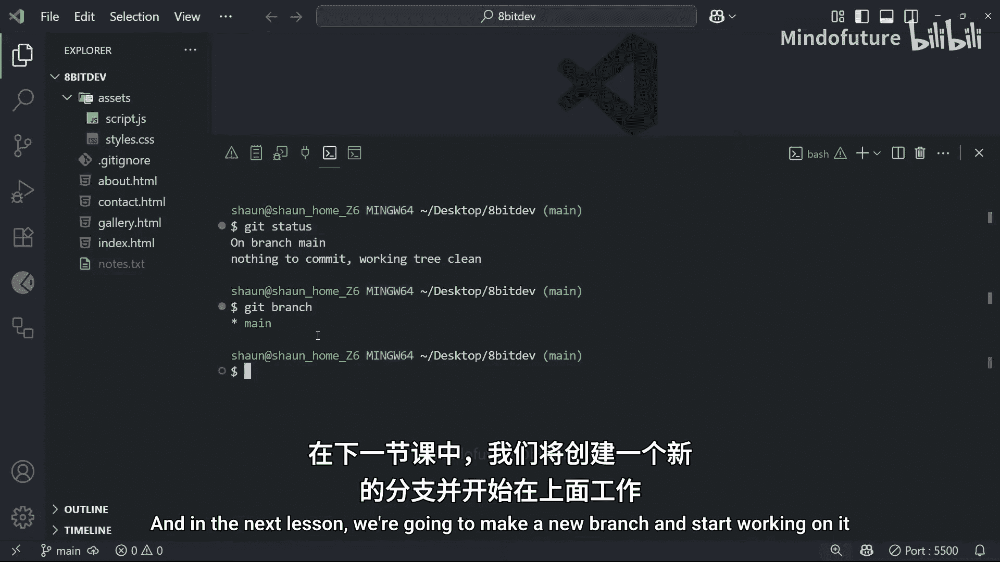

# 【Net-Ninja】Git入门教程-p11-P11_Git_Crash_Course_#11-理解分支--BV1fkvtBcERR_p11-

Or rather gang so far in this course， we've been working with G in what you might call a fairly linear way。

 We make a commit， then some more changes， another commit， then another and so forth。

 It's all very nice in a straight line。 But a lot of the time， that's not how projects go。

 And sometimes we start implementing features and code that don't necessarily work out。

 And when that happens， we often end up with a mess of code that we have to wade through to make things right again。

Now if you have been making commits， then that will make things definitely easier for you because you can just wind back those commits to a point where things were okay however。

 sometimes even that can be a little bit time consuming。

 especially for larger features and projects and it can sometimes lead to your deleting work that you didn't mean to or getting your commit history just a little bit messy。

😊，So for that reason， as well as others， we have something called branches that we can use in Git。

 which as the name suggests， allow us to branch off in different directions within the code。

But what exactly is a branch。 Well， a branching gear is like a label that points to a line of commits in your history。

When we initialize any repo for a project， we always start on the main branch。

 which is where all of our commits have been so far。

 right now sometimes that might be the master branch。

 but these days you'll generally see the default branch called the main branch and this main branch is meant to represent the latest stable version of your project the one you'd typically eventually deploy。

Now， normally， we'd want to keep the main branch history quite clean and contain only commits。

 which we're fairly confident of keeping and which represents some significant progress in the project。

 So imagine now we want to implement some new feature like an email sign up。 Well， technically。

 you could continue on the main branch making commits to implement that feature。 And in total。

 you might make about three or four commits to complete that feature。 And at some point。

 you might realize， well there's a book causing the form to not work correctly。

 So you start trying to fix the book， which you think you do。 and you make another commit for that。

 And then you notice that the styles you made for the form while they're messing up the display of other forms on the website。

 So you start tining around tinkering around with them。😊。

And maybe you even start reverting older style commits to undo the changes。 And before you know it。

 you caught up in a complete tangle of commits， a messy history， trying to patch things up。

 So ideally， when you're working on something new。 most of the time you don't want to be working directly on the main branch。

 And instead， what we can do is ask it to make a new branch to branch away from this main one。

 and then switch to that branch to make the new feature。

 So you can think of this new branch as kind of like a copy of your main branch at this moment in time when you broke off when you make the branch。

 So your commit history and working directory in this branch at this moment。

 I got to be the same as on the main branch at that very moment in time。😊。

But then we can start editing files and making commits on this branch。

 and those changes and commits will only be on this branch。 They won't be added to the main branch。

 So that means now I'm completely free while I'm on this branch to try out new code and test new ideas without it ever affecting my main branch。

 which I know won't be touched。 And as I go， I'm gonna make more commits and make progress with the feature。

 Now， at any point， if I switch back to the main branch。

 then my working directory is gonna change back to what it was at this point in time where we branched out because all those commits on the feature branch didn't get added to the main branch。

 And that means if things ever go south with this new branch。 Well。

 I can just delete it safely get back to this point really easily。

But if I'm making commits on this feature branch and at some point I'm happy with that branch。

 that feature， then what I can do is something called a merge to merge it back into the main branch and when that happens。

 we bring all of those feature commits into the main branch so that now that in the main branch history So this workflow of making a new branch when implemented some new feature is a recommended and standard practice when you're working with kit because if you mess things up。

 it's not affecting your main deployment branch and we only merge it back into the main branch when we're happy with the feature。

 So it adds an extra layer of safety to your codebase and it keeps it cleaner and free of more bugs that might otherwise have accidentally been introduced It's also the de facto approach to development when you're working within a team because each team member can work on a different feature or a different branch individually instead of everyone just making changes in the main branch at once。

😊，Okay， so before we start making new branches， I just want to show you one thing in the terminal。

 So let me use the Gi status command right down here and run it。 And when we do that。

 we can see that right here it says we're on branch main and the working tree is clean so the working tree is clean because we've got note and staged changes in the working directory but importantly。

 notice how it tells us what branch we're currently on main Now for you this might be master if you didn't change the default branch name to main during the installation。

 but the same principle applies。 It's your initial default branch that you start with when you initialize a new repo。

 and normally it's the production branch of your project which you might eventually deploy。

Also you can use another command which is Git branch and when you run that it's going to list all the branches you have in your project Now right now we just have one the main branch and it's green with a little asterisk next to week to signify that we are currently on that branch okay so that's a little bit of theory behind branches out the way now and in the next lesson we're going to make a new branch and start working on it。

