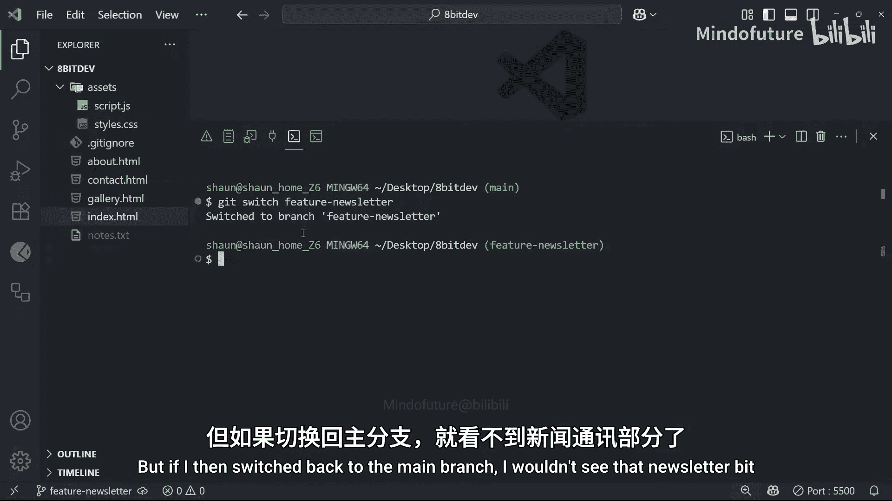
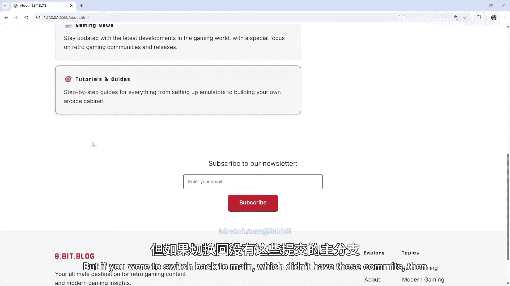
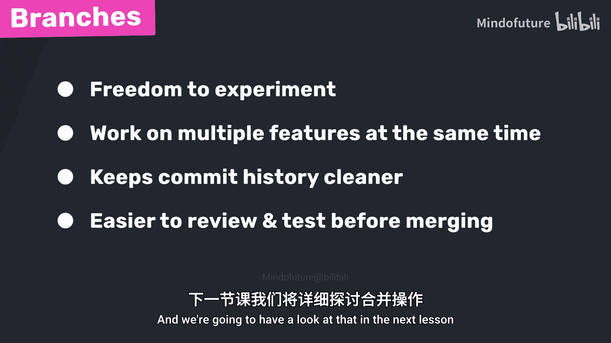

# 【Net-Ninja】Git入门教程-p12-P12_Git_Crash_Course_#12-切换分支--BV1fkvtBcERR_p12-

Okay， then my friends。 So now we've learnedt what branches are and why we might use them。

 let's try make one。 So as we know， we start on the main branch or the master branch。

 if you didn't change that default name during the installation of Git。

 and we can see that by either running Git status or Git branch， which is what I'm going run。

 Now using git branch， the branch we're currently on has a little asterisk next to it like this one。

 And for me it's also green。 So this is the only branch we have right now。

 the main one But now we're gonna to create a new branch to implement some feature or other into the project by using another command。

 which is Git branch again， But this time followed by the name of the branch we want to make。

 So I'm going to call this branch， my new branch， which is a terrible branch name and we will be deleteleting it later。

😊，But right now， I just want to show you the process。 Now， when we hit En。

 that's going to create this new branch for us。 and I can demo this by typing the git branch command again and hitting enter。

 And when we do it this time， we should see that we're still on the main branch。

 but we've also got this other one beneath it now， which we've just created。 Now normally。

 when you make a branch， you want to switch to it to be on that branch right away to start working on it。

 So we can do that by using the command Git switch followed by whatever the branch we want to switch to is called。

 In our case， that's my new branch and then I can hit enter to switch to that branch。

 And now if I run the git branch command again， you should see that I'm no longer on the main branch。

 but I'm on the new one instead， I remember this new branch is like a copy of the code at the point a branching and it contains all of the main branch commit history。

😊，So these two branches aside from them being different branches with different names are like carbon copies of each other at the moment。

 However， if I was now to start making commits on this new branch。

 then it would only get added to this branchs commit history and it wouldn't touch the main one so I could code freely on this branch knowing if I messed up completely it wouldn't have any effect on the working project on the main branch anyway。

 let me switch back to the main branch now by typing Git switch and then the branch name I want to switch to which is main and then hit enter and then we can verify on that branch again by using the Git branch command press and enter and we're going to see the asterisk this time next to main again。

Okay so that's how we can create a new branch and switch to it。

 But a lot of the time when we make a new branch， we want to switch to it right away。

 so rather than creating the branch with one command and then switching to it with another。

 we can do the whole thing in one go and the way we do that is by using the switch command like we just saw。

 but with an added flag to create the branch before we switch to it So let's do this I'm going run the git switch command and then I'm going add this time the C flag which means create this new branch before switching to it and then the branch name which could be something like feature hyphen newsletter which is a slightly better named branch than the one we just made。

😊，So when we run this， it's going to make the branch and then it's going to switch me to it all in one go。

 which is a little bit easier， right？😊，And now if we run the Git branch command to see all the branches we can see the new one we just made with the asterisk next to it because we're now on this branch automatically now sometimes instead of using that switch command you might see people using the checkout command instead to move between branches and you can still do that but the checkout command can be used for many other things as well not just switching branches so Gitin the switch command in version 2。

23 I think to make switching between branches a little more intuitive and simpler so although you can use the checkout command we're going to be sticking with the switch command for this course。

Anyway， now we have three branches in total， the main branch， my new branch。

 and the one we just made called feature hyphen Newstter。And like I said before。

 these two new branches， they're just like copies of the main branch at this moment in time。

 but as soon as we start making commits on them， they're only going to apply to whatever branch we're currently on。

😊，So this is what it looks like so far。 We've got the main branch with these commits in the history and we've got these two new branches which divert away from the main branch and those two new branches just essentially copies of the main branch at the moment that we branched out。

 The working directory is the same on all three of these branches as the main one。

 at least it is for now until we start making changes。 and they contain all the same commit history。

 But now we could start working on one of these new branches。

 making changes to the working directory for that branch and adding commits。

 and those changes and commits would only apply to that branch none of the others。

 And that's when their history is going to become different from one another。

 So let's give this a whirl。😊，So I'm going to run Git branchn again just to make sure we're on the newsletter branch。

 which we can see we are and now I'm going to start making changes to my working directory and adding some commits。

 Now I'm going to speed this coding section up a little bit because like I said before the code in itself that I write and change is not really important The important part is how we use Git to track the changes that we make so let me go ahead and do this now and I will slow it down any time I need to run a git command or just talk about something。

Okay， so I'm just going to add my first commit right now because I've just created the HTML for the newsletter。

 so down here I'm going to say git add then a dot to add it to stage and area。

 then I'm going to write git commit and then M for a message and we'll just say add newsletter。😊。

Htl form and press enter。 Allright， so now I'm going to carry on。

And now I'm going to make a done commit because I've just created the CS for the the newsletter form。

 So let me come down here and say gets。Add and then at to add it to staging， then we'll commit it。

 so get commit。M flag and then say add styles for a newsletter。And press enter。Alright。

 and then finally I've added a link to the About page mentioning the newsletter on the homep page。

 so I just want to commit that as well， so I'm going to say git add to stage this and then I'll say git commit。

The M flag and then say add link to newsletter like so。

Okay then so now I've added all those changes and we've got three commits on this newsletter branch now which we can see by running the Git log command with the one line flag so you can see the latest three commits on top with all the others below it Also remember earlier in the course I mentioned this head thing right here and I said this was like gis way of saying this is where you are you are here and the head is basically a pointer which points to whatever branch you're currently on and when you switch branches you're essentially moving that head pointer from one branch to another so you can see right here that the head is pointing to the newsletter feature branch and down here a few commits back we can see the main and my branch in parentheses next to this commit so this is telling us that we've got branches that have diverged at this point。

And that these two branches are now several commits behind。 Also， if I now switch to the main branch。

 then we won't see these latest commits in the history of that branch when we run a git log command。

 So let me demo that by running the switch command So git switch main and once you've done that we can run the git log command with the one line flag and then you should see that the latest commits we just added to the newsletter branch have gone。

 they're not in the commit history of this branch and the head。

 which is now pointing to the main branch is now on this older commit Also those changes we made to the code and not in the working directory either because we didn't make the changes on this branch。

 They were on the newsletter branch So we'd have to switch back to see them So let's quickly do that and then we're gonna have a quick summary of what's going on andm going run the command Git switch and then the name of the branch which is feature hyphen newsletter and when you run that you're going be back on the feature branch with the upto-d working directory and commit history and。

Very quickly， when you're on a specific branch and you view your project in the browser。

 you should see a live version of the code on that branch。

 so if I were to preview this now in a browser， I should see this newsletter section on the page。

 but if I then switched back to the main branch， I wouldn't see that newsletter bit because it's not been added to the main branch。

😊。

And I thought I'd quickly just demonstrate that while I'm on this newsletter branch。

 So you can see this update on the homep page。 that was one of the changes I made。

 And if a click on this， it goes to the about page。 And at the bottom。

 we have this new styled newsletter section。 So I'm on this feature newsletter branch and that's why I can see this。

 But if you were to switch back to main， which didn't have these commits。

 then we wouldn't be able to view this live in a browser。

 So then what we've seen in this lesson is how to make new branches。

 which branch away from the main default branch of the repo。

 And at the point where those new branches were made。

 they were carbon copies of the main branch it was like having three different copies of the same project at that moment in time。

 And then on this branch， the feature newsletter 1。

 we started editing the code to implement a new feature and we added a few commits as we did that。

 And so now this branch has three extra commits in its history than the other two branches。

 So what we've created here is what's called divergent history。

 If you imagine a tree trunk splitting into different branches。

 the trunk represents the shared history。

And at this point， one branch diverts and contains all these extra commits and continues to grow independently。

So then why is this workflow so useful to us， Because right now。

 we're not really seeing any real benefits from it。 Well， first of all， when you make a new branch。

 it gives you complete freedom to experiment on that branch。 You can try out new features。

 completely messed them up， even delete the branch and your main branch stay perfectly safe。 Second。

 it allows multiple people to work on different features at the same time。

 And this is something we're going to talk about in later chapters when we come to work with Github。

 But in essence， you could work on one feature on one branch and a friend or colleague could make a different branch to work on a different feature at the same time。

 And because you're both working on different branches。 You won't be stepping on each other's toes。

 Third， it keeps your commit history cleaner and more organized。 And finally。

 it makes it much easier to review and test any changes that you make because you can work on one feature at a time on an isolated branch。

 test a feature thoroughly， and then only decide to include it in your main code base when you think it's ready。

😊，And on that note， when you decide to bring the feature back into your main branch。

 we call that emerge and we're going to have a look at that in the next lesson。😊。

