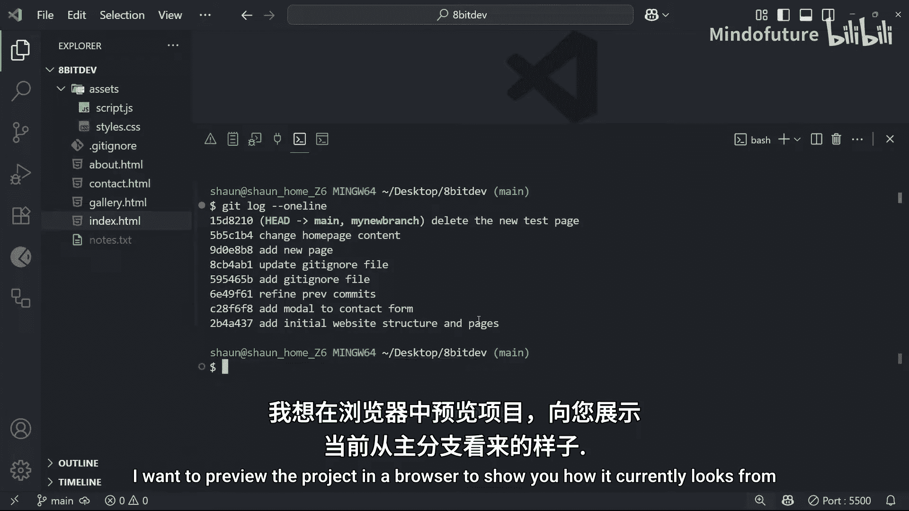
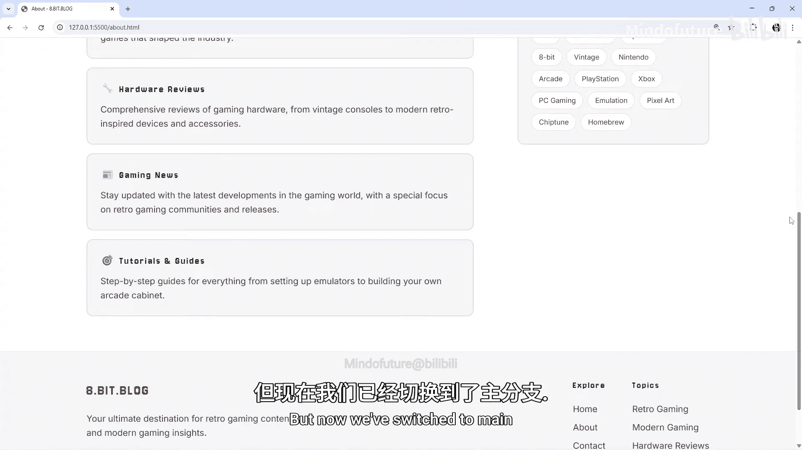
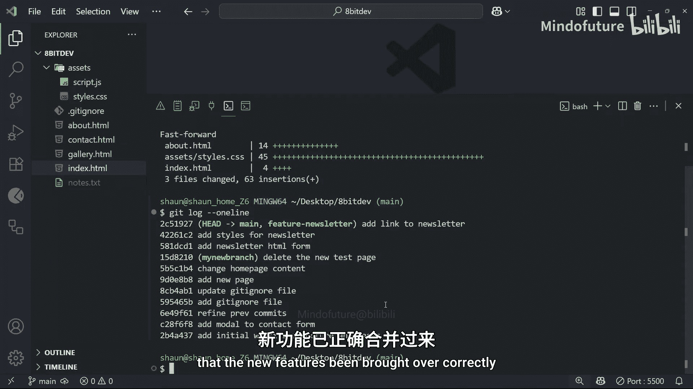
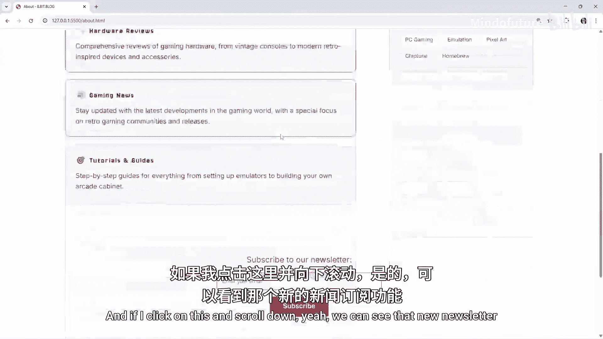
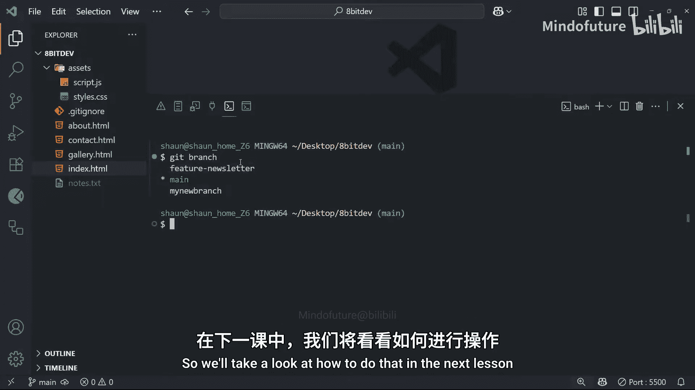

# 【Net-Ninja】Git入门教程-p13-P13_Git_Crash_Course_#13-合并分支--BV1fkvtBcERR_p13-

Or rather than gang so far we've learned how to create branches。

 switch to them and work on them independently， but at some point you're going to want to bring back that work onto the main branch when you're happy with it as a part of your core project because the main branch is meant to represent your main working code base。

 which eventually you would probably deploy。 So this is where merging comes into play。

And merging is basically a gits way of combining the changes from one branch into another。

 So we've been working on the newsletter feature branch for a while and we've made some commits on that branch。

 And imagine now we've got it to the point where we're happy with it。

 it's all been tested and we want to bring it back into the main code code base onto the main branch。

 So at this point we would merge this feature branch back into the main branch。 And when we do this。

 it's going to take all the commits from this feature branch and integrate them onto the main branch。

 So then all the code we added and updated on the feature branch we'll now be present on the main branch as well。

😊，Now there are different types of merges which we'll look at throughout this course。

 but in this example we're going to look at the simplest and most common one。

 the fast forward merge and a fast forwardward merge happens when your target branch usually main hasn't had any work or commits on it since you created the feature branch This is probably the most common scenario when you're working solo and approach it because you won't have other developers making changes to the main branch while you work on your feature so essentially in this scenario we're just fast forwarding the main branch to catch up to where the feature branch currently is okay so let's see this in action。

Okay， so I'm currently on the feature branch and I'm going to run a git log with the one line flag to see all the commits that we made on this branch。

 So you can see in this log the head is currently three commits ahead of where the main branch is and these are the commits we made on this feature branch。

 Now， if we switch back to the main branch by running Git switch and follow that with the name of the branch made that we want to switch to and then run another log using the one line flag。

We are going to see a few less commits because those latest commits were only made on the feature branch Okay。

 so then before we actually make this merge and bring those commits over to mainine。

 I want to preview the project in a browser to show you how it currently looks from the main branch。

😊。

Okay， so I'm on the homep page and we can't see the link to the newsletter and if we go to about and scroll down。

😊，Well， we can't see the newsletter form either。 So if you remember back to the last lesson。

 I showed you that when we were on the feature branch， we could see that。

 But now we've switched to Maine while it's no longer there。

Okay， so now we want to take the feature branch and we want to merge it into the main branch so that we get all that feature code and the same commits on this main branch。

 Now， to do that， we need to run the merge command。

 which is just git merge followedll by the name of the branch。 we want to merge into this main one。

 and importantly， we need to be on the main branch when we run this command because this command basically tells Gi to merge another branch into the one we're currently on。

 So。We want to merge the feature hyphen newsletter branch into main which we're on。

 And then if we hit enter， it's going to take the feature branch and all its commits and it's going to merge it into this main branch。

 and in this case， it's going to be a fast forward merge because in essence。

 the main branch is just fast forwarding to catch up to the feature branch by implementing all of the feature branch commits in order。

So then。Now we've merged that feature branch into main。

 and if we now run Git log with the one line flag， we should see all of those same commits on this main branch now。

 which we do awesome。You can also see in parentheses that these two branches。

 main and the feature one are both pointing to the same most recent commit now。

 whereas before the main branch pointed to a much earlier commit。

 So then now we've merged the feature branch into main。

 Let's just have a little text in the browser to make sure that the new features has been brought over correctly。

 Okay and now on the home page we can see this right here and if a click on this and scroll down。

 Yeah， we can see that new newsletter feature。

So then that's the basics of merging and we'll be looking at more examples as we go on first though。

 I just want to run the Gi branch command to list out all the current branches and when I do that you can see that we've still got the feature branch hanging around。

 So even though we've merged the branch into mainine it still exists Now a good workflow when you're using branches in Gi is to clean up a little bit by deleting any feature branches once you've either merged them or you don't need them anymore so we'll take a look at how to do that in the next lesson。

😊。

