# 【Nvidia】CUDA并行编程-｜-Cuda-Programming-Course-｜-Parallel-Computing-Using-Nvidia-p01-P01_L1_NVIDIA_CUDA中的HelloWorld程序写法--BV1MSq1BTEho_p1-

In this lecture we are actually going to see QUDa programs so typically for today's lecture well be seeing looking into the various so we well first look into Ho program and well also see its different different variations。

At the end， we'll also see， I mean， we'll also see how how actually we can execute the Qa program with multiple number of threads and。

How can we allocate memory on GPU and all those stuff。

 so that's a quite a brief outline for today's course today's lecture。And yeah。

 so with this let's get started and yeah as I tell in each and every lecture， if you have any doubts。

 please feel free to ask during lecture or after lecture。Or at the end of the lecture。

Or you can also post them on Google though any of the way is， I mean， the way you are convenient。啊。

So。Yeah， so let's get started， so agenda for next three classes will is going to be computation。

So in this， as I probably told in previous lecture also we'll be seeing various small codes。

 quoA codes， well also see how the data transfer occurs between CPU and GPU and。

We'll look into the thread hierarchy we'll see what is what is threadbs and all those things so that's going to be the agenda for our next three lectures which is also known as computational aspects of GPU or QUa then we'll see memory synchronization memory I mean in memory we'll see different like different hierarchies in GPU memory and we'll see what is different different types of memories like how can you use the GPU cache and shared memory and all those stuff we'll also see what's co and all those things。

A。Okay， and then we'll look at no synchronization， so how threads how different when we have multiple number of threads running concurrently at the same time and how what synchronization issues we face and like data races and all those and how do we handle them？

Which we'll see later， then we'll see function， supports and topics but。So for today's。

A lecture will going to。See， I mean， look into the computation aspect and yeah。

 so let's get started with it。啊。This is the typical very simple allow program， which is written in C。

 there is nothing related to。Gは quoda inです。And as we know the output of this program is hello world if we run producing a Gcc compiler。

 so if we type Gcc hello world。 hello world。c， assuming that hello world。

c is the name of that C program and we run dot slashierL。And we'll see hello on our screen。啊。Yeah。

 so that's it and。So one thing to note here is that okay now we want to run this using not GCC but NVCC compiler。

 which is the QUa compiler。So we run this using NVCC hellello dotcu and we do dot slash share do。

And one thing you will notice is that this program will run fine and will also give the correct result as it does with Gcc。

So the point to observe here is that GCC is， I mean， the quotes that you will be able to run the GCC。

 you will also be able to run the NVCC。And yeah， so that's like， I mean， NVCC。

 you will be able to see run C as well as in C plus quoa programs。And yeah， that's fine。

 but as I told， there is nothing related。GPU here or we are not at all using， I mean。

 not at all doing parallel computing but anything related to the GPU in this code。So。

 I mean this is not good， I mean we are not doing JP programming at all。

 so we would like to move on and see the GPU hell。So how a typical GPU hello program would look like。

 so this is what it looks like。So here we would observe many similarities。

 but there are three key differences。First is the header file that you will see hash include coa or touch。

which is the headerle that you need to include each time when you want to write I mean when you want to write the Qa code and I mean。

 it will contain the necessary functions for the I mean co related functions and all those things。

And so that's the first thing second key thing here is that you need to include underscore underscore global underscore underscore in front of the function。

Which is also， I mean， which is declared， I mean， it's named as the kernel。

 So what this underscore underscore underscore global underscore underscore tells you that。

This function void， I mean， which is named as D kernel， is not a normal function。 It is a GPU kernel。

So what is GP kernel GPU kernel is a function which is executed on GPU， It' is not a normal function。

 it will be executed on GPU。And yeah I mean this word will differentiate it from the normal function and rest things you can see that those are same CPU or C function that particular there is a return type then there is id which is the name of the function and then there is this process in which you can specify the parameters to the function call。

And then cur brace begins and then you write the body of the function and so on。

 But the key thing is this global keyword which differentiates it from it from the normal CPU function and it tells compiler or NVCC compiler that it's a。

GPpU function or the cardal， which will execute on GPU。So that is the second difference。

 the third thing that you should observe is the call to the kernelel or the GPu function。

Which is also。Much similar to the normal function called in C。

But the typical difference that you will see here is that there is this triple less than an triple less than than one comma one than triple greater than。

In between this， so this is the name of the function that we want to call。

Then the argument list is as it is here， we will specify arguments if any。

 which will be passed to the GPU function。This thing。

 this triple less than one comm of1 enpy cur And this tells CPUu that。

I want to launch this kernel or this GP function with one into one thread。

 which is single thread and yeah it will launch I mean。

 it will launch the kernel with just one thread。啊。Okay， so moving on。So as I told。

 this part is known as Cardinel， which is executed on GP。And this is called a kernel launch， and。

With how many threads it has launched， it depends upon these two parameters。InIn this case。

 one comma one states that we are launching one into one thread。Okay， so okay。

 I'll stop here for a moment and see if there are any questions。Basic question。

Come back to slide second。

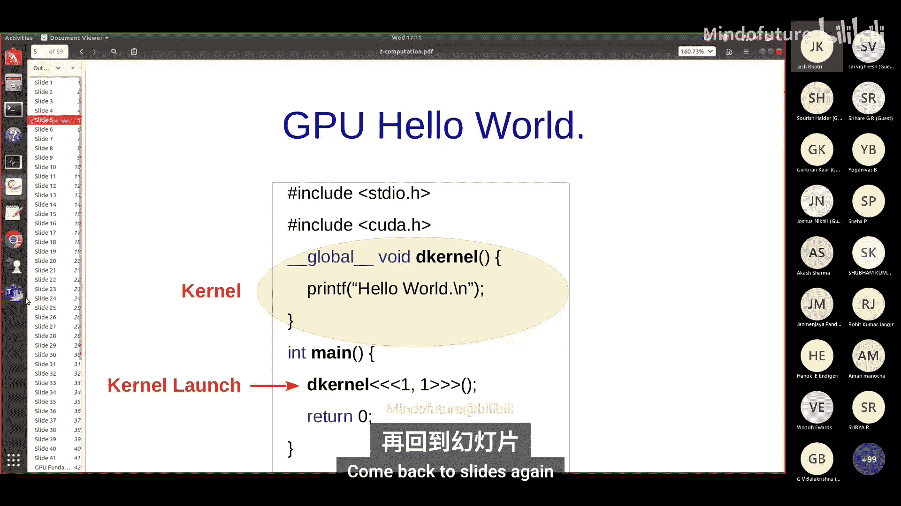

Okay attendance think I already。You don't need to present and all those things I'll make sorry。

 this team already takes care。I think someone is， I mean， why is this coming from someone？

If everyone can mute， it will be。Okay， someone is saying that。I cannot， I mean。

 I cannot able to see the screen where， I mean， was everybody able to see my screen or。系咯。CanYes。

 sir。Yeah， okay。 thank of you。 I think。Why is one comma1 for one third。Yes， actually。

 I'm not able to see the meeting chat in my group。 Can you please help me in this。生明就是。Sorry。😔。

In here， I cant see the chat。Yes， I'm not able to see the chat here。Okay， but chat must be I minute。

Nothing private。 I mean， it's open to everyone。 Is that something， I mean， actually。

 I think I'm not adding in this group so that I'm。Facing this problem。

 I guess in meeting group I think I'm not adding。Actually， there is no need I mean。

 I have I haven't added anyone actually I have kept this meeting sort of open to everyone and yeah so。

So you see mobile means look at the top right， that's be a banner with the name of the post and that should be up there。

Sorry， or can you repeat。Hello， it's， the chat would be in the top banner we have test 15 and well be next to the course name。

😊，Yeah， I guess actually I'm using the laptop， but I didn't see any of these options。Yeah。

 I know it's bottom or top of the mobile lo laptop。

 but I didn't get it should be beside the reason option， but there is no chat option right there。

That's， that's strange， because。I don't think that I mean， at least from mind。

 I haven't disabled anything so。It might be some issue with teams or something， I guess， but。咩比赛。

Yeah， because if everyone， I mean， most of the people are able to see then at least， I mean。

 it's not like something which is disabled from mind。But okay， I'll look into it after the lecture。

Because right we are running out of time。 and need cover lot of content。 That's why I'm telling。

 Okay， right thank you。ok啊。Why is one comma 1 for one thread Yeah， because。

One comma one means we are launching kernel with one into one thread。

 think of it like there are there are there is one class inside which there is one student so one into one I mean。

left one denotes the class number of class and right one denotes the number of students in this way here left one denotes some block and right one denotes the number of threads in that block。

 so one into one thread。What do the first one and second one signifies I already explained in the previous question so what is NVCC NVCC is the compiler for compiling the Qa programs hellello sir how do how to add number of GP in K。

Number of GPSus and kernel call。Actually， I mean， this is quite an advanced thing。 I mean。

 we will talk about how to deal with multiple GP。 But for now， let's focus on one GPpU and。In fact。

 we need to first of all， look， how can we？小的。2 parameters。Yeah， I mean。

 you can pass the parameters in that function itself we'll see later I mean。

 I have an example for that。So don't worry about it。 I think you can reload the page。

Pres third button for it。 O， O。What is kernelnal kernelnal is something which is I mean it's like a normal function but think of it as a GPU function I mean。

 something that is executed on GPU function that is executed on GPU。

Can you explain a little more about NVC and GC。Yeah I have one question regarding to this。

 actually the thing that you applied in C language can be applied any of language means that you applied in kernel that after that kernel function means any of the language。

 the same process will be held。Okay， so you are asking。

 like can we declare cardinal same way in different languages as we didn't see？I guess you get。Sorry。

 yeah， correct ahead。Yeah means just suppose if I say that in Python can we apply the same thing that we applied in the C language which means today I understood yeah I understood like actually for Python I think you will need a different compiler and VCC is C plus quoa think of it like that。

But for Python， I think compiler is different and you need to look for it。啊。So yeah。

 but I don't think that same thing you can apply for Python also。It will be slightly different。

Is what I think because the compiler won be the same。Ser where can we practice quoa don't worry。

 I mean， we have a lot of courses here。 and just in case you need practice question I can also give you later。

啊。So for Qa programming which software here have could download NVCC， I mean。

 that's the quoa compiler。And is it necessary for GP function to have name D kernel or we can any okay yeah so yeah so D kernel is just an identifier。

 you can give any name， you can also give your name to that kernel it won't affect as long as you are adding that underscore underscore underscore underscore global underscore underscore。

It the name won't matter it can be deco or something else。

 so yeah this is a very important point and yeah please note please keep note of that。That I mean。

 name of the function is not important， you can change the name。But yeah， that global is important。

That specifies that it's a ean。Okay， so， yeah。Yes are we going to learn P could also。

As I told in previous lecture， we won't be learning pi kuda。

 we will be learning the C I mean C real C plus ka。But you can。

Explore it in your own time and concepts wise both of things will， I mean。

 both the things will be seen。But yeah， the synax wise， it will be different。啊。And yeah。

 so for this course it will be NVCC， which is very much similar to C and yeah Python is quite coming compiler is different。

We won't be covering that in this course， Okay thank you。对。Yeah，我。Yeah， I doubt。

Can I know why we have to inculcate a different function。

 a white function for declaring the kernel and then the kernel lawn separately。

 Why don't we bring it all together mean。😊，Okay， okay， so like。

In order to execute something on GPU I mean。You need to tell that， okay。

 this is the portion which is being executed by GPU。I mean， to the CP， I mean。

 CPU is the essentially the one who will be offloading that function to the GP。

And in order to do that， you need a very clean way to do。

 and it seems like writing a function and marking it using global。

It's a very modular way of doing it， and hence we are doing it。Okay so。 thank you so much。Oケ。Okay。

 I will come back to questions after it or probably is it necessary for GPU to have I took that question。

 what is the function doing there？It's a GPU kernel。 okay we'll learn more about it， but yeah。Sir。

你还真。😊，DBU经确定DBU的啊。😊，G and you like up is like a software using to execute Yeah。

 what is the software using？Its I mean， it's NVCC compiler。

 you can download that compiler I didn't understood the question。

You are compiling this code using NVCC compiler。谁ir。Okay， ya go。Sir。

 how many threads are available in in is。Okay， that depends upon the GPU。 and in fact， we can launch。

I mean， millions of threads， but yeah I will come to it that。

The limit which we can launch the kernel is actually very high。But in incoming lectures， we'll see。

But please don't worry about it right now。 So， yeah。That， I was say right。Yeah。

 so switching back to slides。Because I want to cover a lot of things， so。Yeah。

嗯啊。Okay。So yeah， we saw this now。When we compile this code with， I mean。

 code using NVCC hello do co CO and。Run dot slash your do out， this is something strange。

We won't be able to get any output。So this is quite strange and you would like to know why is it happening？

And the reason is this that when， okay， so let's understand what is happening here。

So CPUU starts executing from mean。It sees that there is this instruction， which is a kernel call。

 so it launches the kernel call and it moves ahead。And。Okay。

 so it launches the kernelner and Mo heart and the GPU so that kernel is being executed on the GPU and CPUU is executing the next instruction and it doesn't wait for GPU to print the helllo what I mean GP buffer to be dumped back to the CPU buffer and print the hellloer。

And in the En to this， you might see that hello world from G2 is not printed on this CPU。And yeah。

 so the CPU is not waiting for the GP， both are executing asynchronously。And due to this。

It happens in many cases if you are lucky you will see the hello hello world， but in many cases。

 it might happen that we won't even print the hello world。And the program would turn minute。So。

 to avoid this issue we have this function quoa device synchronize。

 which essentially tells the CPU that please wait until the kernel execution is finished or I mean。

 so what will happen in this case is now kernel will be launched by CPU。

It will move on and it will wait for Qa device synchronize here。In this at this statement。

And it will I mean it will wait for all the GP threads to finish and once the buffer is done back GPU buffer is dump back to CPU the things will be printed and then the next instruction will be executed which is written zero and then the。

I mean， then the execution will， the execution of mailway finish。So yeah。

 so if you take this program and compile it using NVCC and then run it it out。

 you'll be able to see the hello。Which is the correct for this group。And yeah。

 so the key takeaway here is that CPU and GP executes asynchronously， they run asynchronously。And。

In some sense， CPU needs to wait for the GP kernel to finish and for that we need the good database implement。

W which is essentially tells the CPU to wait until all the CPU threats are completed。Okay， so， okay。

 so before moving on。

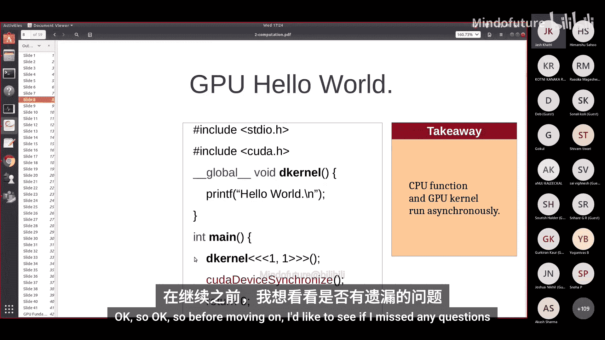

I'd like to see if I missed any questions。哦。Also， is it compulsory global underscorecorence。

We use global inter。 Yeah， so void and。I guess。I think you need to declare it with void only you can't return value from G。

 but I need to check it。 I'm not 100% sure about this。Okay， I'll take this question for offline。

And we'll post it or let you know by some email or something。啊。So next question is。

Do we have to always call the kernel with onecom one thread。No。

 I mean you can call the kernel with any number of threads one common one is telling that you need to I mean you are essentially launching it what one thread。

 but you can launch it with many threads we'll see examples ahead。Yeah， there is some echo， actually。

 I request everyone to mute unless you want to ask some question。

So how can we practice alongside any online IT or some setup needed or earth？Okay， you can use。

 as I told in previous lecture， you can use Google Collab or you can also use the GP that's on your。

Local machine， or you can use our competing facility available on our institute。

But the thing is you need to install NVCC。Otherwise， you won't be able to run the code code。

At least those we are discussing in this lecture。Sur why CPU and GPU runs very synchronously so this is a good question since CPU and GP are different devices so there is no synchronization between them so CPU runs the I mean executes the instruction and it offs the chunk of computation which has to be done on GPU and then it goes ahead so it does not like CPU and GPU have some I mean they are not same device essentially so computation is independent and that's why they are executing asynchronous。

Yeah， I hope that answers your question。So can we create multiple GPU functions Yes sure。

 I mean probably next slide we will be seeing I mean。Not next slide。

 but yeah in this lecture only we willll see like multiple GPU functions。

And call them at various instances in the main year， you can completely do that。And doing so。

 do we have symptoms。Ks have synchronized them every time we call a new GPU function。Yeah。

 this is a very good question we'll take this up in I mean in this lecture only we'll see a couple of examples which will answer these questions。

Okay， this demo lecture that you are talking about is already there。

 probably I'll share the link to this demo lecture for Google Colab。

You can go through that and let me know if you have any questions。

Mostly you'll be able to learn everything from that video。So yeah。

 I don't think that there will be an issue for using the Google Coab at least。O。Okay。

 so I'll move on， okay， unless there is a question。Will this work with。Any hardware。

 my laptop doesn't have dedicated graphic card and uses in。No， no， for this course。

 you will need to have the NVDA GPU。Intelographic card won't work so yeah and V GPP is must for this course。

Okay， so moving on。

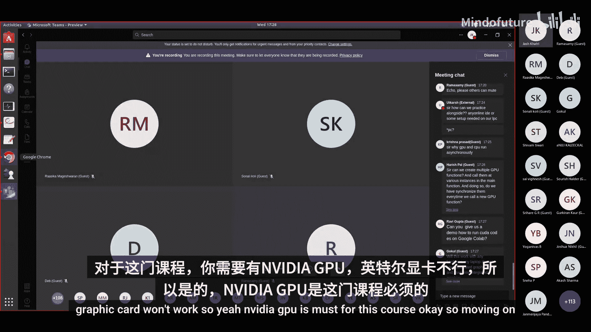

Sing。嗯。Okay， so now。Let's， I mean， we have have twisted this Hallo program a bit。

And let us see what what will be the output of this program and okay let's consider this program and I want each and every I mean each and every one of you to think。

What is the possible output of this program。And Ill wait here for a few seconds and I request you to try this out and post your answer in chat。

Okay， I am assuming that。

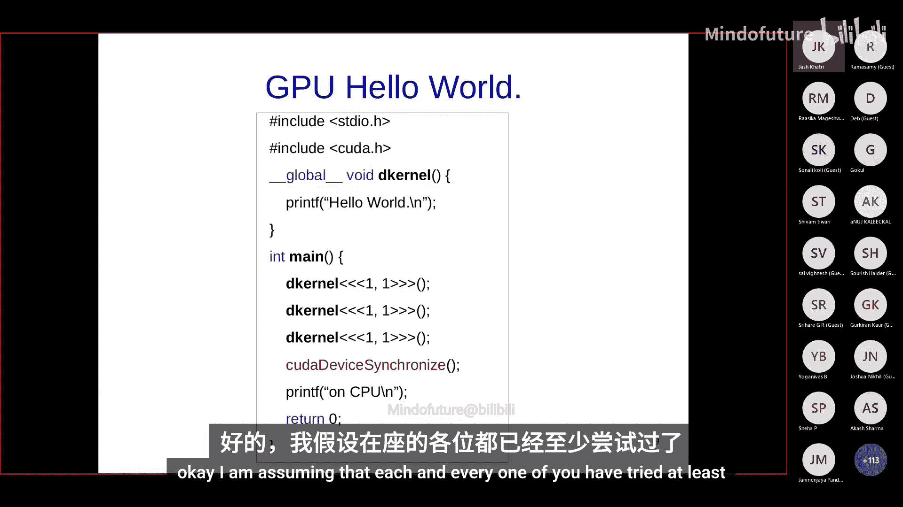

Each and every one of you have tried at least。呃。Can we have some answers here。嗯。

Three times salivoid will get printed。O。Hello， one。Pin statement within the kernel they execute。

Trice， okay， Ex twice。6， hello world。67。Three times hell and then on。Three times hell。

Three times then next line， I'll see。O。Okay， good， I mean， your people are trying that's good。Okay。

 so I'll switch back to slides and I request everyone to try。But okay。

 I'll switch to the explanation of that part。

Okay， so we have three kernel calls and so let's see how the execution what is the execution flow for this program？

So CPU will begin with pain and it it will launch the de， I mean， first cardal。

 which is it will call the kernelal first thing。Ising this call function call。 And with one thread。

 it will execute so。And then CPU will go on， then it will it will launch the second kernel。

 then third， third kernel call。And so on， and then it will wait for， I mean。

 then it will wait for Qa device synchronized here。And okay， so when until until and。

 all these current calls are finished finished CPU weight here。

So you should typically be able to see helloal helloal helloal printed three times and then as all the corner calls have finished its execution。

Cpu will move ahead and it will then print on CPU。And then return zero will be executed and then we are at the end of the program。

CPu is finished at execution of the code so typical answer I mean。

 so you will see a very deterministic answer for this code which is three times hell and then on CPU。

Okay， so one key thing here to ourselves that。At CdS， I mean， if you will wait a CS。

until each and every cu call has finished， so it will never happen that on CPU will be printed before any of the hellello world。

 so that is one point that you should note。And the second point that I would like to emphasize here is that。

There is something called as， I mean， each and every cardal call will execute serially one after the another。

Because there is something called as a Q or stream inside which each and every kernel goes。

 So let me explain with example this example。So CPU will launch， I mean launch this kernel。

 meaning it will load this kernel into some something known as Q。Then it will move on。

 then it will load again this command into the queue so and so on。 and so what will happen is。

Q is a5 data structure， so the kernel which is loaded first into the queue will be executed first by the GP。

And so on。 and then the second kernel and then the third kernel。

So the order of the execution of this three kernel is also。One after the another。

 So this kernel will be executed first by GP， then this second and then this third。啊， so呃。

key takeaway from this slide is kernel biodequ so please remember biode we can change this but biode they are executed one after the another and we will see how to change this in the couple of later lectures。

And the second point that I already told you that CPU launches all these three kernels and then it moves ahead and it waits at goodynchronise。

And it will wait here till all the kernels are finished。

 so as I told onC will never get printed before this3 hell over。So the answer is very deterministic。

 three hair levelss followed by once。If you have any doubt on this， then I can take it on chat。

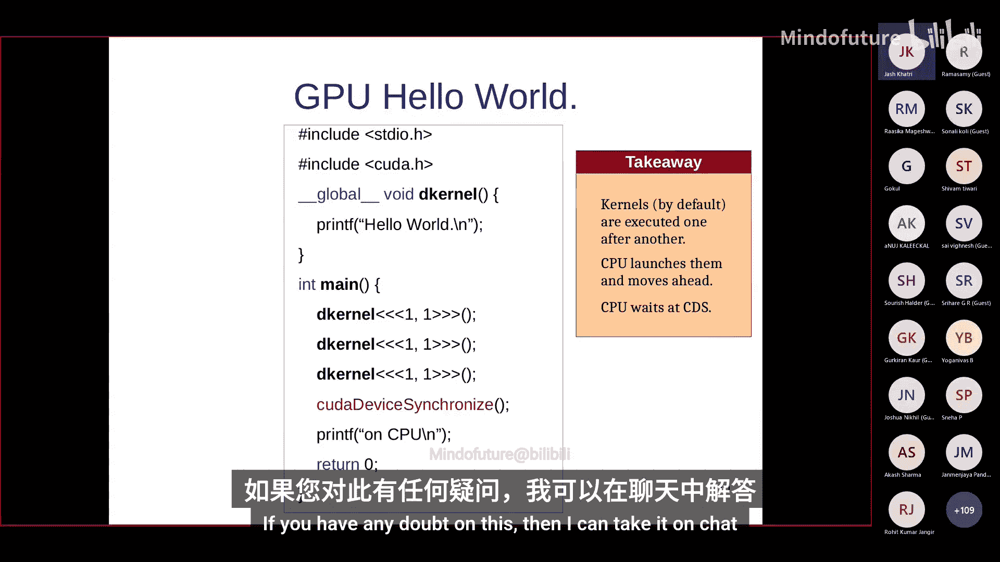

Okay， I guess everyone， and everyone is。Wanting it correctly， three times hello world and on CPU。

 yes correct。S， can you explain the function of？Could our device synchronize yeah so it's essentially like some sort of a barrier so it it it tells CPU to wait until all the GP threads have finished all the threads GP threads all all the kernel calls before it have finished。

So what is CDS CDS is quoa device synchronized， it's a abbreviation for Qa device synchronized CDS。

So what will be the output without CS， Nice question。

Actually we saw that it it might happen that there might be no output as we saw in our first helloable program that CPU moves on and it doesnt wait for printing to happen。

But I will see some of the variations and probably you might get better right of it。 Can you explain。

1 comm1 again。 What does the first and second wonder present。Okay。

 so first one represents the number of blocks。And second one represents the number of threads inside each block there is something called a block inside I mean its a。

The H GP threads are arranged ticket there to like there are blocks。And inside the each block。

 there are a couple of， I mean， there are some number of threats。

So let's say if you are writing one comma 10， then there is one block with 10 threads in that block。

So yeah， so I think next question is one comment， well do we get 12 output from 123 year that is correct。

 we'll see that。I will get 12 outputs， I mean 12 threads will print the same thing， yeah。

And this this quoda kernel is just instruction， So can we have a written value as we。

As we have in expressions。I didn't understand are this quoa kernel just instruction or we can have written values as we have in expressions Yeah。

 so return value I'm not sure of I haven't seen at least in I mean。

 as far as my experience is concerned I haven't seen any kernelnal returning or values。

But I need to check that out and I'll get back to you with it。

 I think someone else saw asked the same question， like， can we return the value from the economy。

So as of now， I am uncertain about that and I'll get back to。Mostly answer is no。

 but I'll let you know。Okay， I guess。I'm going the questions， I'll get back to the slides。

And yeah， let's move on with some other variations of the hello。

So this is the next program that we would like to study。And in this program。

 as you can see that there are two kernels。Again， we are launching just a kernel with just one thread。

And but this time we are printing， I mean， we have two separate kernels and we are printing hello World1 and hello World2。

And we would like to know what is the output of this program？

So I would like each and every one of you to try out， I mean。

 what can be the output and post your answers in the chat。

I'll wait for a couple of seconds here before I move on to the next question。Our next slide sorry。

系冇法嗰啲。啊 jack to see what you要得。Right。

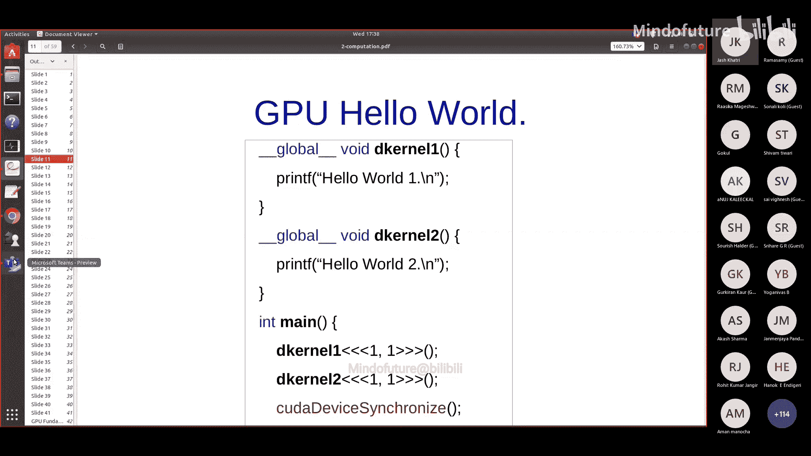

系老位嚟玩系咯位好黄。系lo系都好。Hello， world one， hello world2 on CPU that。Both hello world will be printed on CPU。

哦。Okay， hello World1， hello world2 on CPU。嗯。O。ok 啊。This is actually good。 I mean。

 you people are at least trying away。明啊。啊。Yeah， source code。Yeah sorry go ahead。

Can you please explain against CP and GPA concept， actually I was unable to attend a previous class so that I'm not getting the things。

Okay， so actually。Okay， let me put it in this way like GPU is a separate device and as I explained in this class itself that in order to run anything on GPU。

You need to add that global keyword， which marks that this function is a GP view function。And on GPU。

 you will be typically able to run the function using multiple number of threads。

 so thread is a think of it as a worker。And that function that we saw that global。

 which was marked with that global， it will be run with the multiple number of threads。

And you will be able to do the same， that same， I mean。

 the instruction that are written in that function using multiple number of threats and we'll see how we can get benefit out of it in terms of performance。

And it's okay if you miss if you have missed the previous class。

 I think you'll be able to understand most most of the。

Today's lecture without most of the parts of today's lecture without。啊。

Understanding the previous knowledge of its previous lecture。

Just in case you have any doubt apart from this， then you can ask。어겠어요。ok 啊。没听。Yeah， I'll okay。

 I'll place， I mean， I'll add this quotes。啊。Yeah， quote， but I'll probably add in that sheet only。

And apart from that。Yeah， I guess most of you have tried， most of you are also correct。

One don't need GPp1 PC as we can work on coab rights or yes， yes， that's completely fine。 I mean。

 if you are able to run it on coab you don't need to have。Keepep you on， I mean。

 on your personal machine。

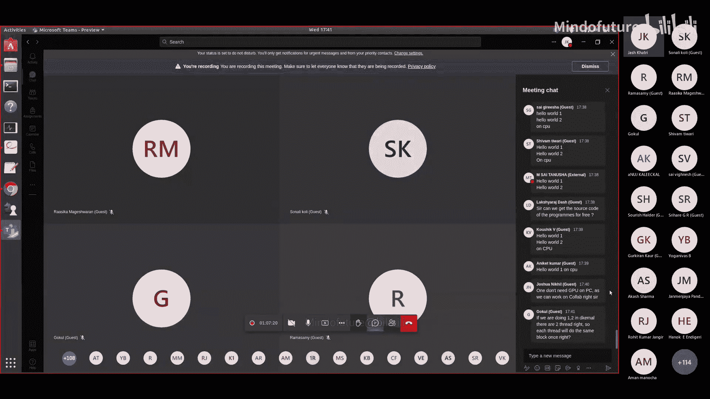

Okay， so I'm switching back to the。Sldes。So let's try to understand this。as we were I mean。

 as we are aware， like GPU will start from the main and it will launch the kernel one。

That kernel one will go into the the default stream or the default queue。

So the kernel1 will be loaded first in the queue kernel 2 will then be loaded because if you will go ahead。

 it will not wait for the GPU to complete its execution。

So kernel 1 will be loaded first in that queue and kernel 2 will be loaded in that cube。

And then she where that quoda I synchronize。For both the kernels to finish。And so like now。

 as the kernels are executed in five4 since they are pushed in queue。

So kernel1 will be executed first and it will print hello world 1 and and please remember that this is happening on GPU。

 whatever is written， I mean， whatever functions are marked with global are executed on GPU。

So actually， this function is somewhat loaded in GPU and then it is like executed by the GPU。

In the same way for the kernelal to also， there is nothing related when， I mean。

 from execution point of view， this is completely happening on GP。

 there is nothing related to CPU happening while executing this kernel。Saly for this current。

 so hello world 1 and hello world2 will be printed on GPu。

And then as the both kernel calls are finished， I mean， execution of both the kernels is finished。

Cpu will move ahead I mean it was blocked here at CS couldar device synchronize waiting for both the kernels so it will okay so both the kernels have finished hello and then and hello world 1 and hello world2 have imprint。

It will move on and then on CPU will be printed by the CPU because here at the mean。

 everything is being done by the CPU。啊。So this part is completely， I mean。

 this instructions that are written in mean are completely executed of ICP。So， this。

Keep a note of that。 So on printer on CPU is done by CPU un printed file CPU。

And then we return and the execution finishes， so the output is helloal1。

 helloal2 followed by on CPU。And the output is deterministic， please give note of it， I mean。

 it will never happen that hello world 2 will be printed before hello world 1。

Because three kernels are loaded into the default stream or queue。And the execution is， I mean。

 the way these kernel are taken for execution by GPO from this stream is in P forward order。

So first kernel will be taken will be executeded then second kernel。

 so hello world one will always come first and then hello world。And since we have the CS also。

 on CPU will also be printed later。It will never happen that output can be something else apart from hello world1。

 hello world2 and on CPU。Okay， so I think we are good with this this version of hellow。

 Now let's try this another version of hell。In this case， Ive just made a small change。

 I've just swapped this tool line， this printer and this quo deviceynch。

 as you can see from previous slide， there is this change。And I want two people to try out this code。

 what will be the output for this code。Let us try and let's post your answers in the chat and let's I mean。

 see how and let's understand like how how is it working？So I'll wait for few seconds here before I。

 I move on。I would like to see answers from you。So the program。

 but will be will be right on an quota compiler， right。We have to download it。Yes。

 you need to download and VCC compiler。But I'm using the intel laptop here。 So is it。

A gone in this type of thing。Is there any issue regarding to this。Okay。

 so with Intel it will not work unless you have NviDdia GPU。

 so inside your laptop if there is an NviDdia GPU， you will be able to run it。ok， thank you。Hello。

If you have N GPP， you will be able to run。In case you don't have NviDdia GPp， then also it's fine。

 you you can run your code on something known as Google Colab。Which is free。 I mean。

 free platform by Google。For I mean， it provides free GPU time。You can try that out。

So we have to change the means in setting， we have to change the GP system right。

 we have to change in the setting。You are talking about co if we will use it in column。Yes。

 yes you need to change the run time to GPU instead of。So can we run program in Kaal also。

I'm not sure about it， but if anyone you of you have tried and it's working， you can。I mean。

 I'm really not sure about whether Kagggel supports it or。

If anyone have tried then you can post it like what was your？Experience with that。I'm really not I。

 I haven tried with Kevinvin。Okay， I guess。

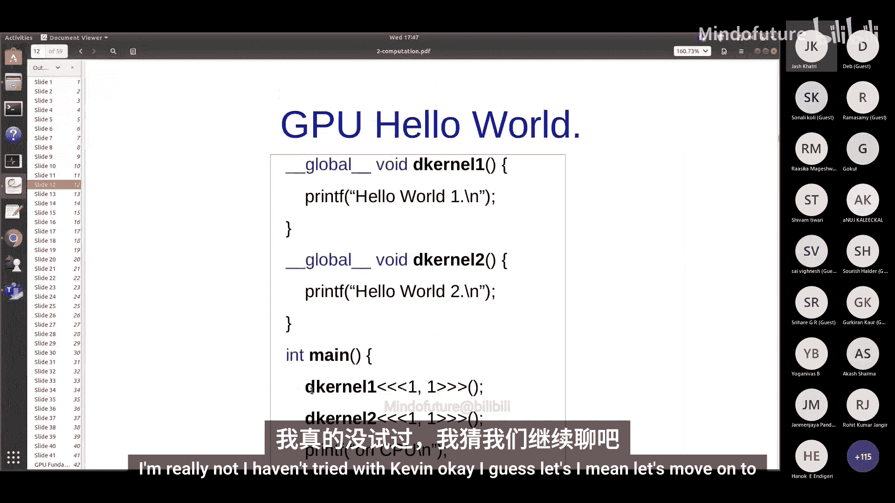

あ系。Let's， I mean， let's move on to chat and see what was your response。Yeah。Okay。Hello to。

 hellello everyone， and hello。不知道几工作。On CPU hello world 1， hello world 2。On CPU， then hello world1。

 then hello world2。Once see you， hello， everyone。 hello with you， O。

I guess you people are going in the right direction。I mean， CPU will be printed on。截表。

Synchronization might not be feasible for executing both in sequential order。On CPU。Hello everyone。

 hellello。好嘅。Okay， let's try understanding this code。

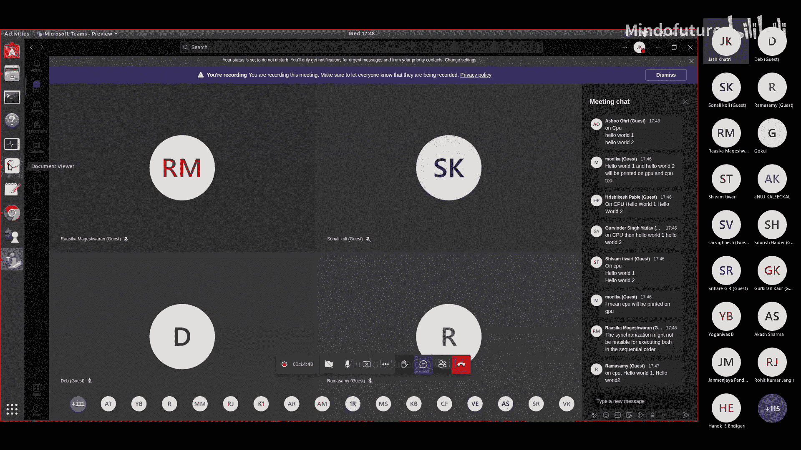

Let's get back the slides。Okay， so again， like say you will begin execution from May。

 it will launch D kernel  one， D kernel2。Both this kernel will go in some Q。

 which is default Q in5 order。So。D kernel 1 will be there。 Then the kernel 2 will be there。

Then CPU will move on， and it will print on CPU。So so in this case。

 the answer can be non deterministic if you see， because CPU is not waiting before， I mean。

 CPU is not waiting for kernels to finish。It will print on CPU。It might print on CPU， okay。

 it might print on CPU。Before hello World1 and hello world2 are printed by GP。

 it might also happen that if GPU finishes， I mean， GPPU kernel execution finishes before。

Then in that case， hello world1 and hello world 2 might also be printed before， I mean。

 before the on CPU is printed。And it might also happen that hello world 2 is hello world 1 is printed。

 10 on CPU is printed， and then hell hello world2 is printed。

So any of this three order is possible on CPU， then hello over1， then hello12。And like second。

 that's the first one。Second case is， hello World 1， then on， then hello World2。

 and the third case is hello World1， hello World2 and then on and then on。

So these three cases are possible。Because CPU and GPp are executing asronously and again one point that I will reiterateite here is that it will never happen that hello world2 is printed before hellowell helloL1 because of that default stream or Q。

Which we have on I， which is maintained between CPU and GPU。And。

Second thing is it will never happen that hello World 1 and hello world2 are never printed because we have this sca device synchronized。

So CPUP will at least wait for both these kernels to finish。

It will not happen that it will finish execution and it will not I mean wait for profit printing and all those things。

 so it will never happen that this hello World1 and hello world2 will not be print。

So they will be printed and three possible answers of this， I mean。

 three possible orders that are possible。Are the one that I earlier told him。And， yes。

 that's the output of this program。So I hope that any one of you I mean。

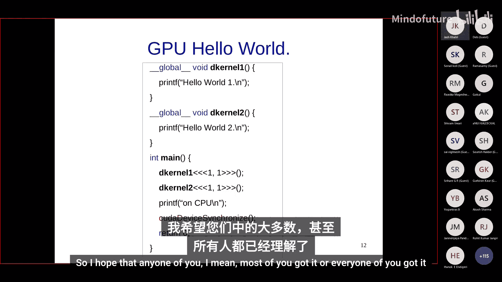

Most of you got it or every one of you got it。If there are questions。

 what if we don't write CDS function in the last program。

 will it be in in the queue if if not one them？我哋。ok所一。If we don't write CdS。

 then it might happen that only on SQ is printed and then。GepI mean。

 Spro doesn't wait for the GPU buffer to pushed back and it just finishes its execution。So。

 in that case， it might happen that only one CPU is printed and no hello world 1 and hello world 2 is printed。

 it might happen。If you are lucky， it might also happen that both of them are printed。

What is the final output I told you that there are three possible of。3 possible outputs。

 but mostly you will see that on CPU is printed first， then hello World one and then hello world。

 there is a reason behind it because CPU CPU is much faster because it just launches the kernel and then moves ahead。

 It's not wait。 I mean， it's not waiting。 It's just executing instructions in order。

Very quickly and yeah， that's the reason。Okay， so what is the purpose of writing could that device synchronize？

I explained you earlier right， QA device synchronizes something like a barrier。

Writing Q device synchronize ensures that CPU will wait for all the kernels that are written before it to finish its execution。

I think if we are doing one commmatooon in D kernel there are two threads right。

 so each thread will do the same block once， right。Okay， if you are writing1 coma 2。

 then it will happen that that kernel will be executed by each thread I mean that kernel will be executed actually by each thread so。

You will see that hello world is printed twice， but we will come to a tone for。Sir。

 can you please run a program in Google Collab。Okay， I mean。没听过。Okay。

 I'll see this from next lecture， next lecture on words。 But but right now， I think I need to。

Load everything on Google Pu and I think it will take very long time。

 probably will overshoot the lecture I mean lecture time。Yes， sir。

 is nested function concept applicable for kernel。Yes。

 yes nested function concept is applicable for kernel。And yeah， I mean。

Probably we won't be covering this in this， I mean covering that concept in this course， but yeah。

 there is this concept is definitely there so you can call a kernel from one kernel。In fact。

 there is some another keyword other than global which is called as device keyword using pitch you can call so once you are there in global global which is a kernel global function。

 which is a kernel。You can call a device kernel， which will， which will also be executing on Z。

 So yeah， there is there is definitely nesting there。And。Yeah， in that case。

 will it still follow the Q concept？Yes， it will still go in that queue only Q concept will definitely be there。

So， this Q concept is known as stream， so everything， I mean。

 each kernel is loaded in stream and the GPU picks up that kernel for execution from that stream。

It is also known as I mean Q Q， which is fast first out ordering。Okay。

 I think I have answered almost all， yeah。The questions so let's get back to the slides。

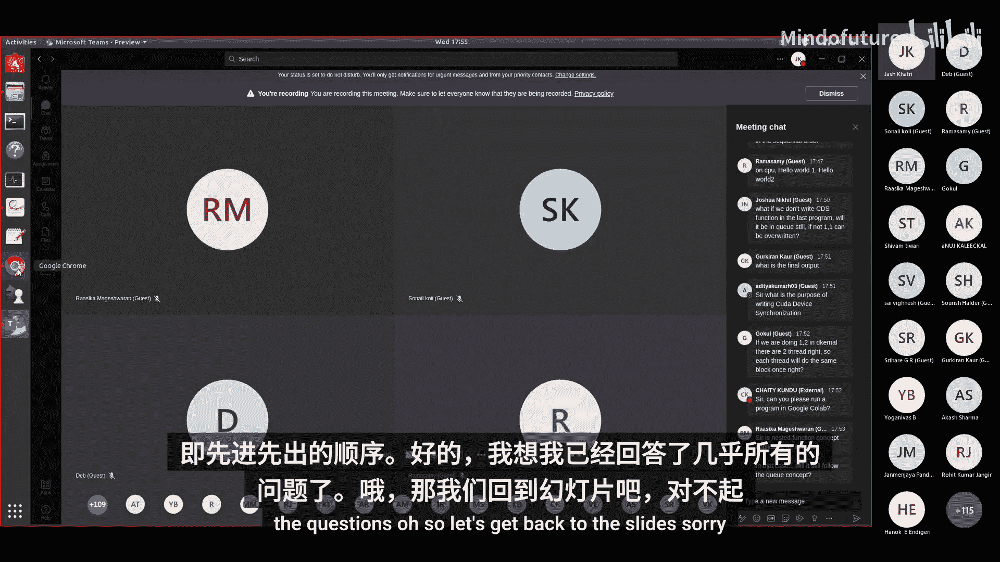

所以。

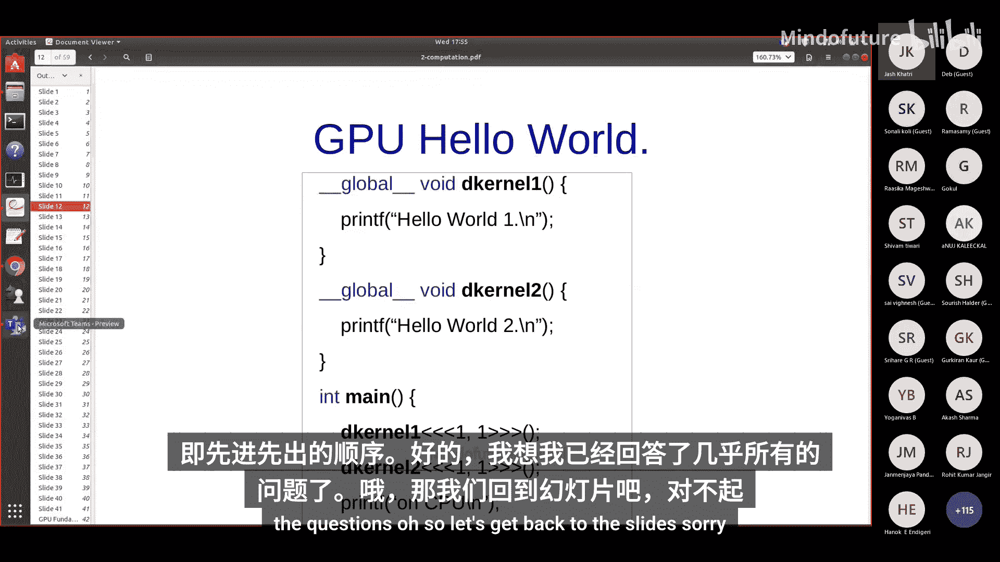

啊。Your voice is very feeble。 I am unable to hear him。 Yeah， Are you able to hear me now。 Yes， yes。

 please go。 you said there are three possibilities。

 One is the first the on CPU and then all one allow2， the other one is。can be this h1。

2 and then non CPU。 What is what is the third one you said。Third possibilitySo third one is like。

Hello World1， hello world 2， and then on CPU last。Because it might happen that CPU is very Imin。

CpU takes lot of time executing next statement and let's say GPU kernel launched I mean launched and finished executing。

 Yeah， that is one of the possibility that I have told what is other possibility you said。Okay。

 so if that's already covered， then。Okay， I'll type attention， probably。你 might be。H one。So H1。

 and then H2。 This is the first one。Second one is H1。And on city。The next。That is second。

And the third one is x1。H H2N on C。O， okay。This be possible。

But mostly you'll be seeing the first one on CPU H1 and H2。Because generally secure is very fast。

It launches， I mean， launches meaning， it pushes the queue and that string or that queue。

And it moves on very quickly。Okay， it doesn't wait for kernel to finish unless we have placed that CS could our div。

Okay， got it， thank you。

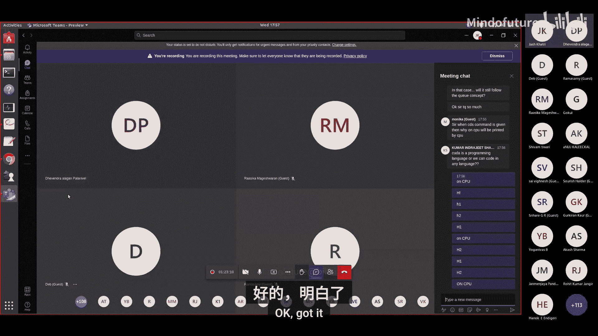

Okay， then I'll move back to the slides。Okay， so we saw this。And yet， I mean。

 there is one more program that we would like to analyze。

So I would like I would like each and every one of you to try out this program。明白。Also。

 check which print types can be executed in。I'll wait here for a few seconds so that you can try。

Okay， I'm hoping that each and everyone of you are trying。So。系啲咩。

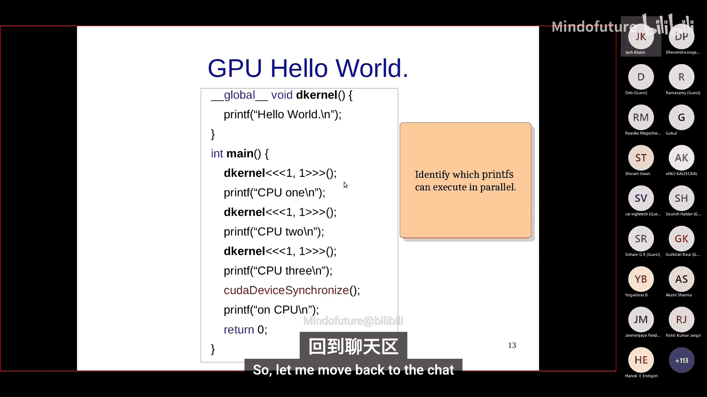

唔好 back嗰啲 job。系 o，大个。啊。Yeah， good at toolkit， you can install。So。CPU 1， CPU 2， CPU 3， hello world 1。

 I mean， hello world hello world， hello world1 CPU， okay。还了问题。し。视。Su1， Su2。

 Su3 can execute in parallel。I guess most of you are getting the same answer and that's correct。

 actually。Pint of statement with gun andprint statement。唔。

Yeah that is actually correct print of statement with kernel and print statement in the main function will be executed in。

yeah， this is correct。Yes， we will get different output。 Yeah， this is the precise answer。So的系。

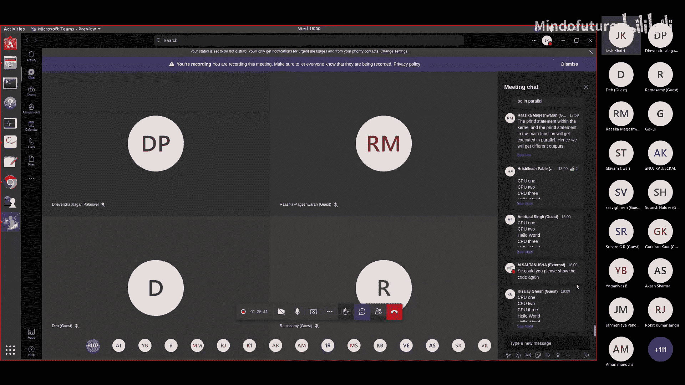

Yeah， sure。 I show the word again。So for a couple of seconds I'll wait so that each and every one of you can try out the code。

Okay， I'm now assuming that。Most of you might have。Tried it， or at least。Thought about how， I mean。

 what will be the execution flow end。Which printers can execute in parallel。

And what are the different possibilities， I mean， what are the different possible answers that can arise out of this code。

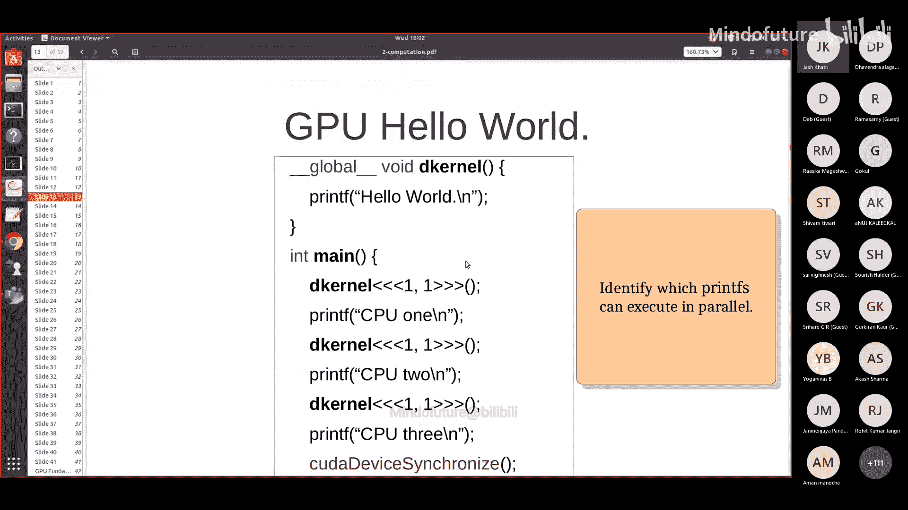

Let me go back， chat to the chat once。で最。Other possibilities as one be。我没。😔，Yeah， that's correct。

Correct。Cipu 1，2， and3 all will be printed together。Okay， okay， so let's understand this code。

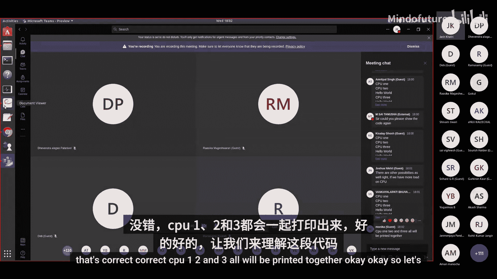

嗯。Okay， so again， if you will start executing from me。First kernel will be launched。

 will be load in the de cube。And then say we will move on。And then CPU1 will be printed。Again。

 second kernel will be launched and it will be loaded in the queue， so Q already has kernel1。

Then it I mean， first this first kernel， then the second kernel will load it， then CPU will be。

The CPU to will be printed by the CPU and third kernel will be launched by CPU。

So again it it will go in that default fee and then CPU will will be printed and then CPU wait here at Qa device。

Now these three kernels are in this stream or the default queue。

So one by one execution of this kernel will happen。

And you will see that after all these three kernelinals are executed， hello， hello world， hello。

 well with Winter。And once that is finished。CPU was waiting here at CS。

Since all these fake gars have finished execution， it will move on and then will print on CT。

So one of the possible order is。CpU1 CPU2 CPU 3 followed by three hell and then on CPU。

That is just one possible order。But again， different ser radio can arise。

Lets the CPUR launched the first kernel， it went into， it went printing CPU 1。Let's say， before that。

This Car first kernelnel launch finished its execution and it printed hellwood。

So this this can also happen。 So hello world hello world can be printed then CPU1， then again。

 hello world can be printed then CPU2， then hello world thought hello world will be printed and then CPU3。

And then on CPU will be printed， so this is also one possible order。

So key thing to observe here is that this three kernel launches。Can happen。

 I mean sorry this not launches this three kernel execution， this three， this one。

 this one and this one can happen in parallel with this three printers of CPU。So this， so， in fact。

 so coming back to our question， which print tabs can execute in parallel？So the onsetet is deep。

3 hellover， which will be printed by cheap U。Can execute in parallel with CPU 1 CPU to CPU3。

 which is printed by CPU。So you can， you will see any internal living。 I mean， you。

 you can expect to see any internal living of。These three hell and CPU 1， CPU to CPU 3。

But as I told earlier， mostly you will see this output CPU1 CPU to CPU 3 followed by3 hellers then on CPU the reason is that the CPU is much faster it just launches the kernel and then moves on。

Before we run the any of the cos have， I mean finished this execution and the right buffer is brought back to the CPU。

So that's one thing which so that's the answer to which prints can execute in parallel。

One more point that I wanted to note here is that one CPU will never come before any of the prints。

 I mean， any of the three hello world prints and this three prints of CPU1 CPU to CPU3。

Because we have this quoa device synchronize here。So CPU will wait for all these three cons to finish as well as due to sequential or execution on CPU。

 it will also wait for this print three prints， not wait。

 it will execute these three prints and then only it will move on to next print。

So on CPU will always come after all the printers that are there in this program。

 so you will never see on CPU coming before any of the printers。

So that's the second point that I wanted to。So any if any of you have any doubts on this code。

 then please feel free to post right on the chat。

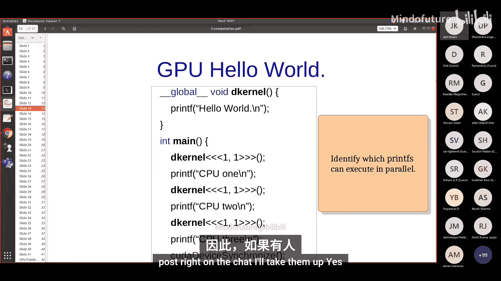

I'll take them up。Yes， that is correct actually yeah that's precisely on if you will be the last the remaining depends on the load。

 that's correct yeah perfect。Any questions， please feel free to post on the chat， otherwise I'll won。

Okay， so there can be multiple final outputs Aa， I talked about few of them。

And most probable output is the CPU1 CPU to CPU3 followed by three hellowers and then on CPU thats the most。

 I mean most likely case。Okay， if there are no questions， I'll move ahead。Yeah。

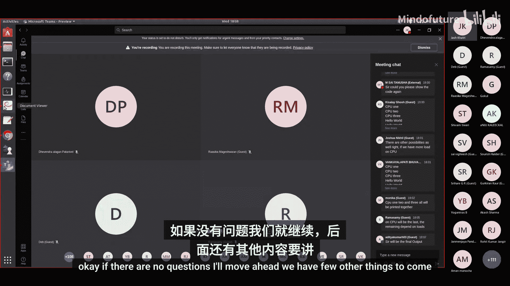

You want that things to come。Okay， so these are， I mean。

 these three questions you need to check offline what， I mean。

 where and V is installed on your system。So in Linux， you can try which command。

 which and and will get the。呃。Location where the is installed。

And then you can check the quoa version using NVCC minus minus version and Linux。

And third thing is you can check what this device query is。And we can learn more about it。

 What is it and whats what's basically the use of it and all this。So these three things。

 please try offline。And yeah。Its coming Yeah。 So going to next slide。啊。Okay， so。

I guess a couple of you earlier pointed out guess thing。Let's say we want to， I mean。

 we were just running hello world on GPU， but just using just one thread and yeah that was not quite I mean。

That was not doing it in pad， I mean， just one thread was working。So we want to see like， I mean。

 how can we execute this hello world multiple times using multiple threads？So it's quite simple。

 we just need to change one thing， which is。The number of threats and we know how， I mean。

 as I explained， we know how to work。Because the two parameters here that we are。Passing to colonel。

Is denoting the number of threads which with which we are launching the kernel so 1 comma 32 if we write this。

 then it denotes that we want to launch the kernel with a single block。

And with 32 threads inside that block。So if we launch this kernel with this configuration。

 then when the kernel is I mean， when the kernel execution begins， there will be cardal threads。

 which will be executing this single piece of code which which is this P kernel function。

 which will be executed on GPQ。By3 with threats。And CPU， after launching this current。

 will wait here for all the threads to finish。All the threads will print this hello world independently。

And the output of this program will be hell oil printed 32 times one time by each thread。

And then okay then CPU will each threads have finished execution。

 CPU will go ahead and will return0 and will finish the execution。

 so output will so if we compile it using NVCC and run yourtop we'll see that hello oil is printed 32 times。

And okay， so the key point to observe here is that。

We can change the number of threads using these two parameters first is this。First parameter。

 which the number of blocks and then second parameter， which den the number of threads in each。Okay。

So moving on， so there are this are this few， I mean。

 there are this few parallel programming concepts which I would like to highlight before we move on。

First thing is process， so the formal definition is the process the program under execution。But more。

 I mean， more practically， let's say， I mean， I want to understand what the process is。

Let's understand with it with an example， let's say your C program。Now let's say you compile it。

 I mean， you compile that C program and it will be in the secondary storage or on your disk。

But when you run dot s it out。That program will be loaded into the main memory or the DM of your system。

And at that time that program becomes processed because that binary file is loaded in the DM of the computer as well as the other data structures will be associated with it for I mean for the sake of its execution。

 let's say it will be allocated a heap for dynamic allocation of the memory because you might declare some memory using mallO or something inside your code and for that you need I mean space I mean to allocate available you need a space so for that heap will be allocated。

He will be allocate to your process which is your mean so yeah so that processes a collection of multiple things。

 one is that binary， another is he。And then you might also declare some variables statically for using like let's say。

 for example， you declare int a。So such allocation of a variable will be done on stack so for that you need something called a stack so inside process process process there is a。

The spinery then stack then he then you need to also take care of like what is the current stage of execution where Im currently which instruction I'm currently executing for that unit program counter and so on so one process might have multiple things and。

Yeah so。So each， I mean， so one process will have sub I mean multiple things and it will be private to that process。

And the examples of the processor notified Chrome word is also a process and so whenever you click on your chromroe I mean when you launch your chromroe it will be loaded in the main momentum。

And it will be allocated all this。All this stack heap and all those things its execution for its execution。

 so yeah， that's it。Next to is a thread。Thread is I mean， technically， a technical definition is。

 it's a lightweight process。But I mean let's understand it practically。

 so let's say you have this word which is which I told is a process， Word is a process。

Now what can be a thread inside that world word is a process right。

 so each process might have multiple threads inside it。And let's say for word is a process。

 then thread can be something like a spell checker inside that word。

Because let's say you're typing and there might be something like you write it wrongly。

 I mean wrong spelling or something， it will auto correct it so that's one thread which is working inside that process on this word。

诶。And it is working I mean independently， and there might be several other threads also。

 which are doing different different things。So I mean what's the difference between thread and process first of all is a thread is a part of process so each process might have multiple number of threads。

But why it is called lightweight process， the reason is that threads have multiple things in sharing。

For example， the threads share the code part， so binary file that is loaded is shared among all the threads。

 then there is he which is also shared among all these threads。But okay。

 so there are multiple things that are shared。There are also a couple of things that are private to each thread。

 for example， stack stack is private for each thread。

 then there are several registers which are privately allocated to each thread。Then now。I mean。

 as each thread is executing independently， it also needs its own separate copy of program counter。

So all these things will be private to the thread， but there are multiple things that are shared like file systems will also be shared with I mean shared among all the trips。

So since multiple things are shared， it is known as a lightweight process。Okay。

 so that's a bit about。Thread but then coming to operating system。

So think of operating system as a manager， so you want to be able to talk with hardware directly。

 at least I mean for the high level machines that we have nowadays so for that you need something like someone like manager who talks on your behalf to hardware。

And so let's say you want to print something on the screen。

 then for that you need to invoke a system call like write and that right system call will in the hardware to so right system call is written inside the OS and that right system call will tell the hardware to print something on screen。

So for each and every， I mean， for each and every we have to， I mean。

 for each and every functionality of the hardware we need to talk with OS and it's kind of a software that manages the hardware。

And it's also also the software with which the user interacts。

 And there are multiple examples of voice， like Windows and Word Linux， even Mac OS is， the example。

The fourth thing is the hardware components itself like cash cache is a very small memory。

 which is close to the processor。And advantage of having such a small memories that I mean。

 access to this is very quick because it's very small， I mean the size is small。

 so indexing it is very fast。But there is disadvantage that its size is small。

 so I mean you won't be able to store many things inside inside it。

 but whatever you can store inside it the access will be very very fast and processor can get it with very。

 very less nu。Then comes the main memory， which is slightly below in the hierarchy。

As compared to the cash。So main memory， so nowadays， mean size of the main memory as if like 8GB。

 16GB is normal for the normal computers。Well for cash。

 you might see that size are just in PM it like 25 p likeambi or something like that note。Okay。

 so that's the difference。But yeah the main memory can handle。

 I mean can load a large amount of data in it and if the data is not present then cache then processor or core will go into the main memory。

And then comes the core core is actually the hardware component on which the thread runs and there is this concept that threadD can jump from one core to another core。

Which means that if let's say we have two threads per let's say there are two threads allocated to one core and let's say that thread number one is currently being executed by the process I mean it's currently running on the processor one。

And there are five clusters。And let's say it happens that T one needs an IU。

 then it will go for IU and plus third one will pick the thread two which was allocated I ined on it and starts running it by the time let's say T one have finished its's IU。

And it wants a processorer again， but processoror one is p。

 so it might go to some other processor which is processoror number， let's say4。In that case。

 you can say that T one has jumped from across the number one to four。

So that is something called jumping of head。And yeah。

 so I'll probably stop here for questions because I think I spoke a lot' see。

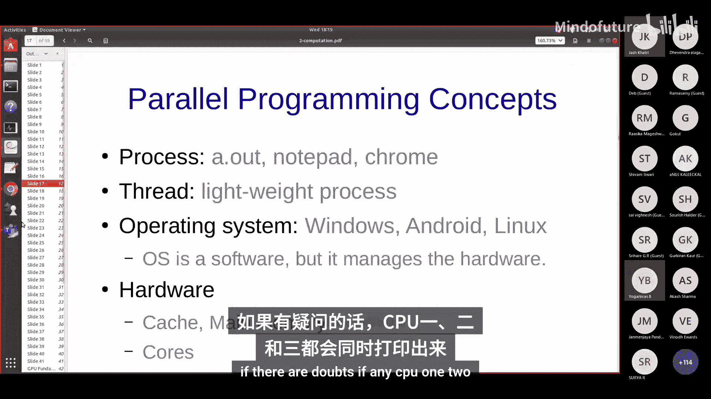

There are dogs if any。CP 1，2， and3 all will be printed together。 Okay。

 I guess this is for last evening。啊，O。Okay， I mean， you don't need to submit the homework you just。

Need to try offline。 I mean， just try it on your own。 We don't need to submit it anywhere。

Does the complexity of program determine the number of threats being allocated？No， actually。

The number of threads that。That will be located。 No， I mean。

 it's the programmer who results in number of thread with which the。

Carinnal is launched in a case I for cheap， I mean， food recordss。

So let's say the code might be very simple but let's say you want to launch it with lots of threads。

 then it's possible， I mean no one， I mean it is not could I will not stop you。

N V will not stop you from doing that and do we always have to manually assign the number of threats or is it？

Is there some way we can make it automatic。I think you need to manually allocate the number of threads。

Do college notebook support CPP syntax， or does it uses。Use Python syntax。Colip。啊。As far as I。

 I mean， I am adquated with CPP syntax， I am not aware with Python syntax， as of now。

But I think it might be supported because。Jupyyta not supports Python and I think it should be supported but some of I mean some of you have to check that CPP is definitely supported because I have tried multiple courses on collapse with a coab with CPP synax so that one't vanish Python you have to check。

Based on what factor we can choose number of course。Number of courses are fixed。

 you want to be able to I in。A number of courses are there in hardware。 So let's a for example。

 your GPS 5000 course。That， I mean on。You want to be able to change， but。

The number of cores are determined based on the type of the hardware。

 so GPU has very large number of cores while CPU has only a few tents of cores。So。Yeah， that's it。

 I think I answered your question or I did I misunderstood it。 I don't know but。

You can unmute and ask if。系。Probably missed something。Okay， so thread jumping is okay， I'll。

Reiterated。 So let's say there is a there is。There are two processor just take。

 just take it in that way， there are two processor even and Q2。

And processor1 has been allotted to threads， which is thread one and thread2。Now let's say， okay。

 so at one instance， only one thread can execute on particular processor。

So processor  one was executing thread one and thread2 was in the queue。Now， let's say processor 1。

 which was executing Th1 and T one needed to go for IO， which is input output operation。

So it went for that input output operation and the processor one was id， it was not to link anything。

So what it did was it took the thread number two for execution。

So now let's say threat2 was executing and processor  one and third one was in IU。

 it finished at IU and it again needed to do some computation on using using that processor。

But pressureer2 is sorry pressureer one is busy， it is busy in I mean， busy with the threat too。

So what thread1 state was it went to presser2？And started executing on it。

If you got if you get it correctly， then initially thread one was with pressor 1。

 but after I it went to pressor 2， so it actually jumped from Proor 1 to Proor 2。

And that's a typical threat jumping that happens in CPU as well as on GP this is a very I mean common thing that happens sorry for that mice。

Yeah， I hope that you understood it， Clifford。系咯。Okay， I'll switch back to these slides。嗯。

Okay， so there is this one more code that I would like two people to try try writing the quoa code corresponding to this。

CpU code， so I'll wait here for a few seconds and will I mean。

 I will like all of you to try out this code。Please， I mean。

 please write the quouda code corresponding to this C code。Okay。

 one thing that we need to ensure that we need this computation part， which is 0 to n。

 is which is essentially printing the squares to be done on GPU， this part we need to do it on GPU。

 how can we do that？Once you are done， please， please post your answer on chat so that we can discuss。

啊。Yeah， please do。Okay， I'll wait for a few seconds more before I switch back to the chat。Okay。

 I'll go to the chat and see what you people have done。

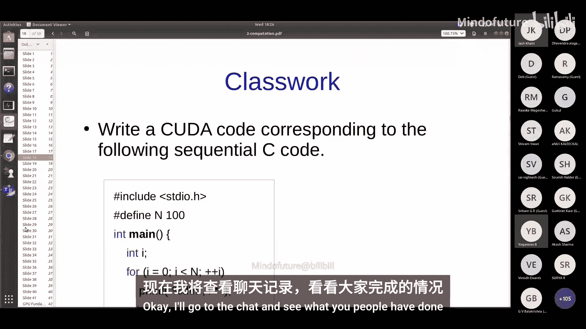

So can you share these slides before the start of the class。ok 啊。Okay， then I'll do that。I just道。

Add to slides in that。Shehiet that we are maintaining。And before each class。

 I I mean just add a link to that。Slide in that corresponding lecture。关あ sorry。And okay。

 next question is to we just add it to themal。Yeah， that is one possibility。

That one thing that you can definitely do， you can directly add it to the。I think。

I define the economy with print F and then print using and。Yes。

 that is one another possibility we can print it with end threats。

But one thing that you might need like。How can we do it with n threats？Independently。

 like thread one is printinging the。Zero square and thread。

2 is print printing the one square and so that we need to。Take care。

 which which we actually will see。Yeah， so this is important point。

 Can we create a kernel which takes input as iron print sign into eye。Yeah。

 I will see how how to do it yeah。That I needs to be taken care your correctly。Yes。

 this is one possible way， this is correct， Ruhi yes。

 this is the one of the possible way in which we can do。好嘅。嗯。哇。

Square is quite y and white and square。ok嘅。Yeah， so you are trying to pass that parameter I mean。

 that I parameter， I guess。嗯。This is also possible， but we need to check if this。

I think there will be some compilation issues。I do I I think you are。

We are launching thread I into eye threads， no I don't think yeah this we need to change this code a bit Joshua yeah。

 we'll need to change this code a bit at all， it won't give you correct answer。Okay， anyways。

 I'll switch back to this slide and we'll see how to do。

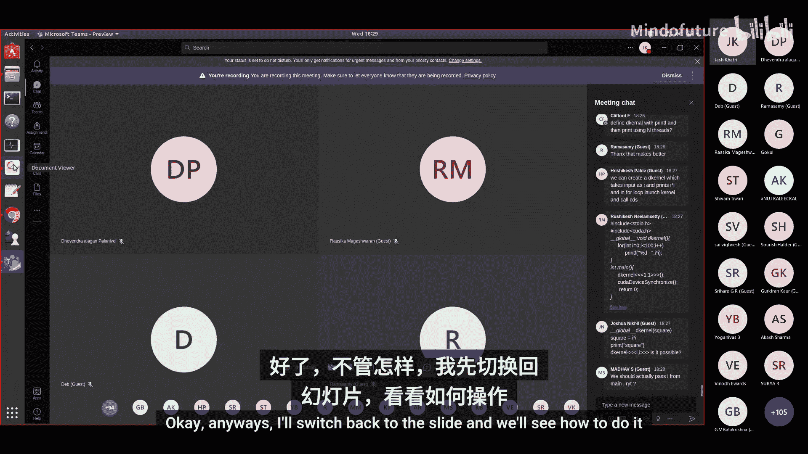

We have a couple of minutes， we'll finish this thing and then we'll stop。Okay。

 so one of the way in which this can be done is very simple， I mean。

 you can just launch the kernel with one thread。And can place this loop inside the kernel。And yeah。

 this will print correct answer。as it was with CPU。But， there is one problem。

That it is running entirely sequential， I mean in in an entire sequential manner。

 there is no parallel thing in worldier， there is one thread。Which is executing， I mean。

 this board loop in a sequential manner。And yeah， we are printing a into。

There is no parallelism involved， so my next question is how can we make this parallel？

And to make this pattern， we need to get hold of something called a thread I。行行。Yeah， let's go ahead。

Secondly， pass parameters to this。指标要放式。Yes， yes， you can pass， so let's say。

 let's take this one cardinnal launch inside this brace， you can pass the parameters。

So instead of doing this sequentially， can we start follow up in the main function？And the passing。

I value from 1 to00， maybe。Yes， that is also one possible way in which you can do you can pass that eye value by launching the kernel in the loop and then yeah that kernel will print the eye into it。

But still that will involve that will involve launching one third for each print right and that's also very high overhead and still we are not doing things in parallel。

Because one kernel launches there for each。Square， squaring operation that we want to create， right。

So let's come， I mean， let's see how can we do it in better way。So， this is one of the。

Pater wing which we can do it， we can launch the kernel with n3 where n is the number till which we want to print this squares。

And。Inside this kernel， I mean， inside this kernel， B， we need something to identify a thread。

So this statement thread ID extra text will give the idea of a particular thread。

So let's if we are executing this can and threats1 first thread。

 then it will see this thread ID X text。It knows that my ID is zero， so threat number zero has ID0。

 thread number one has ID1 and so on until till 99 since there are 100 threats their ID will from0 to 99。

And what each thread will do is based on their ID， it will print it square。

 so thread 0 will print 0 into 0 square third1 will print  one into  one， which is one square。啊。

And1 till 100， sorry till 99， is which will be done by the thread， which is 99 assets ID。

And after all of this is done， I mean CPU was getting here for Qa device synronize and after all of this is done I mean。

 after all this prints are done from GP CPU only1 on and execution will finish。

So one cool thing to note here is that there is no loop involved here， everything is， I mean。

 everything is done by each thread in a very parallel manner。

But there is still one problem with this code and that problem is that。

Output of CPU and GPU might not match。Because each thread is executing in a very asynchronous manner。

And you might see that output might be hummbd。And yeah。

 this is the issue that we face in multithreaded execution。

 but as long as you are not concerned about the correctness， I mean。

 we'll be able to see all the squirs put in jumbo order。

So that is one issue that is with this quote and yeah。I think with this。

 I'll stop here since we have already overshot the time at 630。

But if anyone of you have any question， then I'll be very happy to take them。

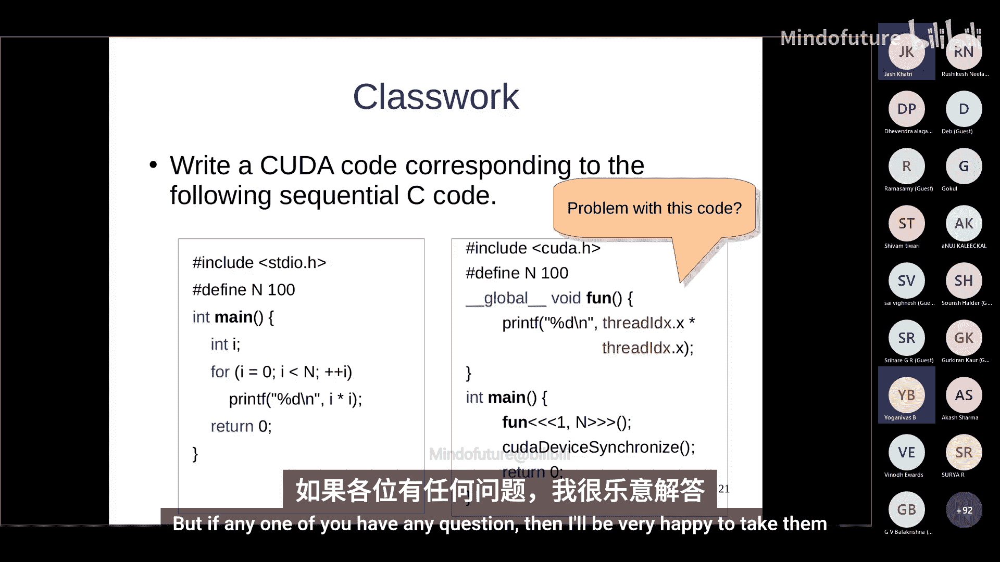

系。