# 【Nvidia】CUDA并行编程-｜-Cuda-Programming-Course-｜-Parallel-Computing-Using-Nvidia-p02-P02_L2_CUDA程序流程与cudamemcpy操作--BV1MSq1BTEho_p2-

Okay， so。Welcome， everyone。And to the third lecture of our G program。

Today we'll be learning about okay， so first of all， a brief recap about a previous lecture。

So in the previous lecture， we saw different， different variations of hello world program。

We also saw how to launch kernel and how to write the kernel。Using some。

 something known as global keyword and。We saw how to launch kernel with multiple number of threads。

Then at the end， we saw a simple application of printing all the。Square suffer， I mean。

 all these squares from 0 to 99。Using multiple threads and without loop。So， yeah。There， I mean。

 there we stopped yesterday and for today days， I mean， for today's agenda， we have to cover。Okay。

 so today we'll be covering how to transport the data between C and GPU， how the typical CPU GP work。

 how CPU GP communicate with each other and what's the typical。Program could a program flow。

 And yeah， probably if pick at time， we'll also see how how is the threat organization in the GP。

So that's a brief outline for today's lecture， so with this。Let's get started。Yeah。

 so a brief break so here， so this was the last slide that we saw yesterday。

So there was this for loop， which was printing。Square of the numbers from 0 to 100。

 and we were interested in writing writing the quoar code corresponding to it。And as you can see。

 that， I mean， we were printing inside the candle and there was no loop in what here。Now， okay。

 this is fine。But let's say that we are interested in okay。

 so let's say we are interested in not printing squares in the kernel。

 but let's say we want to do something else let's say we want to store this result I mean store this square of numbers I mean square from 0 to 19 square of numbers。

In an area and want to get that area want to print that array on CPU。

 so that's going to be our next class。So given this code， given this C code。

Where we are just storing square of the number in the particular index so0th index in the RA A。

In the array A will be storing a0 square。One array index， one will be st the one square and so on。

And。He would。Hello。Is that any question？Okay， okay， so we would like to okay。

 so we would like to write the ka code corresponding to this serial c code and obviously our main goal will be to parallelize this for loop。

In the Qda K。And I would like each and every one of you to try out。

How can we write the Huda code corresponding to this sel？

And I'll wait here for a few seconds to I for everyone of you to try。How I mean。

 think about how we can parallellyze this code or write the quota code corresponding to the serial code。

Yeah， so I'll wait for a few seconds here and request every of you to one of you to try and post your answers in the chat。

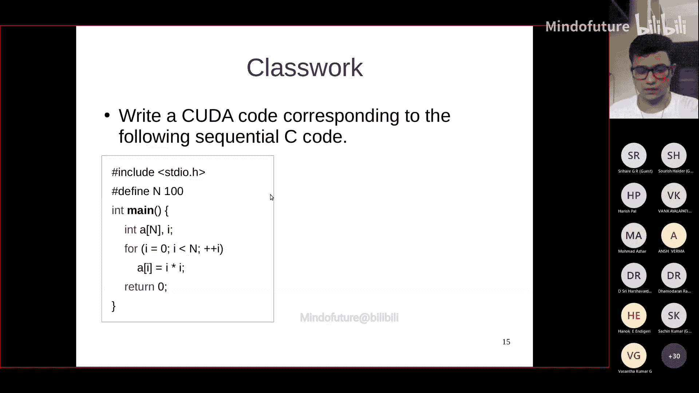

Let me get back to the chat。I guess no one has。And go back to the slide。I hope everyone is trying。ok。

Yeah I turn off the video。Saving the bandwidth turn of the。

Yeah so please please try writing the so for those of you who have joined now。

 please try writing the Quda code corresponding to this。啊。Serial C code。

 and we'll discuss a couple of things about it。I don't have a chat up。

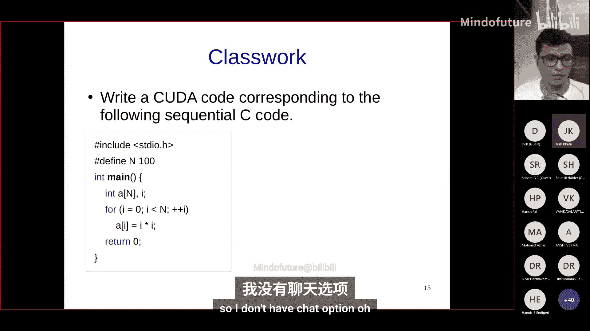

哦。问题。Its that。it's not there for my case。我意食。Yeah， are you short， I mean。

 are you using app or are you Yeah， I'm using laptop desktop application。

chat okay if that's the case， then you can tell your， I mean briefly tell your approach or something。

 but I don't understand why don't you have chat option because。Chat is not visible for anyone。啊。

Right， I mean。I your I mean， you are joining it from desktoptop and I mean。

 are you using update team application or you？In that case， it should be there at least I minute。

I'm not sure what's issue。I mean we issue with the application or something or issue from mind。

 I don't know， but it should be there。 may I join with the browser。Yeah， please try doing that。

 I guess you should， I mean， even with half culture should be there， I'm not sure what's wrong。

Of his arm drain。sometimes they should change the organization above the account setting。

 try changing organization that is why it's happening。Okay， I will say。 Thank you。Okay。Bstro。Yeah。

 meanwhile， I request others to try out。

Yes。こ。Writ sca quote corresponding to this quote。I'll wait for a few more seconds and then we'll discuss the solution。

 as well as C。other people's solution in the chat。

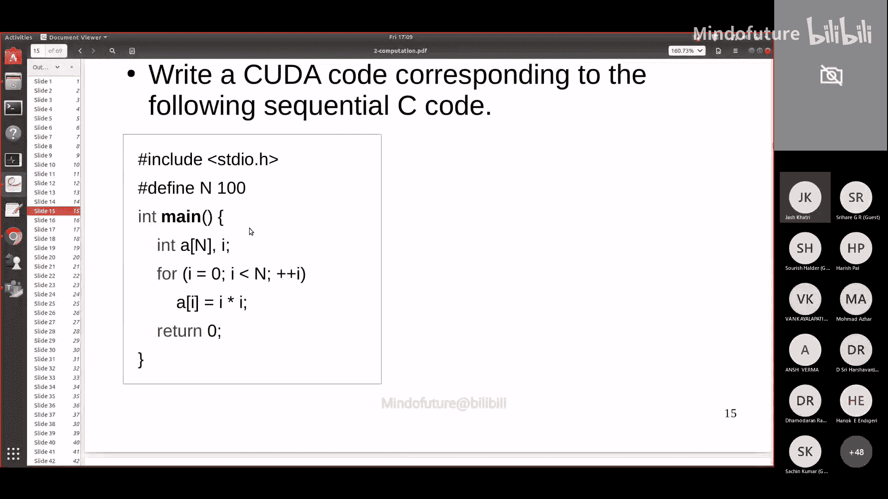

Okay。back to。我嘅 I think。完了。Can has history。As they okay。Ne to understand what data。给我。Ramaammi。

 are you trying to。Use， I mean。I am unable to understand your core what I trying to do。Okay。

 you are just printing squares， as we did in previous。NextYeah， yeah， sorry。

 that is not the A of I just having the squares yes。Yeah， we want to。Store those squares in array。

There yeah，'s。Request Europe。Well soon be discussing it， but please try it out。Okay， so in browser。

 chat is coming for me and not for software。Okay， just in case it's happening with somewhere。

 then you can try joining it from browser alsos。It might solve the issue。Yeah。

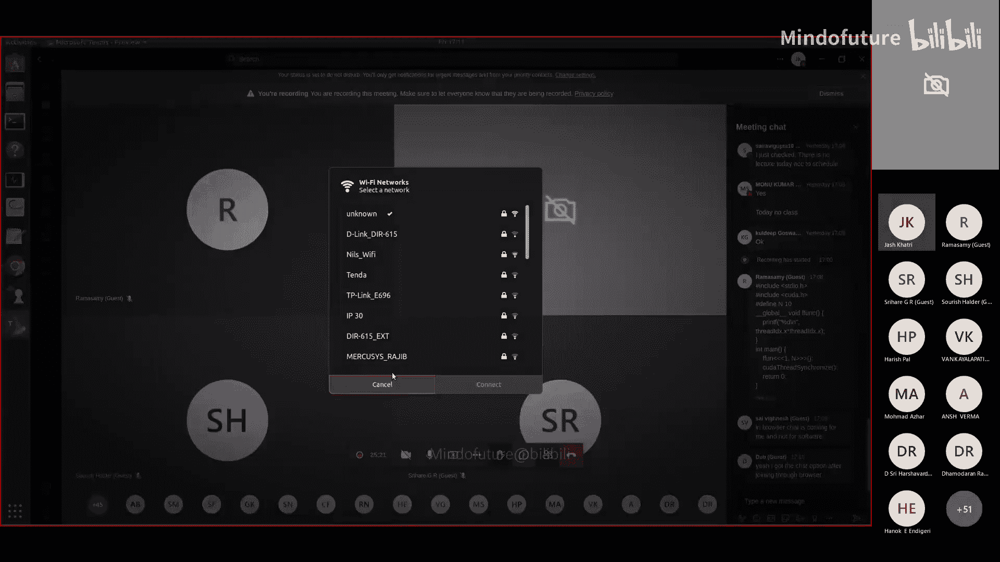

Hello。Am I already， but hello。Yeah。

Yeah， so let's go back to the。Slides。So， okay， so。嗯。This is the quoda code corresponding to that。

The serial C code， so a couple of things that we should observe in this code。Okay， first of all。

 first thing that you should notice that area declaration is same here， I mean。

 we are declaring the area on CPU。啊。Then we are declaring this pointer Dstar which is a pointer on CPU and it will be pointing to some memory location on GPU and that's why it' is called Dstar and distance transfer device and then we are declaring this variable I and then this is important we are allocateocating memory on GPU using kuda meloc now you might ask why we need to allocate the memory on GPU why just can't we use this RA which is already declared on CPU and pass in the pass to the kernel but。

Yeah， as probably I mentioned in some of the previous class， that GP and CPU have different memories。

So whatever you have declared on the CPU might not be accessible on the GPU and hence we need to declare separate memory on the GP and that can be done using quodalog so here in this case we need to we need to I mean allocate separate memory for the RA on the GPU so that is done using quoda and okay so quodalog takes two arguments first is the address to the pointer these D and second argument is the number of。

Okay， second argument is the size of the memory that we want like and we want the， I mean。

 area of size， n into size of it， which is the size， I mean any teachers。

So that's one thing and after allocation， after this gooda。

 we will have memory of size and integers allocated on GPU。

Now what we will do is now okay Na one more thing is this D will now point to this newly allocated memory on GPU。

 so let's say if that memory has allocated I mean memory has been allocated from thousand memory locations。

 then D will have that address。There is a pointer on CPU。

 but it is pointing to some location on GP please make note of that。

And now we are calling the kernel using n threads， I mean 100 threads actually。

 and we are passing this address we are passing this pointer which is address which is pointing to some GPU memory location to the kernel。

And now kernelnal has this a， I mean， this address。

 now please note that this inch are a here declare here。

Is is a point particular on GPU since it sends up enough kernel and it also has a address which is passed。

 I mean address held by T which。Wch shows I mean， which points to a GPU memory location。

 so A will now point to a GPU memory location。And we can index this using threadh ID now we can index this RAA。

 which is on GP using Th IDD， and as we you did our previous example， we can use TID。

 unique thread IDD using thread ID Xtroex， which will give us that unique thread ID。

And can multiply to get the square sense to in that particular memory location。

 it will have same effect as a of I equals to I into I so here I is the thread ID I mean we will get a unique I using the thread ID。

And once this kernel is over， I mean execution of this kernel is over。

 I mean after that we have this quoda M copy， it's important to note what it is what is it。

So quoda M copy is what quoda M copy does it。Transfers the。

Data from CPU to GP as well as GPU to CPU here we are transferring it from device to host。

 which is here meaning which meaning we are transferring it from GP to CPU。And。

So its typical syntax as first is the destination address， second is the source address。

 third is the size of the memory， I mean size of the data that we want to transfer and for this in which direction we want to transfer from host to device or from device to host。

That that is the fourth argument。So we have four arguments in this quoda M copy and since we are transferring it from device to horse。

 which is from GP to CPU first argument is the CPU array then the GP array and then there is n into size of it it says that we want to transfer。

And。In teacher values from GP array to CPU array， which is D yeah， so that's about Qam M copypy。And。

Yeah， once that transfer is completed， we are done with it。

 we can simply print these values which are in RA on on the CPU here。

 please note that this is being done on CPU。And then we can return zero and just finish the mean。

 so this ch， which is corresponding to the serial code。

 this quoda ch will print all the squares from 0 to 990 squared to 99 squared。

So probably wait here for a couple of seconds， if you people have any doubt I'll take them。

I hope you people are able to hear me， right。Yeah， actually。

 could you explain the thread deck thread IDx again once more。

 I thought it was just like an I for the thread。

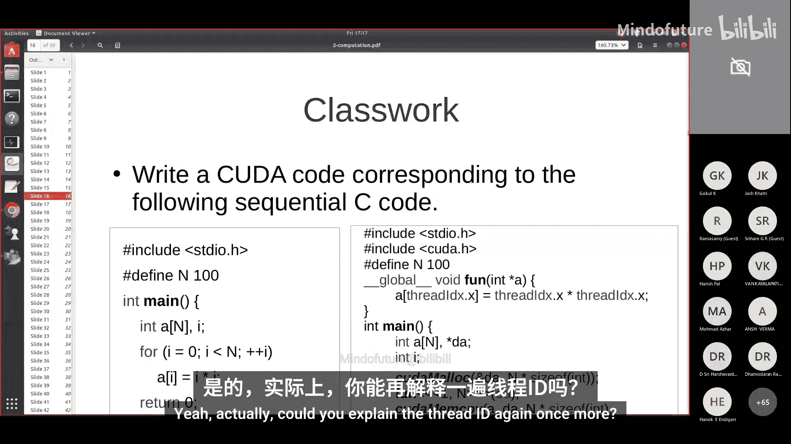

But here we are like multiplying Yes Yeah， Okay， so it's。Okay。

 let me explain it in simple words thread ID X dot X will give ID of thread only。

 so let's say if thread one is in work I mean in executing that kernel。

Then when it will see thread I。对。I by a voice broke。Oh， is it clear now。

 probably that's because of some internet issue？Hello。Yeah， I think it's better now。

 replace please fit that last thing that you said。Yeah so I am saying that thread ID is the ID of that particular thread only so whenever you write I mean whenever a particular thread is executing that I mean that kernel and whenever it sees thread ID xex it will replace it by side。

And we are multiplying it because we want squares to be stored in that area location right that is why we are multiplying and you are correct that it will give id only。

And yeah quo what what's the other questions which is which is source and which on its destination in case of com M copy Okay so first argument is the destination second argument is the source I'll go back to the slides so this one is the source a is the source and D is the destination sorry sorry sorry。

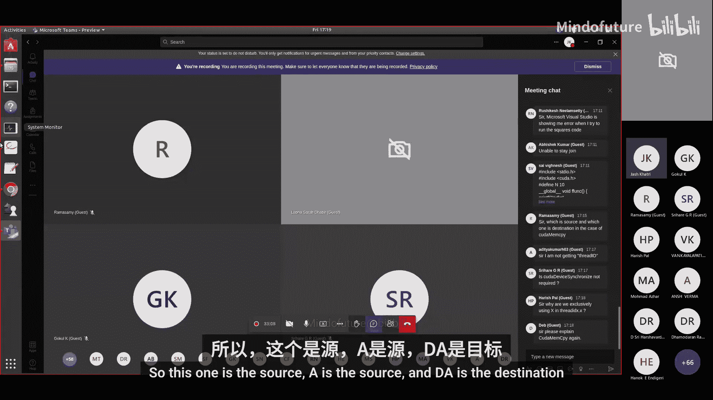

First one is the destination， so a is the destination and D is the source。

 so this quo M copypy tells that we are transferring data from D which is GPU array to the CPU array a。

I hope that is clear， sorry for that confusion initially。Yeah。啊，结束。

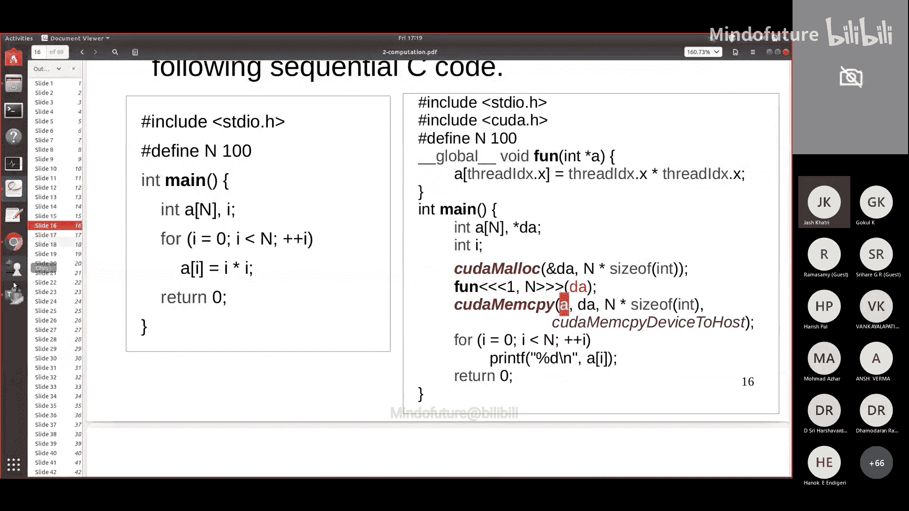

Sir， I am not getting thread ID， I explained， I guess that's clear now Aa。It's good。一个。

 when we are multiplying the T ID， is it being de referenced from the I to the actual value or？

Actually， it's not getting data referenced， it's sort of like。

There is nothing like data reference happening it's like just you are just referring to that ITM mean。

Let's say whenever a thread is。Referring to that thread I D X X， it's just。Getting I mean。

 it's replacing it with。Its own I。 You can look at it in that way。

 There is nothing like de referencing， I guess， happening as far as I know。I hope that is clear。O。

Okay， so moving on。Could the other house。Yeah code I synchronized not required that's a good question we'll see about it that whether it's required or not or y are we exclusively using x and thread ID x nortex that's also a good question Harish。

Probably we'll see in this class or the next class。 what is the significance of x there。Sir。

 please explain， could I am copy again。So quoA M copy is like a data transfer operation as I told CPU and GPU of different memory。

 we need quoda M copypy some function like Qm I mean memory copy function so that we can transfer data across CPU and GPU。

Thanks I got it Okay， one more thing whether couldra yeah I'll talk about it well whether well need it or not。

Yeah so this is very good question Does kuda and copy also freeze the quoa memory we are located so by default no there is something called called a scuda free that we should also do I have not done in this I mean I have not done in this program but yeah there is something called a quouda free which is used for freeing that memory by default it will not free the memory that is allocate good question。

Okay， I guess I have addressed all the queries。So switching back to the slides now。Just a moment。

As sir， if I may ask， is there any difference between quoa Maoc and regular Maoc。Yes。

 I mean it its I mean it's in its name itself right。

 Qa Maoc allocates the memory on the GPs DM while Maoc allocates the memory on CPUs DM。

So when we declared the pointer， we declared a pointer in the CPUs Ram right？Yeah。

 but that is simply a pointer okay， I'll switch back to these slides I can。So。

 this is just a pointer which is on CPU， but when we allocate memory using ka meok and we pass this pointer press argument。

 this pointer will hold the address of the memory which is allocated on GP so think of it as some memory chunk being allocated on GPU。

And T is pointeder rather， I mean although although it is on CPU。

 it is now pointing to some memory location which is on GPU。I hope that answers your query。

probably I can explain and after that， actually， now we have like a pointer that is pointing into the GPU memory from the CPU right。

Yes， yes， yes， that is case。Yeah啊。After that， we are passing that again through our function。

 which is going to be running on the GPU and there we are changing it into another pointer。

とい know starting。It's not changing to another pointer， so let's understand when you pass D。

 it's pass by value， please note that this D is passed by value now what is value inside。

What is value inside ID D is and pointer， so its value is the itRS， right？

So pass by values is we are passing address here so address of GPU's memory location which was allocated here by quoa meoc is now being passed in this function fund and now that address is held by some another pointer intake which is now on GPU this pointer is on GPU and it again points to the same memory location which was allocated by this quoa melo and which was allocated on GPU please note that。

So this pointer star now has the address of memory location which was allocated on GPU by meO and now it can add excess here because in global function which is GPU function kernel。

We can obviously access the memory allocated on GPO diagram， right？I hope that's clear。

Yeah now I understand that thought， but then from from that understanding both D and A pointers pointing to the GP memory。

So then again， we are doing like a M copy。Okay， yeah， okay， I got it。

 so you are telling that this A and this D both are pointing to GPU memory。Yeah。Yeah。

 but please note that this is that the scope of this a is limited to this global function。

And the E that we are referencing here is this CPU array。

So it's not happening between two GP GP memory it's between CPU and GP please make note of it so I am assuming that you know what is a scope and all those things so when we are seeing a here it's a CPU array and when we are seeing a here it's this GP pointer。

I hope you got it。There you god。If any of you have any question please feel free to ask because this is a very important slide and I mean this this is going to be very common across our next I mean almost entire hour course this malllo and mem copy will be。

Very frequently being used in our slides throughout the course。Secondly。

 allocate memory on a GPS memory。Like GPS V Ram。Yes， I mean， okay， I guess you missed it。

 but this ka melo is the function for doing that I mean that thing that you told。

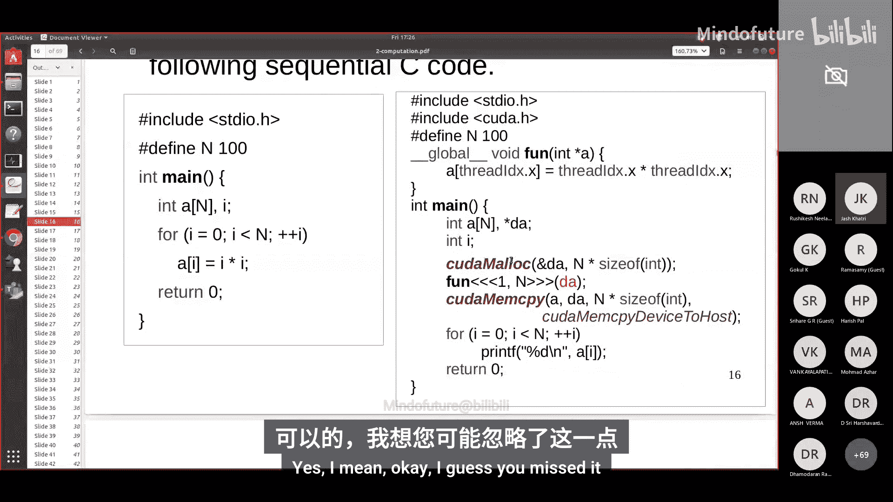

Ka melo will allocate our memory and GPp St So when we say quoa melo hell please。

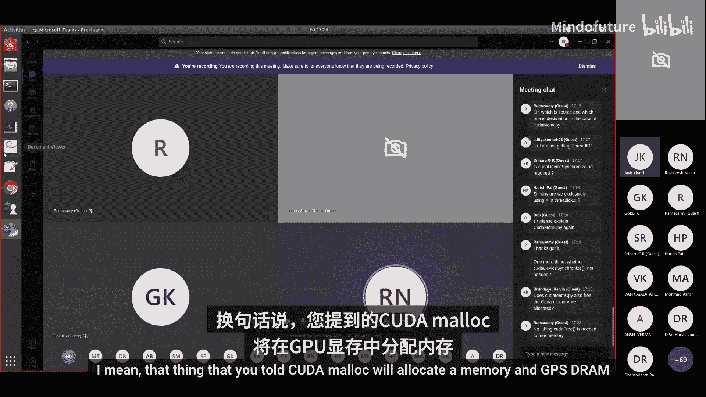

Aren't to we like using the CPU memories。Poiner here。How can we allocate GPU memories。

F memory do CPU your memory though。All right。Okay， I guess probably are missing something here。

 but please note that this D is just a pointer on CPUu it it's not a area or something it's just a pointer so pointer is just like it' is referencing some memory location。

So what this code analog does is it allocates these I mean。

 it allocates the area of size and of size and it teachers。And it gives it its address。

 I mean think of it like it is giving back its address into this pointer D which is on CPU so CPU pointer will store address with the GPU memory location so please note that this allocation is done on GPU。

Only we have its address on CPU inside this variable D。So it's not like。

Or how can I say like it's not that it's allocate locatedd on CPU， it's allocated on GPU。

 it's just that I have reference to it on CPU。I hope that it answers your question。

 it's not on CPU it's on GPU。But yes Sir。挨个得嚟。Thank。Yeah。

 so you can like think in this way also references like address， you might be sitting in your home。

 but you can have the address of someone else's home in that way you can think of。

So that's completely fine c and GPR2 do different homes and one can have the address of another。

 I mean， someone who is living in a different home。That way。O grow one last question actually。

They police scored。I'm going to guess that because we are making like a pointer on CPU side。

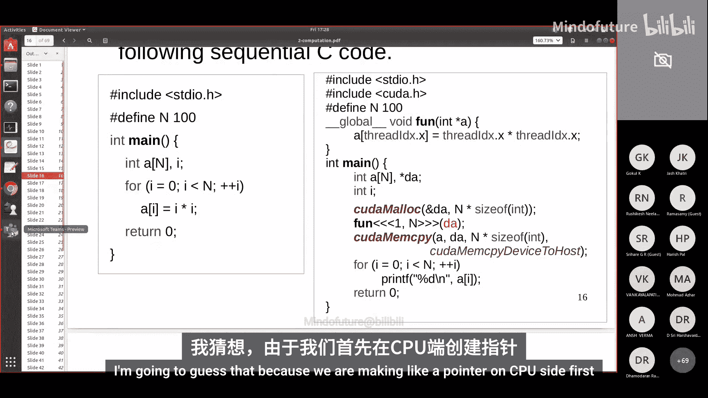

First， and then doing it on a GPU side。That we can't actually directly return there' something convenient like a return statement for the GPU kernel。

 right？Yeah yeah so this is a very good question C there is no way in which we can return anything from GU Carel so probably in previous lecture also someone asked like is there any way to return something from Carel but yeah I mean as far as。

I have checked that there is no convenient way in which we can return something from kernel here using int or something or in star or something。

So we will need this quoda M copy to copy back the things and also for the allocation。

I hope that answers the question so yeah， tell now I I mean。

 we don't have that facility for returning。Okay， I guess no one have any further question right。

 or if you have， you can ask。

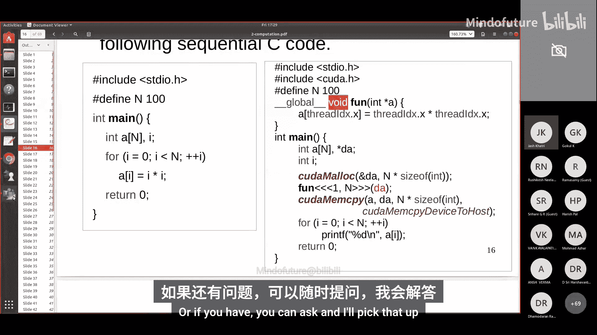

And I'll pick that up。No， I think。Could have needed for free memory yeah that's correct we need quoda free sir is there any tangible efficiency difference between C program and quoA version of the program？

Okay， for this code， I don't think that you will see any performance improvement。

 okay so your question was efficiency difference here。Okay。

 so for this code I don't think sorry for this code I don't think that you will see any major improvement in performance。

But we'll see along。 I mean， we'll see different quotes where you will actually observe the performance difference because here。

 the size is very small， right or 100 or something that。

We'll be able to see any major difference in performance。

It might also happen that GPU code might perform worse than GP code for。

I hope that answers the question if there is any other question I okay， I guess。

I have answered probably most of the questions Okay， so switching back to the slides。

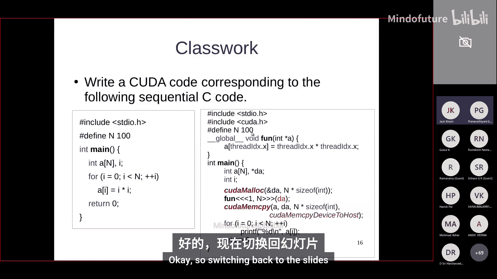

Okay， I think the code is clear now。But there are three things that we should observe before we switch to next slide。

 the first thing is that as many of you pointed out。

 that there is no quoUa device synchronized in this code。

So this and， this is an important observation。And why we don't have quo ID device synchronized here。

 the reason is simple。This ka M copy have， I mean it's a blocking statement so as we saw in our previous lecture when CPU launches this kernel fund。

 it will move on， keep executing the next statements after it。

But whenever it says quoam M copypy it' is a blocking statement。

 so what it will do is it will wait here until all the previous kernels are finished。And hence。

In some sense， we don't need quoaM copy because CPU will implicitly wait for this quodaM copy I mean it will implicitly wait for all the previous kernels or threads of all the previous kernels to finish before starting the execution of this quoAM copy so in that way we don't need QdaM copy as long as we are as long as we are writing sorry we don't need device synchronous as long as we are writing quodaM copy。

But as a good program in practice you should write quoa M copy after every kernel call but here we can avoid that's one thing second thing is this quoda M copy itself one thing that you know you should know about this quoa M copy is that is something called。

P said express bus across which the map copies occur between CP and GPO Dm。

So this maMco is time consuming since there is a limited bandwidth is that this PC Express must have and if you're doing lot of MM copies quoamM copies across CPU and GP and GP and CPU。

 then it can become a very crucial bottleneck so you should I mean you should take care that you allocate sufficient number I mean you。

Two sufficient amount of computation inside your。Sorry your voice I wanted to make from this slide and third。

Sorry， okay， is it clear now？Hello。Oh yeah， now it's first。Okay。

 so okay I'll repeat the second point that I wanted to make som I was saying that this kam M copy can be a bottle length because the data transfer across CPU and GP occurs through something called a PC express person that bus has a limited bandwidth。

And if you have lot of data to transfer， then transfer through this codeM copy。

 then it can become a bottle egg。And so the point that I wanted to make is you should have enough or sufficient computation to do inside your kernel and after that you should do the M copy of the required data back to CPU or from CPU to GPU。

So that was the second point that I wanted to make， I hope that was clear。

And the third point that I wanted to make was from this slide is that we will need I mean。

 we will need to allocate separate memory and GPU using this code ML because the CPU CPU DM and GP Dm are different。

So these are three crucial points from this slide。O啊。If anyone have any questions further。

 I'll just quickly see。 Otherwise， we'll move on to next slide。Okay。

Sir is there any need for defining prototype function declared。Functionicular after me。啊。

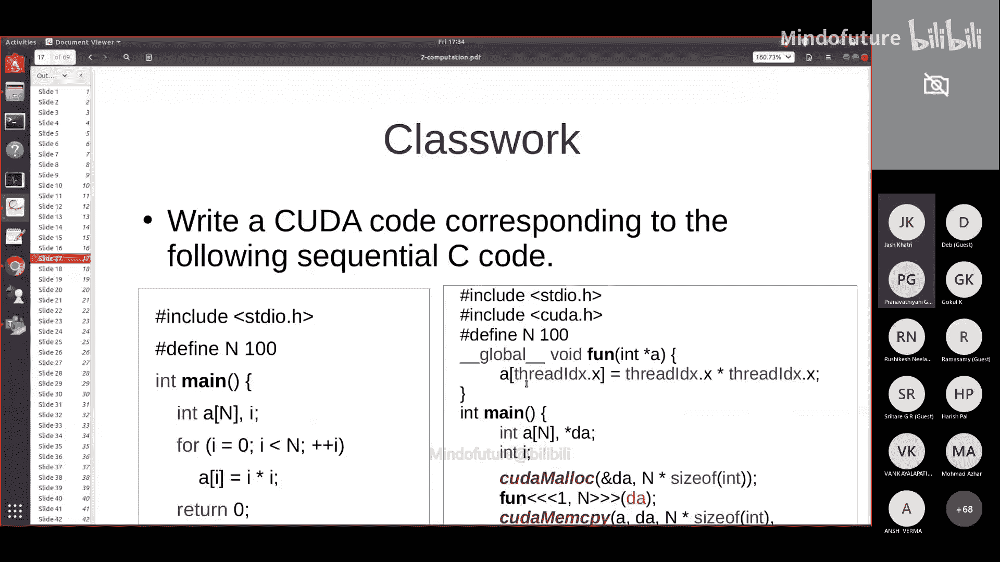

Okay， are you talking about cardinal declaration of termor？Something I missed deep。

Are you talking about any cardal declaration after me。ok 啊。I am not sure about if we need to。I mean。

 probably we need to provide its defin I mean declaration first and then we can define it after the mean as we do for C programs。

 but I haven't。Seen any Qa program doing so， but yeah， I need to check this one like。

As we do for C program we can declare the function first and I mean we can provide its definition and then I mean we can add its body later after the mean。

So I think that must be doable but I haven't seen any QUDa program up till now doing that。

 so I need to check that part。Yeah so that's it and because of quoda M copy plugin synchronize is not knitted。

 got it， thanks okay。Yeah。Yeah， we don't get put atcentchronize。Okay。

 so I guess we should move further that。So moving on to the next slide。

So we have this slide which is I think very simple C code but I mean I want your paper to quickly tell what will be the output of this code I think it won't take more than a couple of seconds for you to figure out but what will be the output of this code。

Can all of you quickly type in the chat？Hello old。Sure， hell。I guess most of you might have。

Got it correctly。 Yeah， I guess no one is type。 but yeah， the output of this will be helloed。Okay。

 so moving on， now， let's say instead of printing hello world from CPU， I make this small change。

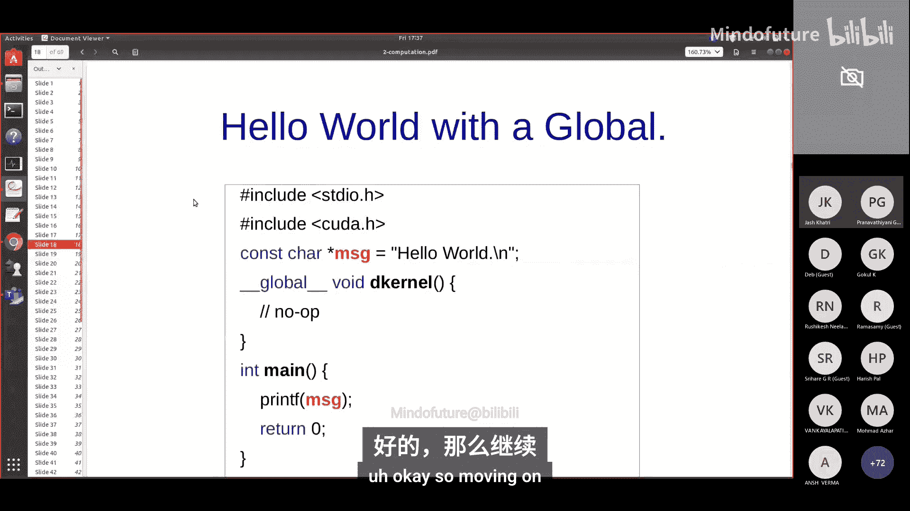

喺呃。I just write this D kernel and launch it with 32 threads。And。Inside this kernelnel。

 I print this message， instead of on CPU， I print this message on GPU。

And then I add Qa device synchronize now what will be the output of this program I want each and every one of you to try out what will be the output of this program。

Request each every one of you to try and let me know in the chat what will be the output of this program。

Then we'll discuss。Couple of thank you。Thank。So people can see and try。O啊。水晶百度的。Chat。嗯。

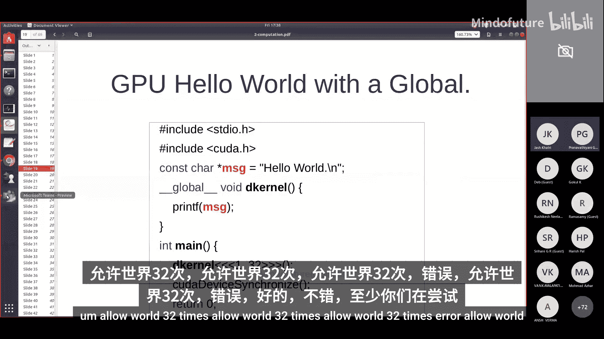

L word 32 times。L world 32 times hell 32 times error， hell 32 times error。Ok。Good， I mean。

 at least two people are trying and that's very good because we should try at least， I mean。

 even if we are wrong， we should try。呃。Okay， switching back to these slide。

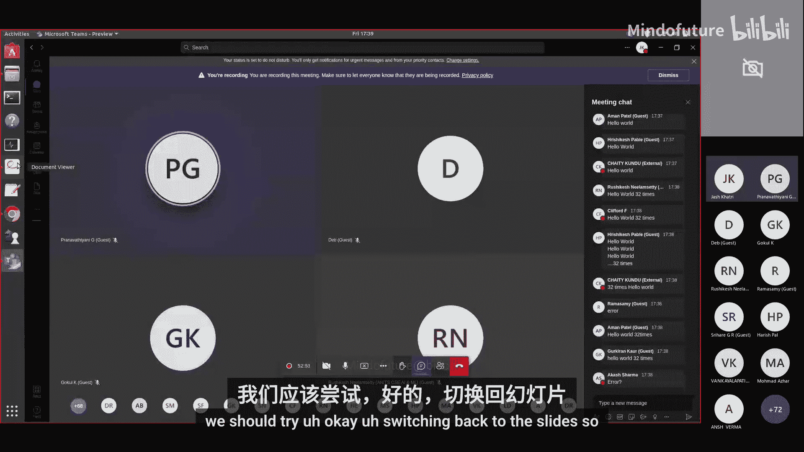

So。this program will give error， the reason is simple as I explained in the previous slide that GP memory and CPU memory are different and whenever you declare any variable or pointer in CPU I mean here whatever we are declaring as a global variable this global pointer here in this case HR star MSG it is a pointer on the CPU or its a string which is I mean pointer to this string or character array which is pointing to the CPU and this character array is in fact also I mean declared as well as allocated on CPU please note that。

So if you try printing this on GPU， it won't work here。 we are lucky that。

Compilr itself is giving us the error message that MSG is undefined in their device code file because MSG is MSG is something which is declared on CPU and it doesnt I mean it doesn't know what I mean。

And this is the GP kernel， this is not something related to CPU so it doesn't know what is MSG and hence there is compilation error saying that id MSG is undefined in device code。

And the key point to note here is that CPU and GP memories are separate。And hence。

 this is giving the error。And one more small note that I wanted to make here。

Is that this is true for discretered GPUs。I mean， when I said discrete shape use， it's like。

CPU DM and I mean CPU is a separate device， which is not I mean it's not integrated I mean or in other words CPU DM and C GP Dmatic。

 but there is also something called as integrated GPUs。

Which are somewhat integrated with the CPU itself， so they have common DM。And in that case。

 this program might work， but most of， I mean， most of the high end GPUs like NP GPUs are discreteed GPUs。

 which are not like kind of integrated with the CPUUs。And。For them， I mean。

 this program will definitely give the error message， but I mean。

Aero message point also cause program progression。So this was the point that I wanted to make from this slide any questions。

So this program run， if we declared the message。

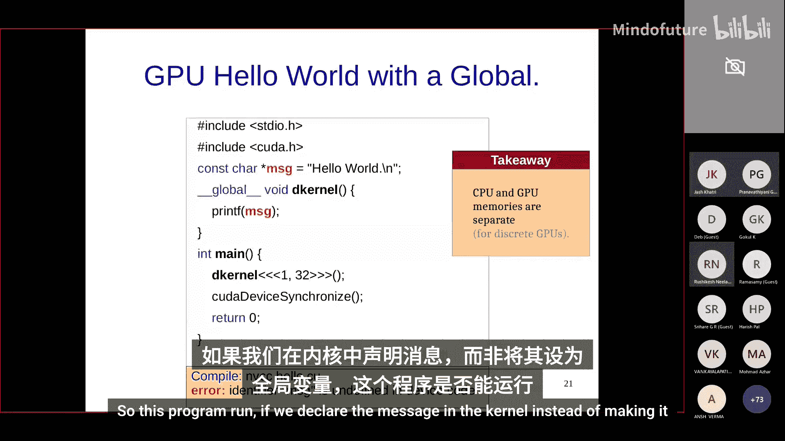

In the guilla。Instead of making it global。Yes， if you。Yeah。

 just taking your question with help of this slide。

 if you declare it inside this card inside this cardinal body and if you print it。

 it's your 100% work。Because whatever you declare inside the kernel。

 probably you might remember in our previous lecture that I told that there is something called a stack so if you declare some variable here inside the kernel it is allocated on either GPQ stack or inside its st。

It should definitely work and it should print the correct hello world message but if you declare it somewhere in the main or here then it is declared on this CPU stack or CPU key and in that case GPU doesnt know I mean GPU don't know like it doesn't share the Tgram with the CPU so it will either give this error compilation error or will cause sex。

Or we also can print garbage value and all those things。So we should take， I mean。

 we should know all these things that this uncertain behaviors can happen if we access this CPU memory from the GP。

So and I of a smart double。S关啊。Don't we need to use a format specifyifier while printing？

Yeah that' is correct， we need a format specify but yeah in this case Ive missed it。

 but yeah that' is sort of a synctic error。

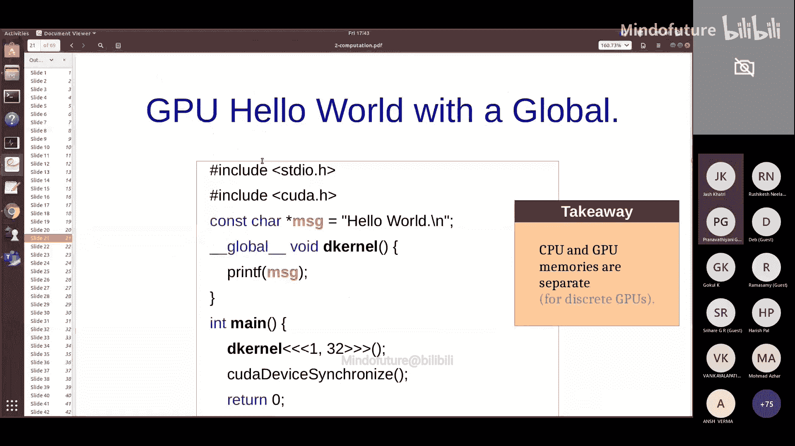

But I guess the main point that I wanted to make out of this slide was。This thing。

 C and GP memories are separate， but yeah， you are correct， we need to specify format specify。

Which I have missed here， sorry worked there。Okay， it's。

Mmo saying a host variable message cannot be declared in device function。 Yeah， that's correct。

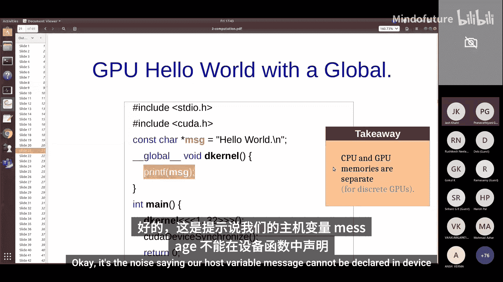

啊。But it's saying that it's a warning， I guess， not terror。Okay， it's also an added， okay。

Is is it a for everyone。AndProb there is some Internet issue。But。

Can anyone please quickly confirm if I'm not？112的。Let's say you audible， but it's breaking in。

Maybe it's because of your internet。 Yeah， yeah， there is some， I mean， there is power cutting。没。

Area， so sorry about that， but。So I'm currently connected with this hotspot and probably I guess by now it should be okay。

 I guess land is now connected yeah。Okay， I guess probably you won't， I mean。

 you won't see that issue again because now land is connected so。I will be much better now。啊。Sir。

 is there a reason for using a pointer instead of a variable for this string hello？No， I mean。

 there is no， I mean， we can also declare a character error instead of pointer pointing to that。

characteract error and yeah that should also work there is no reason behind it any such， I mean。

 no specific reason for that。I guess that they are sort outish。Okay， then I'll move on。我ベ。

TheNext slide。Okay， so there is one small modification now with this program。嗯。

Let's say instead of declaring it as a constant charge star message。

 I just replace it with hash to find message hello and then print it inside the GPU。Here。

Is that the ship you can do now I want you people to try out what will be the outputs of this。

Please try out and paste your answers in the chat and I'll be looking them。

We can understand it better。

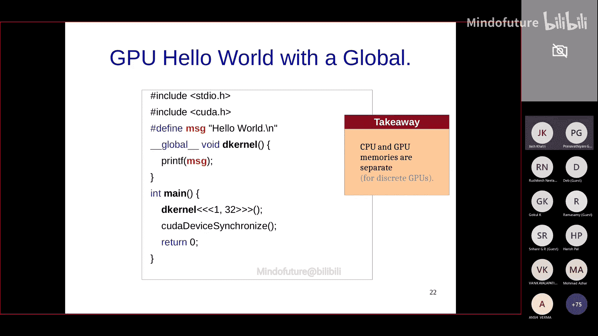

Okay， so I'll be going back to the chat。hello喂。Hello world， hello participating。

I lower talking two time。Yes， I guess most of you have got it correctly。

 I request others also to try so that。嗯。I mean， at least trying is important， as I say。Okay。

 I'll switch back to this slides and let's understand why it is printing I mean you are correct it will think hello 32 times。

But let us understand why it is printing hell over 32 times。

So the reason behind it is that when we tick， I mean。

 when we define just something you has defined then。

This syntax did identify and then the strength something that we want to replace it。

 it's a preprocesor directive。So what happens is before this program is compiled。

 all the preprocessor directives will be processed。So what will happen is。

Wherever this string message is there inside the code， it will be replaced by hellello world。

And due to this， I mean， before compilation itself。

 your code will be something like this print tap hello world here this message you want MST wont be there。

And hence， it is as good as writing print of hello。And if that's the case， this kernel launch will。

 I mean it will launch and will print hello world 32 times without any issues right because we are not accessing something which is on CPU here。

 we are just printing the string hello world which probably you might have seen in。

Previous lectures somewhere in the example， we saw that program right print hell world printed 32 times。

So it's exactly same as that program。And yeah， it should spread 0 hello well 3 your time if we compile using NVcc and run dot slash it out。

So key point here is hash define is okay because it's a prepressor director。

But declaring array or a string in CPU and then accessing one GPU is not okay since CPU and GP have a discrete memory or DM。

And please make a note of it。Okay， so moving on the next slide。So。Again， reiterating。

 So this is kind of a。Structure of， I mean， structure or somewhat。

Prief overview of how CPU and GPU communicate， so they both have separate data。

There is something called a PC Express bus， which I also mentioned in previous or previous to previous slide。

And。In order to， I mean， in order to access something on CPU or some variable or array。

 we have declared it on CPU。We need to make a separate copy on GP。

 and then we need to transfer the CPU array， I mean values in the CPU array with GP array。

And we need to do it for each and every CPU， I mean， CPU area or CPU。

Something variable or something that we have。So CPU and GP have discrete physical memories or DM。

 and CPU variable cannot be accessed directly in GPU kernel and vice ver vers size also to something which is declared in GP DM also can't be accessed in CPU。

So this is a very important point you should always remember。

 otherwise you will see several issues with your code。And。

When we say that we need separate copies of this variable。

 now it comes to programmer to maintain the I mean maintain these two variables。

 I mean it's our responsibility to declare a separate CPU variable as well as a separate GP variable or copy of separate GP variable and it's also our responsibility to keep both of this variable in sync so let's say if air is declared on CPU and it's initialized with some values。

Then it's our responsibility that we should allocate alert our wishes to manipulate that error GP。

 then it's our responsibility to declare it on GPU， meaning allocate it on GPU。

 and then also copy that values of that area， which are I mean values in that CPUU area to the GPU area before we start operating it on that array using the GPU in the card。

收。Okay， so that was the point that I wanted to make。

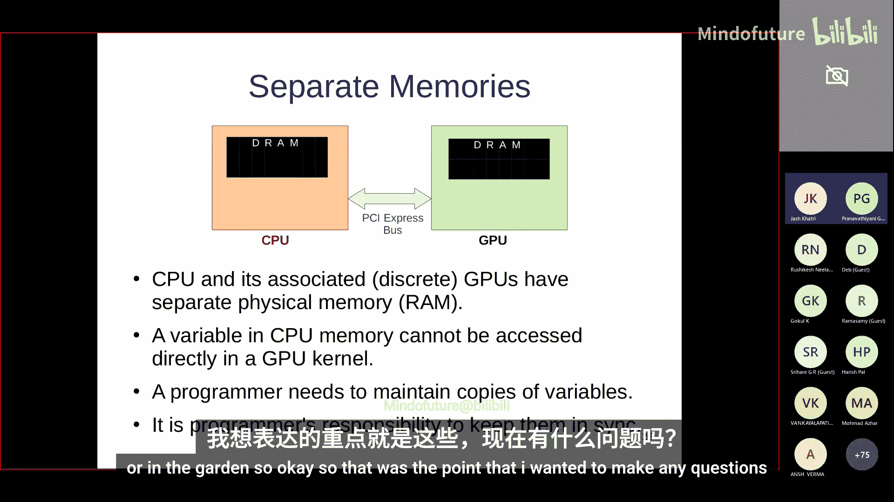

Any questions up now， I'll quickly， I mean， wait for a few seconds or quickly go back to the chat。

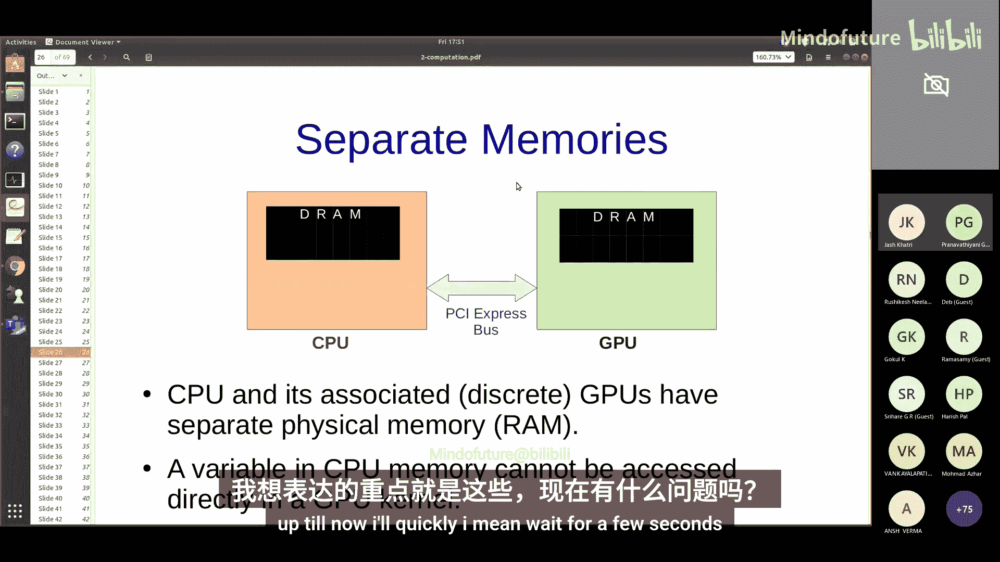

Yeah， correct。So sorry， this is my tool issue。 It's not related to that one。

T is like have downloaded 11。6 kR。I have installed the visual studio also。

But once again it is telling that NVCC fatal error， the path is not defined。

 but I made sure that I have given the path added the path on the environmental variable。

I don't know how to figure it out every time now I have a GPU but I couldn't be able to work。

 I don't know what is the mistake I'm doing。Maybe after this class。

 I will send a mail to you if you can come on Z or Google meet and something if you can help me。

 could be a better thing。Its just the if you have a type Yeah we'll see， I mean。

 after the lecture we'll see probably in lecture we won't because we are running out but yeah。

 we'll definitely see after the lecture。Or probably in the mail we will look into it。

 someone else also was asking if anyone of you have any questions。

 then please feel free to ask all to the content。Yeah。

So is there a possibility that we run both the GP and CP on a virtual memory？Yeah， that's a very。

 very good question。 So okay， so one thing that you should notice probably will come come to it in next slide。

That CPU can access file system directly， so concept of virtual memory is only applicable on CPU。

So like virtual memory concept is something like this。 So whenever you don't have enough memory to。

 I mean enough。DRA， I mean， in enough space in your D。

 you can swap and swap out pages from pages from DM to secondary memory and secondary memory to DM。

But okay， so its GP for GPU case， it doesn't have direct access to the file system。So virtual memory。

 accessing virtual memory for GP is not possible。I hope that answers your question。先帮我错看那个表。Yeah。

 please go ahead。诶。Assume that my PC has a unified web memory with my CPN GP。

 and I try to use the quo M copy or quoa ML， quo amlog or something。What would be the case， I mean。

 what would be the reason， would it sharp an error or anything like that。Okay。

 if you have a unified memory， then in that case， I don't think。I mean， if you have a unified memory。

 then that memory will be common between CPU and GPU， right？

I don't think that you will get any error in fact you will get any end benefit like you won't be。

 I mean， you won it to maintain。Separate copies， it will implicitly taken care by。The compile。Yes。

 but what if even though we have unified memory？And you use the or quo copy。

We it to show any abnormal actions or something？See as long as you have space in your GPU DM。I mean。

 separate DM or some space in your GPU DM。Uuda meoc will allocate the memory and as long as it is able to allocate the memory on your GPU D。

 it will not give any abnormal behavior。Let's say if there is a case that it doesn't have enough memory to allocate。

 then it might give some abnormal behavior。So， I mean， so。Talking in a very simple way。

 having a unified memory will not affect the functionality of coa。Is what I'm trying to say。

A in like the earlier code that we did， we like made a pointer to a GP memory and then we told the GP where that address is right。

 So would it also work if we have like a CPU address and then we pass that address to the GP until it to work from there。

Or will that be like Se faulted。Sorry， can you repeat your question？ I missed， sorry。like earlier。

 we saw that we made like a pointer to the GPp memory and then we passed the address to the kernel and then we had it work from there。

 right？Yes， yes， yeah。Yeah， so like that can we have like a CPU address and then pass the CPU address through the kernel and it to access the CPU memory or would that like cost like a sick fault？

No， that will cause， right， because C， you are allocating something on CPU now。

Even though it's passing， I mean， you are passing its address， but that address is on CPU， right？

So if， if you are and， and GP， I mean， Caral is something which is executed on GPU。

Now if you are executing I mean you are running something on GPU and you are trying to access something which is on CPU then it will it can cause abnormal behavior。

 it can print garbage value or it can even cause S fault or something I mean it will cause abnormal behavior so its not okay you always need to allocate it on GP I mean allocate memory on GP and then pass pass the pointer to it in the kernel。

And that's the correct way to do， yeah。So yeah， just just like the previous thing that you told might lead to some problem yeah。

I hope that's clear。Yes。Okay， okay， then moving on for。

I hope that it was clear to everyone that sequential you have desperateparate memories and。

We need to always take care during the allocation that we maintain the separate copies and keep them in sync。

数务边讲。And yeah， so now we'll look the typical。Cta program flow。

 how we will work with typical quota programs。So first thing that well do is well typically load the data since when we want to process the data in parallel and GPU well what well do first is we will load data from the file system into the CPU memory now when I say CPU memory it's the DRA of CPU which is the Ram or main memory。

Then。What we'll do is will。Okay， so let's say we have copied， I mean。

 copied some array or something like， let's say some metrics into the CPU strand。Sorry。

 now what let's say we want to perform some parallel operation on that error matrix。

 then what we will do is will。Tranfer I mean， we first of all。

 allocate thatarrow or metrics on the GPU using Qa and we'll copy that data from CPU memory to the GPU memory。

 which is shown in this step2。Y。So that's the step to once we have allocated the memory of our metrics or area on GPU and it from transfer that metric data from CPU to GPU。

We will execute that GPU kernel and threats will work parallel on that area or metrics to perform that specific task。

And once that task is finished are over。What we will do is will transfer or copy the results back from CPU to CPU。

So okay， so once let's say we have computed that are done that matrix operation that we wanted to do using GPU kernel and parallel using multiple threads。

 we copy that matrix spec from GP to CPU。And once this is over， what we do is we use the results on。

然后。What is using this result， it might be either we want to print that result or it might be that we want to store them back into the file system。

Or it also might be the case that we want to modify， I mean， we want to take the results。

 modify it and again load back to the GPU memory and again do some computation on the GPU kernel and then again copy the result back from GPU to。

So this step2，3， four，5 can be iterative。For example。

 it can continue till reach reach some fixed point。Until and unless， we have converged and。

This can go on and once we are done with the entire computation。

 we can do either printing or something that we would like with the final result。And yes。

 this is the typical quoA program。And for each of this step。

 now we are going to see the operations that that we will I mean。

 operations are functions that will use to do each of this step。

 so for loading the data typically we need ad。For reading the data from disk to the CPU memory。

Then for copying the data from CPU to GPU memory， as we saw， we'll need this function Puam M copy。

And the important point to note here is that we'll need quoda M copy with this parameter fourth parameter should be this from quoda M copypy post to device。

Because the host is， the。CpP and device is the GP， so host two device says that I want to copy data from。

CPU low GPPU using putda copy。And yeah， so and for the third step calling to the current GPU condo。

 we have already seen that we need to launch a condom with kernelnal name here。Then this。

Two parameters which specifies the number of threads and the arguments to the kernel。

So this is for calling the kernel part。Then the fourth step copying the data or result back from GP to CPU memory again can be doneus。

Good单 M copy。And again， the point to note here is that we need quo a M copy device to host a fourth parameter。

Because we are copying it from GPU to CPU， which is device。

 GP is called as CPU and CPU is called as post。And yeah。

 this was the specific functions that we need for each and every step that we saw in our previous slide here。

And once this is done for printing the results or using the results on CPU。

 we can use our normal C functions， like print or anything。

 for printing or F right for writing it to the P system。And so on those functions。

Any questions until now， I'll quickly go back to the chat to see。

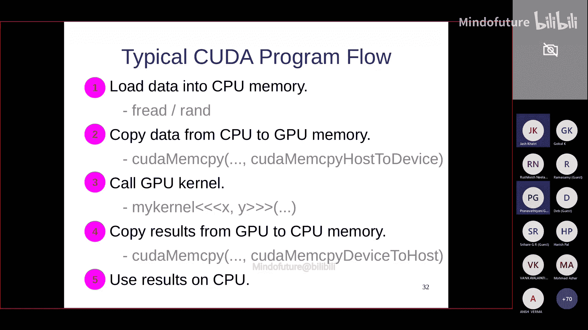

If you people have any questions。Normally in image processing while doing FftT， DW to DNN。

 we need good amount of memory， but GPU doesn't have good M capacity as compared to CP how to tackle this issue。

Okay， in this in that case， we probably need to load a part of image like probably will load a tile of image some tiling might be done and that tile that tile might process and。

That result will be copied back and then again。The next tile will be loaded and then that that tile will be processed and brought back and that in that way we can do tile by tile。

One second approach that we can use， I mean， that that we can use to tackle this issue is that we can use multicul use since。

Memory of one GPU is very limited， we can use， let's say8 GPUs and we can distribute the computation as well as the what I can say the data across all eight GPUs and once all those8 GPUs compute the results we can bring those data back into the CPU can merge the results。

So that is one that are two possibilities that we can use is there any DMA possible between post and device？

As far as I know， there is no direct memory access or something like that DMA between post and device。

 everything is through PCI Express bus as far as I know。Yeah， so that's about DMA。

And for the sew process， our operation GPS CPU size will be same or different。Yeah。For same process。

I guess it will be different。你 guys啊。Because I mean in CPUU process we have a single process right。

 I mean we have very limited number of threads if we have any in the CPU process but for the GPU process we generally don't launch a GPU process with a single thread。

 we have tens of thousands of threads on GPU。So I guess it will be different。

But if you are talking about exactly same process， then it might be the case that。It might be same。

But， I guess。I am not sure about it completely， but there might be some difference at least in this size。

Gs。I mean it depends right， I mean， it depends upon hardware。

 how much stack you are size of stack you are allocating， how much size of heap you are allocating。

And it depends from device to device， like GPU might have different policies for allocation of stackg and he and I mean。

 the size of allocation of stag and heap。So， I guess。It might differ， but I mean。

 exactly exactly how。Pro isあ。Processses， size are determined on sequential。 I am not sure about it。

Why do we， Why we do not print the results on Shiu can。Okay， why do we not print the results？

So G is something like think of it like a。What I can say co processor or something。

 it is used for computation and he can definitely print on it but。

Printing we would generally like to do on this CPU because。Let's say GP is made for， I mean。

 it's kind of a computation device and it's made for computing the large chunk I mean computing on the large chunk of data which have very high amount of I mean work that can be done in parallel。

So yeah， that's why we off the computationally expensive tasks to the GPU。

And wait for it to finish and then bring back result to the and then print it。But I mean。

 if you are saying that， why do it I mean？We can't do it or I mean can we do it or not， then yes。

 we can do it。We generally don't do it because of this reason。

The quoda programs but the file system file system is not available in GPU Noa。Yes。

 it is not available but printing for printing what will happen is like GP buffer will be dump back to the CPU buffer and then CPU will take that buffer that is dumped by the GP and it will printed。

Yeah， you are correct。 That file system is not available。 Priing is possible by。

Transfer of the buffer， right buffer。I hope that answers the question。I mean。

 it won't happen that GP will send the data to Iu or something。It will just send the data， I mean。

 the print data to the CPU and using it， I mean， it will be in the GP buffer and it will dump that buffer into the CPU buffer。

Priinnt buffer。 And then if we will print it。 So yeah。You're correct that Io is not there， but yeah。

 this is the way it is done。I hope that it is clear。Why do okay， yeah， that is do Qa programs run in。

Multiple ship。Yes， multiple， I mean。Ka programs can be written in such a way that it exploits the multiple GPUs and probably will see this in this course towards the end。

啊又系嗰币。Does anyone have any questions？Yeah， one more question if you look at that syntax of Qam and copypy。

Does's the order of variables in that matter。

Yes， I mean， order definitely matters First is the destination address。 Second is this source。

Third is the size that you want to transfer and fourth is the the direction in which you want to transfer device to go or goes to。

So yes， the order matters， you just can't place destination， I mean。

 you can't place source first and then the destination because it might cause multiple issues。

I hope it is clear。对。Okay， so moving on with our slides。So yeah。

 so this was the typical quota program flow and the functions that are。

That are specific to that step in that program flow。

Now important thing to note is this step number two。

 which says that we need to transfer data from CPU to GPU and GP to CPU in step number four also。

Which means that we need to maintain two separate copies for each and every variable， I mean。

 at least the variable that we want to manipulate on GP。So we should always， I mean。For example。

 let's say we want to have a want to compute some do some operational metrics then we want to we need to declare CPU matter and CPU matters to separate。

Metterric on CPU and GP I mean for one which is pointing to the CPU memory location and another which is pointing to the GPU memory location。

 same way for the array， probably the array example we saw as one of the example in one of these slides。

And it is important to distinguish between them by using a proper variable name like the array。

 I mean， the pointer which is pointing to the mem location in CPU can be named as CPU error and the one which is pointing to the mem location in GPU。

Can be named as GP URL so that we， we might not。 I mean。

 we might not by chance pass the wrong address to the GP kernel and。

Which might lead to some issues like Sacport and all those things that we talked in a couple of slides back。

Okay， so。That's fine。And now I want few people to try out。Other。特啲啊。

Try what will be the output of this program and see I mean。

 see what can be the output of this program and please type your answers in the chat and let me know like。

啊。What will be the typical execution flow and what will be the output？

Please try out in probably your notes or somewhere on online or somewhere end。Please。

 post the answer on。啊，别债。I'll wait for a couple of seconds here or probably a minute and then we'll move on。

I hope that you are trying。 Let me go back to the chat。

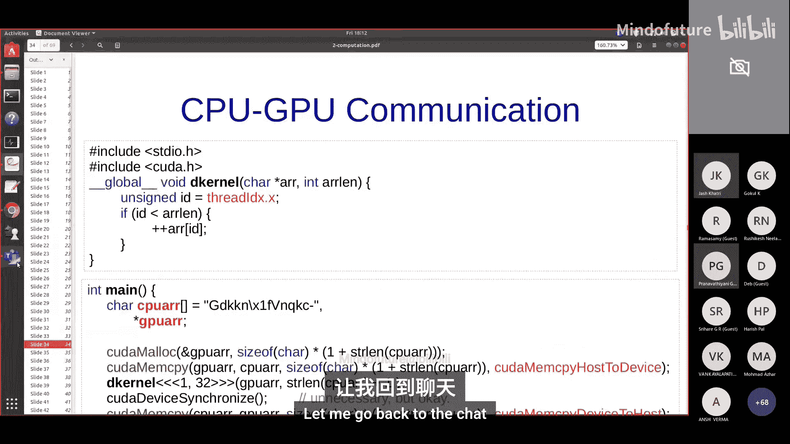

There are no responses up now。拜拜。I am assuming that you people are trying。

 I'll wait for a few more seconds here。

After that， we'll see how it works。And the if any。Anyone know if you have any doubts。没有。

Wing back to the chart。Okay。Again anyone has type anything。Im hoping that you popular try。还 least。系。

If you have any doubt， Rammasan， you have raised your hand。Hello。Yeah， please wait。

You people are raising hand， can just directly unimote yourself and ask if you。

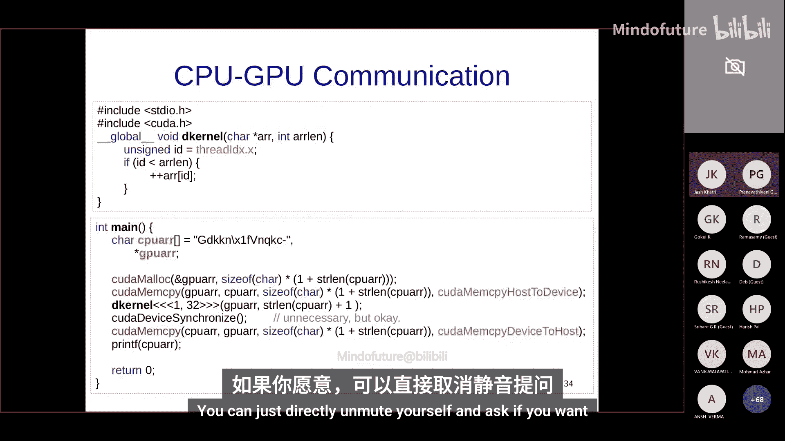

啊，说的。Please call。 hellello， We this answer。可以。😊，Sa hello， well this the answer。And。Yes。

 hello world is the answer， but there is small issue。 I mean， I think you might be able to。

See the issue。 There is a small issue with。Cd probably hell world is the answer。

 but there is something else to it。 you should be able to figure one doubt regarding of the code。

If in the court， we have like assigned ID， right？Yeah。Made like a variable and assign to it。 So like。

 will it create like。32 different variables， or will there be like critical section or something like that。

No， no， it will be 32 different variables for each thread。

So what will happen is this kernel will be executed independently by 32 threads and this unsigned ID。

 which is a variable， which will be it will be separate for each thread and it will be allocated on this stack of each。

And as we discussed in previous lectures stack is separate for each thread and the idea will be there on this step and it will be private for each thread so it won't create any issues Yeah。

 but that's a good observation。Yeah， but that's not teach。It should be something else with this。屋嘅。

あったりし。Hello is okay， but okay， I'll go back to this slide。 I'll tell you what what about an nu sir。

 will that get ined also Yes， yes， that's the H exactly so。Like， okay， let me explain it。So see。

 this is the CPU error right I mean this is the string and its address is being pointed by CPU error。

Now there are total 13 characters in it， if you observe it very carefully， this first fire GDKKN。

Then sixth character is the slash 1 f，7 is v and Q89，10，1112 character is the dashsh。

And the 13th character is the one which is normally appended in the C style string， which is slash0。

 which marks as the end of the string it is on its end。

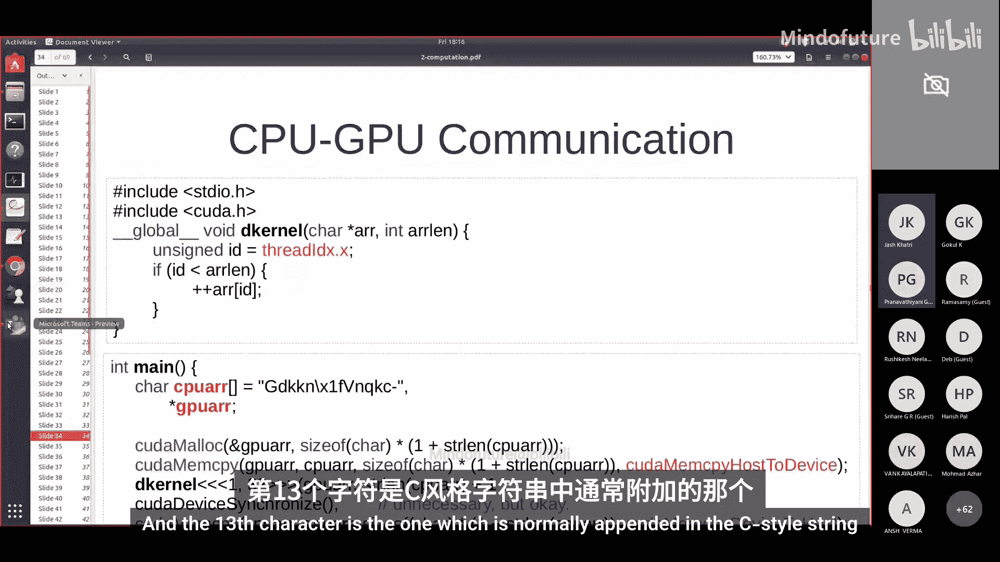

Dlimeter for this string。And that is added by default when we declare a string like this and C。

 so 13 characters at the right here。

And thats okay there this a string I mean this error CPURr has 13 characters。

 then we have declared a pointer star CP error。Now what we are doing is we are allocating the memory that is correct using GP error visual sorry we are allocating the memory of size while plus1。

 please note that string length will count up till this s sorry slash0 character which is the delimiter。

So it will come 12 here by am STRLN will come 12 plus1。

 so 13 size character error will be declared and its address will be given to the GP error so GPU is pointing to some 13 size character error which is allocated on GPU and it is pointed and its address is pointed by GPU error which is a CPU pointer okay。

Now we are doing Qa M copy and this is also perfectly done if you see。We are copying CPU error。

 which is the entire string of size 13， including null character if you see。

Of size 13 is being copied from CPr to GPr， including that slash0。

Because STR alien plus 1 is 13 and 13 character was that slash。So this is also not a problem。

But the problem comes here during this D kernel， we are launching the kernel with 32 threads。

We are passing this CPU error， that' is also fine， but we are giving this STR alien CPU error。

 which is 12 plus 113。And what will happen here is。

This ArR line is 13 AR is okay it's pointing to some GPU string which we allocated here and we also copied it correctly。

But what will happen is this we are going from 0 to 12 I mean， so I will2 I mean。

AThread 0 to 12 below this operation。 So 12 thread。

We also so the 12 thread will operate on that slash0 character if you remember that0 character is this g and 12 character which is the last0 character is this and last character 12 character is that slash0。

And 12th thread， which will work on 12 character， which is PRR of IDD and ID is 12。

We also increment at slash 0。And that was the end of the string character and if we increment it。

 we'll lose that delimit。And what will happen if we lose that diameterit will cause problem in printing？

Because。How， I mean， mostly C styleyle program works in that way。

 it will print the till that until that slash there encounter。And if that is not there。

 it will keep on printing and it might happen that it might s part it might give some abnormal behavior。

It might also print some garbage value and all those things can happen。So okay。

 so why I'm telling all these things so it's very yes it is printing garbage Yes， yes。

 it will happen because。Because as I explained， the reason is that we are incrementing that slash zero。

 which we shouldn't do。So the key point that I wanted to highlight from this slide is that we should be very。

 very careful when we manipulate these strings with the threads。

 we should always keep track that we are not manipulating the like delimiters here like as we are doing in this case。

And if that happened in luck we are lucky here that we are getting garbage。

Let's say it might also setpoint because if we try to access the memory， which is beyond， I mean。

 beyond the GP use STM or something we try to access， then it might give Sfold。

Or process size or something， then it might give set。So this is very important to not。

I would like each and every one of you to make a note of it so that you。

 whenever you write your code， you just don't jump into such issues。

It's very important to keep note of all this。 and yeah so next you'll see the correct code。

 so correct code is we need to remove this plus one， which is the correct code。

And now if you run this code。It will give hello wide as the output。

Because essentially what the code is doing， it is incrementing each and every character of this string。

So this this string or this character is first of all， declared on allocated on GPU。

 then it's copied from GPU to CPU。Then each character is in。

And if you implement this each of the character， you will see that its and hell over。

And then we are copying GPR to CR。hi is we are copying the hello world from GPU memory。

 which just declared here with the CPUU memory which is this GPUarrow and then we are printing it here。

 so the result will be very I mean I mean we all know that it will be the hello world now。And yeah。

 that's it and then the main function will return and yeah， that will be the end of the execution。

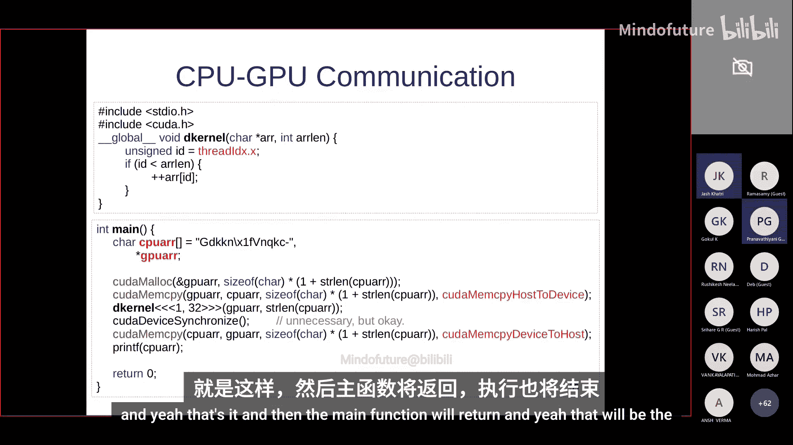

So any questions still now， if anyone have any questions。Yeah， so I guess so。HThis is correct。

 it might print some garbage here。Okay， so。If none of you have any questions。Yeah。

 please while incrementing， does the pre increment or post increment have any difference there？Okay。

 let me go back to these slide。

Here in this case， there won't be any difference， but pre increment and post increment will only cause difference if we are。

If we have， let's say assignment here， like let's say we are assigning the value here to some variable。

In that case， it might happen that that variable might get。

The different value based on pre increment and post increment， but for this program。

 I don't think that it can cause any difference。

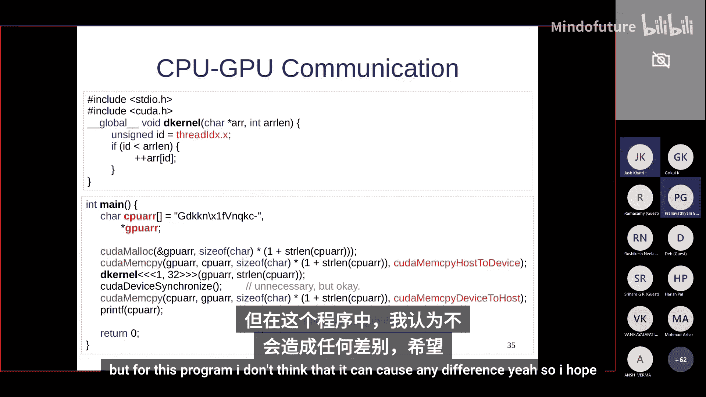

Yeah， so I hope that answers your question。Go good right， go goodlia。Yes。O呃。So okay， with that。

 Ill move on with next slide， probably the last slide for today。

诶。Yeah。for you people。啊。We want to write a simple quoa program to initialize the error of size 32 to all0 in parallel。

 so it should not involve any loop and we want to initialize all the 32 memory locations of the array to 0 using the 32 threads。

That's the simple thing that we want。I want every one of you to try and post the answers on the chat。

I think it's simple。 like， it's very similar to the。Program that we see we saw previously， I guess。

Okay。

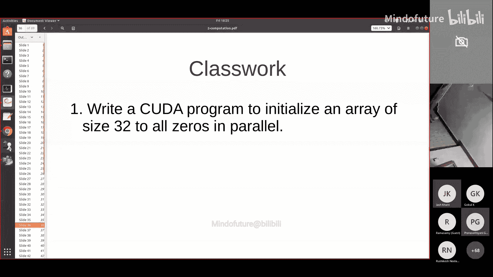

I hope every one of you。At trying。

For the same code that we used for M square。 we can just remove the M square and。

This laser are zero also so perfect， perfect， I mean， we can use that thing。

So we can just use that code and。It will work instead of thread ID x X into thread ID x X。

 we can just replace at 20。And that will change and。Yes。

 and I started to because in that case it was 100， yes。So that will initialize our I。

All the elements of R array， which is of site southern 220。Now。

 what will happen if we change that n to 10？If you do this。

 I' will probably not tell you people to do right now， but if you do this。

 you will see that still it will work。But let's say I go ahead and okay。

 if I tell you to do this that you create another column kernel and。啊。That area that you used。

 I mean that you initial lies to all zero values， which is now of size 1024。

Take each element of the array and add I to it。40 size 1，0，2，4。And。Even this code， I mean。

 this will work， we just need to write a kernel in which we need to write this， right？

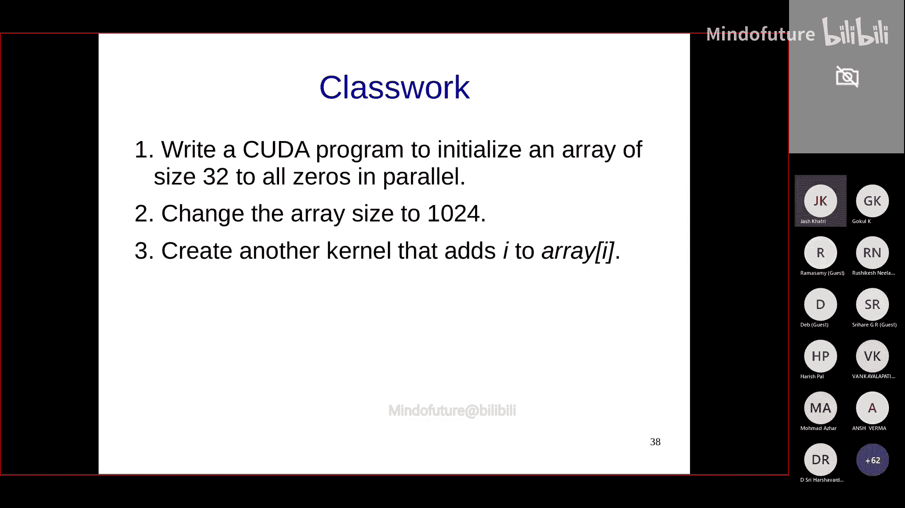

go back toち。When could just do this era of。系。Pect。That's the question for。

Inside a separate column we want to write we need to write this statement in order to。

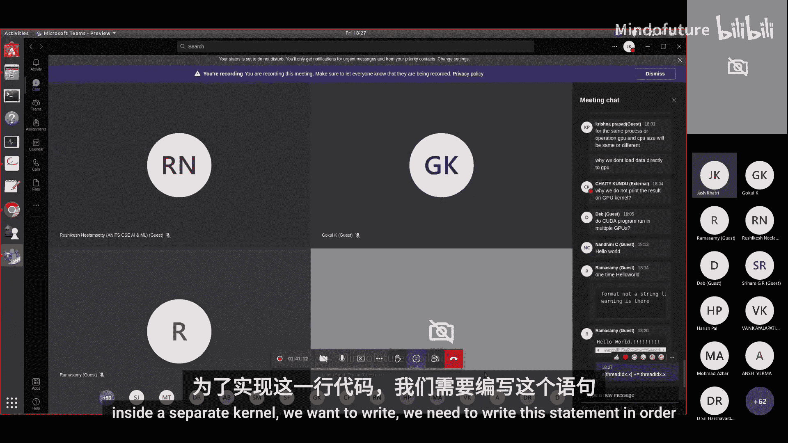

In order to implement this。This name。Okay， so that's cool。

 I mean we will be able to do it for the area of size 102 per without any issues。

But now let's say if I change the size of the  error to 8，000， and I launch the kernel。

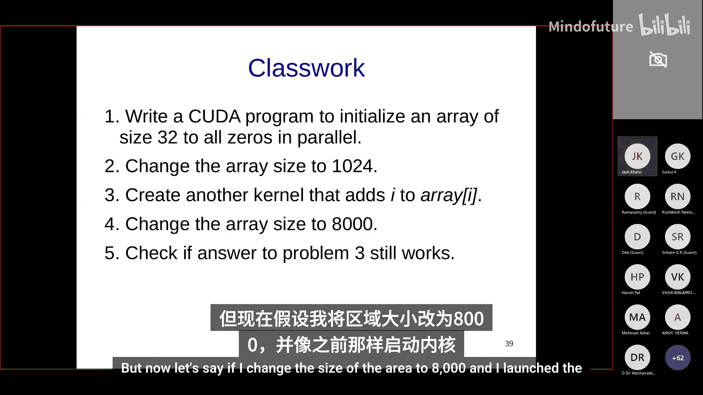

As we do in the previous case like this。Is to launch kernel like this head， the kernel。换过吗？血涛生。

And then some parameters here。If we do this。

Sitching back the slide if we do this。We changed this as size of the area to 8000， and we， I mean。

 launched the kernel I ci in the chat。Using 8000 trips， then you'll see their D。

The code that they I mean the corner that we wrote for three， I mean。

 for implementing this third statement。Once work， there will be issues。

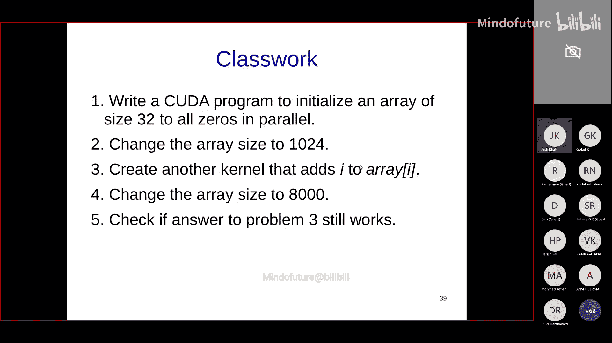

The issue is that the。Issue is this。 So issue is that the second argument， which is this。

Which we pass to the government， it has a limit on it。They can't add more than 102 sorry，1024。Ts it。

And yeah， there is something called a thread block， which is denoted by this second argument。

 sorry number of threats inside the thread block， which is denoted by this second argument。

And that has a limit of 10。So if you want anything more than 1024 to specify here， you can't specify。

 but does that mean that we can just launch10 kernel with just 1024？I mean。

 we can to launch quite bit。More than 102 point，But for that。

 we need to take second parameter in account and probably will see from next lecture onwards how can we make use of that second parameter and can launch the kernel with。

Very large number of threats， not just 1，0，2，Okay， so with this， I'll stop today。

And I'll wait for the questions。From you people。

