# 【Nvidia】CUDA并行编程-｜-Cuda-Programming-Course-｜-Parallel-Computing-Using-Nvidia-p03-P03_L3_CUDA中的线程组织与线程块--BV1MSq1BTEho_p3-

Okay， yeah， so hello and welcome everyone to the fourth lecture of our KUDA program。So。Yeah。

 so so far we saw like in the previous lecture， we saw that。

How we can use like good ML lock and good ML for allocating the memory on the GPU and。

Could MM copy for transferring the data between CPU and GPU using a typical small program which use。

 I mean， using， I mean， using which we wanted to initialize the array on GPU using the squares of the numbers from 0 to 99。

And yeah， then after we saw a typical quoa program flow。In which。

We saw typical Koa program flow in which we。I mean， there was a couple of steps involved in it。

 first of all， we copied the data from。File system to the GP CPU DM。

 and then we move the data from CPU to GPU GPUs DM and then we did specific computations。

The computation on GPU using a kernel call and then we again push the results back from JU St to the CPUU St。

And。Then we printed the results on this CPU。Yes， so that was the typical KUDa program flow that we saw in the previous class and then we saw the couple of examples。

And at the end， we saw this slide right we ended here that。

We want to write a quoa program which initializes the area of size 30 to2 to all0 in pad and then we change the size of area2 from 302 to 1024。

And then added I to each and added I to each。嗯。HR is a particular index to I mean we added I to each index location in that area and yeah so we saw that yeah that program was working。

 but as soon as we change that。10，2，4，2，8，000 that second parameter in the kernel launch， we saw。

If we change that to 8000， the program won' work because as I stated in the previous class。

 that there is something called as。That， I mean， there is something called as block block and。

The typical size of that block can number of thread in that that block cannot exit。Than 1，024。

 and yeah， so that is where we left yesterday。And for today's lecture。

 I'm planning to cover the thread organization。And so particularly why， I mean。

 how the threats are organized on GP and。Then we'll see a couple of applications。

 one dimensional and two dimensional， how they。One dimensional and two dimensional applications can be written using that。

Tat organization that that we are going to see。And then probably if we get time at the end well probably also see matrix squing。

 but yeah that depends upon the time。So let's begin。So in a particular， I mean。

So we saw like how in previous sector， we saw like how we can launch the kernel using multiple number。

And one thing that we， I mean， we should know here is that when we launch a kernel。

 it launch as a grid of threads and。This grid is a sort of three dimensional data structure。

He has a three dimension。Think of it like a rubric cube， like if you see a rubric cube。

 it's like a cube。And inside in that cube is made up of multiple small small cubes， right。

 so think of it think of the grid as something sort of a rubric cube。And。

This grid has threats inside it， but there is something more to it。So yeah。

 as I said that this grid is a three dimensional data structure and one more thing is this grid is made up of threat blocks。

M in I mean， much in similar way as that rubberric cube is made up of that small small cubes think of a rubric cube as a gridit and that small small cubes with which it is made as a threat to block。

So we have a grid， which is made up of multiple threat locks。

And this grid is a three dimensional data structure。

 so in order to identify a particular thread block inside a grid uniquely。We need it。X， I mean。

 to identify the threat block uniquely inside the grid。We need its x， Y and Z coordinates。

 which are given by block ID xt X， block ID x dot y and block ID x dot Z。And。

Since there are three dimensions to the grid， its their x1 z dimension。

 they can be accessed using grid dot X， grid dot5 and grid drop set。So again。

 grid is a3 dimensional data structure， its x y and C dimensions are can be obtained by gridt dot x。

 gridt dot y and gridtm dot set。And in order and I mean， as the grid is made up of threat blockss。

 in order to identify each threat block clinically inside the grid with a block ID D extra text。

 block ID X y。And block Idx dotet。Okay， I think we are still up until now。And next。

As I told that each I mean grid is made up of threadb and okay so what is thread block so threadb is again a three dimensional data structure。

And this threat look consists of threads and again， the threats are arranged in three dimensions， X。

 Y， and z。So。Coming back to our rubric cubes analog analogy， think of， I mean， grid is a rubric cube。

 thread block is that small cubeic with which the rubric cube is made and thread as something which is I mean the material inside that saw that small subcu。

嗯。Okay， so thread block consists of threats and typically threats are arranged inside a thread block。

So as， I mean， as a thread block is a three dimensional data structure。

 it again has three dimensions x， Y， and C， and in order to access each of its dimension。

We need thread， sorry， we can access it using Block Team X X， block team Xt y and B Team extract set。

This will give all of its size of all of its three dimensions and yeah。And。

So as I told that that threat block has multiple threads inside it。

Each thread each thread insert that third block。Can be uniquely identified with， again。

 three parameters or three coordinate units， x Y instead instead。

 because threat block is a three dimensional data structure。

So accessing a thread inside that thread block， we need it x， Y， and Z for。

And that can be accessed using something called a thread ID X text， thread ID extract I。

 and thread IDX。So I'll pause here for a couple of seconds and if you people have any question。

 you can post it on chat regarding this slide。

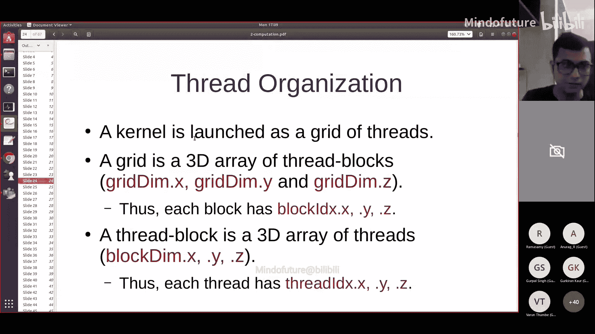

studyud， yeah。Any questions so far。So we help， yeah， I guess we have many participants。

Can you give a recap on carddis？Okay， so I mean， you are telling how to launch a kernel。Andind of。

Cannot understand your question like carddial。You are are you asking your question is like。Soir。

 what is the maximum number of blocks possible in 1024？10，2，4 core GPU。It is， I mean， it is a very。

Hardware dependent question， and。The different GPU might have different limits on the number of blocks that it can。

 I mean， with which it can be launched， the cardal with which， I mean， the cardal。

 the number of blocks inside a cardal。Are typically different for different ship use。Yeah， I mean。

 can you explain where can we get that information， that's what I'm asking。Yeah。

 you can refer to NVDS documentation probably will get something from there Okay okay okay。

 thank you。Yeah， but it's very， I mean， GPU specific， I mean， particular GPU specific question。But。

 I mean， meaning it is dependent on that particular GP is what I'm saying。I mean。

 can you explain what is a kernel sir okay， so kernel is a think of it as a function normal function。

 but that is， I mean， it' is a function which will be executed on GP。

Like you might have seen CPU functions till now， which I mean which are executed on the CPU score。

 but GP is a sort of function， I mean a kernel is a sort of function which will be executed on the GP。

So that's a very simple definition of a government。Okay， so any questions up now on that slide？

Otherwise， I。关。No no， it's。It's not similar to the GP sorry， O card。

Woice kernels are different voice kernel is the part of the code， which is load。

Part of the Ois code which is loaded in the main memory and that code is responsible for managing multiple things yeah but this kernel is different yeah so don't confuse that kernel with this kernel。

啊。Yeah。そ吧。福极啊。Okay， if there are no questions further and I'll switch back to the slides。And。

Yeah I'll turn off the video for now to save the bandwidth here。嗯。

That's fine。Okay， let's get back to these slides。Okay。

 as I mentioned that grid consists of three dimensions， sex， Y and Z and。

Then grid is made up of thread blocks and I mean each thread block again has three dimensions x， Y。

 and Z。So okay， so one question that you might ask that。Can't we， I mean。

 can't we have less than three dimensions。 Yeah， I mean， that's a very valid question。

 I and the answer to it it is like。We can even have。Right， I mean。

 we can even launch a grid which is not I mean， which doesn't have x and x。

 Y and z dimension grid can have just one dimension also in a similar way a threat look can just have one dimension。

But at max we can have three dimensions， so thread can have any dimensions ranging from 1 to3。

Similarly， a third block can have any dimension ranging from one to three。

And in case if any of the dimension is missing， like let's say。

 we just want to launch a grid with one dimension。And second and there are no second and third dimension in that case。

 those dimensions will be zero so yeah， so there is there is a possibility that we can just have one dimension or just two dimensions。

For any of grid or thela。So that is one point that I want to make up the second point is。Yeah。

 so let's come to the second one。Right。Hello。Okay， so yeah。

 so let's come to the second point that I wanted to ask。So， the second point is， like。

Let's say the dimension of the grid in x direction is 10。And。

Dimenssion of gridit in y direction is let's say and insert dimension at7。

Then what is the value of this block I extra text dot y and dot c， I mean。

 what are the range of values that it can take。I want teaching and every one of you to type your answers in chat。

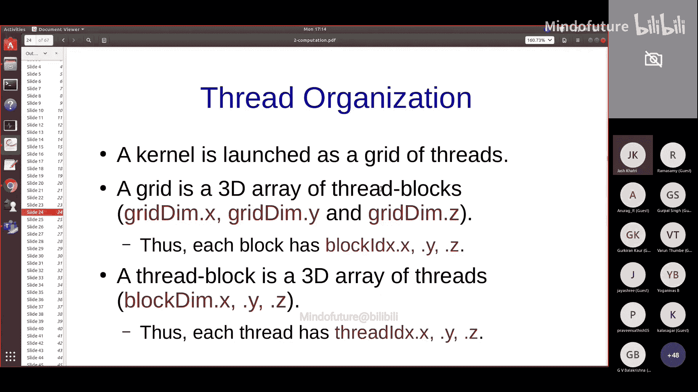

我都 the check。So my question is。得点。Dt x equals 2。跟。Then。And similarly， dot y equals to phi。

And not said those to。Okay， let's skip it6 and let's。Rot side is7。

And what can be the range of values that。

What can be the range of values that。Block ID x or text dot1 and dot C can take。

Can anyone post the answer in the chat？I question each every one of you to think about it and。

Let me know the answers in the chat。Yeah。Okay， I'm going back to the chat。

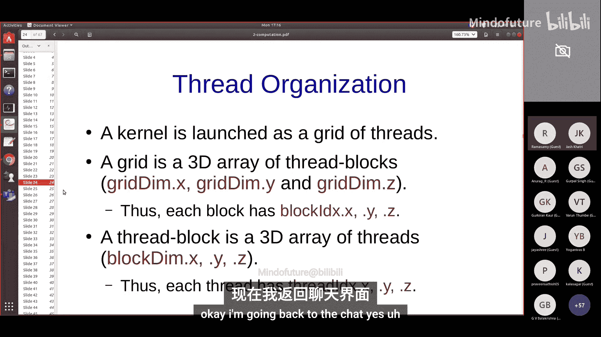

Yes， that's correct，029，02，5，026， yeah。0 to nine， zero to5， zero to six sense that's correct。嗯。

It will be a thread ID extra text， not3 dim X。So create team x is a dimension。

 So it's it's like a size， So itss values fixed x values10， but thread I x dot x can。

Go from zero to9。I just wanted to clarify that dramamaam and。YeahBmo is saying yeah 0 to 9，4 x。

I think you people are correct。I request teaching every one of you to try so that。

We can have clarity。Someone has raised the hand if you have any questions。

 you can directly unmute yourself and ask。Okay。有计嘅数。0 to9。Yeah， I think you'll be。Getting， I mean。

 understanding it properly。So let's get back to these slides。

Okay， since dimension， I mean， x dimension has size 1。So block IDd extra text can go from 0 to 9。

And that since y dimensions， sizes6。As in our previous example。

 block ID xt y can grow from 0 to5 and similarly for set， it can go from0 to 6 because its size is 7。

So I think you got it and yeah one more point that I wanted to make was like even we have this three dimensions we can just use one dimension out of this three dimension and make all our application work。

Yeah， so that was the second point。So I'm moving along these slides。

So typically putting this in a pictorial point of view， I mean， as a picture。

So we have this CPU side right where we have I mean the host is launching the kernels and this is a timeline so at that at this point in time the kernel one was launched by the。

First， and then the current tool was launched。And as I said kernel can be launched。

 I mean threat can be of any size， can be told I mean it can have any dimensions from one to three。

In this case， we have launched a grid with two dimensions where。

X dimension has size2 and y dimension has size 2。And。Okay。

 so as as the grid is to cross to in their dimension I mean in this size。

 so each block inside a grid can be accessed using I mean， can be identified using。

Block ID x dot x and block ID x dot y， so in order to identify a particular block， we will need to。

Two values， which is block ID liketrot X and block ID x1。

And that both value can uniquely identify a particular block。

 so let's say this block if you want to identify then we will look at the block I x text and block I extra y and we will get that both the values are0 so this block is0 or 0。

Similarly for this block， block ID x x 1 and block ID x y0， so it's block number one comm 0。

 and so on for the rest of the blocks。And as I said。Each block can be each block again。

 has three dimensions。It can also have one dimension or two dimension， but in this case。

 it has three dimensions。So since it's a dimension。

 threads inside this block are arranged in three dimensions， X， Y， and Z。Y and Z。

So in order to identify a particular inside thislock。

We will need three coordinates or three parameters and that three parameters will be given using。

Thread ID Xt X， thread ID X dot y， and thread ID X dot C。So。

 you can see how a particular block is projected。Here。And。And this first thread。

 which you can see here has thread ID X X as0， thread ID X y and thread ID X set as0。哦。

Does anyone have any question hello？Okay， I guess it was some wise then。So okay。

 so so a particular thread can be identified using its。X， Y， and Z， IDD。

And that was what we saw in the previous slide and here it is represented pictorially。So， well。

 that's that's okay。 And again， after， after a particular point in time。

 our host or CPU is launching another。Whi has three dimensions。X， Y， and Z， I mean。

 which is a three dimensional。Crid meaning which is x Y， and C dimensions。

 so in order to identify a particular thread block inside that grid。We'll need three dimensions。

 drop block in X x， block them extra y， and block them extrat same。Yeah。

 I think the point is clear here。That bread can have。

The grid can have three dimensions and a particular third block can have again three dimensions。

 it can have less than it， but yeah maximum is three dimensions。

And based on the dimension of grid and the dimension of thread block。

We havell need different different parameters for identifying the threatb and thread inside the threat。

So okay， so get this， I'll move on and。So again， this is sort of a recap。So。

In order to identify the thread block， you'll need， I mean。

 each thread block can have three dimensions。And each thread block can either be of one dimension。

 two dimension or three dimension depending upon the size of the grid and each block thread block can have threads。

Arranged in one， two or three dimensions。で商品啊。

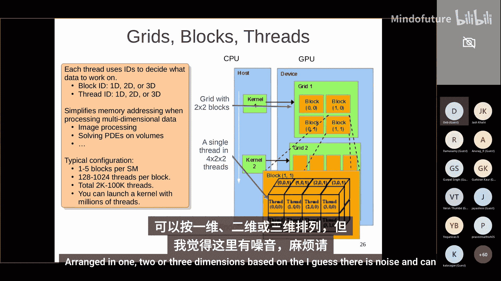

你。I guess there is noise from。And。Can this hello。Can you please move you。Okay。

I request each and every one of you to mute unless you have any question。

Authities we will have a lot of such interruptions。Okay thanks， thanks for muting。

 I'll come back to questions， but let me switch to slides first。

Okay， so the point that I was trying to make here was。That blocks can have， I mean。

 threat blocks can be of one dimension two dimension or three dimension depending on the side I mean。

 depending upon the dimensions of the grid。And each thread each thread can。

 I mean each thread can be arranged， I mean， threads can be arranged in one dimension。

 two dimension or three dimension， depending upon the dimension of a thread block。And yeah， again。

 so one more question here is like。we can I mean as I said earlier。

 instead of using three dimension we can use just one dimension and that would work perfectly fine。

 but why do we need these three dimensions then so in some particular applications this is having this multiple dimensions and arranging the threads in this three dimension data I mean three dimensionsal data structures。

Is sometimes helpful such as an image processing application if you want each and every thread to be associated with a particular pixel。

And like let's say the image is a colored image and in that case it is a three dimensional like tens or some sort of tensor ten in that case we want each and every thread to be associated with a particular cell or a cell in that three dimensional matrix。

Then in that case， the ID calculation will become very。

 very simpler and well see some of the examples later。

And the second example is while solving partial differential equations on the volume。

 so in that case also we have multiple dimensions and all those things。

Handling and IDD generation becomes simpler to few。

Three dimensional threads and three dimensional thread blocks。So yeah， that's it。Okay。

 so coming to the next point， so in a typical quoa program。

You will see these configurations that I mentioned here。

So each thread block will be sorry one to five thread logs will be allocated to a particular streaming multiprocessor。

So what is streaming multi processoror， first of all。

 SM transport streaming multiprocessor and think of it like this， we have this GPU。And each， I mean。

 there are。15 to 25 streaming multi clusterrusors inside the GPU。

And each streamming multipresser can have somewhat like 40 or 50 cores inside it。So yeah。

 so that is what is streaming multipler， so GPp is composed of streaming multipresser and each block。

 I mean a particular block when a kernel is launched a particular block is assigned to a particular streaming multipler。

So yeah， so that thats what I was trying to that's what I was trying to say one to five blocks are assigned to a particular string multipressor。

And in particular， there might be 1。821024 threats in a particular threat block。And in total。

 your application might have some 2k to 100 K threats。And these are typical numbers。I mean。

 this is what generally is observed。And in general， it's I mean it seems， I mean。

 we can see that we can launch a panel with millions of threads。Okay， so I。

Pause here for some second， and。

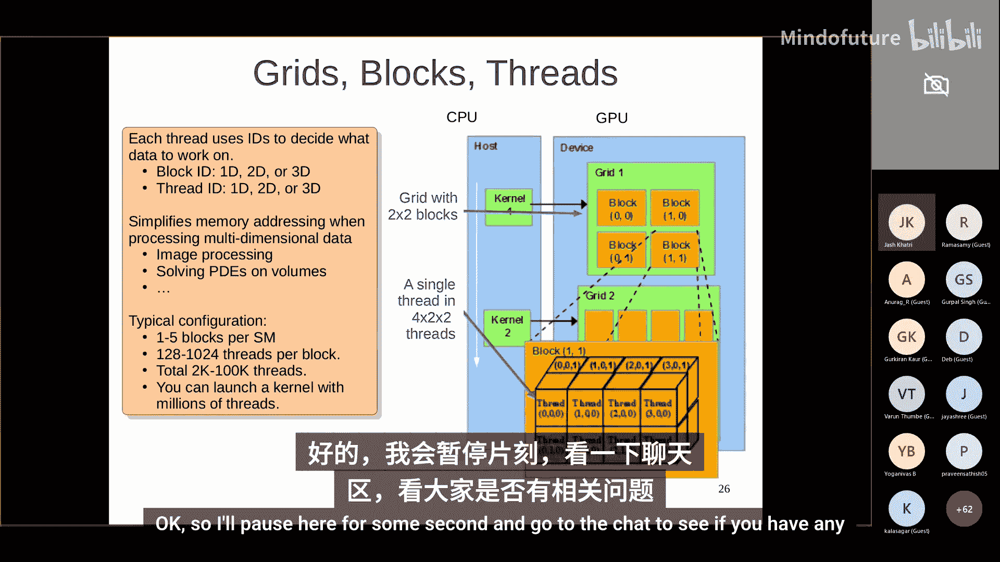

Go to the chat to see if you have any questions here。Please explain great demos。Okay， so， okay。

 So create them access。 Like you can think of it like。The x dimension of your grid。

So grade is a three dimensional data structure， as I explained。

And the x dimension of that grid is given by grid dimex。I hope that answers your question。O。Okay。

 so moving on to next question。Sir， I am unable to use Google Colab。啊， that is是 video。

Which demonstrate how these Google collapse。那下来。In the sheet， we have that video。

 these go through that video。If you have any questions， then。Pos it in the group or you can mail me。

O。Gd is also 3D， am I right？Yes， grid is a three dimensional data structure。

And I wanted to know typical configuration of number of grids for understanding。

Tooppical configuration of number of grids。Blocks and threads are clear in your slide。Okay， so。Great。

😊，I mean， think of it like a single big data structure。There is， I mean。

 if you launch multiple kernels， then then there will be multiple number of grids。

But for for a particular kernel launch， there is only a one grid。And inside that grid。

 there are multiple thread blocks arranged in three dimensional or two dimensional or one dimensional depending upon the dimension of the grid。

Number of the dimension of the grid。And thread since clear okay， I hope that was clear Rammaammi。

If it's not clear， then you can unmute and ask。 I mean， there is no， I mean。What it's the fine thing。

オッケー？Okay， thanks for confirming I there any fixed formula to get unique thread I I saw a few formulas around unable to confirm the right one Okay so。

Yeah， that's actually a good question， so to cal a unique ID using this。Great teamme， I mean。

 great teamme and dotX and all those things that we saw in previous life。

There are a couple of formulas and it depends upon the number of dimensions that you are using so let's say you have two dimensional grid and let's say three dimensional thread block then you need to use a different formula as compared to the one as compared to the case when you have one dimensional grid and one dimensional thread block。

So we'll see a couple of formulas in this slide and we'll also try to understand them。But yeah。

 I mean。There is one fixed formula for a particular configuration I would say like let's say you are just using one dimensional grid and one dimensional tb in that case you will get a one fixed formula but for different different configuration I don't think that formula will remain the same。

I hope that answers your question hellman。哦。Then what。Was the role of S M。O啊。Okay， so think of SMSs。

Some sort of core， I mean。SM stands for streaming multipresser。Think of it as a。

One core inside which there are I mean， not a core like it has multiple core inside there， but。

Think of it as a unit which host the multiple courses of the GPU。In that way。

 you can take like it's a one unit inside which it can have multiple cores。

And the what was the role of it， so the role of it is like each streaming multiprocessor will be assigned。

Multiple threat blocks。So that that is what is set role。 I mean， the role is。Absolly。

I hope that's clear。그렇。The is the stensor same as the metric stensor used in deep learning？啊。Okay。

 so the。So what I was talking about was like。3 dimensional matrix sort of thing for I mean。

 for like in colored image we have this。RBG right， so we have x and y dimension and the third dimension is that color dimension。

So I was talking about that and I don't know if that is very similar to this deep learning tensor or what I mean but I don't know about it。

 I need to look into it。But the one that I was telling in that example was this three dimensional matrix。

 think of it as a three dimensional matrix。Okay， luxur thing。 I have also watched your tutorials。

 Okay， in that case， you can just post your， I mean。

Post your error in the Google group or you can also mail me with your errors。

Vice breaking now and then each block has 1，0，24 threads。ok。O。I guess。Everyone， I mean。

I am hoping that everyone is with me。

And。In that case， let's continue with our slides。And in case you have any questions。

 you can just unmute yourself and ask。Let's move on further。So let's， I mean。

 we saw this all this right。Creit Tim dot x and C ti dot y and all those stuff。

 Now let's see how to access this dimensions insider。gar or g yeah gU gar。说。Forect。

I am launching a kernel， but first of all， I'm defining a gridit and a block。

So here you will be able to see that Ive declared something， I mean， I have this team3 something。

 so what is this this take this as sort of a data type。And then I have written this grid。

 so this grid is just an ident you can replace it by any any other name。

So I'm declaring a sort of a variable which has three dimensions。

And its all these three dimensions are specified here。

 so this two is x dimension three is y dimension and4 is this that dimension。

So I have declared something called a script， which has two assets x dimension。

 three assets y dimension and four assets set dimension。Then I'm also declaring again。

 something called a block using that same data type team 3。With x， y and z dimension as pi6 and 7。

Great， now I'm launching this。Now， I'm launching up Car。With the great comma block。

With grid and block has the parameters in it。And yeah， after that。

 I have CS Qa device synronized and then we are written。And then。Okay。

 so then coming back to the cardinal part。Inside the kernel I have written this thread ID x to x equals20 I mean I have written this condition which says that a thread ID x to x is 0 and block IDX to x is 0 similarly for y and for said if this condition holds。

Then I'm， I'm printing these dimensions， X Y said。For the grid and for the block， again。

 X y and itself。So。I have two questions for you， people here。First question is。

 with how many typess will this kernel will be launched？That is the first question。

And the second question is。Like what will be the output of this program。

 how many lines will be printed and what will be the M， what will be those lines？Okay。

 so I'll pause here for a couple of seconds or probably a minute。

To for new people to try out and after trying， please post your answers in the chat so that we can understand look how how we are progressing。

Have have a great question， Sir。Y， please square。So呃。I am confused with the terminology here。

 given that we understood the first term as block and the second being threats。

Here it is grid from a block。So the first before you used to say that the first is the block。

 which says that how many。Essentially you can access a block index within that and then for each given each block you can have a lots of threads。

 a three dimensional thread structure within that。So the first term is it signifying of a block？

Because one more follow up question on that。Is one grid assigned to one kernel。

 I that the correspondence always？Yes， okay， so I'll take one by one。So first question was like。So。

 you told that。The first parameter denote the number of blocks。

 but I' am telling that here it's great， right， I mean， so that was your first question I guess。

Am I correct。Yes。Okay， so take it like this， grid is just a name。And grid is composed of the blocks。

So here I'm writing grid， So it means that。And okay， so let's understand why am I。

so first parameter denote see number of thread blocks which is correct。

 but I think you are confused with it because I have written here it has grid。

So when I say this grid has dimension2 comma  three comma4。

Take it in that way that I'm launching this kernel。S up create。And inside that grid。It has， I mean。

 it's a grid with three dimensions。Where x dimension is of size 2， by dimension is of size 3。

 and Z dimension is of size 4。And it's made up of thread blocks in， I mean。

 in those three dimensions， take off it， I mean， take it。In that big。So， yeah。

I hope that that' is clear， but just to make it more clear， I would say that this is just a name。

 so don't go by what it is written here。啊。I mean， this first parameter still denotes the number of threat locks。

And the number of threat blocks with which this kernelnal is launched。

 can you quickly tell how many threat blocks with which this kernelal is launched just to confirm your understanding Im asking。

So the first thing will be two into three into4 24 blocks will be large and within that there will be thread。

Yeah， yes， correct， correct， correct。 So this is just a name。 It's saying that we are launching the。

Clonnal width2 into 3 into 4。Locks。And this is again， a name which is saying that it's a I mean。

It's just saying that， yeah， this is a block。It's essentially saying that inside each block。

 we have five into six into seven frames。So just don't go by the ni。

It's notnoting the number of threats inside with the block， and this is the number of blocks。啊 sir。

We have， you said like2 point to 3 into4， right， Why are we like。

Declaring it in that format instead of as opposed to like giving just 24 directives。

Yeah that's a good question so it can be done in either way。

 we can just write here at 24 instead of this three dimensional。

 I mean declaring it at test three dimensional。But the reason I'm doing it here like this is that if we do。

 if we just write here at 24。Then the kernel will be launched with just one dimension。

 so grid will have just one dimension and that one dimension will be the x dimension。

And that at x dimension will go from 0 to 23 and there will be no y in Z dimension。

 but in order to access all the three dimensions here。

I am declaring the grid as 2 comma 3 comma 4 so that our kernel is launched as a grid。

With three dimensions， X， Y， and Z。If I don't do this。

 it will be launched as just a single dimension grid。I hope that you are getting right。

So like in the future， we could like use each dimension for like different tasks or like that something。

Yes， you can use that each dimension for different tasks。

 like as I mentioned for image processing applications。

 you can use each dimensions to assign to a particular portion of the image or something like that you can do。

Yes， sir that is right for image processing the kernel， we want a special feature。

 we don't want to lose that。Yes， yes。 so that is why this， I mean， this flexibility is given by quoa。

But in case you don't want to specify like this two comma 3 comma 4 and then launch it as a three dimension grid。

 which is of three dimension， you can just launch it using， I mean， just by writing here 24。

And that's fine。 I mean， there is no performance penalty or any such thing。But it's just for the con。

嗯对。太狠。Yeah。Theres not twice。

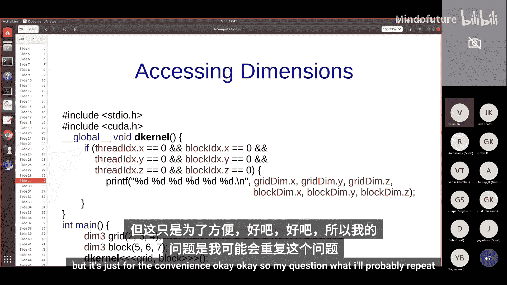

Someone say。O。

Okay， so my question was I'll probably repeat the question if someone would have missed so mean so how many credits will be launched and what will be the output of this program was the question？

And。Quickly， I guess we have many yeah， so let's go back to the chat and see what you people have。

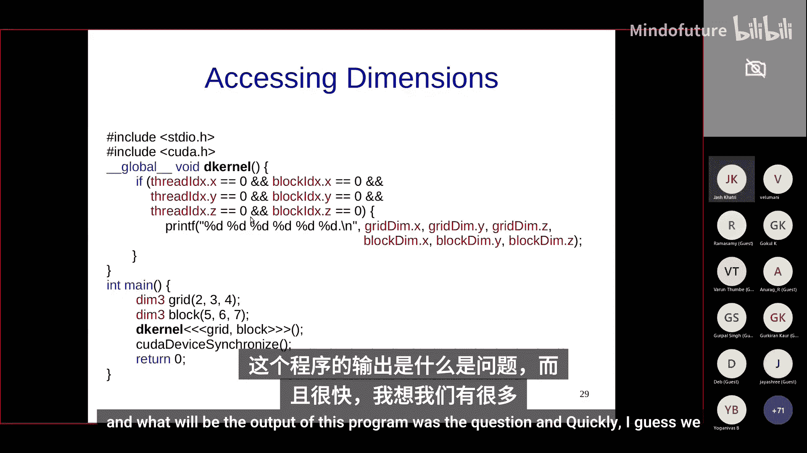

韩词。To to 345 the 6 design is the government Tim。ok。A threat number of threats。Yeah。

 it's a number of threads here， it's not kerneling。

 it's the number of threads with which the kernel will be launched， that's correct。Launched with 5，0。

4，0 thirds。 Yeah，7 factorial is the number with which the kernel will number of threads with which the kernel will be launched。

And it will print only 0，0，0，0，0。 okay， we'll see that。56 and7。ok。Output is 2，3，4，5，6，7。オッケ。

Yes only one print will be executed。Yeah， I want each and every one of you to think how many prints will be there。

 I mean， how many lines will be printed。So far I can only see like one person replying for that。ok。

 one thing。Okay， to one。Okay good。 I mean， your people are trying。 That's good。OkayAnd5，0，4。

0 will be current says， okay， good。Okay， so let's go back to these slides。

 I guess typical are correct。 I mean most of you are correct。

So yeah。Let's try and， I mean， most of the time I'm able to only hear your voice， I mean noise。

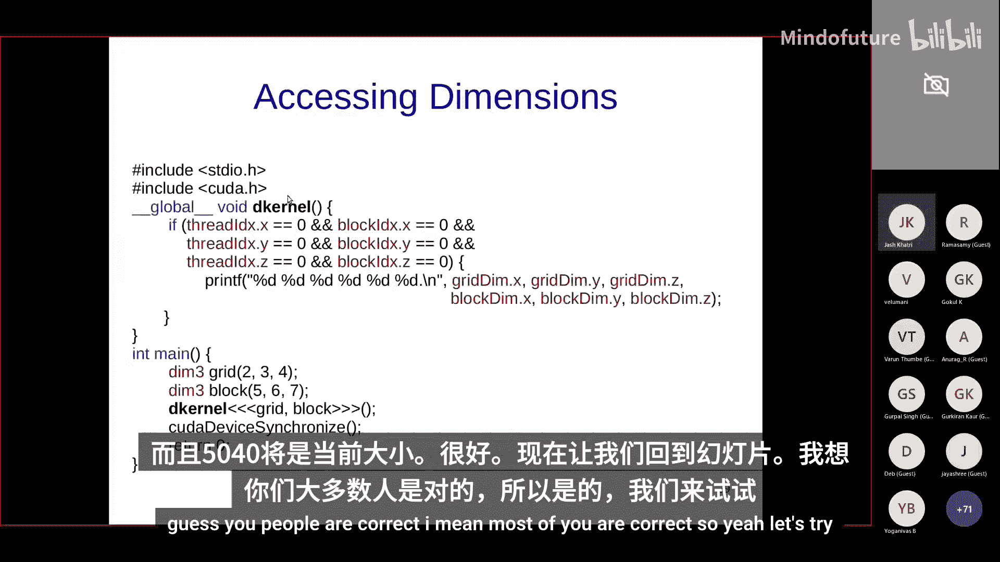

Okay。What you can do is you can type in chat if。Yeah okay。

 so what are suggest is you can type in chat whatever your doubt is。Until that issue is。Yeah又给人带边去。

Okay， so meanwhile I'll go back to these slides wait many you can type your question in the chat and I'll come back to the chat after。

After a couple of minutes。

Okay， yeah， so like since the grid is is three dimensional with x Y， and C dimension is2。

 three and4 and block is up。Again，3 dimension with x， Y and c dimension as 567。

 so kernelnal will be launched with two into three into four into5 into six into7。Number of threats。

 which is seven factorial threads or 5040， I guess number of threats。And。See， let's， I mean。

 once the kernel respond， let's try to see what this condition is doing。So。

 this condition is saying that。That terrible。Tread with X side okay。

 so first of all it is saying that I want to go to the block。

 which has x y and Z coordinates a 000 and inside that block I want to go inside go to the thread which has。

Its coators x y and z coordinate this 000。So what will happens。

 we will get a unique block and that two inside mean inside that block will control unique pressureso inside each。

We have each a menu， so for each block a menu。For a particular block with ID X ID by ID and Z IDS0。

Well be able to uniquely identify that block and inside that block also we are uniquely identifying a particular thread with x find that IDSU。

So only one thread will pass this condition and that thread will frame。啊。X。

 y and z dimension of grid as well as x y and z dimension of that thread law。Which is2a 3a 4。

 comma 5a 6ma 7。So a single line will be printed， which is 2，3，4，567。And yeah。That's okay。

 and that confirms our understanding。The next question that I have for you people is。

Let's say I removed this， I mean， I removed this condition I mean this this。Condition。

 block I x dot x。Equals to0。Then in that case， how many prints will be executed？

How many lines of print appss will be？There。Heres my question， let's how I remove this。

Block I D extra tax equal to0 I remove。In that case， how many prints will be there？

I hope every one of you I， each and every one of you are trying and。First of all。

 you people got my question。And that running。你 so。Moving back to chat。

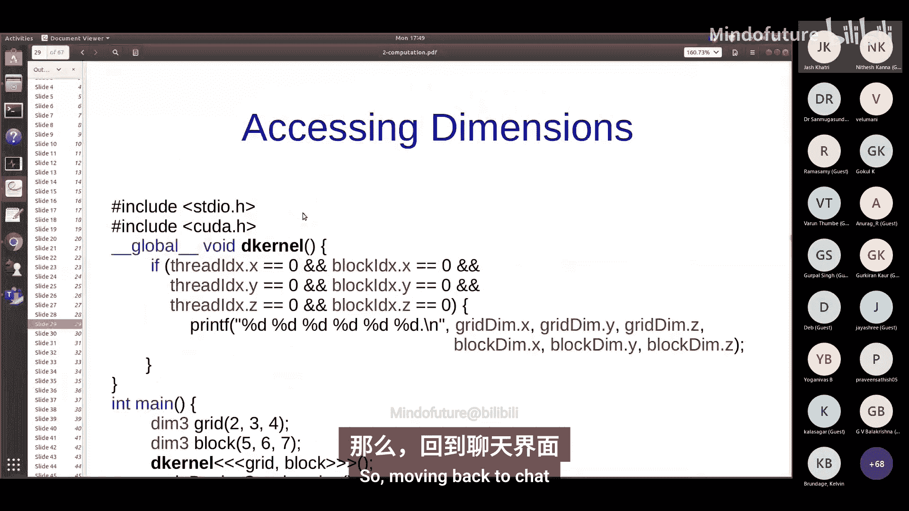

To work at to level。Seemely from the this be。I request all of you to try。

I'll just switch back to the slides。 and wait for。

啊。F more seconds for others to try。屋奇啊。

Let me see what you people are answering。1 seem like the probably thing is we are not checking that condition。

5，0，4，0，52 Sam factor， p2。So I type my question kindly。 Okay， I'll go back to your question one。

 just give me a moment。啊，拜。Okay， so first of all， okay， lets get， let's go back to this slide then。

Ex tryingで。If I'm just removing this block ID X text。Then what will happen is okay。

 so I'm not checking the X dimension of the blue。And if I'm not checking that。

 then what will happen is。The blocks with having M which are having y and Z dimension as zero。

 but any x dimension。They will pass this condition， right？

Blocks which have y and Z dimension is zero。And any exs will be too right because they have two blocks in exs。

Because grid is having x dimension size of x dimension as2。

 so there will be two blocks which will have y instead that dimension is 0。

 but the x dimension can be any， it can be 0 or 1。So there will be two such blocks and inside such blocks。

 to such blocks， you want this thread， which has x y that dimension is 0，0，0。

And there will be only one such thread inside both of this one。

So there will be two lines of print app this after this thing is removed。

 lock ID xtro x equals to0 is removed， there will be two lines of print app。

And both of them will print the same thing， two， three4，56，7 and 23，4，5，6。

72 twice it will be printed in， I mean， there will be two lines of the output。

So I hope that is clear。And。One more thing is the one more question that I wanted to ask。

 let's say instead of this entire gift condition。I just， I mean， I just removed everything。

 everything that is there in the sick condition。And I just replaced it with one single thing with just one check。

 which is。This thread ID x x equals to 0， I just wrote this thing and removed everything else。

Just remove out all these things and just load the str ID extra Texas serial。And in that case。

 what will be there， I request each and every one of you to think about it and post your answers in the chat。

It's important that we do this so that we can understand these dimensions and all those things battle。

So question my question again， I'm repeating。We are just adding this thing。

 thread ID extra x equals to zero and removing rest all of the things。

And how many length of outputs were be printed？Just don't worry about what will be the output in each line。

But how many lines will be there in the is my question。Okay， meanwhile， I'll take up some questions。

系听日。三。まス。Okay so my question is， I should know the total threat requirement。

I should know the total threat requirement。 I am not using mail。Mail I D for attending the class。

 please tell。How the attendance is considered。They will， I mean。

 please give your email to please made your email to me， I'll take care of it。ok下来。

I should know the total threat requirement。So that I can split the different axis in dimm 3 element right。

 so yes， you should know the threat requirement。But in case even if you don't know the threat requirement and if you are splitting。

 that's also okay， you can just。As assign multiple tasks for each each thread here， team 3 blocks2，3。

4， these combinations can be written as 34 to is there any difference？There is， I mean。

 there is no difference in terms of the number of threat locks。With which the kernel is launched。

 but the dimensions of the grid will differ that is the only difference that will have。

I hope that's clear。And。To calculate threat requirements， I should。Be aware of computational load。

 maybe task size sir。 Yes， is there any way to understand this in a better way。啊啊O so。

For understanding the computation load， you need to go to， I mean。

 you need to understand your algorithm again。And。See how much amount of parallelism or how much。Yeah。

 how much amount of parallelyism that you have in it？

And what is the chunk of the work that can be divided across the multiple thread？And in that way。

 you can just have a rough idea of how many threads with which you want to launch the kernel。

And based on that， you can decide the three dimensions of。诶 up啲。Great。

I hope that's clear value money。Okay。Seven factorial by phi，2，3，22 three into four and 6 into seven。

エスカレクターサプバイト。1，0，0 it。 I'm not sure if the multiplication is okay。 I will locate it into it。

Three into four into five into six into seven。1，0，0， eight times。46 prints。オッケ。74。

Understanding algorithm is very important in our case。嗯。Yeah， that is important otherwise， I mean。

 how will you know the amount of parallelism that you can extract out of it？

And that will determine the number of threats。1，0，8，0，7 factorial by5。 Okay， I see most of I mean。

 I can see that most of you are correct。But the。Let's go back to the slides and let's start understanding what will happen actually。

So。As that word。If I only mention this third ID extra tech， then what will happen？And I mean。

 we are removing the rest of these stops right， so what will happen is。So first of all。

 now this condition will not restrict。第一。Threats of the， Imin。Other blocks， I mean。

 the the threads which are read there in other blocks will won't be respected as it was in the previous case。

So， inside each third block。He each block， the threat having ID its x coordinate at0。

We pass the test right will pass this safe condition。So we should think how many types are that。

But I mean， how many threads are there across all the blocks？Which are having its X idea 0。

And one thing we should observe。That inside， I mean。

 such number of threats will be two one to three and2 four， I mean the number of grids and sorry。

 the number of threat blocks。Into five to seven。Because if x dimension is 0， I mean。

 the thread with x idea is 0。Will be one for each x coordinate in a particular third block right。

 so this will be one。And apart from that that。He'll have， I mean。That will be such one thread。

For each x dimension and such。607。啊。Dimenssions would be there inside each threshold block。

 So the total number of。Thats， which will satisfy this condition。

 this alone condition theyll be two into three into four into six into seven。

So that many times the prints will be executed。I hope that's clear if you have any questions then please you can I mean unmute yourself and ask immediately。

Yes是。yeah， let's go ahead。So can me explain。Its problem in the previous。了达送。I mean。

 by previous problem， which one you mean， can you please。

By by previous problem I mean the one where remove is the thread the block areas。Okay， so。Okay。

 so in previous problem that this this was removed， block ID extra text was removed。Everyone right。

Yes。Okay， Ill try to explain you again， so lets say if I remove this block ID extra text right so in that case what will happen。

啊，所你。Now what we are doing is。Hisstricting， I mean。

What we are doing is we want all the thread blocks with。We don't care about the x dimension。

 but it's y and Z dimension should be 0。So such number， I mean。

 such thread blockss will be only two in number because。啊。Because we have this x dimension S2。

So there will be two third blocks with。啊。X dimension is 0 and x dimension as 1 and y and z dimension will be0 for the plot。

So there will be two such threatlocks。And inside that each thread block， the thread with x。

 y and z dimension as having， I mean， inside that each thread block， the thread having x。

 y and z dimension as 0 will be only one。So there are two thread blockss inside that there is one thread which satisfies this condition。

 so there will be two variant types。I hope thats clear if there is something unclear then you can unmute and ask for this question I mean for this part Ill also explain the next。

The next one that you ask。我 know。show this answer本当りま。Victorial。

 it will be very difficult for me to draw。Okay let's take this offline now。

 if you are still confused， then we can。because。Consider what is great。Hello， is it clear？Yeah。

 so what I was telling is pictorially drawing it will be time consuming as well as I mean。

Difficult for me now， but we can take this offline over email or even in the Google group。啊。Yeah。

 so there we can discuss about it。Because here will run out of time and listen if I start drawing it on picture and all this。

Okay， but we will take that you can just ping me after this lecture and I'll try to explain you in the mail。

Get。Sure。I I'll quickly switch back to that。

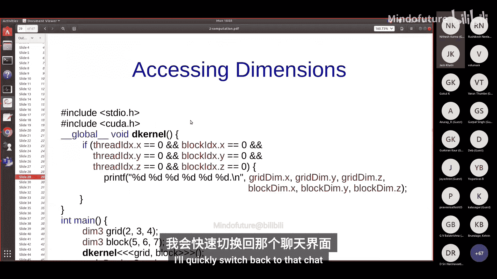

亲爱的。Okay， I hope it's clear for everyone。So could you explain the second answer I period with only t ID D x equal to 0。

Okay， yeah， so let。Understand that again。So let's say I have just this third ID x text0。Now。

 now each and， I mean， there is no restriction on block ID。

 right because we have just this conditional thread ID。

So two into three to four blocks will have some threats which will satisfy this condition right thread I xtro x equals to zero will I mean。

 first of all， you should agree with this， right？So there will be two into three into four blocks。

Which will have some threads inside it where thread ID x is0 now the question is。

How many threads inside each block now2 to 3 to four thread blocks are there。

 but how many threads inside this each thread block have thread ID x dot x equals to 0？

To find that thing， we need to look into this thing。Now， how many threads will have it X idS0。

 it will be exactly one thread。And inside， I mean， exactly one thread， not inside a threat block。

Exactly one thread in x dimension will have thread I extra x as  zero。

And such six into seven threads will be that， right？Because。I mean。

 the dimensions are 5 to  six into seven。6ix seven threads will be there。

 which will have its thread ID x x zero inside a particular thread。

And such two into three into four threat box are there。

 and hence the answer is  two and three into four into six into seven。So there's many threat blocks。

In two six into seven threads in each thread block having thread id extra x zero。So in the end。

 would we have to do like plus one because。😔，The first block， we have one also Sir。

Last one first block I didn't understand your question can you can you elaborate in the in the X dimension there is like five threadnoer per block in that we had you said we had one nozzer。

Yes， we have one I mean we have5 threads and ID will go from0 to4 right。

 so out of that5 threads one will have the idea0， second will have I 1。

So only one thread will be there out of I mean，0 to 4， which will have it side a 0。

So I don't understand the need of going plus one。But as I explained。

 there is only one thread out of that five threads。

And such six into seven threads will be there in a third。

And such  two into three into four thread blocks are there， so 2 and three into  four into 6 and7。

I didn't understand why you are telling plus one， but there is actually no need of knowing plus one。

I hope that is clear。

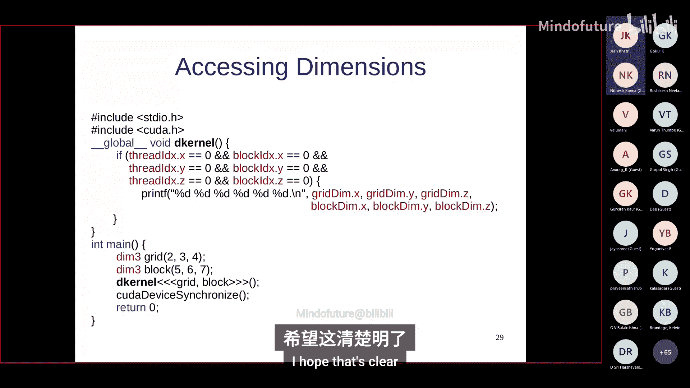

系。I'll quickly go to chat if someone。Okay， I'm not。Okay。

 so the final answer is for the last question that I asked the final answer is the number of lines it will print is 2 to 3 to 4 and 6 and7。

I'm not getting any of the Google group updates in my registered email。Okay。

 probably I'll remove you and add you again。デベ드ラ。They went right， I'll do that。 Okay。

 whether slides are shared in。Slides are added in the sheet that I've shared。For each of these。

 another alternate ID， previous I， you said it's not working。I funding。Not getting any updates。Okay。

 one thing I'll do is okay， again， new idea is not working here saying。いわりは。近方面。

I'm not getting any updates， so there's not any。メだで。我是。So as far。

 I mean for now we don't have any mail updates for I mean， not at least for today。

 we don't have any mail updates， but just in case you want to access the resources you can directly access it using the what I can see this。

Sheet， Google sheet that we are maintaining。And one more thing。

 if you have any questions and if you don't have access to the Google group。

 one thing that you can do is you can directly mail me。

So I'll pick up your questions whenever I'll get time and we'll reply you for。With the answers。

你 that been sent。So before the class there is， I mean， we don't。

 I mean there is no mail actually sent before the class so no one is getting that mail so don't worry about them。

And regarding the schedule， we have I mean， we have already posted the entire schedule on the website so。

Yeah， so whenever there is class， I mean it's already written there， so you need to be。

Prepared for it up prior。And yeah， that there is no email update before the class， I mean。

 there is no reminder running。Right。And when you say thread IDX part will be removed。Teve。

 what's the answer， Im in your previous question。Yeah， so for the previous question。

 the answer will be too， as I explained。When just that block。Just let me go back。

So when this block ID extra text will be removed， the answer will be。This part。

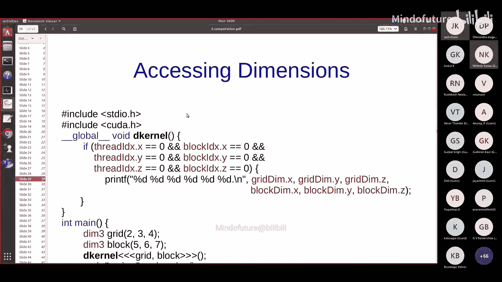

I hope that's clear。 Okay， so that's what we have a lot of questions and。Yeah。

 so I'll move on further because I still have many things to cover and。

Probably will miss out many things otherwise yeah， so simply the number of threads that will be launched is as we saw going into three into four into five into six into seven。

umb number of threats in a thread block will be5 into six into seven。

And number of thread blockss in the grid will be 2 and 3 and24。

And third ID in x dimension is from 0 to5 because。Throid IDine extension is from zero to five。Okay。

 it should from 0 to 4， I guess I have written Okay， yeah， so that is this。Gly， I mean。This。

This kind of place， which says that5 is excluded。Thread I x dimension is from 0 to 4。

 and it's written correctly also。 so when there is this。This kind of closing grace。

 it means the last one last five is exploded。Thread I next dimension is from 0 to 4 and block I in y dimension is from 02 to 012。

So yeah， that's it from this slide I guess and yeah this thread ID x x equals to0 thing we already saw right if we replace that entire condition this。

This entire condition with just this thing thread ID extra text equals to 0。

 then we saw that what will happen， how many printups would be there。Right。

 so thats it from this slide， moving on to the next slide。No。

Let us see how this 2D computation is being done。啊。On the matrix。So for that。

 let us take this sample program。We have sorry， we have this。

Hash define N5 and has define M6 and we are defining this。Vable called this block。

Reing this team 3 data structure with。With n with x dimension as n by dimension as M and third dimension as1。

So essentially we have blocked with a two dimension block with x dimension of p sizei pi and y dimension of p sizei6。

Then。I'm declaring two pointers， star metrics and star edge metrics。

which are essentially to pointers edge matrix points to the metrics declared on the CPU address or the metrics declared on the CPU h stands for the host which is CPU and matrix is the pointer which points to the memory I mean to some memory location are located on GP which is essentially a matrix。

And yeah， as I said， metrics points to some memory location on GP。

 we are allocating memory using Qa melo on GP and that allocated memory addresses pointed by the metrics pointer。

And similarly， edge matrix is declared on the CPU using Ma。Now we are launching the cardinal。

With one I mean with the congregation one comma block。

 so as we saw in there our previous discussion the number of threads with which this kernel will be launched will be5 to6 which is 30 threads will be 30 number of threads will be the one with which the kernel will be launched and we are passing this matrix which is pointing to some GPU memoryial location。

And then after doing this， after the cardinal Comp is finished。V bond。I mean。

 we are copying the metrics back to the edge matrix， which is the CPUs。CPU declared， I mean。

 the space which is declared on the CPU。And using QM copy of device to that is well cheaper to CPU。

And then we are just printing this。Mats on the CPU。Was destroyed stored insect etment。

Now I would like each and every one of you to write I mean write the code to initialize the metrics to unique IDs。

Again， I want to write each and every one of you write the code inside this kernel part。

They said this currently。Unitize， the matrix to un this。

So one thing that we should observe here is that even though we are saying it as matrix。

 it's actually one dimensional area of size M in 1。Because it's a vector， not a I mean， yeah。

 it's just one dimensional another。Yeah， of size and any doing。Yeah。

 so I'll wait for a couple of seconds here for you people to try。And。

If your people want any clarification， then you can post in the chat。

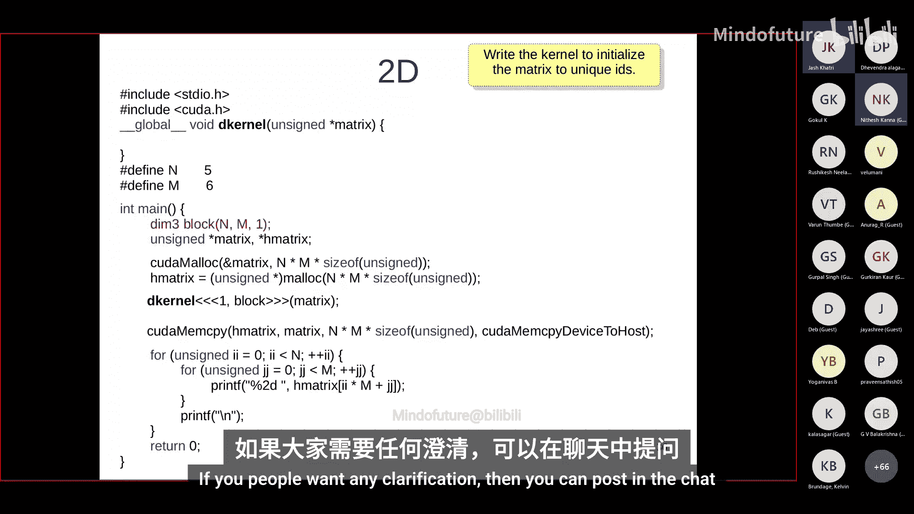

If any clarification is needed， then you can ask I ask by unming yourself or you can post your questions in the chat I'll go back to this slide so that you people can try。

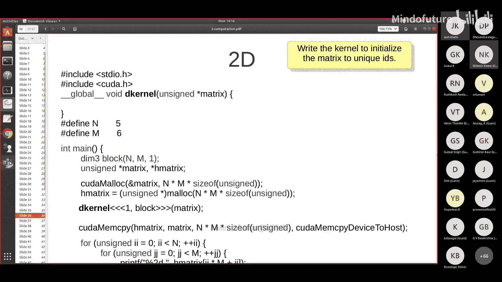

Okay， I hope that every one of you I mean are trying， at least。Yeah好。6。

Tricks of thread I extra tax into block Tim dot y plus thread I x dot y equals 2。The same thingオケ。嗯。

I think that's correct。 but we need to check， we'll see it。And go back to these slide。

People can see the question。嗯。

Th equals2 thread， l D X or X matrix of thread equals to thread。Okay， I think this will fail。Okay。

 when we need to see him what will happen。We are just accessing the x dimension。In that case， many。

 many entries won't be initialized， I guess。Of this approach。

Td I D X text blocked int y plus thread I D X dot y。嗯。I guess this has got it。Okay， back we's see。

I request each every one of you to try at least a minute， even if the answer is wrong。

 that doesn't matter， but it' is important to try。

Okay， okay， so switching back to the slides since we have less time。诶。So okay。

 let's try understand with bit what will happen。So this is one of the way in which we can。

Initnitiallyize the matrix。So let us start understanding it and what is being done here。

So we are generatinging a unique ID for each thread within a block。

Please note that we are just launching a thread with one block right so there is just one block and inside that block threads are arranged in two dimensional manner right？

Of size M， the block is of two dimension of size M in per and in。And so there is one block en lost。

 which has threads are it in two dimensions。And inside the kernel， we are generating a unique ID。

And how we are generatinging this un ID。啊。So first of all。

 you need to observe that this block Team dot y is always constant。

 no matter whichever threading looks it， this block team dot y will always be always be6， right？不告啊。

The block dimension in Y direction is6。So this will be always six。And now， depending upon the thread。

 this thread I x dot x and thread id x dot y can vary。So far。The first thread。

 which is thread ID xt x is 0 and thread ID x dot y is0。

For that thread I will be calculated as 0 into 6 plus 0， which will be 0。

 so matrix I so metrics of0 will be initial size to0。Now for the thread number one。

It's third ID x x will be0 and third ID xt y will be one。

So its id with finished starts says 0 into6 plus one， which is 1。

 so matrix idea of1 will be1 and so on will the。And so until the sixth sorry， fifth thread。

 I guess yeah， and so until the sixth thread I guess for it。

 the thread ID x dot x will be 0 and thread ID x dot y will be 5 to0 to6 plus 5 will be5 so metric id of p equals to 5 will be highest。

And then from the seventh thread onward。You should observe that its thread ID x x will now become1 and thread ID x y will become0。

So one into6 plus 0 will become。Will become six so metrics of six will be six and so on for the next start it will be one comma1。

 so this will be evaluated to seven， this expression will be evaluated to7。

And so on till the 30th thread and for 30th thread as you people can。

Gss this thread ID x dot x will be4。And thread id x dot y will be5， so four into6， which is 24 plus5。

 which is 29。So ID will be computed as 29 and metrics of 29 will be。In case， were。

So this is the entire execution flow and if you see the output of this program it will be like this。

啊。So that this prints， I mean， this print up here will print this thing。0，1，2， three， four5，6， seven。

 eight， nine，9，11。Up 28， as I explained。啊。So this is how you can expect， I mean。I mean。

 you can use this two dimensions。And inM。Of a particular block to initialize a matrix。

By using the x and pi dimensions offer。Of that grid， I I mean。

 accessing the x and y dimension of the threads inside that third。Okay。

 any questions up now on this on this side I would like you that block Tim got why it's supposed to find the block number of the current thread。

 right？see block dim dot y is a dimension， I mean， it's the size of that dimension。

 so block when you say block dim dot y。It's earthquake number six。

It says that what is the dimension of that block in by direction？And at six， that's a fixed number。

Sir， but while declaring we had given like one dimension block with threads of three dimension rights on initially so when we say one one comm block here。

It means that。We are launching the cardinal， I mean， we are launching a grid。

We are launching one grid with one block and that block has a dimension  phi into6。

So if you say block team do y it will give6 if you say grid team dot x or y。

 it should give one right because we have just one grid I mean sorry， we have just one block。

I hope that's clear。S what I thought like this syntax of initialitiizing the kernel is block comma thread right。

Yes， here it's number of blockss and here it's number of threats。Okay， so like when the block。

 I thought that when block dim is called， it will find like the actual number of number of block that red is in。

No， blocked in， okay， so I think you are confused here when you say block him do y。What it does is。

For the current block， I mean， for。The block that is being， I mean， considered here。It will see， I。

Okay， so it will see what is the dimension of the particular block in that by dimension， I mean。

 by axis。Think of it like that。So here in this case we have just one block and for that block also its。

Its size in y dimension is6。So this block MDt y will give6。I hope that's clear。If it's still unclear。

 then please， please a minute。Tell me what's your query so that I can explain better。

Just getting confused between the blocks and the groupss because syntax and the game。I got it I mean。

 it's a bit confusing on the first go。But I request， I mean。

 I request you to go through this lecture once again， or probably it's recording once again。And。

Look look for these slides where I explain this create terms and block terms and all those things。

They probably will be able to catch a better idea。So， when I say grid Tim。

 it is the dimension of grid and when I say blockt it is the dimension of the block and those are the fixed numbers。

Those numbers won' change across I wonder， Sir when you say like dimension of the block。

 you mean like the number of。Treads in that rock like that， you Sir。啊 see啊。

There's not a number of threads in that block。Dimensions are determined by the way you are launching the kernel。

 Here you are。Explicitly saying that I want a blog。啊。With x dimension is5， by dimension is6。

So it's not a number of threats， it's the damage that you are specifying here。

Number of tenant are  sorry， 30， right？But locked input but y will give six so that 30 and6 are not seen。

So number of threats and that dimension is different。

Dimenssion is something that we specify as a programmer。

As well as threats also are specified by us only， but both I mean。

 both the things are different is what I'm trying to say。I hope that's clear。

I've understood somewhat Sarah I got I， I mean， it's。

It's completely okay not to understand it in Poshka because this are， I mean。

 these concepts are quite tricky， I would say。If you go through the recordings couple of time。

 I mean， one time more probably one or two times more， I am sure that you will be able to get it。

Yeah， but if you still have any question， then youre， I mean。

 you're free to mail me or post in the group or something so that we can take it up from there。

 right？也是。我啊。If there are any other questions。

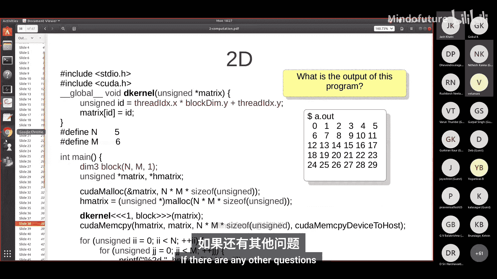

Yeah， please score。Yeah， your article。

Yeah。😊。

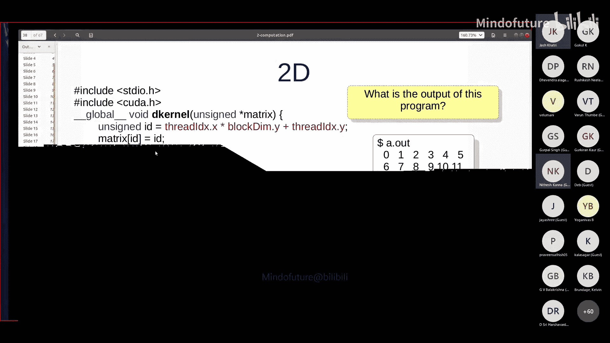

嗯，你 are的不老师。Yeah yeah， you are already。But your voice is speaking here we。With noise or sir。

 is this clear。Yeah， there is no noise， but your voice was breaking， I。Please go out here。

I'll try to understand what you are trying to say。We have mentioned the T D X do X and others are in Visor。

 but I saw something like T X dot text into block dim dot x plus block ID。😊。

IDX dot X like that my question is how to mingle this x y and is it dimensions to get the unique thread here for 2D you are use its like you are using x and visor or this fixed it one or we can change to ask for our program need。

😊，This is my question。 It click。Let me ID。 this is a Tonyny program。

We use in this way for 3 or one day they can change right or if its a fixed one or is there any formula is there any way to arrange this x y is it dimensions maybe if here is that dimension is one。

 but may it may if it is instead of one it if it is three and all。😊，Should we感 that。

Those is a dimension in。Unique threaddy。Yes， find it。Yes， yes。 you are correct。 I mean。

 if you are using， let's say if you are using more thread blocks here instead of one。

 then in that case， you also need to consider the thread block， I mean。

To get the unique ID across the threads， right？So it depends upon how we are launching and it also depends on how we are defining the dimensions。

 so these two things you should always keep in mind for calculating the ID uniquely。

I hope that's clear。Yes， sir it's it's clear now if I get any doubt in future。

 Ill ask you in personal Z in mail thanks so I'll probably I'll cover one more slide slide and then we'll stop because I think we have already。

😊，Reached the time 630， so I'll just cover one more slide。skipYeah。

 so I want to cover this slide because this is quite important one。So。

 as we did for two dimensional data structure， I mean two dimensional metrics。Haari。

 two dimensional matrix。Chi matrix was just one dimension。

 they were access second in two dimensional way。And we were launching a block which was having two dimensions。

 right in the previous case。Now instead of that， let's say everything is same right like n is has defined as 5 and M is has defined as6 and then we have these two pointers similar as the previous program and then the memories are located and then for on the GP and then on the CPU and everything is same。

Now， the difference is that instead of just launching。The kernel with one block。

 we are launching the kernel with five blocks。And。Inside each block， we have six threads， M threads。

 which is6， and we are passing this matrix。And again， after that。

 we are copying the metrics back and printing it now we want to initialize the matrix as we did before。

And yeah， we want to write the kernel to initialize those matrix to Uniite and I want you people to quickly your try out。

 how can we do that？Or probably I'll just wait for one minute and then I'll quickly explain what。

What should be done？Yeah， sorry， I'll just wait here。这不是得那过去那东西。Yeah。

 so instead of in the previous case， we launched the kernel with just one block instead of that。

 we are here launching kernel with n blocks5 blocks。And inside each block， we have six threads。

And in this case blocks are not two dimensional it' is one dimensional clock right we are not using team2 or team 3 anything of that sort right they are just passing integer as parameters here right you can see。

Then like and again， we want to initialize the kernel as we did before。

 and I want you people to think how can we do that？Quickly， I mean。

 just this last slide I want to cover and then we'll。Finish what we doing。

So the main question here is like， how will you calculate that ID uniquely is my question。

Such that we can get all the numbers from 0 to 29。As we did in the previous example， right？

Let's just wait for a few more seconds and then。Explain。Okay， let me go to the chat。

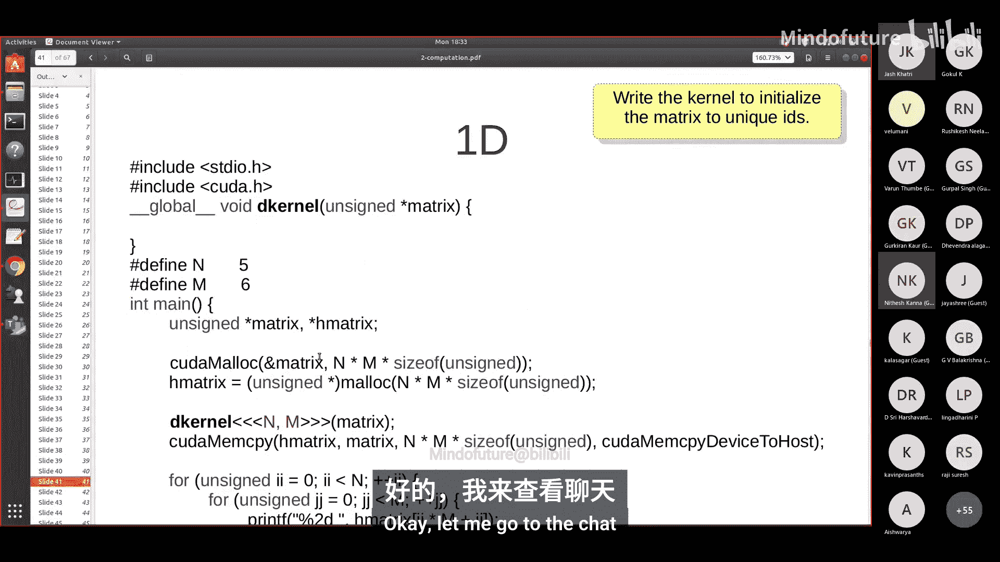

T I x to X plus I equal to thread I x do5。Looks correct。 We'll need to see。嗯。Where。

Where the thread requirement is30 block involved is why each block executes its thread。You they put。

 okay。Yeah， that's correct block zero will have zero to5%。I mean， six thread part block。

Block IX dot into and plus IDXt，六点八台。Okay。Okay， so I guess most of I mean。

Some of the answers are correct， I can see， but I'm happy that many of you are trying it。Okay。

 so let me quickly go back to the slides because we already run out of the time。

So okay， here， if you see。This is the correct equation。

 this is one of the way in which it can be done correctly， there can be multiple ways。

So let's try understanding this。First of all， one thing that you should observe here is there is no y and z dimensions here that you should fit in your mind leg。

Because we are just launching the kernel。ベト？Create dimension as one and block dimension as one。

 there is no Y and z dimensions in what here。So accessing Y and Z here is like I mean， there is no。

 I mean there is no point of doing that right， because grid has one dimension and block has one dimension。

 so that is first point that you should not。Now， in order to get a unique IT for each slide。

How can we do that？So first of all， if you see this equation。

 you'll see that there is a block team xtex now what is block team xtex block team xorex is again the dimension。

Of that block in x direction and there is only one direction in this case。In this case。

 the block team extra textment give six。And。Block ID extra text will go from okay。

 so far it will go from0 to five。该啊。We have a。5 blocks。

So 0 to5 and inside each block we have six threads。

 so thread ID extra text for each block but remember for each plumbing is noted that for each block。

Thread ID extra text will go from0 to  five because there are six threads。

And block ID D extra text will go from0 to 4 because there are five blocks for each block。

 it will go from I mean， sorry again for each。L， third I will go from 0 to 5。

Because there are 63 in the block。There are five blocks， so block IDX text will go from 0 to4。

And B to X dot x will be a fixed number， which is 6。So。Yeah， so in the similar way in similar manner。

 as I explained in the previous example。For the。Thread0 of the block first block I mean first thread of the plus first block。

 let's take it in this way for first thread of the first block block ID x dot X will be 0。

 thread ID xt X will be 0 so the ID compute will be0 into6 plus0， which is 0。

For the next thread of that same block， the block ID extra text will be 0 thread ID extra text will be 1。

 so0 into 6 plus 1 is6 sorry1 and so on for the6 thread which will have thread ID extra text is as5 and its block ID is 0 so 0 into 6 plus5 is 5。

And so on for the。Other threats of the different blocks。And for the last block。

 it will be four into six because last block is the fourth block that blocks are from 0 to 4 because five blocks are then from0 to4。

So for fourth look。It would be four me 6。Plify。So 66 was at 24 plus5 is 29， so the last I will be 29。

 so 29 location will be in4。And the output will be same as the previous one。

And the key point to observe is that the key takeaway that you should observe from this slide is that。

The thing that you can do with the multiple dimensions。

 in fact that we saw that it in two dimension we did the same thing right we can do it the same thing using one dimensions also so like here we are using just one dimension by thread and blocks are of just one dimension。

I sorry， not trade and B， grade and Bs are just of one dimension。But in the previous case。

 it was block as was of two dimension。 So anything that can be done with。

Two dimension or three dimension can also be done with one dimension。And a quick question for you。

If we want to launch the kernel using2 comma x here。

 let's say instead of n which2 comma x and what that x should be。

Probably this is the last question with this will end today's lecture。Okay， yeah， so okay。

 I'll repeat if we instead of this M command， if we want to everything is thin like rest。

 everything is sent。And we want the same output for this program。

But let's say we replace this m comma and2 comma x here some x is some number。

 then what that x number should be such that the output remains the same and the entire code rest of the code is the same。

What that x should be。In。Yes， that' is correct 15 should be there because at the end we want to launch the 30 threads right to initialize this matrix and hence it should be2 comma 15 and that will give the correct I mean correct results for this code。

If we change this part。哎。Yeah， so with this， I'll end。

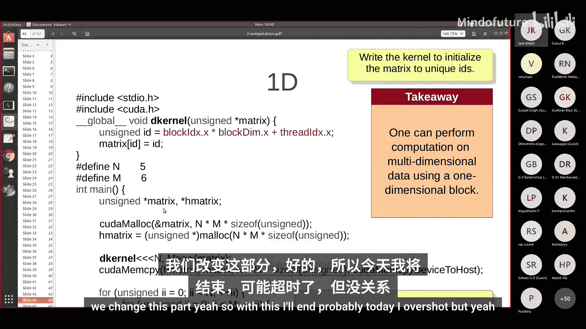

Probably today， I overshot。But yeah， if you have any questions， then you can。Ask it right away。

 I' will be still there here for five minutes。Otherwise， we'll stop here。

