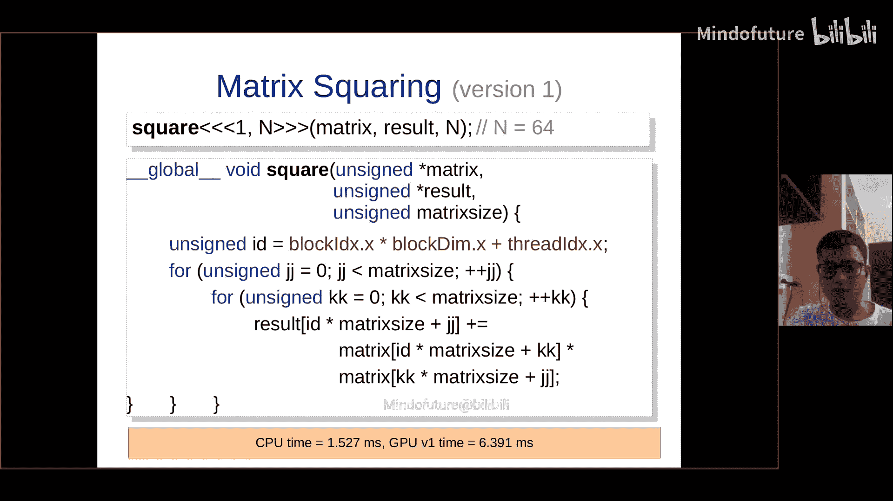
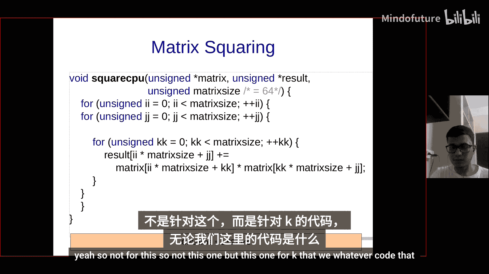
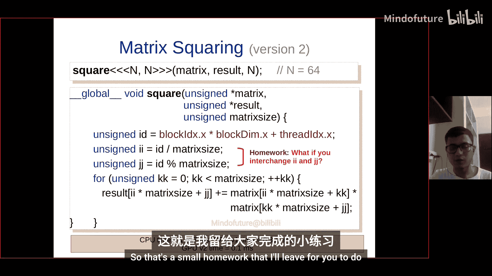
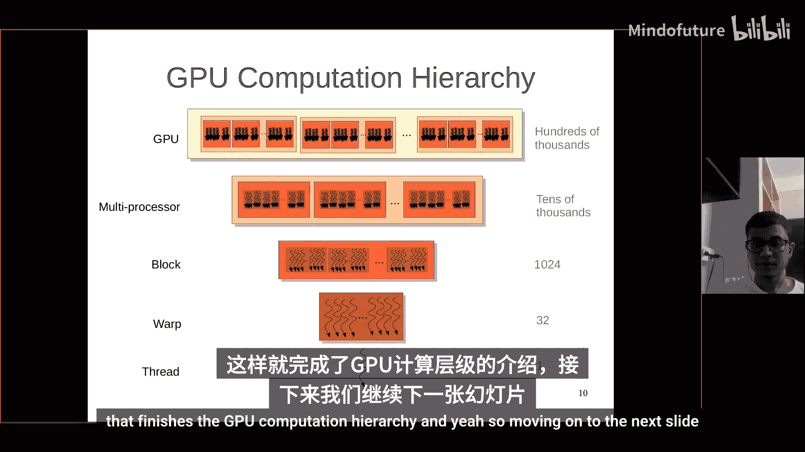
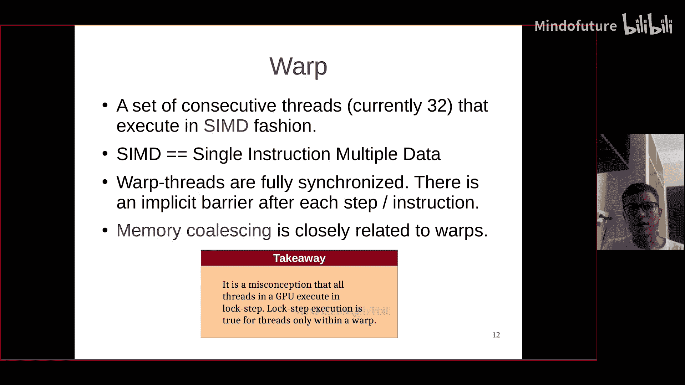
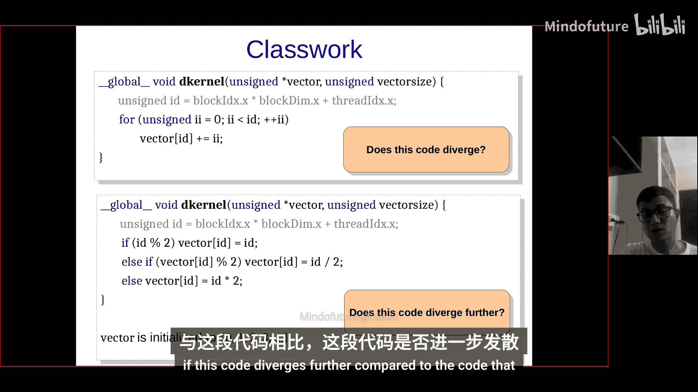
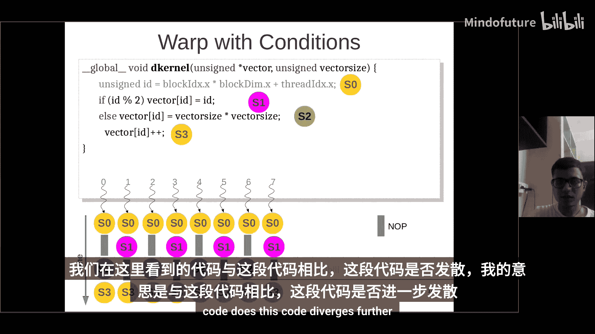
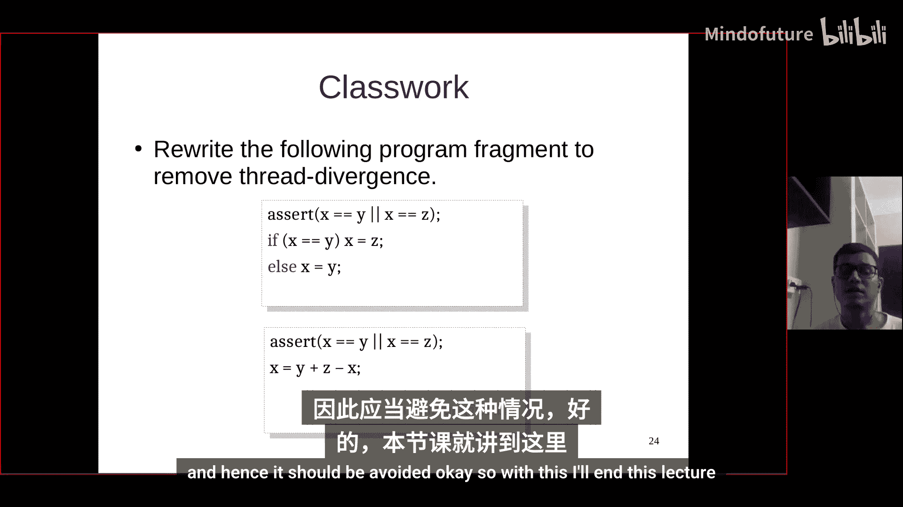
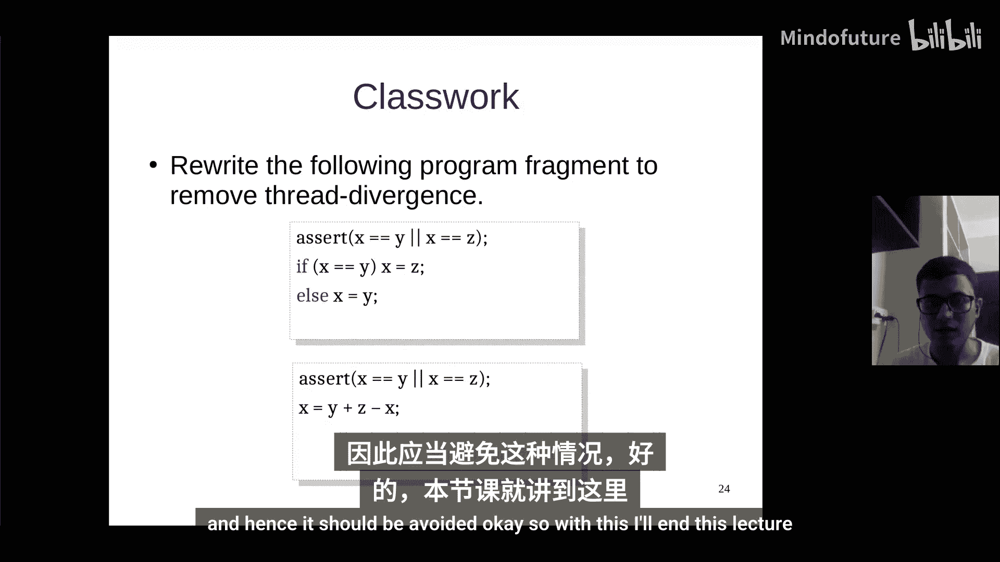

# 【Nvidia】CUDA并行编程-｜-Cuda-Programming-Course-｜-Parallel-Computing-Using-Nvidia-p04-P04_L4_GPU计算层次与矩阵平方的线程发散--BV1MSq1BTEho_p4-

Okay， so hello and welcome everyone to the fifth lecture of our QDa program。

So in the previous lecture， we saw how part I mean， we saw how the threads are organized on the G。

And saw we also saw how a gridit is associated with a kernel launch。

And then we saw that grid is composed of thread blocks and yeah so multiple black thread blocks forms the grid。

And yeah， and then we saw that there are multiple multiple dimensions associated with with grid and threat blocks。

And so we saw that there can be at most three dimension associated with this grid and thread blocks。

 and then we saw something called as thread IDD and block ID to access the grid as well as thread block in these three dimensions and then we saw the particular examples associated with  then we saw the particular examples associated with 2D grid and  2D thread blocks and  one degree and 1D thread blocks。

And there we stopped in the last lecture。And for the today's lecture。

 we are going to see how we can launch the kernel for the how can we launch the kernel for the large amount of data。

 when the data size is huge， how can we launch the kernel。

 then we'll see the GP computation hierarchy， we'll see what is the warp and then at the end probably we'll see what are some of the issues such as threat divergence and such issues we'll see。

Yeah， so that's the brief of outlineing  for the two days lecture， so with this let's get started。

ok啊 so。Let us see how can we launch the kernel for the huge data size when the data size is huge and how can we launch the kernel？

Let us let us understand it by this example， for example。

 let us say that we have a vector or array of very large size and we want to launch the kernel in such a way that we have one thread。

For each element of that area so one thread will one thread will do computation on that particular element of the area we want such type of we want to launch the kernel in in such a way that we can have one thread for each element in the area and we want to initialize that area。

So for that， let us see this example code。SoHere initially。

 I'm including the SD Io dotage and quor dotage。Which is normal for any kda program that we do。

 and then I'm defining the block size as 10，24。Then coming to the main main this text to command line arguments。

 which areC and Rp in Rrc and Rrc， so the first command line argument is named as nN so it denotes the number of command line argument that the user will pass during the runtime。

And the second argument is named as STR， which which will store each and every command line argument passed by the user during the execution of Tolasha top。

啊。说呀说。So what we will do is well take the first command line argument passed by the user here we assume that the first command line argument passed by the user denotes the number of threads。

with which the user wants to launch the kernel， so it actuallys both the number of threads with which the user wants to launch the kernel as well as the vector size of the vector that he wants or she wants so as we want one thread for each and every each and every elements of the array so and denotes both size of the array as well as the number of threads with which you want to launch the kernel。

So。Yeah， so first argument is a string which stores the integer， so first of all。

 we need to convert this string to an integer。Using this built in A2i function given in C library。

 so we convert that stream， which is the first command line argument to an integer and store it inside inside this variable n which is an unsigned integer variable。

Then we declared two pointers， unsed integer pointers， which is star vector and star edge vector。

 so edge here stands for post as we saw in our previous lecture。And vector vector will store the。

Address of some memmal location on GPU。Okay， so as we saw previous lecture。

 we'll allocate the memory on GP using Pu malla and。This include envelope。

 will allocate the memorymor and GP view。Of size and un teachers and then the starting address of it of this allocated memory location will be stored inside this pointer vector。

 which is declared here。Then after that we again declare the memory of size and allocate the memory of size and un integer on the CPU using by。

And the address to it will be stored。And that starting address of。

 this allocated memory will be stored inside the actual vector。Once we are done with this。

 we will now calculate the number of blocks with which you want to launch the garden。

As I mentioned in the previous lecture， the block size cannot exit I mean a block cannot have more than 10 or2 portraits。

 and it might happen that our users specify the integer value with which he or she wants to launch the kernel to be 1 million。

So in that case we just can't launch the kernel using 1 comma 1 million because the number of thread here we can't launch the kernel with 1 comma 1 million because number of threads in a particular block are restricted to 1024 we can't launch one block we can't launch a kernel with a block having more than 1024 threads so in that case we need to calculate。

How many threat locks we will need。Considering that the threat blocks。

 each threat block can only have 10 to4 threads。So considering this NSsA very large number。

 which is specified by the user。Will will calculate what is the size of what is the number of blocks that we want to e。

 which can be calculated by n divide by block size block size is 102。

So anti5 block size will give us the number of that number of blocks with which we want to launch the government。

 so please note here the C function。So if if if the n is not perfectly visible by the block size。

 then we'll。Launch one more block to just compensate for the extra。Sttra elements in that area。

And yeah， then once that is c， we will。will app print that number of lock which are calculated here。

In this printer up and then we'll launch the kernel with n blocks。

 which is number of blocks that we calculated here and the block size， which is 102 per。

And then we'll pass this。啊 like this啊。Vctor is the array that we declared here， I mean。

 the array which was。A locatedated memory on GP etc ceter was stored inside this point vector。

 so we are passing that address here。put the garden。And once the computation of kernel is finished。

 we copy the data from GP tools。CPU that is from vector to H vector using Ka M copy device to post。

And we are copying n elements back from CPU sorry from GPU to CPU。

 and then we are printing all those n elements。Yeah， and inside the kernel。

 what we are doing is we are first computing the ID as we saw the previous lecture here we are computing the ID with the same equation that we saw in the previous lecture。

And what we are doing is we are initializing each element of the array。

 each element of the array with the ID of that thread。

 so thread with I0 will initialize the element will initialize the zero element with。

zeth element of the error with 0 so the thread with ID1 it initial is the first memorym location in error to1 and so on till the last thread will till the last thread and yeah so that is how。

This court is organized。So moving on， there are two issues that this could。

And let us look at each and every， let us look at this both issues one by one。So。

 first issue is that。The first issue is about this at this line here。

In the calculation of end blocks。So let us see what is Asian。

 let us try to understand this issue with an example。

Let us say that I have 10 let us say that user have specified and as 1025 instead of any number which is deable by 1024。

 let us pick that number as 1025 so user specified ns 1025。有诶。So this n is 1，0，2，5。

 which is an integer。And block size is also 1024 which is an integer。

 so way this integer division works in C is that when will regard 1025 by 1024 in C it will give 1。

 it will not give 1。 something because it's an integer division and that C of1 which and the C of 1 will be 1。

So C lock 1 will be one and hence we'll be launching the kernel， so endlock will be one。

 and so we'll be launching kernel with 1 comma 1024。And hence。

 we'll be launching the kernel with just 10 two4 threads。However。

 users specified that way that he or she wants to launch the kernel with 10，25 heads。

So that is the first wrong thing that we are doing instead of launching the kernel with 1025 or more threads we are launching it with less threads let's just launching it with 1024 threads instead of 1025 so thats the first issue and that is caused due to this in teacher division here so thats the first issue with this score。

The second issue is， this。Is here。So let us understand this second issue again by example。Yeah。

 so let us say that we fixed that issue first issue we fixed and user specified Ns 1025 and the we the floating point division here so 1025 by 1024 will be  one。

 something。And C of that one point something will again be so that C of1 point something will be2。

And the end bloc will store the value to。And啲。And the kernelal will be launched2 comm1 set of to。

So cattleal is launched with 20，48 threads。But now。

 since kernel is launched with 2048 threats and the vector is only declared of size 1025。

So here selected particular on GP is only of size 1，0，2，5。

So here what the issue will occur is that we be accessing some of the threats in fact， many threads。

Which have ID from 1025 to 2047 will be accessing the invalid memory location here。

So that is the second issue that many threads will be accessing in valid memory location if the number of thread launch than are more than the size of the vector。

Size of the vector that would declare on you。So， in order to avoid both both this issue。

 what we can do is okay， so first of all as I mentioned。

 we need to avoid so so first of all as I mentioned the first issue is that we need floating point division here and second issues that excess can be out of bound。

At this line。Say in order to。Eted of both these issues。 What we'll do is。First of all。

 we will convert this linkte division to floating per division by either type casting end to flow or block size to put here。

 I have typecasted end to float。And。耳朵。To solve the second issue。

 what we'll do is we will add a guard gift condition here that if I is less than vector size。

Then only will do vector of Id equals to I。So vector size is the the size of the area declared on the chip。

 so vector size is passed here if you see。N and n is what the user specified。

 so if user specified 1025 then vector says will be 1025 and all the threats having ID more than 101025 or more will not execute this statement。

So by putting this guarding if condition， we are safe， I mean。

 we won't face any set fault or any such issues on GPU after putting this guarding if condition。

And by this adding this two things， we can solve both the issues that we saw earlier。And yeah。

 so moving on to the next slide。So next thing that we are going to see is a simple matrix squing application。

So fastal will be looking at looking on it sorryal will be looking at its CPU version。

 so this is a simple CPU matrix querying application。啊。

So here we are multiplying two same metrics and this code looks very similar to the matrix multiplication code。

So here as in the matrix multiplication code， we have this triplineest loop each going from0 to metric size。

Yeah， and as we have in the matrix modificationification code for each entry IJ we are doing we are first calculating IK into Kj so we are multiplying that two things and then adding to。

And then adding the result into。The result metrics at location I J。

 So one thing that you should note here is that。Yeah。

 one thing that you should note here is that even though we are doing metrics operation。

 I mean we are。Doing metrics operation， which is some， some two dimensional data structure。Still。

 we have declared the metrics as one dimensional area。

So in order to access that one dimensional array two dimensional form we are using this thing IA into metric size plus JJ and similarly here I into metric size plus kk and Kk into metric size plus JJ so that is how we can access one dimensional array in way the two dimensional matrix are accessed so yeah that is one point that I want to highlight and yeah this is a simple metric scoringing code that。

That is highlighted here and this when we run this code on CPU。

The time taken time taken to run this quote for the metrics of size 64 which is 64 plus 64 metrics。

Is 1。5 to7 milliseconds， so that is the time taken for metrics sub size 64 plus 64。And yeah。

 so that is okay， this is the time taken for the matrix squing on CPU。

But let's say we want to paralyze this port only the GP。So how can we go about analyzing energy。

So one of the simple way can we， we just， I mean， one of the simple way is to just parallellyze this first outermost follow。

And that is what we'll be going to see our next slide。So in order to paralyze the outermost loop。

 what we'll do is well launch kernel I mean will。Launch kernel with one command threads for any 64 is noted any 64 and will be passing metrics and result which are again two metrics。

So yeah， that those are the two matrices that will be passing to the current as well as this end。

Which is the size of the matrix， which is extreme。Now。

 once these things are passed and the kernel is launched with N threads， which is 64 threads。

In order to parallellyze that outermostole， what we will do is we will declare I mean we will calculate the I so this ID value is calculated using the same equation as we saw in the previous lecture。

And yeah， so once that ID is compute， we'll see that each so threads will have their ID going from0 to 63 since there are 64 IDs will go from 0 to 6。

And。Each thread will be keep I mean each thread will be executing one loop each thread will be executing the one loop of the sorry one iteration of the outer loop。

 so please note in that previous slide I was going from0 to metric size and metric sizes and metric sizes again nomaly because n here we are passing which is against stored metric size。

So metric size is n and this code is written in such a way that one thread will。

Will execute the one ateration of this look。Of this outer loop。

 So outer loop is removed and each iteration。 So one iteration will be taken care of by one thread。

And the entire loop is now gone and yeah， so rest of the code remains same except that so except that wherever there was I now we need to replace that by I。

So if you remember here in the previous code， there was I here and。I hear peer with places。

Now that is replaced by I。So yeah， there are three two minor changes that we want to do。

Just things are the same， so we have this two nest loops。So rest of things are seen。And yes。Yeah。

 so that two nest loop remains the same。Now，呃。If we time this code。

 if we time this GPU code using some block function or get time of the day function。

 then we will see that this code takes even more time to。

This cort takes even more time to execute than the CL code， if you see this CQ cortex 1。

52 milliseconds called GPU cortex 6。39 milliseconds。

So we need to understand why why does this happen so there are two reasons here。

 first of all the first reason is that we are doing a lot of work in a lot of work serial if you see there are two we have just parallellyzed one of the loop。

Still， the school loop are there here and this is a lot of work。

Still done on done by thread in sequential menu。 And if you remember each core of GP is much weaker than the core of CPU。

 So even though CPU we are doing N cube amount of work and on GP we are just doing for this code we are just doing n square amount of。

By each turn。Still the CPU code will beat the GPU code because there is still a lot of sequential work that is being done for each spread。

So that is one so first point is that lot of sequential at1 the second point is we are not exporting the GPU at its maximum extent because we are just parallellyzing the outer loop and the outer loop was I mean was of size 64 right it was running from 0 to 63。

So the maximum amount of parallelism that we can achieve by parallellyzing in this way is just 64 right because。

Each thread is taking care of for nitration and there are just 64 itration so the maximum amount of parallelism that we can achieve is 64 for this version of code。

And as I mentioned in the was lecture。They're。The number of courses on GPR much larger。

 the number of course on GPR in thousands， well here we are just exporting 60 pole here。

 so we are underutil the GP that's the second issue cost issue is there is a lot of sequentiality。

Second issue is， we are underutil the GPU forms and hence the performance is poor。Compared to6。

So in order to improve this version even further， what we can do is we can even parallellyze the second this second loop。

In our book。Which which干 to stop tea。啊。Wch kind of stuff loop variable S So yeah。

 so let us try parallelzizing this this J loop。So how can we do this。

So instead of launching the kernel with one comma n thread。

 as we did it on our previous example here。What we' will do is we' will now launch the kernel width and combine from which is very only 64 so we are launching kernel with 64 into 64 threads and again we are passing metrics and results as we did before。

Okay， so yeah， and metrics and result we are passing and again we are passing the stored metric size。

And now we are inside this kernelal。And the kernel receives these arguments from the main function。

 these three arguments。And yeah， we compute the ID as we in art biggest lecture using this formula。

And now this item will go from0 to。64 into 64 its。From 0 to2，0，4，7， sorry， 64 into 64 minus1 will go。

 So it will go from 0 to2，0，4，7。Because we are launching kernel with 64 to 64 threads。

 so id will go from 022047。And in order to get of unique couple of Ij， what we'll do is we lose this。

Report this formula。So we'll calculate IIS I matrix size and JS ID mode matrix size。

 so let us see how this works。For threat number is 0。Id will be0。

 So0 divide the matrix size will be 0 and 0 mode matrix size will be 0。 So I and J J will be 00。

For first thread， again， it will be1 divide by metric size。

 which is 1 or sorry which is 0 and one what matrix size which is 1。

 so0 comm 1 will be which is again a unique tu。For the second thread again。

0 will get for i and what J will get2。And this will continue for up till the n minus1 thread for n minus1。

Id biometric size， which is n so n minus1 divided by n will be 0 and j will be n minus1 more n。

 which is n minus1。But for n thread， it divide by matrix size is n by n is 1 and j is n mode n which is0 so for n thread we will get 1 comm 0。

And for n plus1 the thread， it will be again， n plus 1 divided by n， which is 1。And N plus one modem。

 which is1， so one one will get， then it will continue soon on for other threads。

So the thing here to observe is that by using this this two formulas will get unique pair。Ie and J。

 so unique tu will get for this unique tuple for IJ will get。And。耶稣。After doing that。

 once we have this unique double for Ija what we can do simply， we can simply copy past the。

Quote that we were having in the previous version for key here。

Yeah， so not this so not this one， but this one for cave that whatever quote that we were having here。

You can simply put it over here。And yeah， so that's it， rest all things are seen。And。

So the K loop is not parallellyzed here。So IN J to parallelize and。

So rest of the computation is same as we do in the matrix modificationplication or matrix square。

And one thing to observe here is that we have improved the amount of parallelism here。

So initially the amount of parallelism was restricted to 64 because we are just parallelalzizing the out。

But now the amount of parallelism is much higher， which is 64 into 64 since we are launching kernel and command threats。

So amount of parallelism here is much higher， which is 604 into 604 for this score。

 so we have solved the second problem that I mentioned earlier and we have also solved the first problem。

诶。See the first problem was amount of sequentiality is very high。

So here we have also solved that problem because now the sequential portion is just restricted to K the scale loop。

So yeah， so amount of sequentiality is also reduced and the parallelism also improved。

So if you time this ch， which is the version two of the matrix query。

 then you will see the time taken。For this quote to executives 0。1 mill second。

Which is lesser than the version one that we saw were the time taken by the version  one。Whi was 6。

39 milliseconds and it is even better than it is also better than the CPU time。

The CPU matrix will improve which is 1。5，2 milliseconds。So yeah， so by paralyzing both loops。

 we were able to achieve good performance benefits。For this metrics during application on the GPU。啊。

And yeah， so one more question is that can we parallellyzze the key？

So parallellyzing the k loop might be possible because when we can parallellyze the k loop。

 what will happen is that for each entry in this itself cell or each entry in this。Matx I Ij。

 which didote send unique entry in that matrix。There will be multiple threats which well be adding to that same element in that matrix。

So there is something called a state risk that will happen so paralyzing cable。

What be possible because due to data is there might be some correctness issues。

 so we should be careful about it and hence the parallellyzing kiloload is not possible unless we do some synchronization here。

And yeah， so for now well leave here because centralchronization part will have cover。But yeah。

 please remember that there is something called this data is when we try to parallelize the scale。

Yeah， so that's it for this matrix query and one small homework that I want to。

Give to people is that try extractchaning this INJ variables and see if the results that you obtain for this matrix query are correct。

 let's say the results are correct。You should try to observe what is the changing the timing that you observe。

Whether it is more than this 0。1 milliseconds or less than this and how is it compared to the CPU time and GP version one time？

So that's a small homework that I'll give for you to do。

So moving on to next slide。Now we'll see this GPU competition hierarchy。

So at the lowest level on the GPP， we have something called a spread。

And so the third is the smallest individual unit。Or it is something like a worker。

Which is like single work around the TV。And this such 30 to such threats together from something called a war。

And the important point to note about this work is each and every thread insert this work executes in simply fashion which is single instruction multiple data。

 so let's say there is an instruction I and then there is an instruction I。等。

All the threads of the work will first finish the instruction item and then only they sorry instruction item and then only there'll move to the instruction item。

So it will never happen that a particular third of work what is executing the instruction I1 and the other third of work is executing the instruction I do。

系。Yeah， so I repeat that。 It will never happen that。

A particular thread of a work is executing the instruction item and another thread of that same work is executing the instruction I do。

啊。Yeah， so that is one thing that is called a assembly execution and multiple such works together forms such thread block。

Multiple such vers together forms a thread block and yeah as we saw the thread block can have atm 1024 threads。

 so atm there can be 1024 by 2 which is 32 ws inside block so atm inside atmX inside a block there can be 32 vers。

And yeah， each of this war executes in sand fashion and one more thing about this plot is that。

For threads， for all these threads inside a particular plot。

 there is something called a past synchronization that is available。

 so we'll study that in synchronization lecture that that is something called as sync threats。

Available for this threads within a block， so how this sync thread works is。

 it is something like a barrier。So like all the threads within that thread block will synchronize at that point where that syncra function is true。

So what will happen is that let's say。Let's say one thread is waiting for some instruction to finish and let's say that thread has reached that sync thread function。

So that at that point that thread will wait for other threads of that thread block。

Reach that instruction similar to how we saw or like how we saw in the case of Q device。

So in case of productivity I centralized， CPU waited for all the GP cuts to finish。In this case。

A thread of a thread block will wait for other threads of that thread block to finish before they move on to the next instruction after this。

there is a past synchronization available for the threats of the threat block using something called the same thread。

 which we'll study later in this course。Another thing is there is something for this shared memory which is available for the threats of the current block。

 which is part of plot。But blocks some memories available。

And this stretch of this strlock can utilize that memory。

hi is also known as shared memory and yeah it is very fast I mean it's basically the album cache and that memory is very fast and this threads inside this thread block can make use of those memories。

The shared memory and can reduce the memory latency and we willll see how to use the shared memory later lectures。

Okay。So that's it。And yeah one more thing， so multiple such threat blocks are assigned to something called a streaming multiprocesor。

So in general， as we saw in the gray sector， a streaming mipresssor can have one to five head blockss as at particular time。

Yeah， so in general。Yeah， so in general， there can be thousands of threats running on a particular stream in multiple。

And as we saw in the previous lecture。There are typically 5200 streaming multipressor inside a GP each streaming multipressor can have again 100 cores so yeah so and at any point in time a streaming multipressor can be running with thousands of。

And yeah， so one thing that you should not hear is that a block once assigned to a streaming multiplsor cannot go to other streaming multiplssor。

So block cannot I jump from one stream to other swimming middlepress。Yeah。

 so that is that is one thing to note I was from and。Yeah， and moving up into the head。

Multiple such training multipro。Forms the GPU and since a standing multi can have thousands of threat。

In general， GPUs with multiple such streaming multior can have at particular moment。

 tens or hundreds of thousands of hard running money。And yeah， that finishes the GP competition hal。

And yeah， so moving on to the next slide。So let's try understanding this warp in a better manner。

 so as I told earlier， group of 32 threads forms of warp and all these threads that is group of 32 threads executes in CD fashion。

 which is single instruction multiple data。So let us try to understand this C exhibition again with another example。

Let us let us take this example， let's say we have this GP kernel and inside the GP kernel we have this operation vector of ID equal to0。

 the ID is that unique ID compute for each third。And they want we want each I mean。

 each memory location of that vector to finish is20 using that unique ID， which is for each third。

And。So let us see how that sampling exception works here。In this example。

 so whenever this war warp tries to execute that instruction。

 what will happen is they have that single instruction type as instruction is single vector of 5 equals to 0。

 so all this 32 threads are executing that single instruction which is vector of 5 equals to 0。

 but the data items are different right because thread0 of thater will be executed will be initialitizing the memory location of that vector memory location0 memory location of that vector to 0。

While the thread one of the word well be initializing the first memory location of that word to0。

And so on in the 301 thread will be initializing the 30 plus memial location of that vector to 0。

Yeah， so that is what is single instruction multiple data。

 so each thread of the world are executing the single instruction。

 but they are working on the different different data items， so single instruction multiple data。

And as I told， in the previous that， walk threads are fully synchronized that there is an implic barrierrupor each and every step of each and every instruction。

So I gave as I told in the previous slide， if there is an instruction I1 and then there is an instruction I2。

 then it will never happen that some threats of the word are executing the instruction I1 and other threats of that same word are executing the instruction I2。

Because there is something called as barrier implicit barrier between this each and every instruction。

 so once all the thread of the war or all the3 to two threads of the war finish that instruction either。

 then only they will proceed to the instruction item。Yeah。

 so that's the third one and there is something called as memoryquial which is closely related to this word and we'll see this in memory lectures and well see that。

This workplace exhibition。Reducuces can help in reducing the memory latencies using sample part as memory coalition。

O啊，什么病吧。Yeah， so the key take up from this slide is that there mean there is a misconception that。

Misconception that all the GP threats execute in lockstep manner， which is wrong。

The lockstep execution is only to approve for the war threads well the across I mean across the war。

 it can happen that threads are not executing that lockstep fashion they are working asously。

But within within a world， there is this lockster execution across the world。

 there is no lock stock execution， so please keep this please note at this point。

数务点讲。Okay， so as I told in the previous slide that each and every had of executions and a lockstep fashion。

So with this， let us try to examine this code with this code snippet。Let us assume that this kernel。

 which is T kernel named as D kernel， is launched with 32 threads， which is exactly one one。

So this deccon is launched with her starts。The way we are doing competition is as follows。

 they first computing the ID that is I poly and。The ID will go from 0 to 31 since there are 32 third。

Now for each ID， we are checking if the ID is， we are checking if the ID is odd， if the ID is odd。

 then we are executing this statement。And else， if there it is even， we are executing this。

And then we are doing some operation。So， so what will happen。So this is something interesting right。

 as I told in the previous slide that all the war fit executes in lockstep fashion。

 but if you see here we are launching the kernel with just one word which is 32 threads。

 but when so the first statement will be exhibited by all the work。

But when the thread of the wars come here， they'll see that for the threads of the same work which are having even ID。

 this condition is not true， so they will have to wait or do know of here。

 they will do no official because they execute and lockstep number right because they can't just move forward because even odd number odd ID thread。

For odd ID threats this condition will be true and they will be executing this statement。

So even number threats will have to wait here。and do more and。

And opposite will be true for the health condition。

 even ID threats will execute this treatment and all ID threats will have to do no。So啊。So as I。

 I mean， there is small addition to what I told in the previous slide。I told that， all the。

Are the portrait threads execute in boxstep menu。啊。They execute the same statement。

 as I told that all the W that executes the same statement or they execute the no so that is one addition。

 they will execute same statement or they'll execute no and when they'll execute the no when there is something like this。

 when there is some condition like this。Where thread is， I mean。

 where thread is forced to wait for other work。So。This is something which should be noted。Yeah。

 piially， this is I mean， this pictorial representation of what I said。

Considering this statement as S0， this is S1， this is S2， and this is S3。

And considering that workp is just of size8。Actually， the work is of size 32， but for this example。

 let us assume that work is of size 8。Then， all the。

Eight threads of the one will be executing this as well。But while executing the S2 statement。

A I threads will execute this as one statement， but even even I threads。

Well how to execute more here。So S0 will be executed by all the clips， but S1 will be executed by。

O ID threats and even ID threats how to execute theOO instruction。

And a it will be true for the statement as to。Even I threats will thenec PS2 and all IT threats will。

Execute NoA， and then again， S3 treatment S3 will be executed by all the threats。And yeah。

n isn is represented using this gray color symbol here。Yeah， so。

This is what I was trying to convey that whenever there is a condition。

It might happen that the third have to wait for other wars by accepting the know。数冇边咁。Yeah。

 so anyway。Different authors want to execute different instruction are are to they are said to have been diverse and。

In order to take care of this， what hardware I do？It executes the threat which are satisfying their condition。

ButFor rest of the threats， which are not satisfying their condition， it will add more instruction。啊。

And yeah， and yeah， it will execute the statements for， I mean。

 it will start executing these statements， which are after that condition。

 but the threats that satisfy the condition and rest all will execute。

But there is a disadvantage issue right， because here the even ID threads are doing nothing and here the odd ID threads are doing it。

So ideally， there is some sequentiality which is added due to this。div or due to this divevers right。

 because if if we if we are not having this condition or conditional execution。

 then this war threats might have finished this statement in just a single step。

But here we need two steps to execute this。This statement has1 and S2 because there is the divergence among the wars。

So there is some amount of sequentiality in what due to this divergence problem and this problem is also I mean。

N as the threat divergence problem only the children。Okay。So moving on。

 I have a small quote snippet here。And inside this cord snippet。

 let us assume again that if this kernel is launched， this kernel is launched with 32 threads。

And inside this kernel yeah so it's launched with vertical cards which is one one and inside this kernel we are again calculating the ID and then have we are having the loop here。

 which grows from0 to ID。And we are doing that in some competition inside that too。

So the question is， will the sport diverge？So answer is yes。

 this quote will diverge because the reasons are。TheThe size of the loop is dependent upon the ID and ID is variable for each thread。

 the thread zero can have ID。0ro right one will have I1 and last third will have I 31 So depending upon the idea of threat or yeah。

 depending upon the idea of threat。Each term might do the variable amount of work。

Since water plan executes in lockstep manner。Each third， I mean， each third。I mean， the last， I mean。

 all the threats will at least， I mean， should wait for the last threat， which which will。Execut the。

This look from zero to 30。Yeah， from 0 to300 to 30。

 so the last rub 231 iterations and all the rest of the threads will have to wait for that last start to finish。

And hence， this corporate diverse。Because there is uneven amount of competition that is happening across the workerss and the all threat inside the work has to wait for the。

Thread with longest amount mean the longest amount of computation， which is the last thread。So yeah。

 so this court will diverge。诶唔得冇边个。So again， we have one more questionnippet。Again。

 let us assume that the kernel is launched with 32 threads， which have one1 and。Yes。

 the ID calculation is very similar as we saw， and then we have this condition as we saw in previous slide that ID molecule。

If ID mod2， then we execute this instruction if Els the vector of ID mod2 is。

Effect of hiding what two is one。 Then we execute this instruction and else we execute this instruction。

 And the vector is vector is initialized as this。Okay， so。你关煲。

You want to check it this quote T is part。说。Let us see if this quote divrgtses further compared to the quote that we saw here compared to this quote。

Does this code divrgge， I mean， as compared to this code？

Does this quote diverggees further？Is what we want to check does this code die versus further compared to that code？

the answer to this。Why let us try to understand it。So whenever the ID is odd。

This condition will be kept satisfied when the ID is 1，3，5。

 then this condition will be true and what ID threats will be exploiting this。The statement。

Now when the idea is even。What will be the vector of  I so when the ID is even0 to4 the vector of I will be again 0 to4。

 so when we do even number more2 the value will be0。

So when the ID is even this condition will always be false this will always be false。

 so this else it will never be。So this else condition will never be satisfying I mean will never get satisfied for any threats and hence all this even number threats will always execute this statement。

So this code is as good as writing the code that we saw in the previous to previous slide right。

 so this code is as good as saying that there is no condition there is nothing in this line。

Which is similar to the quote that you saw in the previous previous。

So this code will not diverge further， the amount of divergence is same as the。

The amount of dirgence in the court that we saw imp previous to。ok so冇变改。So， we say that。Yeah。

 so we say that there is this divergence problem。You might feel saying that this divergence issue is because of this conditions that we have with conditions that we。

So。Is it correct to say that conditions are evident in the kernelal code because kernelal code because they causes the threat？

The answer is no， because let us try to understand this with the example。

 let us say the value of any k2。And。Yeah， so let us so that the value of any particular。

And let us say that this is I。So if that is the case， then for all the workersers from 0 to 31。

 this if condition will always betroright because you may take any I from 0 to 31。

 it will be less than 32 which is and hence each and every third of the war will be executing less one so there is no dirgence because each and every third of the what is executing the same statement does。

The execution is not distributed at across effect。For the same works。

 hence there is no divergence because every thread of the world will be executing this。Hence。

 the conditions are not。Then。Then we might feel saying that。

Conditions evaluating to different throat values are。If呃。Conditioning values to different vertical。

 then there might be third divorce。But again， this is not true。

 let us start to understand with this example。Let to say。

That we launched the Col book 64th threats this time。And let is if there is divergence。

For this thread zero for the third zero because even this if condition will be false。你帮着啊。

But threats from 30 to to 63， this if condition will be through。So 0 to 31 will be executing S2。

Because the said condition will be false for 0 to 313s and from 32 to 633s。

 they will be executing yesterday。So here this if condition I mean， if conditions are sorry。

 if condition evaluation is different for each thread right for zero thread。

 this if condition is false but for 32 thread this if condition is true。

 so condition evaluating to different stroke values。Are not able because。

Even they are evaluating to different truth values here。

 all the wart threads that is from 0 to 31 are executing S2 and all the second war I mean。

 wart threads from 3 32 to 63。Are executing S1。So it even falses to say that condition is evaluated into different truth values array。

Because as we find this example， even condition evaluating two different proof values4 threats。

May not lead with the threat divergence。Hence， the takeaways that conditions are not bad。

 even evaluating two different growth values is not bad。

The bad thing is conditions evaluate improve different growth values for the word threats is bad。

 So if within a word， I mean， among two threats which are which are within the war。

If the condition evaluates to a different profile， then it will cause it health diversity。So。

We should we should make a note at this point。And moving forward。So a small classasper here。

We want to prewrite this code fragment in such a way that there is no threat divergence。

Inside this code。 So first of all， this is the code syn that we want to examine and。

Please note that x can have this this assert statement says that x can have a value of y。

 or x can have the value of s。So x can either be equal to y or can be equal to7 and。So yeah。

 so the x cannot have any other value than y or， and then we are checking that if x equals to y。

 then we'll assign value of set to x。Else if x is not equal to y。

 which is the value of x is equal to z， which is the second case and will assign the value of y to x。

So yeah， this code mainly lead to divergence rise right。

 because let's say the threads within the war for the threads within the war if this safe condition is evaluated differently for the same war threats then。

Few war threads will be executing this statement and few other war threats will be executing this statement。

Hence， there is possibility of dive in the school。can we rewrite this if condition。

 the false condition in such a way that there is no divergence？For that。

 we need to use a small trick here。And this is how we'll remove the diveerence。

 but by replacing the signals by this single statement。So。Yeah。

 so the single statement doesn't involve any condition and all the Vo threats will execute this statement in just one group。

So there is no divergence here， but let us check if the correctness is maintained。So to analyze that。

 let's understand case by case what is happening here。So let us say that value of x was equal to y。

That was the first case right the value of x is equals to1 and in that case will what will be assigned to x here。

If x equals to y。If x equals to y and x and x will be cancel and the value that x will get is will be equal to S。

 So this is as good as starting x equals to S when x equals to y， and that is exactly what we want。

Fax equals to y， and x will be a the value of。Because why an ex would。Now。

 let us examine the second case。X was equal to7。That's the second is when x was equals20。

When x is equals to Z， what will happen is now this Z and this x are equal。

So this set and X will get cancelled out and this statement will turn out to be。

An assignment statement where we are assigneding Y 20。So again， when x equals to Z。

 this statement will turn out to be assignment of y to Z， which is exactly what we want。So。

So the cool thing here have to observe is that we have remote the if condition and we have just turned it into a single statement。

And since there are no conditions here， there is no threat here。

So one point of mo here is that sometimes we might be able to rewrite this code with conditions in such a way that。

There is no condition， I mean， in such a way that there is no condition in involved。AndIn that case。

 we can get rid of their di things。But this might not be possible in every case。So yeah。

 but wherever it is possible， we should do it because that hydrogens can theity can cause sequential execution on GP。

And as it should be alert。

Okay， so with this， I'll end this lecture。

And yeah， see you in the next picture。Bye。