# 【Nvidia】CUDA并行编程-｜-Cuda-Programming-Course-｜-Parallel-Computing-Using-Nvidia-p05-P05_L5_CUDA中的线程发散（续）--BV1MSq1BTEho_p5-

Okay， so let's start。Okay， so hello and welcome everyone to6th lecture of our quoda programming。

So in the previous lecture， we saw。Like in the previous lecture。

 we saw how house the GPU computation hierarchies， we also saw a typical matrix squaring application in the previous lecture we try to parallellyze that application by parallellyzing the two outermost loop of that matrix squaring CPU application。

Then we also saw how to launch the kernel when the data size is very large and we saw typical。

 I mean， we saw two issues that we can typically face when we launch the kernel with huge data size。

Then we del deeper into the warp， what is warp and all those stuff and we also briefly looked at what is the thread block and all those things and what are the advantages of having thread blocks like。

There is something called as fast synchronization and faster。

Scratch for memory or shared memory available part。我哋睇咯。Then we saw what is warp。

 how the warp executes， we saw that the warp executes in symptom fashion with a single instruction multiple data fashion。

And。It executes in a lock step， then we typically look to read。

Issue that workplace execution can have which is the threat divergence issue。

And there we stopped yesterday。So that was the brief outline of the sorry outline outline of the last lecture。

For the two days lecture， we are planning to。Delve deeper into the thread divergence issue well see a couple of more examples for this threat divergence issue we also see how to mitigate I mean how to remove this threat divergence step by step for a few of the sample programs。

Then then at the end we'll see I mean we'll start a new topic which is memory till now we have been looking computation aspects of the now we'll start with the memory aspect aspect of the GP at the end of the lecture。

So we'll briefly touch upon the memory aspects we'll see how the memory is organized and all those things we see and probably there will end will not tell deeper into it like will not del into locality and la principles and all those things but yeah we'll just see the organization of the memory and GP and there will end for today。

So that's the brief outline for the two dayss lecture。Okay， so with this。

 let's get started for the two days lecture， which is the sixth lecture。啊 yeah， so。

As you can see on the screen， this was the last slide where we left up last time right。

 I mean not left up， but this was one of the slides that we saw in the last lecture。

So if you remember， I told that。Yeah， if you remember I told that we have this kernel known as named as D kernel and we have this vector of size 32 sorry vector which is of size vector size not 32 but we are launching this kernel with 32 threads and which is one word and this is the way the ID is computed using this equation and ID will go from 0 to 31 as there are 32 threads and then we saw。

That。there are I mean， as the mean as the idea of the thread can be either even or all。

 if the idea of the thread is odd， it will execute the statement as well。

And if the idea of the thread is even， it will execute this statement as to so the statement S0 will be executed by all the war but S1 will be executed by even I sorry odd ID threats and S2 will be executed by。

Even ID threats， and then again， S3 will be expected by allD threats。

 so you can see here as it is shown here。So if you observe it closely。

 you will be able to observe that。The number of steps taken by word thread to execute this if else construct is to right。

 no matter whatever work word thread you pick up the number of steps taken by that war thread to execute this。

It helps construct as2， so you can see for thread with ID1， it takes two steps， for third is ID0。

 it takes two steps and so on for any whatever ID among the work。

So that is the one point that you should note here for this construct construct the number of steps。

Taken by whats to execute this construct is too。Yeah， so with this， I mean， please keep this I mean。

 please keep a note of this and with this we'll move forward for the today's lecture。

Now I have a small class for you people， this is a slight variation of the example that we saw in the previous lecture let us do this。

So for this code， for this piece of code。I have two questions for you people， first question。

How many steps will the warcrs take to execute this if LC files construct？Again。

 how many steps will the what threads take to execute this if as if else construct？

Assuming that there are only 32 threat that is one what this is and how many steps will be taken for the execution of this because a first construct and second question is how can we。

I mean we know that this quote div is right because in worst case all I mean 32 threads。

 I mean some threads might be executing this， some might be executing I mean for some thread this condition might be true others for others this might be true and for rest of them this else branch might be the case。

In worst case， all these three， I mean threats can go in either of these three conditions。

 so I want teaching and every one of you to answer how many steps in worst case。

The what threats can take to execute this construct and how can we remove this third divergtence is the second question。

 How can we remove the third divergtence from this。诶必十 good。

So I'll stop here for some seconds and we'll wait for a few people to answer either by unnoting or by writing your answers in the chat。

I hope that question is clear， please try out and post your answer in chat。几啊。I switch to the chat。

To see what your people aretyping。

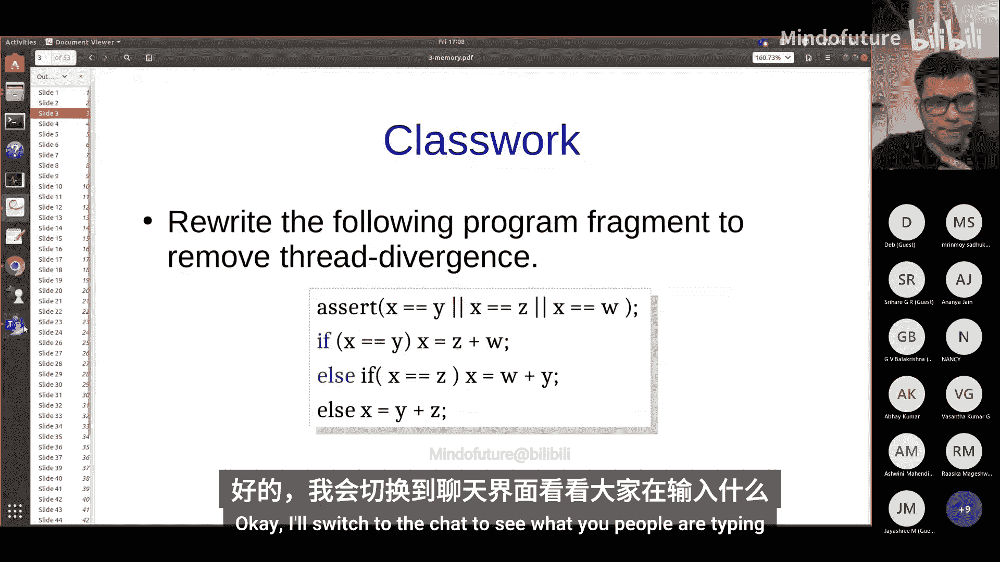

Okay， three steps。 worst case， yes。So I request you to try out for the second question that I asked。

 I mean， I mean， how can we remove。其大问。Yeah， good evening。

Yeah I'll switch back to his slide in case anyone wants to look at the question again。

If this is the question， we want to remove the divergence。

 first question is how many steps will it take for work threats to execute and second is we want to remove the divergence。

Bless Pra。I'll wait for a few more seconds。

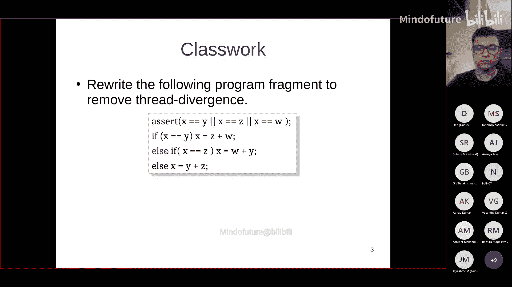

咁佢整 back佢上。O啊。Cool， I can see some responses。 three steps， four steps。

Okay four steps I saying some many saying four steps。Yeah。

 this equation looks okay to me is5 plus at plus of 2 minus6。Yes。

 yes similar to the last question yeah。That is correct， I guess this equation is correct。

How can it be four steps as I'm wondering？I mean， just don't include that assert treatment without S it's three steps three steps。

 I guess。Okay， so let us understand it。I'm happy that you people have tried。 but yeah。

 so let's move to the。

Slightight。And understand how I was。So okay， so let's try understanding it。So first of all。

 for those who haven't understood it， so like it will take three steps to execute this FL else clause or construct。

So as I told in worst case， it might happen that。Warb threads。

 which is a bunch of32 threads might go into different different conditions。

 so let's say for first5 threads this condition was true so theyll execute this statement the rest of all will execute no。

Then let' us assume that for 6 to 15 threads this condition was true。

 so they'll execute this condition this statement and for all of else for everywhere。

 I mean for all other threads they'll execute no。And let's say our threats from 16 to 31。Yeah。

 so assuming that thread ID goes from 0 to 31 from 16 to 31 threads this else they fall in this else condition and the statement was executed and rest all of them execute more so worst case three steps will be taken right。

And yeah， so three steps can be taken in worst case。

But let us say we want to create this code in such a manner that we want no dis， I mean。

 we just want to finish this thing in just one step。And how can we do it， as some of you pointed on。

 we can simply use this formula。As we know that either， I mean。

 x can either take the value of y z or w。So there are， again， three case here。

So we can just replace the center if LC say fail by this one statement and is this correct？

So as I explained in the previous example is let us analyze this case by case。

Let us say the value of x was equals to y then in this in that case this value of y。

 so how this right hand side of this equation will evaluate。

This y and this x will cancel out and this right hand side will turn out to be set plus w。

 which is actually what we want when x equals to y that is case1。Now case2 when x equals to z。

In that case， what will happen， this set， how the RHS will evaluate how the rS will look。

 this set and this x cancel out and will let up with y+ structure。

 which is what we want in that case when x equals to result。And in third case， one x equals to W。

This average is put to I mean， this W and x will cancel and r is put to y plus set。

 which is what we want。When we fall in that else， which is x equal。So this one will exactly。Exactly。

 I mean， serve our purpose because it is similar to this center repal cross。Okay。

 I guess everyone got this point if there is any doubt here。

 then I'll probably wait for a second and move to chat if to see if anyone have any。

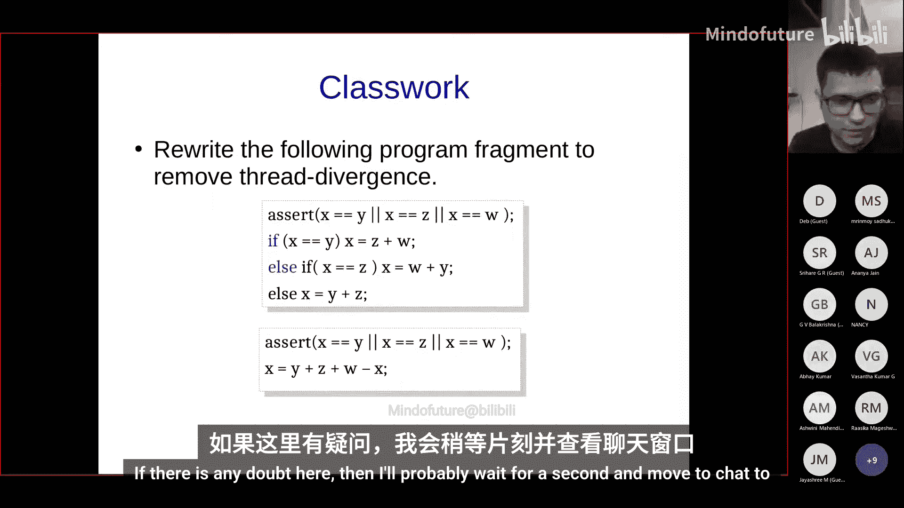

Question。Yeah， I had a quick question as you were seeing the number of steps。

So in the number of steps you set not to include the assert statement is that yeah， yeah， I mean。

I was like， how many steps does it it take for vlets to execute this if L pulses clause。

 so SERT is not part of that ifels。但是。So question was that I mean I didn't told that what is the number of steps taken by war threads to execute this entire fragment that was not the question question was how many steps will the W threads take to execute this if LCLs class or construct？

That answer is free， but if we consider this asset also， then the answer is4， that is correct。Yeah。

 but for this part it's just three okay， I hope that's clear quickly。

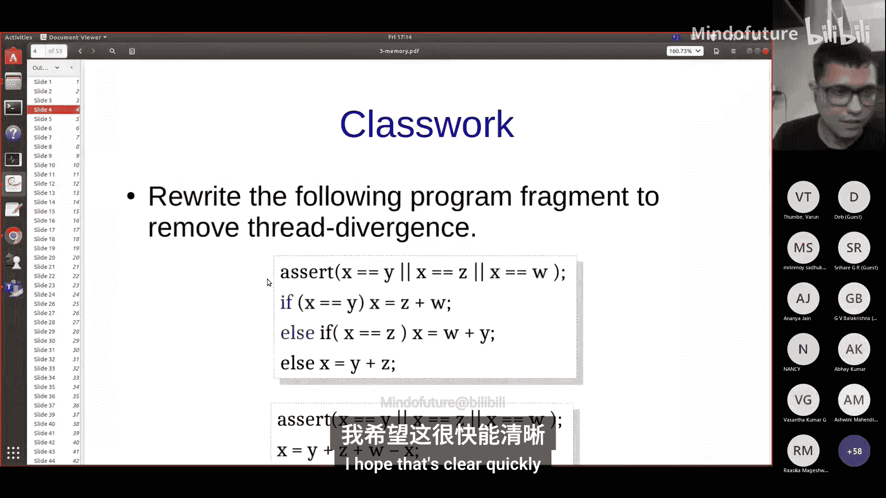

嗯。喺。That is there are no questions， okay。Okay， then let's move on to our discussion further。

So this was like a warm up question we'll see more involving questions further。

So let us start with very good exercise now。Let us say that we have。

Let us say that we have this conon named a tea conon。Wwhich is taking two arguments。

 which is one is the quantta to the vector， which is again pointing to some GPp memory location vector size is the size of the vector。

有诶。As we saw in the previous lecture this ID is the I mean。

 this equation calculates the ID and let us assume that this kernel is launched with one word。

 which is 32 threads。And okay， so 32 threads are there。 So I will go from 0 to 31。

And then we have this if El。Construct a pelsic construct if we can observe here this entire pels。

So again， my question is simple， how many steps does the war thread take to execute this Eive construct？

Just the if custom， don't include this IT calculation only， just focus on the s。

How many steps will what threads will take to execute this eulsive construct？

I'll pause here for some seconds and wait then we'll move on。Okay。

 so one thing that I want to mention here is that。Asum that this。I mean。

 this loop thing doesn't I mean， doesn't affect much so if there are hunter iterations here。

Assume that the。Each at takes one step and loop doesn't count towards a steps or anything is considered inter turn that way。

So for this loop， consider it as 100 steps because we are going from what 200 right。

 so consider this loop as 100 steps。Keeping that in mind how many steps were？I mean。

 this entire if construct。I'll wait here for a few more seconds， and then well。

go to chat and then check out。Okay， let me go back to the chat。

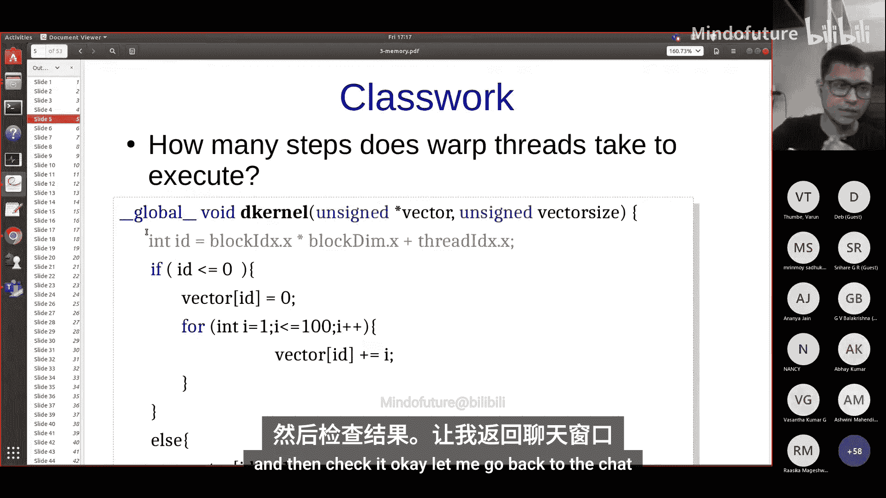

Sometimes体性 do。First kiss， to。But mostly when。Okay， why people are telling to。

 I am not able to understand too。Worst case0 yeah。This seems quite reasonable。 worst case  hundred02。

1， I don't want address by one。 I mean， one is like。One will be when there， I mean。

 there is no divergence person。Okay hundred， okay。Hundred and1。So please think about it。

 request teaching every one of you to try and switch back to this slide so that your people can find。

Please think about it。 I mean， unless you try， you want to be， I mean， will be difficult。Oh。屋企啊。你过咩请。

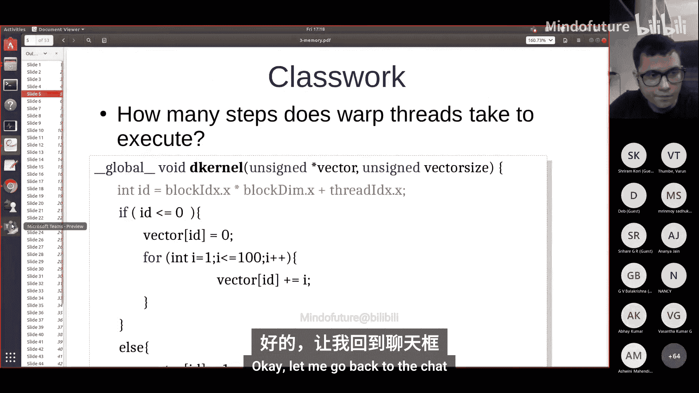

嗯。Friday。So one steps shouldn't take the condition here。Okay， let us see I mean， what will happen。

Somebody saying， hundred02。Okay， that's good that many of you have at least tried， that's good。

So let us understand what will happen。Okay， let us understand what will happen as I told this kernel is launched with exactly one wt so there are 32 threads and id will go from 0 to 31。

Go it。So now what will happen， let us try to analyze this。

So let's say all the thread comes here at the S condition。

 theyll see that only one thread which has ID0。Satisfy this condition because for only thread with I 00 is less than or equal to 0 is  true。

For all other threads， ID is 1 from 1 to 31， so this condition will be false because from 1， I mean。

 1 to 31 is a positive number and it is not less than or equals to 0。

So for all other threats from 1 to 31 this they will never enter inside the safe condition。

 they will enter inside the sales condition。So currently。

 only one thread has entered inside the safe condition。

and that one third which is having I0 it is executing how many steps lets try to understand it is executing this step。

 which is one one step。Then this 100 steps of this border loop。

Total 101 steps are being executed by the threat， which is having I0。ok so。

Treread with  LD0 is executing 101 steps here， mean what this other threads are doing。

 other threads which are having I from 1 to 31 what they are doing they are just executing no right。

So。Thats with ID0 to sorry， threat with ID0 has executed 101 steps and all other are executing more。

Okay， so that's fine。Once that zero threat is finished。

They all the will come in this else part now for the sales part third zero will not enter this else part。

So all other 31 threats will enter having IDd from 1 to 31 and they'll execute this statement。

 which is。Vectctor of 5 equals to 1 that is theyre initialitizing that particular memory location with one。

And all threats from 1 to 31 ID will go the step and0 thread will execute more。

 so total how many steps are being executed here。101 here。And then one here。

 so 101 plus  one which is 104 total steps are being executed if you observe carefully。

Total 1 and2 steps are being executed。By the Web。So that看。If you have any questions。

 then I'll quickly go back to the chat。 otherwise we'll move further。

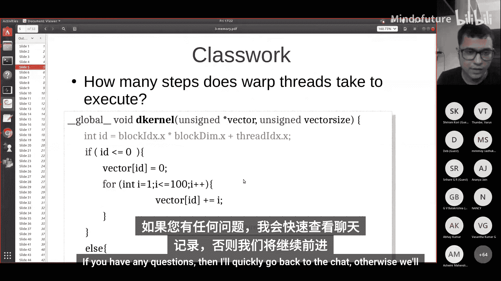

杭州咧都有杭州咧都。135 in。Sorry to0 and okay， okay。Okay， if there is any doubt。

 that'll pause here for probably four or five seconds or。

Okay， if there is not doubt， let's move further。With our discussion。Okay， so we understood that this。

This if construct takes 102 steps for what threats to execute。Now， again。

 my question is that can we improve this， can we reduce this 102 steps to， let's say lesser steps。

 let's say from 102 can we reduce it to 50 or something like that。Can we do that or even lesser？啊。

So I hope that you caught my question， so this case spell construct takes 102 steps for workforce and we reduce it to some lesser step。

So I want each and every one of you to think about it， how can we do that？And yeah。

 I'll stop here for a couple of seconds or probably a minute for you people to think。

And then we'll discuss。The效性。おってした。冇嘅。

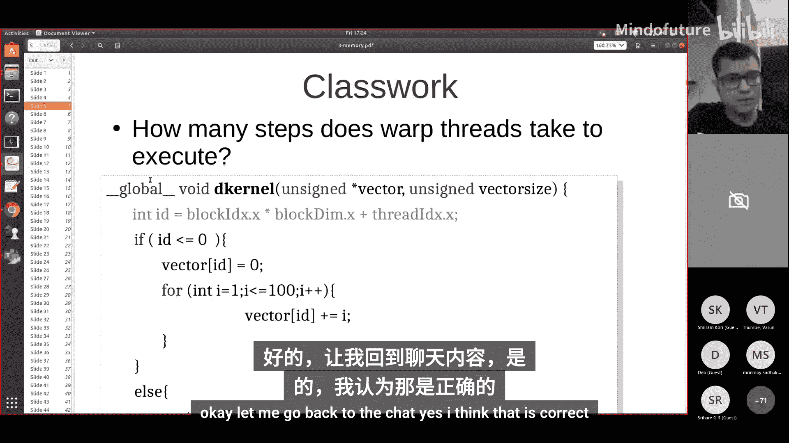

go back。Yes。嗯。I think。That is correct。 you can do this thing。嗯 the one。Yes。

 I think both of your correct。I also request others to try so that you can practice out of it。起不得。

Yeah， I think the answer is correct， so let's move on。

Okay， so in order to okay for others some vi。Explaining it in some better manner。

 So in order to understand how can we reduce the steps further， we need to understand what， I mean。

 what this。This if condition， I mean， what is the statement inside this if condition？

First thing is that the most expensive part is this thing right because from1 to 31 threads which are I mean the threads having 1 to 31 I。

 they are just taking one steps， but this the main bottleneck is the thread zero which is taking 101 steps。

So is there any way we can reduce this one to just？Few steps。 or let's say， one step。To do that。

 we need to understand what is happening here actually。So if you see what we are doing this。

 we are initializing the zero memory location0 me location because it is 0。

So we are initialitizing zero memory location to 0 and then what we are doing is just sum of first and natural numbers which is yeah I ranging from 1 to00 so we are doing some of first 100 natural number and placing it at the zero memory location。

So yeah， so I mean， the idea is simple if we can just remove all these things。

 this loop things and all those things and just。Replace it by the formula of question natural numbers in this case question00 natural numbers。

 it will reduce the number of steps。And this is how it can be done。呃。花热。

If the id is less than or equal to 0， then we just simply do vector of I equals to 101 and 100 by2。

Which will simply calculate this thing only， the center thing only。

And this can be done in just one step， right？So yeah so。

This will reduce the number of steps and here we just keep the same thing that we had previously。

Here， yeah， so this and this thing are similar。So okay so it seems like we have reduced a number of steps so like I request I mean request you to try out how many steps does it takes to execute now？

It will be very quick you will be able to tell it very quickly how many steps this if Elif construct takes to execute now what the war threads。

一啊。

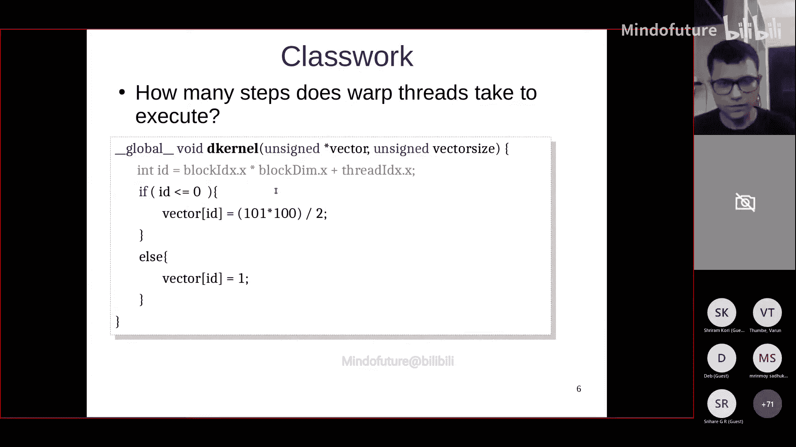

过都得讲。廿六海呀。Obviouslyous， I mean， everyone would be now。Able to guess like it， too。Okay。

 so that's good we have reduced Cal quickly move back to these slide。O啊。

I'll quickly move back to the scripts。

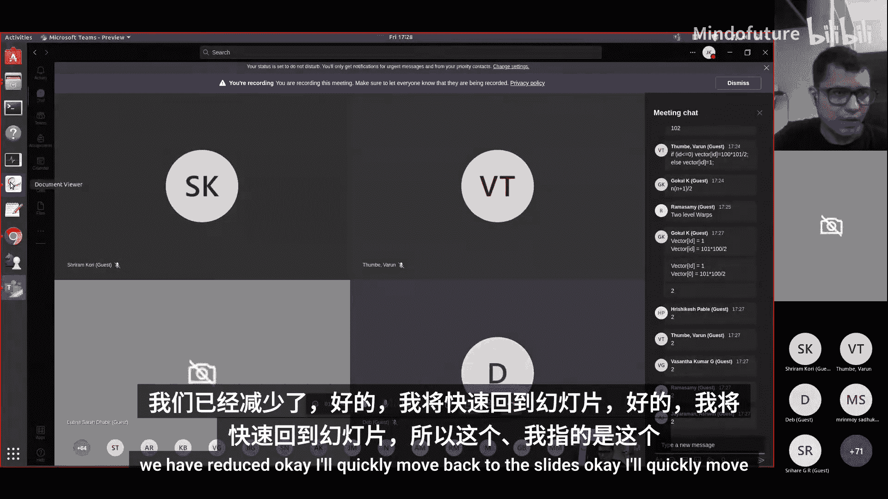

So number of steps taken。For this。I mean， I guess if I a construct execute for what says too。

Now again， it still takes two steps and there is still divergence here， I mean。

 threats are diverging， right？啊。So， I mean， because fast is。

Firstern will execute this part and all other will wait。

All other will execute this button cost zero thread will be here。So still， if you see。

 there is a threat divergence here。So I request each and every one of you to try further how can we reduce the threat divergence further or how can we reduce the steps further here two steps are needed right for the Web。

Can we reduce it for just one step as we did here if you remember that？here， right。

 we just reduce the center three steps to one step one step， right？

So can something like this be done here can I request each and every one of you to try with this？

And post your answers in the chat， I'll probably wait for a minute or probably two minutes to。

Im wait for you to think about。Then will proceed。呢个先知道。先搞我。

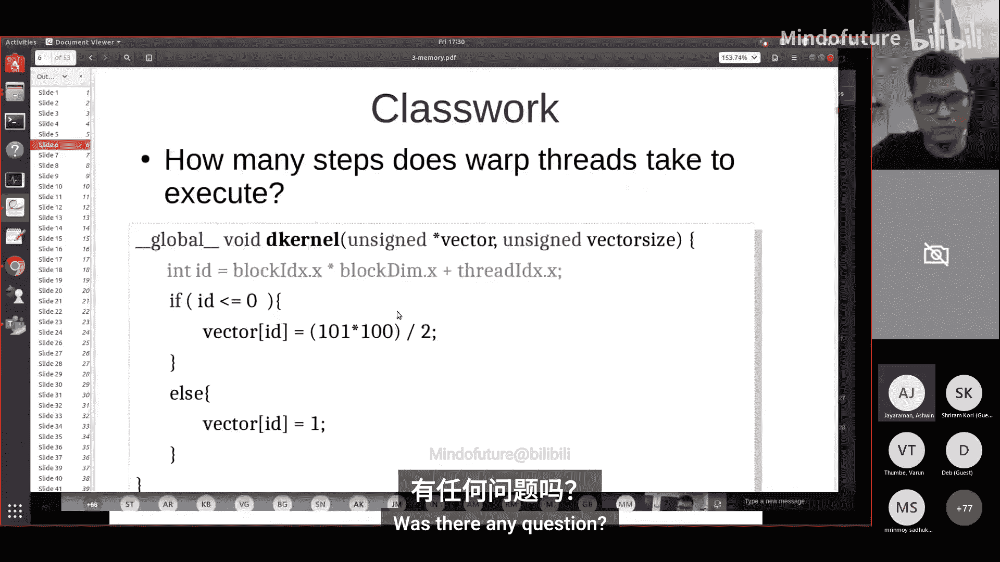

Was there any question， you。Someone was speaking， I guess。The Googleo has typed something。

The saying vector of idd equals to 1 and then vector of 0 equals to 101 and 200 by2。Okay。

 I'll ask you a question here how many steps it will take Yeah it's two right still it's two it two steps。

So。It's， I mean， we have avoided here but。We should think it， I mean， think in a better way。

 smart way， I mean， think smartly。Can we reduce it to just one step？It's my question。I mean。

 please try I mean， if you， I mean， if you are unable to。Find the correct answer that's okay。

 but least start。

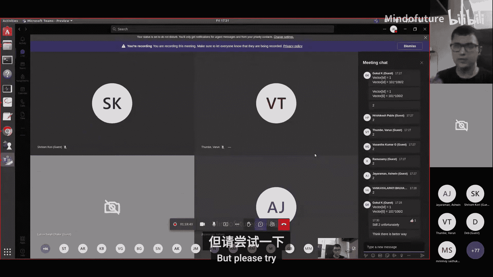

I switch to the。I'll wait for a few more seconds because it might not be very straightforward。

 so I want to give you people some time。

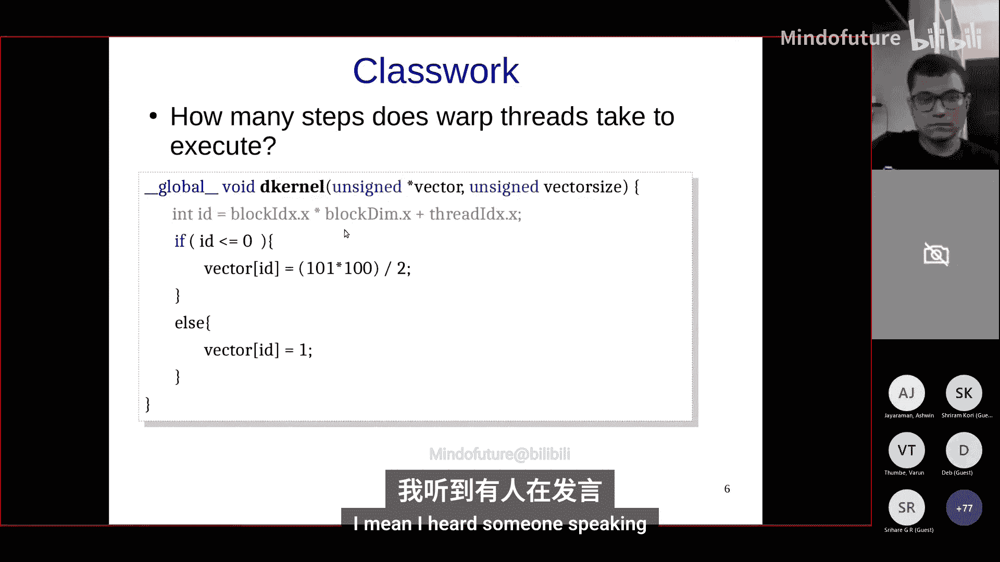

I， I mean， I heard someone speaking。Okay， Bar has typed something。 Let us see what is。啊。Okay。

 can this work。What is this IDd less than zero， what does it does？嗯。ok啊。Yeah。

 I guess this should work。This is one of the way it can be。But yeah， I have proposed something else。

 but let us see， I mean yeah， this this seems correct to me other than one and 00 by2 minus1。And到。

Yeah。嗯。One of the way it can be done is this year， correct。

 waroon has probably given the correct answer。But， I think。There should not be one here， right。

Because I D less than equals to 0。Will evaluate true for0 threat。And that will cancel out this one。

 So why are you placing this additional one here。And。So in case of zero。

 we want 1001 into 00 100 by two right so the one will cancel out。Whi is is needed。

 and in case of other values， ideal less than equal to 0 is 0。

 its true value and multiplying it with。If you the answer will be one。 Okay， I got it。

 This is multiplication。 Okay， this one is okay。Got it。 Got it。 Yeah。 Go it。嗯。Yeah。

 I think this looks direct to me。requestest others to also try。Okay， yeah， type casting that's。

 I mean， it's good to typecast， that is correct。Okay。

 let's go to me and Gopo is saying value divide by value minus1。贵啲出。Okay。

 but ID will go from 1 to 31。You need to do something like this the way Vaaron has done。

Because you should you will be able to you should be able to generate a mapping in such a way that if I is 0。

 then it will give one else if I is positive， then it should be able to give you 0。

So I guess this should not work。But anyways， I mean， it' I mean it's good that you have right。Yeah。

ok啊 so I think。I've given even enough time， let's get back to our slides。

So， okay， so one of the way it can be done。 I mean， the way I thought was this。If you see。

There are two important observations here。First is that ID is going from if you see this equation they computing ID and ID is going from 0 to 31。

And ID can either be a0 or can be a positive number。That's one observation。 observation number one。

That ID can either be 0 or can be a positiveus number。

And second observation is that ID is an integer， so it takes 32 bits I mean in memory it has 32 bits I mean where the specific bits are from 0 to 31 right the way the integer is declared is there are 32 bits reserved for it。

So the way that I thought of doing it was like this when you have a number integer number。

And it is a positive number in our case it it will be a positive number or a 0 so when it is a positive number and you negate that number then if you people know it sine bit positive number is sine bit as 0 when you ne it it sine width become 1。

And when you ship that。Negative number which has signed bit as1 by 31 times what will happen is sign shifting will happen I mean sign will be shifted and every bit will become one or sign copying will be done something like that will happen。

So， all。32 bits will become one。Like if the number is positive and if you do this thing。

 this minus id left shifted by 31 times。So right shifted by 31 times and if the number is positive it will become all once and if you people know all once in whose complement is actually the minus1。

So if the number is positive and if so if the number is positive。

 what will be the output of this equation， it will be minus1。So when the number is positive。

 this will this thing will emit minus1 and minus1 plus plus sorry1 plus minus1 is 0。So。

 for positive numbers this entire thing will become 0 and when the number is0。

 this will become this entire thing will become0 because no， I mean。

 if you do minus 0 the number is still 0 and sine word pulse remain 0。And when you shift it by 31。

 the entire number will become 0， so for 01 plus 0 will happen， which is 1。And yeah。

 so the key point to remember here is this entire thing will evaluate to one if the number is 0 and0 if the number is positive。

So in our case， when the id is 0， this entire thing will be 1 one into this entire thing will be again。

 this entire thing1 and 1 into 100 by 2 minus 1。And plus one we are doing。

 so when the id is 0 will get this thing 1001 into 100 by2。And when the idea is。

Positive number this this entire thing will be 0 as I explained and0 into anything is0。

And so what will be laptop is there's just one。This one。And that one will be assigned。

 so this is exactly what we want， this I vector vector of I is this thing。

When the number when the ID is0 and when it is positive， we want this one to be assigned。

And that is what will happen here。And。The cool thing to observe here is that we started off with this thing。

 this center thing。And it took actually 102 steps to execute for war threats。

And we have just reduced it to just one step if we can see here。So， I mean， yeah， I mean。

 so number of steps the what threats would take to execute this one is now just one。

And we reduce it from 102 to1 and yeah so the key takeaway from this this example of this exercise is that。

In many of the cases， if you see the computation， if you see the computation properly。

 you'll be able to reduce the threat divergence and it is possible in many cases but there are cases where you want to be able to reduce the threat divergence。

 especially in graph algorithms mostly when the computation is irregular and just can't avoid the divergence there。

 but in many cases like this is one of the example where you can reduce it。让。Very large extent。

 I mean， from 102 to2 just one。 So yeah， please make a note of that。In many cases， it is possible。

Okay， so if anyone have any doubt in this slide， I'll just quickly go to them and quickly go to the chat and。

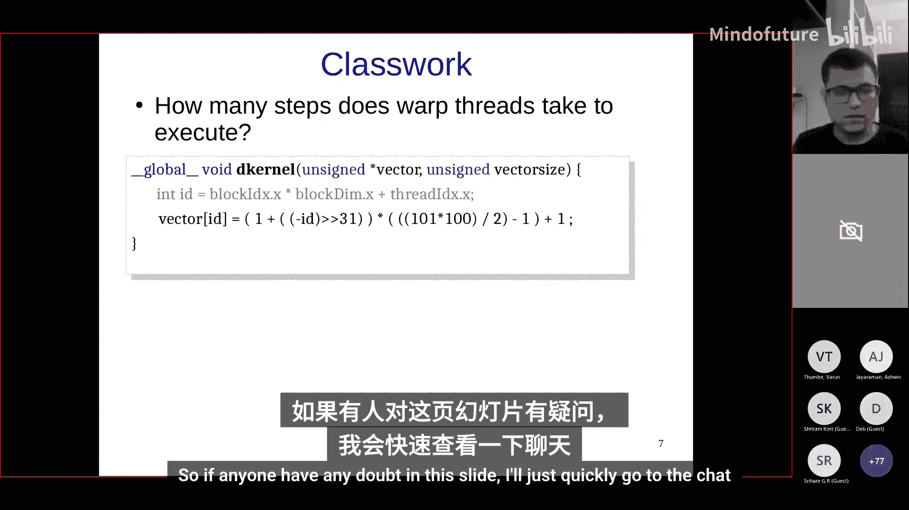

because it's negative， it will always shift to one。Oh， so okay， when the number is negative。

 the sine bit is 1。And I mean， sign bit is the most significant bit。

In that 32 bit 32 bit number and that bit will be shifted and the entire。

 I mean it will be not shifted， but it will be copied in consecutive bits。

 so entire 32 bits will become 1111。And in fact。And vectorctor。

Number with all once in the 32pi is actually minus1 if you if you know the tools complement or I mean two how the tools complement well that the number with all once in it is actually is actually is actually represented as minus one in whose complement representation。

Next question is。Not of I D and0 would this。Id and zero， let me think。Okay。

 you are saying that wait to no I DN1。ok。Yes。😊，对对。喂。ですか。たた。Your voice is breaking。 Can you。

Speak again。hello。O。So let me think about this， I D， everyone。屋企咁。Okay。

 but when how are you planning to do this I？We should give the entire equation I D and one will give。

0ero and I zero。And in the rest of the case， it will give one。But actually。

 it will give one on also if it is an odd number， right， I think。Yes， in every case， will， I。

What positive number， I think it will give one。How。I positive。啊，知。For02 give0。

Because get why and right？But the even numbers that。Yeah。

 for even numbers it will not give because let's say number is2。Then it's 10。

1 n to 10 will give 0 so your。E questionation might fail for even number， if you are。

Planning to use this as something like here multiplication or somewhere。Party multiplication。

Therefore even number also will give0。For odd number， it will give one。Yeah。

It highly depends the way you are using it， I mean， how we are framing the equation。一。

So please try out and it might work if you place it properly。Is what my suggestion。

Okay， anyways， let's move further from here。So again。

 let us continue our discussion with threativs let us say that I have again one more kernel which which has the name again D kernel。

And again， there is this vector and vector， which is the area。

Which is allocated on GPU pointed by this pointer vector。And they exercise the size of vector。

 and then again we are interpretrating the ID in a very conventional manner。

And we are launching this kernel with again one bo。And then which is 32 threads。

 and ID goes from 0 to 31 and we have this switch case construct。

And I want you people to tell me how many steps will what threads take to execute this switch？

Switch case。新家添。Enti switch。So I'll wait here for a few seconds and for you people to try out how many steps it will take。

And then we'll probably move on。With their discussion。Yeah。好的。I think someone said，10。

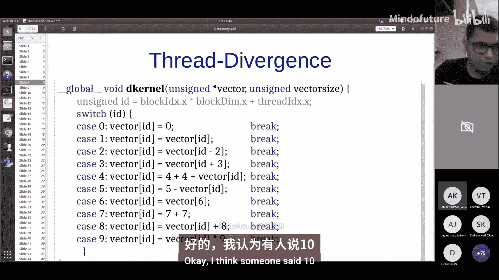

1， how， how can be。Can you， I mean， can you。Some funny think to。好跟。Then来一个 question。Okay。

 I'm talking about entire work so。

你ick。Could let me go back to。Like， I mean， so。What has 32 threads and。

Id of those 32 threats range from0 to 31。And based on ID， we are switching right。

 so it is very very much similar to write that writing that if if else ladder if you remember。

So I don't think that it will just execute in one step。

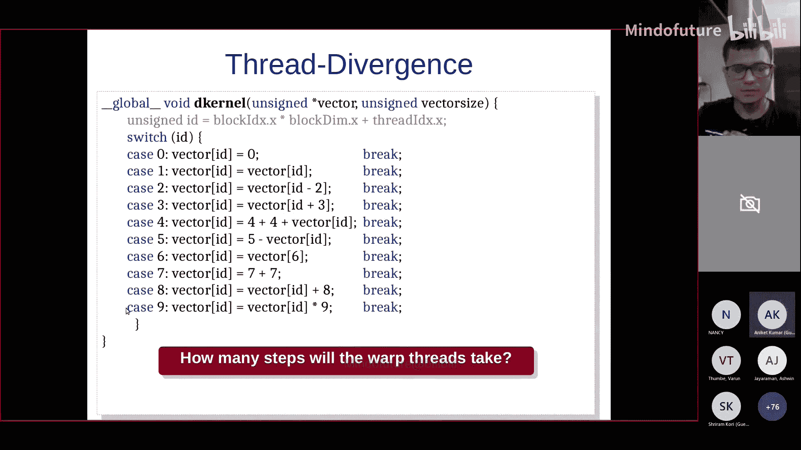

But yeah， let us see I mean。

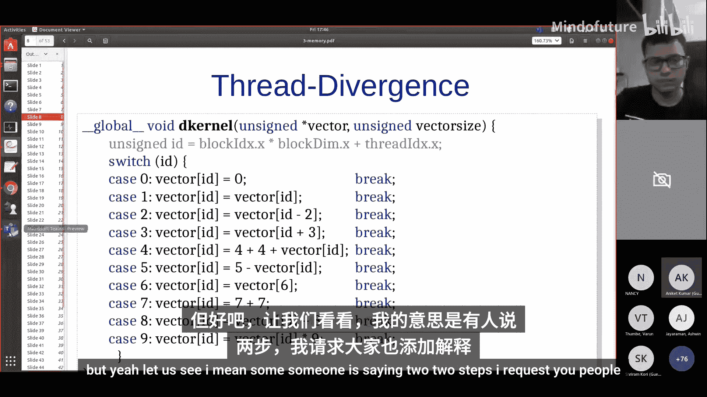

三。Somebody think do。Two steps。I request you people to add the explanation also otherwise。

 how can I I mean， how can I understand how I mean the way it is working two steps。

 probably you can unmute your cell phone。Okay， so executing a case is like you are going inside a。

I mean， let's say if you， I mean， it's very similar to effects so。

Switch case is very similar to health。 So let's say if you are。If your condition is true， so okay。

 in fact， let me explain it。With that slide itself， so I'm happy that you people have at least tried。

 but let's understand this。

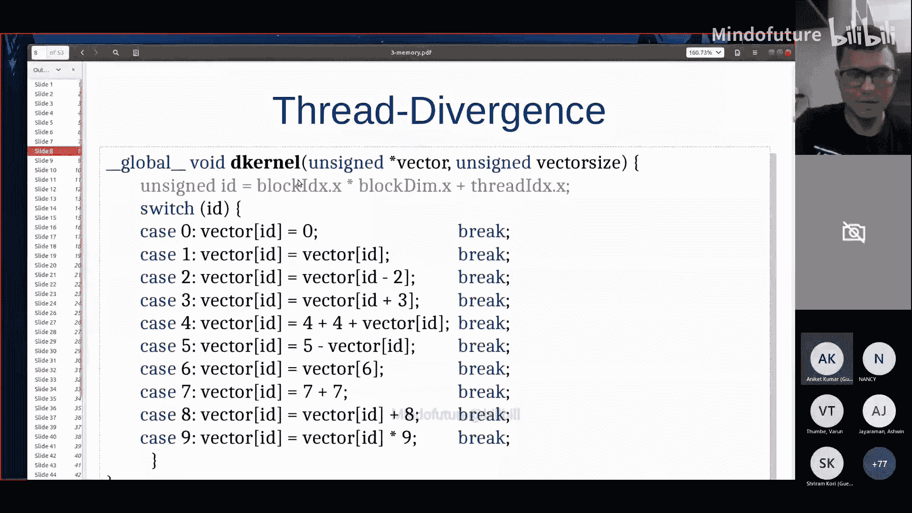

Or at least let us see what I think about it you people might be correct but I need some convincing explanation so that I can digest the thing so okay but let us let us understand it with this slide。

That is what I think about it。So。Okay， yeah， so ID ranges from 0 to 31 and then we have this switch statement。

WWhich is switching based on the ID。So I can range from 02。31 as we know， and based on the case。

 the third will execute that statement。So for the thread with I0。What will happen is that， okay。

 so this， first of all， this switch is executed by each and every thread， right？

So what will happen is thread with I 0 will go inside。Here。

 and it will execute this statement because K0 is true。And for all the rest of the threats。

 what will happen is they'll execute more。So one step here， I mean。

 third zero is executing here and all all other third are executing now。For a thread with I1。

 this case is true， so it will execute this statement， all others will execute more。

And this will go on， this will go on till nine。Over 9 thread。This case nine will， I mean。

 it will value to true and it will execute this statement。ok。And the rest all will be executing Bob。

So in worst case， in worst case， 10 steps will be taken because there are 10 cases。

Consider it as a itelciants ladder like。It is as good as writing if I equals to 0， then do this。

 if I equals to1 then do this， if I equals to2， then do this and so on， if I equals to9。

 then do this。if I just replace that thing by this。

 I believe that the number of steps taken are 10 for the web threats。

If there are any question or if you feel that something was wrong。

 please admit or type in the chat so I can also。

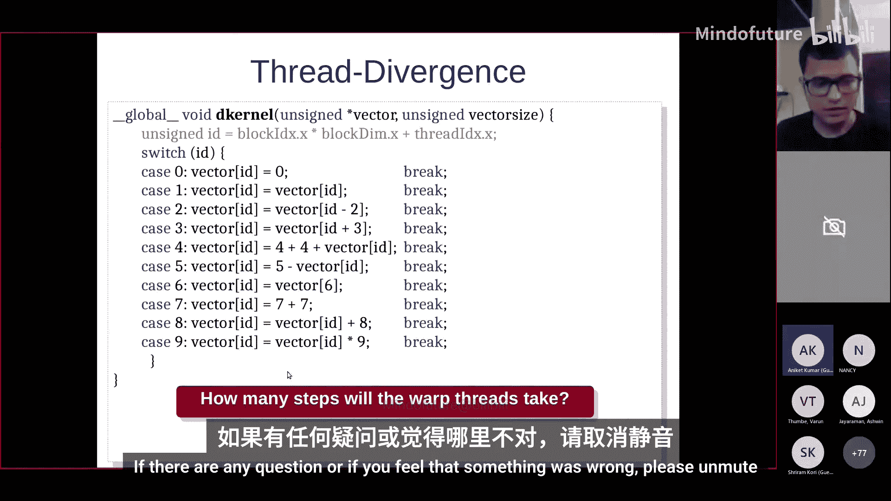

So I am question this。 yeah， please go ahead。So when case and0 exceed you and change and it goes ahead and eventually case 9 also executes。

There are total 10 counting from case 0 to case 9， including the the statement for case 9 as well。

 right， So won't there be11 like。To execute the statement for case 9， which is。

About the statement thats being。

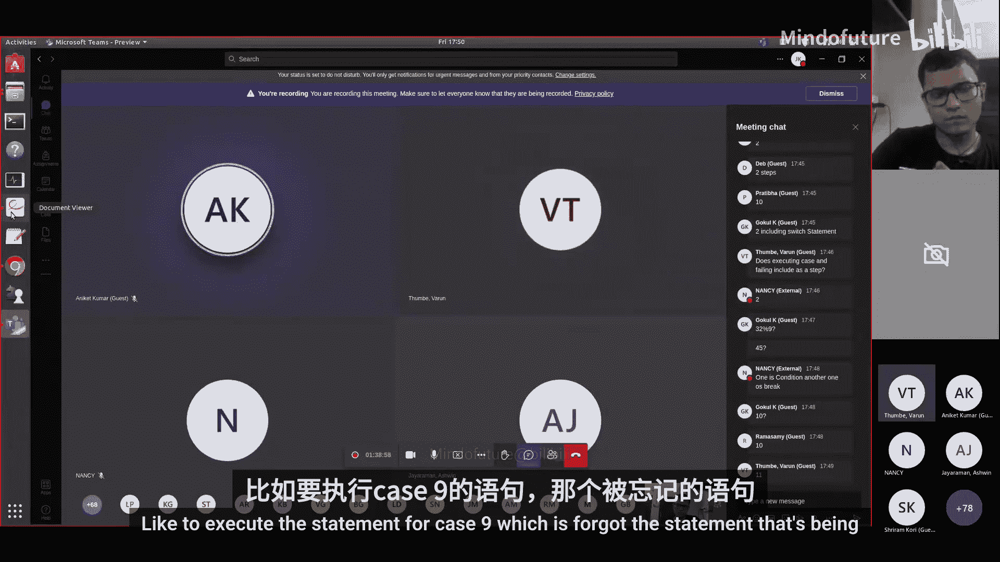

O。

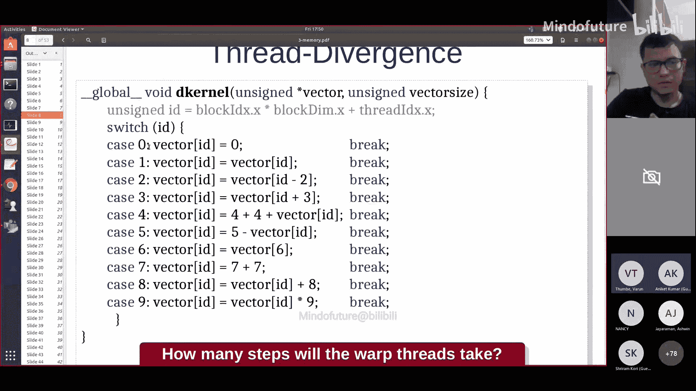

I didn't got it， which which one youre asked just can you reiterateite that？In case of case 9。

YouEven the statement of case9 needs to be executed right and along with actually verifying that it is a case9。

Oh， okay， yeah， you are telling that you need to check that if it's a nine or not。

 I mean gl is nine or。yeah that can be included but so far if you remember in our all the previous examples if you see here we are not including that as a step well it can be included as a step but when I say a stepm Im talking about this basic block or let us not talk about basic block now but I'm talking about this。

This thing， I mean， the statement which are inside。Inside this gloss。This thing I mean。

I the garlic trace。So in the similar way， Im not counting this case checking as well。

I'm not counting this case， acting as a step。In that case I'm a little confused。

 could you go back to one of the easier examples and explain how it is to work？Yeah， so okay。

 let us let us do this thing on。 This is the most simplest one。So here。

We also have this timeline right， So here I'm not taking this。

If checking this if condition as a step。I'm just taking this one as of executing of this execution of this statement。

And this story。As a step， so you can see that this is one statement。

 then there is not for all of the。Then there is the statement。So in that way it you take， so I mean。

 this is very similar to ifL as， right？If I is0， then do this， if5 is1。

 then do this and if that is the case we are not taking ID checking as a step。

Is what at least that is the way I'm thinking。Yeah。

 particular thinking in that I checking with then it might be more steps。

 but the way I'm thinking it will take10 steps exactly。

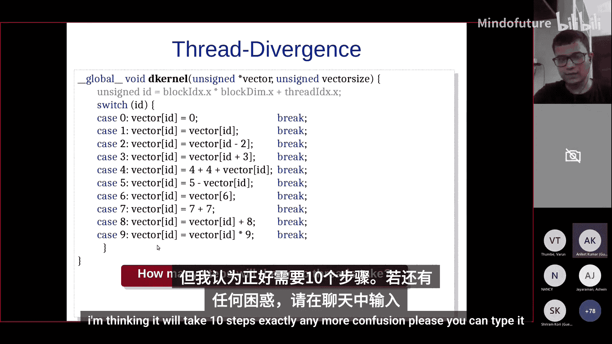

Any more confusion of this？You can type it in chat or just unmute and ask。

verification yeah that is correct if we look deep enough then we can say that verification is one step and go to line is another step then expression another。

 but that is if you if you are really planning to go deeply go then if you say this how this thing this。

Switch case and all those things。 and April's condition are written in。Um， very， I mean。

 very low level language， it's go to right， it's go to this step and all those things。So yeah。

 you can consider it as a step， but just for the sake of simplicity。

 I'm not considering it as a step， I mean to make make the discussion simple。

But I agree that if you want to consider it as a step then you can。O。

I guess we just need to look at lines of code the thread。Yeah， that is what I am focusing on。

Yeah okay， so let us move on to our discussion。

Okay， so as we know that this will take。Thanks， Step。Not considering the checking as the。

this would take 10 steps to execute。For the workers。

Now I want two people to think about how can we reduce this， as we did in our previous examples。

 how can we reduce this 10 steps to probably lesser steps？

Please think about I'll give a few seconds here， wait for a few seconds here for you pull the thing。

And。Pot your answers in the chat。I have个。Yeah谢谢。😊，Yeah， what the initial value of vector I like。

Or what is the initial value of vectorta。You can assume that it's a garbage value。I mean。

 we haven't finished eyes that right， so。For example，3， it goes to vector of IDd plus 3。

 which will be vector of six。You are seeing to get initials to a garbage value in case 3。No， no。

 it wont。 I mean， the observation is correct， but。啊。Okay， let us say that。

Even though its initial to garbage value， then your observation is correct， right。Thatctor。

Case 3 and case 6 are similar， no matter whatever the value is at the。Vector location 6。

If you see this， this thing will evaluate to vector of  six and this thing also also vector I mean vector of6。

And so what we are doing is whether it is 3 or6， what we are doing is we are assigning that with vector of6 and no matter what whatever the value is as long as we are doing it correctly。

 it is okay right？So yeah， this is one observation， K3 and K61 can be combined。

Is there any other observation that any one of you have？There is still one more。

 at least from my side， please observe。Like the ID is appearing in the equation or initialitation equations。

The2 and 0 can be combined， right， case 0 and case 2。How can it be combined K 0 case2。月はい。Yeah。

 please sorry I was wrong。 sorry Yeah， it I mean， case 0 is initializing it to 0 and and case2 is initializing to vector of 0。

 which are two different things， according to。still one more thing is pending please， I mean。

 please observe it carefully。But that's that idea I minus2 equal minus storage。Yeah， sorry，1 by one。

 I am unable to。In the beginning。Yes， yes。 that's correct case4 and case it are same if you see this thing and this thing is similar4 plus4 plus vector of5 days same as。

诶。8 plus vector of  I。So。Two things can be merge， at least from my side。

 case for in case yet can be merge。That isn't。Yes。😊，K21 case0 if you look at case2 adjust。

That that idea of I D minus2， I D will be through that， So I D minus2 becomes zero again。😊，Yeah。

 but as I told， okay， let us take this。You told that id will be 2 and 2 minus2 is0。 Okay， perfect。

2 minus2 is0 but。But we don't know what is there inside vector of 0 vector of zero might be a garbage value lets say 10000 so is it similar I mean is it same idea of  zero I mean vector of zero is initialized to0 and vector of2 is initialized to 10000 is it not same that it is not same but the the act if you look at it depending on order of which state comes first。

The value not be different， but in the end the end we can only point to like a certain index model。

I didn't got your question， sorry can。Or can you explain it with some here example？哎。Third。

 I'm saying that， depending on。Sa for case1 upon scenario one vector ID sorry ID0 first that way0 will get defined then vector ID of0 and then vector ID id minus2 will come to minus21 and2 point to that。

😊，But if it's a different order means it could be different， even in the normal。

probably I got your okay I think I was wrong here and probably you people were correct here so I got your point so I mean it's lockstep fashion I mean lockstep and of execution so initially Id of zero will be initialized to zero so vector of zero will be0。

And vector of here， it will be 2 minus-2， which is 0。And which will be0 again， yes。

 you are correct here， so this case2 and K0 can also become correct， I miss this one。So in fact。

 we can merge three things right here。As if I have understood it correctly， we can merge K0 case2。

Then we can merge case in case6。And then we can march case4 and case it also。

So three more things are possible here。Number of steps will reduce from 10 to 7 right。

 so now we we can execute this。Switch， I mean， this center switch construct in just seven steps if we do it smartly。

Then it will take seven steps if we merge this cases， as I said earlier here。

And elsewhere if you don't march， it would take 10 steps。Any out here a。

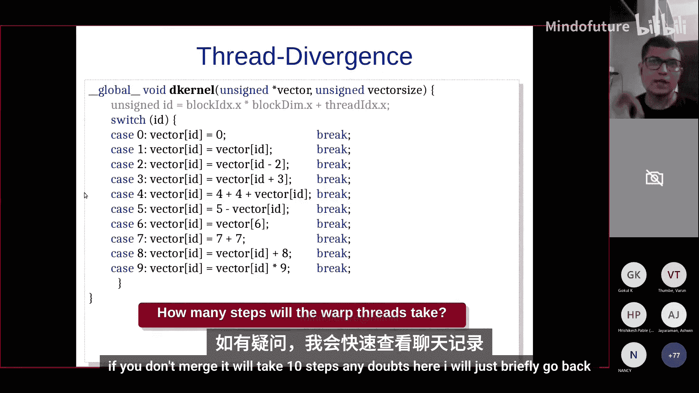

Greatly， go back to the chat。Whatt thread execution。安し？啊没点使。Re？I mean， vector of 0 and vector。Okay。

 I guess as I explained， since thirds are executing in lockstep manner， can let me go。百度的。

So okay， so I mean， the switch case is executed with， I mean， first of all。

 this catalyst is executed with 32 thread samples。And vs will execute。

 I mean W threats will execute in lock step manner， so first of all， this will execute。

So vector of 0 will become0 by mean this will be done by zero， right？

So0 third is initialitizing zero memory location of this vector to0。And then when we are moving here。

 when this case to is true by a minute。ThisThis done by I tried with IDP。

What it will do is it will check。2 minus2 which is 0， which is vector of0 and vector of 0 is0。Hence。

At memory location too also we are assigning zero， so it is as good as this。

So we can combine this two， I hope that' clear。

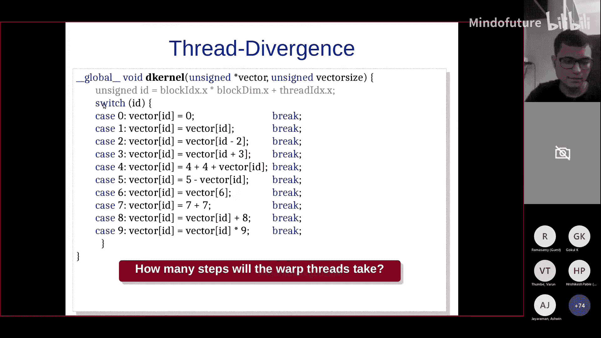

Willll ask that question。I hope that's clear Jayya Raman。In the end。

 we cannot guarantee the value in any index only which index is selected for which that is that。已经。

In the end， we cannot guarantee the value in any index。Yes。

 because everything is initialized to I mean bio defaultpo it is garbage so I guess you are correct。

 I mean we can't guarantee what will be in the water index I。

Because I mean we are doing some arbitrary operations right。

 so we just can't predict the final output here what will we there in each next we can't guarantee you。

Only which index is selected for which thread is started， yeah that is correct。

Value in any other location。Yeah， value in any location we can't predict because。

Where during the arbitrary operation， we are also using the prior valuess which are carbon。

If we can't just。Tell what will be the final values in each higher location。That is correct yes。Okay。

 so I guess。Everything is clear up this point。If there are any questions。

 then please unmute yourself and ask else I'll move on。

ok，系冇运题。Okay，Yeah。So， again， let us。Pry this example， which is probably the last one for today。

Let's say again， I have finished， I mean， I have this kernelner， which is launched with 32 heads。

 which is one more。And。A the construct。Whi says that if5 is less than  less than 16。

 that is from 0 to 15。I print this inside it。And there is something called a global value。

 which I'll explain what is that？And else if it is from 16 to 31， I'll print this else。

And then there is this global barrier。And now what is this global barrier。

 it's a synchronization form， think of it as a barrier， so what is barrier。

So whenever there is a barrier， all the threats will wait at that point until I mean， sorry。

 I reiterate so what is barrier barrier is a。point。

 so unless all the threads have reached that this statement， this barrier。

Any of the thread will not progress further so let's say thread one has reached this point but not I mean all other threads are still doing something else so thread one will wait here until that all other threads reach here and once every thread has reached here。

T on the teleproor。So I want each and every one of you to think that what is the output for this program？

What will happen for this program？And what will be what will be printed in case if it is printed。

 what will be the printed？What would be the printed up。wait here for a few seconds to try out。

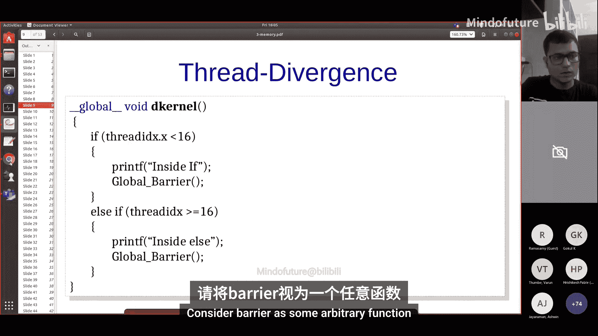

Okay， consider barrier as some arbitrary function right。Okay。嗯。嗯。嗯。嗯。Answer， you're muted。对。Okay。

 I don't when I just went to mute Yeah， but this is a very interesting observation that what about。

Threats that don't make in make into the if condition。So they'll keep on waiting forever。

 that is the important thing。Inside it 16 times， okay， inside it 16 times。

 and then program gets stuck perfect。O， I have unuted myself。So let us try to understand it。

 I am happy that you people have tried， but okay， let us try to understand it。

So as this is synchronization point and as we know that threads execute and what threads execute in lock step manner and we have launched kernel with one word only。

What will happiness？All the threats would come here。

 they'll see that for only past 16 thread that this condition is satisfying。

 so all other threats from。Having Id from 16 to 31 will execute more and for 16 third。

 having I from zero to 15 will start executing this。Statements which are inside the。So first of all。

 theyll print inside 16 times。Then there will be this global bur so。Every I mean。

 each and every 16 threads will keep waiting here for other 16 threads to come and only if they come。

 I mean， only if they reach this point， I mean other 16 threads reach this point， they'll move。

But they are never going to enter this if condition right。

 so this16 child will always keep waiting here。And。Yeah。

 so this program will end into something called a deadlock because。呃。

This thread are waiting for some another threads to finish their exam this threats are waiting for some other threats to finish some tasks so that is something called the start and will study this issue of tlock。

MoreIn more detail in upcoming lectures of synchronization。This is for now。

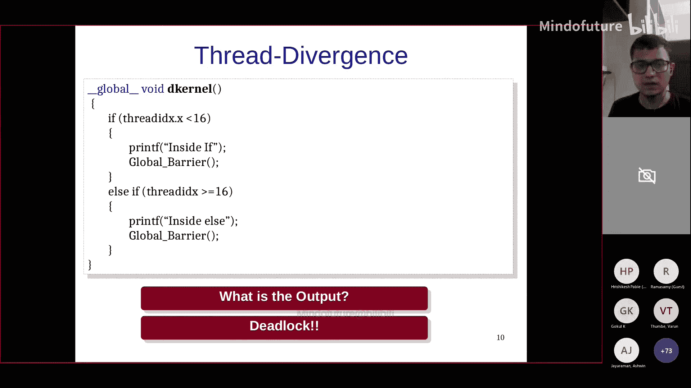

都稳点。ましたかす。That is some noise from someone in place， can you move？重新。Excuse me。 Can you mute。Hello。

Unless you have any questions， please mute。Hello。系啊。す。Thatastic。哦。Yeah。

 so waiting for something that will never happen is called something sort of a dad and we'll study this later as part of our synchronization lectures。

So this is a typical example of。

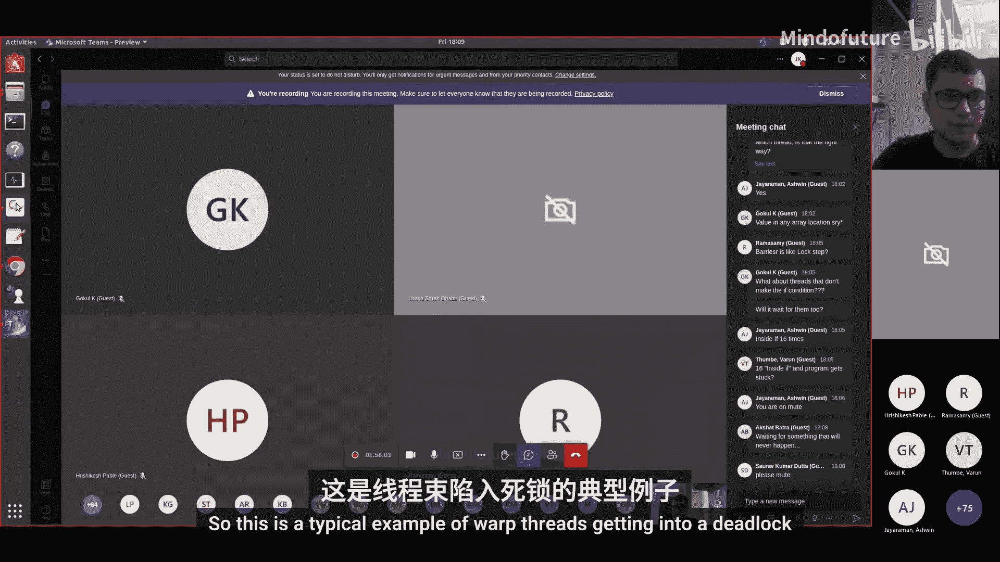

What threats getting into a deadlock？or warb threads waiting infinitely for some event happening will which can only be done by other threads so this is a typical example of deadlock for war threads and I wanted to highlight this so that people can understand like something like this can happen for warb threats also。

ok so so far any doubts anyone。

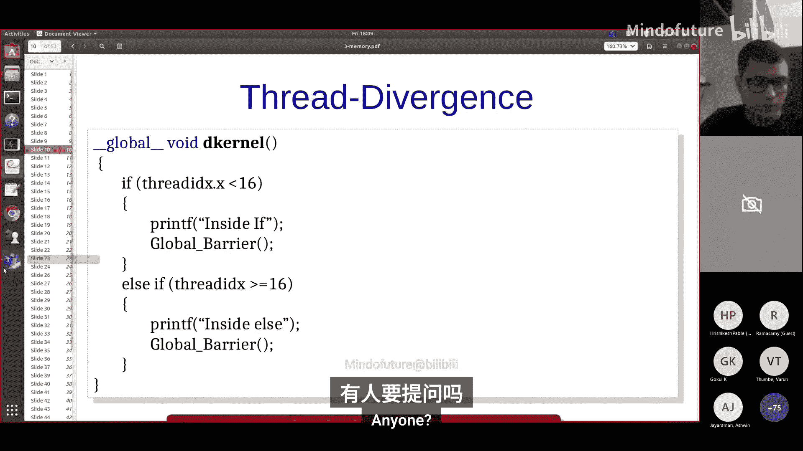

你。啊。Okay， I guess there are no doubts。Okay， if there are no doubts， I'll move further。

Probably I'll just cover one or two more slides for today， and then we'll stop。

好。ok企。Okay， so till now we just。We just saw the computational aspects of the CPU programming right。

 So we saw we completely saw through the I mean， completely went through the computation card。

 We saw how the how to launch the kernel and。I mean。

 how to launch the kernel using typical hello world programs。

 then we also saw how to transfer the data from CPU to GPU first we saw how to allocate the data using code MLO and then transfer it using Q ML copy。

Then we saw the typical program flow， U program flow。

 like how we first load data from file system to CPU and then transfer it to GP and then into computation and then bring it back。

So all these things what we saw， then we also saw thread organization which was the part of computation and then we saw all those things that we saw in last lecture like how to launch the kernel for huge data size and what is warp and what is threat blockss and。

How， I mean， how what is the issue with threat divergence and probably go to their de deeper input with the threat divergence issue。

And saw a couple of programs。So that was our agenda for computational part now we'll move on towards the memory part。

 which is again one important aspect of GPP programming in a Qa program。

And we'll look a couple of things here。The first thing is that we'll see is like what is the memory hierarchy in the GP that we'll see first？

Then we'll learn about what isity and locality of reference and all those things。

How the latency affects the overall competition of GPU， I mean， overall competition on GPU。

Then we'll see something called as memory coing。Area of structure。

 structure of area and all those things will be learning。

And probably then we'll learn how to express share that I mentioned in probably the previous lecture。

And yeah， that's it。 I mean， we've done all these things。And。Yeah， so let us start with memory。

 I will just cover one slide for today guess。So this is the difficult。DaMem model or。

Memory hierarchy of the。普 our地球。So at the lowest level， you can see that there is one， I mean。

 there are threats。Sorry your slide is not shared。

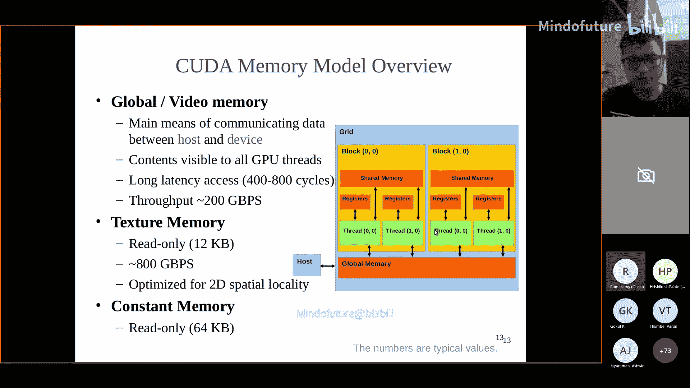

你惊司。Can anyone confirm from slides services visible？Hello。要子来。Okay， I guess。

If someone is facing the issue， then you can just log out and log in okay， okay。诶屋企啊。

Yeah。Okay so for today we'll car this slide and we willll stop here。

 so let us understand what is the typical memory hierarchy or kab memory model。

So at the lowest level， we have threats here。听。Each of these threads have registers associated with it。

So typically there are a few numbers of like the 10 or 20 registers associated with each of the thread。

And the access access to this registers is very fast because it is part I mean allocated to one。

And then there is something called a shared memory。

Probably I highlighted this thing in previous lecture also or yeah， so and this shared memory is a。

Sorry， yeah， so this shared memory is something which is part block。

So as we saw in the previous previous previous structure that there can be up to 1，0，2。

4 third inella and each set will have some chunk of something called a shared memory assigned to it。

And yeah， so it is a part block memory。So okay， there is something called this register。

 which is part thread， and then there is shared memory， which is per block。

And then multiple blocks together from Se， as we know， I mean。

 we have seen this in threat organization part。And then at the lowest level。

 there is something called this global memory。And this global memory is nothing but the GP D or。

It is also called as video memory， global memory， as well as the GQ D。

And if you people remember the things that we were doing like let's say code MLl log and code a copy。

 all these things will allocate the memory here in the code in the global memory or the DM of the GPU。

So this is a typical memory hierarchy of the GPU。And okay， so coming to here。

 I mean coming to this point， so global memory is also known this video memory and it is the main of main means of communication between post and device。

 as I call。Post will transfer the data to the GPSest DM or this global memory。

And one more point to observe here is that this's global memory is common across all these threats。

And across all the grids as well if here have here we have just one grid。

 but if there are multiple grids， then it is also common across all the grids。

So if let's say two threads from different blocks want to communicate with each other。

 they can do via this。Protect so they can go via this global memory。

So common memory across everything coming across entireG， all the thread of the G。

And it's a main mean of communication， data communication between post and device。

 as well as the multiple threads of or across all the threads of the chip。

And its content is visible to all GPQ threads， as I explained。

But one drawback of this global memory is that。F latency is very， very high。 typicallyy。

 it takes around。400 to its entire cycle for a thread to access something which is inside this global memory。

And if this is actually a very high time， we' will see that there are lesser times for accessing other memories like registers and shared families。

And typical throughput is 200 GB， which is first throughput is the number of instruction that can be done。

In a unit time。 So here the number of number of， I mean， number of。哦。

Instruction number of tasks that can be done in your account。

 So here task is something like reading or writing from the global memory。And。

So 200 GPs of data can be read in one second， which is the outputput for this global memory。And yeah。

 so that exact quality of global memory。Yeah， the next two things are this texture memory and constant memory。

So。There is there are two this special I mean， there these are two spatial type of fluid and specialtyity of this constant textual memory like。

First of all， their size is very， very small size is just。12 Kb and 64 Kb。And there read on I mean。

 you can't just update update the things that are written inside it once they are image lit。

 so they just read on it。And。Yeah， so typical bandwidth of the texture and costume memory are much higher than the。

攞嗰啲问咪嚟诶。4our times like 800 chips。And one more thing to observe about this text memory。

 it is some sort of optimized part 2D。Sppatial operations like let's say your matrix。

 which is a two dimension data structure。That matrix is of size 100 across 100。And。

You wants say we are accessing some element three cometry in that。

Then all the elements which are close to it like。See， let's say。3Coma  two will be close。

 then three comma 1 will be close and all those things which are I mean closely associated with that cell。

Will be。Will be accessible very quickly if your matrix is placed inside the protection memory so it is optimized for 20 special locality。

So， that is。part for the texture memory and consumer memory and the use of texture and customer memory is like they are used for storing some metadata。

Like let's say we have some data structure which is used for managing other data which is based in a global memory or some。

So textual memory and custom memory can be used for some st some met data and it can give you some faster accesses for accessing that matter data and so。

So probably I'll stop here we cover about I mean cover the details about registers and shared memory tomorrows so not Coms。

Next lecture。But probably I'll stop here and we'll take some questions if you have it。

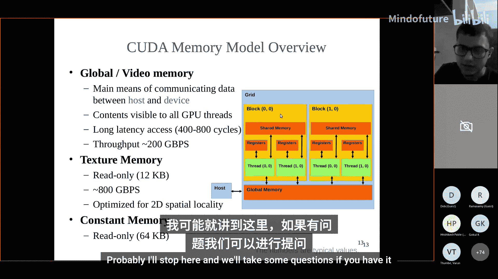

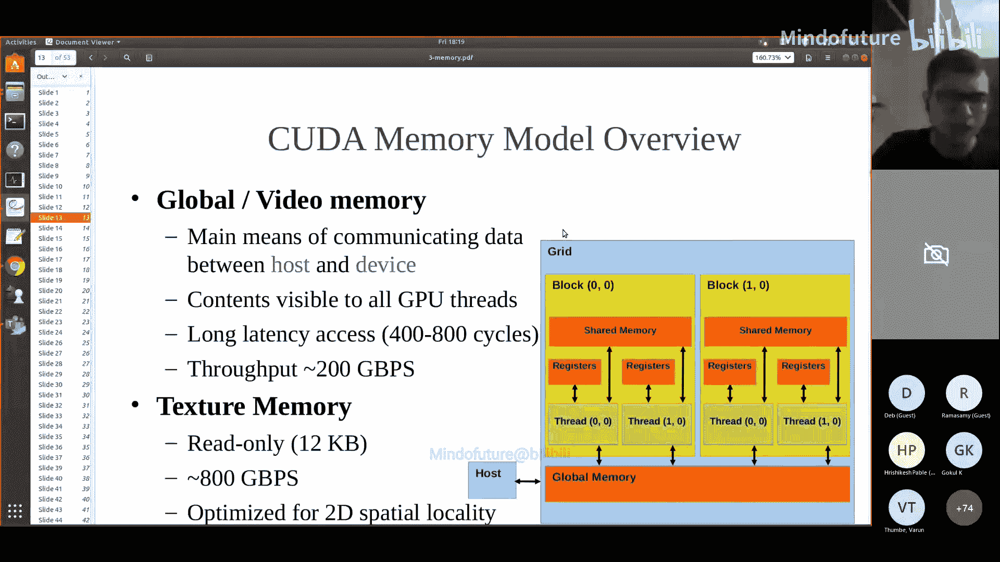

Okay， how can we avoid thatlock？This is something we'll see in synchronization but if you are asking for this particular example。

哦。Yeah， so for this particular example， if you want to avoid the del then you need to write this condition in such a way that。

All the 32 threads finish this assuming that kernel is launched with 32 threads。

 all the threads finish this， I mean all the threads basically land inside this one particular condition if they。

Go into different cases， then that will be done。If you want to avoid it you need to write the code in such a way that too。

This， I mean， this in this statement every thread makes， I mean， every thread reaches the statement。

得飞。But further will study in the synchronization part that how can we avoid deadlock and all those things？

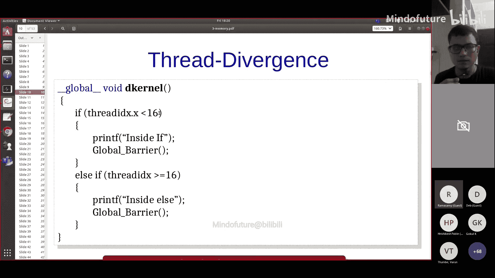

Probably a。If you have lot of questions。那个这个。Machine cycles。M wasing machine。

Okay， I guess you are telling。Work cycle。

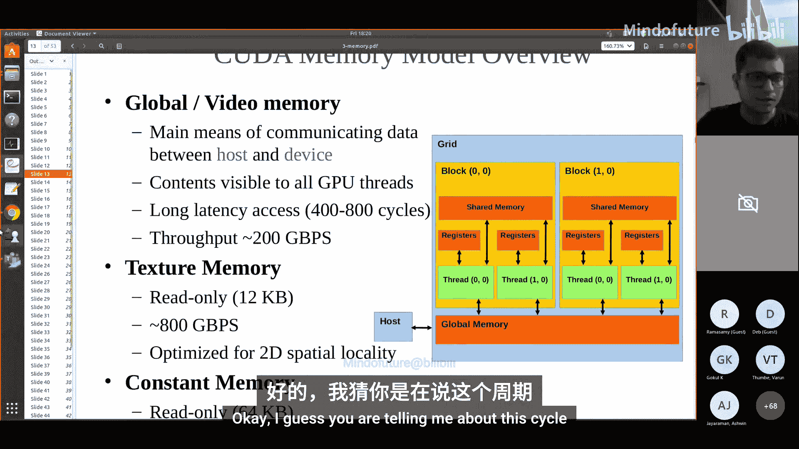

Cyclees are like CPU cycles only the number of。I mean， the time taken by CPU， I mean。

 cycle is something defined by frequency if you remember from our first lecture。So， next go。

One gigga processor， then re cycle and this。1， nano secondd。明唔度，有啲抽啲细佢嚟食饭。

Take some of perus if you can do in that one particular。Ccle that one， that one time unit。有。

Candder question。Can we launch a kernel within a kernel Also if we get CPU side parallelization like open MP canvass。

Start two kernels parallelization Yeah， so first question I'll take up like we can launch kernel from the kernel and that is possible。

And I have also seen some of the I mean， some of the examples in which this thing is done launching the cardal from the card。

Yeah， so that is doable also if we get CPU at parallelization like Openemppic can we start two kernels parallel。

Yeah， if you， I mean， C and GPR asynchron right， I mean， I told this in second lecture I guess。

Like CPU and GPR， not the same device。So even if you have something， I mean。

 running in parallel on CPU。You can do some other task interview interview。

That may be parallelization， I mean， that may be starting of two kernels or anything else。

So I guess that won't be an issue。Proly I misunderstood your question if you think that way you can just unmute and ask。

Texture memory， constant memory is per thread lock or per SM。 Okay， So texture memory。 Okay。

 I missed mentioning that。

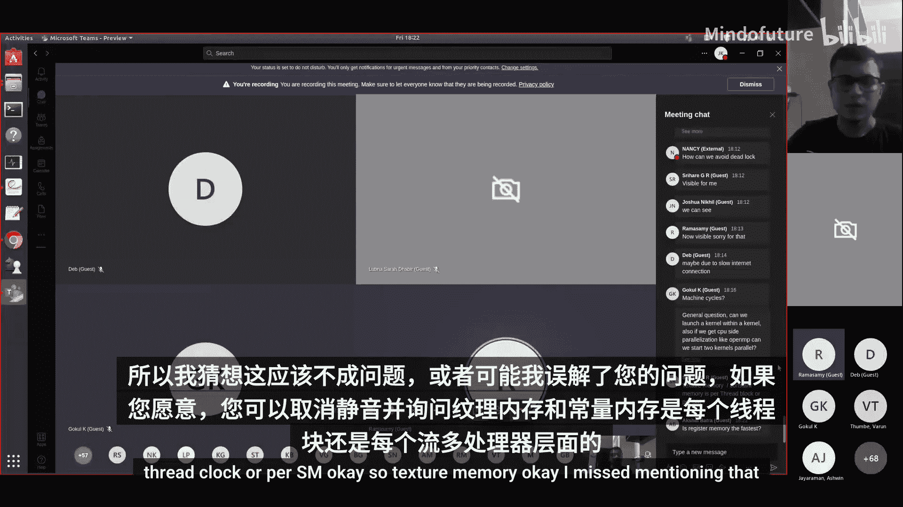

So texture memory and global memory is something sorry texture memory and customer memory is something like global memory。

 it is across all everything across all the grids and all those things it's not。

Or para or para or anything。's it's similar to global memory。I mean， similar meaning。

 it falls in the same place in the hierarchy as global memory falls， it is common across everything。

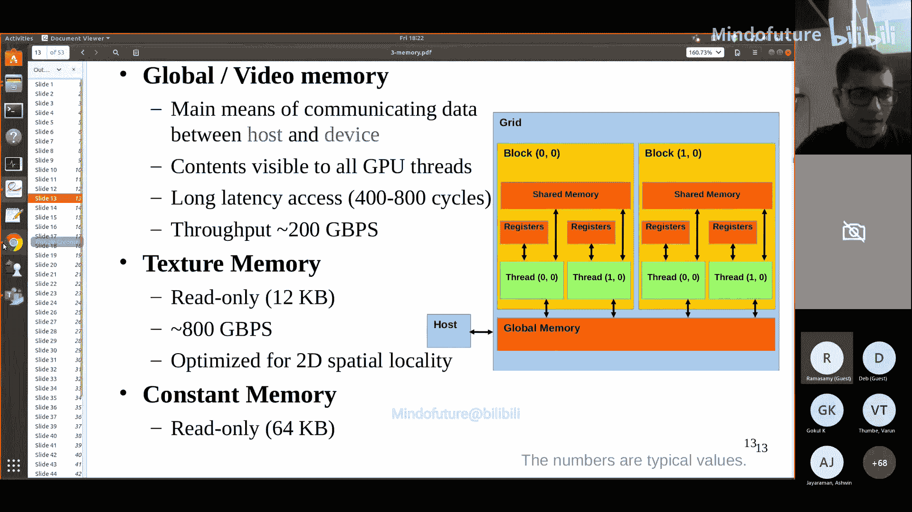

OkayIs register memory the fastest Yes， yes。 The register is the fastest。1， yeah。

 register is the fastest。 and we'll see this how fast it is。 And it's even typically faster than。

They shared memory。 So something like this is their like hierarchies， this first of all。

First comes the register， which is the fastest one， so T will look into register。

Then a thread can look into shared memory because it is faster than， I mean， it is faster than going。

有啲 good global memory。So registered， then shared memory and then global memory。

That is the order that we should go to reduce the latency。

Because fasters is the register then shared memory and then global memory。

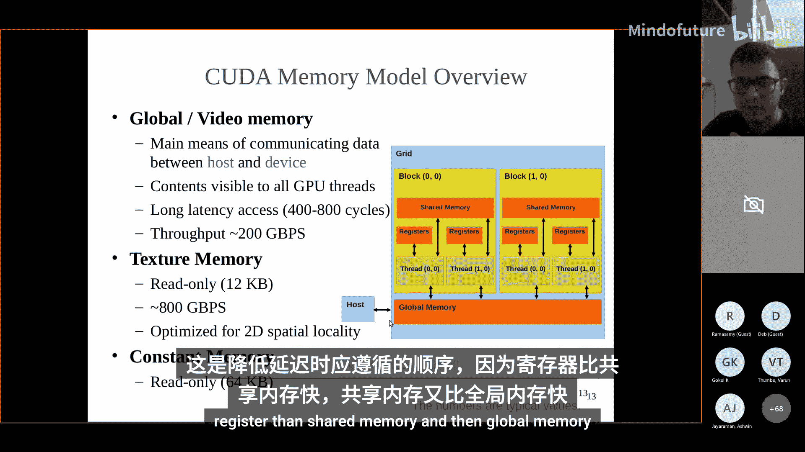

Okay。

Yeah。嗯。は。Okay， I guess if there are no questions， then probably will end here。

