# 【Nvidia】CUDA并行编程-｜-Cuda-Programming-Course-｜-Parallel-Computing-Using-Nvidia-p06-P06_L6_GPU内存类型、延迟与局部性--BV1MSq1BTEho_p6-

O， so。Hello and welcome everyone to the seventh lecture of our quoDA program。

So recap about the previous lecture。So in the previous lecture。

 we delt deeper into the threat divergence issue。And we saw multiple programs， right。

 and we saw the number of steps。3udy。

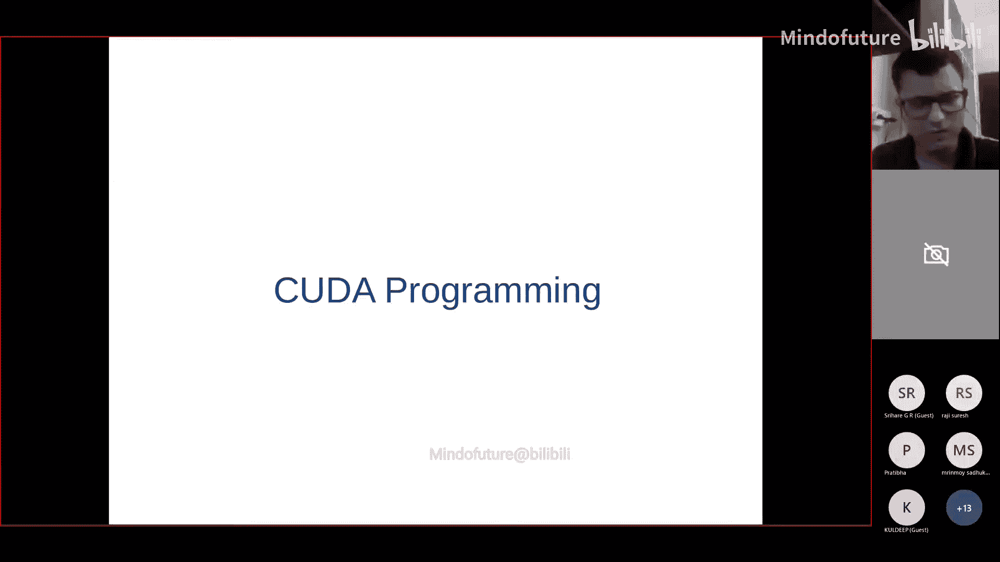

Is that any question？ok。I guess that was some noise。 That's okay。

Okay， so in previous lecture we saw that I mean， we saw we del deeper into the threat divergence issue and。

We saw multiple programs which were having this threat divergence issue。

 and we saw the number of steps that were taken to execute those programs。

And then we also step by step looked into how to remove the divergence from them or at least reduce them。

And then towards the end of that lecture， we also saw how， I mean， we also started with a new topic。

 which was memory。And we also saw that how a GPU， I mean， how the memory is organized on the GPU。啊。

We typically saw what is shared memory and all those things and what is global memory where where is all those memory located on the GPU。

So yeah， so typically there we stopped yesterday。So for twos。

So the today's agenda is to the cover the memory aspects in the detail。

 so we will be looking into the GP GPU memory hierarchy detail。

Then we will see a few things related to bandwidth and latency。

 then we' will also see what is what is latency hiding。Yeah。

 and then we'll probably go to the locality aspects and。And in the locality aspects。

 we will see a couple of examples related to the locality。And yeah， probably there will stop today。

Yeah and yeah so let's get started with it so that' is a brief outline for today's lecture let's get started with this。

So this is where we left off in the last lecture。If you remember I told that this is I mean this is the typical memory hierarchy of the I mean typical memory hierarchy on the GPU so at the lowest level we have threads and each threads have multiple amounts of registers associated with them and then there is a shared memory which is per block I mean which is。

This allocated to each block of the。Each block of the。Each block in the grid， and。

And multiple such blocks from Se and then there is a global memory。

 which is common across all the threads in the GP as well as across all the grids。

And the communication between host and device occurs through this through this memory， I mean。

 through this。Global memory， so whatever host wants to send to the GPU it will first place it place it in the global memory。

So if you observe one thing here， this memory hierarchy is very much similar to the computational hierarchy that we saw。

There is a thread and then there is it's within a thread block and at the top level we upgrade grid so the key advantage of having such a hierarchy is that if we know such things I mean if we know about I mean if you are aware about this hierarchy we'll able to exploit it to get I mean get more performance out of I mean more performance out of our applications so typically in this case we'll be able to share memory too。

To reduce the latency for our applications and we'll see as we go on how to use all these things shared memory and all those stuff。

Okay， yeah， so that's， I mean， quite， I mean， that's quite similarity between computational hierarchy and memory hierarchy。

So。Apart from that， yeah， we saw that。Yeah， this global memory。

 which is also known as GP StM or the video memory as we saw in last vector。

And it's the main mean of communication， I mean data communication between host and device。

 so whatever we did like code MLO and code ML copy and all those things to allocate and copy the data across CPU and GP。

Was happening across I mean， was， I mean， happening across something called a PC express person N。

The things were， I mean， things we getting。Move to and from this global memory。So yeah。

 so it's a main mean of communication between a main mean of data transfer。

 communication between post and device， everything that post want to。

Sent to the GP will be placed in this global memory and will be taken from this global memory。

And yeah， so it is common across all the threads， I mean。

 if you even visualize multiple grids then across all the grids of all the threads is global memory is common。

So that is something we should know so if a thread wants to communicate with another thread across across a grid or I mean across multiple grids or within the same grid or within this or within。

 I mean across the multiple blocks then，It can do via this global memory。

 but within within within the sidewalk it come to do then it actually actually be better to do via shared memory。

That is some ways from。Some side。

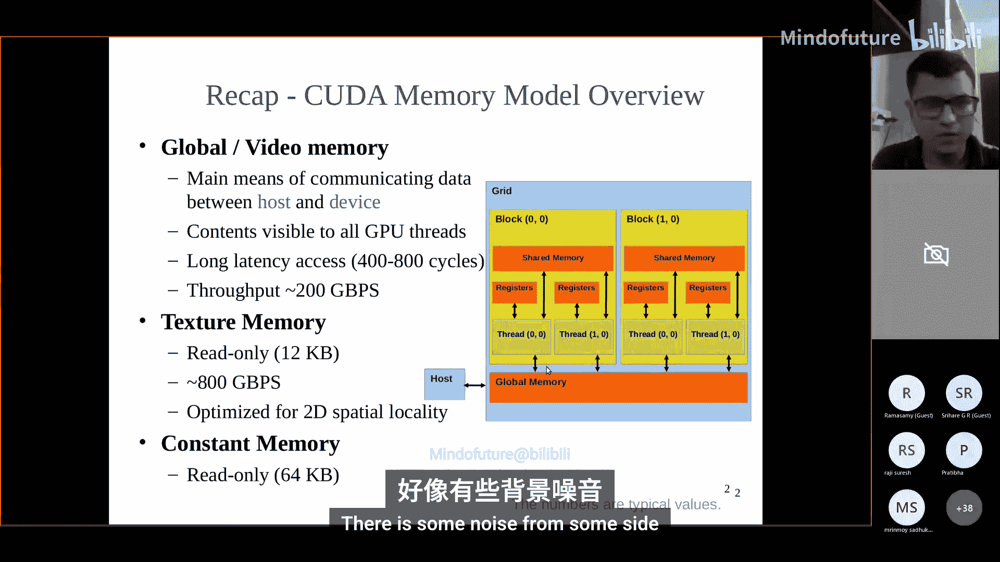

A request。Others to mute unless you have any question， let me see what is there in chat。Okay。

 good evening， Eric West。Allder you to mute unless you have any question。 If you have any question。

 then you can just unmute and ask。No issues with it， but please don't unmute just for a minute just。

The presentation。If you have any question then， please feel free to unmute and ask。

Okay， so there we were and we see that the content which is present in this global memory is visible across all the GPU grids。

 across all the grids and everything I。It's global across entire。 I mean， all these rights。And since。

 I mean， since it's very， I mean， in the hierarchy。

 it's very far from the core GPU core streaming multiroor， its latency is very。

 very high across 400 to 800 cycles。whichch is actually high because I mean if you see other memories。

 you'll realize that it's a lot more cycles than what those memories take。

Latency is high and throughput is around 200 gigabits per second。And。I mean。

 what is throughput as probably I mentioned this in last lecture。

 but it's the number of operations that can be performed in unit time。So。

In of case of memory it's number of reads or writes that can be done done in a second so its and these reads and writes are I mean quantified using bytes so I mean how many bytes of data you are able to read or write in that particular time frame so its。

20 200 GBtes per second。 So that's what it is。 And one thing that I forgot to mention the previous lecture was like。

The cheap views are like。Truput oriented architectures。

 so this is something related to throughput so I want to place it here。 so what will happen is。

So memory latency or a single read or write access to the GP global memory， which is the DM of GPU。

Might be slightly more or mean might be more than the latency which is required to access the CPU global memory or CPUUS DM。

 not global memory， but CPUUS DM。But when you when you talk about throughput。

 it's like number of operations perform， I。Okay， so the throughput would be throughput for the GP memory will be larger than the CPUUS memory because。

Thput is something the number of， I mean， is something which is quantified as number of operations which can be performed in per unit time。

说。Like even though the latency is less I mean GP sorry latency is more for the GPU so GPU will be taking more time to access a global memory for one particular operation。

 but in general GPU can club multiple operations into I mean can access multiple I mean it can do multiple access to the global memory at the same time and hence the through quo is larger。

So think of it like this， there are multiple reads and ris happening to this global memory。

W is ideally not the case for CPU， so like that's Y the throughput is larger because the number of operations per home are larger。

So Tputwise GP， GPUs， memory access are bad， but latency wise CPU has lesser latency。

You will see that CPU might take lesser cycles to access its DM。

 so that's one point that I wanted to highlight between CP and GP here。

But through potential attention。And then we also saw like what is texture and constant memory if you remember。

 so briefly I'll reiterate what I said like in previous lecture so both of these memories are read only memories as well as sizes very very less 2 Kb and 64K before quote texture and constant memory。

But like so as the size is less than。They are only the real on I mean。

 they are only read only memories， so they can't be typically used for storing large amount of data or performing any I mean。

 they can't be used to store our。Data which on which we can perform the computation because typically the applications that we generally used for used for the competition and GP have very large chunk large amount of data so instead of storing the real data we can store the metadata inside them or the something called as I mean。

Like something like the data that keep tracks of other stocks or other data。

 which we have stored in the global memory。So that part we can keep in texture memory or custom memory。

 So typically they are used for。Storing met data。And the key advantage here is that their throughput is very high。

800 JPPS， which is actually four times than the global memory。And嘅。

Talking about difference between constant memory and texture memory。

 its that for texture memory it is optimized for 2D special locality I will discuss like what is 2D special locality so。

For like matrix operation it will not just I mean， it will optimize for the optimize for the accessing its neighbors around that particular cell。

 so if you are accessing three commme3 in the matrix then。

Re cells that are surrounded by like2coma3 then。For comm3 and all those will be， I mean。

 excesses to all those will be quicker。So that's one specialty about it。

 which is not that in constant memory， so that's the difference between them。

And talking about this position of constant texture memory。

 they are at the same level at the global memory， so they fall somewhere in the I mean。

 they fall in at the hierarchy somewhere。Here， like with the global memory on。

So they are not part block or。I mean， so they are across the grid that's what I wanted to say。

Common across all secret grids as we have this global memory。Yeah。

 so that's it I think that so that was a very comprehensive lookcap， I guess， for the previous。

Lecture where we left up。And yeah， so moving forward， does anyone have it out up this point？

And quickly。Go back to the chat， otherwise I'll move on。

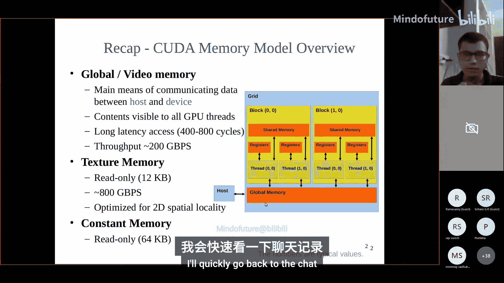

Okay， I see there are no questions。 so okay， so let's move on instead。

So okay， so let us move on。 So apart from this three things， which is。Whi is texture， sorry。

Which is texture memory， constant constant memory and global memory。We have three。Three other things。

 which is add toC album cache， which is also known as shared memory and registers。So okay。

 Al cache which is which is shared memory shown here as well as the registers。

But al two cache is not shown which falls somewhere in between the global memory and the shared memory。

 so like it is common across all the all the threads like in the same way as in the same way as it is for global memory。

 so it falls somewhere here。So common across all the threads， but size is very。

 very small as compared to the global memory。So you see the size of global memory will be typically or I mean。

 size of the GPtM or the global memory will be typically。Of I mean。

 typically you will see it sizes like 1 Gb or 16 gb。Coming to the al cache， it size is very。

 very small like it's just 768 kBs。Or I mean at MaxX some MB set will be there。

 so that that's what I mean that's what is the size of l2 cashboard GP use。And one more point is。

 as I would like it falls here somewhere。And it's common across all the threads。

If it's common across all the threats， then it's also shared among all these streaming multiprocessors。

So one thing that you should observe here about the L2 cache。

The thing is like since it is shared across all the threads。

The number of I mean the amount of memory or amount of L2 cache which is available for thread is very very small right because GP I mean we can typically launch a kernel with tens of thousands of threads and even with multiple kernels so in that case what will happen is the amount of sharedd sorry amount of amount of memory inside the L2 cache that。

A particular threat has is， I mean， has can be very， very less。So。

 in that way L2cache might not be as effective as we have it on CPU but still I mean we need this L toc。

 the reason is this fast atomics that it has mentioned that so let us understand what it is。So。Okay。

 so what is this past atomics， So let us say。Okay， let us say we want to synchronize two threads across different thread blocks are given across across different thread blocks。

Then。For that we need atomics right and to implement atomics we need a variable which can be tested and set which can be values whose value can be tested and can be set。

So。We need such kind of a variable and that is how atomics is implemented and we need to test and set its value atomically。

And。Let's say we want to place such a variable， then place such a variable in memory。

 then the best place to place that variable will be into the L2 cache。

Because al gas is closer than the global model， so accessing such variable。

Or accessing such a variable which are used for atomic implementing the atomic operationpress will be faster。

And hence， like L2 can be useful implementation of something called as spa atomics。Okay。

 so I hope you got it like if you want to， I mean， if you want to synchronize between two threads of different thread blockss。

 we count't use shared memory because it's not common across I mean thread blockss。

You can use L tocache because it's common across all these networks and grids。

And to synchronize you need some variable and I mean。

 best place to place that variable will be L since accessing it will be faster as compared to global memory。

So yeah， so that what is faster atomics， so it helps in implementation of fasteromicomics and many more functionalities like those are faster atomics。

So that's something about al tokesh and yeah。So apart from that。Yeah， so apart from L2c。

 we have this album cache。Which is also known as shared memory。So。There is， I mean。

 when it comes to add to cash or shared memory， there are two things to it。 I mean， first of all。

 first thing that you should observe that it's。Configurable 64 kb memory available per streaming byor。

 so this thing， the entire block。I mean， it's named as shared memory but。In some sense， some sense。

 it's。Both album cache as well as shared memory and。

It sizes 64 kb and what is this configurable and why it is known as configurable 64 kb memory I mean。

 the reason is that we can。Spify what we want like we can configure it in such a way that like we can tell like I want 64 sorry out of the 64 kB。

 I want 16 kB for the shared moment。And 48 KB for the album curve。

 so let us try to understand what is shared in El， so shared memory is something which is controlled by the programmer。

So youll see that programmer will be able to specify that， okay， I mean。

 I need this 16 kb as a shared and 48 KB as album or vice versa。48 KB shared or 16 Kbs album。

So that is， I mean， that is something which is， I mean， which is in the hand of programmer。

 but we can also specify that 32 KB I need as shared 32 KB as element。

So okay so I mean what is the difference between the shared N element first of all we should understand that so shared memory completely I mean not completely but it it can be controlled by the program it's programmable it is controllable by the program so you can specify that okay I want to declare a variable which should be stored inside this shared memory。

So that is what is this shared moment where this Alvin cachehe。

 something it is something which hardware manages。So you want I mean， as a programmer。

 you won't have control over that allow cache， but yeah， the shared part you can typically。

I mean manage and control so you can specify what variables should go into a shared memory you can also specify that like okay this this area I want to place it in shared memory or this vector I want to place it in shared memory so all these things we can specify。

Yeah， so that is typically the control that is given to the programmer to exploit the shared memory。

And one more point as I specify it it is also， I mean a programmer can also control the amount of shared memory so you can specify I need 16 kb of shared memory or 32 kb or 48 kb out of this total of 64 kb。

That is available。And yeah， so that's it yeah， so one more two more points。

First is the latency of this shared memory or Al cache is very， very low if you see。

 it's just 20 or 30 cycles。Just compare it with the cycle standard for global memory。

 you realize that its it has very low latency or it is very， very fast。

Just a couple of cycles we need。And the reason is it is very close to the streaming multicrosor or the core of the GPU。

 So that is the reason for the low laency。And since it has very low latency。

 its bandwidth is also very， very high across1 Tps bandwidth we can get。I mean。

 if you have stored some day time shared memory， then we can access it at this speed1。都别。

So that is about Alvin Kesher shared memory。Next thing is the registers。啊。Okay， yeah。

 so one thing I forgot to mention probably is that shared memory is per block， so。诶。Okay。

 so all the threads across one block will have common shared memory and similarly I mean it won't be across all the threads。

 it will be per thread sorry per block so it is not common across all the threads it is per block and it is shared across the threads of a particular block。

So the thread this thread， from this pictorially， this thread cannot access the shared memory of this block。

And vice어봤어。So。Tris of the same block can access the content of the shared model。But yeah。

 the other blocks， I mean other blocks shared memory are not accessible by the threads of this block。

 so yeah， that is one point other point that I wanted to specify。Apart from that。

 we have this registers and you will observe that there are a lot of registers available per string multiplsal。

So typically target to。Regstrs are available， number of registers are available in one streaming multicroor。

 and you you do some calculation here。If you have some threads per stimulus percent then and if you divide it by this number。

 typically you'll see that on an average you can have around 20 or to 21 registers per thread。

And this is a good number， I mean， because as long as you have something in register。

 it accesses very， very fast because register is something which is very， very close to the core。

 even closer than this Al cache or shared number。And its bandwidth is very。

 very high as expected because very， very close to the core of the GPU。

Its bandwidth it's typically 8WPS。Yeah， you should observe one thing that these two components Al album cache or shared memory。

And registers。Are something which can be exploited to get a very decent amount of performance。

 because both of them are very， very close to the。Close to the core of earth the streaming multi。

Another point to observe here is that the shared memory。

 not Al cache but shared memory is programmable， so you will be able to specify that okay I want this variable to go into shared memory but。

For registers for registers， this is not true。you want to be able to specify that I want this variable or particular variable to go into register so so it is completely dependent upon a compiler so as long as compiler is able to allocate。

Alloccate register to a particular variable， it will do。

 otherwise it will spill to the global memory。Yeah， so but in general， you should， I mean。

 you should be able to exploit shared memory and registers will be taken care internally by the compiler。

And first of all， it will try to allocate the variables on register and then it will if then it goes beyond the capacity of a register。

 it will spill into global memory。But in general， if you use these two things together。

 you'll be able to get decent performance and we'll see how to do that。

Especially we'll see how to express shared memory。In the upcoming lectures。Yeah。

 so that said for this slide， any any questions， I mean， so far， any questions？

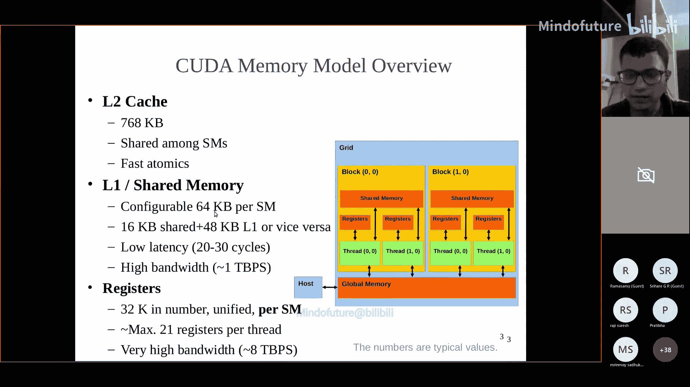

I quickly， go to them。Check。I global barrier we went over last time， an example of fast atomics。ok一面。

Yeah， so global barrier， you can think of as an atomic operation across。All the yeah， but I mean。

 atomic is something like， let's say you have a variable。And multiple threads are performing。

 I mean performing some operation on that variable and you want to I mean synchronize the excess across all those I mean all those threads。

 then for that case atomic atomics is used。barrierarer is slightly different。

Gart is something like a synchronization point insider。Inside the program。

 so until and unless all the threads have reached that point， no thread will move further。

So I guess there is some difference between barrier and atomics。

 but I think going towards synchronization lecture will make it further more clear。

So I'll partially say that I mean， I won't give complete answer right now， but yeah I mean。

 there is some difference， I would say。As compared to fast atomics and global barrier。디ina 에곡ケ。Okay。

 yeah， okay any questions。Please feel free to ask questions， otherwise it will become， I mean。

 just one way talk or something like that。Because for today's lecture， there are， I mean。

I don't have any like very interesting problems to solve， so it will more be like theoretical and。

Probably it will start feeling boring to you people otherwise。Anyways。

 unless there are any questions。

Okay， unless there are any questions， I'll move further with my slides。

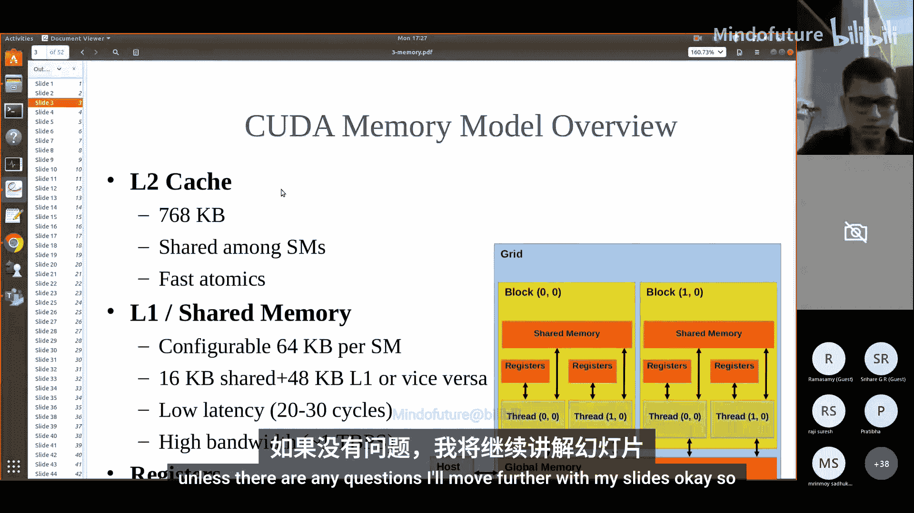

Okay， so we we sort particular。Memory hierarchy that we have or cheap you。Okay。

 so we'll see in later lectures how to exploit this hierarchical typically I mean we'll see how to exploit shared memory that's the main part here because rest of all is。

Under the control of hardware， because registers we can't program and all this same global memory。

 we know how to access it。During competition we saw okay， so moving on， so let us talk about， I mean。

 let us talk about what is bandwidth with then。How it's typically associated with GPU and all those things。

So。When when we talk about bandwidth， it's about， I mean。

 how how wide is the database rather than how fast that database is。

So when we say Data in context of CPU GPU communication。

 it's that PCI Express bus that I keep on mentioning in。Cole of lectures， right so。Okay， okay。

 so yeah， so that that's one thing。 that's one PCC express version another thing is like。

There is also some。Out。Pas available for transferring data between， I mean， not transferring。

 but reading and writing the data between the CPU score and the CPU D。So that's second thing。

 and also the Al cache and all those things。 I mean。

 the bus that is available to trans read and write data between that Al cache， L cache and。

That GP ST， so when we talk about the bandwidth， we talk about how how fat or how wide that database is。

The one that I talked about just right now， so how quiet the database is rather than how fast it is。

So let us take one analogy here。 So when we。Okay， so let let us take one analogy。

 let us compare the airplane with the train。啊。But the amount of people it can transport and the time it takes to transport them。

So if you see， with airplane， you'll be able to transfer fewer peoples。From one place to another。

 let's say transporting from place A to place B using aeroplane。

 I mean transporting some people from place A to place B using airplane takes 1r。

 but it transports very less number of peoples right typically if you see。

Couple of hundreds of people can go from one place to another place using an airplane。

 but it is very fast。Yeah， so that's latency that the time that is taken to transport transport the people is latency。

So latency is less for airplane。But the amount of data or the number of people that is transport from place to place is lesser compared to the grain。

In contrast for train， the latency is high， right because time it takes to transport。

The person from place here to place we using。ATrain is。Is higher compared to the airplane。まった？

But the number of people that are。That are being transported from place here to place using train is much much larger。

 probably thousands or even tens of thousands of people can be transported。

So yeah so that is what is bandwidth so like the amount of data being transport rather than the latency。

When when we come to a bandwidth， I mean yeah， so that's the amount of data being transferred and that data meanss what is the bandwidth？

And。And bandwidth can be improved by parallel data transfer， so transferring more than。1， I mean。

I mean more than one more than one block of data at a time from one place to from memory to。

co or something like that and when we I mean why we are talking about all these things。

 the thing is GPU is some somewhat like a as I told。

 it's somewhat like a throughput oriented data structure so。

Even though the latency is larger for I mean， for any operation， for IU operation， let us take。

For transferring the data from GP D to core is larger for。GPU DM to core is large。

 I mean it takes more time to read or write particular data from the I mean， from the DM to the core。

But the number of data， I mean， number of chunk or number of data that we can read at a particular time is larger。

 That is what is valid data transfer。 and that's why the bandwidth of。

CpU is typically larger compared to the CPUs bandwidth because here the f is larger。

 I mean there is more f if you see the y data is present rather than。The fast data of。

 but typically for C2 it's， I mean， it's supposed they are fast data us。

 but the buses not that right。Okay， so that was about bandwidth。But that go look'。

Techniques proposed in literature for improving this bandwidth in general， just not across， I mean。

 not for the GP or across C or GP and it's general techniques that are。

Proposed for improving the bandwidth on。But imp worked on any architecture or anything。

Here are three techniques， positively。You can reuse the data， so what is the reusing of data？Let us。

 I mean。Let us talk about it in this GP context。So let us say we have this program。

Well we have two areass。And we are declaring to errors and then we want to perform some competition on both of those areass on the GP。

So what we'll do is we'll transfer the first array from CPU to GP do some computation will get back。

 I mean， get back the results。And then we'll declare the secondary transfer it from CPU to GP to some compression。

 bring its result back。But instead of this， we can do one thing。

 let's say if the first area after bringing its result back is not being used further。

Then in that case we can just reuse that array by doing like instead of declaring the another array and then passing it to the GPU we can just populate that first error itself and then pass it to the GPU so in that array we can。

I mean we can reduce the data rather than I mean just declaring the new data， so that's one way。

 so that will save some I mean bandwidth only CPU you。The transfer， I mean。

 data transfer benefit on the。Between the CP and GP， because he access。Reusing that area on the GPU。

 so once that computation on the first array is finished on the GPU。Will populate it on GP itself。

 and then will。Start reusing it。 So the second data transfer is not needed。

 I hope you are getting it。There is confusion you can later ask it at yeah。

So that's about reusing data， then there is data completion。So coming to data compression。

 its like this， so instead of transferring the entire data as it is across CPU to GPU。

What we can do is we can compress the data and then can pass across that PCXor。I mean， yeah。

 across that PC express bus from CPU to GP。So advantage of compression is that the amount of data transfer。

 I mean， the size of the data will get lesser。And the time taken to transfer it from CPU to GP will be less provided that the compression and decompression time are reasonable。

Okay， so let me put it in this way， so let us say the amount of time taken to transfer and compressed data was x and the amount of time taken for compression and decompression together was y and the。

Time taken for transferring the compressed data was set， then Y plus set should be less than x。So。

 I mean， to see the benefit of compression， y plus that should be less than x。

So that is one way we can exploit the data compression to improve the bandwidth so in that way we can I mean we are transferring less data and compression and decompress are also taking minimal time。

So yeah， that is the way we can save some bandwidth using data compression。

And the third way is to recomputute instead of patching in story。

So here I mean here what we do is like I mean what what is the general way like we just transport the data from C to GPU do some computation and then bring back that is like first we store from store the data from C to GP and then catch the results that's the conventional way。

But this recomputing suggests something else like it's one another way of improving the bandwidth so in this recomput what we do is instead of storing and patching the data。

 what we do is like。Let let us precompute the data I mean recompte the results back so let us I mean let me put this with an example。

 so let us say we want to run some algorithm on the GPU let's say algorithm a we want to run it on GPU。

So what we'll do is fill。Opload the data from CPU to GPU。란디 알바르더만 집。

In meanwhile we'll also run the algorithm one on CPU also and instead of copying the result back back from GPU to CPU what we'll do is we as we are recomputing we I mean well get the results on the CPU itself right so that saves the catching part so that is one。

I mean， that is the place where we are saving the bandwidth。

 like we are not catching the results back。We are recomputing it on CPU。

So it is one way we can save the bandwidth by recomputing。Yeah， so any questions up till this point。

 I'll stop here。

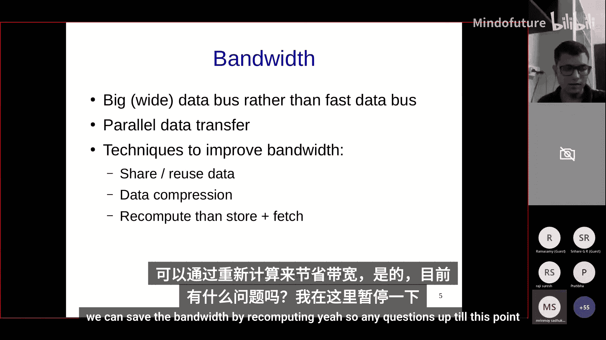

Okay， I see there are no questions Anyways， there are no questions okay， someone has。Raise the hand。

If you have any questions， you can unmute yourself and ask Rammaammi Rammaammi you can unmute yourself and ask。

Okay， I'm assuming that。You don't have any questions。I'm moving forward the lecture。

Okay， so these are the typical techniques that are used for improving the bandwidth。And yeah。

 so moving forward。So let us talk about latency now。We saw that， like。Lettency is the I mean。

 the time taken to perform that particular operation， right？

But coming to memory it is time taken for the IU like here the operation that we are performing is IU when we see from the CPU or GPU core perspective it is the amount of time that we need to I mean that we need to perform read or write operation and for。

CPU or GPU code IO I mean accessing the global memory or accessing the DM of CPU or GPU is one。

 I mean it's one form of IO so。Here latencies， time required for the IO more precisely the latency here that I mean in this context the latency is the time taken for read or right operation that can be either on L cache or l2 cache or or the Dm of the。

这别。OrC， so。Ideally， I mean。Ideally， we want this latency to be0。Because， I mean。

 we just don't want the core or the processor of CP or G to wait for the data。But as we all know。

 like the data transfer from DM to CPU or CPU cortex time and。

That is something that can't be avoided because of the page is3Ms1。So one thing， I mean。

 so the latency ideally should be0 and should be minimized it is not zero but。啊。

But like it is not always the case， I mean memory becomes the bottleneck many times because if you see the number of cycles taken for fetching the data from memory and bringing it to the CPU or GPU core takes as we saw like it takes around 400 cycles。

 right。I mean， two slides that we saw that it takes around 400 cycles。So。

Ideally the processor have process should have the data available in no time。

 but that's not the case it takes multiple cycles， 400 cycles or 800 cycles up to 800 cycles it takes to fetch their data so this thing can become a bottleneck this memory iO can become the bottleneck on CPU as well as GP in both architectures。

诶不诶。But like this latency some I mean， latency should be hide in some way and can anyone suggest what is the way in which we can hide the latency on the CPU mean？

Its just a quick Q and a like do people know and I mean。

 do people know how can we hide their latency on the CPU， particularly how it is tunnel on CPU。

Ltency hiding。Let me go to the chat。

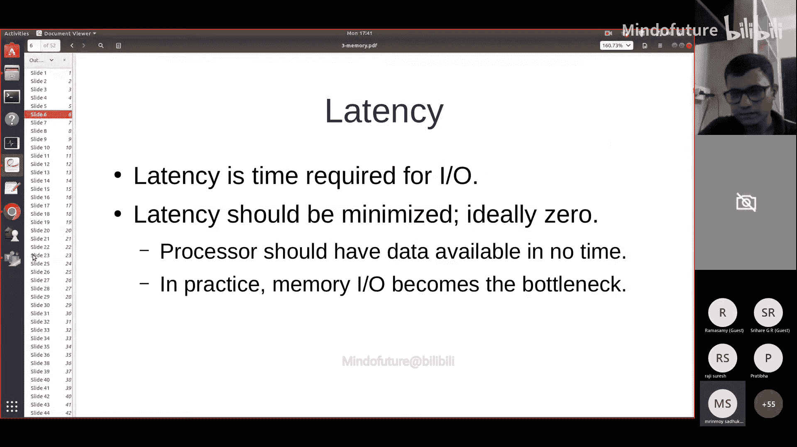

Okay， we have question here in。Yeah that is correct I mean if we are not getting results from the GP then what is the purpose of using GPU that is correct but this is not I mean as I told this is not I mean it's not typically for。

CPU GPpU， as I told earlier， this is， I mean this。

你你好嘅。This all these techniques that I'm talking about are generic techniques just I gave the example of that CPU GP because we are currently in the ha context so that's why I gave that example but you are correct what is the point of using the GP if P are not。

I mean， using think the results from GP。That is correct。

 but if you see the results are compute on the GPU and if we don't want to fetch that results and we want to save that bandwidth then what we can do is we just can run the I mean that algorithm on CPU。

And get the results。So that was that was what I was trying to see。

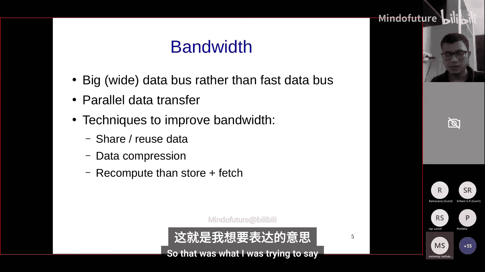

Okay， I hope that clears the question clears your doubt wasn。

When you mean by when you mean by store and fetch it is between CPU and GPU okay。

 so it can be between CPU and GPU， it can be also between CPU core and its CRM。

 it can be between GPU core and its CRM。So I mean， we can read and write from either。

 I mean either of the case， right？That's one thing。So there are multiple cases here。

It can be applicable for multiple cases。Okay here there is question， sir。

 if hypothetically a latency for a database is0， then we would never need to use sc device syndrome。

O啊。It's not that we would never need Qa device synchronized because。

Let's say we are able to transfer the data between C and GPU in no time。

Let's say latency for data transfer between CPp and GP is 0。

And even let's say that GPU core gets the data from DM in no time。

 let's say let and say0 completely zero hypothetically。

 but what can happen is thread might take lot of time during computation。

So when we launch the kernel the computation aspect is also one thing right。

 so if computation time is very large then in that case CPU might not wait right if there is no code device。

it might start executing the instruction that are after it。

Then in that case also there can be a problem， so it just it is just not about that data transfer。

 it's also about the computation part like what time that what time each and every thread takes to finish。

Okay， parallel rates， so in what context context is it variableu？B rent troops。

Essentially parallel data transfer， it's the answer like you ask the question right。

 how how can we hide the latency of？我直变素系。

No， okay， so my question was slightly different like me。Okay， so my question was like how this。

 I mean， how this。This latency hiding is done on the CPU not GP。

 we are not currently talking about GP letters， just talk about CPU， right？

How this latency heading is done on the CPU micro。

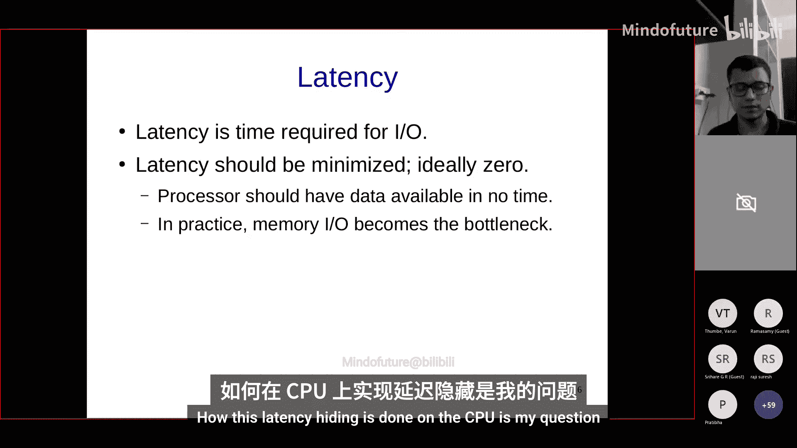

好白。二岁。Paraagon reads， that is true for I think GPU， but for CPU might be different because。

On CP we are a very few number of threats， right？palard reads。I mean， will help much。

Asynchronous program。ok。Is there anything else that we can exploit on CPU？你得咯。Like。

 is there anything special we have on CPU that we can expect？Yes。

 that's correct we can catch into the cache， that's important point。So caching is one thing， I mean。

 one definite point which we can， I mean， one definite thing that we can exploit to。

Reduce the latency on CPU。Then other points I mean please feel free to discuss， I mean。

 what are the multiple ways in which we can hide the latency on the GPU， sorry CPU。

 not GP again sorry， CPU。Okay， I guess there are no responses。Okay。

 so there are multiple ways in which we can hide the latencies on CPU memory latency on CPU。

One is definitely caching， we can have a hierarchy of cache like Al L2 LT L4 cache。

 we can have to L4 cache we can have like some of the architecture internal architectures have up to L4 cache。

😊，So that's one point， so whenever a block of memory is accessed from CPU DM we can。Place， I mean。

 you can place that block of memory either El Al El or El or the higherarch came those caches and whenever next time that。

Block I mean word from that block of memory is being referred by the CPU score it will get quick I mean。

 it will be able to catch it quickly from this caches so thats one way。Second is， I mean。

 second way to hide this latency on CPU is using。Multi programming or multi threading so instead of just running one process at a time。

 what this CPU does is it places multiple processes in its DM。

So advantage of it is like if let's say one process goes for IO。

 then it can schedule other I mean other process on the CPU for the execution。

So that is that is one way in which it can hide the latency。

 so lets say that is one process which is requesting， I mean requesting some word from DM。

And let that process perform IU operation or accessing that TM。Meanwhile， see if you can place。

 I mean。It can schedule some another process for execution so that core is not id CPU core is not。

That is one way second way then there is something called as write back caches so in right back caches what we do is just werite the word in the Alvin cache and just then and then just CPU moves on I mean it doesn't wait for in writing into the。

I mean， writing it with the D and all those， I mean the lower level I mean， lower level things。

 I mean lower level memory chips so。In that case， what will happen is when when that word or that block will get invalidd。

 it will be written into the D， so that's one way third way and。

At that points we can also expect like parallelism， instruction level parallelism。ex say呃。

We have one instruction which needs IU then we can okay， I mean， we can just let that I mean。

 let let that instruction perform IU but。At the mean。

 let's say we have that the next instruction after it。

 which doesnt which is not dependent on the previous instruction。

 so in that case we can schedule that instruction for execution within the same process。

So that is one way in which we can do by exploiting the instruction level parallelism and then there are other ways also like we can use pipeline like if few people have heard there is something called us pipeline architecture。

So in pipeing， what we can do is like。There are the whole hardware is divided into multiple multiple components like there is ALU。

 then there is one component for AL， then there is another component for。

Reading and writing and all those， I mean there are several components。

 one is just for patching and decoding the instruction so multiple units are there。

And lets say if one unit is busy， then we can still use the another unit and can I mean。

 and can export the parallel parallelism that is there in the hardware level。

So that is the way we can export， I mean， we can reduce the latency on the CPU。

So these are some of the ways in which latency hiding happens on the CPU， I mean， at the CPU level。

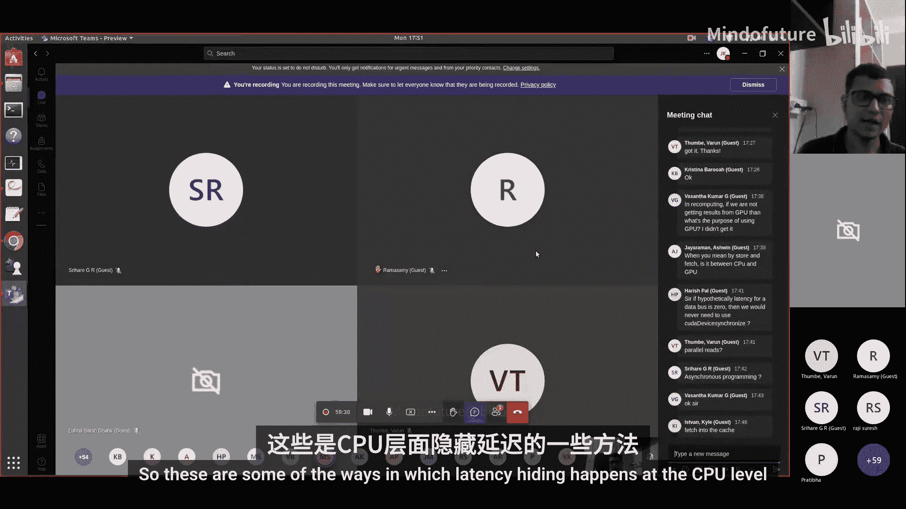

Okay， so I'll just move on from here。So yeah， I have talked about multiple ways。

 but the primary primary， or I can say the core way of reducing the latency on the CPU is through this memory hierarchy which composes of registers then L cache and L2 cache and L3。

 L4 caches and then DM。So。So that's the primary way in which the latency adding can be done on CPU but on GPU if you see we can do latency adding up to some extent using this registers sorry registers as well as El and L cache as we saw in the previous2 previous slide。

Retency adding can be done up to some extent using registers and L1 and L2 cache but。

The problem here is that。The number of threats that we have on GPR， I mean， very large。

The chunk of Al and L2 cash， as well as the registers that we will get per thread will be very。

 very small。So， so what will happen is like we want people to store sufficient amount of blockss into this al and alcche when it comes to cheap。

And hence， latency hiding using album allocation registers is not that effective as as it is with the CPU because CPU has I mean。

 it has very few I mean very few threats。Compared to GPU and so if there are very few few threats。

 then the。Portraread L1 and L2， I mean， portraitread memory available in L1 and L2 cash will be much higher and。

If that's the case， then this caching effect will be much significant。

 but that' is not case for GPU so yeah， so latency heading can be done using this caching but its less effective on GPU。

So instead of this， I mean， to make it more effective。

 what we do is we exploit something called as massive multi multi threading。

On GPU to hide this laency， the latency of accessing the Dm。

Can be hide by using something called as massive multi threading。

And let us see what is this massive multi threading？Okay。

 so let us see how the latency hiding is been done， let us say that this is the timeline。And。

This let's say this from this line to this line。This distance represents the one unit of time。

 so this is one unit of time when this is second， and this is third。And then four times one。

And here y axis shows the time x axis， we have the blocks， so this is one block。

And let us say it has some computation to do。 so sorry， okay， so yeah。

 so it has some computation to do。 so let us say that this blue box represents the computation that。

That particular this threat block wanted to do。Let's say it did some computation and then it went it for IU so this that IU operation is represented by this tall。

 something called a。So it did one unit of computation and then it went for I。

AndPlease note that this entire thing is for one streaming multiroor。

Let us say that this the threat block was executing on that streaming multi personsor and it had one unit of per and then it went for IO so now that streaming multicursor is completely idle。

Now what it will do is it will take some another thread block and it will start executing it and it will start executing its part of computation。

 so let's say after this thread block  point4 I steming multirosor。

 picked another thread block and started executing it。

So let us say that this second thirdlock that the streaming multiplor picked up also had one unit of work and it did that work and again that went for IO this block even went for IO。

But okay， so now we have this both blocks which are performing Io at this moment here at the instant third unit of time。

So if let's say we have sufficient number of blocks then this process and process can continue so streaming mod process can pick the thought block and it can execute its its part of computation and let's say then again it went for IO and it can if that's the case then it can again pick the third block and start executing its computation part。

And yeah again， if it goes for IO then yeah， then in that case we have four all four blocks which are now at the IO。

 but it might happen that meanwhile， I mean， meanwhile the forwardd block has。

 I mean streaming multi processoror has finished four block competition of the4d block。A啊。

The IU operation of the first block might be finished and it might start again executing its part。

 so the streaming multisor might pick up this。Po block， and we'll start executing it。So。

You can see here so one thing that you should observe here is that。

Streaming multi pressureor is not idle at some point at some point in time。

 let it be this or this or this or this or this， is it is executing some of I mean it is executing something I mean。

Some computation from at least one of this thread block。

 so you can see that even though the thread blocks are going for IO。

The streaming multi processoror is being utilized at its best I is。

Gettting I mean idle so that' is one point that you should observe and this is how we do latency heading on the GPUus by exploiting the mess multi threading so here we are exploiting the multiple thread blocks that we have that we have allocated for streaming multi clusteror。

To high the latency and if you remember in I mean a couple of lectures back I mentioned that。

Once streaming multiproor is being allocated multiple thread blocks for the execution and this is the reason why it is being allocated multiple thread blocks because。

It helps in latency hiding so if let's say one third block goes for IO after doing some competition。

 some chunk of computation。Let's it goes for I， then that streaming multiple can pick up another threat block and start executing it on its course。

Yeah， so that is the advantage of latency hiding。So yeah。

 and one point that you should observe here is that this this way of executing this。

way of executing in this manner can lead to superline buildup does anyone know what is this super linear speedup？

Okay， I repeat like does anyone know what is super linear split up。

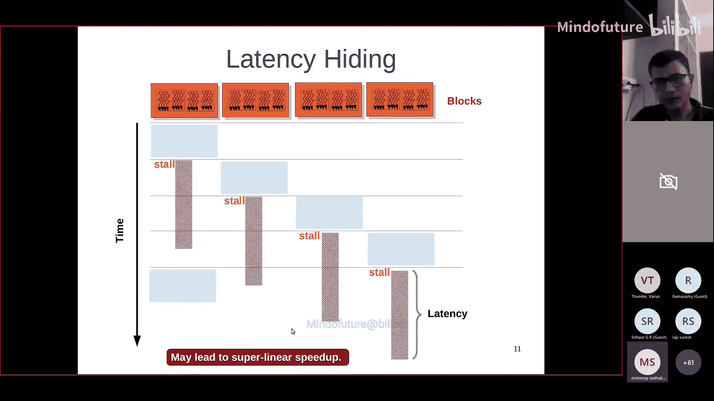

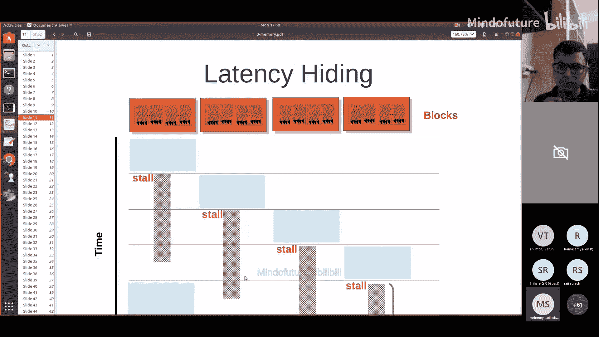

First of all， do you have any questions at this slide， I mean。

 something that you didn't understood from what I tried to accept。go back。

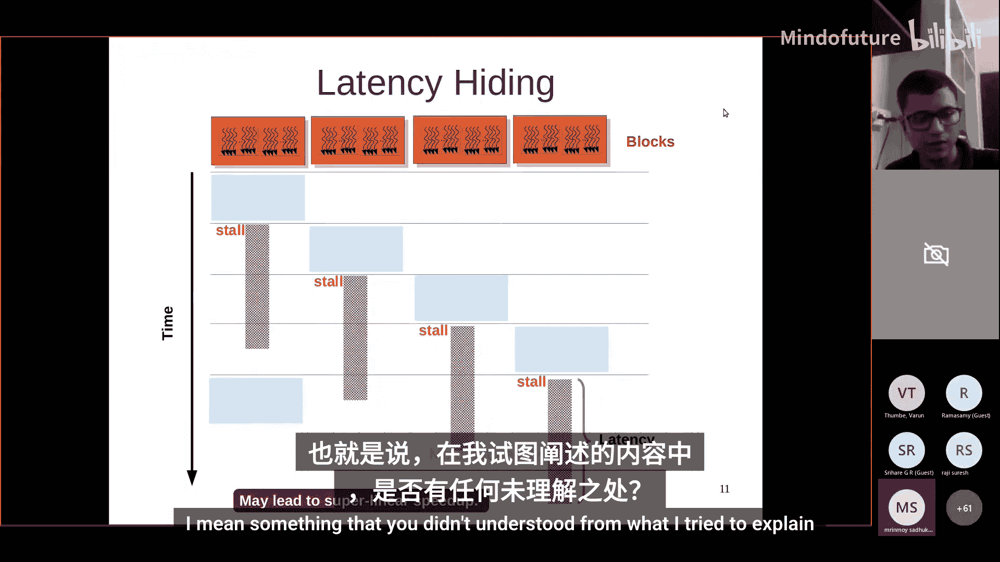

I guess there are。No questions， then。Okay that't know questions。か。Yeah， I think this is quite close。

 I mean it tend to divide by number of participations。

I guess there are no other responses than that case let us move back to these types。

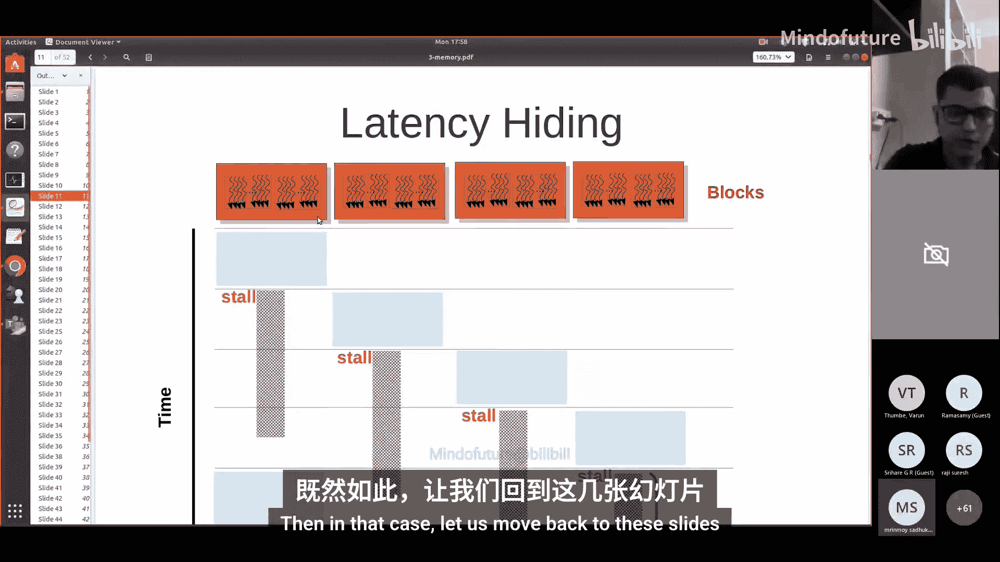

Okay， so let us start to understand this super。 So what will happen is like。

Let us assume I mean in na fashion what will happen so in ideal case what was happening this this block take let us take this block。

 how many units of time it was taking to get I mean how many units of time it was taking to finish the execution so it was doing one unit of competition then three units of IU then one unit of competition again。

So five units of times， five time units were needed for this block to finish its complete operation。

And similarly there are four blocks right so ideally we would have needed 20 units of time total 20 units of time we would have needed to complete all the computation of these four blocks。

But if we go in this manner， if you see， if you closely upset。Here， first block will finish here。

Then let's the second block finished here。so one， two， three， four，5。

 second block will finish somewhere at six， third block will finish somewhere at seven and fourth block will finish somewhere at eight。

So if we see idL， it would have taken 20 units of time to finish if we just executed sequentially without nettency hiding。

It would have taken 20 units of time for this four blocks to finish。But by using this latency I。

 we willll just finish in eight units of time。So that is what is super poly linear put up like we are able to scale the performance by using this latency hiding。

The principle of latency hidden。I hope it's clear if you have any questions can quickly post。

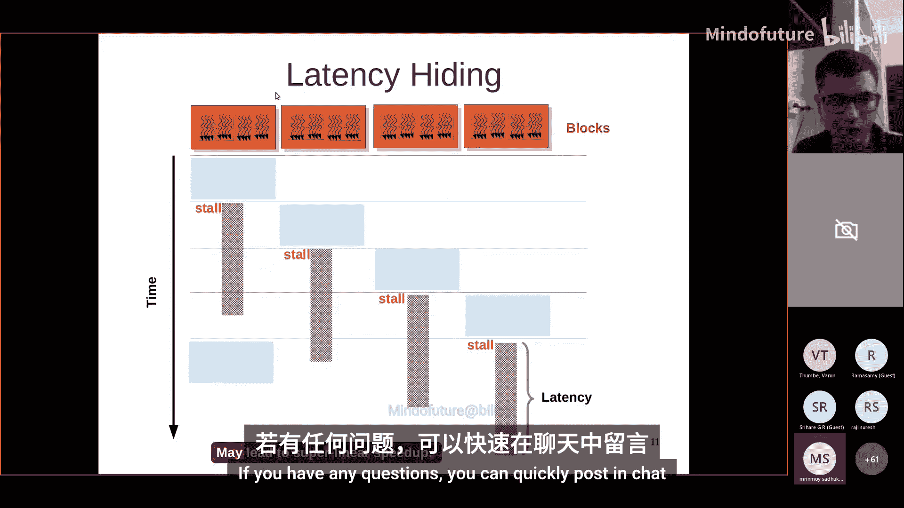

Chat。

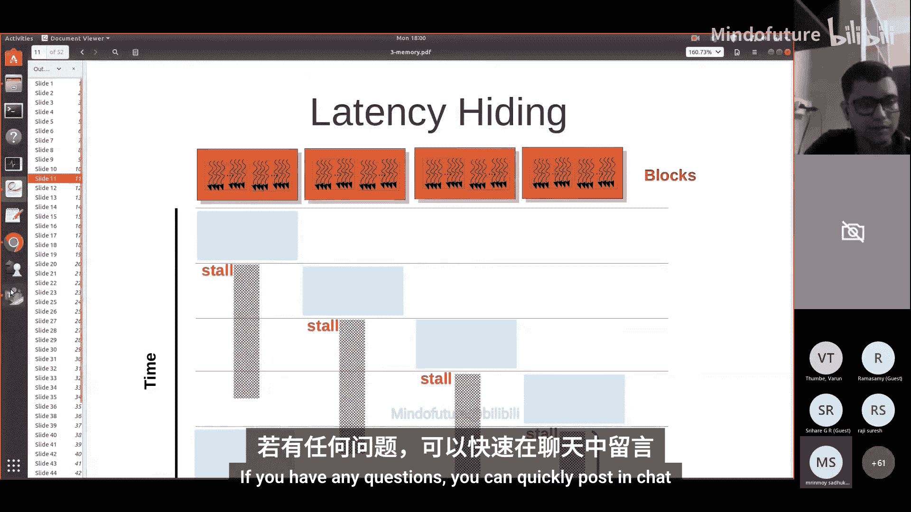

Just like。OkayI guess there are no questions， but in case you have any questions。

 then please feel free to unmute or post them on chat。

Okay， if there are no questions， I'll move further。So okay。

 I'm assuming that you people have understood what is latency hiding in super linear speed up。

So moving on， let us talk about locality。So。We all know that locality is very important on CPU right because let us say the that is how the caches are I mean that is why the caches are designed right？

Let us say that。 We have。You have。We have we have access one particular word inside inside a block from the D。

 then it is I mean it is highly likely that we will access that block I mean that word or something that from that word。

Sorry， some another word from that block in the future。So。So that is why these cachehes are designed。

Whenever we access something from that from the DM， that block is placed in the caches on the CPU。So。

So I mean so that is how I mean that is what is locality principle some and the caches are designed to expert this locality thing on the CPU as well as on the GPU we saw like there are L and LT gas。

 so locality is important on CPU as well as CPU。啊。Yeah。

 so it is important on CPU as well as CPU and all threat in the thread block exercisees their L1 cache versus as well as the L2 cache。

And yeah， so if you see typically the size of Alban Kesh。

 which I talked in the couple of slides back， which is also known as shared memory is of the size 64 Ku1 Pacal GPU。

And as I also previously mentioned that it is configurable， so you'll be able to mention， I mean。

 as a programmer， you will be able to mention that。

I want 48 kB of album cache and 16 KB of scratched memory or shared memory。

 so the 16 kB is under your I mean under the control of programmers so we'll be able to specify some variable to go into that shared memory and this 48 kB if you specify it as album then it will be completely managed by hardware。

And yeah， so threats in this threat blocks can use this album cache。And up to some extent。

 you can also I mean you can also。Specify that I want to use this Al cache for storing this thing or that thing or this variable or that area or something。

 which can go into this scratch button normally。And it is configurable， as I told， like6， I mean。

 you can specify what chunk of scratch memory and what chunk of album Caew want， it can be either 16。

 48， 48， 16 or 30 to 32。For stretchboard any element fish。So that's part for the album cache and。

Yeah， so。Typically as a programmer， we should exploit this locality because because when I mean。

 let's say you have some some portion of array or let's say you have very larger and there is a small portion of that array which which is being accessed repeatedly by our applicationplication then in that case it will be very very intuitive or it will be very very。

Performance friendly took place that chunk of that chunk of area or that part of the era or that。

That tried or that part of the array the。Into this scratchpa memory that we can。

 I mean that we can program。So in some sense， programmer can exploit this locality by using this scratchboard memory in album cache。

On CPN GP both， I mean both we can do this， but in GPU setting there is one more thing there is one moreity call a specialities locality which is very crucial。

And we'll see why this special locality is crucial when we'll come to memory coalescing。

 there will learn like how the special locality among war threats helps in reducing the memory excesses or how it can help in grouping the memory excesses together into one memory exercise and all those things we learn。

Yeah， but on Chief view， this special locality is something which is very crucial。

 and we should keep this in mind and we come at this point later during coalescence。

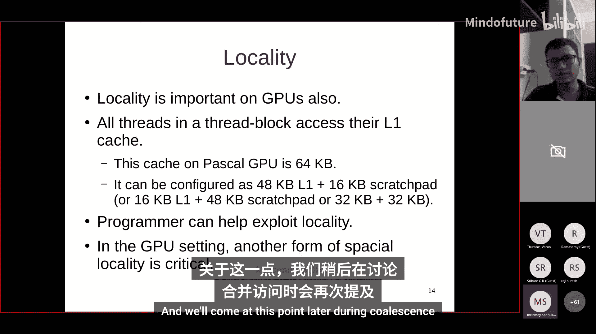

Any questions up this slide quickly，Go back to chat and see if anyone of you have any questions。

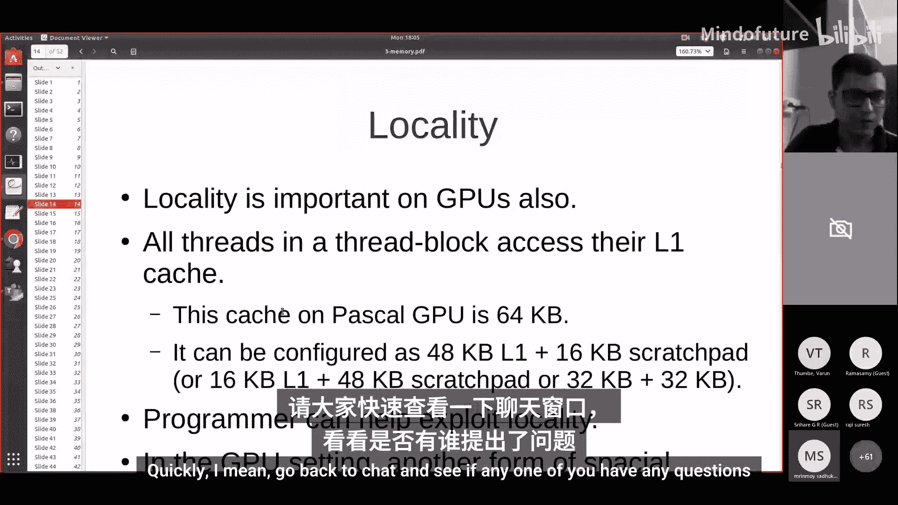

So as a programmer， how do we decide whether to use L1 or L？First of all， Hash。

 I think Aluk is something which is not in Rm。We can program up to11 cache， I mean。

 we can either specify。Okay let me put it in this way like you can say that I want this variable or this area to go into El1 cache。

 which is scratchboard memory。But you can't specify that I want to place this variable in Nakeche。

It is decided by hardware。I to cacheache is not I mean something which is in our hand。

 only11 cache and not entire element cache the part of it which we call it as Crboard memory is it is in our hand。

 I mean is in the programmer's hand。So that point you should know。

 but yeah this L2 cache are inherently exploited by the GPU hardware。

 so whenever you try to access some chunk of memory inside inside the GPPU's global memory，If yeah。

 so that would be placed into the L cache and L2C to improve I mean to get the benefit out of it so if next time if if we are accessing the same I mean accessing somewhat from that same block。

Then that access will be faster。Okay， so scratchboard memories is the same as shared memory。

 so okay let me reiterateite so there is something called as L1 cache。

So that El cache is divided into two parts one is Al cache I mean， one is the El cache itself。

 which is managed by the GPOs hardware and second is called us shared memory or this scratchboard memory。

Which is something which is in the hand of program。 and we can， I mean。

 we can program it in the sense that we can。Specify that I want to。

This array or this variable tool is stored on the scratchboard memory or the shared memory。

 I hope that's clear。Is it safe for programmer to use Al one F？No， I mean， not album cashsh， I mean。

 it's scratchboard memory， which is being。Programmed by the programmer which is just small I mean it's a part of Al cache Al cache is not being touched so okay there is some conditioning case so Al cash l cash all these are not programmable register Al cash L cash only part of Al cash which is called as scratch memory is given to the programmer per row。

啊。Or I mean， storing some variables or something。I hope that's clear。Okay， so。Okay， before moving on。

 I'll specify one point here caching and all those things are implicitly taken care of by hardware。

But。Here is something like， I mean， some portion of cash is given， I mean。

Some portion of cash is provided to the programmer for I mean for。For our advantage。

 so we can export that thing。Otherwise， this Al L2c and all those things registers and Al L2cahes are I mean。

Not program equal bias us even on GP。So at that point， you should always know。

They's taken care of by hardware。I hope that's clear。If there are any further questions。

 please feel free to ask。

Okay， I think I should one。

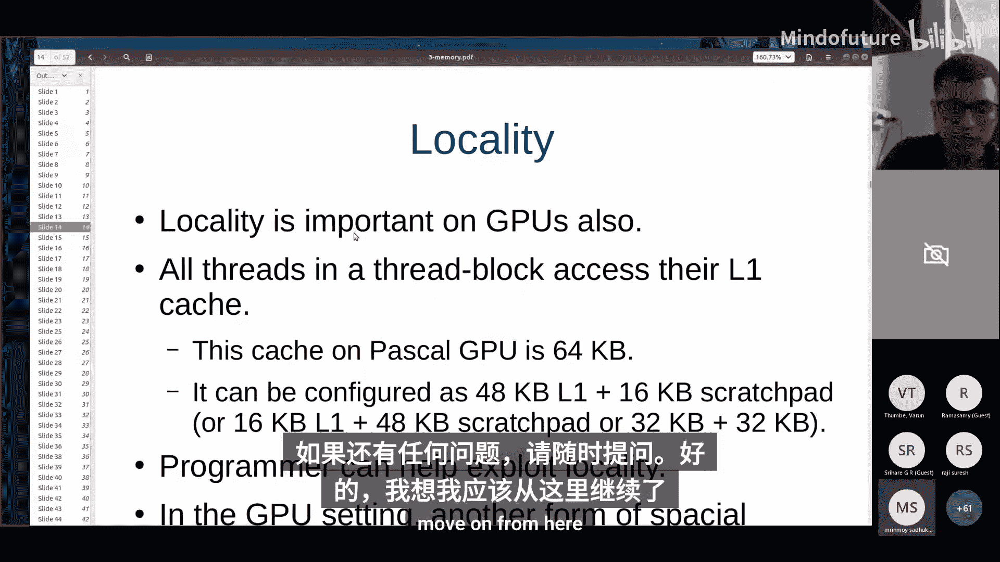

ok啊 so。That are， I mean。Let's come back to CPU again。

 so there are two types of locality on CPU can quickly anyone tell what are the two forms of locality on CPU。

Quickly。There are two types of locality and safety。hi are I mean。

 which we generally talk about when it comes to CPU。

I want people to quickly tell what are those two forms of locality？

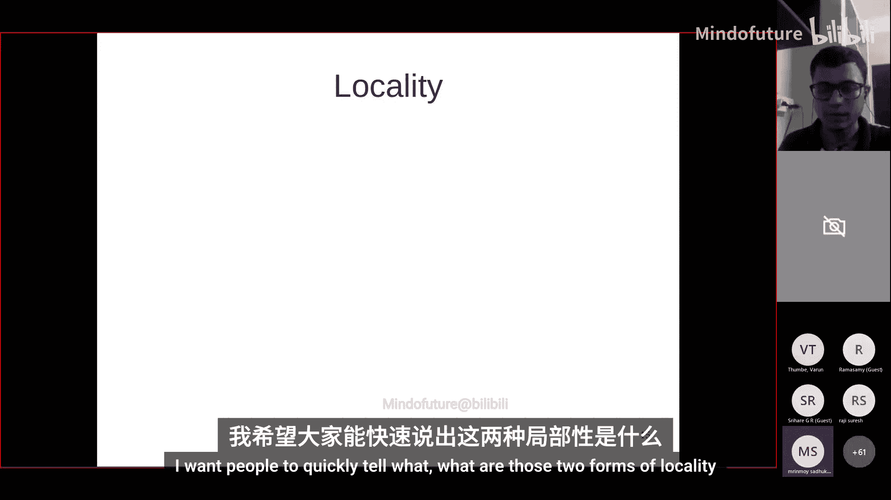

Yes， one is special locality。Then there is also another form of locality。

Whi is very often which is very often used on， I mean， which is very often specified on this issue。

Which is being exploited by caches。Okay， I guess。There are no responses。Yeah， yeah。

 temporary localization。Yeah， so there are two localities says。By Goku andrihish。

 there are two types of localities on CPU when it comes to CPU， there are two forms of localities。

Special locality and another is temporal locality， so let us briefly touch upon what are these two local I mean。

 to forms of localities on CPU。啊，So。What is spatial locality so spatial locality tells that let's say I have an array and I have accessed its eighth memory location a is I memory location I have accessed at particular point in time or lets say I have accessed that eighth memory location then。

It is likely that I'll also access some i+ case memory location where case some sort of tellta。

Itss like it's some constant number let's say 10 or something so if I if I access some memory location inside the area then it's or inside some inside some data structure then it is likely that I'll access the memory which is close to it and that is special locality so I'm seeing it from this space point of view so is there is some access at some particular point in the memory and it is likely that I'll access some close memory which is some which is which is very close to this。

Me location which， so that is spatial local。Second is temporal locality， which talks about， I mean。

 which looks into the time aspect of this locality。Which says that if I access some memory location。

 that's an EI inside your memory。Then inside that area， if I access some memory location。

 then it is likely that I'll access that memory location again。

So it is something like time aspect of the locality。

 So let's say five access that memory location once then it's likely that I'll access that。

Mem location again， so that is the temporal locality。And let us look at the examples of both of this。

Let us come to temporal locality first so let us say we I have this for。

 this is CPU code sequential code and let us say I'm accessing that area of I which is I location in the area or in the memory。

 some location in the memory。And first of all I'm writing to it， so here I've accessed it。

Then again I'm accessing it for reading as well as writing and then again I'm using it for reading so if you see here I've access accessed it once then I'm reaccessing it here and here so that is what is temporal locality so it says that if I access a memory location once then it is likely that I'll access it。

In the near future， again， so。It will be accessed soon again。So that is what is temporal locality。

And second thing is special locality， it says that if I accessed a particular memory location。

Then it is likely that I'll be exnct the nearby memory locations， so this is the example for it。So。

 here。the loop goes from0 to anywhere and is some let's say some large number。

 then if I am accessing， let's say area of 10。Then I'll be alsoing area 11， 12， 13，14。

I'm in some sense， accessing the。Nearby memory locations in that area， I mean。

 so this area is stored as conuous I mean is stored contiguous in the memory so。

If I'm accessing the1 element in that area， then 11， 12， 13，14th element will be con in the memory。

Yeah， so like when I access that particular ma location， I'm also accessing its neighbor。

 so that is what is special locality。And the。Cashs are designed in such a way that they can exploit both of this locality。

 temporal as well as spatial locality。So whenever you will access some memory location。

 either on CPU or GP， it will bring the entire block of that。

 I I mean whenever you access some word inside the the of either CPU or GPU。

It will bring entire block in which that word is present to the cache。

 which might be al cash or right to cache so that。Once， I mean， so whenever in future。

 if you access that memory location or its neighbors。It will be present in that law。

 so that is what is temporal and special equality。And both C and GPU are designed to expert this temporal and spatial localities。

crucial crucial point here is that these localities are applicable on CPU and GP， as I would。

 but they are more applicable on CPU。Because as I told on GP， we have a large number of threats and。

The part third cash available。P third memory available for cash is very limited and hence this locality。

Both of these localities are more applicable。CU rather than GP。

But there is one aspect related to the spatial locality。Which I have already mentioned。

 which is memory coalition。 That is something。 I mean， it's very close to this special locality。

It gets exploited on GPS to。I the I mean， to reduce the latency and we will see in probably in tomorrow's lecture what is that memory coalition？

And yeah， so probably， yeah， so let us do this classwork。

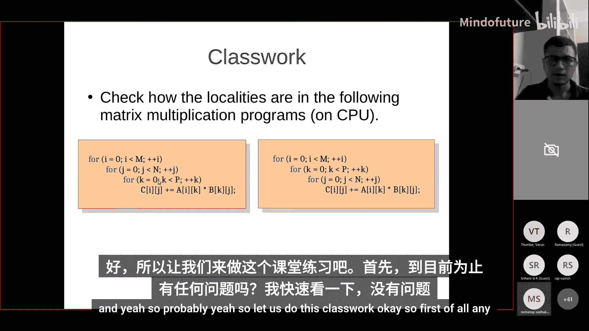

結 so questionこれ any questions。Ill just quickly。Okay， there are no questions。

Okay， then let's move on， okay， so we have this classwork。

 small class work like these are two snippets of codes。

And both of them done does one particular thing which is matrix multiplication。

 So here ABCR three metes and。They are a。Multiplying metrics a with metrics B and storing the result in metrics C。

 if you can see here。And both of them does this operation correctly， which is matrix multiplication。

 but there is small。Change in， I mean， both of them like here first there is J loop and then there is K and here first there is K loop。

 and then there is J。So entireing of loop is being done。Between these two， I mean。

 that is what is the difference between these two。I want each and every one of you to try out。

 I mean， I mean each and every one of you to tell me which which code is better considering that we are using row major order。

For st the for sting the array in the mattresses and the CPU as well as CPU in this case we have CPU。

 so let us assume that we are using pro major order for storing the mattresses on CPU。

 considering that fact that is a fact called which which of these codeniper as pattern。

Or which one will give better performance？I'll pause here for some time and elect you people to think about this。

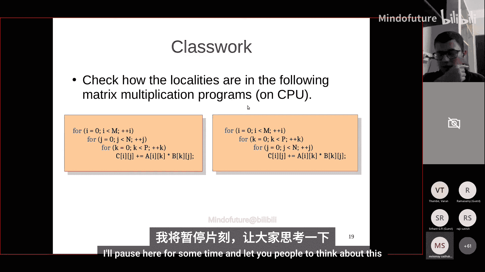

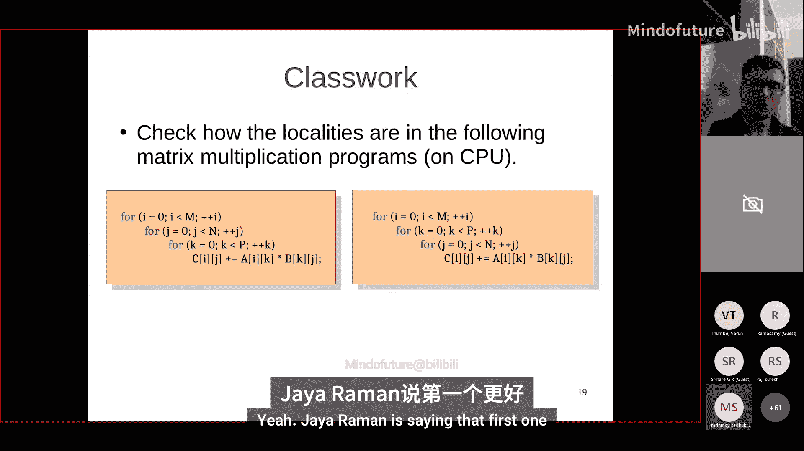

J is saying that first one。O， I request others through try switch back to the。

Sndes。Requestest others to try。

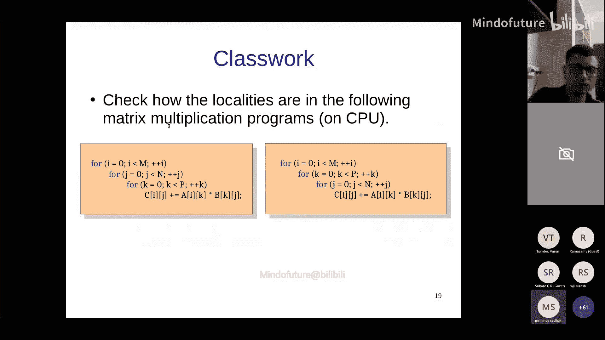

と出ちゃん。 depends on size of n relative to P。First one。 first one， okay。Un Pra。

Ply saying depends on size of n relativeivity okay let us assume that size of NP and K are same let us assume just for the sake of simplicity。

 let us assume that this NM and P are all are of same size。

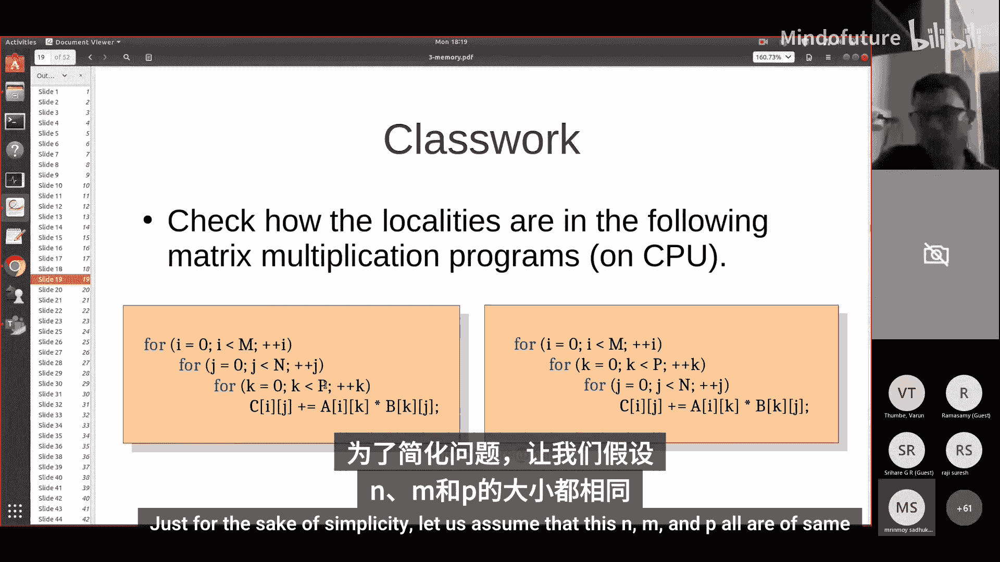

Then which one will。Okay， I buy still first Okay， okay。

 so you people are trying to go with the first I mean， first option then。Let us I mean。

 let us assume that the first one is better than can anyone give some， I mean。

Give some convincing argument why the first one is better like you need。

Can you give some explanation for it？Why you are telling that first is better。

Either you can unmute your support and just paste your answer in the chat。

Let me go back to this slide so that you can just refer to it。

Why， why the first one is better if we are telling。It's better than why。

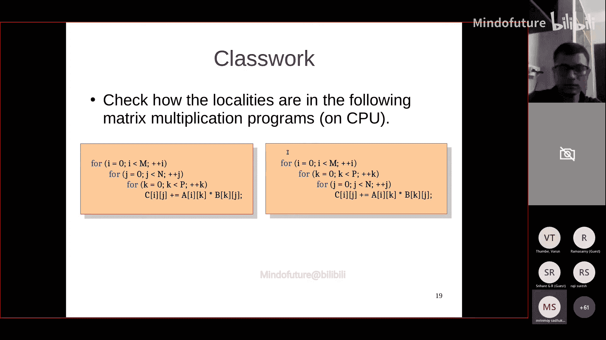

I think it will be a bad idea to compare temporal and special locality。明啊。

She uses temporary and maybe uses a special colour。

几。Well， if if you are telling that CU is temporal。Ailities using both temporal as well as special abusing。

Because if you see。Cha is changing faster than I， so in some sense it is going along the rows。

 so it is also using special as well as the temporal both localities it is using。

So I don't think that that is very。Correct way to compare， I mean。And。Even for A and， I mean。

 A we will be using spatial， but yeah， I mean， that' is not correct way to compare it。

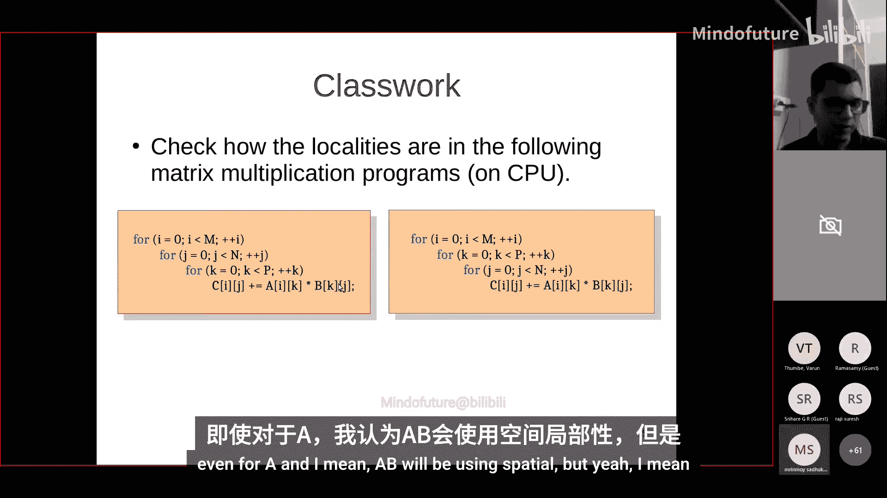

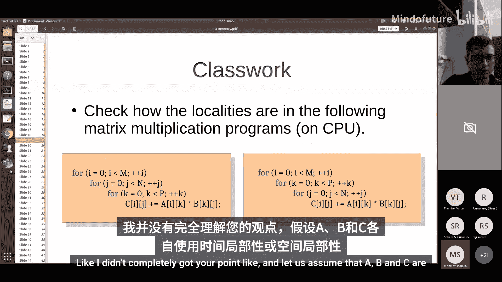

I didn't。Completely caught your point。And let us assume that A。

 B and C are either using temporal or special locality than in that case。

It is also true for this one right this code also uses temporal and spatial locality for a B and in some sense and I mean how is it but I mean how this is better I mean I really didn't。

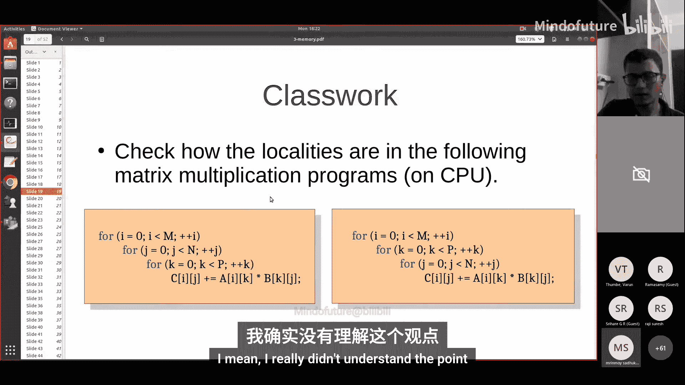

And this took the point。

Okay， I guess I think I should now move towards the explanation。

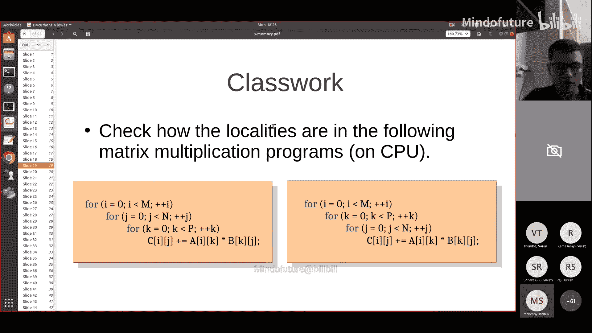

Okay， so the answer to this is like the second quote snippet is better because I'll explain why it is better。

So if you carefully see in this quote of this quote snippet。There are three me， first of all， A。

 B and C in both the cases and。If you need to observe one thing here that in the first I mean firstnippet the C or a C and a are being accessed in row major order and I initially told that the array stored I mean mattressrices are stored in row major order。

 we are assuming that we are storing mattressrices in row major order on the CPU。

That is on D That is on its Dm， so。Accessing them in grow Me order will give us a caching benefit or more precise it will give benefits due to special locality。

So here C and A both are being accessed in the row major order if you see the first variable which is I is progressing slow and the second variable J is progressing fast so it is moving along rows。

 so that is the row major order， this is being accessed in row major order。

A is again being accessed in row major order because I is the first sorry slow changing variable。

 but k is very fast changing variable。So again it is in row major order， but if we see B。

 it is being accessed in column major order， the case is fast moving fast moving variable。

 so its excesses will be in the column column column columnar manner。

P of0 00 will be accessed and 10 will be accessed and 20 will be access so will move along the column for p。

 but for A andC we are moving along the and as we are storing metrics and row major order this both will give caching benefits but B will not give caching benefits。

So that is one point that you should not hear now coming to second qua network here let us analyze what is happening。

Here C we are accessing in row major order right because I slow moving variable chase fast moving very fast moving variable so ij will be in row major order because00 will be accessed then 01 will be accessed then02 will be accessed okay so this is row major order。

Then again， this i case room is order you see because I slow changing variable。

 case fast changing variable。So here also0，0，01 in that man will move along row and again for B also row major road。

If you see， because K is low moving variable， J is past moving variable。So again。

 the AB is also accessed in row major order， so here all three A B and C are accessed in row major order。

And as I told that we are storing this mattresses in row major order， if if you use I mean。

 if you use the second ch snippet， then we'll get better better performance because obviously all these three are being accessed in row major order。

And since mattress is also stored in room major order。The special locality will give us some benefit。

As compared to this bus。And hence。This will outputperform this first I mean this time taken for the second snippper will be much lesser than this fast sniper and if you time you will see that fast sniper takes 9。

5 seconds and second sniper takes 4。7 seconds。So that is the reason。One small， I mean， one small。

 another reason is also that this p which we are accessing in column major order here in Pani。

Its actually very fast， I mean， we are accessing it in very quick manner。

 right because k is the inner Muslim and it transfer every ING。

So we are doing Poland major order very frequently。And column major order won't， I mean。

 it won't give us cashing benefit because our matrix is completely stored in no major order。

So that is one biggest disadvantage here， but that will， I mean。That will。

Casuse performance to degradation here， this one， this thing will cause biggest performance degradation。

And definitely this second snippet will win if there are any questions。

 I'll quickly go back to chat and probably will。

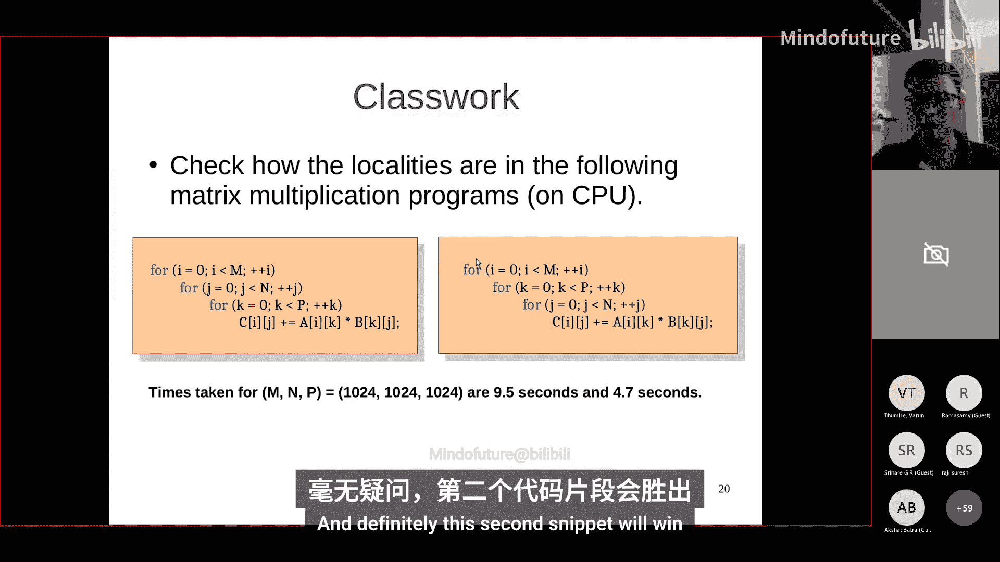

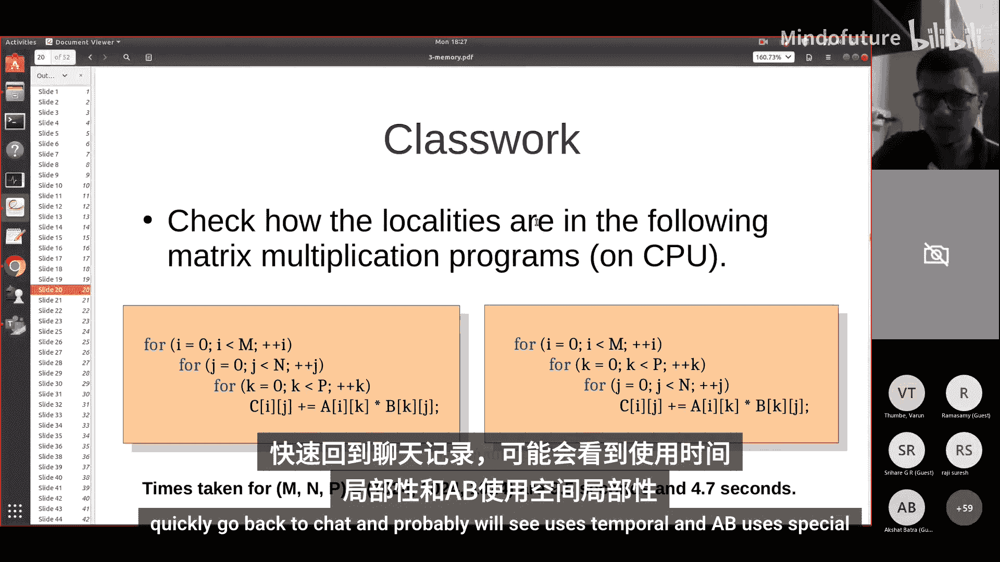

CU is temporary， and AU is special。Okay， I really didn't understand， I mean。

 there is no point of comparing temporal and special locality。So。

Either it is temporal locality or special locality it will get some benefit from caching so you just can't compare temporal with special it's about whether it is getting benefit or not is the question out of caching。

It might be either temporal or special， whether it is getting or not is the question。

Is what we should focus on。Special locality first one， CIJ A B benefits from special。그자 이제。Okay。

 so could you explain B Kj from code 1 once more？

ok。Okay， let us。 I mean， let us go。

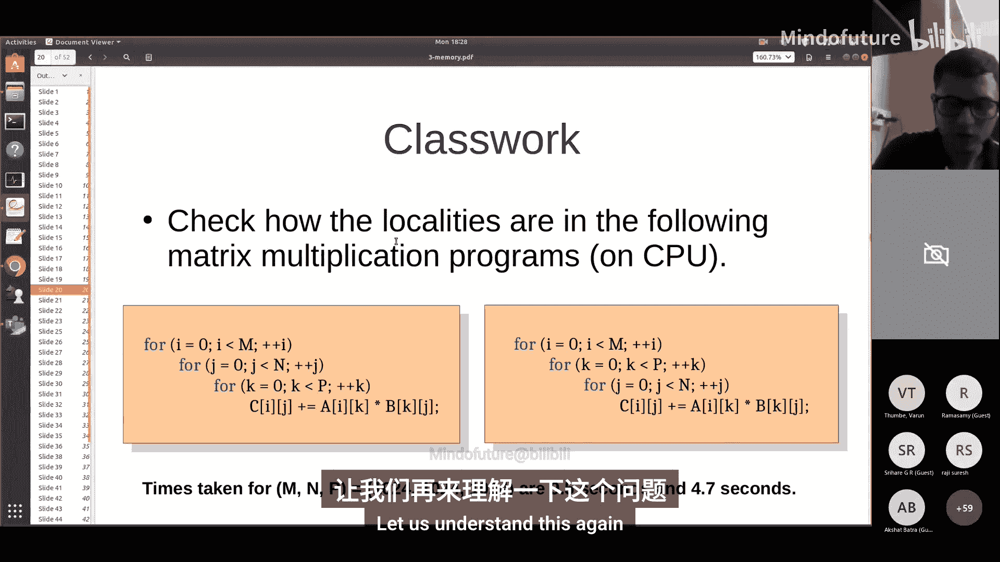

Yeah， so let us understand this again。Just let us focus on this B cage， what is happening here。

How is this being existed if you see carefully， how is this being existed？

How this matrix is being covers， let us see。So k is a very fast， I mean， fast moving variable right。

 because it's in ourmost loop so it will。Run for each and every value of h J。

So how we are be accessing this D mattress。We are accessing it in this manner， right？

Let us say for the0 value of j k will go from 0 to p right so let us say p 10 let us put some random numbers right so let us say that p 10 set will go from so how it will go like it will go from 0001020304 up to09 right because p 10 so from 0 to 9 will go。

So 000 sorry，00，10，2，0，3，0， up to 9，0。So the way we are accessing it it is in column column order right so 00 then 10 is is the next element in that column 20 is that is further next element in that column so we are accessing it in。

Like in column direction， not in the row direction。And。

As I mentioned I mean as I added that prerequisite that matrix is stored I mean mattresses are stored in CPU1 in raw major order this will not give cashching benefit because if you are accessing something in column major order then you won't get benefit out of special locality that is a problem like special locality is something that if if you are accessing。

particular memory location， then all its neighbors are brought into the memory and since the mattresses are stored in row major order。

 all its neighbor will be that row elements so。So I mean。

 so elements meaning like if you are accessing 00， then 01。

0 to03 and 0 Alexa 06 up to 06 will be what into the。

Into the cache but 10 will not be bought into the cache。

 so that is a disadvantage and you are accessing it in column I mean column direction。When they呃。

Benefit that will get out of special locality will be only when we'll go along the roads。

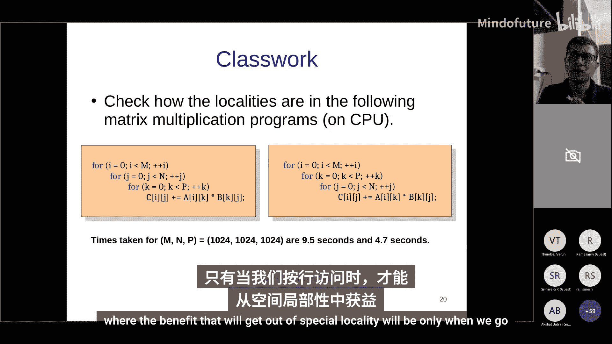

I hope that's clear。

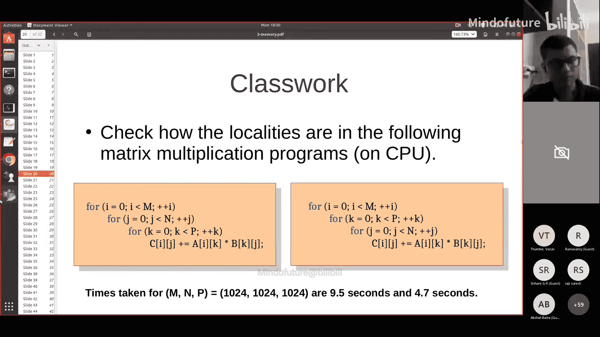

Yeah， I hope that's clear go yeah。I think someone has raised and you can unmute yourself and ask the question。

So what happens if B Kj takes place off。Of Bjk takes place of P Kj in the first one。

 then which one is faster。我给汝结姐。ok嘅啲 i个结个。并且给。

HIn that case。I think all three are。In raw major order and I think the performance will be very much comparable to this second s second one。

Because in that case， all three are。Being accessed in a row major order。

So there might be some difference in performance， but it will be very close to this。

 but here you can see that performance differences， I mean used right it's almost double if you。

So first sni sorry first snippet is performing， is taking double time than the second snippet。

But if you change this KJ to JK then performance will be comparable for both I'm not sure what will be the exact number but I am thinking that the performance will be almost similar for both the programs。

Because in that case， all three are being accessed in row major order。

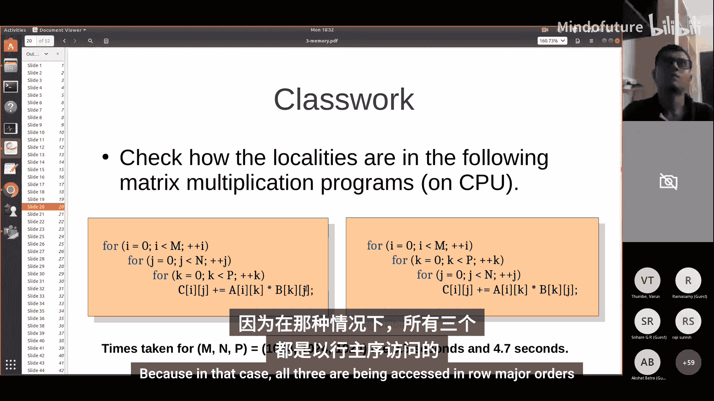

I hope that clears your question over you。If you have any further question， then you can ask。

