# 【Nvidia】CUDA并行编程-｜-Cuda-Programming-Course-｜-Parallel-Computing-Using-Nvidia-p07-P07_L7_内存合并与AoS对SoA--BV1MSq1BTEho_p7-

Yes。Yeah。Okay， so let's get started。So welcome everyone to the eighth lecture of our UA program。So。

In previous lecture。We saw， I mean， we saw multiple things related to the memory， right。

 like we saw the typical memory hierarchy on the chip。 we saw that。There are registers。

 then there is element cash， then there is al cash then there is a GPS use global memory， which is。

Is on an SDM of T TU。Then we saw what is letting see， what is bandwidth。

 and we saw like cheap use at throughput oriented architectures。And we saw those things right。

Can we typically saw。Some， some examples related to locality。 And first of all。

 we saw different types of locality， like special locality and temporal locality。And then at the end。

 resolve。F examples related locality。And。Yeah， so。That was where they stopped in the stopped in the last spectrum。

So， but in today's lecture。Well be going through the most important part of the most important memory aspect。

 which is memory coalcing。Then we'll be looking into something called a structure of areas and area of structures in the region。

And then we'll probably look at a look into few of the examples related。

Whats the end of the lecture we gets some time then we'll also look how to exploit the shared memory which I used to keep on telling during the previous lecture so you'll probably see shared a few things started to shared memory。

Yeah， probably there will stop for today。And yeah， so that's the。

Ill applying forward today's lecture。So with this， let's get started。So。Yeah。

 so this was where we left off last time。 This was the last that， right， so。If you remember。

 it's only people that。What will be how the localities will affect the execution of this to poorni and which one which one will expert locality better than another one。

So we saw that the second snippet was better because because they。

The way we are accessing the ABC is is the role major order in this second statement。

While in this costni， A and C are exist in row major order。

 While the C is exist in column major order。 And typically。

 the way the mattresses are stored in the memory is is the raw major order。And hence of。

Since these three excesses are in major， we will get a recent performance improvement as compared to this。

When we compare this to this two gold snippetss。Okay， so yeah， and 4。7 and 9。

5 are the timings which we're seen for second and the first three practice。Well， so that's。

It kept about the last slide that we saw in the previous lecture。Now， okay。

 this is this was on the boat on CPU， right。These things will occur on it。Now， what about GPU。

 So what will happen on GPU。So。If if you remember， I told that this to locality。

 spatial and temporal locality are still applicable on G。

The thing is they are not as effective as I mean， they are not as effective as they are on CPU。

So we'll be able to get some advantage out of the special and temporal locality when we run this type of courses on the GPU。

But there is something else on the GP2， which which needs to be exploited in order to get in order to reduce the latency of the memory father。

And for that， from， from this。Apart from this special endor。And that。

Other thing is something called as memory coolalism。Is part as memory quo。 And what is this。

 Let us try to understand it。WithThis definition。So。What is memory policy。

So if the war threads excessive words， words meaning 32 bits or4 mites。 So then war threads。

 which is the bunch of 32 threads excesses a word， which is word meaning。I mean，4 by or 32 B。

 and the excesses the words from the same block of 32 W。Then their memory requests are club into one。

 So instead of making 32 memory accesses to the memory controller and catching 32 wordss one at a time from the E of the GPU。

 all this 32 words are brought together。 I mean， they are just club into one memory request and they are all brought together。

And when this thing happens， it is said that these memory requests are loyalist。

And that's a typical definition theoretical definition of the memory coism。

Let us see this thing from。What example point of。So if you remember， I am given giving this example。

 right， it's a classic example， right， next， we want to initialize the。At这个。I mean。

 all the elements of the array to all zeros inside the GP2 button。

 then you can know it the way we write the kernelal。What we do is we specify， I mean。

We launch the kernel and we customer calculate the ID。

 and we also pass the array inside the kernel address of the array， which is allocated on Z。

 they pass it with the kernel。And then we calculate the I， which is unique for example。

 and then what we do is we do that thing， right。A of I D equal to 0。 Now。

 if you see that Ar of I D equal to 0 is。It's a coalest memory axis。 While it's coalest。

 because if you see the thread0， which coming in thread， having I 0。

Will access the zero memory location compared with I1 will access the first memory I mean。

 first element of the error compared with I2 will access the second element of the direct。

 So until the 30%。And assuming that this area is an integer error。

 each word will again each word is again of cut bit because integer is a cut bitite when it comes to see。

So here， multi authorss are accessing the words from the same block of 32 words。

And why it's the same not because if you people might， I mean， you people know， right。

 that terrorist stored contiguously on the。P然 or O然。So here。

 the block of 32 words is that A are run of 0。 we are run of 30。So。

Each and every thread is accessing that somewhat from that same block of 30 degrees so。

The example that I gave that typical example is a good example of the coalest number axis。Yeah。So。

 moving part。And。Let us assume that this。Po I think is not there。Then what will。

the coalcing is not that and in our previous example or the example that I just gave。

 what will happen is that for accessing each and every element in the area。

 we need one memory request。Support accessing we are out of 0 to we are out of 32 by 32 thread 32 w threats。

 You will need 32 memory post and。That will just I mean， that will become a bottle next。

 right because such cut memory exists just for one one。If we have coalition memory access。

 those 32 memory reports are plug into one， and we'll just need one memory access。

So that's the advantage of coing and without coing。

 there will need one door store instruction for each memory operation。

But coing just one operation for entire one。 So yeah， considerable saving， I will say。

And what fat would require 32 memory cycles in worst case when there is no coing is this coing is not accurate in 32 memory cycles。

And if that's the case。Will significantly reduce right。

 because for one what will need 32 memory segments and that's quite costly， I mean 32 memory。

Cyclees are quite costly。 If you remember each memory access makes some。400 to 800 GP， I mean。

The tip your cycle。 So that's quite costly。32 for each of that is。 It's had a lot of。

Science so throat will significantly reduce and if that is the case then GP will only be used for compute heavy kernel spins if there is a lot of number matching operation going in that case only the GP will use but fortunately this doesn't I mean this is not the case as long as we are exploiting this coalescing memory coalescing properly。

Memory cocing。Properly。Will be able to even。R much， I mean， memory Hung can on the as long as we are。

Use， I mean， as long as we are exporting this memory coalcing property， coalcing property property。

So any questions on this slide up now？

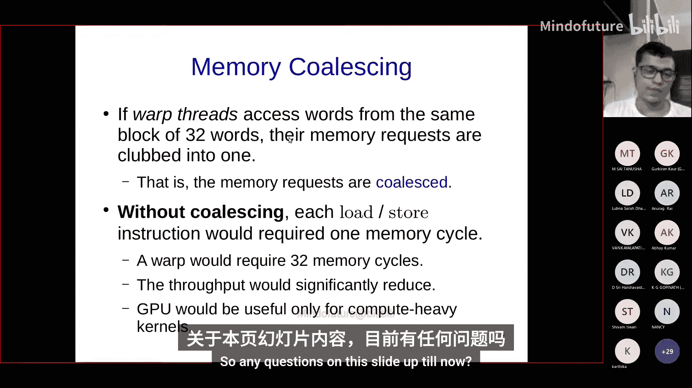

Anyway I have quickly moved with the check。

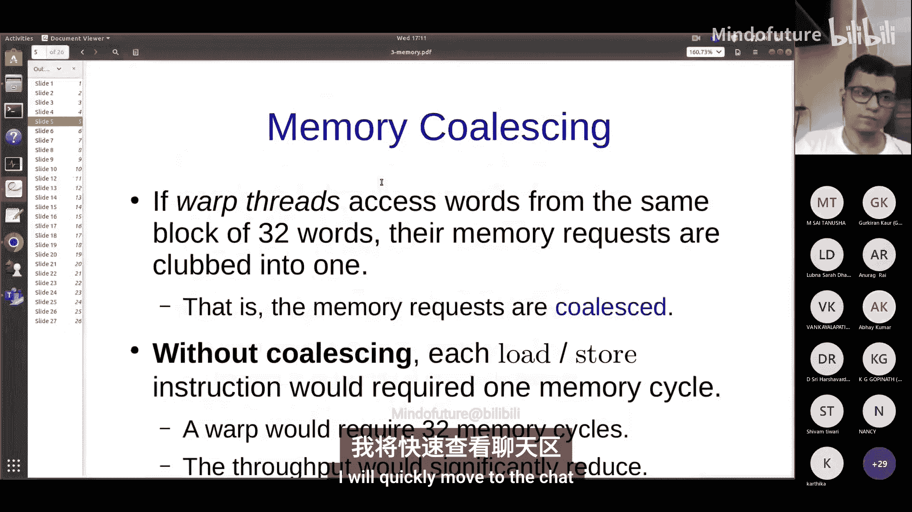

Any questions up now on this link。

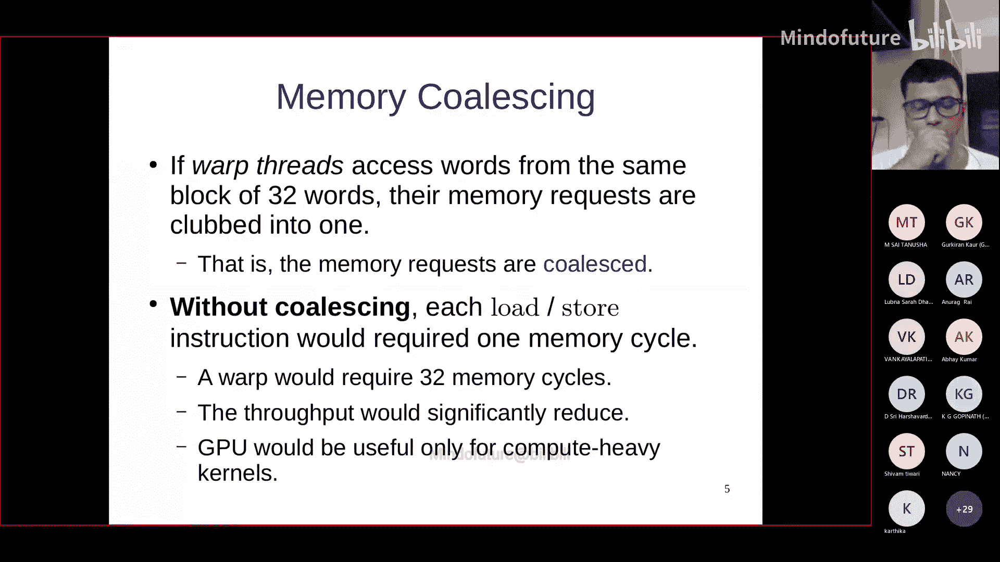

Com。Okay， I'm assuming that。There are no questions。 And in that case， I'll move forward。

With these slides， just in case you have any questions。

 please feel free to ask either in chat or the unverting yourself。

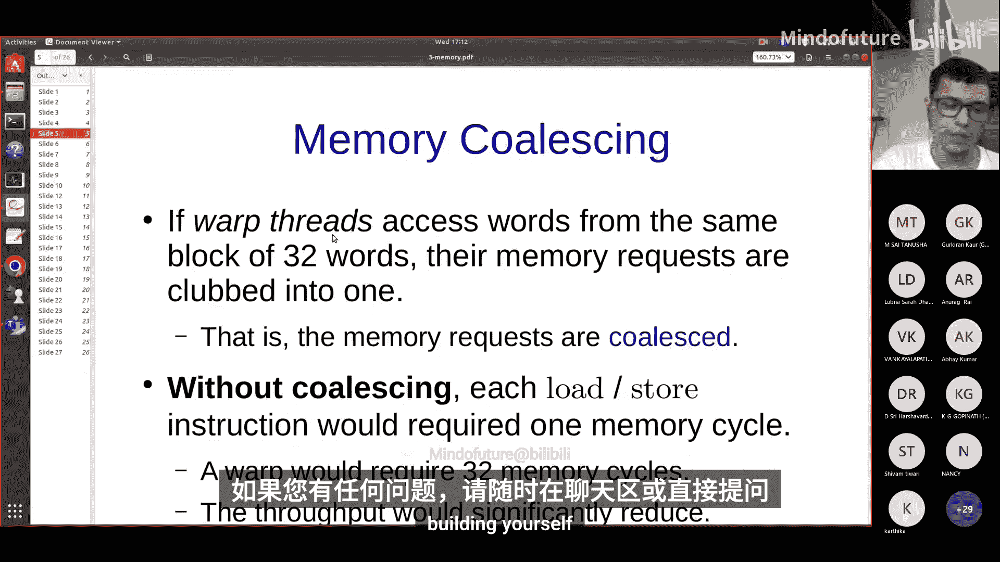

Okay， so let us understand how this。Memory coing is being implemented internally。So。So internally。

 if you remember this， I mean， this memory coalition is first called what qua threads so。Across war。

 there is nothing this。There is no concept of memorypoli， but it's among the walks。

 it's among the walkres where this memorypoli property or concept is being applied。

And how is this implemented internally， is that if you remember right？

That walk threads execute in simply fashion。 So there is so each each instruction will be executed in lockstep fashion。

 So instruction I will be executed。 Then only all the threads of the work will move move to。

So if that is the case， then。The instruction at any moment that war threats are executing can either be a load instruction or store instruction or a he he instruction。

 which needs some computation。So it on lower store instruction。That is a memory demanding operation。

And what will happen？What memory it affects a memory demanding operation and what will happen is this memory controller will look into the addresses which are required to be which are required to be accessed by these walk threads and if this addresses happens to fall in the same block of 32 words as it is mentioned here。

 this memory addresses falls in the same block of 32 words。Then the memory request is come by。

 I mean。I mean， this， this entire practical block of art will brought with the Al cash and。

All the threads can access this。This works from this block of capital words from that cache element。

Or even or an L or， yeah， so。That is how it is internally happening inside the GPU hardware to some extent。

And yeah， so the crucial takeaway from this slide is that。

Memory querys is being done irrespective of， I mean。

 it's not something which is enabled or disabled by the program but it's implicitly done in at the hardware level。

And it's our responsibility as a programmer to exploit this memory coalcing。

So that our application can get our application can。Reduce the latency of the memory excesses。

I hope that you are getting。

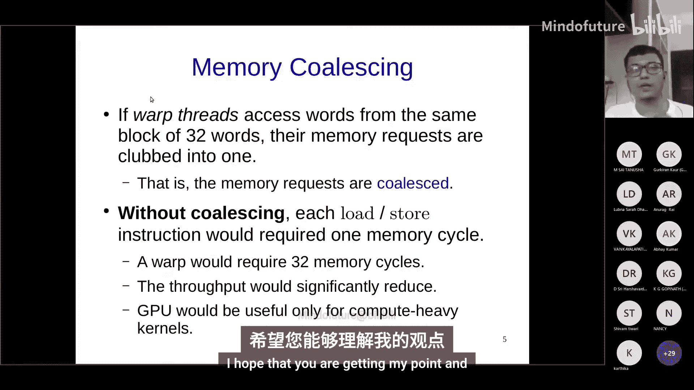

And。You know， just go back with the type case。

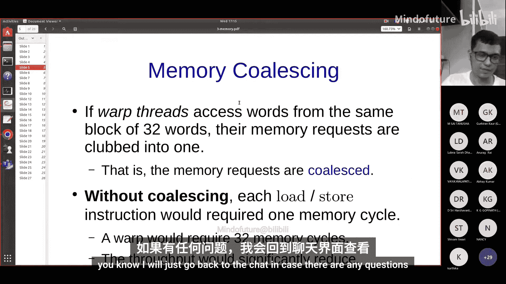

Never。Any questions。Question，1 question， what。If one thread fit a memory index out of。segmentation。

Okay， if。If any of the thread excesses the memory beyond the。Beyond the limits of that process。

 and that is segmentation error and。阿边。In that case， there is no coing。

 as well as the segmentation for whole thing。So memory coing is only applicable if we are accessing that accessing within the bound of all the threads。

 all the bo threads are accessing within the bound of that 32。Block of。

 and that block of that two two words。I hope that's clear。Will the whole memory coalcing I was okay。

 in that case， whole memory coalcing。InThat case， your program itself will fail so。I don't see any。

 I mean， point of coaling there because。I mean， program itself is failed， but。Okay。

 if if your question is like this that let's say segmentation for it is not happening。

 Let us assume that。请比。The GPP thread is existinging some memory location。

 which is we want that block of。block which is on 32 words。

 which is beyond that and in that case more than one memory request will be required。

Since it is valued memory location， excesses will be， but more than one memory access will be hard。

But the case where it is exist some illegal memory location in that case。6。Simply。It was less。

 is less to think about。啊。coalescing because your program itself will fail， right。

I guess they're disputed。if something is unclear， then you can。Be that fault is stopped by trial now。

ok。哎他们的。I mean， I haven't seen tri cash block inside the kernel so far。

Assuming that this trica is available and it's being。 I mean， it's being used to。呃。

It's being used to， I mean。Find that there is segmentation fault。And in that case， yeah。

 rice 31 threads can access， I mean。For S 313s， it will be coest memory excess。

So S 31 thread will be accessing from the same block of 32 words， I hope that's clear。Okay。

 I guess it's。Yeah， so I'll just agree。冇计佢啲。

Thanks。Okay， so I hope the， I mean， there are no questions， further questions from this slide。

 So I'll just move forward from here。So。Yeah， so let us try to understand this Victoria。

 Profe ofpher， let us。So， first of all， this。Coalcing memory。

 coalescing thing can be easily achieved for the regular programs。 Reg programs where meaning。

 where the access to the memory are not。Access to the memory are not in some irregular fashion。 Like。

 we are accessing it in a very。啊。What I guess in a very straight fashion， like we are。

 let's say we are doing some tense matrix operation in which let us say， we are E。 I mean。

 all the workers are working on one particular row of that。And within that row。

 they are accessing different different columns， so one thread will access AR of 0 comma 0 the another word thread will access A of 0 comma 1 third thread will access AR of0 comma2 and so on。

So such kind of of， I mean， such kind of excesses are poetist。

And for many of the dense matrix separation， this。Po I mean。

 coal thing can be achieved very perfectly because those are those falses under the category of regular programs。

So that is one and let us see particularly how this wholecing works。So。

Let us say you have this block of 8 words here it' failed。

 but actually it's applicable for a block of 30W。Just for the example， it's8。

 But let us assume that there's particular word。收啦。

Thread first thread with I0 is accessing the zero memory location。

 thread with I1 is accessing first memory location and so on。In the last thread。

And since they are accessing all the birds from the same block of cut to words。

The memory existes are are coolist here， right， because no thread is。Accessing no war thread。

 First of all， these are war threads。 No war threads are accessing any word。

 which is outside based clock of 32 words。And hence， this is the example of fully oed memory access。

So I hope this clear That's the example of fully coal para。Then this is the second example。

If you can see in this example。This thread number one。Te number4。And the last part。

 which is part number 8。Are accessing their memory from same block of 30 doors。

Assuming that this is the block of Turkey to。 They are existing same from the same block of Turkey to。

But other threads， apart from this 1，4 and 8， they are accessing some。Some words they加呃。Not in。

 which are not falling in in this。Block of technical words。

So this is the typical pictorial resolution of。Unqued number exists。So。

 but there is one question here I wanted to ask。Is， is that the， I mean。

 is this thing the completely unpolish memory exists or it。There is partial policing happening。

What do people do quickly think about it？Post your answers in chat。 Like， is， I， is this。

Thectorian representation of completely and coalless memory access or partially un coalless memory axis。

Just think about it and put your answers in the check even you can。

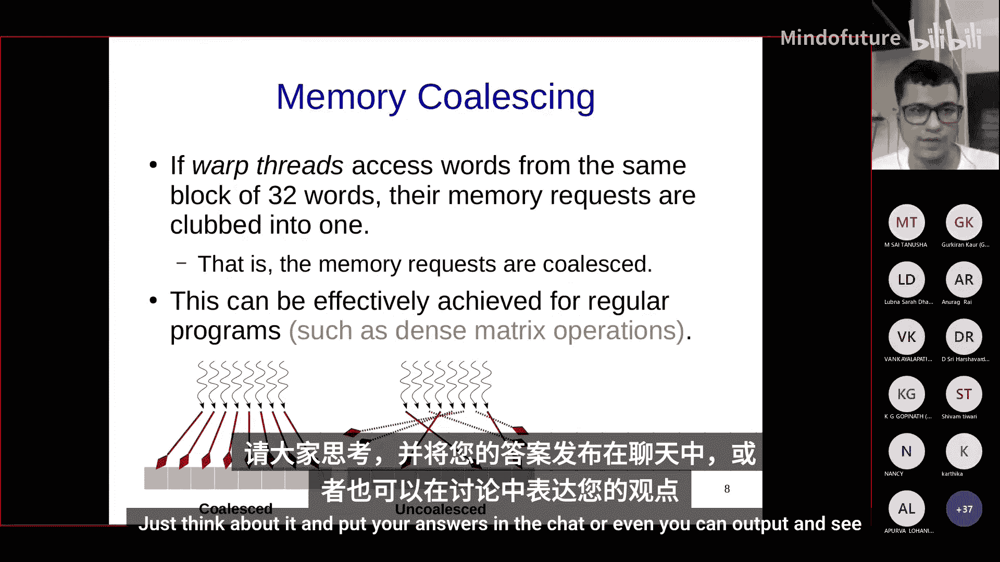

Partially policylic。Or you can even say that it's partially unpoing。

We are partially cocing for three words yes。In that way， it's correct partially policy for。80。

Proect I mean， few people are。

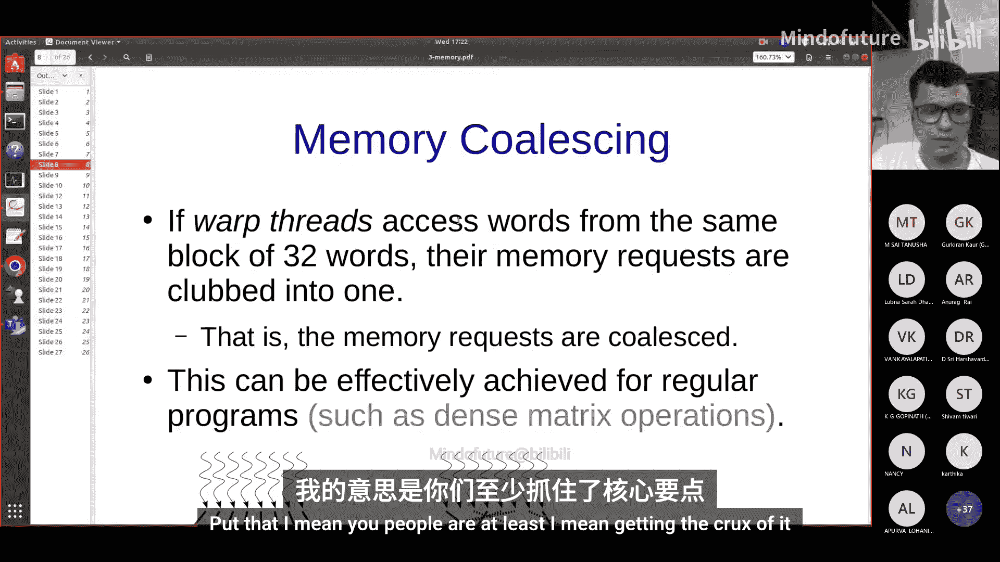

It's coming。Getting the drugs of it so。So like here is。It's unpoed maonics， but partially， I mean。

 it's partially unpolied because you can see that thread。

 one coorinator are still accessing the word from the same block of。Restall， I mean。

 not accessing from this block of。There are some heads， which are。Accessing it。

 so it's the example of partially uncoaled ma or partially coalesed memorym in either way you can see。

Okay， that's good。 But let us come to this example。 if you see this example。Can you tell about。

This kind of memory access， is it completely unpolied memory excess or partially uncoced memory access or completely coaled memory excess？

Just think about this and please put your answers in the chat。Wait for a few seconds。

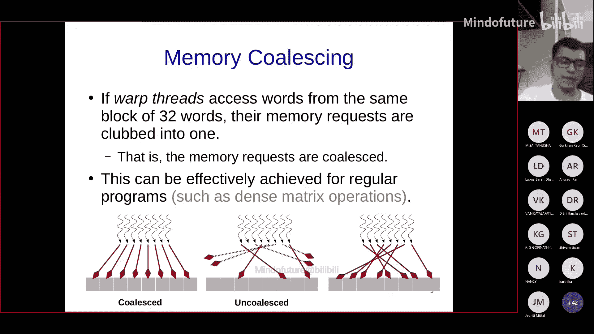

You go back。P whom we saying complete coalition。Compte police。Any thoughts by other people。

Other people think about it。Apart from this street， warun。必ish guess。I guess。Yeah。Anyways，Ya。

Tes and telling。Okay。

I think people are getting it correctly， so。This is， again， the example of complete whole memory。

 because let us understand why， because even， I mean， even the warlets are accessing the。

portraits are accessing the memory hireyy。 if you see they are accessing the memory ereuly， but。

The point here is that they are accessing the memory， I mean。

 they are accessing the memory from so they are accessing the words from the same block of 32 words。

Assuming that this is a block of2 doors， they are exceeding the。Words from the same rock of。So again。

 yeah， if they are accessing the words from the same block of 30 words。

 then heads are their definition of co memory co。And hence， the warp threads。

 these warb threads are accessingly a marinecomp and fully coalesed manner。So okay。

 this is the example of full complete memory quees。 and again。

 this is the example of complete memory que。This fall an under partial。

Partially coaled or partially un coaled number excess。O， I。

I hope that this slide is clear and there are no further questions on this slide。So let us move on。

With the next slide。hello。Hello。Yes。

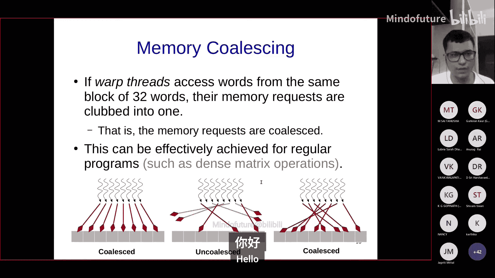

已已边已已边不。If that block contents more than  cut2 words。We need to become。Hello。If they block onto more。

 then happy it to work。是。But there are contents。Weever only 32 words up their blood who be con list。

If there are more than 32 words which are being accessed by that， then it will be uned。So。

 let us say that。As I told that， word sizes。4 bys。 But in some applications， I mean， for some case。

 like， let's say you are declaring the。Okay， so let us say that you are declaring the error of doubles instead of integers。

 that is double will need8 bikes， right， instead of four waves。So in that case。

 each and every error each and every thread is accessing the error element。

 which is of eight pipe and which consists of two words， eight pipes of two words。And it will need。

To access， if you are getting it properly， then it will need to access22，32。 sorry2。

2 blocks of two blocks， each of 32 words。If you follow that are factor error example。

 area of5 equal to 03。So I hope that's clear。 if， if it's more than 32， I mean， it's。

 if it's going beyond 32 words， then that will become。Unpoed。

 as well as it will need more than one memory fetch one memory operation。I hope that's clear。See a。

Okay， anyways， there are any further question， then please feel free to。And move then ask。Yeah。

 I'll go along these slide。

あ。Okay， so I hope that。Till this point， we are clear。 and let's move on。

So let us now see the example for， I mean。An example， poor snippets for each and every the case。

 which is completely coolist。 Second is partially coolist or partially unpoist。And artists。

Completely unpoed。Yeah， so let us see the example for each and every。So for completely coaled。

 I've already gave you that example， right， that if era of Id equals to 0。

 like we are passing the area to the G end。In that di， you want to initialize each and every value。

 each and every element of that di you see。And that's the example of completely toiletless memoryex。

 So A are of Id close to some。Right inside that we some operation we are doing。

So each and every element will be each and every thread will be accessing the con element of the air。

 so Fred zeroro will be accessing this。Zth location and third one will be accessing first location and so on。

 so。Exses are completely coalest， in this case。And yeah。

 so that is typical example of completely coalless normalex。啊。Yeah。

 but now let's come to the second case where the memory exercise exercisees。Completely unpoed， so。

I request each and every one of you to try writing the code。At least a small snippper of cord。啊。

In which the memory exercise are completely uned。Exactly opposite closer to this。

 Like we are completely coist。 you want to write the code corresponding to。Appfflic， I mean。

 corresponding to the case where memory access are completely and police。

 I'll wait here for a few seconds to cry out for。

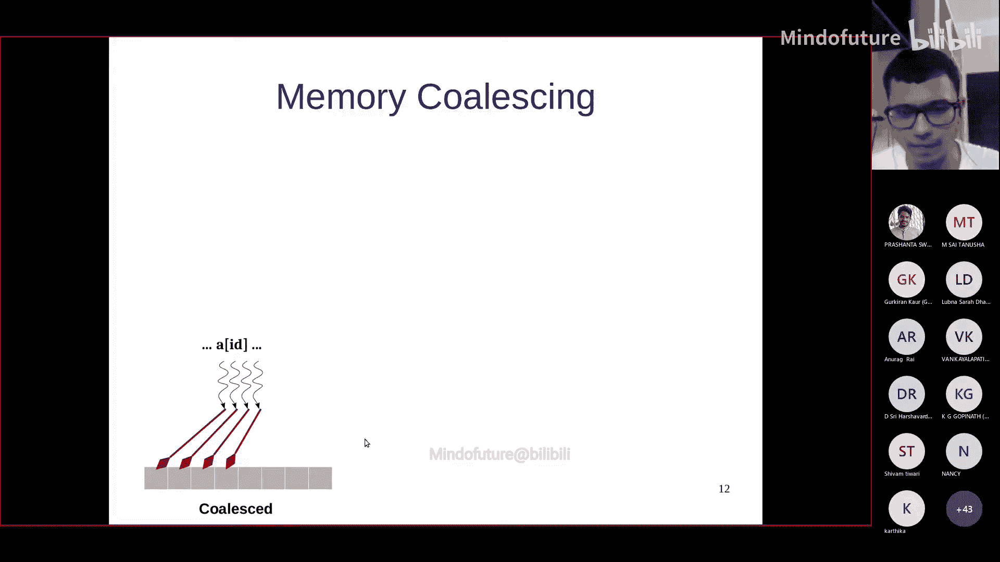

でことち合先です。Yeah， please try out。Case where memory excesses are completely unpoed。T the quoteniet。

 corresponding to that and。Once at least some of your client will look into the court。对。Com百限こた howす。

At I also get people can at least get some idea out of it， like how to do that。

We went here for few seconds。

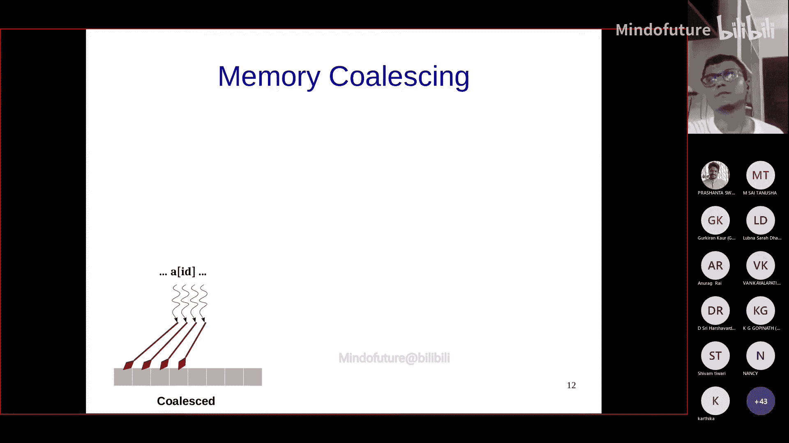

Okay， if you're using big area of log log。Oh。Not really sure about the size of that。原告当你。

Assuming that size of the long， long， I mean mean， the amount of memory it takes to store a long。

 long h inside a seat。Yeah in C is less than 32。 Then in that case， also。

 the excesses wont be completely unpoed right。Because there will be at least two threads who are。

 I mean， if let let us assume that size of long long it is 16。16 bys。

 Let us assume that I mean in the go case。 then in that in that case。

Firstt third will be accessing that。16 by Second will be assessing that 6 another 16 by。

 which again falls into the same block of 32 B。So， I don't think that。You're saying big at it。Long。

 long name。Pro I but think the rest of the war should be going little biter。 Yes。

 rest of the war will be going beyond those block of 3 words， right， But is it completely uned。 when。

 when the excess is completely uned。 Let me clarify this。

Excess is said to be completely polishlished but。We need one。Go back to this。

So if walk threats require 32 memory cycles。One memory cycle for each thread。

If one memory cycle is required for each stretch， there will be 32 memory cycles required for the entire work in that case that I mean。

 this is the worst case right， So this is the example of the。Unpoless memory access。

So you should write your。Bold or snippper that you are designing in such a way that will cut to memory excess for the。

AndSo the maybe。Yeah， this point。Yeah， so maybe if so in this case what we need to do is just increase the size or still like a different to it。

So we can go like time long long inter。Keep going like that or Yeah， I got， I mean， I got your point。

 But instead of just changing the data， can you do something else。Let it。 I mean， let。

Let let it be right。 I mean， go if it is long， un， long， long inter。In。

As long as you are accessing some word， which is outside that block of capital。

Can you do something such that you are accessing that。Ex okay。

 so if one workcr is accessing somewhat from that32。Sorry， block of their 32 words， another thread。

 another thread in the word should not access the word from that block of 32 words。

Is the functionality that you want。One way to go with it is the way you like。

 we you just keep on changing the data types。But yeah， that is okay。Can it be done in a better way。

Lettistic， I mean， just let us go within。And if we want to。我同。wantant to access more。 I mean。

 we want that block， then how can we。Just be。

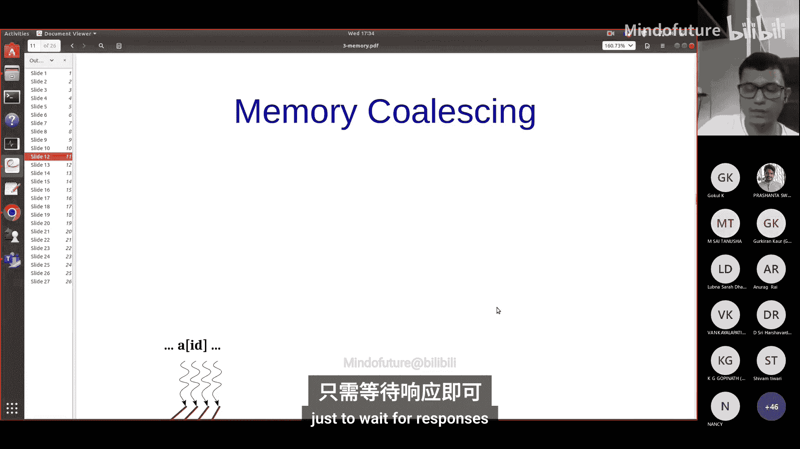

Even if you are running。Thats Frank。That's right。So maybe we could have like an array notice。呃。

Inter that is having eight different values in it and like that we will have 32 different arrays and we will just address the base address of each array a that process。

Yes， that will probably work， but 8 will not work in 832， because。

One integer takes four bytes and four bytes says one word。And in each block， there are 3 two words。

 So we'll need to access in the hops of 3。So first threat， I mean， third with I0 should access the。

Some element from 0 to 32。Then the next thread， which is third one should not access anything from0 to 3 fact。

Any other threat， apart from0 threat， should not access anything from 0。I hope that's clear。

 And all other threads should exist in that hops of。

 That's the case then we can as you see how to do that。waitingaiting for been waiting for some。你百。

This is the question for computing the I uniquely。Okay， this big area of long long and。That is。是我。

Calculating the I in the way where。You're going along the blog dimension first， and then。

Rather than going within the block。In sense that you are multiplying it with a three dimension and adding the block dimension then。

After the first ride， you will go directly to the next block。

And then I come to the next block and then again to the next block or I better ways if we initialize something with like n comma one。

 the kernel there。I got it properly。 That might work。But， yeah， I mean， that should work。

 but I think。This will get slightly more complex， but anyways， I think that should work。

 I mean this one will also tie in 3。We're just talkingping country bit。You are just hopping by 32，32。

呃。In the， in these steps of 32。 So I think this will also work。And in发。Thet。So could be also， like。

说要有。So instead of actually using like all the threads from。

Each block would be like have like a bunch of blocks and just like。Use1 third8。

From each will be called uncoesed or。So if you're just accessing one。

 one thread and performing operation with it， then。In that case， in worst case。

 you need one memory operation， right， because you have just one。So yes， but different front what。

 Yeah， but， I mean， I， I already told you the start of the lecture， right that。

This memory cocing concept is only applicable within one。Across the work。

 there is nothing like bullet。So。Will this permit accessible。Within the world， I hope。

 So that's clear。Okay， so let us go to this slide。I think probably this last two things。Might work。

 but I need to check whether it will work or not。

Yeah， so let us go along these slides and see how it can be done。

So the one of the way in which this can be done is this。You can see this network， right？So here。

 please observe customercard， please observe one thing。This junk size variable。

This chunk size is the variable， which is under the control of a programmer。And。

And he or she can modify this modify the value of this variable to make the coalescing， I mean。

Change the amount of coing。 So if this junk size is 32。Then we'll see that if this。

 if this chunk size is set to cut it can it will to completely unpolish memory exist。

How let us understand with step by step， so。Let us review war threats whose ID goes from 0 to 31。So。

 yeah，330 to her side is going from 0 to30。Chunk size is 32， as I stated。

 for completely unpoless memoryx， we want to check what will happen。 So chunk size is 32。

And if that's the case， then for first for the zero thread the thread having I0， what will happen。

So start will become zero because zero into something is0。And will become zero plus chunk size。

 which is 32。So and will become pretty。And this loop will go from start to end。Expluding that。

 So if the snow will go from 0 to 3。But threat number one。

 what will happen the start will become 32 because one into 32 is 32 and will become 32 plus 32。

 which is 64。And for the first， this group will go from。32の63。And so on。 So if you see。

 this is the pattern，0， third access these array elements。0 third exes。

 These are element from 0 to 31。 first third ex。 These are elements from。13 to2 63。 Second。

 the third having Id2 will access it from。64 to 95 and so on so if you see the first thread is accessing the first 32 elements。

No other third is touching their target dwell。If you， if you are getting it properly。

 the track number one is only working10 to 320 to 31 area elements。

And that exactly forms one block of one block。30 words and then no other thread from the what is touching them and similarly for the thread one。

 thread2， thread thread3 and thread 31。So I hope you' are getting this。 So if that's the case， this。

If chunk size is set to 32。Then in that case， you will be getting completely unpoed memory access。

And I'll ask you one。Another question， I'm encountered question to this thing。

 What will happen if I set chunksi2。And I said Jhangsi to。

How many memory excesses will be required by warm threads。

How many memory exercisees would be required by objectss for accessing this？Okay。

 I think it should be now very clear to building if chunk size is too。

 how many memory exercisees will be required to access this is my question。We here for。什是电峰。How。

 how6。How is66？Okay， anyways， I mean。If you feel that something and when you're proposing some answer。

You should give some。What I can say， you should give some convincing argument related to the answer so that others can understand why you're proposing that solution。

A sort of like。Earlier， we did like increments of 20 to no。

 So like because we are doing increments of2， if we do 16 so 16。I am still be do。

I don't think that will happen。Okay， let me see what others are。

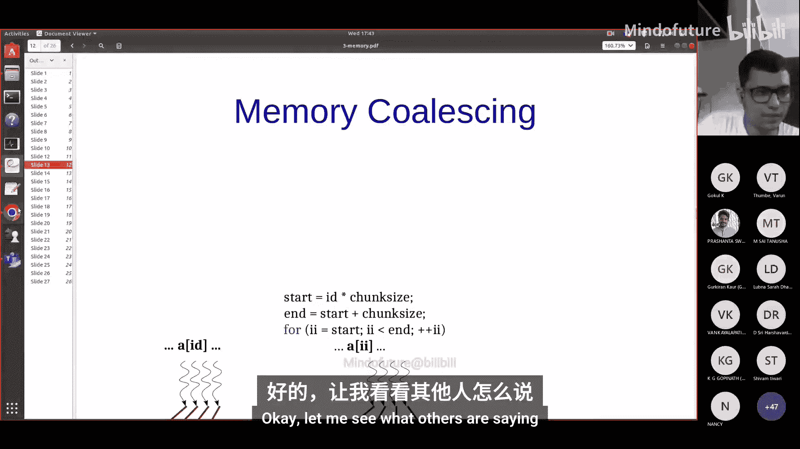

I think others are getting。correct me， but don't worry when if you are doing wrong answer。

 that's not an issue understand。We understand step by step。Yeah。

 so I think we own is getting with the。Correctly， was 163 goalest to the next 16 year that that's correct。

OkayAnyways， I think people are getting it， so let's go back to this height understand what's high。

So when chunk sizeizes two， let us understand what is happening。So yeah。

 let us come to our bar only 30 to3， each having I from0 to 31。And chunk size is 2。

 So what will happens this Id for this0 thread will be 0。 So 0 and 22 is 0 and is 0 plus 2。

 which is 2。So first threat will go from 0 to 2， exploding  to。 So 0，1。

 So this and this memory location， this two memory location。It be accessed by zero threat。

1040 past third。I is1， So one input two is2。2 plus 2 is 4。 So from。For expic for。

 because this was less than， so。2 and three memory locations will be accessed by the。

Third with I1 is two and three w locations。And so on。

 the thread number three will access four and five thread number four will access5 six and7 and so on。

 this will go on So if you see。First 16 threads will be accessing the ports， which are indeed the。

So first 16 threads will be accessing the words which are in the same block of that。

And from the 17th thread on words， which is having IDS 16。So threats sending Id from 16 to 31。

 which are rest 16 threads。They'll be accessing the。De cards from the another block。

 which is not this one。And。Their excesses will， again。

 will be written from the same block of category words。

 So exactly two memory excesses will be needed。And yeah， so that is what is the answer。

 So exactly two memory request been the chunk size is2。

I hope that's clear if anything is unclear at this point， that is。

We can unmute yourself and ask or just put your question in chat。 I'll take that look。

This is important because this polishlicing aspect is。不行了。

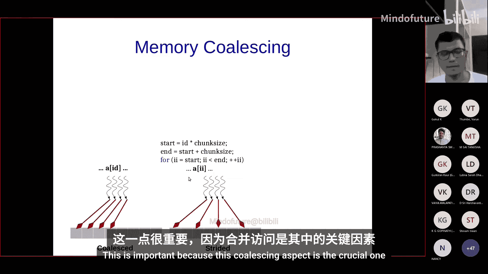

Its good as Sir。Yeah， please hello。So instead of this quote snippet， if we write error ID plus 32。

So will it be completely unqualed？A of Id plus 32。 where you are telling here is at this place。Now。

 instead of this entire code snippet， just I am taking A ID plus 32 in each thread。

A R of I D plus 32。No， I don't think that that will be coalist。 Let us understand why。

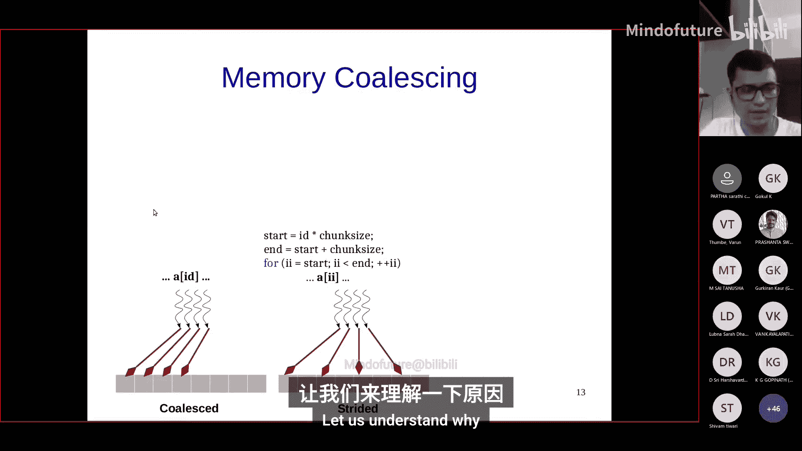

喜完过节。No， no， Yeah， it will。 It wont be un goalless。 Let us understand why。For this zero thread。

 it will be 0 plus 3。For the first third， it will be one plus 3。And so on。 for the second third。

 it will be two plus 3。And if you see this， again， again。

 this excesses are from the same block of 32 words， the word that is starting at this 32。 I mean。

 you can ignore think constants， right。If you see this， if， if the word starts from 32 location。

 it's 0，1，2， and so on。 It's the same thing。 I mean， again， the memory exercise， I got it。Yes。

 I got it。 It will not be the it will not be the first b， but another b。

 but completely me quality Yeah， completely what。😊，Yes， sir if any further questions。Sir， each block。

 we said like 32 white steps。 would that always be like constant for the hardware or。No， no。

 that's I actually gave that example， right， that for integer， it's。

 it's the case that the size of that word。 I mean， size。

 we say that size of that word should be  four parts or 32 weeks， right。But it's。

 it's just the case with integer because integer needs 4 by or 32 B on the hardware to store store that in into variable。

 But for case of double， you'll need 8 by。So in that case， it might happen that you need。

2 memory exerciseide， because in that case， first 16 threads will be able to access the。

Awards from the same block of。I hope you are getting， because we are now。Using double。

 which takes8 vi。 And if， if that's the case， each， each element in the array needs two words， right。

 to， to store itself to store that element。And if that's the case， the war threads what need。

Me access。 Even though the excesses are like。E out of 0 equals to 0。 Ya out of1 equals to 1。

Even if the excesses are like this。But if we are using double。Instead start of it。

Then it won't be completely coolish because because of the size of double。

So we'll need to access this there。And it won't happen each and every time that。

I hope that you are getting that。This board sizes。W size is matching matching with our data type size。

But from hardware size， it is a hardware side， It's always fixed that the board is 32 B or four months。

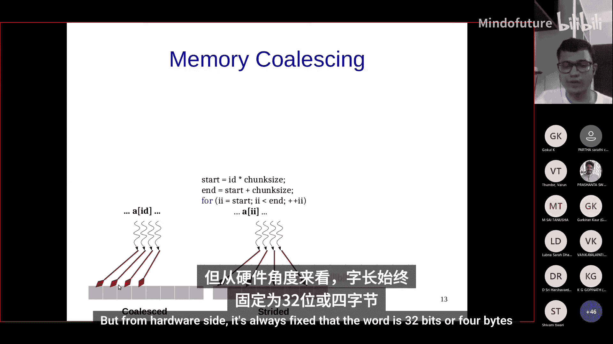

Ho that is clear。Just in case I missed anything。Then。Go further and， and， unmute yourself。

 and ask further。Yeah。Hardware side， it's fixed， but data type side， it's not fixed。

Okay， I think。There are no further questions from at least this part。 So let us move。

So we saw two examples， sorry， in fact three examples we saw first one was completely pooresed this one。

Second is completely unpolish one， chunk size is 32。

That will be the example for completely un goalest and the third one。

 which is partially uned or partially coolest。When the chunk size is too， right， when chunk size is2。

 they are partially Po memory exercise because well， as， as we saw that we know two memory exercise。

So we saw three examples， complete coist， complete and coist， partially coist。

And this way of accessing the ER is also known as strideed way of accessing because if you see。

Thread one is accessing some elements， then threat2 is accessing some elements。

 and that is the pride， right， this pride of two。And this is the pattern in which the elements are being accessed by the air。

 So this chunk size determines the stride of that excess pattern。I hope。And at this point， we have。

Now， third thing is the surrender axis。So let us understand this random access properly。

 So whenever we have this this form of access where。We have this ID。

 which is unique to each and every thread， as we know。

Then we are using the side to get the value from some Eric， which is known as input。哎。

Whatever value we get from that。I， I mean， input of I。

We are we are using that value as an index to that array。In that case。

 it completely depends upon the way the values are storedor input。I mean。

 the access to the area will completely depend upon the。

The way the values are stored is input direct。So it might happen that some of the memory exercisees are oiled。

So I'm not cool， but some of the memory excesses are falling into the same block。

Other memory exercisees go beyond this block of 30。 It completed。 It points upon this input。

The way the values are there in this input。In go to Eric。So yeah。

 this is the example of random access and this randomness comes comes from this input area。

And you might think that where these things。And where this type of exercisees are being done。

So a typical example of this type of excesses is in the graph algorithm。So let us take the example。

 one of the example of graph algorithms， let's say BFS。

We are canvasising the graph for let's say SSpy singles were shortest part。

And that is what we do is like we want to traverse the graph。

 we want to find the shortest distance from the source。To the syncs in case of preism。

So what we do is， this is the normal operation that we're do in such algorithms like like tripospy。

 What we do is。WeFor a vertex， we go through all its neighbors in Trispy， we do that for the vertex。

 we go through all its neighbor。wantant to know the distance of their of our neighbors or sorry。

 the neighbors of that world。So this thing is very similar to the a。For a vertex。

 which is handled by a particular thread。 So thread Id is handling to vertex number Id。

So for that vertical vertex， which which is I as this I card Id。

And we want to go through all its neighbors， so this input represents the list of neighbors so to we are going through the neighbors of this vertex I。

And， we are， we are taking its distance out of it。 Like let us assume that this array A。

Is the distance error， which towards the distance of each agreement。 So for a vertex。

 they are going through all its neighbors。Getting its distance。

So if you say this type of random competition， random random access is。Highly possible in graph。

 typically the SSs for example， than I。And even in BFS it happens right， for the particular vertex。

 we go through all its neighbors and we probably might need some information about that neighbor vertex。

Which is stored in sum many。So。Yeah， so this random excesses are common in graph algorithms。

 And if you see this random exercise leads to。Unpolish memory access。

So at this point that you should work here。Okay， any questions。AndThis point。

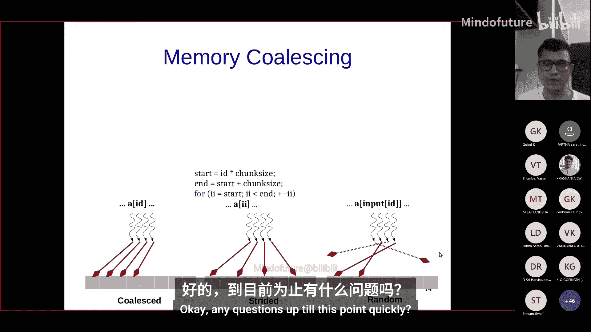

，Someone is saying， instead of addition， I guess multiplication can do the job like。

Is multiplication can over reach up。 In fact， someone even suggested that。Yeah， this one， I D into32。

 I guess this will also work。Because of tests rembling0 be 30 to then 18 to 30。So。Into32 will work。

 but plus 32 will again lead to fully coalition number excess。I hope that time here。Another thing is。

 I'm hoping that there are no questions up till this point， so that。That's the case。

 And let's move ahead with sides。

Okay， so this was about this Poest， unpoed and partially coalist memory excess。Okay， so I think we。

 we understood the things up till this point。 Now， there is one more question that I wanted to ask。

Let is say we have this unpolish memory access right here。 Let's say chunk size was 32， right。

 We understood that chunk size is when chunk size is 32。Will have completely uncoless memory access。

Let us say that we want to access this area in similar manner。 It stride and manner only。

In these stride of3。That is assume' that we want to maintain that thing。

 we want to access the arranged strategy， but still we want to get the coalition number access。

Then my question is， how can we get that poorest memory access if we want to still get that poorest memory access。

 even the access pattern is right。Can anyone point out some way in which we can do that。

I hope that the question is clear。De the question。 Let us assume that the stride and memory exercise is still。

 it still holds that you want to access in stride manner。Still we won the。

Mymbody access to the poet is。 Then how can we get。That's my question。 I'll wait for a few seconds。

 then we'll。Just giving some time for you people to think about。

Just think about it and post your answers in chat or unmute yourself。Say， what do you think about。

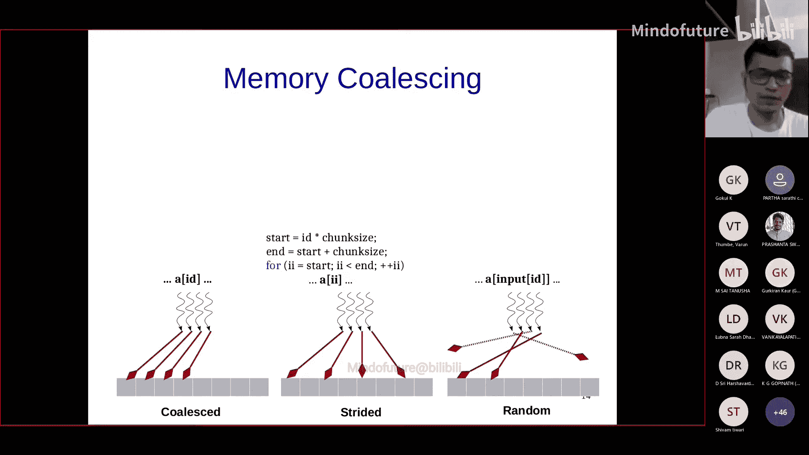

啊。Think there are no responses。Okay， anyways， I hope that you people are trying， but。

Let us go ahead with slides。Reduced。Sa。Reduccing the number of access。Okay， I mean。

 it is not this solution， right， I mean， we just。Each time to do some work and reducing the excess。

I think a proper solution for it。Success can be done evenly or oddly。

I think so this might be the case， but。やりファもなんですね。And your artery， how， How can you do even to。

I think this might work。 But you need to specify what is evenly， what is audience and what。

 what actually is the access button that we'll be using。Okay， anyways， let's。That to this helps。

 I think we might run out of time， so。

back to decide。So okay， let us assume that we still want to access the air is strideed manner。

 So first thread will access from access the elements from 0 to 3 but second thread will access from 032 to 63。

S one。 So started access button。 we still want。This will lead to one coalition motor excess， right。

 as we know。But if we still want。If we still want to make it goalless。

 then what we can do is we can just。But1， one thing that we can do is we can just rearrange the values in this area。

But the way we should rearranges like this。 So to make it completely coolist。 What we should do is。

We should take the first element， which will be accessed by the error 0。 first element。

 which will be accessed by error1。Post element， which will be accessed to R and so on till the 31st A。

All the first first access of each thread， we should take。And then and then put them together。

Put them together at the start of the year。Then in same manner， we should take the second element。

 which will be accessed by the。That number 0， Second element which access by the thread 1 and so on。

 is the threat3。And place them after the， all these fast excesses are， are getting finished。

Then we should place the second the elements which will be accessed by these thread elements。 sorry。

 thread threads secondly。 So in that way， we should arrange， I mean， rearrange the values so。

I hope you are getting it。 So entire。A values in this area will be getting rearranged。说的。If you。

 you want to access the first element of all these threats。

 then will this access pattern will become like this。Because now all the first。

 forced excesses of all the threads are together。So they'll， they'll be accessed like this。

 Then all second accesses are together。 So they'll be accessed in the same manner as as cost accesses are being。

So。So one way to go， I mean， one way to one way to mitigate this issues is or rearranging the values inside this area。

The hope are getting。So with， so with this， let let's move further。

 Please keep this in mind that I told that we need to rerangech the values。啊。And this。

 this rearranging thing that I told that all the same attribute groups。 So here， if you see the。

First letters says in that first access or the first。Think that each thread。

Of this each what threads are accessing represents one attribute。 So this is first attribute。

 This is first attribute。 This is first attribute。 This is first attribute of a particular。

And then this， again， is a secondary book。Then this， again， is a secondary group for that particular。

So what we are doing is we are group a particular attribute together。And such kind of grouping。

 I mean， or such kind of way of storing the data is not a structure of errors。

And we'll look deeper into what is the structure of areas in today's lecture。

But if you see if we arrange our data in that way。Then you can clearly see that the ma excesses that will need。

The memory that what threads will be。To have will be completely coolist。So yeah。

 so there is definitely a benefit of having structure of airing instead of this thing stride at access。

 so when we use structure structure of fers， the axis will be completely coalesced。Aposed to this。

 there is some second thing also， which is area of structure。 Okay， so first of all。

 this structure of error is good for GP because there is complete coalescing happening。But there is。

 again， second thing， which is。Area of structures。 So think of area of structures similar to this stride access。

 So each thread should access con elements of each chunk。

 So thread one will be accessing 0 and one memory location。

 T2 will be accessing two and three memory location。 So that is something stride access。

 And it it is actually very similar to area of structure。 We see。

So this thing have advantage on CPU because if you see whenever this one particular thread on CPU will access this。

Due to caching different， all the elements which are after this will be bought into cash。

And since this element is being accessed， all the elements after it will also be accessed by that thread。

 which will be， which will be actually the case for started access， right， you can see from。So。

This strideed access is actually， I mean， which is also known as errorial structure。 I mean。

 the way it is stored is similar to error structure。Has benefit， I mean。

 it gets performance benefit on CPU rather than GP because of something but as because of this locality principle。

 which we studied in the previous structure。So that's one thing。

 So areas of structure of this standard access button。Thiss better， but this structure of error。

 which we'll be seeing both both these things we'll be seeing is something which is done on Je。

 which gives better performance compared to these structures。

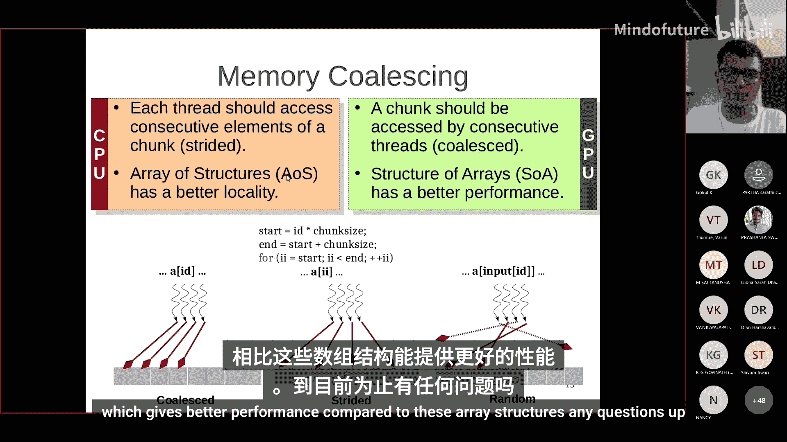

Any questions up to this point？

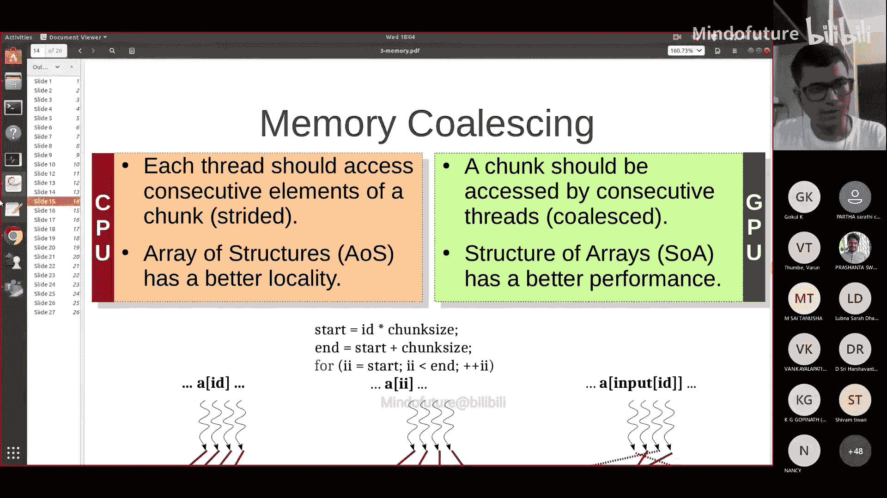

Okay， I already give you that example， right， that area of5 equals to 0 initializing all the elements of that area to 0。

So。

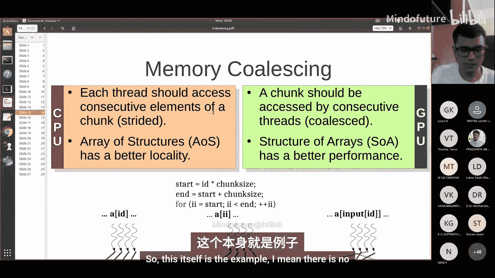

So this itself is the example。 I mean， there is no， I haven't written it completely。

The computation of Id and the kernels signature and all those things。

This is the typical example for complete tolerances。

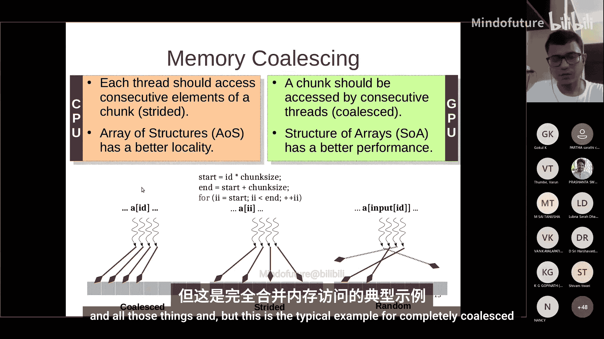

I hope that it's clear for you harshish。No。Okay， fine。 if there it is， then let's。Move forward with。

Our discussion of area of structure versus structures area。

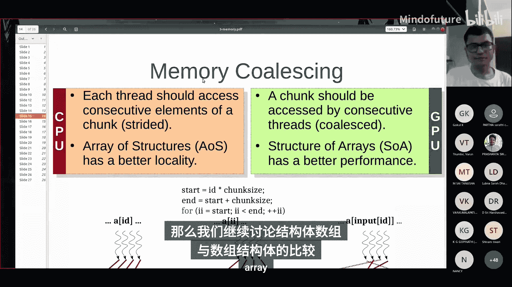

Okay， so let us discuss about this area of structures and structures of area quarter。So let us say。

 let us say that you have some linked linked to data structure。

 something called sort of linked list or something like。

And you want to store the you want to store the information of the entities inside that nuclear structure。

And for doing that， what you need to do is first you need to define how how the basic entity of that structure sorry basic entity of that linked to data structure will apply。

 which is defined using something called a structure in C。So。So this。

 so there will be the area of this， this type of。Let me put it like this one。

 There is this structure， which is this attributes gain a double double B and charge C。

 is character so。Oh。Okay， so yeah， so these are the attributes of that particular element of that linked to data structure。

 and we are declaring the area to to create that link data structure and each element of that linked data structure will be of this type。

This。No， I。And yeah， so let us see， I mean， let us put this with an example so。

Let us say that you want to store the detail details related to the students。So how。

 how can you store that， You can do something like this， So you can declare structure structure。

 which。But you detail out the information about， about each student。So first。

 so here you can store the attribute of students。 So first attribute might be inroll number。

 So it stores the roll number of the student。Then double marks， marks corresponding to this student。

 and then character character and the name corresponding to that student。

So all these things you can store。 I mean， those are the attribute of the tool。

And then to store the information related to the multiple students。

 what you can do is that you can declare the area of such students。And each student， I mean。

 each element of this area would have this entry ABc， which is role number， marks and name。

So we are declar area of students， where each student having is having the groups。 So this way of。

Declaring this way of declaring array using this structure is called us area structures。 If you see。

 we are declaring array where each element of the array is structure。 So it array of structure。I。

 I mean， okay， let' move so。So good thing about this okay。

 good thing about this Arab of structure is that。It gives performance benefit on the CPU。

Ca we already s the grid slide The reason， but this is already covered in the grid slide。

 But let us understand it utterly here。So when you have this area structure。

 it gets performance on the CPU because of the locality。Better locality， I mean。The locality。

 which is being exploited in better manner in this data structure。 How let see。

So when a thread accesses a attribute of the node。Please note that attribute is this role number or。

Marax or this。Name of the student when a threades an attribute of a note。

 So let us say a thread has executed access these。Attribut role number。

 then it will also access the other attributes of the。

 So that thread has executed access the role number。

 and it is likely that that thread will also access its marks and the name of that student。

 And if that's the case， it will give benefits on CPU， sorry。

 it will give performance benefit on CPU， because because of the caching。

 So whenever this role number is what。This marks and。Markax and name corresponding to that students。

 The student will also be bought into the cache。And hence the hence。

 because of this locality principle。On CPU， well get significant performance benefit。

On GPU this caching effect is there， but as I mentioned in previous lecture as well as in this lecture。

That caching defects are not as prominent on JU as。That those are their own CPU。So on CPUu。

 we get better performance for this type of AOS data structure， which is area of structure。

 data structure。Then on Je， That is one thing。呃。In order to exploit the performance， I mean。

 in order to。Get better performance for such type of。 I mean， let's。

 let's say we want to perform such type of operations on the students。Students that。

So how can we do it on GPU so on GP we need to export something else and as we all know that something else is the memory violation。

So， how can you。Access this kind of thing。In coalist manner。 So for that。

 there is something called a structure of aries。 And the way the structure of A is done is like this。

So instead of storing each attribute in in this manner。

 like first So here the storage will be like this。 So one element of the area will be having AVs。

Another element of this area will， again， will be having its ABC。So if。

If one thread is accessing the。Roll number of that student。

 And another thread is also accessing the roll number of the another student。 Then in that case。

 the access will be straight， right， because the roll number is here， then。

Between that roll number and， I mean the role number of that student and the next student。

 there will be this。Name of the first student and the marks of that marks of that student。

 So this is something a sort of a stride access for the gym。

And as we saw that stride access will give some， I mean， performistic gra。

 because memory coaling is not being exploited。200% in that form of access。

So in order to make memory excesses completely coolest on GP。

 we use something called as So which a structure of hers。And how we do it， It is like this。

So here we are declaring Pri method that here we are declaring the area of size n which very element is of size or。

 but here there's just declaring one structure。For the all。

 all end students and how the structure of。For all insurances of。This， is like this， the。

We have these role number corresponding to all students together。 The name sorry。

 marks corresponding to all students together and the name corresponding to all students together。

Know what you see。If there are two threads or let's say if there are 32 threads and they are accessing the role number of that。

All 32 students， simultaneously， and the exercisees will be coalless because。不。

This it's stored in the area， right， So it will become something like this if we。It be like this。

Because roll number is an area， and it's stored in con location。 And each thread will be accessing。

 Each thread of the work will be accessing the。Partigous member location。

 which is the words from the same group of3 words。So， by story。Attributes in this manner。

We'll be able to exploit by poing。Hundred percent by this form of storage。

 which is structure of fairies。And。So， so advantage of this is when a thread accesses an attribute of a rule。

 Let's say that attribute is roll number。 So thread0 is attributing the accessing the roll number attribute of this。

Yeah， thread one sorry， threat zero is access access。P number at of student 0。

It's neighboring thread accessing the same attribute。 So thread when accessing the again。

 the roll number attribute of the。Student right。呃。If that's the case。

 then the same attribute of the next thread。 And in that case。

 the goaling will be better because both of them are accessing the same lock from that。

Same block from the sorry， same word from the block of 32 words。And yes。

 this can this can achieve up to 00%。My me is， I hope that's clear。 I was， I think I was but。

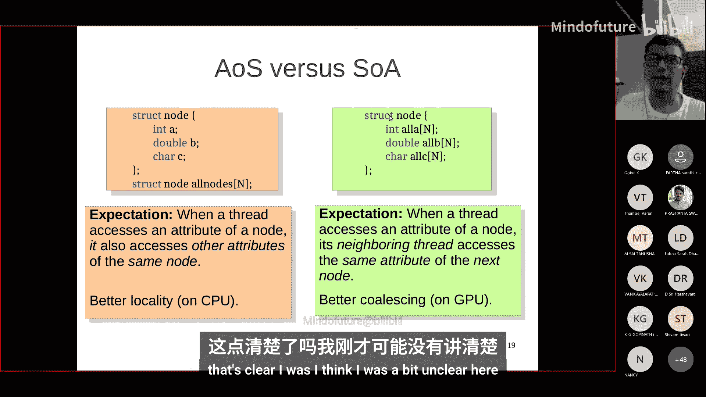

Unclear area， if there are any questions， then please feel free to。As for， I mean， unmuters ask for。

对跟你讲。I guess what 16 credit success。反正没死。I don't think that this will work。I hope that you are。

Telling this for that。How to get coalist memory access， even， even having the stride access button。

 I hope that this is the answer for。Any not table。Your cow in。I mean。

 use this even or the thing to get to this。Anyways， if you feel that。That something。

 I'm missing something yet and you cannot unmute yourself from ask。Yeah。Okay， any is Al more so。

When you'll be able to provide an example。Okay， I think I already took up this question。Yeah。

 any questions until this point？

On this slide。This is a。Very important concept。IfThere are any questions then please feel free to ask me。

Or area structure and structure，我 done for。Few seconds，45 seconds。

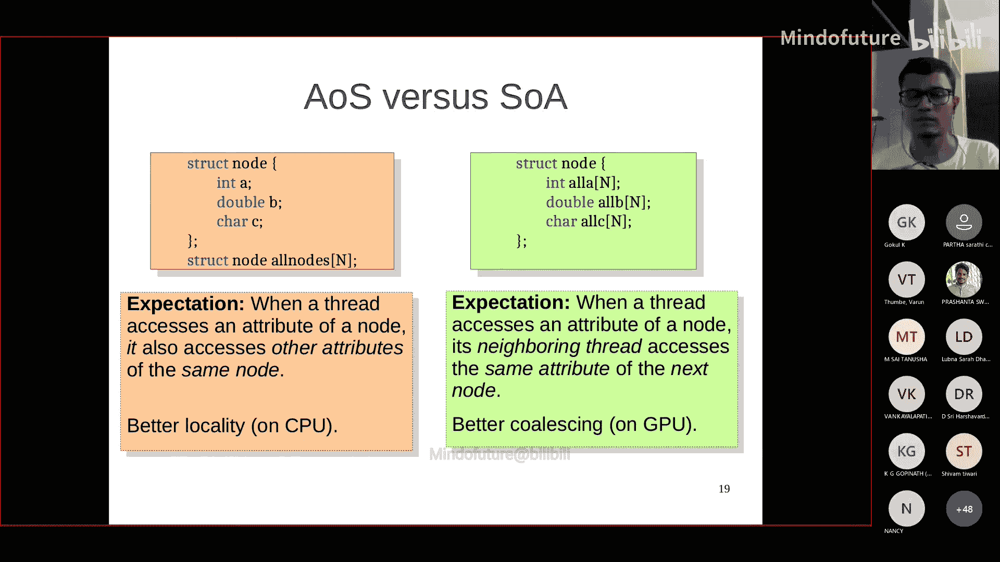

guessues there are no questions in that case。

Okay， let's move on if there are no questions。 I'm assuming that two people have understood what is。

Arr of structures， What is structures of error and why So， which is structure of error is。

 is able to get， I mean is able to exploit coalescing better than area of structures。

So the key thing or key takeaway is that area structures will have this stride access better。

 and this stride will be determined by the。Number of attributes that are there。

And in case of structure of error， we are getting fully coaled memory exercise because all these same attributes are together。

 So that's。Take away from this area of structures and structures of having。

So I'm hoping that you people have understood this。So。

Assuming that you have understood all the things。 I give small class。

To write the code for both of this come mean for both of this case。

 and you should it be able to use Uda M copypy to copy the data from CQ to GP。

Perform operation on such kind of data structure。And after performing the data， the operation。

 you should be able to copy the data from Se。And the actress request you to write the quote corresponding。

This。caseses。And yeah， for the GPU right， I mean， both of the code for the GP。

 So you need to write the kernelinel。You need to also decide how to copy the data。

 because we don't have just primitive data。 It's no， just。Something which is a user to find data。

So please think about it and post， post your answers in the chat。Wai here for few second。

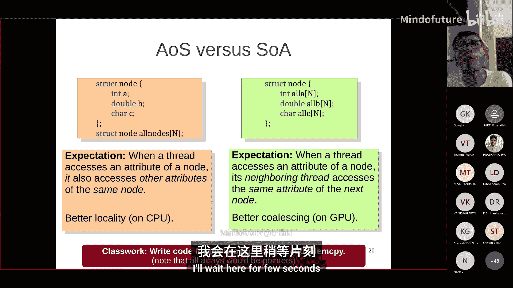

佢 go back嗰啲就。I guess there are more questions here。 Please feel free to try out。

I will wait here for a few seconds。 And if there are no， I mean， there are no responses or。

Then we'll move forward with the next。but please try out so that you can。

At least get some idea of how to do it。Benefits from ex。

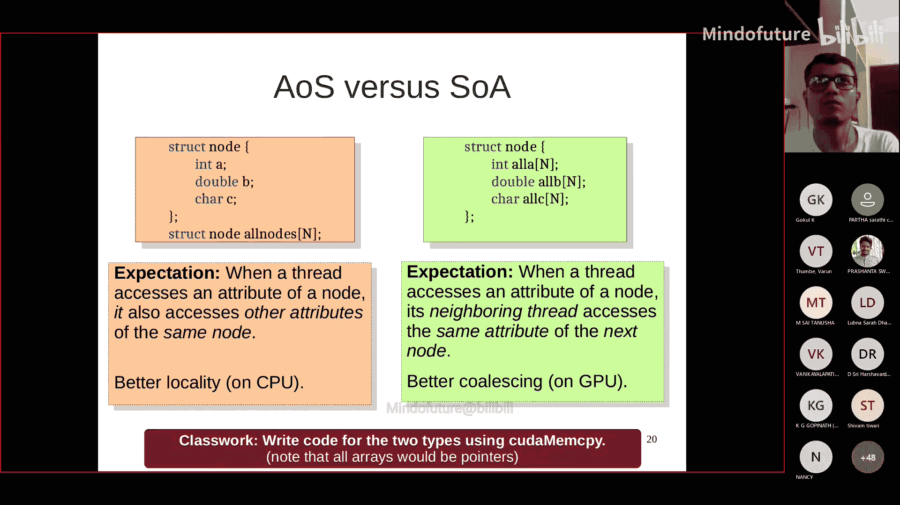

系。

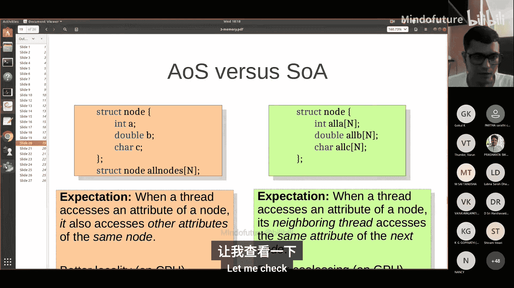

ok啊。Explain So once more so So is like， we are placing all the attributes， all the attributes of the。

Of the entity together。 So the role number are placed together in one area。

Name is placed together in Gu， then。Marks are placed together in binary。

That is the structure of ferries。And it is called structure of area because we have a structure inside which we have the areass to see。

Like this。And the key advantage is whenever a thread， whenever we have threads within the what。

 which are accessing the same attribute。Which is let's say this first attribute was rolled over。

 Since since we have， we have stored this thing in area。All the excesses will be contiguous。

 and they'll fall inside the same block of capital。And the power exercisees will be completely。

Willll be able to see some advantage because of this few this onzipu rather than this。

 because this is strideer。 and this is completely close。

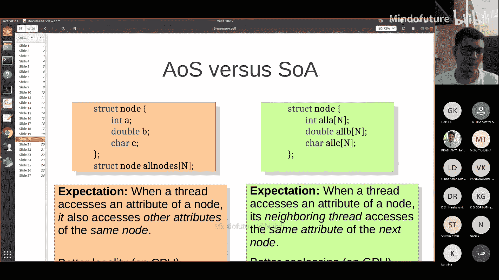

I hope that's clear meanwhile。

Okay， okay， then I think as we are running out of time。

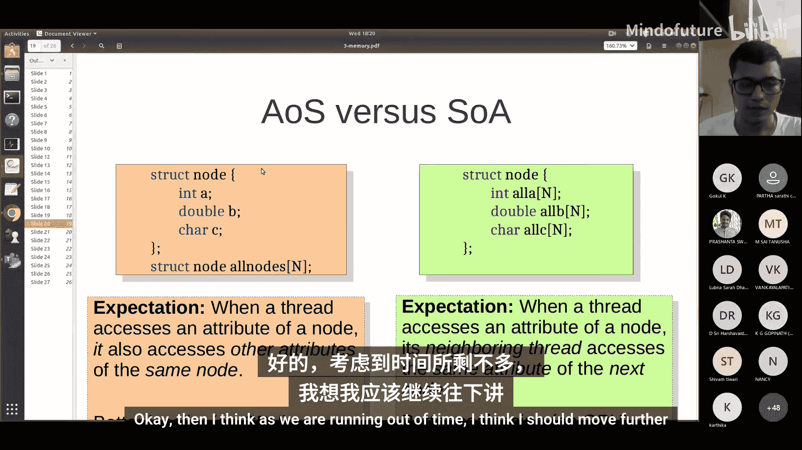

I think I should move further。Okay， so assuming that you have at least tried this。

 Let us go to the next slide to understand。How this thing works， Like。

 let us say we have these two types of。This two ways of declaring the data structures。

 how to access them on G Let us see。Wester方 나오。Then copy them and then access written at a series。

So let us say that you want to access area of structure on GP。 Then how will you go to access it。

 So for that， first of all， you need to declare this drug， as we did previously here， also like this。

Will need to declare this drug。And then we need to declare this pointer all node to us。

 which is pointing to the error。 I mean， this， this is just a pointer。

 which is pointing to the error。Which are having elements of type， no reverse。So， yeah， that's the。

 but that's on CPU。 So we have this point of pointing to the。Area of size， which is one city。

 but we need to。Declared the array of this type again on G。 So we so to do this we will do。

To declare to declare。I mean， to store， I mean to allocate the memory of for this。

 this type of element will do any to size of node， node As。 if few people know。

For allocating the memory for structures， we do something like this。

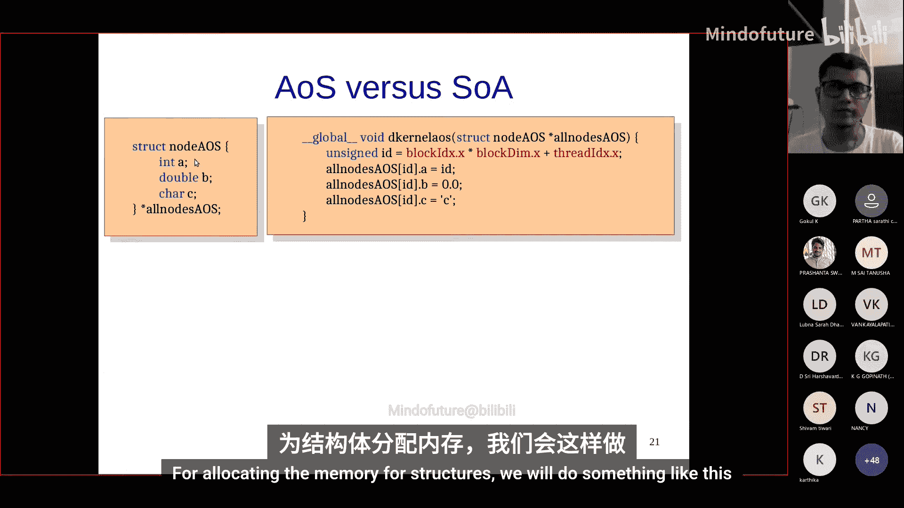

回单班吗？s咗。ThatWhatever that structure is， will specify it here。

So we'll need to allocate the memory like this。 Obviously， there will be a second parameter。

 which I'm missing here， but。

Weing to allocate at the memory。And then putamm copypy the CQ area into the GPQ area。

Once that is done， and we have pulled up the pointer to the Jeu memory location。

 which has been allocate will pass that。Pointer I mean， the address is in point and it would be fold。

 I mean pulled it here is this pointer。And then inside。

 we will just complete the idea as usual we do。And then， using the I will。

Access the each and every elements。 I mean， each and every， each and every attributes of this。

This adding。ItPlease not that this， this all loads aos is now on Gp。 I mean。

 it's responding to some Gp in location because we did codedl and coded on copy。And。Yeah。

 so this is the way in which we can access EOS1 GP。And if you see this is tide x right。

 because a threat having I0。Is accessing the attribute ABC。And if you recall。

 it's something like this。Let us say this this was attribute A and this was attribute B。

It's tried to access because C3 is accessing。A R emit the A of I D of a and A of I D of P。

 So you can correlate this with this。This thing。So this is private access button。

 This will definitely degrade the cocing。 I mean， we won't be able to achieve full coing。

If we use Es and to make metal worse， if there are more attributes。

 here just there are three attributes。 So， so the stride size will be。

But if there are more attribute， let's attributes， let's say 10， then stride， stride size will be 10。

 and that will significantly take degree the amount of coalcing。So instead of doing this。

 what we can do is this。Particular this structure in different way， which is node A US。

And each attribute here is the to the array。 So here array is this。But this is air。

 But now we are just declaring pointers。This quarter would point to the appropriate area and。

Once once this area want the appropriate areas on the CPU。

 you'll need to put a the memory for each of these three。

We will allocate the memory for each of these three and and will and then well be doing pua and copy for ABC respectively。

And then that pointers to those three memories， which are st at the starting address of those areas。

Do the tip you can here。And then we'll be completing the I。

And then we'll be doing a of I equals to ID and this all these things and one crucial thing to observe here is all the wt threads when they execute a sorry E of I equals to ID。

 this is completely cos because for the zero thread a of 0 equals to0 will be done second third of a of 1 equals to one will be done and so on so you can correlate this with this one。

A of0 equal20， this a of1 equals to1， e of2 equal2， and so on。So this is very much similar。Thiscom。

So。So this is the example of completely coalition memory access， so。

SoO will give you complete policy。The maximum numerical coaling that we can achieve for the water。

And this will give stride access so partial coaling， or even in worst case， it might give。

Comptely un goalistic。 There are a very large number of factors。

So this is one point to observe and if you time this code for the GPU I mean for this GPU kernels。

 if you time the this two kernels using I mean if you are declaring this structure and then you are launching the kernel and this is your kernel for both the cases。

 then you will see that UOS performs。I mean we are take 62 units of time。

 well that' why will take just 22 units of time and hence this performance benefit is coming all because of memory coing di。

So it's just almost three times benefit， I mean， three times performance improvement that we can。

Just by police。So this is a sort of motivation which we should use SOa instead of Ps when it comes to GP for CPU。

 A is but for GP S。I hope that everything is clear up to this point。

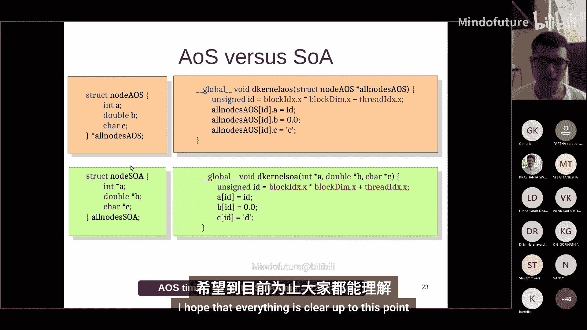

If there are any questions， I'll quickly take them up。

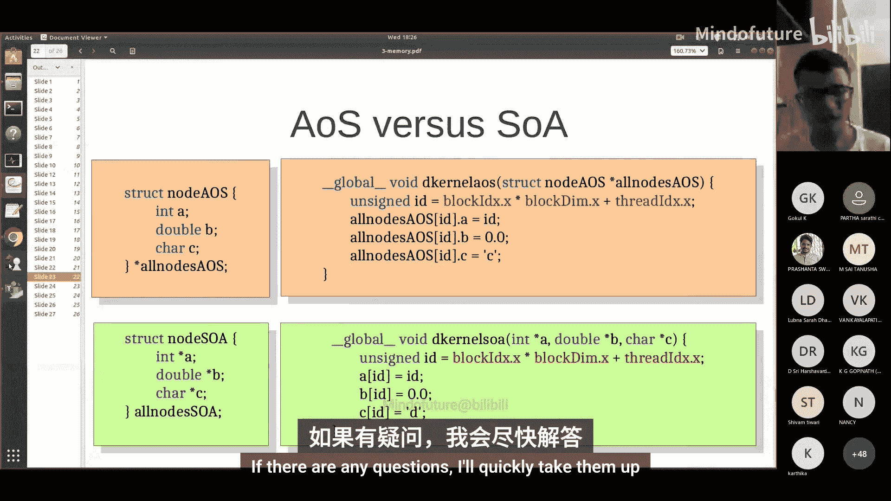

And sir this for a NorOA。

那就是。Yeah。Yeah， that not SoA， we have like pointers like A BM， right？嗯。So for those pointers。

 we will be having to do quo malloc and Pua Maac。First of all， you'll be doing Malocone CPU。 I mean。

 you need to allocate memory and CPU。 These are just pointers right。

 So you' will be allocating memory and CPU and making those memory point to that。

A memory location on CPU once CPU location is done， initialization is done， everything is done。

열비 되 로그팅 마 집 구。I hope that's clear and then once。I mean， once you are done。

 a location is in pua meo and you have stored the starting address in some point and we will be passing those three pointers which are stor which are corresponding to these three CPU locations to the GP。

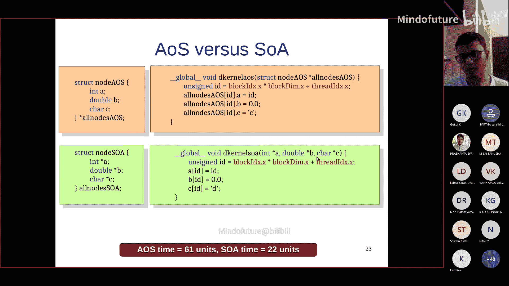

If that's unclear then， let me go to each chat。收。Okay， so let's say it was a。St。 I mean。

 please take out this data type。 This is something you study。Ting the precise thing。

I understand this。This pen in blue。Size。So first you need to do this to allocate the memorial CPU。

Once that is done and you have， let's say you have allocated and initialized the memory type now you need to allocate the memory in GPU also so。

For to go particularled G GPU area。And I've been the same thing。The same thing that I waited here。

This time it will be Ko am。Can please assume that I have passed arguments properly。

And then once this G is ready and you have mem copied quoda Ma copy， actually。佢有名多啲。呃。企业。

So entire AI is cop to G once this is done。So you have this now entire error on GPU。

 which is C you will be passing this pointer， which is pointed to GPU memory。啊。

Look here。We' passing it here。And yeah， then this point， I mean。

 it will content with the appropriate GP member location， then you can access the way you want。

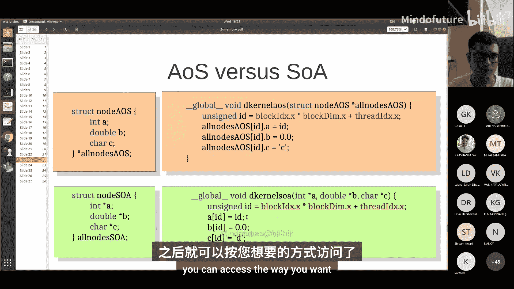

I hope that's good。If there are any questions， probably we have already reached the time limit。

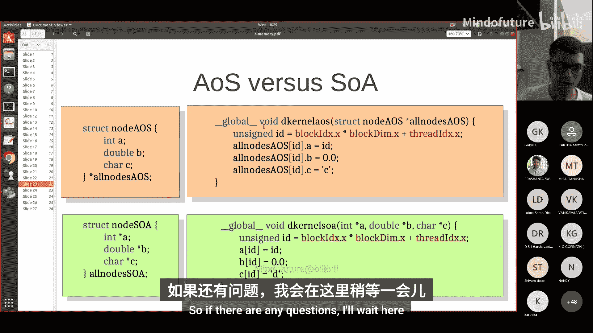

If there are any questions on waiting here， but this is a small homework that you people should try。

Pro put。Come back in slides and put slides on that sheet and。P and try this homework working around。

So yeah， I'll stop here， to not move with the shared memory part for today because。

Fs already time and。I want to push this button。Because it will take at least some more 10 minutes to start with the mood of thequi shared memory。

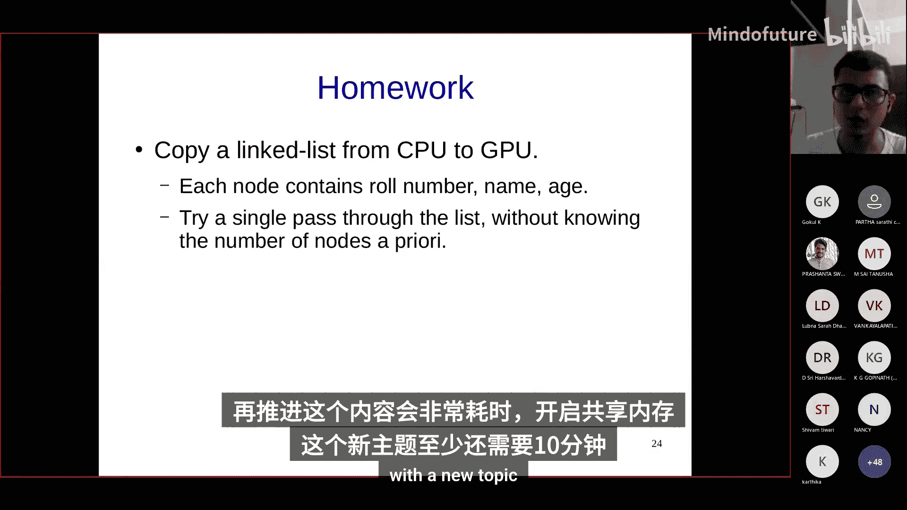

なんですか。But just in case any questions you people have。I'll wait。

 I'll be there here for a few minutes more。Just clarify the questions and then probably will disperse。

Or could you explain how the array of structures like improves locality are in？

都给他。Okay， so let us go back to this。OkaySo area of structure is something like this guide and memory exists。

 because whenever you are declaring this this type of data structure， I mean this type of structure。

ABC is I mean it is stored contiguously。Let us come back here。

 So let us assume that you are declaring part is simplicity。 Let us assume that there is no C here。

 I mean， there is no thought。Attributs， there are just two attributes。andW。

So the way this is stored in the CPU when you at the area of this type mode。

Which is having good looks respects like this。So， when。

So this is the area something it looks something like this and here this is the cost element。

 is consider these two blocks as the cost element。This two blocks is the second element of the area。

So this first element will have two parts， one is a， one will be used for storing A。

 and another will be used for storing B， so that is one element， then there is second element。

 third and so on。So whenever you are doing access like this。This all node dot all node of0 dot a。

 all notes of 0 dot a。What will happen is this entire thing will be brought into the cash。

 this all lots of A as well as all lots of。And next when you try to access all modes of P。

Due to locality because it's already brought in the cash because of that special locality。

 if you remember。From our biggest subject。The excess of this thing would be very good。

So that is the advantage of locality。With respect to US data structures on CP。

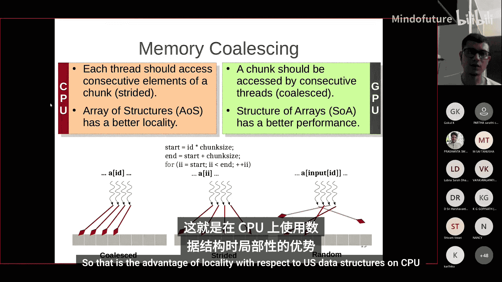

I hope that's clear and if there are still any questions， I mean。

 there is something unclear to then you can ask。

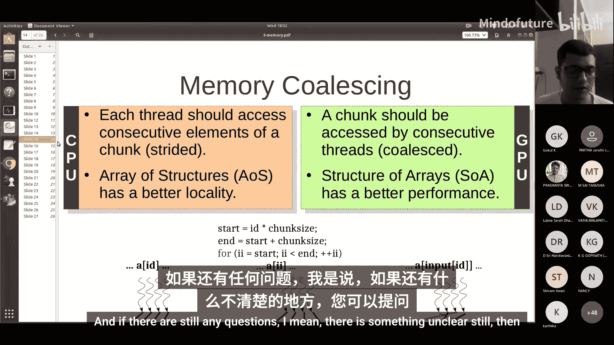

Sir， but even on the CPU side， if it is。Wed like callinging to be better no。On CPU。

 there is no coal because there is no SIMD execution pattern on CPU CPU， everything is asynous。

 no threads are executing in SIMD。So memory coing concept is not their own CPU。I hope on CPU。

 we won't have like war blocks or anything like that。 No， no， no， on。

 there is no concept of warpoint。What is typically for GP。So in CPU okay。

 so let us talk to CPU if youre asking this question then in CPU， if you are launching， I mean。

 let's say on CPU you are doing some competition with 32 threads。

 then all these 32 threads will be asynchronous asynchronous。

 there will be no SMD I thing right so it might happen that one thread is executing instruction I1 and another is in executing instruction some I5 or anything。

나body过。呃，那 guarantee。That's what I see。Okay it so。Okay， I'll stop， I mean， it's not done on the city。

It's completely。And that is why we are able to get improvement by using SO instead of theOS on GP。

I hope that's clear if there are any further questions， then please。你这过。没。Oも next晒。

