# 【Nvidia】CUDA并行编程-｜-Cuda-Programming-Course-｜-Parallel-Computing-Using-Nvidia-p08-P08_L8_GPU中的共享内存--BV1MSq1BTEho_p8-

Unscreen is。Yeah， fine， let's start。

不。Agenda， okay so。Yeah， hello and welcome everyone to the ninth lecture of our Q app program。Okay。

 so。Typically in the previous lecture， we saw about memory coalerescing， right。

We saw like when the thread accesses the words from the same block of title to words。

 their memory excesses are lo into one single memory access and that single memory access memory request is given to the。

Proed to the memory controller and yeah and then we also saw how this memory cocing is implemented at the hardware level and typically how this SMMT execution。

Of the W threads is exported to implement the memory quality。And。Then we also saw multiple。

Multiple examples what the memory coalescing。 So like we saw the example when the memory excesses are fully coaled。

 then we also saw the example when the memory excesses are partially coalced and。

Third case when third case， we saw that when the memory exists are completely unpoless。

 but that also we saw the example。And yeah， then we also saw the。Yeah。

 then we saw that arrays of structures and structures of array。

So we saw how to declare those data structures in the previous lecture and we also saw how how to access those data structures in the kernel GPU kernel。

And。Yeah， and then we also saw like that SOA data structure is better for the GPU than the aOS data structure because the memory coal property is expected in better manner in the SO data sorry yeah SOA data structure than aOS data structure。

And yeah， probably there we ended for the last lecture。So yeah。

 that was the kind of out for the previous lecture。So。For today's lecture。

 I'm planning to cover this。Shared memory part so we will be covering multiple aspects related to the shared memory for the today's lecture。

 so we first of all see for the today's lecture we will first of all see how to how to use the shared memory。

That is what we are going to see mostly for today's lecture and we'll also see multiple examples that so that we can understand how to use the shared memory。

 then we'll see some some synchronization construct across the threads of the block we'll see what is that synchronization construct and we'll see multiple examples about how to use that synchronization construct for that will look multiple examples and。

Towards the end， we'll also study about how to specify the size of the shared memory of the L1 cache that we want to use。

Yeah， so that is what we'll study in today's lecture that。But。

Overline for the Bu lecture and outline for the Buh lecture。And with this。

 let's get started for the today lecture。So yeah， so this was the last five problem that we saw in the previous lecture。

And just for the Vcap， this is the。We we declare theOS data structure。

 and this is the way we declare SO data structure。啊。So yeah。

 so one thing is that this chaosOS data structure is better suited on this CPU。Because。

As you can see this the way we declare the CO data structure is。This end up。

When such kind of declaration is there and when we have C thread which accesses an attribute of a node。

 lets say that attribute is a， CPU thread is assessing the attribute A。

 then it is likely that it will also access the other attributes of this same so it is likely that it will access this attribute B and C。

And the way this data structure AOS is stored in memory is that A P and C are conti in memory。

So since they are conigious， the caching effect will come into play more precisely this locality aspect would come into play。

Due to that， we will be able to see performance improvement on the CPU。

And hence this aOS is better on the CPU， I mean， better to use on the CPU。In contrast。

 we have this as data structures of areas。So。Here on the GPU， what happens is， okay。

 so this SO is better on the GPU。Because on the GP。

 what happens is when a thread access an attribute of a node。

 that is let's say that it is accessing an attribute a of a node。

 then its neighboring thread will access the same attribute of the next node。

So the neighboring thread will also， it's likely that neighboring thread will also access the same attributee。

So in that if that is the case， then it is better to put the same attribute。

Of all the threads together， so if you see here we have placed the attribute a of all n threads together in this area。

So。By doing this， we will definitely get the benefit of memory coalition and since the coalcing will do better by doing by storing in such a manner。

Such SO data structure suits and inputs well on the GP and will give better performance。

A better performance as compared to A。In AS we saw in previous lecture light that con leads to strideed access and that degrades the coalism。

啊，慢慢的过就行。O， so。That's a sort of a briefcap recap in the previous lecture。About the or NS SO。

 so let us start with today's agenda， which is the shared memory。

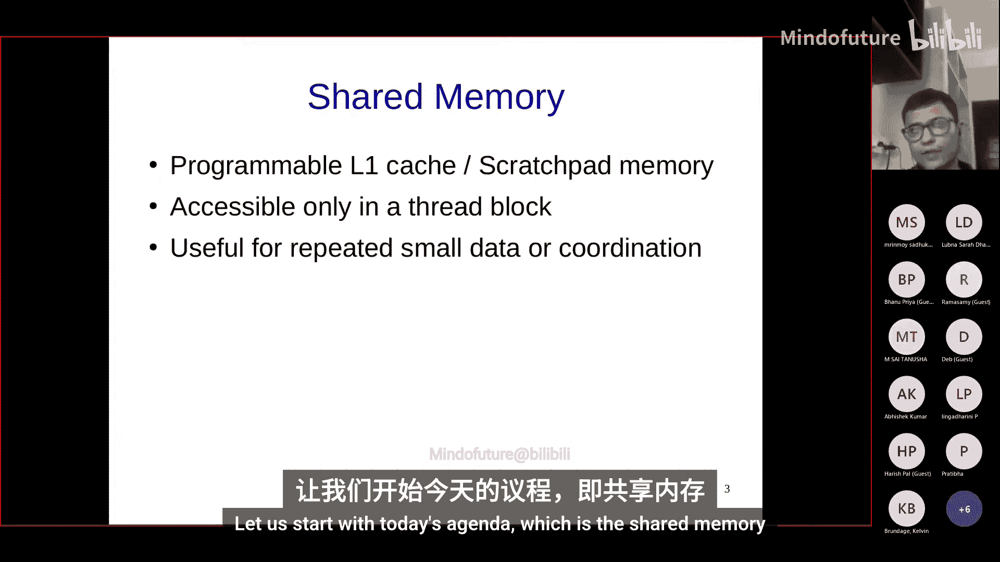

Okay， so before I start， is there any question of？连ち。Not yet how visible。

 I hope that this screen is visible for everyone。If it is not， then please let me know a prayerar。

Okay， I think it's visible for all。ok啊。Yeah， I think there is no issue with this sharing is what I'm supposing。

And there are no questions also， so yeah， let's move on。

Yeah， let's move on。 I， I just got confused with it。 Yeah， but let's move on。

So let us start with our today's agenda， which is shared memory。So。

As I I told in the earlier lecture of the memory that there is something called as Alvin cash and that Alvin cash is。

Slilitted into two parts， first is the El kt cell， which is managed by the hardware。

And the second part is this scratchboard memory or this shared memory。

 which I keep on telling that it is programmable and I kept on telling in。

F of the lectures right in the memory memory lectures that the scratchboard memory or the shared memory is the portion of the album cache。

 which is programmable and is under the hand of the programmer so programmer can specify that。

Programr can specify that okay， this part of the so this。

 I want to declare a variable which should be stored in this scratchboard or the shared memory。

So we' will see how to do that here only and yeah so this one thing here here that you should observe is that this is kind of a very powerful feature that is provided by Kuda。

Because if you know on CPU， there is nothing like this。 I mean， you， there is no control。 I mean。

 there is no。ProProgramr cannot control what data goes into Al1 L2L3 or l4 cache on the CPU programmer has no control over it it is completely under the control of hardware what data is placed in those caches on the CPU。

And also， programmer has no idea about how data is arranged。

 how the data is arranged inside those L1Ll3 or L per cache。But here in Qa or in GP U F youC。Yeah。

 they scored。Was there any question。

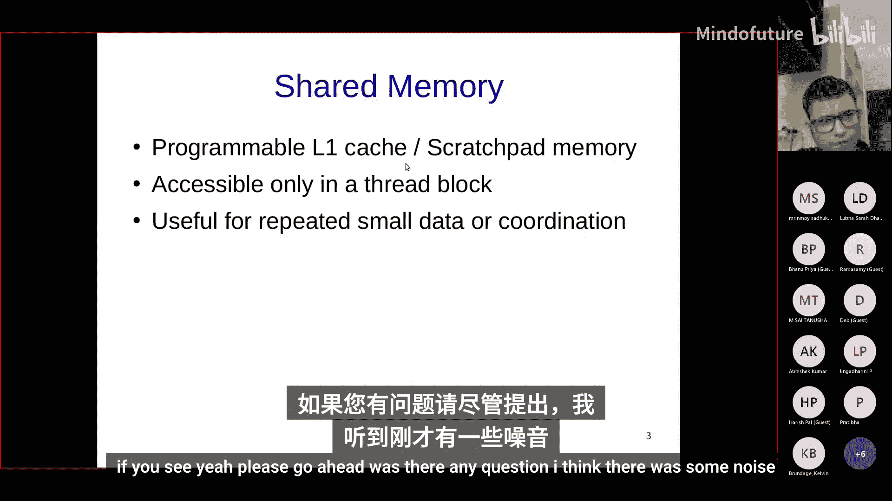

整大个心。Noice from or some question from。新闻。If there is question then please。Right。Okay， anyways。

 if there are no questions。

Okay， so I as I told that this is kind of a powerful feature provided us by QUa because like on CPU nothing。

 I mean， these caches are completely managed by the hardware programmer is no control upon when data took place on that cache as well as the way it is arranged。

 but on GPU， we have this portion of relevant cache which is scratch memory or shared Ma。

Which can be which can be， I mean， programmed by us or the programmers， so that's kind of a。

Important feature that we should exploit， which is given by the。The next important point is that。

This scratch part memory or the shared memory。Is per thread block so I mean so each thread log will have its own will have its own scratchboard or shared memory。

And one point that you should remember here is like even though multiple threadlocks are assigned to the same streaming multicro them。

Even then， each thread block will have its own shared memory or scratch but。

And all the threads which are within the thread block will so the thing is like the variable which is which is I mean。

 declared in that shared memory will be common across all the threads which which are there in that thread block。

So yeah， so the important point to notice that it's part redlock and。Yeah。

 and the threads within that thread log will see the same will see the same copy of it。Yeah。

 so that is the second point and the third point is that it is typically useful for two cases。

 I mean mostly it is typically used for two cases。First case is that there is a small data。

 small amount of data， a small chunk of data， which is getting repeatedly accessed by the threads。

So let us say that you have a very small area which is getting used repeatedly by I mean。

 which is getting accessed repeatedly by the threads。

Within the third block then in that case it is very useful to keep that small small area or small small that array into the shared memory so thates the latency of accessing that array is very less because it is the part of L catch so excess latency is very strong very low。

Yeah， so that is one critical use of it second is coordination， so if you remember I told that。

A toc can be used to implement past atomics in similar way。

 let's say if you want to implement some synchronization construct。

Among the threats of the thread block mean within the threads of the thread block。

Then it is more useful。 I mean， it， it will be more convenient， or I it will be more。啊。

Proper to use the scratchboard or shared member instead of Alc because we want to implement this synchronization construct among the threats of the threat block。

And not all thes across the thread block， so since this scratch spread or shared memories。

 thread block， I mean， with 4 threads of the thread block。

What we can do is we can declare we learn keep a variable which can be tested and set atomically。

In the shared our stretch company。And that way， we can implement some functionality of a barrier or something like that to coordinate key threads within the thread block。

And this is one of the another use case in which we can use this scratchboard or shared memory for implementing the I mean。

Implementing some synchronization or coordination construct among the threats of the threat law。

So yeah， so these are typically two uses for it and now let us see how to declare declare a variable or an array inside this shared memory。

So okay， so please remember that it is a birth thread block， so yeah。

 so I'll come to what is what that mean with this example。So， first of all。

Whenever we want to declare a variable or an array inside the shared memory。

 we need to pre it with the keyword underscore underscore， shared underscore underscore。

So rest of all things are saying interesting。So let us say that okay， yeah so rest things are same。

 but let us say that we want to declare the array float area of sizezen。So。

This is the typical declaration in C load A of N。But when we proceed it with this shared keyword。

 then what will happen is this entire array a， which is of s n。

 will be allocated memory on the I mean will be allocated based on this graspport or shared memory。

And the important point to remember here is that it is common across all the threats of the threat blocks。

So let's say the threat block has 1024 threads， which is the maximum possible number of threads inside the thread block。

So those 1024 threads will be sharing this RA。And yeah。

 so that's one case declaring the second cases that we want to declare some variable variable s on the shared model。

 then the synax is similar， we need to precede it by the this underscore underscore shared underscore underscore keyboard。

And then this type of tick， I mean， this synax is same as the C right。

 the data type and then the identifier。So， again this variable s is now declared on the shared memory or scratch for memory and it is common across all the threads of the thread block so let' us say again if we have 10 to threads in the thread block。

Then all these1，0，24 threads will have this common。I mean， they will share this variable as I mean。

So that this variable S will be common across all these 102 profile。So， compared this with。

This normal declaration。 So please note that this all things are happening inside the kernel。

So let us say you don't specify this shared keyword here and what will happen。

Let's say only this part is the inside become can unsciized。

Then this variable will be a thread local variable inside the kernel。

And so when it's a thread local variable， so thread0 will have some value of as thread one will have some value of s and thread one cannot access the value of thread 0 and thread0 cannot access value value of S of thread1。

So that is what is spread local when we declared just as unsigned as。

 but when we declared underscore underscore， shared underscore underscore unsigned as。

Then this variable is common across all the threads of the third block。

 so if thread 0 and third 1 are within the same thread block。

Then they will be able to see the value of S as well as the modify the value of S because it's a shared variable and both of those threats are falling in the same threat law。

So that is typically one point or note here。Yeah， so moving one。Then let's say we have this。

Kind of assignment E of I equals to Id。收。One important point to note about this sort of assignment is that now this Id here。

 this I， which I'm。Using here and here。It can't be the global thread ID， the way we compute right。

 the way we used to do like in equals to thread ID x dot x plus blockd dot X into。喺到诶。

Block Bt dotex into block IDX dotex。Because that equation that we generally used was giving us the global。

 I mean， global unique strategy。But here this， if you note。

 this array is shared among only the threads of the same thread block。

So we will need to compute the ID， which is unique to the threads of the sorry。

 which is unique to the threads of the thread block。So what can be deciding？

Can anyone quickly tell what can be the ID we want the ID unique to the threads of the threatb then how can we compute this ID？

Stly I'll move back to the chat to see。你不。

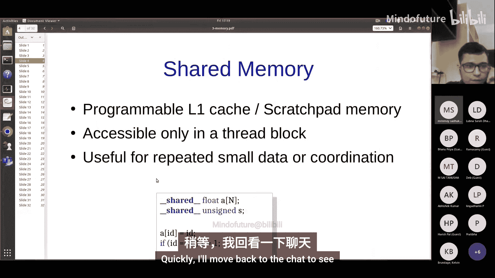

见佢。Can you quickly explain fast at on second Okay， so let us say we want to implement a functionality where let's say multiple threads are adding the value into a particular variable。

Then in that case， since multiple threads are adding the value into the same variable。

 that is the possibility of data is。诶。So since there is the possibility of data risk we want to synchronize I mean we don't want multiple threads to add the value at the same time。

 so for that we'll need something called asatomics we'll learn about it in the synchronization lectures。

But to implement that functionality， we need to have a variable which can be tested and set atomically。

And for doing that， we need to declare some space， I mean。

 we need to declare space for that variable either in the shared either in the L2 cache or the global memory since we want to implement it across all the threads of the grid。

We need to declare that variable in L2 cache or global memory。And。Yeah。

 so it so as I told in the one of the lectures of Hamerit， it iss better to keep it in。

L to cache because the excesses will be quick to that variable because L2 cache is closer in the hierarchy in the memory hierarchy。

不是呃这U过了。But here our requirement was different right。

 we want to synchronize among the threads of the same thread block。In that case。

 instead of using even L2 cache， we can use album cache， so that was what I was trying to explain。

We we declared a shared。To be declared of shared fairry。

Are inside kernel or main function or separate。Okay。

 so shared variable and all those things are declared inside the kernel。

 so yeah so just to clarify that point。

This thing， this entire thing is inside a kernel please note that this shared and all those things are completely inside the kernel there is nothing like shared inside inside the。

Main or CPU CPU functions。 So this is typically for CPUus。I mean， GPU spinning inside the kernel。

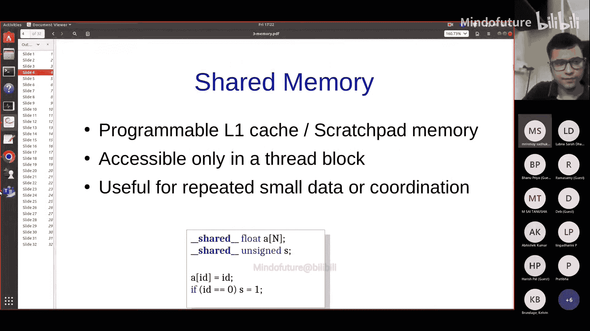

ok。Block I， okay， you are telling that this I should be block ID。

No， I don't think that it should to be a block。So， okay。

 so the question is this error shared I mean it's declared a shared right。

 so its I mean it's common across the thread of the same thread block so in that case。けて再り。

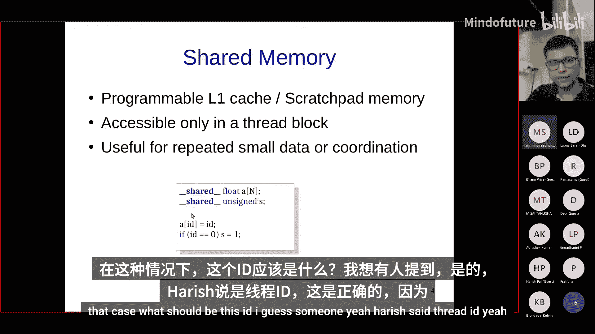

I guess someone yeah， Harish said third idea story。Yeah。

 this is correct because since we want a unique ID for the threads within the same thread block。

It is I mean， we should use thread ID X text right because thread ID X text gives the unique idea of thread inside the thread block provided that we are just having one dimensional thread block。

If it's a 2D thread block， then we'll need also need to use thread ID x dot。X and thread ID x dot y。

But。Yeah， case in the case where we have just dimension one dimension thread ID extroex should。

Should suffice for our purpose， so the idea should be thread ID externalt。

And this when it initialize this carry。And please remember this remember that these all things are done inside the car。

And yeah， and then there is this statement if I equals to zero。Then we set s equals to one。

 So what this does is。For the first thread。Of all the thread blocks。

 please note that for for all the thread blocks。The first thread of that thread block will initialize this variable S to1 and this s is common across all the threads of the thread block。

So all the copies of s， which are part thread block will be initialized to one。So yeah。

Probably I'll stop here for a moment if there are any questions， then I'll quickly take them。

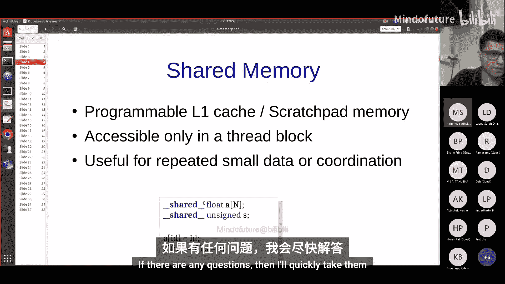

OkayI guess there are no questions if there are any questions， then please。

E unmute yourself and ask her。You can even type on the chat。

Okay， if there are no questions， tell me。Let us move further。So let us start with this classwork。So。

 let us say that。We are given a matrix M of size 1024 plus 1024 and。

Each row is assigned to a thread so okay， so since there are 102， it's a 1024 plus 1024 matrix。

There are 1024 rows and each row has 1024 element， so for each row we are assigning a thread log and assuming that thread log has 1024 threads。

 we can assign one thread for each element in the matrix， which is MIj。

And if that's yeah a one thread for each and every element of the matrix。

 and what we want to do is we want to change。MI J， which is that particular element of the matrix to MI J plus MI J plus1。

Wherever possible， meaning for last。last column it want to be possible， right。

 because for last column there is no cheap less one。So for rest or column except the last column。

 you want to do this， we want to change MIj to MIj plus MIj plus1。Okay， so in。Okay。

 so for doing this， we want to export the shared memory。

So I request each and every one of you to try this。Try this out and post your answers in the chat。

Or either unmute yourself and ask。So I hope that question is clear。

Each row is assigned to a thread block and since there are 1024 threats in a thread block。

What we want to do is we want to assign one threat for each element and what that each threat does is it adds。

 I mean， it does MIIJ plus MIIJ plus1 and stores into that location， MIIJ。And for doing that。

 you want to exploit the shared women。韩国申请。

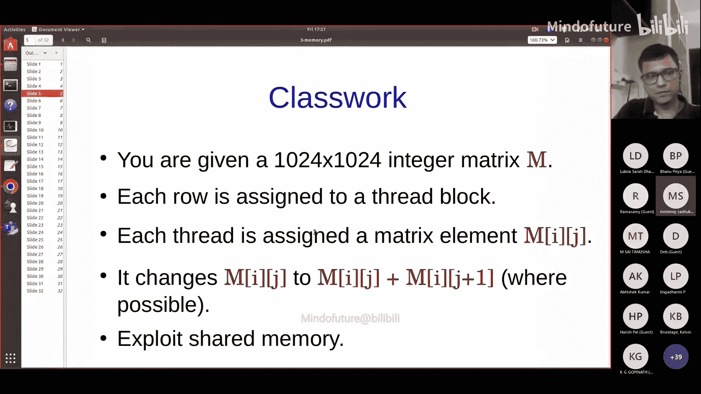

Yeah， this card， so am I J。Plus M Z plus1， let's say one of the indices icona J is updated with this。

Then however， that value is also going to be used by the adjacent thread to update。

MIj plus the next MIj plus1， right？佢啲。Like because the whole thing is happening in parallel。

 how whats the value sort of we are expecting or should we store the results in a new matter so that？

I dont know， we want to store the values within the same same metrics。

 so we won't be using any other metrics， but yes， you are correct that there will be this issue。

Thatctor。As all the operations are happening in Pa。There can be some inconsistencies and values。

But yeah， for that we'll need some sort of synchronization construct or something like that。

But first of all， let us think about how can we do this。 I mean， can you。

iveI mean， give some rough steps to implement this thing and how can we expert shared member here？

You are correct that well need some。Th to centralize， because we are。

Accessing this two location and address and thread will be also accessing these two so。

There might be some inconsistent value that we might be reading。But yeah， that is one issue。

 but first of all， think， how can we implement this and how can we exploit shared memory？

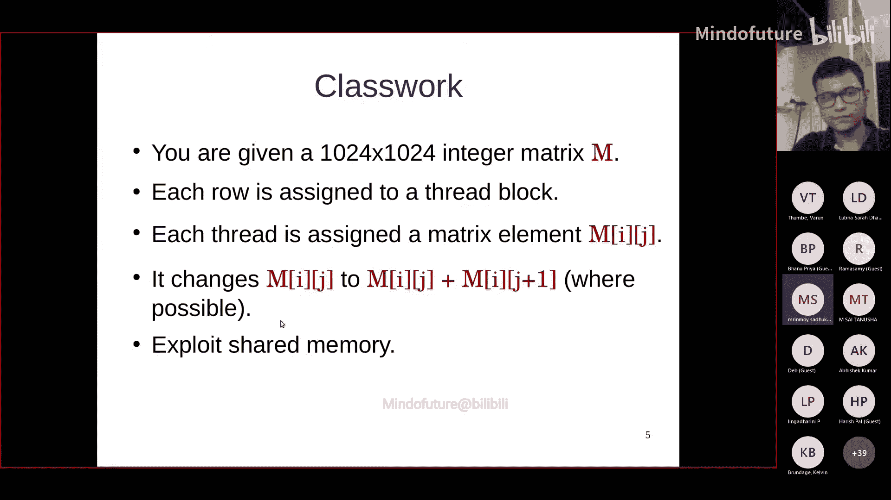

Okay， I'll probably go back to that slide so that。I'll wait here for a few seconds and for you people to try and then we'll continue。

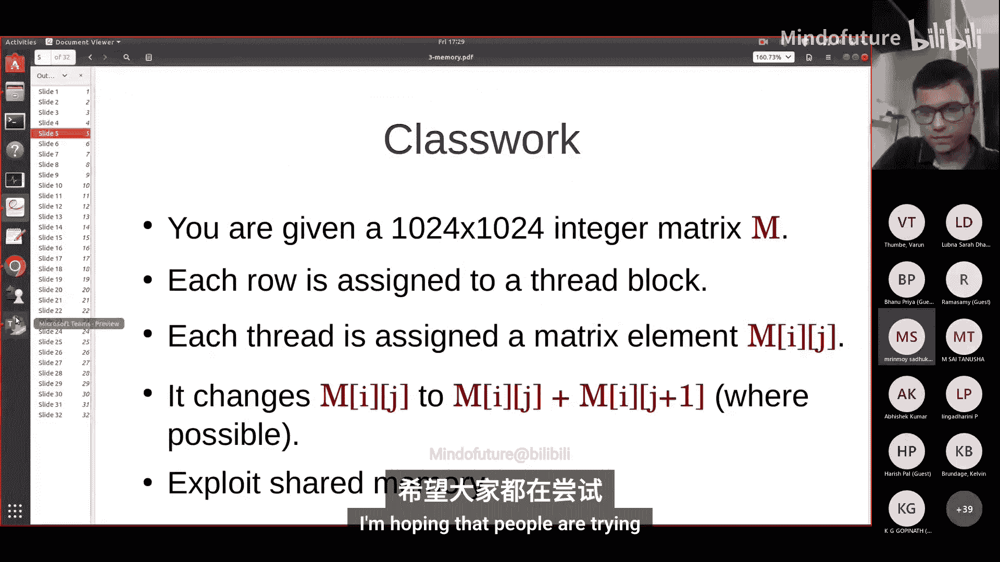

Okay， I'm hoping that people are trying。Okay I'll wait here for a few more seconds。

 and probably then will continue。Yeah。

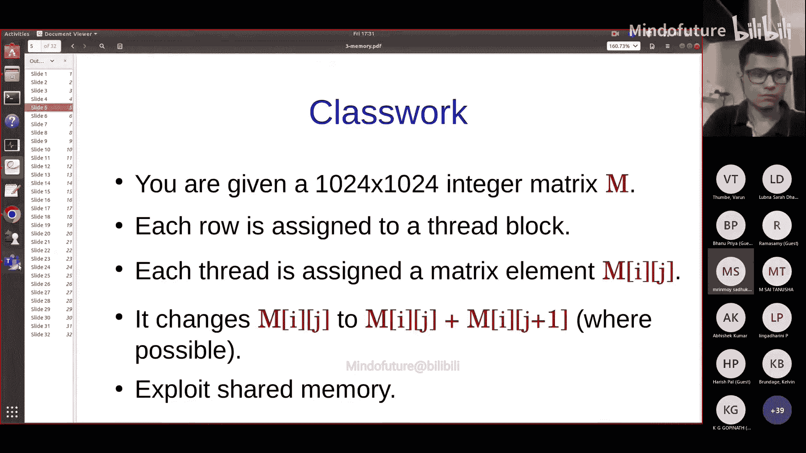

你啊。我的。You can create separate shared vector for the rows。今日收到。ok。I think。This is quite。

Quite two available levels。 I mean， we can do this。But， okay。

 I am assuming that you people have tried。Let's move out more to the。

Sldes them so okay， so we want to implement this functionality。

So how can we do this like what can be step by step way of implementing this， so let us see this。

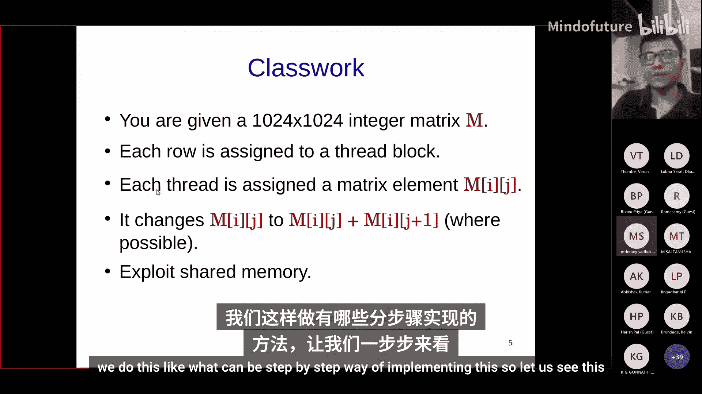

So， step 1 would be to。First of all， we need to copy the data。Cee from。Beta blue。Shared。Memory date。

Or first of all， we need to declare this shared memory， so how can we declare？啊。So that are my。Okay。

 so before this step， what we'll do is we'll declare the shared ma。啊。Shared in the。Hehara。Of size 1。

0，24。Yeah， so this this will come before this step。So after that。

 we'll copy the data from D to shareholders， that is the step1。Then， step2 is。Well do computation。

 right？Computation using that formula M of I J。Equals to that。That whole thing， right。

 I of5 J plus M of P J plus1。That is step。And what is step3？Okay。

 so one point here is that I can't use Mmo Hy right now because。We need to use shared memory。

 so once we have copied the data from shared memory， what we'll do is we'll use。Para of J equal。

やら 아이지。Plus yaラ I G plus one。well do that。 That is step 2。And step three。Will copy the。

Here are our values。都嗯。关。But each over with them。So these are typical， I mean。

 typically the three steps that we need to do copy the data from DM part the global memory to the shared。

 first of all， declare the shared memory of size 1024。

And for each row copy that drove from DM to the shared memory。

Once that is will compute whatever is there in the shared memory， I mean。

 once we have copper we can use that shared memory and then compute using our equation here。

But now we don't need to use M because now we have the values available in the shared memory right。

 so we can use that data and shared memory and can perform computation like this。

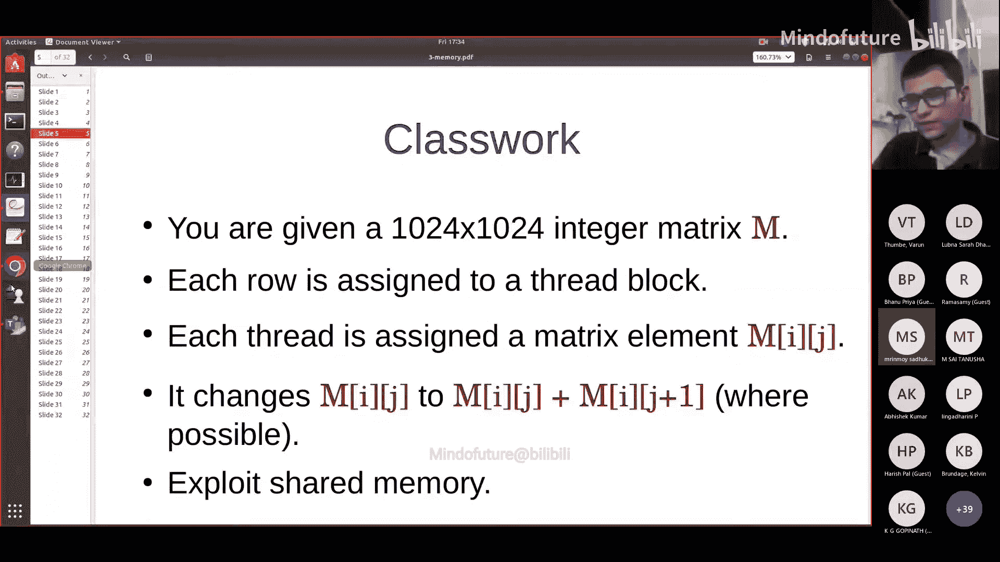

And once that is done， we need to copy the values back from shared memory to the global memory into that matrixM。

Okay， so I hope that this is clear if there are doubts still this。

 I mean in this three steps then place。Let me know。Meanwhile， I'll take some， I mean。

Vi some responses by your people。What I to1 I less than 10。はい。Okay， so this is fine Nancy。

 but this is the CPU code right you are。What you are suggesting is the CPU code。

 you want to do it on GPU， so for doing it doing it on the GPU。

 we need to write a kernel and inside kernel we need to do all these steps right？

That is what I'm suggesting。So these are three steps you' will be doing inside the。干了。

Because shared memory we want we need to declare inside the kernel then copying from global memory to shared memory will again we want to do it on kernel and then。

Comput on kernel and then again copying back from shared to global memory or that Am again on the kernel。

And mallloing and all those things will be done from the CPU that is allocating the memory for this。

RAM and initializing it and all those things， we need to do it on6， then copy to the GP。

So before declaring the shared variable， will be allocate memory in GPPU usingkudaello。Okay so then。

I need to clarify one thing here。For declaring the shared memory。

 you don't need any quoa melo or all those things。Because yeah。

 for okay so far shared memory you don't need code ML and all those things only for declaring the memory。

 I mean allocating the memory in the global global memory that is DM of the GPQ。

 if you need code MLO and all those things and that need to be done from the CPU side。

But for declaring the shared memory， you can do it from the kernel so as I told if you remember。

These things are。All these things are done on the GPU I mean， it's inside the kernel。

 it is done on the GPU so when you declare this thing she a float a of size。It's on GP。

 I mean it this is inside card。And it will allocate this array per thread。A is part。

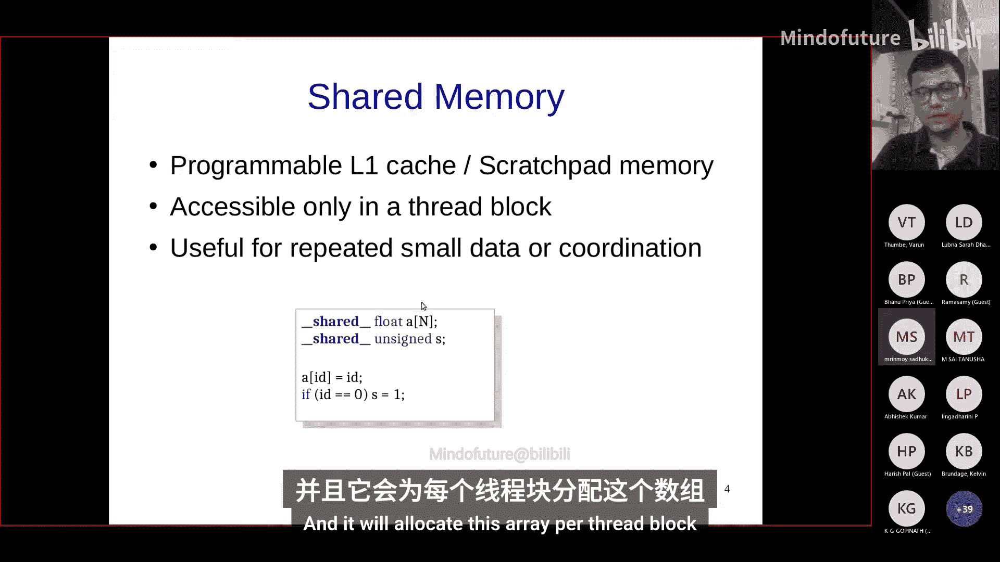

So I hope that's clear any further questions。Yeah， so the step two should be singularly manipulation。

 if not to the AR of I equal to AR。Yes。Why single it。Oh study。

My understanding was the shared memory view per block is essentially for a row so you have declared it as a of 102 per which makes sense。

As the first okay， yeah， I got it， so it should be， yeah， that is correct。

 it shouldn't be IJ that that's a syntactic error that I've made here。

So we need to access it in the way Okay， so we just got the clarification， we need to access it like。

We need to access it like this。So that is one thing that is correct。

 but any questions up till this point， if there are any questions then please ask otherwise。

I have a few questions for you people if there are no questions from your end then I'll ask people a question。

Okay， I'm assuming that there are no questions and。

You people have understood this thing and these steps you people have understood。

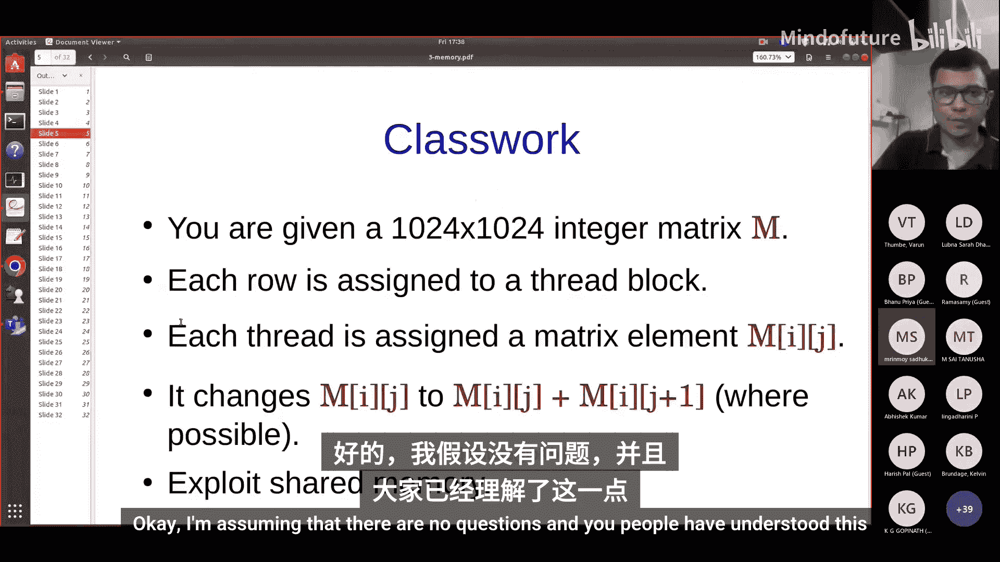

Assuming that you have understood all these things。Now， there are two issues with respect to this。

Okay， so first of all， we are exporting the shared memory here if we are seeing we are exporting the shared memory。

But okay， that is fine， so this final thing is achieved expert the shared memory。

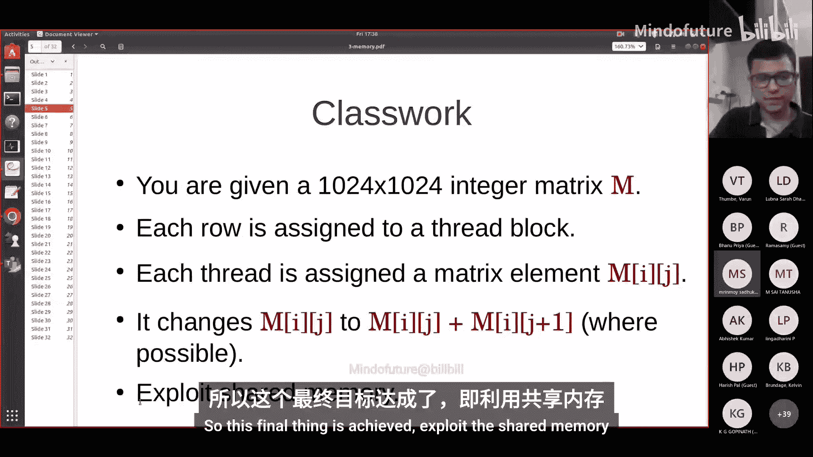

But still， there are two issues with respect to this procedure or these three steps which we are doing to achieve our functional。

I want each and every one of you to tell me what are those two issues。不敌。So fast issue。

 I think someone I think waron or someone specified that this。

This thing is problematic because we are accessing this， I mean。

 we are doing this operation in parallel and。Ts， I mean。

 threats will be concurrently accessing this ER of I and ER of sorry ER of IG and ER of Ij plus1。So。

There will be issue that。Two thirds might be。Accessing with， I mean， might be reading the same value。

Same value together， and that value might be wrong。So that is one issue。

 so let me explain that thing with example。So let us say that we have this some random values。7。

So let us say that we have some a like this。Now， what computation we are doing。

 we are picking two values， I mean， we let's support the index one。

 which is having value35 what we are doing is。We are taking that 35 and2。

And then adding those two and placing it at this location。

 which is this and so this will become 37 now。But at the same time。

 what the neighboring thread is doing， it is this picking this value2 and5。

And placing five plus towards this location。 So it might happen that。

Neighboing threat have placed here seven。And after that， this thread here， which is computing。

 I mean， which is operating on this element 35。Does 35 plus 7， So in that case， the value will be 42。

 which is wrong because the actual value should be 37。

So that is fast issue that was specified by someone， but still there is one more issue here in this。

啊，大家呃。The procedure which is composed of three steps。

 I request each and every one of you to see and tell me what can we be another issue here。So。啊。Yeah。

 please try out like what can be what might go wrong here。Other than this other than this part。

Is that。The possibility that we may go beyond our defined size of positive。Yeah， I mean。

 assume that we have taken care of the boundary checks and all those things， assuming that。

what can be the issue I mean yeah， it is possible that we may go beyond 10 before。

 but assuming that we have written it perfectly I mean。

We have done the boundary checks and all those things。If that is the case。

 then we won't be encountering this issue。But there is still， I mean。

Still some more serious issue here。Just then there's boundary checks and all those things。

In this three steps。If you， you observe it carefully， you' will be able to see that there is some。

Critical issue here， which might。Which might cause correctness issues。So please。

 please think about it and tell me what can be the issue。

Meanwhile while I'll wait here for a few second school。What are youこ trial。啊。TheSome。

Once the order of execution of tests will def the final matrix。No， I don't think so， because。

Will be calculating the。I mean， well be calculated the ID rights。

Based on ID we'll be doing all the computations and even let's say。As long as a thread is picking。

 the value of that element。It's neighboring element and adding and placing it in that dirt。

That element， I don't think that the。That will cause any issue toish， I hope that is clear。But yeah。

 I don't think that order of execution of rights will。食翻啲快嘅嚟。

Or if I'm misunderstanding something else， then please correct me。Between two trademark marks， also。

 we can have neighbor values that we can。Between two thread blocks， also。

 we can have neighboring values， and we can't access shared memory of one block。Okay， so okay。

 there is one conclusion here。 I think for we are slightly confused here。

 So see what we are doing is we are declaring the shared。Ary or this part。This area of size 10。

24 or one particular row， right？So。What will do is will。

Perform only operation for that particular row and。

There is no need for So okay， so let me go back to。So what this equation。

 the way we are computing this is that we are bringing the entire row out of all this。

 I mean let us focus on one row， lets say we are focusing on the zero row and that zero row is assigned to a particular threat log right？

Now， since threads。This1024 starts inside that threshold。And since each of them are performing that。

呃。Computation independently。And let's say the last thread is not doing anything because there is no J plus one for the last element of theide。

 so let's say 102， three threads are doing their work properly。In that case。

 they don't need to access anything from the。Anything from the shared memory of the next。

 I mean of the next block。or the previous block because everything that they need is inside is already brought from this matrix inside there they declared I mean。

 they declared shared variable。And they can use that for competition and there is no。No， I mean。

 there is no need for accessing the shared memory of previous or next。

 so I don't think any should there。

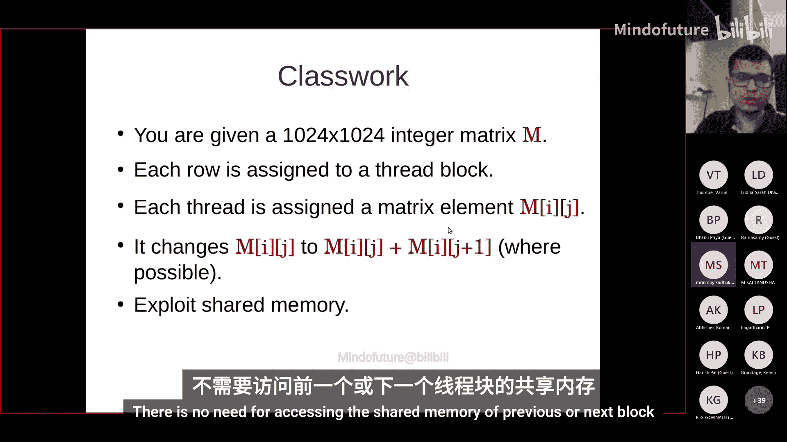

But is any from their side？Yeah， so if there is any still there is any confusion then please let me know。

 but there is no need of accessing the shared memory of any other。Any other threat logs？

So so we still have the inner for loop in the kernelal right。Heard forlook in the kernel。嗯。😊，No。

 I don't think that we probably need any forlook because see what we are doing is。Wai，Yeah。

 there will be one loop because。Yeah， there will be one loop because we will doing this operation repeatedly right for each and every row。

 so yeah there will be one loop， but there will will that be the inner loop or not？Not sure。

 but the other will be still one loop because we will need to do this operation repeatedly for。

Each and every row。So that will be one yeah。屋企啊。I guess。We are okay from Do's point of view。

 but yeah so。We were unable to point an issue here， but that's okay。 so there is still one issue。

 as I told， there is still one issue in this。Three steps that I mentioned。

So the issue here is that let us understand what is the issue。

When you are copying the data from D to shared memory， first of all。

 you are declaring the shared memory and then copying the data from D to shared memory。

And then in this step you are doing computation， so can it happen that。

Some some threads have not finished the copying and other threads reached here at this stepoo and they started compute I mean。

 they started with the computation。Or can it happen that some threads have are still doing the computation and？

Other threads reached here and they started copying the data from the shared memory to the Dm。

 can this thing happen？Its the question， I want to ask this question to you。

 but can this thing happen？So came like。Can this thing happen that term？We are， I mean。

 few threads are still copying the data from BM to shared memory while other threads came here at the step two and started executing this。

Can this thing happen quickly I'm asking this question。

Is it possible that this type of execution flow？My Tuer， is it possible？Ters in in gotard point0。

Okay， I think that。Okay， so let me continue with this。I told I I asked this question， right。

 can it happen that this some threads are copying the data from。

Shared memory sorry to shared memory while some other threads are doing this operation。

I must clarify here that this thing can happen and this thing will happen typically for the threads which are the different ver so if you see few of the war threads might be copying the data from D to shared memory meanwhile lets say some another warps have already finished that step and they moved on and they might be doing computation so if that is the case then you can see that this copying is not yet done but still that computation has started。

So this is problem because we want this competition to finish。Sorry。

 this copying to finish and then the competition to begin for all the threads。

Of the block of this thread block， so。All these 10，24 thirds of the threat block。

Should first copy the data from DM to the shared model and then only move towards the computation and then once the computation is finished。

Then they should for all the thirds of the table once the competition is finished。

 then one they should move towards the。Copying the values back from the shared memory to the TM inside the matrix sum。

So in order to do this， if you see carefully， we need the synchronization。Point at two place。

 One is here。Between step one and step two and another is here between step two and step three。

That is the two， I mean， those are the two places where we need the synchronization point。

 I mean synchronization construct and we'll learn what what will be that synchronization construct probably in today's lecture only。

And the second thing is as mentioned by someone as multiple threads are performing this operation concurrently Ar of Aj equal A5j plus A of Ij plus 1。

 and they are placing their values in Er of5j。Well also need to have synchronization construct here because multiple threads are reading the values and writing the values and as we saw here like with this error example right that there might be some inconsistent values which might。

W which might I mean， which might occur due to this this type of execution。

So those two things we need to take care of， so some centralchronization construct we should had at between step one。

 step two， step two step three and while during this competition。So yeah， so that was the point。

So these are the issues with this typical execution flow。And we'll see。

 what is that synchronization construct with the upcoming slides， But any questions still now。

Okay I guess there are no questions， then let's move on。

Okay， Im assuming that you people have understood what I was trying to explain with the shared memory and the。

Classwork here that that we discuss。So let us see， I mean， let us see this program。

So here we are customer defining the block size to 102 per， so each block will have 102 per threads。

And then coming to mean， we have this kernel launch in which we are launching the kernel with one tlock with。

10，24 threads inside inside each threadlock， so there are in short total one into 102 per。

 which is 1024 threads， so kernelal is launched with。1，0， two， for threats。And yeah。

 and then we have this CS good at second， so see you will wait here for all the threads of this kernel to finish。

So here we have launched kernel with 。0 to4， and then I'm declaring this。

Variable s will be shared across all the threads of the thread block in fact we here we have just one thread block right and there are 10 output threads inside that thread block。

So this variable S is shared across all the threads of the thread block。And then we are doing some。

Initialization and addition of that variable。If thread ID is 0。

 then we are adding so we are initializing S20 otherwise。When I is1 or 100， we are adding one or2。

And then finally we are printing that variable S。And I want you people to think about what can be the output of this program。

啊。So I request teaching every one of you you to try out what can be the output of this program。

Can there be multiple outputs or can there be just one single output and if there is single output then what is it and if there are multiple outputs then？

What can can be that multiple output？What are the typical values that we can。That we can get by。

 I mean， by the execution of this， piece of code。So I'll stop here for a few seconds request each and every one of you to try that what will be the output of this program。

And yeah， please try and post your answers in the chat or unmute yourself and unmute yourself and tell the answers and whatever your thoughts are about it。

This describescribe。

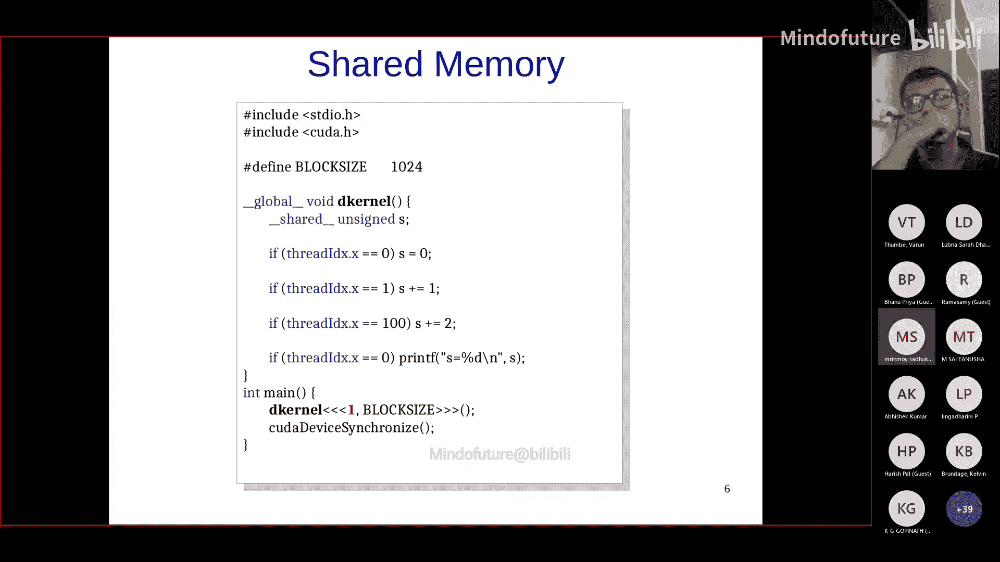

ち。

Yeah， I'm assuming that you people are trying quickly。So。

Please try out what will be the what are the possible output for this。

The scored snippet and try out and post your answers in the chat。

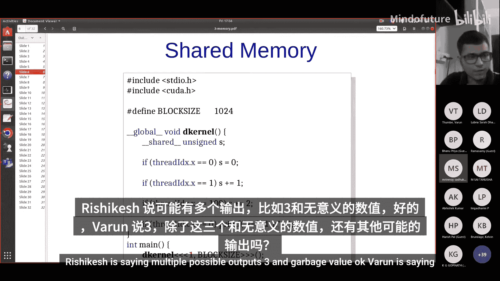

She cases is saying multiple possible outputs。3 and garbage value。好嘅。What dot we think可。Okay。

Any other possible outputs apart from this3 and garbage value？20。Anyone wants to support。This啊。

G it you do answer。

And gonna to go back with this slide。So' wait for a few seconds more here to。Later that we try and。

Please try and post your answers in the chat。After a few seconds， we'll move further。经历。

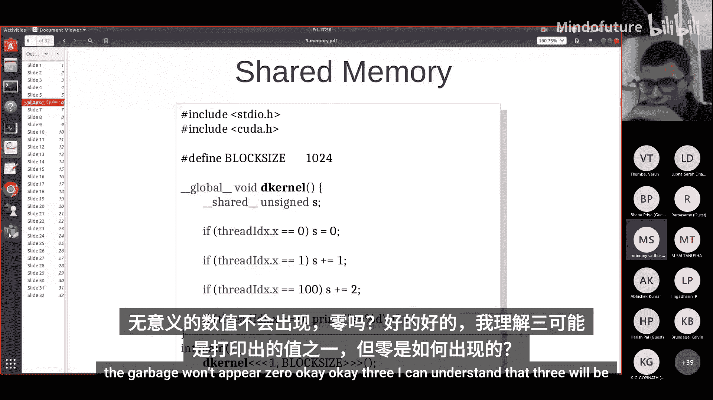

Theica is saying garbage quantia， zero。Okay。Okay，3， I can understand that three will be one of the。

One of the value that it can be printed。But。How can zero idea this I'm thinking？Any， I mean。

Any supporting statement that you want to make Richshiksh for this zero？

And Vaon is saying one or three are garbage。Okay， I think this answer is really very close。

 but still we are missing something。This is really close。啊。Okay。

 I am thinking that you people have tried。Probably I should move back to the slides otherwise。

So let us understand this code。What are the possible outputs that。This piece of court can give。

So first of all you should understand that we are just launching kernel with one block and so this shared variable there will be only one copy of this shared variable across all these 102 quas which are there within just single thread block with which we are launching the kernel。

So this variable is shared across all 10 people。No。Okay， now let us say that yeah。

 we have this common variable across all these threads。Now。

 what will be their typical execution flow？So thread1 initialized the variable s to0 sorry thread is 0 thread of id is 0 initialized s to 0 then thread with id1 mid s plus equals to1 so it incremented the value of s so value of s is now 1。

Then，300。Incrementmented the value to2， so its value is now three。

And then third0 printed the value of pass which is 3。

 so is three is one of the possible output out of this code snippet。

What can be the other possible outputs？So let us understand this code in more better way。

So first thing that you should observe when you when you are solving this type of questions is that。

First thing that you should always keep in mind that walk threads execute in simply fashion。

 that thing always you should keep in mind and we have just one thread block and which has 1024 threads。

So there are3 two wars here。So the first war is from  zero to 31 and second v is from 302 to 63 and so on。

 so 32 ws and each whos execute in simply fashion。So when they walks。

 when I say that walks execute instinctively fashion。

 first thing that you should that you should observe here is that。

this statement tried IDx dot x equals to 0， then make s equals to0。

 then this statement this thread IDx equals to 1 then make s plus equals to1 and this statement print。

When thread I is0， different pays。This three statement will always be executed in lock step fashion。

 this， this and this。So there is one thing for sure here， this will be executed。

 then this will be executed， and then this will be last print up will be executed。

So this order is fixed， there is no change in disorder order。

But take but the thread which are not in that warp， which is the warp number first war。

 which is havings from threads from ID0 to 31。The cats which are not in that work can be executing in arbitrary fashion。

The which are thread which is not there in that first op is this thread with IDd 100， right？

So even though this three statement， this statement， this statement and this last statement。

 execute in log lockstep question， which is one after another。This statement。

 which is being executed by thread with ID00， which is not there in that war。

It can be interlived in any fashion， so following are the inter living setup possible。

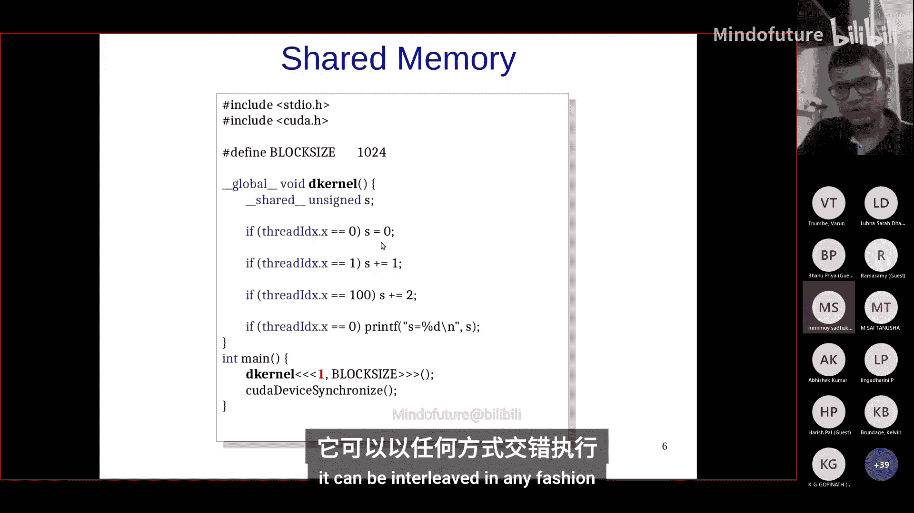

So悉。This thing as equals to0 then。呃。As equal equal to zero。Then。Then， as equal equal to 0。10 S。

Yes equal to why。Thank。Prien taps。This is one of the order that can happen。Second is。

As equal to zero can happen。Then。As plus a question two can happen。Then。

S plus equals to one can happen。Then。1 think that。Or this thing can also happen as equals to0 then s plus equals to 1。

嗯。S plus equal to 2。Then drink up。Or one more possibility is this as plus to zero as plus equal to1。

认得。Yes。And then。As plus question。So these are the four possibilities that can happen。

Assuming that yeah， these are the four possibilities that can happen。

But there are also few more possibilities， but this are the few， I mean。

 these are the four possibilities among the total number of possibilities that can happen。

So if you see properly for all these four cases。Answer would be either one or three。

To see in the first case answer that printerer will give is three in this case。

 it will be again three。In this case， it will be against report in this case。

 No sorry report first case it will be。One， for first case， it will be one。

For rest it will be three and for last case again， it will be one。So rent up here will give one。

 then here3，3 and1。So for these four case， if you analyze properly。

 answer could be either one or three。But my question is。

 can there be more positive examine can we get something else from the printer？

So I think Vaon has suggested something。And fishy dish is also suggesting something garbage value won't be printed zero。

I don't understand how zero， but we is saying either one， three arbitraryr or two。ok啊。Yeah。

 I think this answer is correct。This's one P garbage and zero。Yeah。

 so we have understood why one in three can come but。

do you want to explain why garbage value or2 can happen？

Can unmute yourself or type I wanted to quickly look the project that yeah。

The garbage value is when the the100 belongs to the third fourth warp right。

 so then that executes first。And in that case， the value is not initialized at all。Okay， then。And。

The value。把了个。How can we be garbage， I mean， let's say this happened as plus equals to do by the 100th thread yes and。

How can then that be account？我哋都会。查家附近你哋先。好便好好。Yeah I obviously didnt think about it idea。Yeah。

 but anyways， I mean， whatever you thought you can put even if it's incorrect， don't worry about it。

 just it's important to highlight what you think so。

That is what I want to emphasize just don't worry about the correctness or anything just。

Whatever you think you can Oh yes。I as far as I。I did think of the last statement as war。

Id as 0 rather than thread of Id。 That's what I'm。Okay。So if that's the case。

 then you might think that garbage won't be printed， is that correct？Yeah。Let us see what。

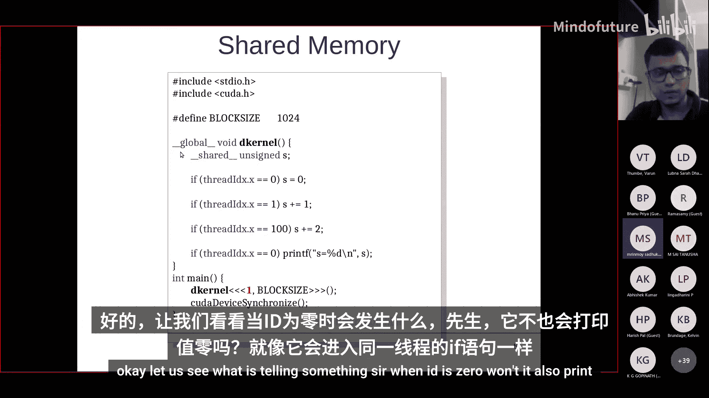

Be the case。嗯。The ratio cases telling something so when id is 0 you want it also print the value0 like it would enter。

To if statement in the same thread。

Okay， yeah I think we are missing out something here to like threads lock walk threads execute in lockstep session if you remember from our previous discussion。

 so here when the thread here all the3 thread of the war will come。Then set S equals to 0。

While that so this will be executed only by the threat having ID zero。

So Sunday one of the thread would execute this rest will be masked out。After that。

 they will be moving to this statement。Then they will be they will be making s plus equals to 1。

 so s will be 1 and then they will move here。So I don't think that zero will be printed in either of the case。

One can be printed， C can be printed。Even something else can be printed， which you will see。

 but I don't think that zero can be printed。If you have any thoughts about it， then please。

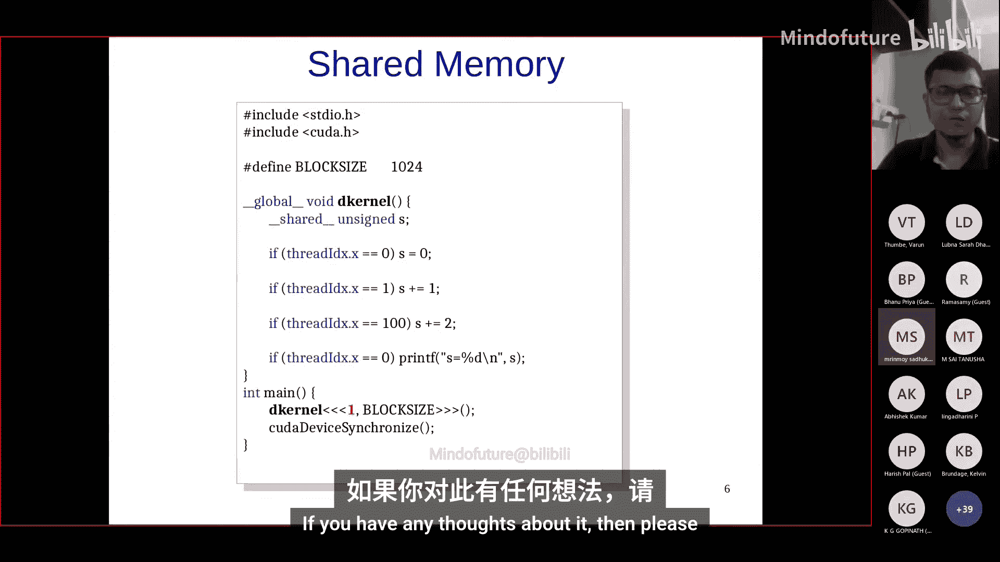

You can type here or even unmuting yourself and ask saying it's okay。ok啊，唔该。

ok， so啊。First thing is that we understood why can we get one and three？

But there are still two more possible outputs here。First output， first is one and second is three。

 third possible output is。Third possible output is to。So even two can be printed here。

And the fourth possible output is garbage value。So1，2，3 and garbage value。

 this four possible outputs are here， we saw how one and three can occur。

 but we need to still see how2 and the garbage value can be printed here。

So let us start to understand that is， but let me just quickly check。 Okay， there are no doubts。

 So can there be。How can the output be too， let us understand that。Let us say that。Okay。

 let us understand this。Let us say that thread zero。What's here。And okay， first of all。

 let us understand this that this thread 0，1 and300， these are into different ver。

So thread0 and1 is in one word and thread 00 is in another one。

So it might happen that whenever this thread。呃。T0。Was initializing this S value to 0。Okay。

 at that time， let's say this thread zero has initial thread graduate to zero this statement was successful。

So threats now this shared variable S is now its value is now zero。

And then let's say that third one from that same block。

Started executing this statement as plus equals to1 meanwhile the thread of the work I mean the thread of this work where this100 is thread with 8000 is present。

 it also started executing this statement as plus equals to 2。So in that case， what can happen？

This two statement as plus equals to one and S plus equals to2 are now executing。

Simultaneously so there is a data ratio so either this will be successful operation or this will be successful operation assuming that the second operation is successful so okay first of all understand that as values initialize to 0 and now these two are executing in parallel。

So assuming that only one is successful and assuming that the second one is successful。

The value of S that will be that will be I mean， that will be present in this variable s。

Execution of this two statement will be too。So I hope that you are getting as far initialized to zero。

 then these two were happening concurrently。And since they were happening in the I mean。

 at the same time， of two will be successful， of two。

erE of this who will be writing finally to the variable S。So。Can either take value1 or two。

Because this edition of one or two is happening here。And assumingsum that this is getting successful。

 this statement is getting successful by this war that the thread with I hunter was。

So the final value that will be there in this variable as filled with two。

And then let's say third0 prints the value and in that case we'll get the output as。

I hope that's clear if there is any confusion here。Then please let me know。 I will resolve it。

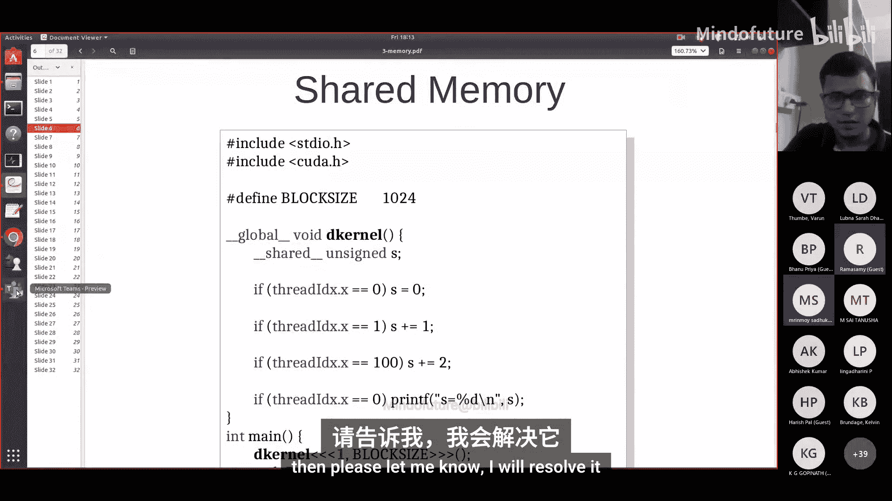

Similarly， Wacon zero cannot be printed。

Because at some time yeah， sorry， yeah， please work。 How can zero weight later？

When thread ID dot x is0 simultaneously。All the threads will be running parallellyino。On呢个 i mean。

Threats among different tubes will be running in padwell， as I mentioned。

Thats from 0 to 31 are executing in same fashion， so it won't happen that。

Thread with I1 is executing this。 thread with I0 is executing this。

If you remember our safety execution， then all the threads within the same board which are in this case。

The threat from I0 to 31 they are executing the same fashion。So first， this statement will be done。

And then only they'll move to this statement。And if that's the case。Output 0 is not possible because。

This statement should be done and only after we can move to the statement。

If this would have been done before and then this would have been executed。

Or if let's say these two would have been done and after that this s equals to0 would have been executed。

 then output zero is possible。But。Here it is not possible because of the same execution of the war threads。

 I hope you are getting it。

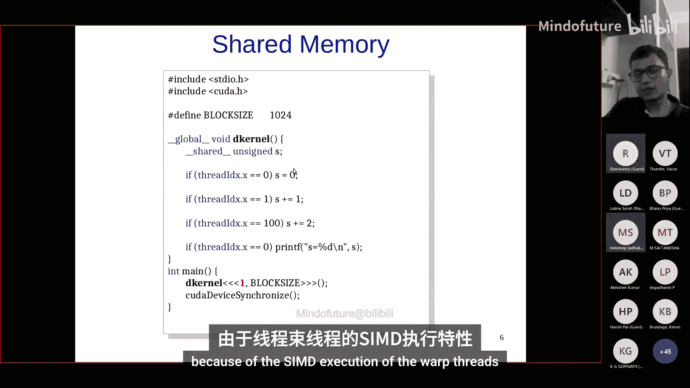

O。オケさ。Yeah。Yeah， well come to this when I executed the program I got output to three， yes。

Output 3 is the。Is the output that will be seen in most of the cases。

But what we are trying to analyze right now is what are all the possible outputs？

If you see output as 3， then it doesn' not mean that that that is the only possible output。

 there can be multiple possible output。And we have seen so far that why can we get output1？

Why can output can we get the output3 and why can we get the output 2？

But since there one thing is left， how can we get the garbage value as the output？

Would anyone like to。Explain our。Give some convincing。

Explanation for why can we get the garbage value as the output？

As equal to and S plus equal to2， both of those execute。嗯。你你翻咧。Timeone yeah。In that case。

 how can we get the garbage？ExBecause won't be initialized for the hundred strategy。

And so it will add garbage list too。But that will win the race and then。开 one。I think that's correct。

 so let us understand how can we get the garbage here？So， as I said that。

Th threats which are not in the same war。Can execute in any fashion。

 so in that case this this if condition or this statement as equal to 0。

 which will be executed by the thread with ID0。And this statement。

 which will be executed by thread with ID 100， can execute in parallel， right these two statements。

And if that is the case。Then。It can happen that the value of s， which is initially garbage value。

Is red。Is read by the thread00。Is added with the value2 and is written back before this as equals to0 is written sorry after this s equals to0 is written by this。

Ted with胎 zero。So the value that this thread hunter will write is garbage plus2 on the S。

And then third one what will what it will do is it will again rate that garbage plus2 value will add one to it。

And we'll write garbage plus3 in that variable S。And then finally this thread sorry。

 this thread with ID0 will print this value， which is garbage plus。

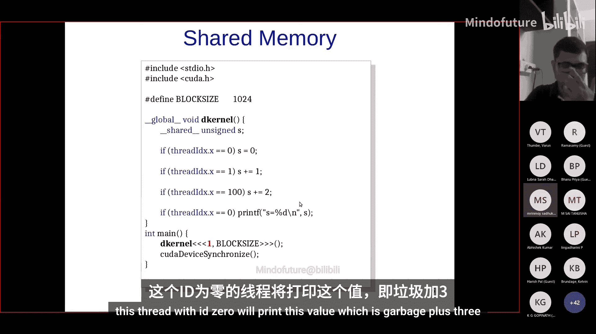

So。Okay， so so far we have seen these three possibilities。1 is one。读。嗯。Garbage。Plus3。はい。

Now I have still one more question for you people， I think my scaling for garbage is wrong。

 but please I assume that this is garbage。Can we get。Garbage plus2 as output。

My question is we have seen these three right，1，2，3 and garbage plus3 is three possible sorry。

 four possible outputs that can occur out of this program。

Can we get garbage plus2 as the output， I'll quickly move to these slide so that we can。

Think about it， can we get garbage plus2 as output？

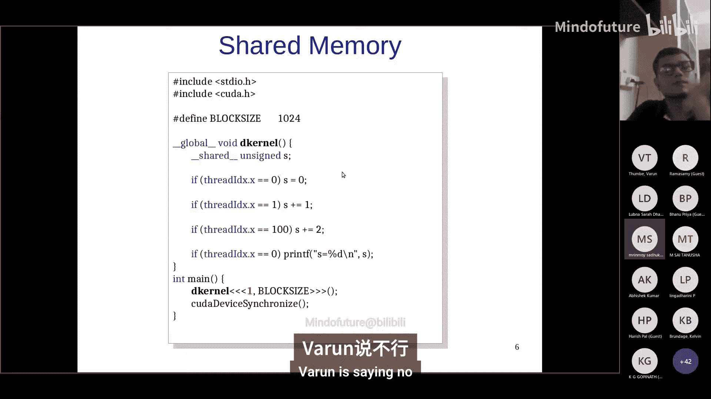

バに sayingの。Okay， why know do you want to give some comments for that why you are assuming that the quantity comment I have is one essentially the zero and one threads belong to the same word so。

嗯。好等呃好。Please call the。0。The statement correspondinging to S equal to 0 is executed along with which S plus equal to 2 is executed in parallel。

No， no， no， okay， please understand here that they are not executing in parallel since they are war threats。

They are executing in MC empty fashion， so this will be done， then only this will be done。

I was talking of0 and00 for that， it is correct here。 then go ahead， how can you say that it's no。

The execution of S equal to 0 and s plus equal to1 has to happen and the race condition will be at at most at one of them。

Either it has equal to 0， or。Yeah， race condition will be either at this place or this place。

 it cant be at once other statement has to execute as what。啊。

That's not the case that other statement has to execute。 but yeah， let us see what will happen。

 I think there is something that you are missing here。 but yeah， let us understand it。Get at us。

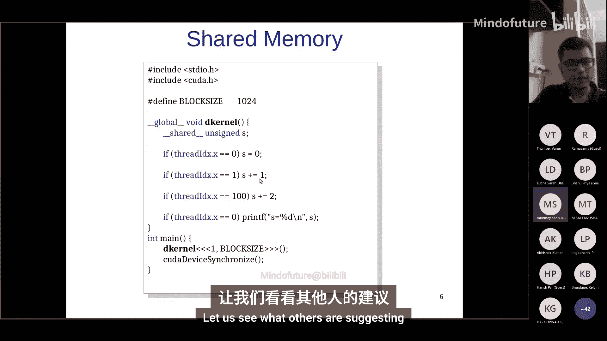

Let's see what others are suggesting。The Hihiksh is saying yes， if you are saying yes， how I mean。

When if you are saying no then how and yes， then why you should add some。嗯。

Con conclusive argument to your yeah please correct Yeah your article So， so like like I'm not sure。

 but like if the risk condition is between the third and the fourth statements take we initialized it as zero added one。

And between printer and S plus equals to that is race condition。Yes， I think that is correct。

 so let us understand why garbage yeah， so answer is yes， garbage plus two can also be printed。

 but let us understand why it can be printed。So let us assume that this two statement happened in parallel as equals to0 and s plus equals to 2。

So initially the value rate here will be garbage here also it will rate garbage because yeah。

 both will rate garbage value。Now， let us say that this100 thread red garbage value。

It added added that two to that garbage value， so the result was garbage garbage plus 2 okay。

But before storing that garbage plus  two into s， what happened is that okay。

 so that storage is pending。So before happening that storage by storage here。

 what happened is that here thread0 assigned value 0 to it 0 to the S。呃。It did s equals to s plus 1。

And okay， so here the value of S was one。But after that。

 this thing happens storage of garbage plus 2 to the S。

 so the final value of S will be garbage plus 2。Because here0 was stored， then one one was added。

 then one was stored。Sttod and then finally this garbage plus2。

 which was completed here by the thread0 was stored in this。

So the final right that happened to the variable s。If the order of execution。

 which I told would have happened， then the final value of has。

that would be there would be garbage plus two because the final rightward was done by this threat。

W which was having that garbage just to as the compute value inside it。So yeah。

 garbage plus two will be there and then finally threads zero print garbage plus two。So yeah。

 five possible outputs， one， two， three， garbage plus2 garbage plus three。

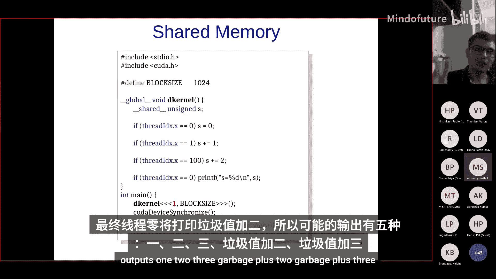

I hope this is clear if there are any questions at this point， then please ask。

Because I think there might be some confusion。Among you people。

 but yeah please feel free to ask the questions here。There are no questions。

 then we will move further。

I didn't catch again。So how when you have garbage。The thread I D0 and。

The first warp has already increased it and changed the shared to one right how can it still be garbage when the thread id under understand that is understand。

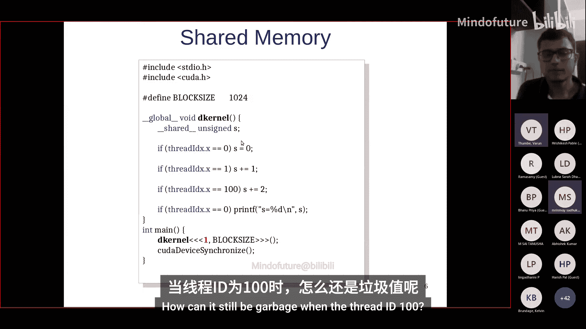

So， yeah。So initially， if you assume a minute。Yeah I'll explain garbage plus rate。

 but let us first understand garbage press2。So initially I was garbage。啊，O。

Now this garbage value is read by。Right to the local registers of this quote the threads， right？

So this thread zero and thread00 will have garbage value read into that local register。

 so let us understand this。

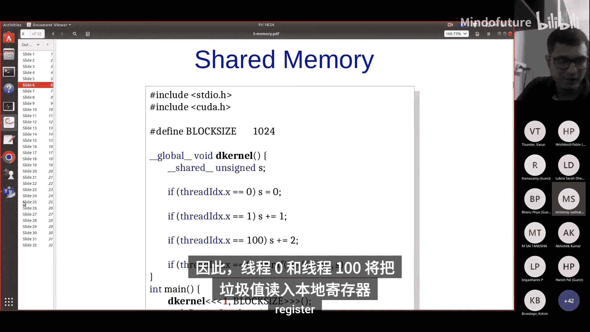

So whenever I say S。Equals to s plus 2， something like this is happening on any thread。

 what is happening is this will happen if this single statement。

Will be broken into three statements at the assembly level， assembly level so。あ、です。

Register equals to as will happen as will be added into the register。Register refer to register。

B two will happen。啊，等。As equal to the register problem。

So this single statement is broken into these three statements。

Now， let us say that this。Ting here。Statement here by 300， it read the garbage value。

As per are this here。

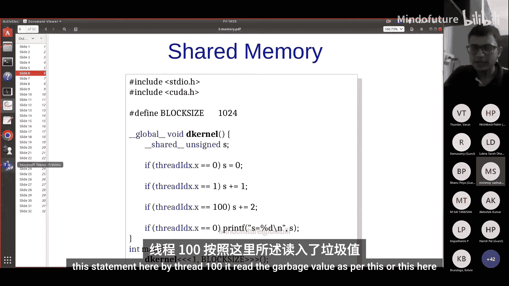

So this register now has garbage well， okay， is it okay till now？

Now now let us say it has red garbage shell get it。

Garbage plus2 here now this register has garbage value。

 so garbage plus two is there and it's stored inside the register okay。啊。And okay。

 so this is re stored garbage plus two。

Now， what will happen is let's say。This。

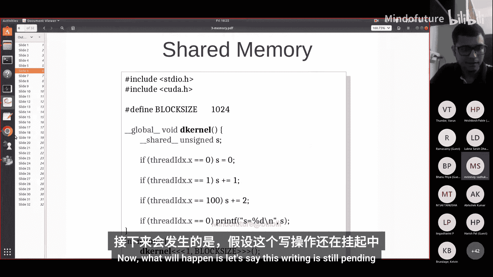

This writing is still pending， this garbage plus to writing as is still pending。

Meanwhile， what happens is？S right， the garbageage value made it to 0。

Then this thread one also incremented it to one。So S was written one。

But the value of S finished will be garbage plus2。

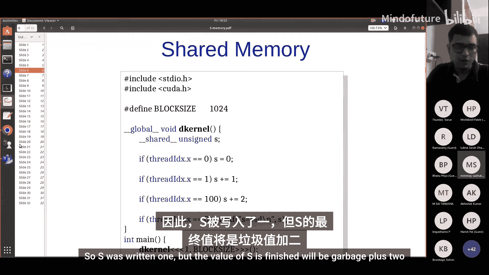

Because they registered storing garbage plus too and。

Here the last thing that will be done is garbage plus2 will be stored back in the S。Yeah二。あそ。

So finally， this garbage plus two will be there because this one is the one which is doing the last operation。

And after that they thread with I0 frames。Then it will print garbage possible。

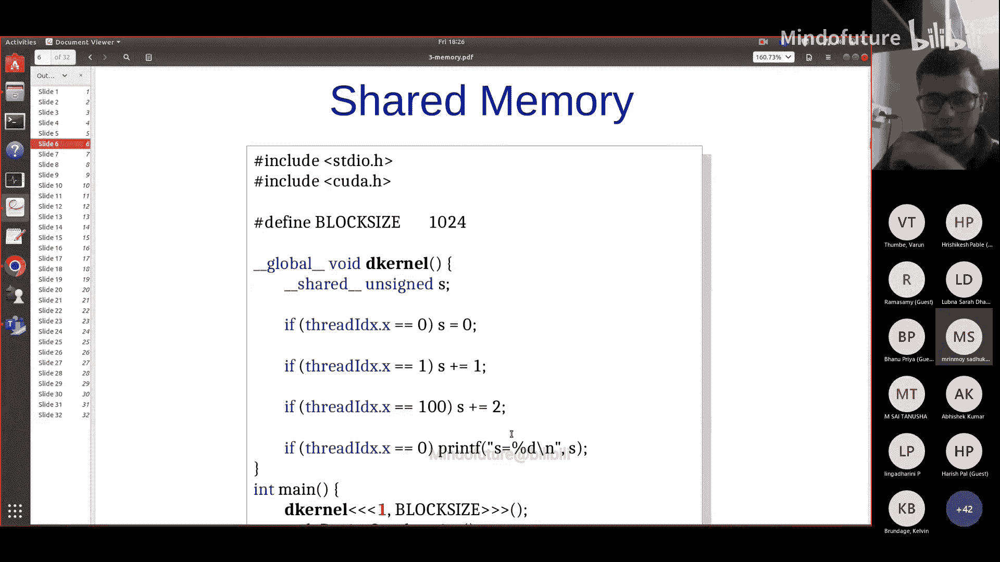

I hope that is clear。Okay， garbage plus three and quickly。

TheR， why can it happen？So， again。

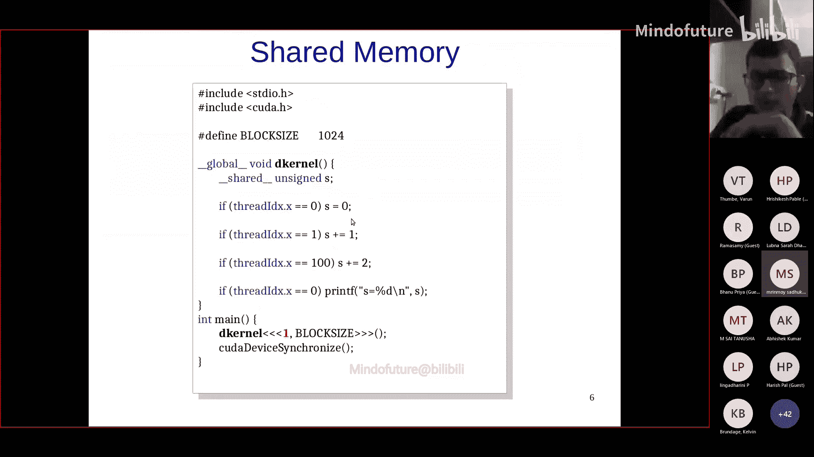

As I explained here that this statement s equals to es2 can be splited into these three statements。

系啊。

So what might happen is， let's say this value of s， which was red here。It be garbage， here。

 it will be garbage， here it will be garbage。But let us say this thread with ID 0 initials the value of s to 0。

 but before that the value of s， which was read as garbage here。

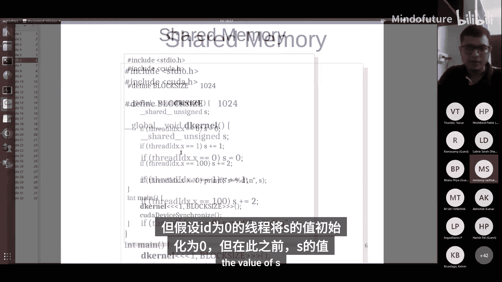

Here which sorry， which was read as garbage here。Well add two to the garbage and will store garbage plus two。

So since these two things are executing concurrently and the s equals to 0 is written before this。

So final value that will happen that will be there will be。

Gbage plus two after execution of this and let us say that after that thing this thing is executed s plus equals to1 so as is having garbage plus two。

Doing plus one to it will give garbage plus。And the final value that is printed will be garbage first。

So， total 5。Execution， I mean， five outputs are possible，1，2，3， garbage plus 2 and garbage plus3。

I hope that's clear。

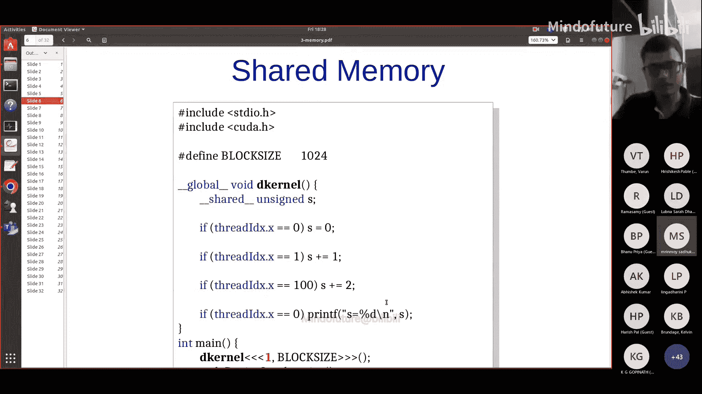

Okay， I hope that that is clear if there are any questions further than you can ask here。

I'll pull here for probably a few seconds and then we'll move on。

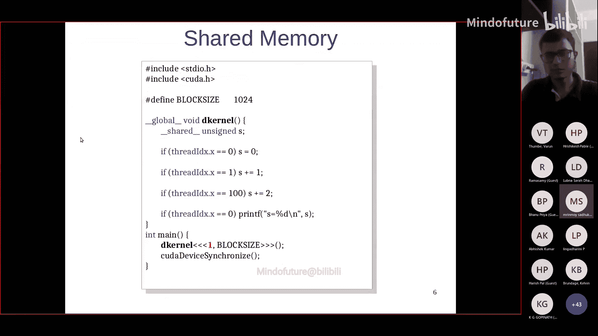

Okay， I'm assuming that it's clear so。My next question is simple。

 let us just quickly look into what what we can do with this so my next question is very simple let us say so there are five outputs possible here right but let us say that we want to restrict the output to just one value which is three and how can we do this？

It's my question。This program gives multiple output， right？

This program gives multiple output because of this parallel execution between first warp and the warp。

 which is having thread with ID00。But in order to restrict it， to just give one output。

What can we do here。think about佢。Please post your answers in the chat。

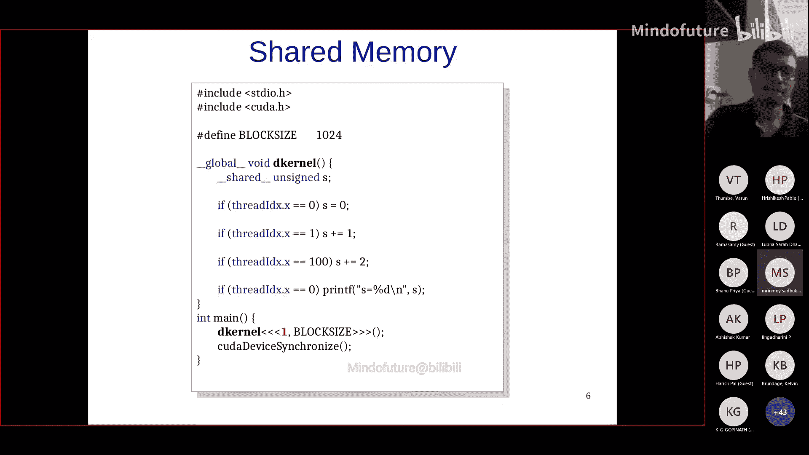

Okay， yeah， so one of the suggestion is。May hundred as some less than 32。 Okay。

 something less than 32 is okay， but let us say that we want to keep it as0。 Still， we want to。

Get the outputs2， and how can we do that？So do we have any control in getting any one of five different outputs no we don't have any control it's completely dependent upon the way the execution will proceed。

So if you execute this program multiple number of times。

 then you might see that there are multiple possible outputs。

 so let us actually see what will happen。

So， okay， let us say I am executing this program once。Then it is possible that I get output。

Let us say that I execute this program once but with two threat blockss now。

Please note that I have made chatlock heres2。Then in that case， also I get the same output 3。

 but let us say that I ran this program for multiple number of times。

Let us say I just ran into two thread blocks， each of1024 threads。But with within the loop of0 to 10。

In that case， I will get 20 possible output because 10 iterations each with two thread blocks。

 so 20 possible outputs。So if you see here， you might see somewhere here one。

And this indicates that even though three is the most likely output。

But the other four outputs that we discussed， which are 1。

2 garbage plus2 and garbage plus 3 are also possible if we execute this program multiple number of times。

Yes you can observe here。So I hope this is clear I think we have over short day time。

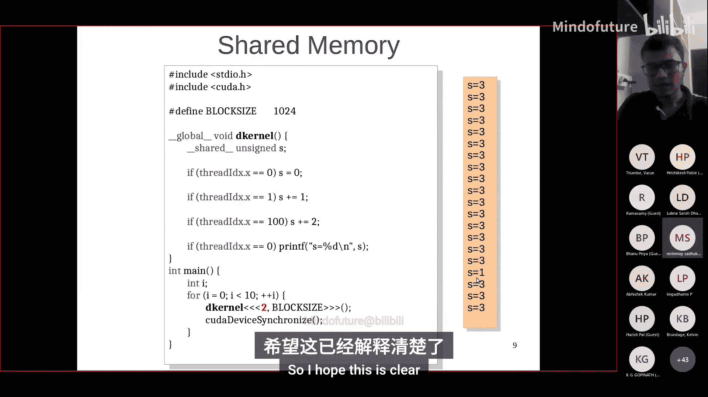

Okay， I'll wait here for a few seconds to take up the questions or a few minutes， probably two。

 three minutes I'll be here for taking up the questions。

If you people have any questions up till this point， then please ask it by unmuting yourself。

Post them on the chat。Any questions up this point from any of the slides？电梯啊。

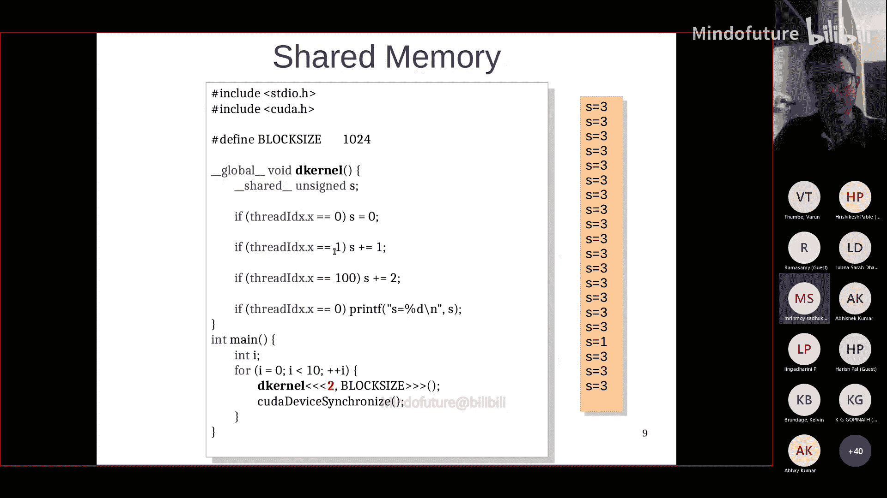

Okay， I got your point for that we can make 100 as something less than 32 or yeah。

 something less than 32。But。Let us say that our computation is such that we can't make that。

that value is less than 32， lets say plus 32 credits are already busy doing something。

Then in that case， we need to pick some thread having guiding more than 3。In that case。

 how can we solve this problem？Probably we willll look this in the next lecture。

So probably next lecture， we'll see what what is this synchronization construct that I was telling at the start of the lecture of this lecture。

That we need to synchronize the threats of the same threat block。

So that will come into the picture here。发者。making the output deterministic here the output is not deterministic。

 it can be any of that5 value， but to make the output deterministic we'll need some that synchronization construct that I was talking。

 which will synchronize the threats of the same third block。

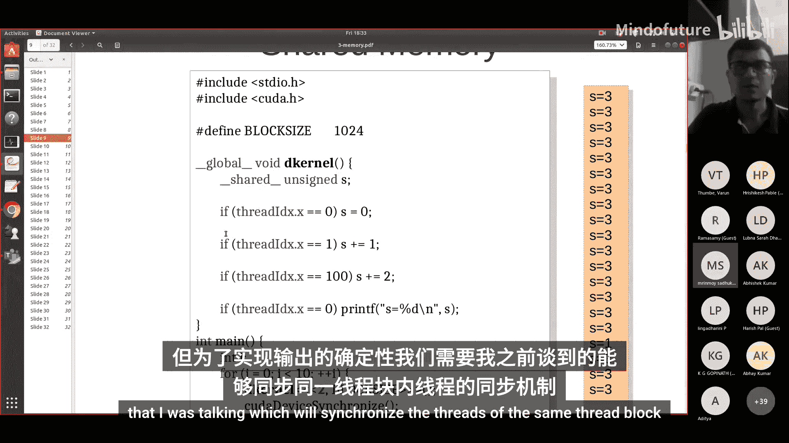

We'll see that in the next lecture， but meanwhile any questions， I'll be there here for a couple of。

So out of deep quite different。Is there something as correct output or incorrect output， I mean。

 is as equal to three？Consider correct and rest as anyone see when it comes to parallel execution。

 there is nothing like correct or incorrect。 There are five possible outputs， I already already say。

But let us say that as a programmer。

When I wrote this code。When I wrote this quote， my expectation was that I want to get the final output as as equals to 3 then in that case I'll say that these four outputs that I am getting which are apart from s equal to 3 are。

Are not as per my expectation。But let us say I was writing this quote in such a way to。啊。

I was writing this code in such a way that I wanted to see how can this data affect the final result then I'll be not。

Astonished by looking at this five different outputs。So yeah。

 it depends upon the programmer's perspective of I'll say。

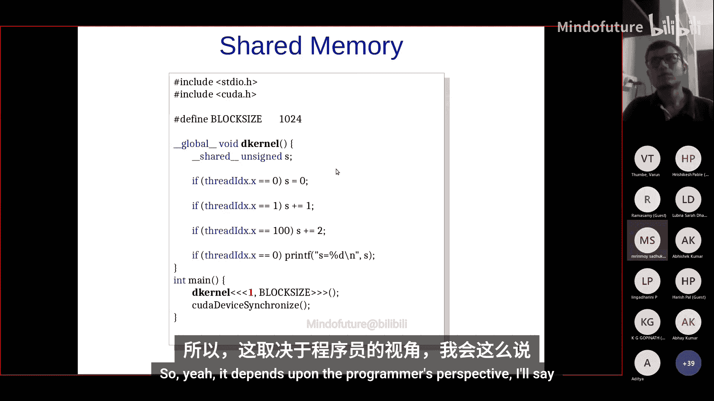

I hope that answers your question， Haish。O。Okay， meanwhile， any questions。

 if there are any other questions， please please feel free to。Like priority andcoding。

 can you elaborate Rammaam like what like priority andcoding。

Say which one you are writing first that happens and probability most of the time。

 it will give the same thing。Yeah。Yeah， i mean。There is probability that one particular order of execution will happen。

Multiple times， but that's the not only one that， I mean， that can happen in this case。

what else you say。There is one part possible order which can happen most likely but has high probability of offering but。

There are other I mean， there are other also possible orders that can。Acur and yeah， I mean。

 you can compare it somewhat like priority and codingding you the way you were suggesting。

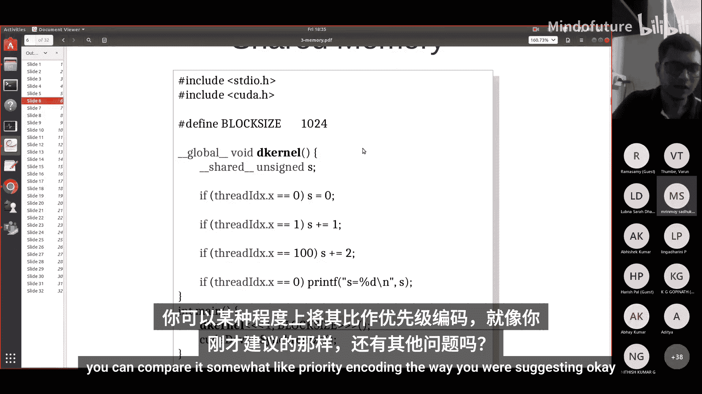

Okay， any further questions？

