# 【Nvidia】CUDA并行编程-｜-Cuda-Programming-Course-｜-Parallel-Computing-Using-Nvidia-p09-P09_L9_动态共享内存与存储体冲突--BV1MSq1BTEho_p9-

Okay， so let's get started， hellello and welcome as well to the 10th lecture of our PuA program。

So in the previous lecture we saw multiple things related to the shared memory right so we saw how that Al cache is divided into two components。

 one is the album cache itself and second component is the shared memory or the scratchboard memory。

And yeah， and then we saw how to okay so then we saw like that album cache is managed by hardware but that shared memory or scratch memory is under the programmer control so we can specify which variable or error should go into that scratch or shared memory and we saw how to allocate I mean allocate variable or an error in that shared memory。

Then we also saw how to access， I mean， how to load store data into that variable which is declared in the shared memory or the area which is declared in the shared memory。

Then we saw like that shared memories per Tlock and each threadlock will have the separate copy of that shared memory。

And yeah， and then after that， we saw multiple programs and multiple examples related to the shared memory。

啊。Yeah， so there we stopped in the last lecture。So that was the outline for the last lecture for tourist lecture。

 we are planning to look that synchronization construct that I used to that I。

Told in the previous lecture， which is syn thread， which is just for synchronizing the threats within the thread blocks。

sorryrry within the thread law and。Yeah， so we'll see that synchronization construct will understand that in detail。

Then we'll see multiple examples related to that centralchronization construct。

 which is across the threat of a threat law。And then we'll see something called a dynamic shared memory。

 how to allocate the shared memory。When it sizes no net run time。Yeah， so how to do that will see。

 how to allocate dynamic shared memory will see。Then we'll also see how to specify the size of that scratchboard memory or shared memory and the size of Al cache using Al cache using some APIs which are provided by Ga。

So we'll see that and towards the end of this lecture probably we'll get some time then we'll see what is band conflict and what are issues related to it and how it is associated with the shared boundary and all this things。

Yeah， so I guess that' see。That's our plan for today。 So with this， let's get started。 Yeah。

 so this was the。If if you all remember this was the last slide that we saw and we saw that this kernelal。

 which is D kernelal， can produce multiple outputs and。

We saw that there are total  five possible outputs， One is。So okay。

 so those five possible outputs are one， two， three garbage plus2 and garbage plus3。

 so those 25 possible outputs that can be printed by this kernel。

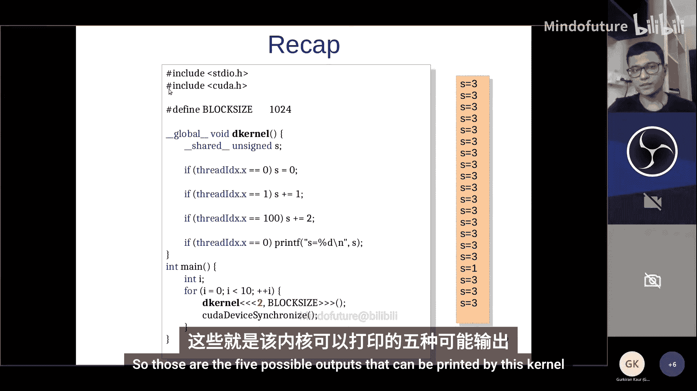

哎 yeah。I like this。

Okay， anyways， let's。Continue where we left up so this was a last slide that we saw in the previous lecture so in this slide I mean so in this slide we saw we saw that there is this D kernel which which can give multiple possible outputs so we saw five possible outputs which are 1 two three garbage plus2 and garbage plus。

And yeah， and we saw that if we run this kernel once or twice， then we might not see。

Any different value apart from three， but if we run it multiple number of times。

 probably 20 times a year as we do here， then we there is some chance that we see some another value apart from three。

And。Yeah， so this this shows that， yeah， I mean， there are multiple possible outputs possible for I mean that are that can be printed by this kernel。

And yeah， that's the brief recap of the last question that we saw。So moving on。

 I have some another classwork for people。So if you can see this code is exactly similar to this previous code that we see that we saw in the previous lecture。

But the change here is that we change this hundred。23 even。

So I request each and every one of you to try out what will be the output of this code if there are multiple outputs then please type all the possible outputs in the chat and please try it out。

And yeah， so here there were multiple possible output output because of the asynchronous executions among the workers。

 so this two statement as well as this statement we executing asynchronous。Due to this。

 there are multiple possible outputs due to data risk plus asynchronous execution。

And we saw how to calculate the multiple outputs for this， but yeah for this case。

 what will be the outputs and。If there are multiple outputs。

 then what will be those multiple outputs， please drive and post your answers and be checked。Yeah。

 please try out and let。

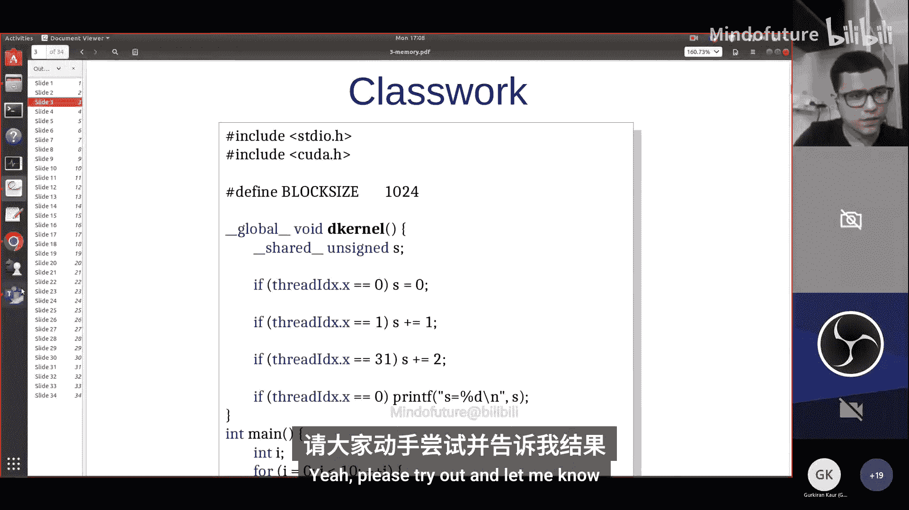

Okay， Baron is saying S equals to 3 only。Yeah，20 times yeah。 that is correct sense。

Since we are running this。Inside the for loop， which is being run from 0 to nine and there are two blocks。

 red blocks。So yeah，20 outputs， but。Yeah， what will be the output for each case？So。

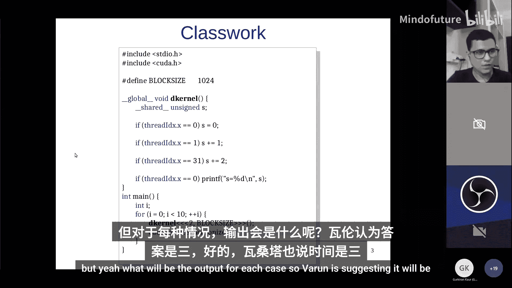

But only suggesting it will be three。O啊。Wasanta is saying it's three， okay。

Request others to also try so。Check跟你说 the good again。哦，行。

佢哋。

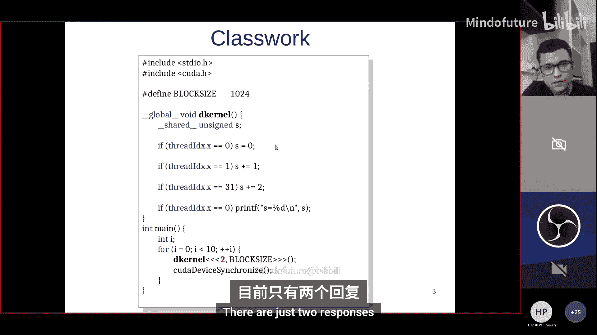

There are just two responses anyways， I'm assuming that you people are trying。

But okay， let us try to understand what will happen in this case。Okay。

 so let us understand what will happen with this code。 So again， this code will， I mean this。啊。

This kernel will be launched 10 times and with two thread blockslocks during each launch。

So during for each third block， what will happen so that for each block。

 there is a shared variable S。And it is being updated by this three inside this with the help of these three statements。

 right this this and this。So， okay， and one thing to observe here is that in the previous case。

 we had this third ID contract here。And this thread 800。Was belonging to the thread。

 which was in the different ver as compared to this two threads。

 So this thread 0 and thread with I D 0 and one where in the one what and thread with I00 was in。

Some other work。So due to this， there was some asynchronous execution happening because this two statement can be interlaved with this statement because as you people remember from the previous previous lectures discussion that war threads can be executed in any interlveing fashion。

If there is， I mean， if they are executing simultaneously。

 then there is also a chance of data is so yeah， I mean， among the war threats， I mean。

 among the threats which are in different work， there can be a synchronous execution。

But if you remember for the threads of the same board， we have this C execution。

 which is single instruction multiple data execution。So they will be executing in lockstep fashion。

 so what will happen is since zero thread zero with I0， thread with ID1 and thread will 31。

All these three threads belongs to saying what what will happen is theyll execute in CD fashion that is lockstep fashion。

Thread with so so this will be the execution flow thread with so all the31 threads or probably all the threads of the thread law will come will start executing this kernel。

Here， what will happen is that with I0 will be。Entering this same condition。

 rest of threats will be masked from having ID1 to 31。And all other workshop can execute， I mean。

 go further， but for them， nothing is， I mean， no if condition will be satisfied。

 so nothing will be done。So here only one wordt will be executing the statements right so for the for that just one word and within that1 word they trial with  I0 will be executing the statement as it goes to zero in while all31 threats of that war are masked out so yeah they are masked out。

Then so as value s is initial size to 0， then they move further and the thread with I1 within the same bo will do s plus equals to 1 so as s value is 1。

And meanwhile， no other thread within the same word， meaning thread from 0 to 31。

 except the thread 1 will move further because will not move further because they belong to the same work and they have to execute in lockstep fashion。

So they will be masked out and they' will wait for this thread one to finish execution then again once this thread one finishes execution they will move further。

And now thread with ID 31， which again belongs to that same ball。

 will satisfy this condition and will make s plus plus equals to 2。So value of S will now be  three。

And rest 31 threads with IDd from 0 to 30 will be masked here because they belong to same word again。

And yeah， now the value of s is 3 and thread with id0 will print that value of s。So in this case。

 the output which is present inside， I mean， which is the value of this shared variable s。is three。

 and this output is deterministic because there is no concurrent execution happening here because of this warop based simply execution。

 which is lockstep way of executive statements。So， okay， so here the output is deterministic。

 which is。Three for any case， so even if you run this program any number of times。

 you won't see any different output apart from three。Okay， so that is one case， that is one thing。

But let us say that we are not allowed to change Okay， yeah。

 so let us come back to our original question， this one。Where we had this condition  zero，1 and 100。

 I mean， the side is 01 and 100。Now let us say that we are not allowed to change this 31 to， I mean。

 this 10 to 31， as we did in previous case here。We want this to be 100， we just don't want this to。

 I mean， be 31 and still we want the output to be deterministic， which is three for all the cases。

For all the cases we want output to be 3， but we we can't change the I from other to21 or any other ID。

Which is within the water。Maybe because all the workers are busy doing something or some reason is there。

If that is the case， how can we still guarantee that the output is deterministic， which is3？

So I want each and every of you to think about it。Considering that these creative conditions or this entire piece of code can't be changed。

These conditions can't be changed these things this board lines can't be changed how can we make this code deterministic is my question please think about it and post your answers in the chat or either unmute yourself and you can answer。

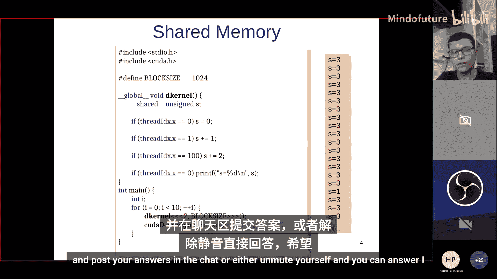

I hope that question is clear。Yes so I guess the previous one。

 everyone understood as equals to three yeah， that's correct。

So request others to think about the question that I ask。We can't change this。The signs。

 this four lines， but still we want。The output to be deterministic。

 which is as equal to three for all the cases。How can we do that。

Partly some brief idea about how can we do that？

Okay， so啊。Deterministic， here is like。So as I'm taking Goal's questions are deterministic here is that。

We just get one output is the meaning of deterministic in this case。

 so we don't want the output to differ across multiple runs as it was happening here so few。

See here if we execute this kernel for multiple runs。

 we can see that there is some different value that we can get so there is this nonmin nondeminism in the output。

What output would be deterministic， meaning that it should give same。Same value for， I mean。

 no matter how many times you run， that is the meaning of determination here。

I hope that is clear right。Decing the block size may reduce the fluctuation in VR。Okay。

 it might reduce the。Fluctuation in the output。 Okay， that is correct。 but I mean， we are not。啊。

We are not bothered about reducing the fluctuation here， parish。

 but we are concerned about the correctness。 So even if it is giving。Rrong output。

 one time out of 100 execution then its I mean， it's seems correct， right？That is our concern here。

Use of atomic barriers to synchronize the threads。Yeah。

 I think this might be the possible solution would you like to。Would you like to add where， I mean。

 explain where we should add the barrier or synchronization construct somewhere？In the example。

Yet。My understanding is the way we can do the things in CPU where we can add locks。

 I don't know how we can do here similarly we need to ensure that the first two statements happens first。

And only then。It the first and set the first warp threads wait。 all the threads wait till。

This is the next execution。 Yes， that is correct。 So we somehow need that these two threads I mean。

 these two statements or there is some sequentiality。 I mean。

 what can I say is that this war threads fast war threads。Finish these two statements。

 then only all the other threads proceed to this statement。So we need something。Something which can。

Provide us that functionality and we'll see how to do that， but let me quickly。

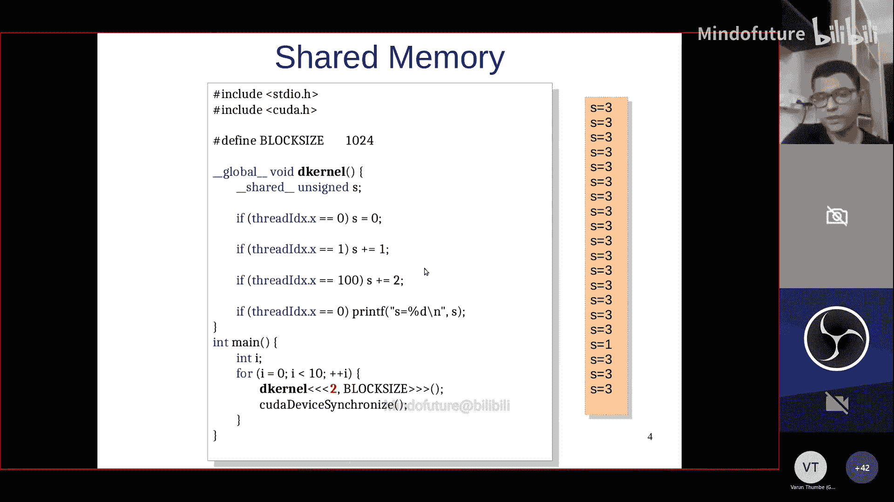

啊。We can get we can set a lag inside cost to with condition use that as a condition itself with。ok 啊。

I don't think that this will work because if you remember this that。

Let us， okay， let us understand the risk risk suggestion。He is suggesting that we use some flag here。

And。That flag is only set when these two conditions are。These two conditions have finished execution。

And if that is the case， then only execute this safe condition。Okay， that is possible。

 but let us understand what what can be the issue there when you declare any flag variable。Here。

 here， in this case。啊。It should be okay， let us say first of all that you declared that variable as not shared but just。

S variable in flag， then in that case that is a thread local variable。And it won' to be accessible。

It won't be accessible across。All the threats I mean even within the threat law so that is one thing that you can't do second is you can use some sort of shared variable like this again。

 so that will be only set when both of these conditions have finished execution。But in that case。

 also， I think you'll need something。I mean， some checks such that it can be tested and set atomically。

 otherwise it will happen that the thread with ID 10。

 which is in different work might see that if the flag value is 0 and it might not execute this statement and will go on。

It should happen that here it should be guaranteed that the value is set to that value of flag is set to true and then only the flag thread with ID under execute this if condition。

If that is not case， an output one will also be possible， so I guess that might cause some issue。But。

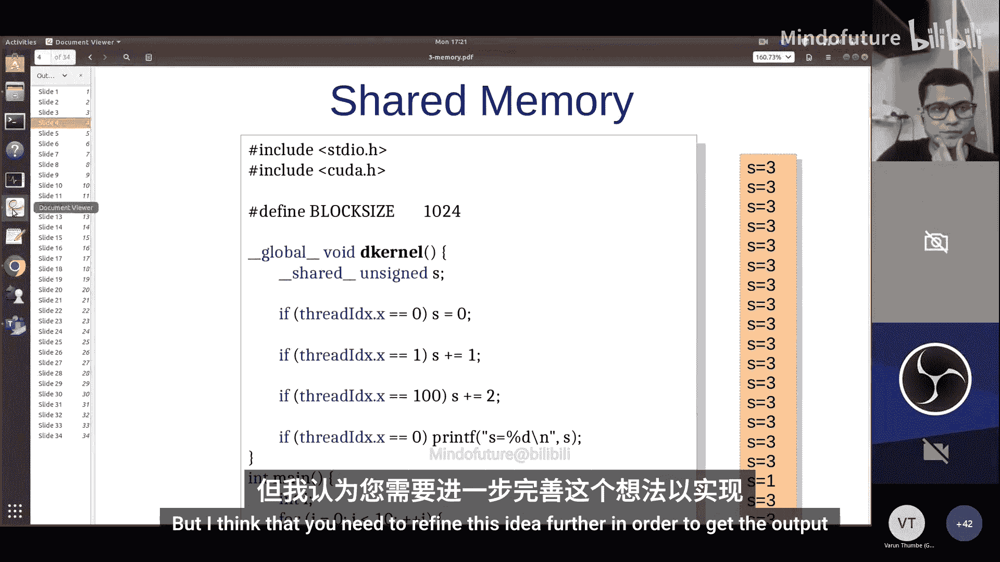

I think that you need to refine this idea further in order to get。诶。The output that we are desiring。

Yeah， so that is thing one thing。Could we use kuda device synchronized inside card？Okay。

 I don't think that the。I think that we can use Quda device synchronize because there is one option of launching kernel from from the another kernel。

So I think there should also be an option for Qa device synchronized but。I haven't seen any code。

 I mean， I haven't seen any example doing this thing， I mean doing code as a device syn from。

Within a kernel， so I can't comment about this thing。So yeah， I am unsure about this。

 like whether we can use coa device syn inside a。 So most probably the answer is yes， but。

I'm unsure about it I。Yeah， so yeah that's it， so with this， let's move on。

Okay， so both I mean you people have at least tried， so let us see what happens here。Okay。

 so we want to， okay， as I said， we want to。Cter deterministic output， which is3， even。

Even when these four lines are not changed。So how can we do that？

So let us try to understand the way it can be done， so here comes the interesting part， which I。

Which I mentioned in the previous lecture， which is the sync thread。

So let us try to understand what this same threat does。

This sync thread is a sort of a synchronization construct。

 which is used to synchronize the threads within the same thread block。

So let us understand with the example what will happen， so think of it as a sort of barrier。

So all the threads， I mean， all the threats within the same threat block will wait here until I mean。

 all not all the threats but whichever thread which reaches here will wait here for all other threats to come and once all the threads have arise arrived。

 then only they'll move to the next treatment。So let us take an analogy here， let us say that。Yeah。

 let us say that we plan to play football match。Uh， and in that case。

 what we do is we like we decide that， yeah， we we Cuopher meet at some common point。

At some place or some some ground will we decide some ground at which will we will all。

 we will all will meet。And from then from there onwards we'll go towards some bigger ground where we can play the football so that point where we all meet that ground is called a synchronization point so we might asynchronously leave our comb and follow different different paths to reach that common point but yeah once we all reach at that common point then only we'll proceed towards our final destination which is the final football game where we are going to play the image so the syn third is something like this。

Among the threats of the same threat block。Let us say the thread one has reached here。

 but all the threads， all other threads which are。Apart from that third one are still here。

 I mean executing some statement here。Which is about this thinker。

Then this thread one will wait here until all other threads have reached here。

Once that all of those threads have reached this point where the syn thread is written。

Then only they'll move to the next statement， which is after this synchron。So yeah。

 that is some sort of the barrier， I mean， all the threads will be I mean。

 all the threads which which have reached here will wait until all other threads。

Have not made up this up to this point。Any questions tell this？

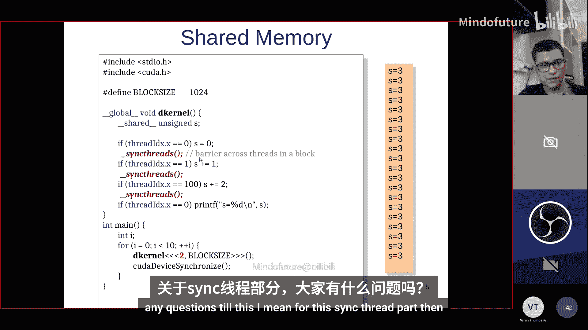

What is sync tri part？But we are look into the。Okay， there is some question， can we pass argument to？

我先石到。Seep of present and what I didn't understand your question， Rammasam， you can you elaborate。

Yeah， in S right。Can we pass some arguments so that some specific set of threat I want to delay or costs？

Okay， I tell now I haven't seen any argument being passed to St Fred such that we want only。

Some of the threads within the thread blocks to centralronize but。Okay， I'm not sure about this。

 but I mean， my best my best hunch is that there is no such。Arguments possible here。

But I need to check whether it is the， I mean， whether it is the case or not like。

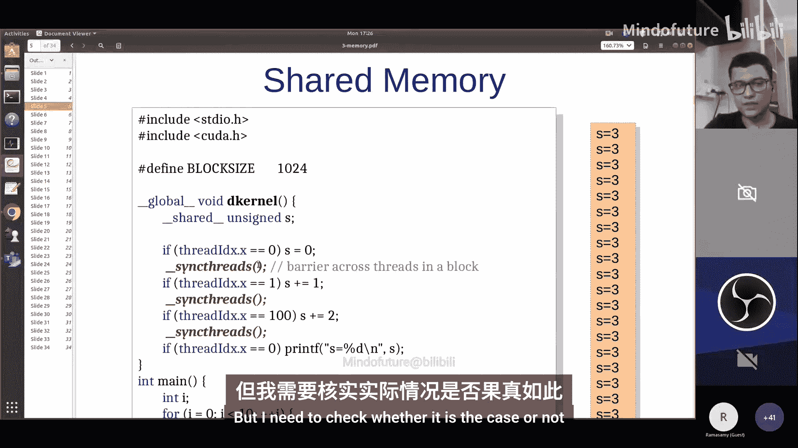

Yeah， so I'll say that I'm not 100% sure， but。That is what I， I mean。

 I think that it is not the case is the answer to this question。Okay， anyways， let's。

There is some questions sir how would synctread work inside if？Okay， yeah， if that's a good question。

 let us understand how Syntht would work inside any。You might remember that one of that。

Slide that we that we saw during computation right in that slide we had that global barrier if you remember inside if。

And we saw what happened in that case， there was a deadlock。

So something like that will happen if you place the synccchred inside the if condition and not all threads are not if all threads are not entering inside the if condition and you are placing that synccreed inside that if condition。

 then there will be a redlock。I hope that's clear if some threads have moved past there if already。

Yeah， I mean， in that case also there will be a title law。I hope that's cool。

I guess we have already seen one example in that computation lecture where there was some global barrier that I used to talk about。

Okay， anyways， let us understand this。Okay， so we understood what is syn threat。

And important point to understand here is that this is a barrier across the threads in a block。

All the threads within the thread block will only wait here。

 so if there is some thread which is not part of that particular thread block and it will just move on it won't wait here for the other threads to come to reach at this point。

If there is a thread within the thread block， then it will reach for all other threads to reach。

Reach at this place and then they'll move ahead。So yeah。

 important point is it's a barrier across threads of the thread block。And again， yeah。

 so this is the barrier across the threads of the threadlock， this shared memory is also。

For0 threads of the thread block。 And yeah。So yeah。

 that that are the two points that I want to specify apart from that。

 this s equals to 0 and s plus equals to 1。A done by the threats of the same work while this S+2 is done by the threat of some another work which doesn't belong to this。

This this thread which is。Sorry， these threads which are in different one。And this printing is。

 again， done by the。Is again done by the thread zero。

 which is not part of the which is not inside the work。What in which this thread0 is there。And yeah。

 and again， we are launching the kernel with two blocks。So yeah， that is the scenario here。

 which is happening。Okay， so with this， let us try to understand。I mean。

 let us try to understand what is the execution flow of this program as we saw for the previous example。

So let us understand what will be the execution flow for one one block right we are we are having。

We are launching kernel with two blocks and that to 10 times or 20。Launches， I mean。

 20 blocks are that total， but。Let us understand what will I mean。

 what will happen for just one block。And yeah， let us it， I mean。

 let us try to understand what will happen。So here shared variable is tick， I mean。

 yeah shared variable is tick。Then。😊，All the all the threads of the same block will come here。

 I mean they'll okay first of all let us for the sake of simplicity city。

 let us assume that this block size is 10 per4。If that is the case， then there is。

 I mean there are two blocks each with 102 qua heads。

 so within software one block there are 102 qua heads or 32 watts to help。

And all the war threats will start execution， will start executing this code。

So they'll execute this this in asynchronously， I mean， Was will execute these things asynchronously。

And all the war will wait here。The threads of the first one。

Theyll theyll be masked out here right because zero thread which is the part of the cost walk is executing this as equal to0。

 mean all other threads are masked out all other threads meaning the threads of that what。

So thread with 30 is here executing all other threads from I having ID from 1 to 31 are masked out here。

And meanwhile， all other threads of the same block are waiting here。

 please note that all other threads with this within the same block are waiting here。

Thread zero is executing this and thread1 to31 are being masked out here。Once that is finished。

 this execution is finished。Threats from 0 to 31 will reach this sync thread statement。

So as now all the threats within the threat blocks have reached here so okay， 0 to 31 were here。

 they came here， rest all were already waiting here。So。Okay。

 so now all the threads within the thread block have reached here。

 so now they can proceed right because it's only barrier across the threads in the same of the。

Same threat block， so since all threats within the same threat block have already reached here。

They can now move forward。What will happen is thread1。

 okay here what will happen is again thread with ID1 will execute this statement。

All other threads of the same word， meaning thread0 and thread。2 to 31 will get masked out。

And rest all threads of different workss will again wait here。Right， they'll wait here。Yeah。

 theyve here and once this statement is being executed by thread with ID1。

All of the threats of the same w as well as the thread with 81 will move ahead and will come here and since now all the threats of the same threatlock have reached the statement they move ahead。

And。They'll come to this condition。They'll see that this。

Stment is true only 43 for they spread with ID100。So thread with ID 100 will be executing this statement。

 meanwhile， all other threads of that work in which this thread with ID00 is there。

 they will be masked out。And all other threats of other wars。

 apart from the warp in which this thread with 1800 is present， they'll be waiting here。

For other threads to reach this， other thread meaning be thread within the war。Having this ID100。

 so they all are masked out here and thread with ID 100 is doing this treatment。

So other threads are waiting here， so once this is finished。

 they'll reach here and all the threads again have reached all the threads of the block have again reached this point。

So they'll move ahead and the thread with I00 will print the value of us。

So if you see at each and every point， we have this synchronization construct and they are again executing in lockstep fashion。

And if you see here the。Law execution is very， very deterministic， So it will never happen that。One。

 okay， it will never happen here that S equalQ should2 is being executed simultaneously with either of these two statements as it was happening。

part this case， if you remember。Here s equals to 2 can execute E is simultaneously with s equals to 0 s plus equals to 1。

But here， if you see because of this synchronization construct， the execution is very， very。

 I mean flow of execution is very very deterministic this will happen then this and then this even there are。

Even if they are executing Simon， I mean。We have the cards among different wars。

 which are executing this statement。But because of this syn construct。

 they'll execute in a very deterministic fashion。And the our court will be always be three in all the cases。

 no matter how many times you run this code。So I hope you I hope you' are getting this point。

 but if there are any questions up till now， then you can。

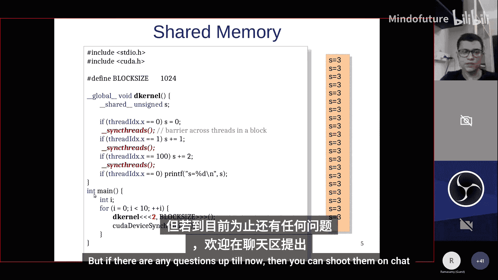

To them check。Okay guess this one I book。So how would synced work inside if okay。

 I also put this two question？Is sink thread or a thread while？

T for tlock while global barriers for all the threats have come。

Then can we think of global virus GPU version of？Yeah， first， I mean， first question is， I mean。

 first thing is correct that you are thinking。Synre is across the threats of the threatlock while barrier global barrier is across all the threats of the GP。

That is correct。The second point is then can we think of global barrier as GP version of O devices？

Yeah， I mean， you can think in that way that it's somewhat similar to Qar device synchronize。

 but what did you build threat？In case of quo device implies CPU will be waiting for all the GPU threads to finish。

But for a global barrier， any of the GPU threats or any of the GPU threads across I mean。

 among all the threads will be waiting for other threads to reach that point。

So that is something called a global value， very similar to S thread。

But but across all the threat blocks and across all the grids， think， I mean， think of it like that。

And we'll see how this global barrier works in way。Upcoming lectures。Any doubt apart from this？

I think there are no other questions then in that case， let's move ahead。

Okay， so now I have one question for。Your people。 Okay， so the question is this。Let us say that。

Third。😊，Picetal。Of block of one block is okay， first of all。

 we are launching the kernel with two blocks， right？So we have two blocks。

 so can it happen that thread zero of block  zero is executing this statement？

While thread one of block1 is executing this treatment， is it possible， okay。

 my question I repeat my question。Since we are launching the kernel with two blocks。

 can it happen the third zero？Of block 0 is executing this statement。

 while thread1 of block 1 is executing this statement。

And please note that we have the same threads at every place we have not removed that can this。

I mean， is this possible， the thing that I asked is think about it and post your answers in the chat。

W are they saying yes。

Request others to also think， I'll just。Quly switch to the slide so that others can see the code and think about it。

If Go is saying it shouldn't be possible because same Bobb threads， right。Okay， well see what I mean。

 well see the reasoning behind it。Its possible since there are no synchronization between threads of different。

Flocks， yes， that's correct。 I mean with the proper explanation。the correct， yeah。She。

 she saying a yes。Book啊 sensor。

There are okay since you people have tried， let us switch back to these slides and understand that whether it is possible or not。

 so short answer is yes， like it is possible that thread whenever the thread。

0 of block zero is executing this statement， thread one of block one might be executing this statement。

And why why is that the case because you if you people understand the syn threadread properly。

 then this sync thread is only the barrier across the threads。Within the same third block。

But if you take two threads， which are inside the I mean， which are inside the different blocks。

 which is here， I mean， which is the case here， two different blocks。And thread one is， I mean。

 thread one is in the block one and thread zero is in the block zero。If that is the case。

 then this thread1， which is in block1， will not wait for the thread 0。

 which is in block 0 at this synchronization point。Because they are in the differents， sorry。

 different blocks， not vers， they are in different blocks。

And synt is only this synchronization barrier。Across the third within the center third block。

Th one will not wait ahead， it will just go on。So yeah， the answer is yes。

 and yeah it is possible because of this reason that syncre is only they buried across the threats within this sinkre。

So I hope it's clear if you have any question at this point， then please feel free to ask。

Discuss the reasoning that you have。Yeah， so by the way。

 the output will be very deterministic in this case， which is three for。Any I mean。

 three or any case I mean。Any number of times you run this board out this column。

 the output will always be three if you add this。成戒。

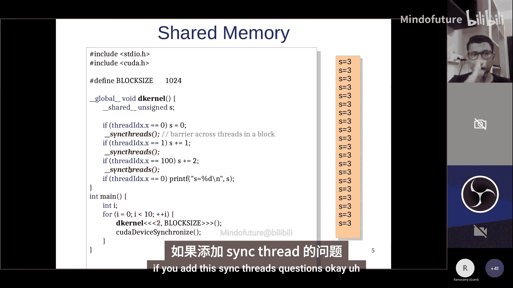

Questions。ok啊。

Okay， I guess there are no questions， okay， then let's move ahead。Okay， I have one more question。

 one last question for this slide my question is， can we remove this。

Can we remove this fast sync thread is my question， if we remove this fast thread。Then。

Will it be the case that we get some non deterministic output？

One deterministic meaning or any other output apart from this three。That we are getting。

If we remove this post。I there， I mean， is there the chance that we get some another output apart from this three you are just removing this for syn rest to our。

Stent there as they are。I hope you've got the question and please think about it。

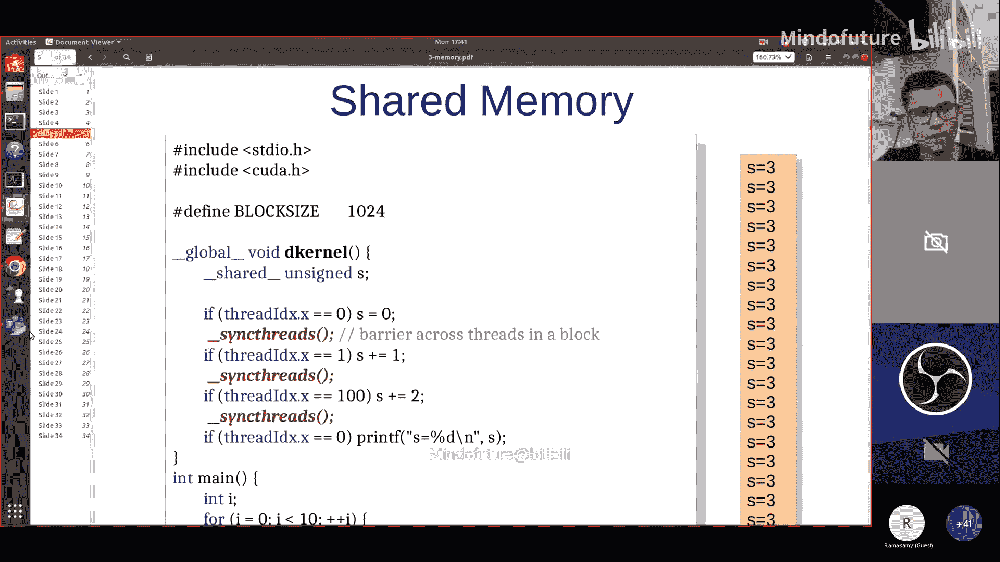

Okay， I think go saying no she saying no。Warm is saying yes。

 because fast two threads are within same warp and they have automatic synchronization。Okay。

 I didn't understand the connection between the answer yes and the reasoning were like you are saying that。

There is automatic actually cost two yeah， the first two statements have synchronization。

 at least for the first war so if we think。

The the hundredth thread anyway doesn't go through this statement and it can wait after the first two statements has executed。

 so the first thing thread is not even needed for the hundred。Thread index。

For the first two thread index as far as it is conduct it executes in lockstep fashion so if we have sync threads if we don't have in both of the cases S will be one and it will just stop at that point and for100 thread ID it will anyway stop at the second sync thread first is not needed in that case Okay okay I got it I mean so I think your reasoning is correct and answer is also conflict this first sync thread is not needed this is redant。

The reason is the one that Veroon explained。Since this thread 0 and thread1。

 which are the part of the same one。And since they are the part of the same boat。

They are executing in lock step fashion so s equals to zero will be executed by the threads of the first war。

 I mean not threads of the first war， but zero third of the first war and rest of all threats will be masked up。

Meanwhile， all other wars may proceed， but they won't execute this statement， neither the statement。

 so they have to wait here even if this synch is not there。They'll eventually wait here at this in。

And。All other threads， I mean， all other the threads of the first walk will move ahead only after the thread zero of that work has finished this statement execution of this statement。

Then then move ahead once this is done by this zero right。So fast all will come here。

They'll see that T one has to execute something here， so they T one will execute。

 meanwhile others will be masked up。And please note that at that time all other war threats apart from the first war。

 all other wars are waiting here。And once s equals to1 is done。

 then the first walk will reach here and then the entire execution is same as we saw earlier。

And if you see if we follow this execution flow， then again。

 the output that we willll get is deterministic， which is  three again。

So fast inputed is not needed because of the lockstep execution， I mean， lockstep execution。

 the way that the warlets execute。Is lockstep I mean it's lockstep where we are executing and due to that we don't need this fast sync thread。

So I hope that's clear。So yeah， this processing thread is redundant。And even if you remove it。

 the output which which is three， will be deterministic in all the cases。

 even if you run it any number of time。So yeah， I mean。

 if you try running this program by removing this， then also it would give same， I mean。

 same result and deterministic output will be there。

I hope that's clear if there are any questions I'll take quickly。

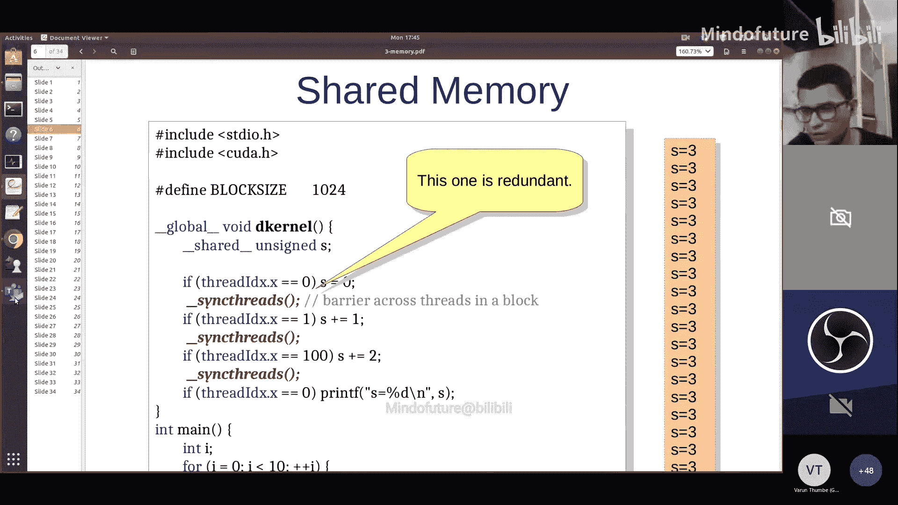

It could be that the block2 S equals to 0 to the x after block 1 as equals to0。

Could that be the block as equal equal to 0。Execut the block1。Yeah， I mean， it's possible。

 completely possible， so you are telling that block2 s equals to zero。

Execcuts after block one S equals to S plus equals to one It's possible， right。

 because if two threads are in different work， then any any order of execution is possible。

 I hope that's clear co because they are。

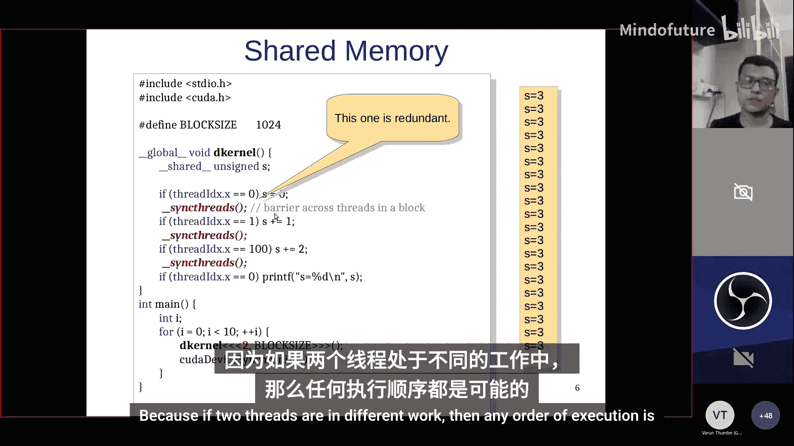

Inside the。It could be above situation happen here， I mean。

 it's completely possible that this will happen。I hope that's clear because if two threads are within different blocks。

 then。There is no restriction in the way they execute they are completely asynchronous。

So anything can happen any order of execution is possible。Okay， I hope that is clear。

If there are questions any I mean， you have any questions further go with them please feel free to ask。

I'm assuming that it's clear， so I'm moving forward。Okay， so let's move ahead。And。Let us。

 let us try to。Predict the output of this program。So， okay， so first of all I'll try， I mean。

 I'll like to ask you people， what will be the output of this code？

So here we are launching the garden。With 10 blocks and each block of size block size。

And assuming that block size is some number greater than 32。which is we are launching a block。

 I mean 10 blocks each having more than just one warop of thread， I mean。

 having multiple blocks in other sorry， multiple wars in other sense。So 10 blocks。

 each having multiple wars inside it while launching the kernel。

And then we are deciculating some shared memory， and then we are doing some computation。

And then we are printing some。String， which is here。 We are printing it here。And yeah。

This is what will do， I mean， this is where the output will be generateded。

So I want you people to think about what what is the， I mean。

 what is the possible output for this program？Or I mean， is there any issue that will happen？

Or what will be the output or is there anything that we should add here or something？

Please think about it and post your answers in the chat。

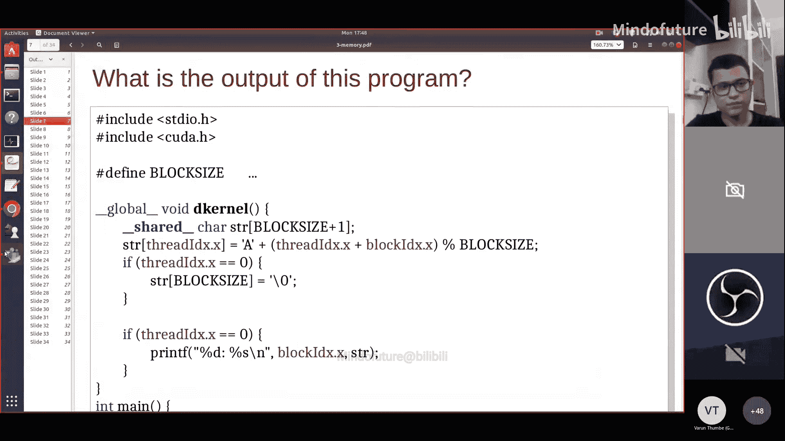

Cl that's good， I'll probably switch back to this slide。

系。

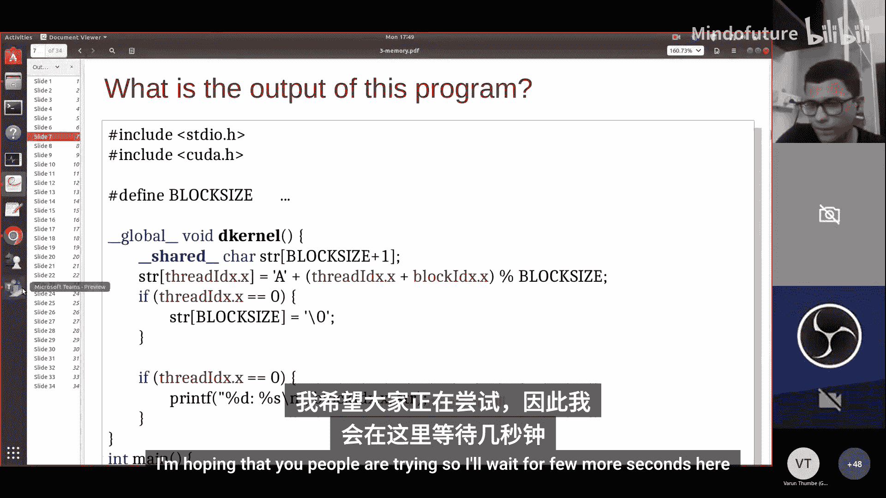

I'm hoping that you people are trying， so I'll wait few wait for a few more seconds。

Here， so that you can get some more time for trying and。After that。

 we' will discuss what what what what can be the possible output or what can be the possible issue with this code or output with this。

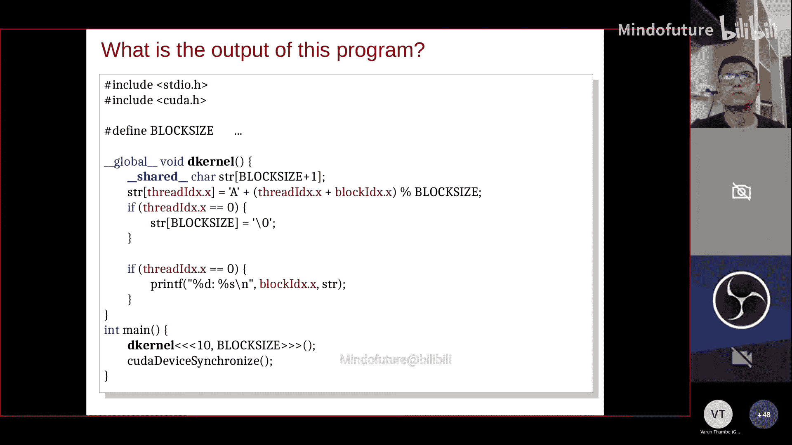

Cowood has typed something 65， 66， 67， 68。I guess you are trying to。We're trying to。

Fra the ask values after a PC in that order， I am supposing that like。As value of A，B，C， D。

 and so on。

Okay， let us see what will happen， So I am hoping that you people have tried。But with this。

 let us understand what will happen with this score。So yeah。

 let us see what will happen so actually there is one issue with this code which is actually there is some bug with this code。

 so let us understand what is that bug with this code。So yeah， let us understand。

 so we are launching the kernel with 10 blocks each having each block having multiple vers。

So that's fine。 So here and now the currently is gone and here what we are doing is we are。Initizing。

 I mean， we are declaring a shared Eric， which is character Eric。Of size blockless one。So。Okay。

 so block plus one size and block size is some greater than 32。

 so let us assume that let us take some random number。Let us said that block size is 1。8。

 so we are declaring。They shared， I mean。We are declaring the character area which is shared across the threads of the threat block。

 I mean threads of the threat block and it sizes 128 plus 1 since we assume that block sizes 128。

Its of， I mean， it is of science 1，28 plus 1， which is 12 minutes。Now each thread here。

This writing towards own copy of the share， I mean shared Eric， if you see here。

 we are using thread ID extra textex and this ID will be unique for each thread。Of the thread block。

 so each thread is writing to the separate separate I mean separate。

Memory location inside this STRARA。And what what is it writing， it is writing something。

 let us assume that it is writing some character。Based on this sum equation。

 but let us not bother about what that character is for now。

So it is doing some writing here in its local I mean and it's some。Memory location。

 is which is different for each thread because this ID is unit。After that。

 after this writing this done。Each I mean， each and every thread will move further ahead or yeah I mean they are executing asynchronously。

 so they move ahead and here thread with high a0 will execute this。

 I mean will satisfy the selfconditional will execute this statement。

Which is STR of blocks as equals to s 0， which is end of this string character。And yeah。

 so end of this string character is based at the last last position in the RFqC in this character array。

And then the thread zero is writing， I mean， is printing this。Enti string got his character vary。

So what can be the issue with this code， so you should observe two things here first of all。

 there is writing happening here。Which is being done by all the threads。I mean。

 of different different wars。So。Threadds of first war are writing something。

 threads of second war are writing something and so on。

That is one thing that's first thing that you should observe second thing that is happening here is thread with I0。

 which is a part of first what is printing something。

So if you see this writing and print writing sorry writing and reading pattern so printing is some sort of reading right we are reading this value of STR and then dumping it to Bar and and then it is printed so here writing is happening and here reading is happening。

So if that is the case， then what might happen， what can possibly go wrong here。

 so what can go wrong is that。Let us let us understand with the example what can go wrong。

 So let us say that thread with。First walk I mean， let us consider the entire crosswa。

 so first walk might finish execution of this statement， the center statement。It might move ahead。

It might also。Enter this ship so when this fast war checks for this ship thread zero will execute this rest all will be masked out。

So let us assume that this first we also finished this， I mean， the safe condition。

 execution of this if condition。Then first wave also came here。And started executing this， mean。

 all other wars were here at this statement and they were they have not finished executing this statement。

And during that time， when the other wars were still executing this。First war。

 thread0 of the first war printed this。Dest thing， SDR。If that is the case。

 then what will be the output？Well， the output here will be garbage。 I mean。

 force 32 elements will be correct because。The threats of cost swap executed in lockstep manner。

 so this statement will be executed and the values from 0 to 31 will get correct correct character I mean correct character values as per our computation。

Then they'll move here， then they'll move and print。So past 32 characters will be current。

But rest other characters which still are being computed here in whose values are are not yet placed in this STR area。

They are not， I mean， they they are not they will not be reflected correctly here。

 so there will be fasted potato characters which are correct and rest might be garbage。

So this is one of the possible output that can happen。 It might also happen that。

The first pop is the last to execute this last point to execute this statement in that case we can get correct output。

But if the first qua executed all these things and came here and printed this and meanwhile。

 others are still here。Then in that case， it might happen that。This the value。

 this character area that we are printing might give just our first 32 values as correct rest our garbage。

And yeah， that is the problem with this code that it might not bring the output as SPR computing。

So that is the bug with this code and okay， I'll ask you people， how can we resolve this thought？

If this is the bug with this code， and how can we resolve this bug is my question？

I'll quickly switch to the chat if there are any questions please feel free to ask。

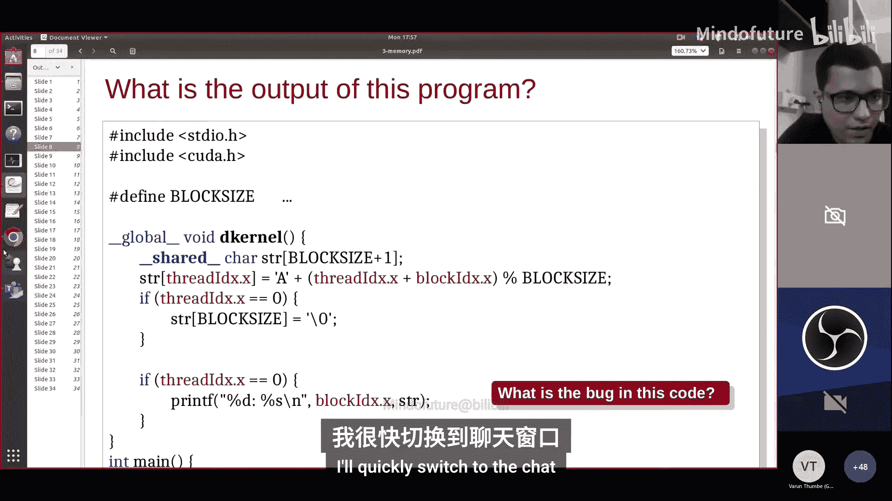

Your borrow is asking null character can be overwritten with other character。Warom。

 can you put some more light on this statement， how can null character be？

Over it with other character。So for the block size， we are assigning null character in that way。

 but with the thread I corresponding to the second of the first thread。嗯。

The first like the 32 3 secondnd thread can execute the first statement。And assign。The value。

At that point。 and so the null character will be overwritten and so。But。Okay。

 but why are you assuming that null character can be overwritten？Block premier。Yeah。

 please go aheadm。Sorry， can you repeat。My so the thread index dot x in the first statement can be 32 right if assuming block size is 32 Yes yeah but。

Block size is 32。 That is correct。 Let's say block size is 32。

Then thread ID extra x will give will have value from 0 to 31， right？

So even the last thread will write to 31 location and this array of size 32， which is from 0 to 3。

 I mean， array of size 33 values going from0 to indexes going from 0 to 32。In that case。

 STR of block size will set STR of 322 null character so it won't happen。

That the overwriting will happen。 overwriting of slash 0 will happen。

 I hope that you are getting this。 But if still， there are any further。

Clarifications needed than please。

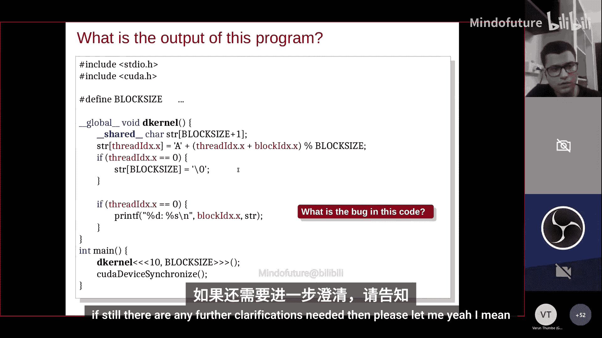

一啊。Yeah， I mean， if there are any further clarifications near that。

I'll make it more collaborative possible。啊。Okay， go saying S thread， okay， S thread。

 but where where should we play Sth？Was sent Tai saying， placing S thread before the。

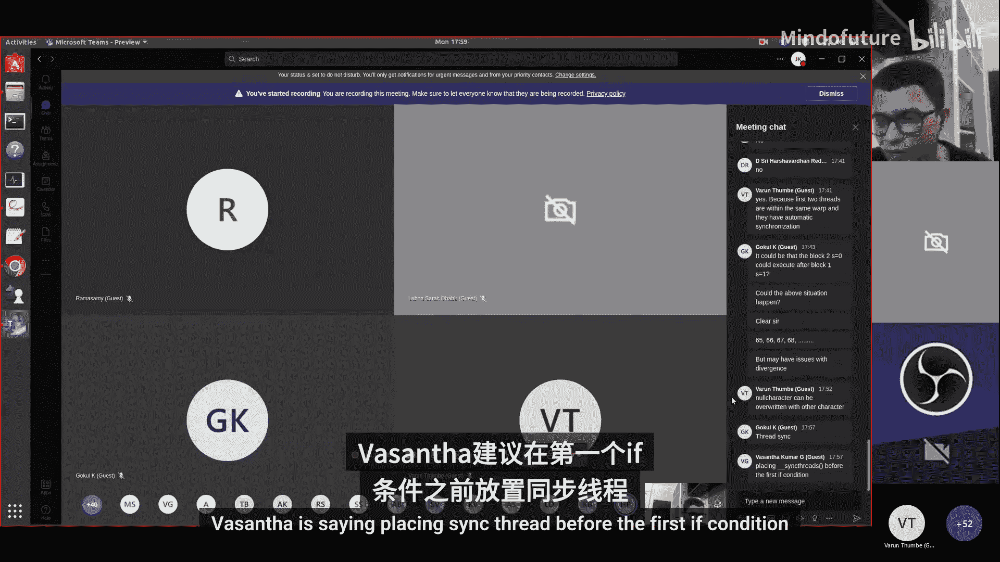

Firststive condition。Okay， fast condition here you are saying。ok。I think that should also what。

Can I request others to also think， but。

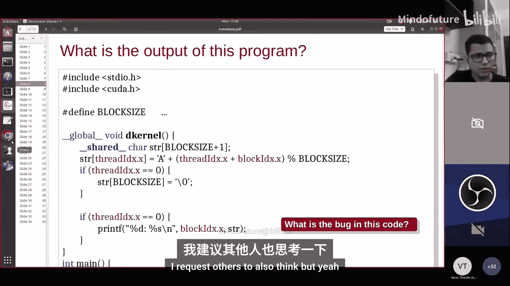

Yeah， before printing， I think this will also work， yeah， let us see what will happen。

Okay， so。The way I've done is like， we can。Okay， so wait， I' have done this like we can。

Place this syn thread before this if condition where printing is happening。So。

What will happen I mean as we saw that。All the threats。

All the threads might be exploiting this statement and meanwhile the zero threat might end up printing this。

So in order to avoid this， we need to separate writing and reading。Triting is happening here， right？

And rating is happening here by some barrier。And this barrier is sync red in in our case。

 so it can be either here or here。After they say far after here， after， I mean。

 before they say power before they serve， they can place it anywhere。So if we place the sinker。

 then let us see what can be the execution flow。So let us assume that earlier scenario where Fred's first mark was coming here and printing this。

String and it was printing some garbage value apart from that first 30。他极都。Characters。

 so let us take that。That case itself。And let us understand what will happen with this sacred。

First one， let us say that it executed this， it came here， it the value of set it set the value。

Of the last entry in this character ready to slash0 and then it is forced through it here right it cant just move ahead because all the other threads of different works which are within the same block。

Are still are still executing this part， so it will wait here for all of threads of the same trip blockss and different wars to finish。

So。If that is the case， then all of the threads of the different walk will finish this thing， right。

 this execution of this thing。And then only they'll move ahead。And once they reach here。

OfAll the threats of other works here， then only be。

First war or the threats of first war can move ahead。 And if that is the case。

 then the other thread sorry other。Strets of different works have already finished writing right。

 your writing thing is finished。And if that is true。Then if the thread zero first warp prints this。

Then it I mean， we are sure that it will not print I think garbage it the value which will be the air I。

The values inside character array， which will be printed。

Will be the value which we have computed and placed here。So。Adding this syn ensures that。

We'll get the correct output as per our computation。

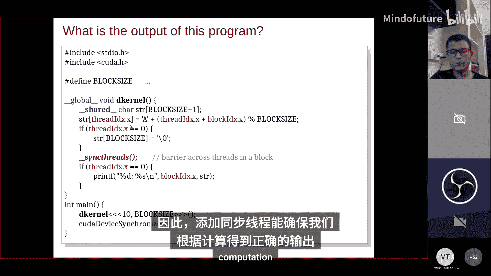

So I hope that's clear， but if still there are any questions then。嗰边冇佢哋整。Okay。

 facing synched before the cost is okay， before printing is also okay。啊。Okay， any questions so far？

Andited to this slide or any previous slide。I didn't cash fully， so you were saying that。

There were only there will be 32 things printed always right， because we are always。

Assigning the Purit second value was null character。Okay。

 so I guess is there is one confusion here this with this block size can be。Arbitrarily large。

 I mean， it can go beyond 30 to also。 So that's one thing that you should not。In that case。

 what I was saying earlier， the thread index dot x， the 32 value for the STR。

 it can override the null character， right？How can you towr let's say you have a block size of 32 let us understand this in case of 64 can we consider like 64 okay。

 let us consider that this block size is 64 right。Then in that case。

 what will be the size of this character 64，64 64 plus1， which is 65？ok。

Now what will happen is each thread。Which has their ID going from 0 to 63。

We'll set some value inside this shared character area， right？

And this values that will be set will will。Only B from the enter 0 to 63。 Do you agree with this。Yes。

 but it's possible that  zero to 32 executes this statement first right rather than other things are waiting and not starting to execute those other。

Because they are in a different war。Okay， that's fine， I mean， if  zero to 32， I mean。

  zero to 31 threads are executing this。Then how can this overwriting can happen if something thinking？

Our block size， again， I imagined us。Yeah， I think you are confusing with this block size。

 so this block sizes。If you are taking it at 64， then here it's 64 and。

The zero thread would always initialize STR of 64 to dis nu characters。And true。

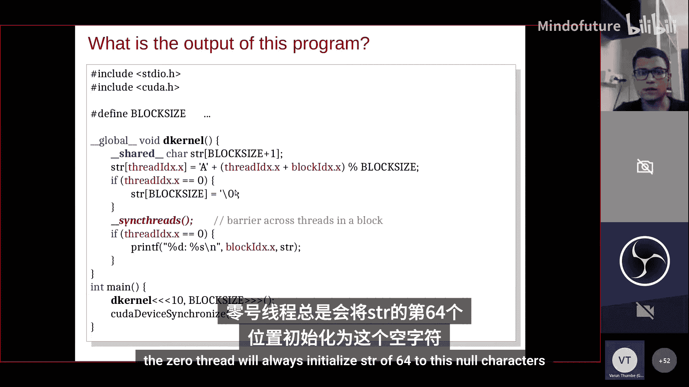

Okay， let us。Let us make it more clarify。What will happen is that let's say that size of s was 65。喂。

no诶。0 to31 threads。Let's say executed here。啊 and end the model。And then they made。This。So okay。

 so S of 0 to 31 is initialized。Okay， some you value， some some that computation that we let us。

Then what the03 is doing， it is setting s of 652。They' actually。And then what is happening is as of。

30 to to 63。He's doing some in it。So it will never happen that this 65 is overwritten in any case。

 let us say even if you。Jmble these three orders。This three order of these three statements。

It will never happen that。Slash0 will be overwritten because。

There is only one thread which is writing to the 65th memory location， and that is the thread zero。

Yeah。I hope that's clear， but since there is confusion， then please。Feel free to ask。

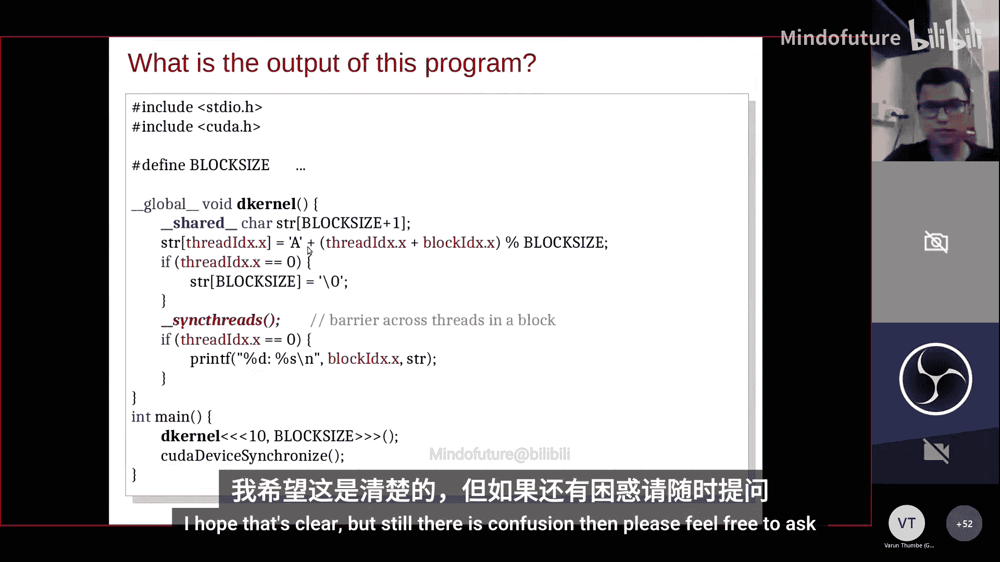

咁解。Okay， I'm assuming that there are no further questions。

Okay， in that case， let's move。Okay， so one thing is if the block size is less than 32。

 then we don't need this same thread right because if block size is less than 32 then we have just one workp and if that is the case then。

This。All the wars will execute in the lockstep fashion， I mean。

 all the threads within the warp will execute in lockstep fashion and。Yeah。

 all these has within the walk pill executing lockstep fashion and there will be no need of synchres because anyways the execution is in step by step manner and。

We are， we are sure that this。Printing will always be done after all the threads have finished this。

Execution of this statement， so writing is always done before reading is that we are I mean is that we are sure about if the block size is circuit because of this h execution of the。

啊 what。But if it is greater than 32， then we need sync thread for sure。

 because among the threads of different mos that can there can be any arbitrary inter livingiv。

Of the state I mean， arbitrary inter living of the executions， I mean， arbitrary inter living。诶合比啊。

Arbitrary executions that can happen part this statements。In that case we definitely need this syntt。

 but if it is less than 32， then we don't need any synt。Yeah， so that's it with this。M。Our next。

Slide， which is about this album versus shared。Memory and in this slide in this slide。

 we will understand how to specify the。Size for the shared memory as well as the other case。

So there is this API called a Qa device set cache config， which is available as part of this。

As part of this kuda library in which we can specify the I mean in which we can specify the amount of size that we want for the album cache or the shared memory。

And its typical。typical synax is this this gooda con。

 which is the name of E or the function instead that we specify the cardinal name I mean cardinal for which we want the size to be configured and then the parameter。

So this parameter decides， I mean， what amount of memory we want to reserve for the albumcation。

 what amount of memory we want to reserve for the。Shared memory or be scratchboard memory。

So cut name is the name of your cut yeah and the parameter can have three values。

 one isa ka P cash pre none name second is album and third is shared。

So let us understand what these three mean。So when you specify quoa cache prefer none。

 quoda fund cash prefer none。At this place here。What will happen is that。

The compiler will automatically figure out the amount of share I。

It will automatically figure out the amount of space needed for the shared memory and the album cache。

So it might some， I mean it might do some pass through your one pass through your kernel and might decide that okay。

Based based on the code that I mean current quote that you have written。

 you might need some well sorry， 16 KB of shared memory4K KB of El cash。

Or it might decide that you might need 32 K of share memory a 32 Kp of El cash in that way it might allocate。

 I mean， it might do the partitioning for the entire El cache。So it's completely， I mean。

 it's completely upon the now it's the completely responsibility of the compiler if you specify this。

The way the partitioning was set。But if you specify this parameter as album。

Then what will happen is 48 KB of space is reserved for the Al cache。

And 16 KB is reserved for the scratchboard memory or the shared memory。

And please note that the entire size of that Al cache is 64 kB， so this partition that you do。

 it should I mean the addition should become 64 so 484 Al and 164 shared memory will make total of 64 for the entire Al cash that we have。

So that is what will happen for Alvin， I mean， 48 kb for shared memory or sorry Al cache and 16 16 kb for shared memory。

Opposed to that， when you specify the。When you specify this parameter as shared。

 what will happen is that compil will allocate  16 kb for  El cache and 48 KB for the shared memory。

So that is how that allocation is done based on this second parameter of this API of this function。

And yeah from okay now one word second also I mean。

 now the Qa also provides a facility to make two equal partition of this。

This entire album cache that is 32 k before1 and 32 k before shared。

And if you want to achieve this thing， then you need to specify the ka cash to equal。

So apart from this three， this fourth。For alternative is also possible for this。

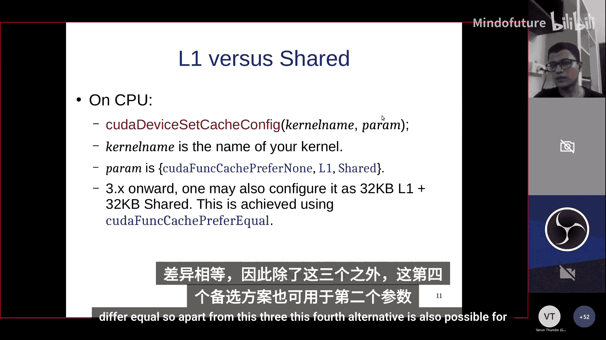

Second parameter。So any questions still this point？

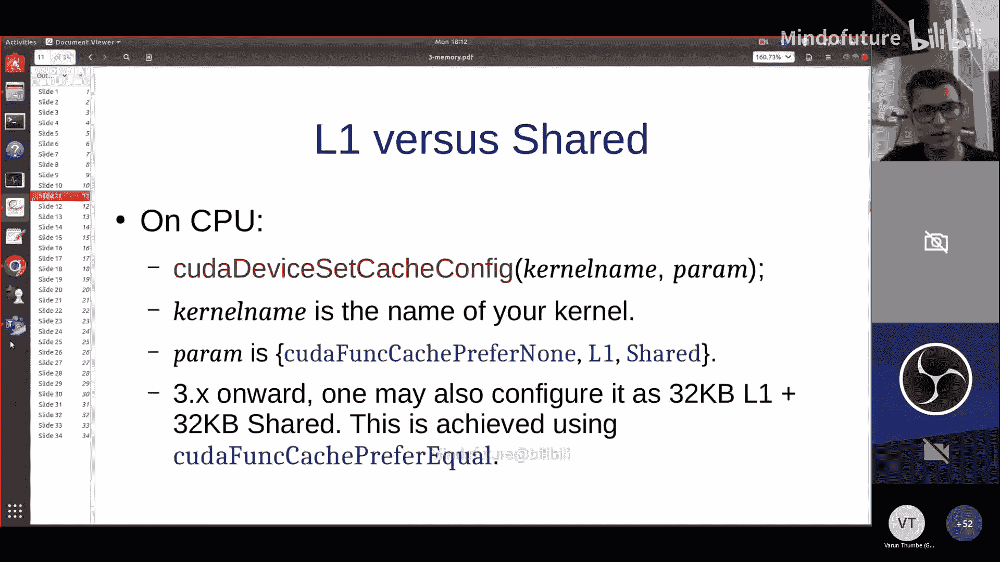

If there are any questions and please feel free to。Pot them on the chat order。

You can unmute yourself， and ask。Okay， I guess， I mean。

 I'm assuming that you have understood things up to this point。

That's the case then let's move on。Okay， so this is one typical example for。This啊。

This function Huda Pg set cache contact。So here， what we are doing is we are。

Launching this kernel D kernel here。But here are specifying the we are specifying the amount of shared memory and everyone cash we want we want for this kernel up prior and how we are doing are。

We are using this quoa set cache conflict function and inside that we are specifying this thing。

 right。For the parameter second parameter we are suspect the quoa fundsks cash Ri album。

 so what it will do is again I。Specialified earlier it will allocate48 KB for the 11 cache and 16 Kb for the。

That's scratch memory or shared memory。And。Then it will launch the kernel。 And here we are。

Andocating the。Data， which is an array of some block size and it's shared。 So yeah it's a。Yeah。

 it shared， so it will be allocated on that scratchboard moment， which has 16 kB of size。

And then we are doing some competition That's okay。 But one thing to observe here is that。

Let us say that you have。Specified this right quoa pump cache prefer album。

 so it will allocate only 16 Kb for the scratch variable， right。So if that is the case。

 then the I mean， the date， I mean， the size of error that you are declaring here。If it exits then。

 I mean， the amount of memory it required for its allocation exceeds then 16kbit。

 then compiler will give。Some compile time error that okay。

 you are asking for more space than what you have， I mean， what you。

What you need that you have specified here。So in that case you need to be careful and specify I mean。

 if you're currently taking more scratch memory or I mean need more scratch memory than you need to specify data on cash or share because。

In this case， it will allocate 48 k before shared memory and 16 k before alum。

So that even you can specify one larger array on the shared memory and do the computation record degree。

So that's one thing。And yeah， and if you want to allocate more I mean if you want to allocate very larger。

 which is again， I mean， which is beyond the size of the album cache itself which is even beyond then 64 kb and you need to I mean you just can't allocate such I mean big error on the shared memory because the size is limited which is 64 kb so you need to allocate memory which is I mean as much as possible on the shared memory which is up to some extent which is up to some size and then once the processing is done for that chunk of the error you need to evic that evot that error and I mean bring the fresh value inside the。

Fresh value from the global memory with that shared memory and then process it so you need to process in in form of chunks if the size of the ER is much。

 I mean， size of the data that you want to process is much greater than the size of the urban cache itself。

 which is the6 per KB size。So yeah， I hope this point is clear。

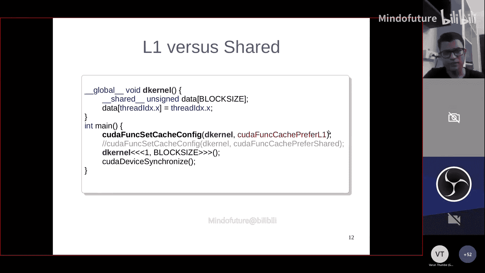

Any questions？Okay， I'm assuming that there are no questions。

Let us move on。ok 啊 so。Let us understand this thing， which is time dynamic shared number。

 So if you see up till this point。The shared memory the way we were declaring the shared memory was like this。

 right？We were declaring this， I mean， declaring this array and then this size of the array using some block size。

And this block size is the con because we were using that hash defined if you remember。

We are using some hash define some value， so this value is known as compile template so compiler will simply even pre processor director will simply replace this block size by that value here。

And the compiler will know the size of the shared memory at the compile time， right。

 so that is one thing。So that's okay if that's the case， then compiler can okay。

 I want to allocate this much memory at the compile and。That is not patient， but。

But let us say that our requirement is slightly different。

 you want to allocate the size of the shared memory。Based on some input that is provided by user。

And if that is the case， lets say want to take some input value from user and based on that input value。

 you want to declare the size of the shared component value。If that is the case。

 then how can we do that and for doing and for such kind of re， we need to use timeynM shared memory。

And let us understand how to do that so yeah， when the amount of shared memory is required。

 shared memory required is unknown at compile， which I talked about。

We need to use the dynamic shared memory。And for doing that。

 we'll use the third parameter of the kernel mun and let us see how to do that。Okay。

 so this is the typical example part the dynamic shared memory。if you see here。

 post thing to observe is that we are using the third parameter in the kernelal launchs。

Till now we have just seen cardinal launch switch two parameters。Qut and second。

But here we are using some third parameter， so let us understand what is happening here。

So first of all we are declaring this variable n and we are scanning this value so this value will only be available at runtime when the user types something or gives some input to the keyboard which will be stored inside this variable n and this value will only be available at run time。

So based on this value of N， which is available at run time， what we do is。

We specify to the compiler that I want the amount of shared memory to be allocated on the kernelal。

Equal to n into the size of him， so I want this much amount of memory to be allocated for the shared。

So we need to specify as the part of the third argument to the current part。

And yeah that is one thing and inside the kernel call we need to take care of one more thing。

 which is while declar the shared memory using underscore underscore shared underscore underscore key。

We need to add one more we need to pre it with one more keyword， which is extra。

It says that this is not， I mean， this size of this shared number is not determined static。

 it is dynamically determined。Based on the value which will be provided by some runtime entity and yeah based on it。

 this size of the shared memory will be decided。And if you see we are not specifying any size here。

 groups observe closely here are we are not specifying any size。

 it is completely based on the renting value that user will provide here。AndBased on that。

 the size of the shared memory will be decided。And rest all of the things are same。

 we are doing the computation as。As put did in the previous case。Okay， so any questions？On how I'm。

On this allocation of the dynamic shared memory， so far。

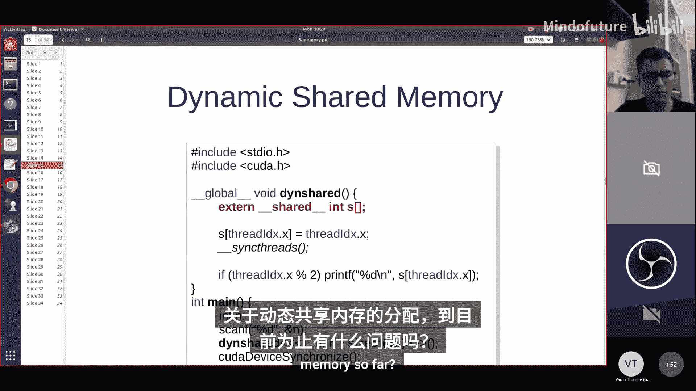

I think there is one question， so why will we no longer use return0 in the main function。

 is it not mess。ok啊。I mean， it's just， I think。

Here we have used it， but。I mean， it's completely dependent upon the compiler。

 I think some see compiler。I mean， some C compiler are strict about this like you should return0。

 otherwise they'll give some compile error。But a few of these C compilers also， I mean。

 they can also specify wide main and then return nothing and that's okay。

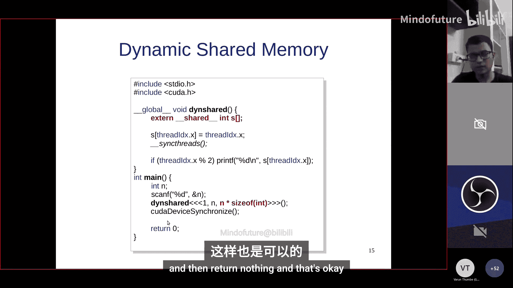

I don't think that will cause any issue here。あり。So is that not necessary？I think it's got I minute。

I won't say that it is not necessary， I mean， you should return if you are specifying in。

 then you should return zero。Is what I'll say。And。I have not tried return， I mean。

 specifying void main and then returning nothing with NVCC， so I'm not sure if that will work。

In most of the cases， the specifying intimate and return zero is okay， otherwise I think if you。

Right wide and written nothing then what will happen is I'm unsure about but。

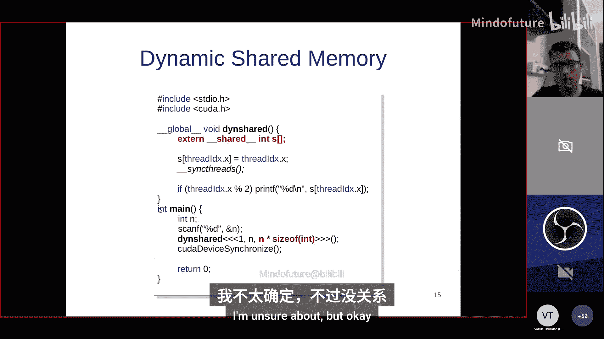

Okay， I think you should check this if you just don't， I mean。

 just specify white and just don't return anything。

And compile the program with NVSC compiler and check out what will happen Haish。

 so yeah Im not sure about this part， but please look into it。

Have you ever seen dynamic shared 2 d array。うん。😊，Okay， I haven't seen。

Any application of dynamic shared memory to 2D array I have seen with one day array so far， but。Yeah。

 I have not seen with 2D area， but if you want it to be 2D then I guess you can。

Still do it I mean， let's say you specify the size as in and here you declare to the area。而家条升啊。

Double braces。 And I think that should work， but。See， I haven't seen such an application so far。

 so I can't。啊。I can't tell you can I mean， I can't tell。

100 percent sure that it will work so you can try here specify sizes and then double double square brackets here。

And see if it is compiling。Ideally， it should allocate n into n。

 but I'm not sure if it will work or not。

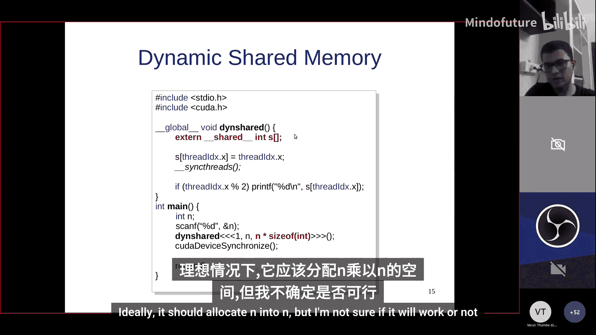

It might also give compile and error。 So I'm not sure。Okay， it sounds like a nightmare。啊Can you啊。

Can you elaborate how I mean。好。It might cause some trouble。Google， would you like to。

Lboerate on that issue。Okay， I think。Okay， in that regard， we can sca meocin kernel。Yeah。

 quoda me is okay but。But I thing is good I look will allocate the memory indeed。globalbal memory。

 which is the。Daam of the GPU。But this shared thing will allocate the memory on the l cache so there is there will be some performance I mean benefit that you'll get by declaring it on L1 cache but anyways I haven't tried this the thing that you are specifying。

Have I mean， this two allocation of 2 d are in the shared memory so。Unsureair about what， I mean。

 what will be the result， Either it would be compile time issue or run time issue or even。I mean。

 some other issue I'm not sure about this， I need to see this。Okay。

 thanks for checking this thing that and this is a compiler， it says the main function must be it。

A type of the main function must be incorporated。Anyways。

 as I told I haven't seen any program so far，For all the QDa programs that I've seen so far。

 it always have that in return time for the main and then they return in zero。Inside the main。

So yeah， it might， I mean it's very likely that it should be errors， so yeah。

 thanks for checking out that。

So with this， let's move further。So let us see one more。Application of this dynamic shared moment。

Let us that you want let us say that you want to allocate the shared memory based on the size of some。

Size of some sorry， based on some value that is provided by the user， as we in the previous place。

 So by declaring this。In as Z the same way but the same way in which we declared N and then we。

write that value from the I mean， write the value from the user and store it in the end。

In the same way here we are using as set。Wwhich is being is being taking the value and storing it。

 I mean， taking some value from the user and storing it inside the S。啊。

Then what we are doing is we are。I mean， we are launching the kernel here。

And we are passing this third parameter in the kernel pole。Which is ased into the size of him。

which says that I want to allocate the shared memory dynamically of size as。

 I mean as into the size of it， which is the asset integer characters。

 I want to allocate for the shared memory。And then I'm also passing two additional parameters which are asset and asset by2。

So yeah， it's based on this asset， the asset by two value will be competitive and will passed。

So here in the kernel asset is stored I mean asset is stored in the variable asset again here。

And I that by two is stored in the variable n1。And then we are declaring this。

Shared sharedhared areas。Which would be your size ased into the size of him。And then。

 what we are doing is。We are are by I mean， we are splitting this array as。

Inlude two subs of equal size。 So how we are doing it， Let us see so。We are declaring two pointers。

 S1 and S2。So they cost pointer。Will point to the starting address of this。Starting on rest of this。

She there is。Which is given by acid itself。And the second point is pointing to the。The entry。

 which is just after the half of that S， which is given by N。So anyone anyone。

 so please note that value of anyone is assessed by two。And。When we do S plus N1。

 they are actually skipping first half of the element。 So quantum will be。

Quantent will be jumping accordingly and the value of S2。Vue of the e， I mean。

The value which will be stored inside the astro will be address of the。Address of the location。

 which is just after the first half of the elements in the areas。So yeah。

 so one pointer is pointing this pointer as one is pointing at the start of the shared memory。

 second pointer S2 is pointing at the middle， I mean。And。Element， which is in the middle of the。

The shared that is。And once that is done， we can use this pointers S1 and S22。

To add the values the way we want using all these commands， all these statements。And yeah。

 that is how we can bifurcate the shared memory， which is allocated dynamically into two parts and use both halves in the way we want。

So I hope this is clear if there are any questions， then please post them on。

Any questions up this point？

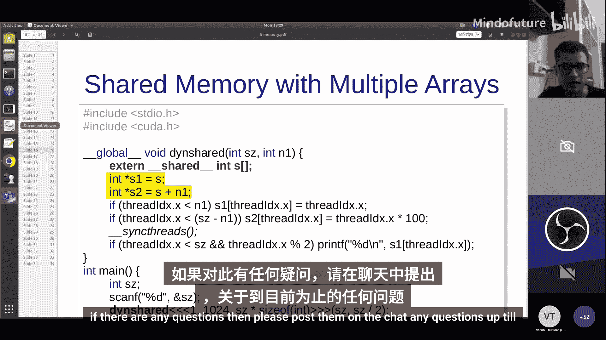

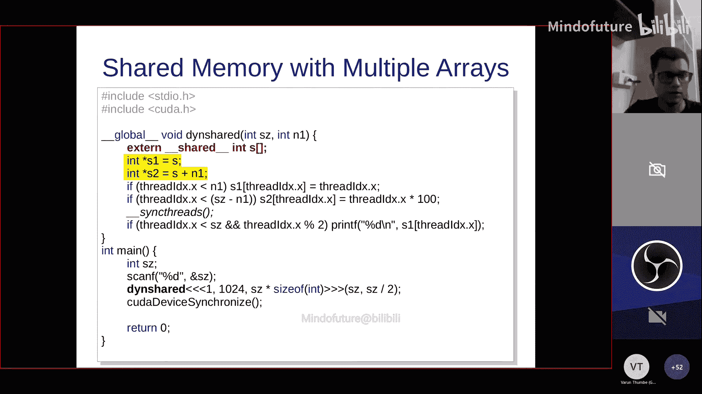

So I'm assuming that there are no questions。

Okay， in that case， let's move on just。Next slide， so let us try to see what is this bank conflict。啊。

So let us just briefly touch upon bank contract for today we probably。

Cover it in a great detail next lecture， but let us touch upon it。

So if few people know that there is this issue of memory coil is sync with I。Not issue。

 but there is this memory coalition that is provided for the DM of the GPU。

And this bank conflict takes something very similar to that memory coalition thing。

But let us understand what is this， so first of all。

 the shared memory is organized into the 32 banks。So there is something called a bank and each shared memory has 32 such banks。

And。And if you want to and two threads of the same thread block， if it accesses the same bank。

Of the shared memory， then those excesses will be sequential。

Let us try to understand this with analogy。So let us say that we are going to some shop to buy some groceryocery and let's say there is just one shopkeeper。

第。If there are persons going multiple people going into that shop， then each I mean。

 since there is only one shockkeeper， each person will be solve sequentially。

 I mean request of each person will be served sequentially。So， here the。Shop is bank。

 so there is just one bank and yeah that there is only one bank and multiple requests which are coming to this bank are like that people coming to that shop for buying something。

And if that is the case， if multiple people are going to same shop by buying something。

 their request requests will be served sequentially。So yeah， so that is the analogy。

 same so excesses to the same bank will be sequential。

But let us say if two threads are going to two different banks for the request。

 then their request will be solve at the same time。Ideally。

If two threads go to the same bank for the memory access， then their excesses will be sequential。

 their excess is with。Shared memory， which is composed of bank will be sequential。

 but if two threats go to the different banks。Then then their memory request can be solve parallel。

So I hope this is clear if there are any questions then。

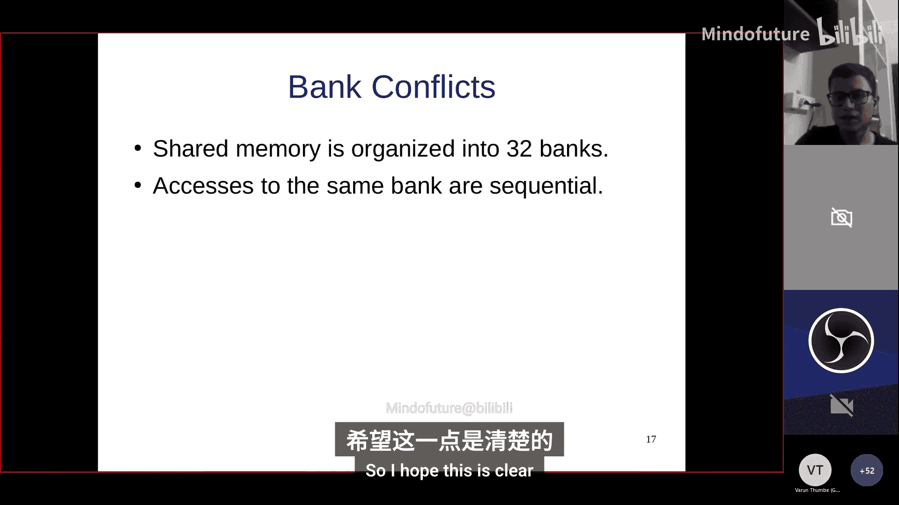

The little。

So， I think。Willll stop here。 We'll cover bank conflicts in detail in the。Next lecture。

 there are a couple of things to relate to it which I want to be able to cover today because we are already out of time。

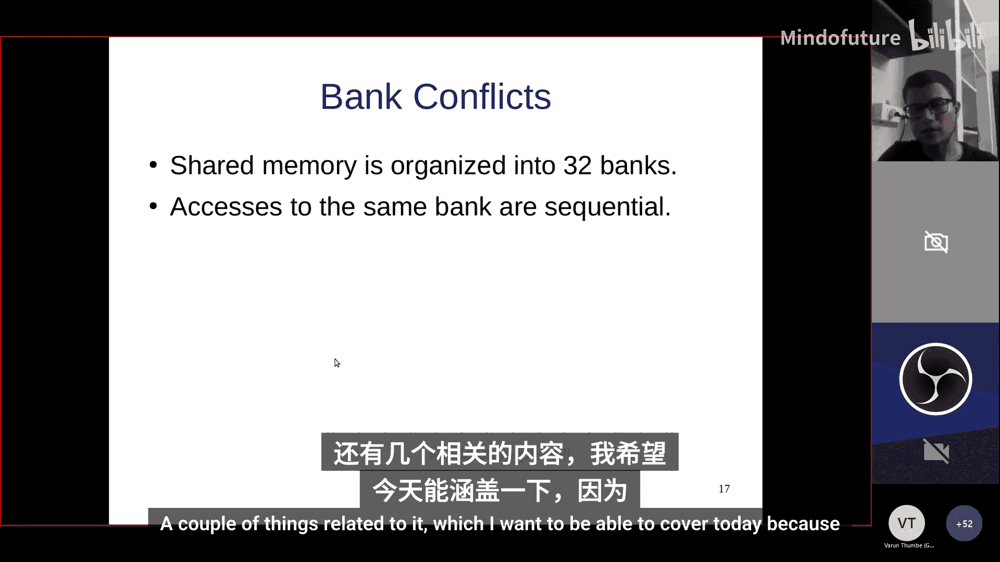

But yeah， if there are any questions， then。Please feel free to ask them。

 I'll be there here for a couple of minutes， so yeah。Okay， sir。

 my question is not related to today's topic， but can you discuss in brief about ray tracing and graphics？

Okay。Devy and show I'm not aware about this。 What is this rate tra can you。

Can you give some example little it？I haven't come across this rate racingcing。听诶。

So it will be helpful， if we can。Claborate on that。And if I know something about it。

 then I'll probably take some time out to。咁物得。Or if you are comfortable， you can also type in。Okay。

 any questions on。

Any of these slides。Covered today。好。Or any of the material which we covered in the previous lecture or previous to previous lecture。

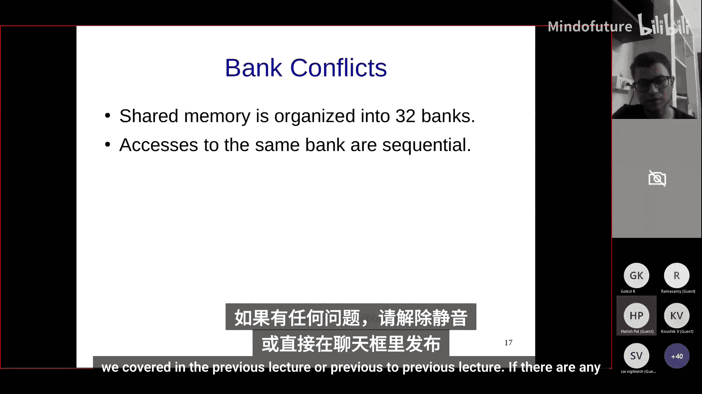

If there are anything please。Unmute yourself or just post them on chat。

rate tracing is application implementation level concept。Okay， I am not sure about this rate racing。

 but。I need to check this out。 What is it。And if it will get some time， I。In the later lectures。

 I'll probably see if I can add something about it。

