# 【Nvidia】CUDA并行编程-｜-Cuda-Programming-Course-｜-Parallel-Computing-Using-Nvidia-p10-P10_L10_存储体冲突（续）、纹理内存、常量内存及计算能力--BV1MSq1BTEho_p10-

啊。

Okay， well， let's get started。Yeah， so hello and welcome everyone to the 11th lecture of our BuA program。

So。So far so in the previous lecture， we saw that synchronization construct。

 which is called a sync thread which。whichch synchronizes the threads。

 which is used for synchronizing the threads which is used for synchronizing the threads within the same thread block。

And then we saw multiple examples related to that sync thread。Construct synchronization。

 construct and。Then we saw that the API called a Sca device sector cache Config。

Which is used to set the amount of。Wwhich is which is used to specify the amount of shared memory and album cache we want。

 so we saw typically that we can specify 32 32 kB of shared memory and 32 kB of album cache or we can specify 30。

48 KbF shared memory and 16 KB of El cash and vice versa。

So we saw that we can set or specify these things using that API called a Ka device set cache con pick。

And then we saw then we saw the。Yeah and then we saw that dynamic shared memory thing right that when let us say that we want to specify the size of the shared memory based based on some argument that is being provided by user at the runtime。

 then how can we do that we saw that we can do that using something called this dynamic shared memory。

And then later towards the end of that previous lecture we saw。

 I mean we briefly touched upon the bank conflict， we saw what is bank conflict and there we stopped in the previous lecture。

So。That was the brief recap of the previous lecture。Okay， so for the today's lecture。

 we are planning to cover the bank complex in detail。

Will be covering bank conflicts with some examples related to will also visualize see how the bank conflicts。

Acur and all distance things。Then， we'll see。The yeah。

 then well see briefly touch upon the texture and constant memory well see one one program related to both texture and constant memory。

And towards the end， will。C诶。Different things to to the QUDa compute capability。

 so what is QUDa compute capability and how its related to the families of cheap use and all those things will be seeing towardss the end of this coa lecture。

And this with the end of the2 days structure， we willll be concluding the memory aspect of the GPU。

And yeah， so that's our agenda for today will be completing the memory aspect。诶对。Yeah。

 so I think with this we should。Get start get started so yeah so this was where we left the right like we saw I mean we saw that there is something called a bank conflict which is very similar to something called which is very similar to memory coalcing that we saw。

But we saw that this bank conflict is something related to the shared memory。But一啲啊。玩 this啊。

Memory coalition is related to the DM of the GP or the global memory。And。Yeah。

 and then we saw that the shared memory。Is composed of something called as bank。

And yeah and typically shared memory is organized into the set of 32 banks。And yeah。

 so we saw that in the previous lecture， and then we also saw that excess if do what threats。

Try to access the same bank then their requests are sub sequentially so accesses to the same bank are sequential that we saw so to accessing the same bank then the request will be one after the we saw that with that typical analogy that we have we are going to I mean people are going to grocery shop or buying something and。

Let us assume that there is only one shopkeeper in that shop then in that case the request of multiple people will be served one after the another。

So in that case， Bank was that shop or shopkeeper。The people were the requests that are made by the work。

 a memory request that are made by the board， so we saw that thing。And yeah， that was， I mean。

 that is where we lost laptop in the previous lecture。Yeah， any questions of that？

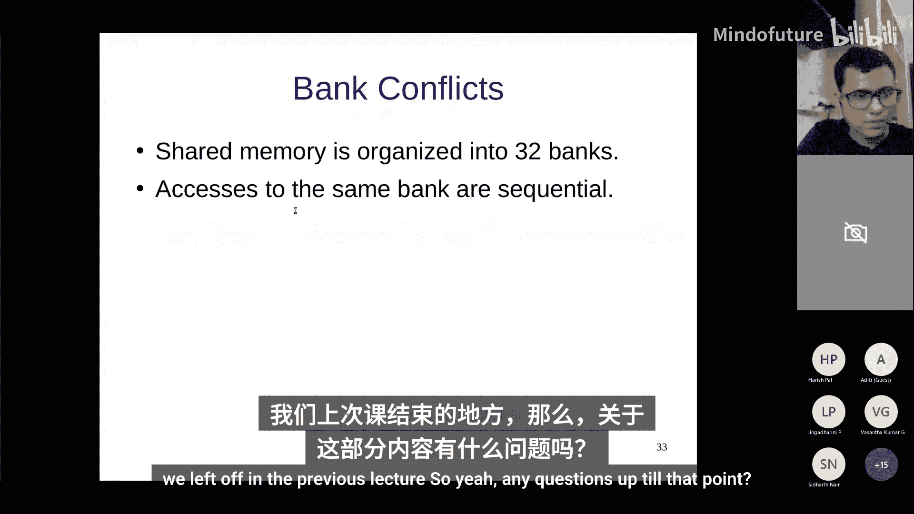

Yeah， I think that part is clear so。

Anyways， let's get started with a two days content。Okay， so before。Before starting further so。

Let us say that I want to clarify one point here。Okay， so let us say that your program。

Let us say that your program is having both issues。

Memory coalition that is you are having uncoaled memory access in your program。

As well as there are bank contracts occurring in Europe。Program。

 which is your quoda program that we have your done。Then in that case， what is important。

 memory coaling or the bank conflict？Can anyone quickly tell me which one mean which one should we give more priority for the optimization？

Pically based on the things that we have covered so hardly。

 you might be able to answer it from this thing on this point。

Which one should be given higher probability memory co or band conflicts。

 which think you should optimize first。And then go with the。

 which should have the higher priority among both。你啊。

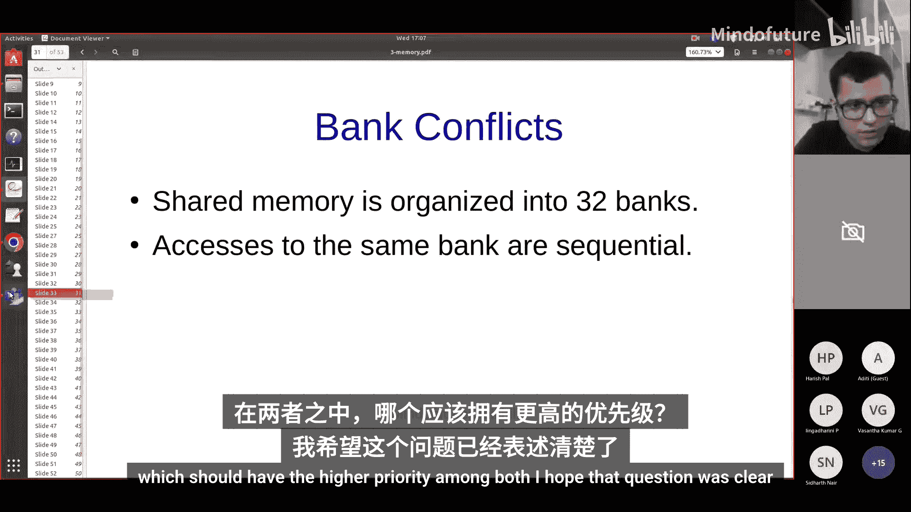

I hope that question was clear up。

Okay anyways， I'll answer this question and leave next question for you people so okay so let us say that our program is having both the things uncoalless memory access as well as the bank pocket then。

First we should go for。Optimizing on the， I mean， making the memory excess call is why。

 because a few people remember the。Memory coalcing is something related to the DM multi the global memory and accessing that global memory is a very costly operation。

 if you remember from the cost lecture of that memory that accessing the global memory takes around。

400 to 800 cycles and if the memory accesses are uncoed there then lot of memory request or the access to the global memory will be made and that will eat a lot of time。

So first thing is improving memory policing。And if that is done。

 if your eggs are completely coalesced。Then if your program is having bank contractss。

 then you should optimize for the bank contract。Or removing those bank contracts。

 optimizing your program by removing those bank contractss。So。Yeah， so again。

 bank conflict will only occur when you are using shared mobile and let us say you have a very。

Very nicely paralleled operation and you are using shared memory for performing that operation and。

During that parallel objectionions that you are performing， there are a lot of。Requests by the wars。

 which are causing the sequential bank excesses。That will cost bank conflict and。

And we'll see how I mean， we'll see the examples for them。The this slide or the next slide， so yeah。

 so I hope that is clear up till this point。Any questions。

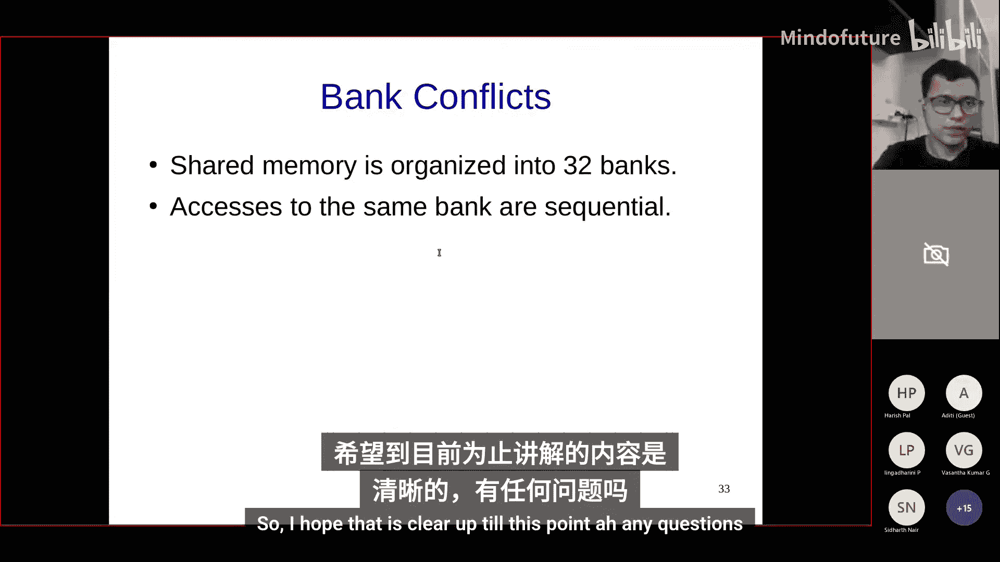

诶 much send missing going。quite ex。It wasnt bank contracts will be given higher priority since shared noise quickly access。

Okay。Was。That is correct that it can be accessed very quickly。If you see if your memory excesses are。

 I mean， unpoless， then that is the biggest bottle like that I would say because that will take even more time。

I hope that is clear that what I expect。啊。Okay anyways。

 if there are any questions related to this point， then you can unmute yourself on us。

Meanwhile， I'll move further so that yeah， so okay， so let us。

Move on and understand this point that consecutive words are stored in the adjacent plan。

So let us understand this point with the example that consecutive words are so case of consecutive words in shared memory cost of。

 consecutive words in shared memory are stored in et。So let us understand with this with an example。

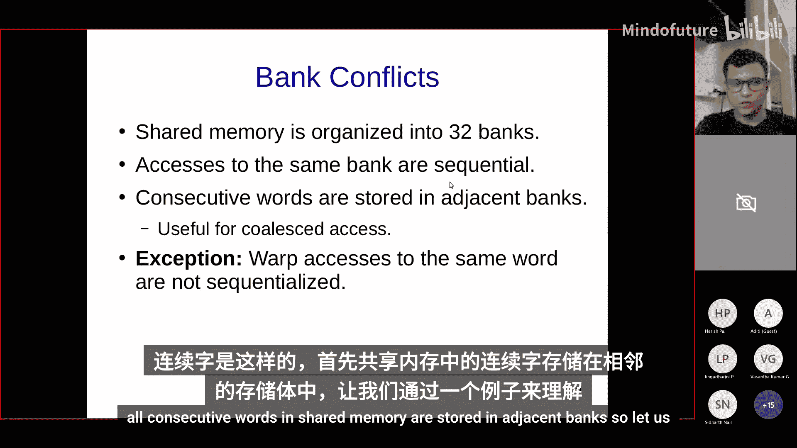

So let us say that you have this type of shared。冇系佢。啊还有 just。Sre。In的。Sharian era。1，0，2，4。

 Okay so we have some shared。We have some error which is declared as shared。

 so it is inside the scratch per memory or shared number。And what point that we。

 I mean what point that this line is saying that con words are stored in the adjacent bank？

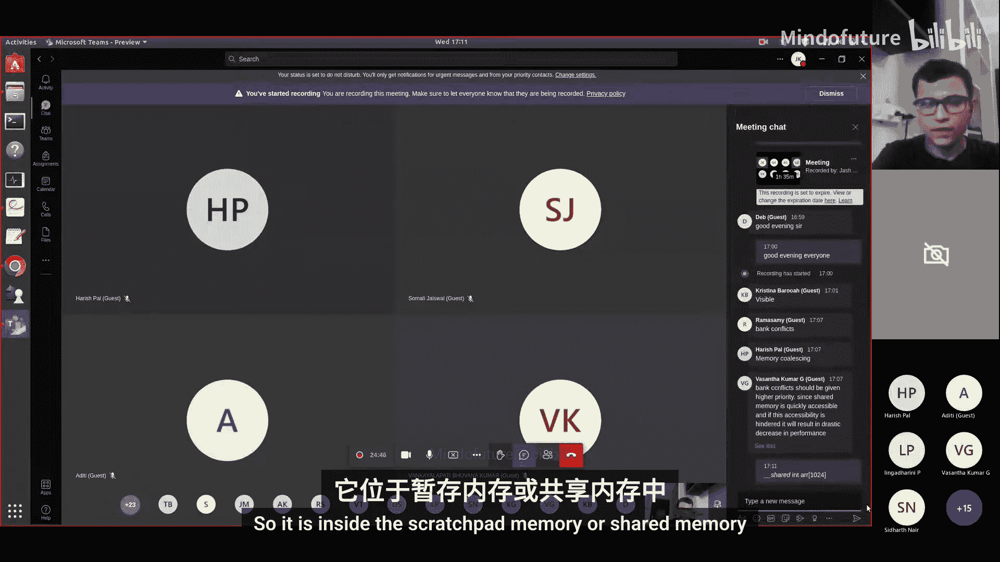

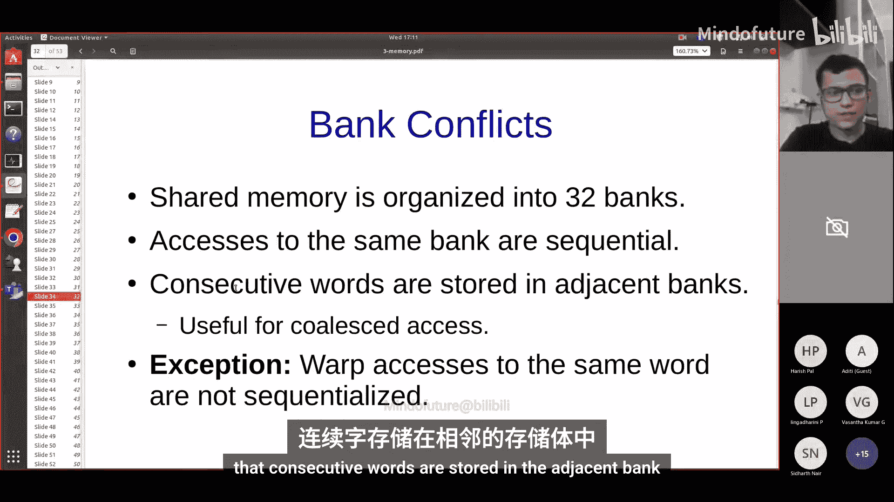

So。Okay， so here the consecutive words are like this， right， So A R of 0。

And they are stored in the consecutive bank， so it will go in the bank1 or bank 0 level。

An eraR of one。佢过你。Bank one。ヘアラルック。important bank。And so on。In the same way， R of31 will go。

嗰啲饼 number cut啲。And this pattern will repeat in wrap around fashion。啊。

E R of 32 will go into bank0 the R of 33 will go into bank 1 the of 34 34 will go into bank 2 and so on。

 this pattern will repeat for all other。For all other elements or all other words inside this element。

 since this integer array， one integer is one word right。So， yeah。

So let us come back to the slide。That is what this point is suggesting。

 consecutive words are stored in the adjacent pan。So if you see this in that example that I showed in that chat。

 AR of 0 error of1， all those are consecutive words and those are stored in the consecutive adjacent Bank sorry so they were stored in bank 0 bank 1 and so on since we are 32 banks so 0 to 31 but they are stored in those adjacent bank from 0 to 31。

And this is typically useful， like because this is very much similar to memory correlationing if you see。

 so let us come back to this thing again so if you see。

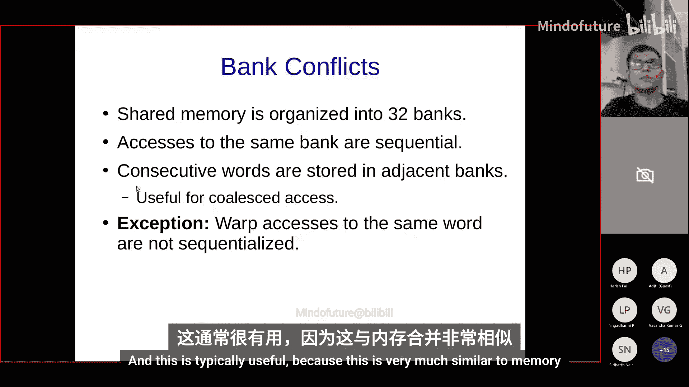

ThisNow lets say threads to if our let's say war threads are accessing this consecutive member location from Er0 to Er3。

T0 is accessing this era of0， third1 is accessing the error of1 and so on till till third 31。

 So these are above threat rates， 0 to 31 and they are accessing like this。

So now if the access pattern is like this， what is shared memory， and what will happen？

So each thread is accessing something from different bank， if you see。

 if each W3 is accessing something from the different bank。And if that is the case， then。

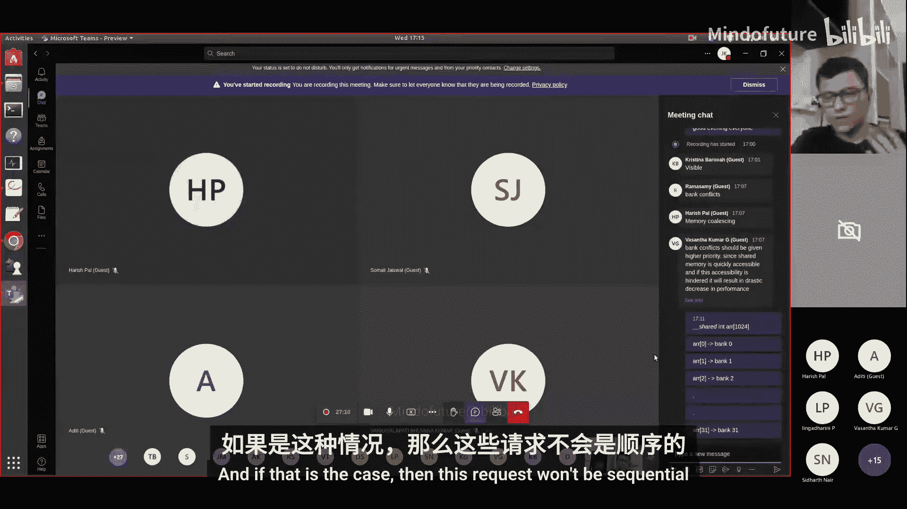

This request won't be sequential if you see。

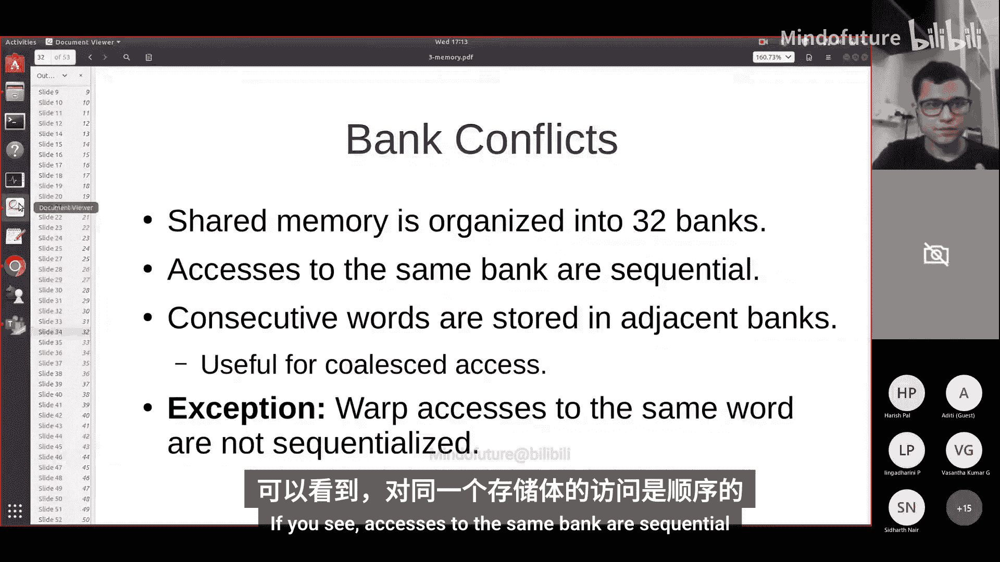

Exccesses to the same thing are sequential part。In this case。

 all the wars are accessing different different banks， so excesses are all in parallel。

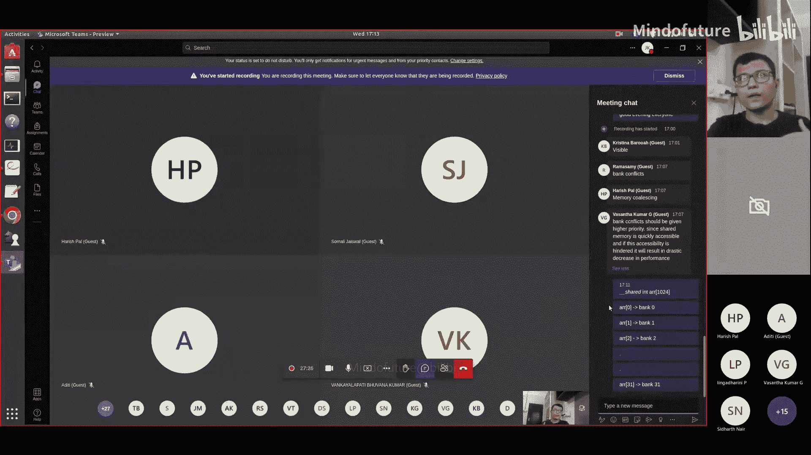

And if you see， this is very much similar to memory coalition， I mean。

 its not actually very same to memory its not actually the memory coalition because in memory coalition。

WeWe have seen that when work that accessing same word from the block of 32 words。

 then memory accesses are poorest。But here threads are accessing different banks and hence the excesses are done in parallel and the latency is just what the one memory excess right。

So in some sense， in both oil single。This bank contract， if the excesses are。Done as per the I mean。

 excess are done in the consecutive fashion， then we'll just need one memory access as we find this example for。

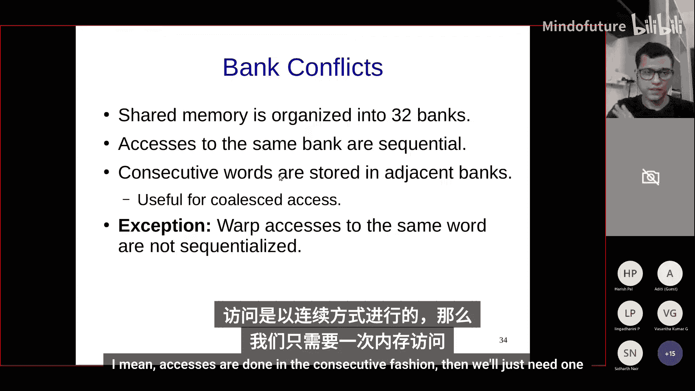

This shared memory also right， so this entire thing will be something in just one memory request for we work。

Because they are in the adjacent bank and the excesses are parallel4 different。

So I hope that this is clear。啊。Yeah， so it's very similar to memory coalescing the I mean it is useful in very similar fashion as we saw for I mean。

 we saw for the memory coalcing or the coal text。But that is one exception here。

I told that the excesses to the same bank are sequential， so what threats accessing same bank？

Will to sequential access to the memory， I mean， sequential access to the word inside that name。

But if W threads exercisees the same word inside the same bank， then requests are not sequentialized。

So let us also understand this with an example here。

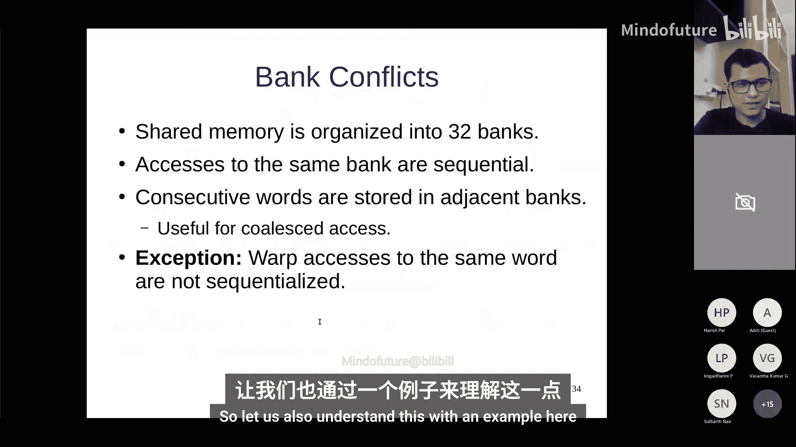

So let us say that let us continue with this example itself， so Er of0 is stored inside bank zero。

Now， let us say that thread1 is accessing a out of zero。And T2 is also accessing the RLC。

In that case。Both ti threads， which are the war threads， so it' is not that both ti are the war。

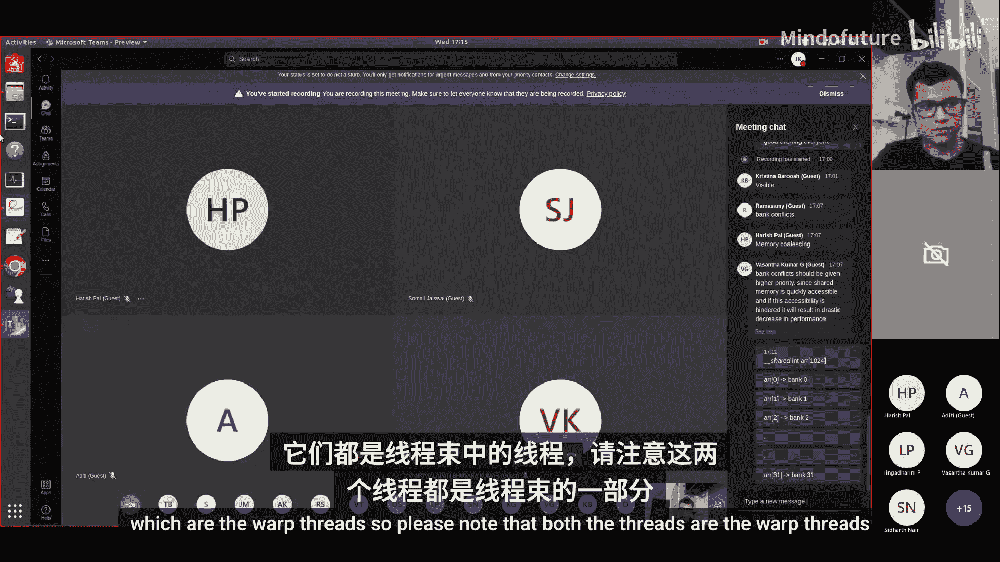

诶。Those both threads are accessing same board， which is a error of 0。And they are also from Si bank。

So in that case they are not these excesses are not sequentialized because that word is。

 I mean it's common between what these war threads， so those excesses will not be sequentialized。

So the excesses that will be sequentialized are the excesses that are made by warres。

From the same thing， but to the different one。Okay， Texases。Madeby walked through the same bank。

Today different words are sequentialized， but exercisees to the same bank of the same word are not sequentialized。

 they can be solve in Ba。Because just one world will be brought and the another part just， I mean。

 we' just make not that patch word。Yeah， it does not require to recatch it again。

 so that's the reason。I hope that's clear。If there are any questions up this point。

 then please feel free to ask， I'll probably pause for a few seconds here。

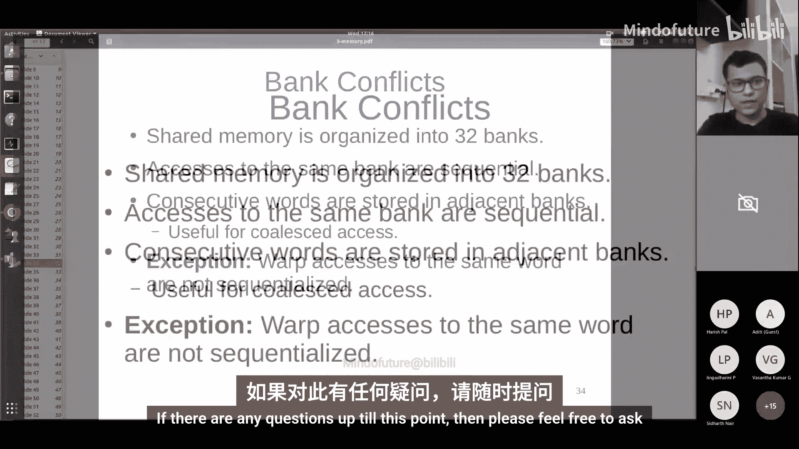

Any questions。Okay， I am thinking that there are I I'm hoping that there are no questions。

 so with this let's move one further。

Okay， so yeah， so our next task will be to write the code corresponding to the。

The case when there are no band conflicts， so I request teaching every one of you to try writing the code corresponding to the case when there are no band conflicts。

And please post your answers in the chat so that we can discuss。

The possible ways in which we can write that。As I'll pause here for a moment for new people to try out。

And yeah， then we'll move ahead after a few seconds， probably a minute。

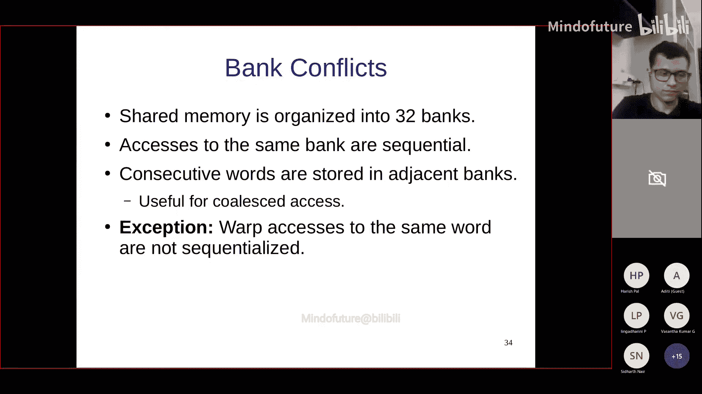

Okay， yeah for our discussion， let us keep it simple。

 this concept of bank is only limited to the shared memory。

But as far as my knowledge is concerned like I've also studied this。Ba thing in the CPU St。

 so I'm assuming that there is something called this bang inside the CPU St also。

 but let us not worry about this right。Yeah， so I'll just say that。Yeah。

 I'll just leave it there because I think that this bank concept is quite generic。

 it's not very much limited to the。What I can say is shared memory， but。But it comes。I mean。

 it becomes useful for the shared memory because of the way we access it。

What is the difference between coalal is Texas and water。Okay， so。What TexasD I mean？

If you see coalalest access， then I think you might remember that definition， right that。

When W accesses the words from the same block of 32 words then the memory exercisees are saved to be cool because will only make I in。

 only one memory request will go to the memory controller of the C。So that is coalest access。

But is warp excess is like。It can be a， what threats can access anything in any fashion。

 right because of CMD execution。So W thread will execute some instruction which each thread in the war will execute some instruction。

And they can access some memory location， and that is something called a Wb access。So yeah。

 so W access is something like what all the threats in the war。

 what memory location all the threads in the warb are accessing。三。

I'm hoping that that is clear what is forex and coalest。

Okay， request each and every one of you to try out what can be the corresponding to no band conflict。

Rely some small snippet that you would like to highlight which would present in no band conflict。

Based on what we have understood so far using these four points。I' wait here for。

few more seconds to let you prepare try。

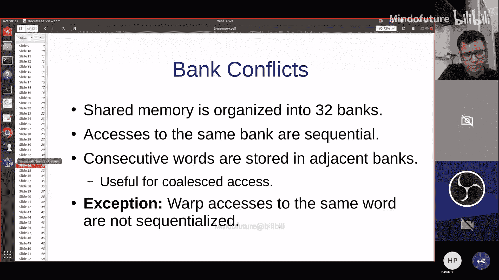

Yeah that啲さ。嗯。We are of thread I X dot text equals to thread Ix。Okay， I think that's。

That's probably correct。So any other response apart from this？

Would anyone else would like to cry out what can be the possible？

Possible answers corresponding to the note and content。系倾过系实第上咁啊。Since it's sequential。

 can we access multiple banks at the same time given that each index in the area has its own bank？

Can't we access multiple banks at the same time， given that each index be。Yes。

 that is what will happen gokula I hope that is clear because each and every element is going into different time。

 all the excesses will be pair。So。Here not to。I mean， no two memory locations are， I mean。

 no two words of the area， at least for 0 to 31 are being stored into the same bank。

So this is precisely the case where there will be no bank conflict。

And I have asked few people to write the code corresponding to it， so this can be one of the way。

So let us see this。So okay， let us try to understand this。 So we have this。Tfield garden。

Which is named as no bank country。And inside this， let us see what we are doing。

 we are declaring this shared okay， we are declaring this areass， which is of size 1024。

And it is marked as shared， so it is common across all the types of the thread law。So。Yeah。

 so and the access pattern that。That we do here is like this third ID extra tax as equal to third ID extra text。

So let us understand what is happening。So thread0 will access s of 0。Thread  one will access S of 1。

 thread2 will access S of two， so if you see。This access pattern is exactly same as the one we saw here。

 right？

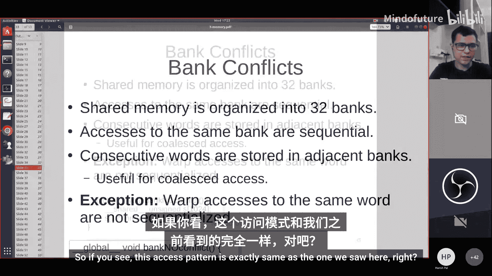

Here instead of here are the areas as shared areas。

So S of 0 is accessed and S of 1 is accessed by T 1 s S of 2 is accessed by T2 and so on。

 S of 31 is accessed by threat 31。So if you see all these words are going to different banks。

And hence。If you see， this program will result in more bad conflict。🤧。Sorry， so this program。Sorry。

 so this program will result in two。

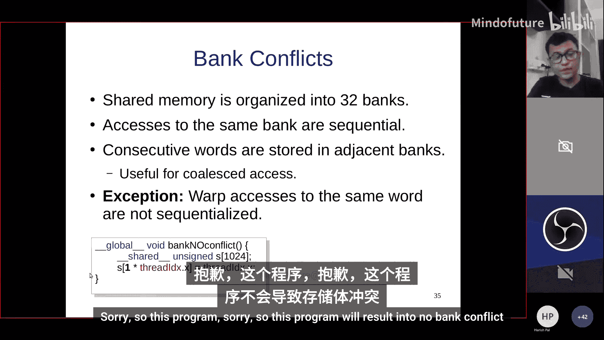

No bank contract。And I hope that you are getting it if there are any questions here， then please ask。

Why multiply by one in the example？ok 啊。That is just for， I mean， it has no。Any such a purpose of。

I mean， we will understand that thats why we have multipl it by one。

It won't affect anything is what I am trying to say here if you see。

Multiplying it by one doesn't have any effect on the。啊。On the no band conflict part right。

 because if you multiply it by1， the spread ID X text will remain the same right anything multiplied by one will remain the same。

So。That part is， I hope clear。

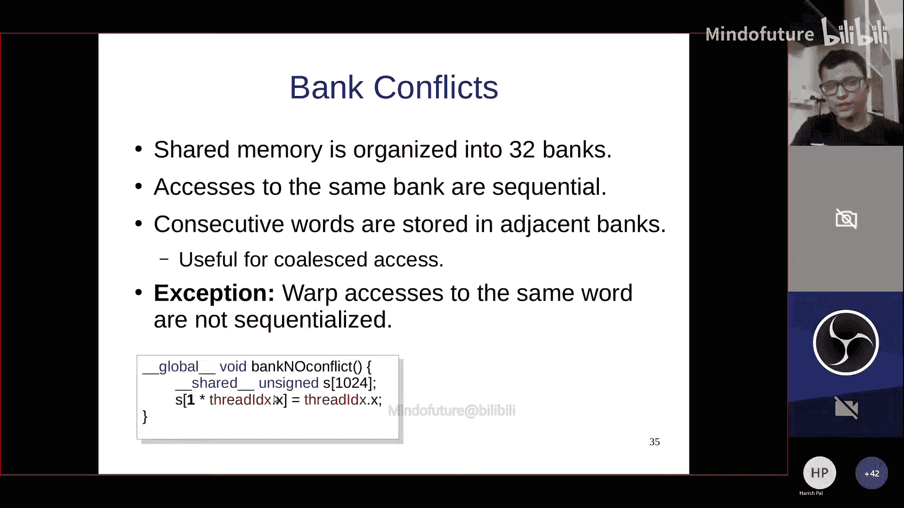

So okay， that's fine I mean， if there are no further questions at this point。

 will we explain again but。In but comparing with how we usually do。嗰啲。So we explain again。

 but comparing with how we usually do I。Okay， I think okay by giving IDs as an example。

 so I think this is the good example right， I mean this is exactly what we are doing。Sorry。

 this is what is exactly what we are doing。In this example。

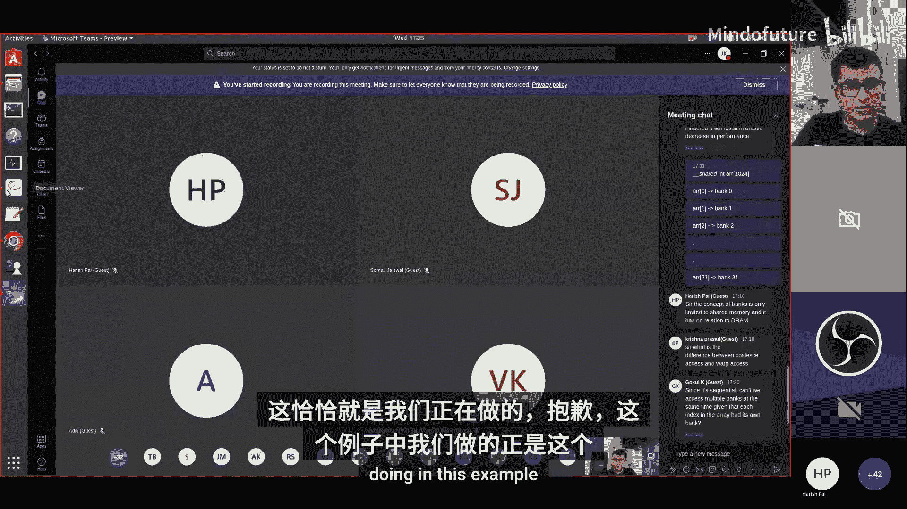

So S of0 sorry0 will access S of0， thread1 will access S of 1。

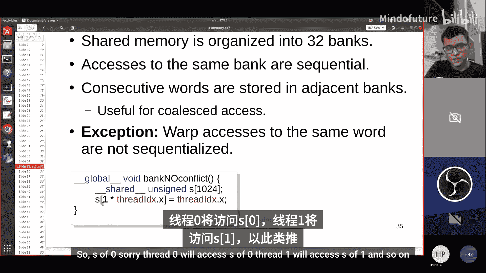

And so on， so the success pattern is exactly similar to this。S of 0 is excess， S of1 is excess。

 S of2 is excess and so on， Tra 31 will access S of 31。

And since all these are in the different banks， this all。

Words which are consecutive are in the different banks。

Theyll be accessed in parallel fashion from the shared woman， and hence there is no bank conflict。

Only the waters are accessing view。Words which are in different when there is no band conflict。

And yeah I hope that is clear， but if there is any conclusion hopeful。

 then you can unmute yourself and ask。Okay， I am assuming that there are no。

Questions further，Anyway， if there are no questions further。Let us continue。

 I have one more question for you。Which is to write the court corresponding to the case when there will be bank conflict so that is the next question。

 please write the code。Goresponding to the case。When there are， I mean。

 when we have the bank context bank context， that is the second case。

 so please take some time to write out that quote。And please post your answers into the chat。

Or at least some expressions like this， like what we'll do for that case like we did here， right？

So please write the quote corresponding to that and post them on each chat。

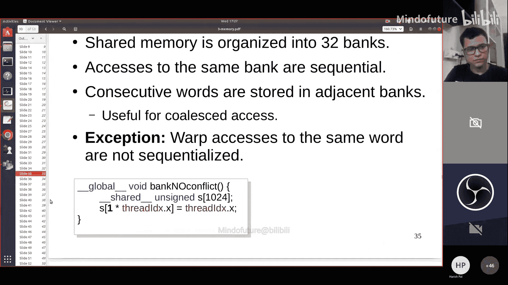

I hope that question。屋嘅包。To avoid bank context。To avoid bank contract as staff have to be carried out only inside kernelnal right。

 nothing has to be done。Inight the main function， yes， that is correct。Whatever we need to do。

 whatever steps that we need to take for removing the bank contract should be done from within the column。

Because the shared memory itself tick inside the kernel， right？Yeah， that is the answer， yes。

 the answer answer is yes。W she case is suggesting S of3 equal to thread ID extract。嗯。ok。

Parmiing a of0 equals to T ID X text， but I don't know what will get assigned to。Yeah不。That is fine。

But。Okay， let us take fast look for this。Reish and warrant suggestion。So what， I mean。

 what both of them are trying to do is they are trying to。Take some ya of random index。

Which is between。Bendum index between 0 to 31。And they are doing some。Td Id extortex。はい。

So my question is will this work out， I mean， okay， let us understand why will this not work out？

The answer lies within this four points only if you try to do something like this as。

Some ID equals to thread ID Xortex is this the case for no I is this the case for complete bank conflict or some bank conflict？

The answer is no， let us understand why the answer is no。

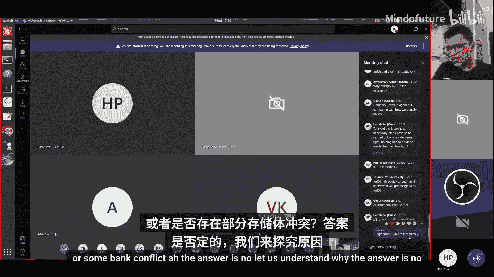

If you see this exception part， I think you peopleicle didn't catch up this exception part properly。

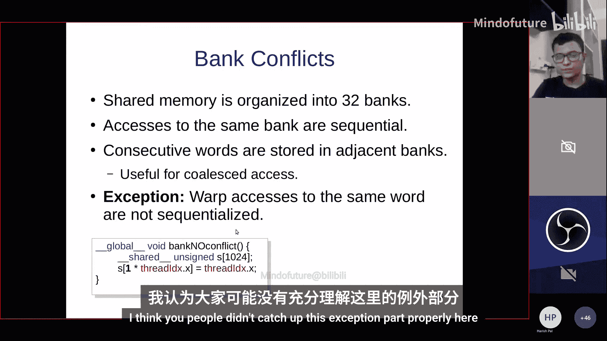

Here。Theedicacy。Each thread， each thread。Is accessing assuming that this thing is written inside the tunnelal。

 each thread is accessing some location， Let us say that location was。Yeah， I don't。Family。

So each thread is accessing the era of 10 and what is the CR of 10。 Let us understand this era of 10。

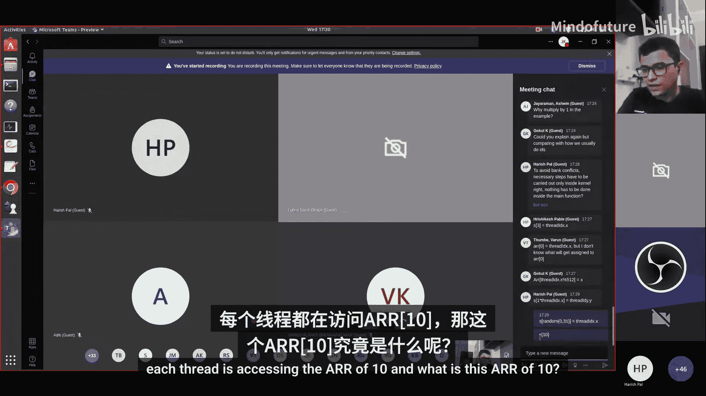

Is being accessed by the Wp threads， so war threads are accessing。Same word right。

 because each head will be assessing the error of 10 only， so waters are assessing same word。

From the same bank。So objects are assessing same word from the same way， if that is the case。

Then this is the case when we fall in this exceptional part。And in that case。

 the excesses won't be sequential。If you are following it properly， then。Actually。

 this is the special case， whatever this warun and Ruhiksh has suggested。

 this is the special case where there won't be any bank conflict。

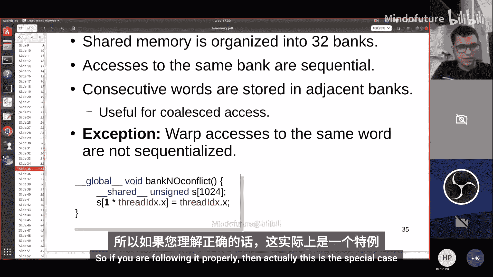

I hope you are getting that so this both。Sedicitions。A part of no bad conflict， actually。

ok啊 coming through the your suggestion咯。A R of3 I x dot x mode 512 equals to x。

I'm assuming that x is some random constant or some variable go but let us think about red ID extra X more5。

I think still this will be coaled right， because let us say from thread 0 to 31， 0 to 31。

 mode 512 is again 0 to 31。And if you are doing that， then again， it is the example of fully coal。

Fully sorry， no bank contract， not yeah， no bank contract。

 so this again is the example of no bank contract。Co I hope that you are getting this。

This is the example of no bank conflict。哦 let us咁。Alicious edition。

Cred ID x dot X equal to credit ID， y do y。So Im not able to understand this suggestion。

How can this get to no bank？下里。How this can lead to complete band conflict。

So this is the example of nobank conflict， this is this three。

 all these three are the example of no bank conflict possibly。

Then I think this is also the example of no bank conflict policy。

But I'm not able to catch up this thread ID y or y， assuming that we have just one dimensional。

Can look啊。And let us assume， I mean， let us for the case of simplicity。

 assume that we have only one dimensional t。And in that case， we won't have thread ID Y or。

Just don't try to mess up with the dimensions， let us keep the dimensions as just one。Party tlock。

Considering Im keeping that in mind what can be the answer？Okay。

 so moving on reshi cases again suggesting that T ID extra X。Into 32 is equal to 3。

 I think this one is correct。Let us see this， I'll come to this thing。

Can you explain why it's not a bank conflict again？Okay， Jaraman， can you。

Can you unmute and tell me which one is not a bank contract？嗯，Yeah对。Yeah。Your voice is breaking。

Speak up louder or。Can you speak again。I was my。咁。这个好。哎那退多。Sa I can的。I'm unable to。

Catch you fully because of some noise issue if someone else is able to hear him。

If anyone else is able to understand this question， then。Please unmute yourself and。Tell me what he。

O啊。W example， okay this， I think it's this。Okay， so again let us understand this what is aR of 0 equals to tri ID x x so first thing that you should observe is that we are accessing the same memory location right the ARR is shared error。

The way we have done here， it's a shared Eric。And what we are doing。

 we are accessing the same memory location accuracy you see， which is a of0。

And as we saw， if we access the same ma location or the same word because it's an integer。

 its same I mean it's one word， so if walk threads。

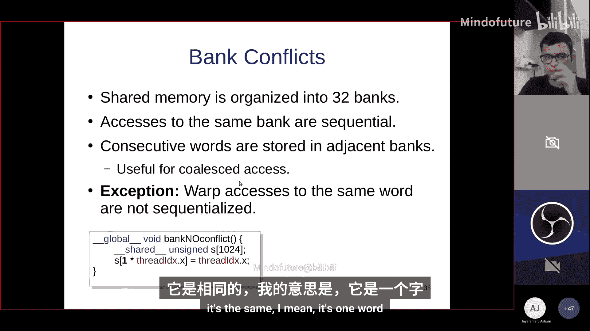

啊。Let come back so here what each and every third is doing， each and every third is toing。

Thread its ID， which is thread I extraex into these。Same word， which is the error of。

So in other words， what is happening is each thread， each walk thread， so what threads。

Are existing the words？From the same thing。And if that is the case。

 if the operator select and same what's from the same back， then there。

Requests are not serialized or sequentialized and if their requests are not sequentialized。

Then it is the case of no bank conflict。Bank conflict only occurs in the case when we have sequential excesses。

 so excesses to the bank， same banks are sequential in that case only will have bank conflict。

If accesses are not sequential， as it is the case in this exception。

Then there is no bank conflict actually。

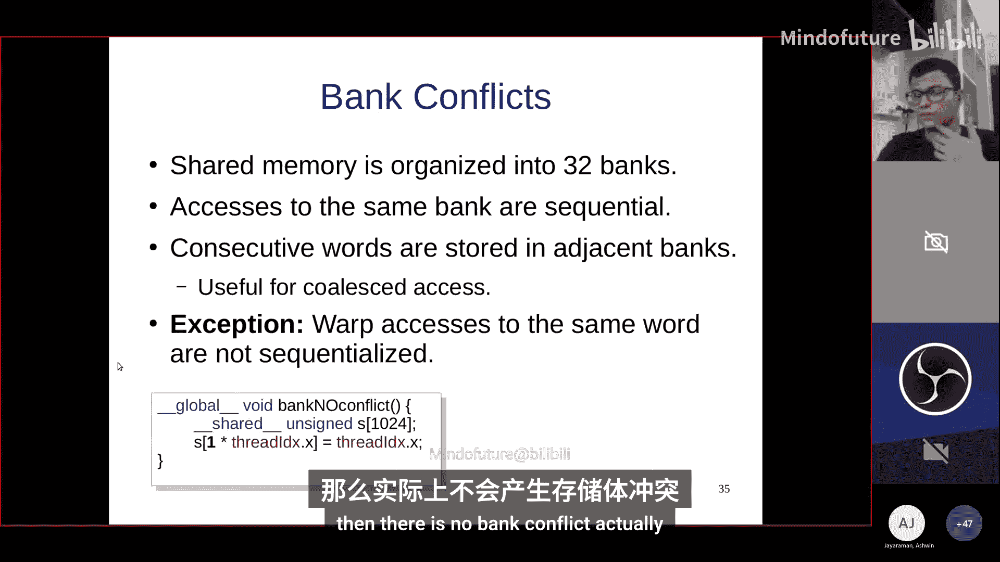

So I hope youre getting it。So if there is any further question， then please feel free to ask。

Well come to this Google， Does bank conflict occur only when whole war doesn't access the same bank？

Probably well see a couple of slides related to this， I'll come to your question later。Yeah。

 but let us move on。So yeah， I think that was a good discussion。

 so let us see the quote corresponding to the bank conflict。

So this is quote corresponding to the bank conflict， so we have this kernelal bank conflict。

And inside this， we are declaring some shared array。Sorry， we are declaring some array of size 1024。

 which is shared is which means that it is carbon for thes across threads of the thread flow。

And the access pattern that we are trying to do now is this as of 32 to third ID x to x equals to third ID x1。

So let us understand what will happen and why is the case for the I mean。

 why this code causes bank conflict。So。Let us understand what will happen。So thread with Ii。

 let us take warp threads first， yeah， so let us take war threads。

Thread with I0 will access the memory location S of0， so thread with。I is0 with excess of zero。

Ted with I D1 wheel access or 32。Threadville ID 2 will access 64， S of 64。

 Tville I3 will access 96 and so on。

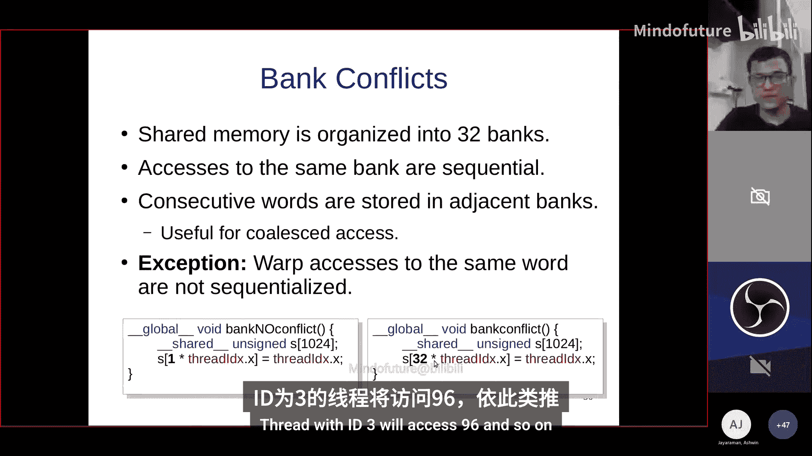

So if you see。This words。If you see this pattern zero though。他啲到。64。96 and so on。

Where this where all these words are stored， if you observe carefully。

 where all these words to be stored， let us come back to our this。Example that I posted in chat。

If you see a of 0 or S of 0 is stored in bank 0。If you follow this pattern。

 then if you will again observe that 32 will be stored in bank0。64 will again be stored in bank zero。

 96 will again be stored in bank zero。If you continue populating like this in the way I have done here。

So， all these words。Here， even here。0ero，32，64，96。All this will be stored in。Swardin Bank。自ろ。

All these words will be stored in rank 0 and if that is the case if let us come back to our slides。

So if that is the case， all these words are stored in the same bank and now if you see carefully。

佢 did is some noise from someone。

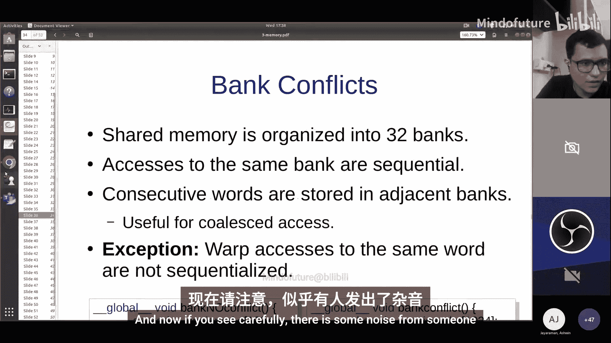

I request every one of you to mute。Instead。ways Im mut， let me quickly check。This。Okay。

 in case you have any questions， then please。Unmute yourself and ask， otherwise。

Please mute ourselves so that we can have animal destructions during。The glasses。ok 啊。Anyways。

 let us come back to our discussion。 So we saw that this what 0，30 to 64。

96 all are stored in the same bank， which is bank 0。 and if you。

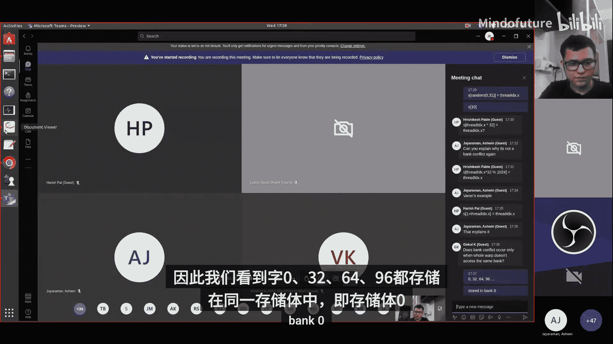

See this。If you see this， the definition of bank country。If the war threats are accessing same bank。

And different words within the same then， then excesses will be sequential。

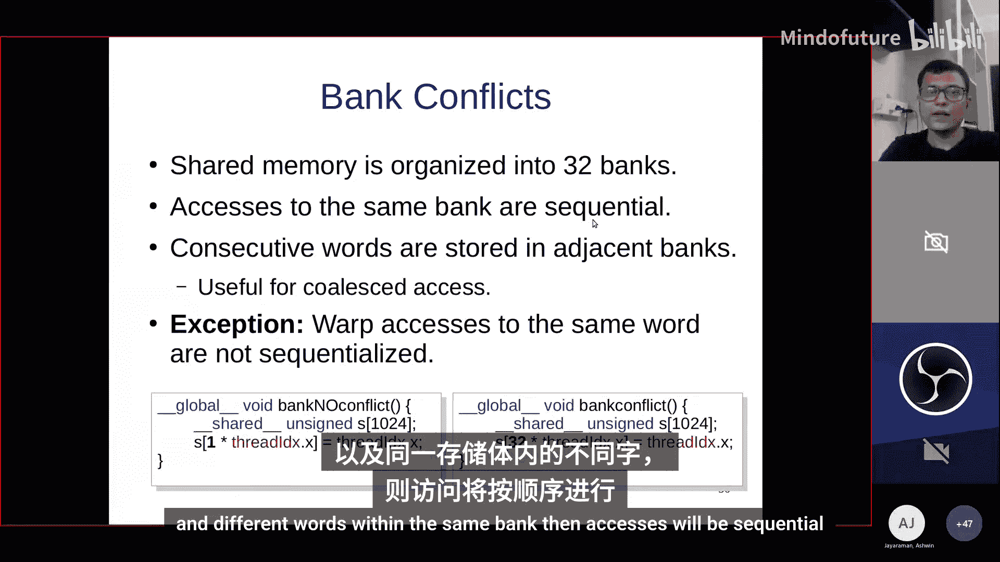

So that is exactly the case here， right？The war threads。

 which is012 sorry threads with ID 012 and so on， they are accessing word 03 to 6496。

 which are within the same bank。And these are not the same word， which was the case in which I mean。

 Warun and Rashike suggested the same word。These are not the same bird and this are also not yeah。

 these are from the same bank and these are also not the same bird。 So this is the example for the。

Bank conflict。 So this is typically the example for the bank conflict。

I hope you're getting it in case there are any questions further than I quickly。

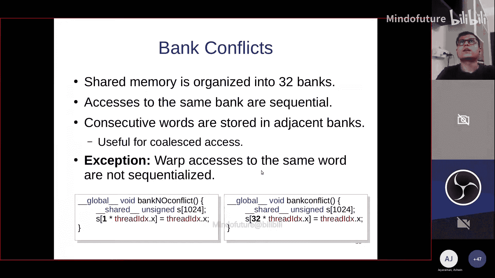

In this case， many unique war threads access the same bank。Is that。CR。In this case， many work。

Access the same yeah， if。In this case， there are many threads accessing the same bank and this is precisely the reason。

或啲病。But I would like to add one thing here， they are accessing the same bank。

 but they different words within the same bank， and that is why this is the bank contract。

If it would have been the case that they are accessing the same word from the same bank。

 then there won't be any bankruptcy。所见啊。Different words within the same bank will cause bank conflict。

 same word from the same bank will not cause the bank conflict， I hope that is clear。

IfThere are any questions， then please feel free to unmute yourself and ask。啊， yeah系。

Wai here for a few more seconds。

And then we'll move on。

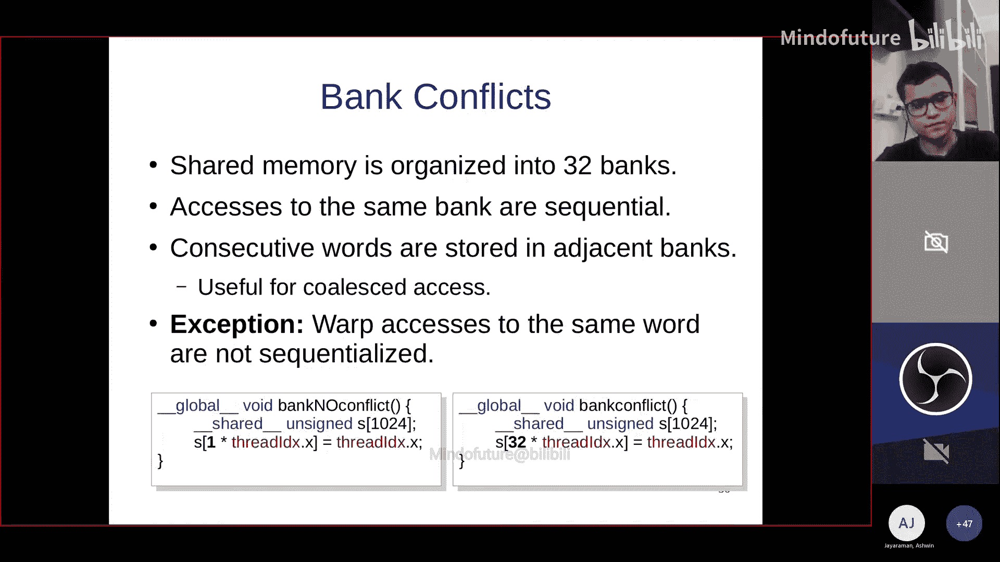

If there is some question， are there always only 30 two things？Yeah。

 for I think for current technology， it's a shared memory of the GPus having only 32 banks。

But in future， it might change so I can comment about。Yeah， I mean currently it's subject。

 but in future it might change， that's the answer。ok啊。II'm assuming that there are no questions。

And let us continue with our slides。

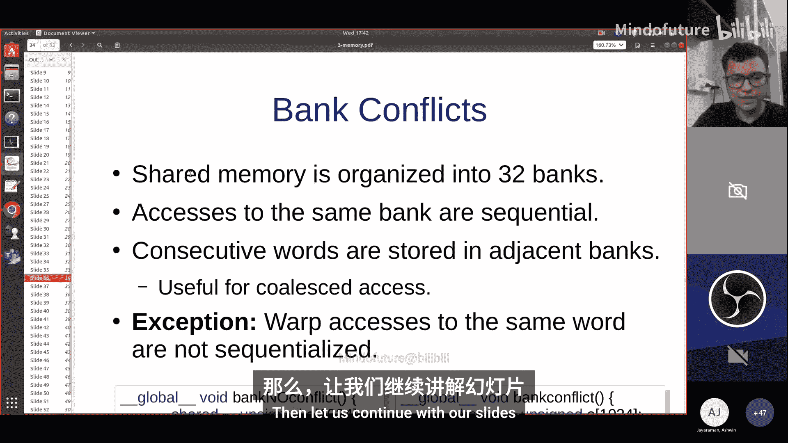

Okay， so we have these three cases here。So let us understand what is happening。So， this。This  one。

 two， three and so on are the IDs of the thread， tell 31， what threads are？

These are the ideas of the war threats from 0 to 31。

And this yellow box is three dimension on yellow boxes。Represents one bank， so this is bank zero。

 bank， one bank and so on。And inside them， if you see this orange or red boxes represents the world a particular word inside that bank。

哎。And if you see here， each thread， each thread is accessing。Somewhat from。Different thing。

If you see each thread is accessing， each word thread is accessing。

Some word from different different， so I would like to ask you people which scenario is this。

 is this the scenario for no bank conflict or is this the scenario for the bank conflict？

Please post your answers in the chat I mean this would be very quick if you have understood the previous slide completely。

What what this first thing， this first one represents is this the complete bank conflict is this the bank conflict case or no bank conflict？

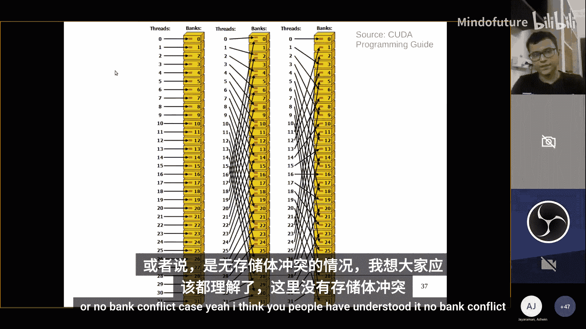

Yeah， I think young people have understood it， no bad conflict。Yeah， no bad。

So this case is the one for no bank conflict， so first one I think it is pretty much clear after understanding the previous type that this is the case for no bank conflict。

See now let us come to the second case， again， we have this thread。

 war threads having Id from 0 to 31 and banks。Which are represented by this cuoid or yellowo yellow cube。

And each this orange box are the words within that bank。And here if you see。

 the threads are accessing the banks in some order。

And I would like you people to think about which scenario is this。

 Is this a scenario for bank conflict or no bank conflict？Its a。

Think about it and post your answers in the chat。Please think about the second case。

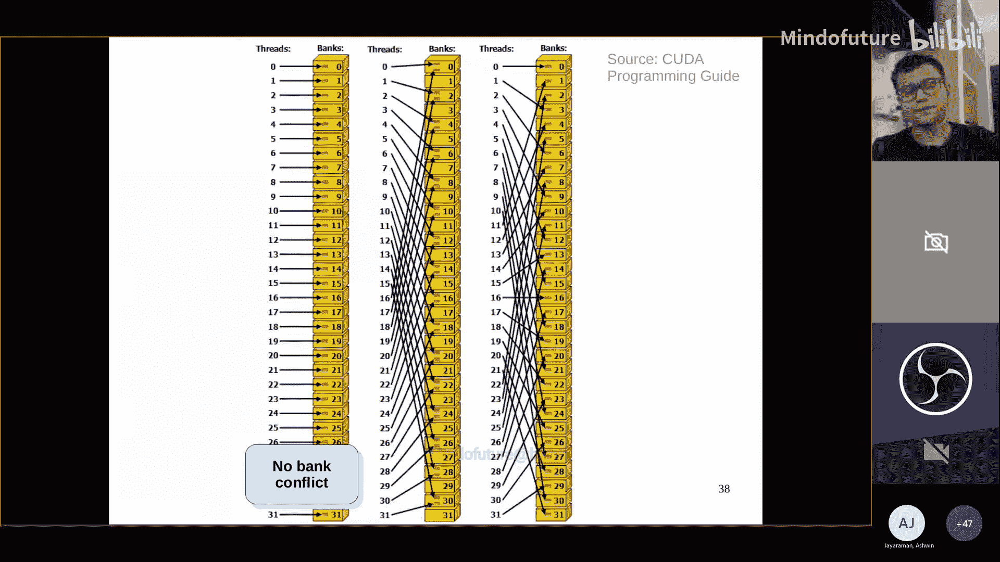

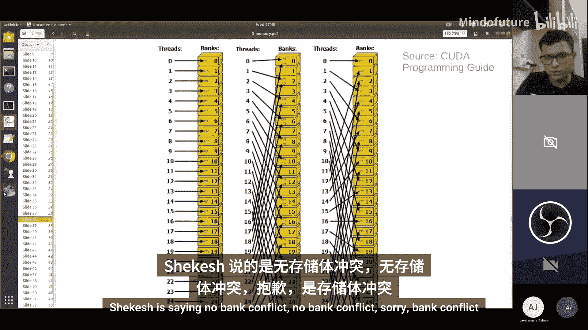

結か。She thing no bank make no bank。So， bank conflict。Iing bank conflict， bank conflict， conflict。No板。

ever think no bank conflict。Conject the。Cha 16。The the thing。No bank。 Okay。

 so those of you who have said no bank conflict。 would you like to add any。Supporting argument。

For your， for your answers。Why you people are saying that there is no bank contract Ill quickly go back to the。

Slide， can you explain why there is no bank or I mean， what was the reason that was in your。

Mind mind when you told that there is no。Sir bank conflict I can explain like bank 0。

 two of them are like0 and 16 are accessing to different。Locations in90。

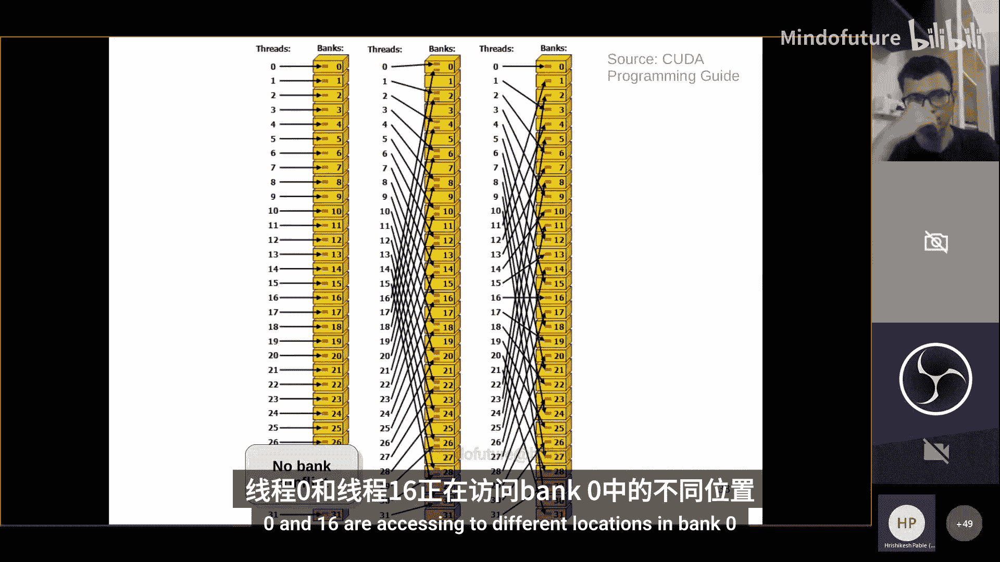

So it is bank conflict。Yeah， so it is bank conflict， but I think。咁啊。

He wrote that no benchmark select。ok啊主。Sodi， so。Yeah， I think that is the precise。Explanation for it。

 So let us send this。

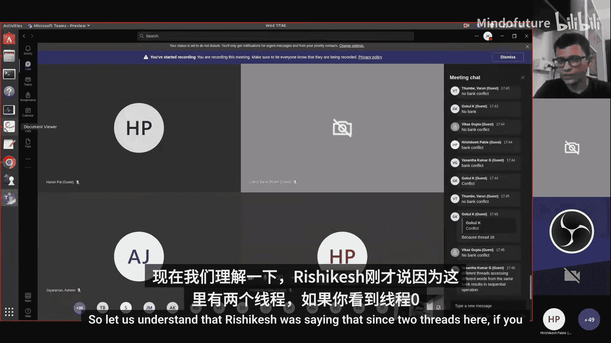

Thatrihiksh was saying that term。Since two thirds here， if you see third 0 and third 60。

Are accessing the word from the same bank。And if you see， this is not this， I mean。

 they are not accessing the same word。They are different words。

 so they are accessing different words from the same bank。

So here there requests will be sequentialized。And if you see。Here， if you consider all the bank。

 then the maximum amount of sequentiality involved was the maximum amount of sequential request that a bank has to。

 I mean， maximum amount of memory request that bank has to serve sequentially is to， right？

If you see any of the bank， then the maximum amount of request that has to be served sequentially by any bank is to there won't be any requests that have to be served sequentially having size more than two。

So in other words， this is also known as two way bank contract。So I hope that you are getting it。

So this is the example of two way bank conflict and yeah this is the case for the bank conflict。

 first of all， and it's a two way bank conflict。 I hope that is clear if there are any questions。

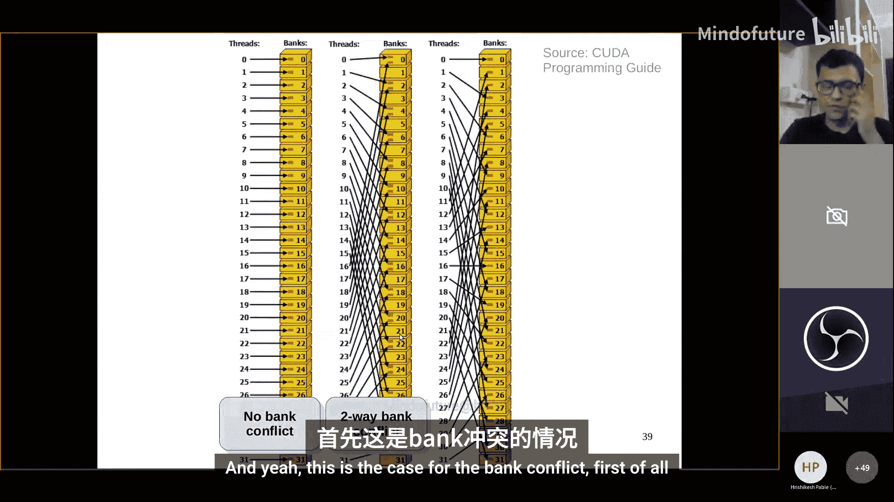

Different parts。Ssing different parts from the same bank。Result in sequential operation Yes。

 that is the correct reason why it is the bank contract。

Here different partss which is spread 0 and 16 are accessing。The different words from the same bank。

 so it is ready to sequential exercise and hence the bank。So I hope that it is clear。Yeah。Okay。

 some'm assuming that it's clear to everyone Google。

So okay， so let us move on further So what is I mean again。

 what is this third scenario saying is it bank conflict or is it no bank conflict？

Please put your answers in the chat， I think it will be much easier now after understanding first2 and that previous slide。

Is this the case for bank contract or no bank contract？

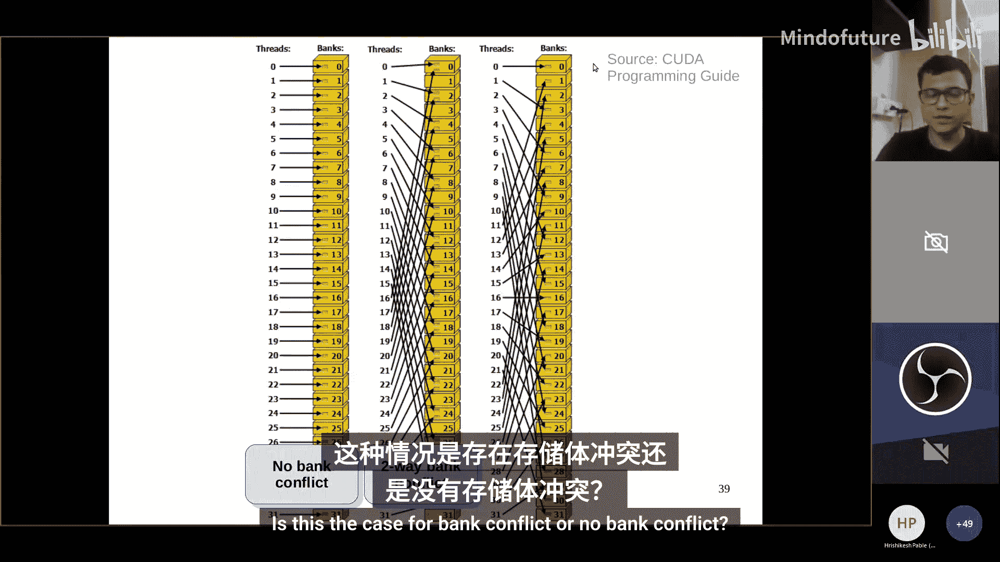

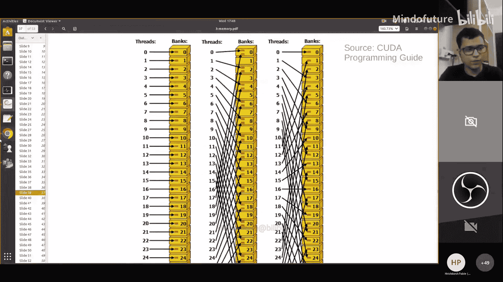

冇病讲。ok， i guess啊。

Okay， I guess if people are getting it correctly now。

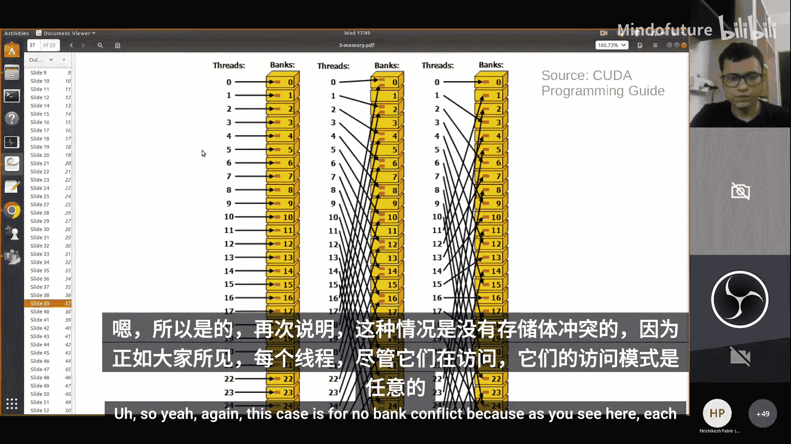

Yeah， again， this case is for no bank contract because as you see here。

Each thread although their access pattern is arbitrary。

 I mean they are accessing in some jumbled manner right thread。

 one is accessing some third bank and so on。Access pattern is jumbled。

But the important point here to observe is that each threat is accessing somewhat from the bank。

And no other threat is accessing from the same bank。All the threats are accessing from some bank。

 which is mean。Wwhich is unique to that thread， so it wont happen it is not happening here that threat2 is accessing from some bank and also some other thread is accessing from that same bank。

So if that is the scenario here， then again， this is the example for no bank concept。

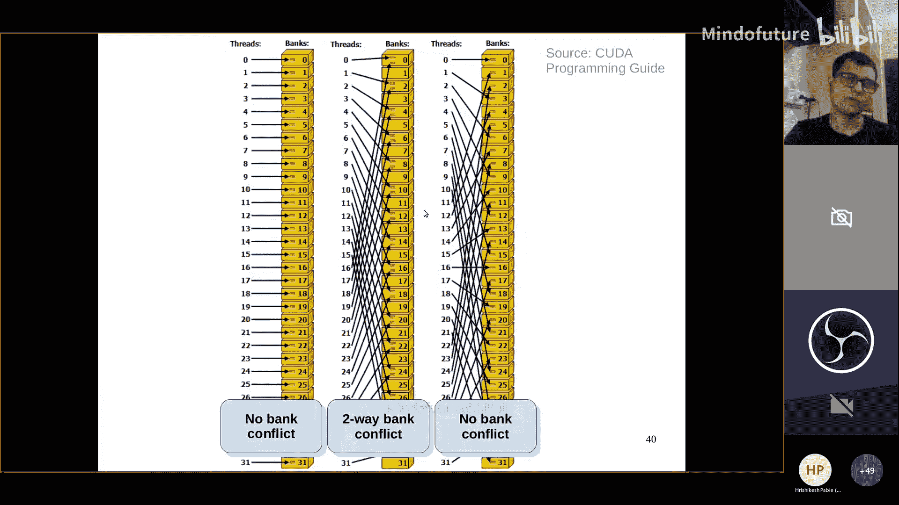

I hope that you are getting it， just let me quickly go with a chat。好啊。Okay。

 I think everyone is getting this one， so let us move on further。

Okay， so let us understand this three cases again。So I guess post scenario。

 I guess everyone will be understanding it。 Now， this post one is again for the。No bank conflict。

 So I'm just skip this because I'm assuming now that the ratio our previous example。

 you will be able to understand why why this is no bank conflict， right。

 because even though the excess pattern are。Jumbered up here。But still。

 each thread is accessing somewhat from the bank。And no other thread is accessing the same bank here again。

 like the previous example， so again， this is the example for no bank。

But what about this two example？The second and third one。

 are they the example for no bank conflict or they are the example for the bank conflict？

Can you people quickly type in the chat， what do you think about these two cases？

Hep AS for some time so that you people can think about this。

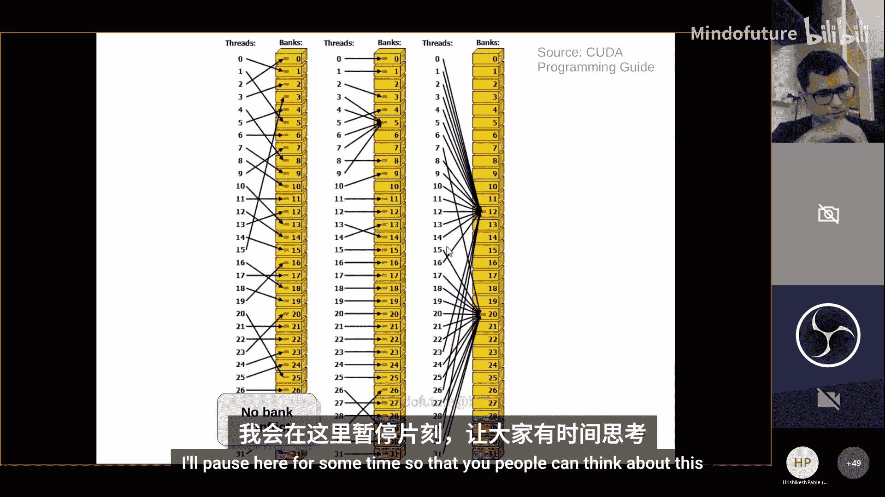

系。Besides I saying no bank conflict because they saying no bank。Is there any bank。

 is there any possibility of locality in bank conflict action？Looccalality in bank conflict， Texas。

Okay lighting catch up your question， can you。Would you like to elaborate on this。

locality and bank conflict。So she gave she thing no bank contract for okay。No bank contract， no bank。

Do I' many。But sometimes also saying no bank conflict okay。I think the。

I think you people are getting correctly here。

So these two are okay， let us suggestion these two cases。

 So these two cases are typically the case for that。

The exceptional one right that we saw if you remember here。

 this exceptional case that if war threads excesses the same word from the same one。

Then they are not sequentialization， hence there is no bank company， so if you see here。

But please took case。There are work clicks。For example，2 for。6，7， and 9。

This thread are accessing the same world from the same value。And if that is the case。

 we are calling it that exception case part。The excesses won't be sequentialized to the bank pile。

And this as they are accessing the same part， the request would be served parallel for 3467 and9 so this is the case for North bank。

 similarly this one。Since this all0 to 16 threads are accessing the same word from the bank well。

The request won't be sequentialized and all these threats will be solve in pad and hence again there is no pen。

Okay， same similarly for this bank 20， so I hope you're getting it。This case again。

 this both case are4 no bank， I hope that is clear。

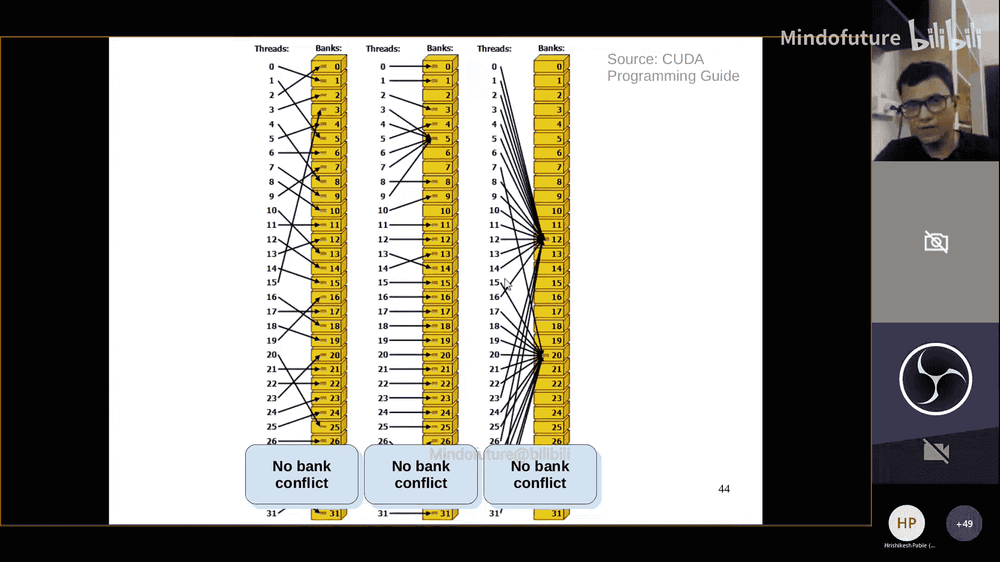

If there are any questions further here， then we can take those up。S。

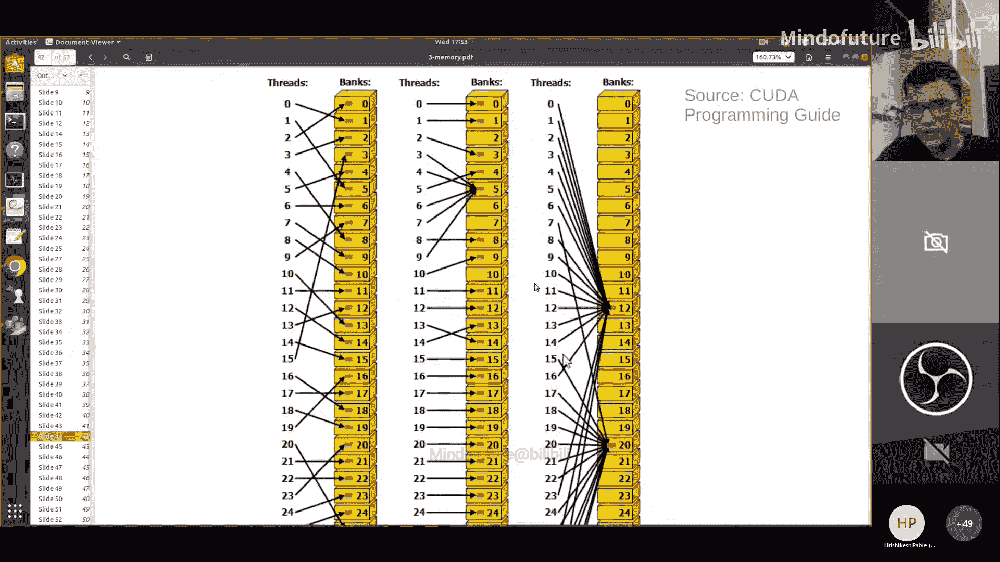

还是说什没玩。Okay， I wordsza sequence。80。入佢话个点。こ locality。Okay， I think there are some。

Since this shared memory is again， the part of Alvin Kehe， I think locality will come into play。

I mean， the adjacent word， as we saw in that spatial locality， right。

 that if adjacent wordss are being access then。Totypat locality will get some performance benefit。

So I think that thing also comes into play， but what's more important here is this bank。

bank conflict and the。The way， I mean， the way we are arranging the words in the different different ways。

So your consecutive words are essentially different things and this will give us the performance benefits here in case of GPU。

And I think that locality aspects will also come here。

I don't think that it will have much effect on the performance compared to this。

Paddle like us across the bank， so yeah， that is what I can see。I'm not much sure about testing。

I need projects towards our sequential。 good building the next what。我哋有冇叫俾老家。

I'm not 100% sure about it， but yeah， I mean， locality will come in the pictureck here。Okay。

 I think there are no further questions apart from。

Yeah。I think there are no questions， then let's move forward。Okay。

 so let us briefly touch upon the texture memory now。

 so as I hold in the first lecture of the our memory， first of the memory lecture。

 that we have this texture memory and it's across across all the threads of the grid and I mean common across all the threads of the GPU。

So and it's also read only memory， so。So， I mean， it's read only memory。

 so it can be used for storing some met data like。Yeah， if you want to store some data structure for。

Keeping track of data， which is present inside the global memory。

Then you can do it using texture memory。不。Study。But more typically， if you remember that this。

Texectual memory is optimized for it 2D special excesses。So。

Let's say you are accessing some memory location IJ。Then access to the i plus 1 J I minus1 J。

 I J plus 1 I J minus1 and so on， which are within the close。I mean。

 this cell which are within the close。啊， I mean主。specciially close to that cell IJ will be， I mean。

 will can be accessed quickly if if you have placed your。

That2D error your matrix into this texture memory。So that is one point。

 it is optimized for the spatial excesses or the a。geometry some kind of geometrical excesses。

 and its second thing is it's only read only member。So it can be used for storing metadata。

So let us see how to access this texture memory。So first of all。

 in order to access the texture number， we need to declare a variable of type texture。

So this name of this variable is text。And yeah， this is some sort of data type texture。

And we need to specify that this variable tag will be。

It will be pointing to some area or some two dimensional matrix， which is storing the plot values。

The second parameter says that its a two dimensional matrix or two dimensional error。

 and then we are specify that it's ua read mode element type。

Meaning that we are only allowed to do read operations。

 which is actually correct because this is only read only memory。

So that is how you look at this variable of text。And think of it like some pointer to the air。

And then once we have particular pointed to the error， we need to point it to the actual error。

 so for doing that we use this o fine texture to error function。

Wwhich in which we pass this stack as the argument and Qa array。

 which is the area which is allocated on GPU using quoa melo and initialized using quoa me。

So that array。Will be binded with this tech pointer or some sort of pointer。

 which is actually it's a variable， but let us assume it， let us consider it as a pointer。

So this post will be fine and now tech will be having this hooddi area。And it will be there， okay。

 so this thing will transfer this co iron into the texture memory。

So memory allocation will be done and then the hai area will be transferred to the textual memory and that memory can be accessed using this tech variable which is declared here。

So again， this is some sort of declaration of tech wave。Here using this statement。

 we are allocating the memory as well as initializing it。Yeah。

 so I hope that these two points are clear so。Allocation and initialization is done inside the textual memory。

 what we need to do is to access that memory， obviously。

So that can be done inside the kernel using something called a stack toD function。

And it can be done using tech 2D function and we need to pass this variable tech。

Which actually will give us the hold to that。Areea that we want area metrics that want to access。

 And then we need to specify the。Dimenssions like IJ views to for。

2D mattress right on C program or OA program。That we need to pass two arguments as well as the tech which is the name part。

 I mean， which is the some sort of。Name for that， the area that we have allocated in detectionual memory and initialized it。

So I hope that this is clear if there are any questions on this slide， then please。

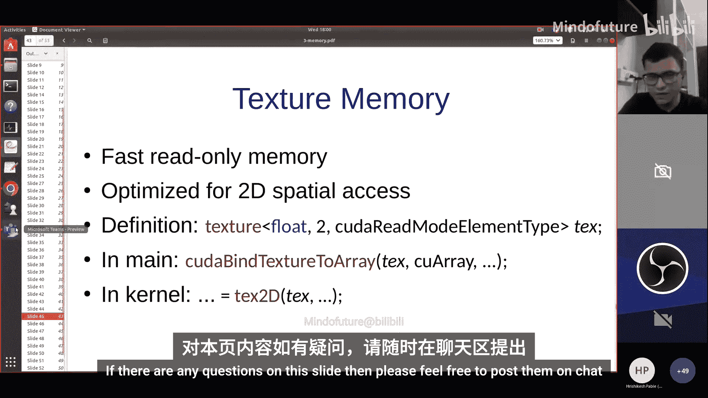

没个可以。我 them冇。So what is the？Element type for。

I didn't catch up on this question， where is the element type？Are you talking about this data type。

 it is for the it shows that what kind of data that you are storing in。

Inside this tech matrix or something that we have allocated in the textual memory and initial H。

It says what type of data youre storeding。

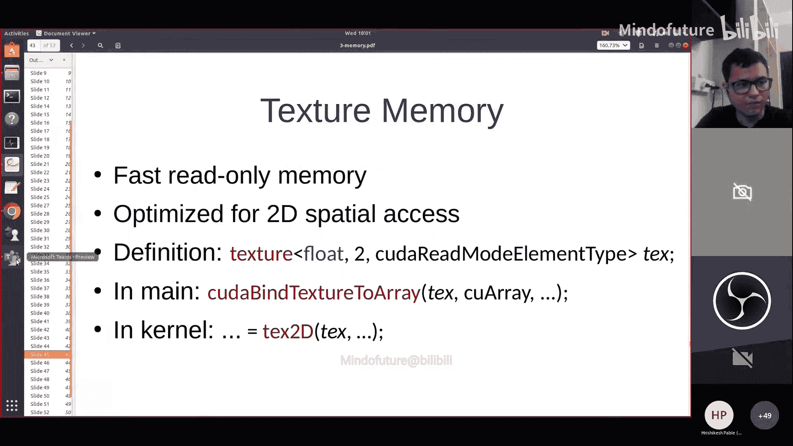

I hope that was your question， if not， then。ho that be。冇得 living问题。

Okay， so this part says that we are。We are only interested in reading this。 I mean。

 we will be only reading this。啊。I mean， we will will be only reading this memory。

 which will be allocated on the text memory。 and in fact。

 that is true right that it's only read only memory， so it suggests that。

We'll be accessing this matrix stack， which is allocated on the texture memory。

In real world is what it is suggesting。It is what the meaning of the。

About that is good。Would that is more element。If there are any further questions then you can ask。我会。

えい。One is saying。There is the texture memory located as visible only within a block Okay so texture memory is common across all the blocks。

 all the grids so it is something it it's I mean its located。

At the same place in the hierarchy as the global ro。So it is common across everything。

 all the threads of the GPU。Not just the war threads or block threads。

 I hope that is clear across all these threads， all the grids。

 I I think it's common like the global memory。Okay。

 I am assuming that there are no further questions。

Okay， let's more then， so let us try to understand this one example。So。

 let us assume that we have allocated the。Sorry， we have declared this variable of type tag。

And binded it with some Eric。Here， let us say we have globally declared that tag variable and then binded it with some。

A which was declared on the GPU here in the mainine， and then we are launching the kernel。

And then while launching the kernel we have this four arguments right。

 one is output I mean it's a pointer of type flow and its name is output which can point to some load e。

And it will be actually stored for I mean， it will be useful for storing the output since we can't write into the textual memory light。

Since we can't write into the texture memory， well need to store it's， I mean。

 after performing operation， we need to store output in some。A and that is what is this output error。

 which is our type load。Then we have this width and height。

 width and height of the image that we are going to transform。

It's some sort of an image transformation function。And width and height as。

 the height and width of that image。Then we have this heat up。

Which is which is of type float and which is some。W actually didote some degree by which we want to tilt or clip that image。

So I hope this argument is are here， then we are cap x and y。Value of x and y。

 which are unsigned in teachers。Using this standard equations that we have。

And then we are doing some operation using this four line， so what these four lines are doing。

They are taking these values of x and y。And based on these values of x and y。

 they are calculating x and y as well as width and height。And theta。

 they are calculating the value of P and TV。So based on this value of x， y， height width and theta。

 they are callibrating the value of T and T。So actually。

 if you see this x and y are the original location of some particular pixel。

And this D and TV are the modified location or the new location of that particular pixel。

So we want to real， I mean， we want to ship that pixel， which was at location X Y to T and P。

And in order to do that， what we do is be excessive texture memory using T 2D。

You pass this argument tag， which points to or which words the pointer tools that。That matrix。

 which is allocated on the。and detection memory。And then we pass this T and TV。

This will give us that element and then we store that element into the。X， Y me location。

 So please note that this is the。Excess of the 2D metrics in 1Dform by to width plus x。

So at y into win plus x， which is y x limit location， we are storing this。

Element which is presented at to you and TV。So actually。

 if you see what will be the output of this program？It will take some input image like this。

Then this input image after the execution of this program will be tilted so based on this function theta parameter which we pass。

Which later reminds the tilt that we want。Which determines the till that we want for this image。

Based on this data parameter， the image would be tilted accordingly。So yeah。

 this is the output input and the output for this program。Any questions up this point？

Okay， I'm assuming that there are no questions。And if that is the case。

 then let's move on with our next slide。Okay， so next thing is the constant memory。

 so we have seen text memory and it's one example， so let us also see the constant memory and one of its example。

さです。Constant memory again to read only memory， so we won to be able to write a write anything as such so its only for storing some met data again like the data structure using which we will be。

Whi can be used to manage Earth data， which is present in global memory or something like that。

So it second read on the memory， so it can be used for stor met data and it sizes 64 kb for SM。

 which is streaming multiproor。An。Okay， and then let us understand this thing。

So let us say that we want to define。We want to define some variable or an array using I mean。

 variable and array inside this constant memory。啊。Yeah。

 so okay let us say that we want to define some inside this area or variable inside this constant memory and how can we do it？

The way we can do it is very similar to the way we do it part the shared memory。So for shared memory。

 what we do if you people remember that for shared memory， we do this underscore underscore。

Shared underscore underscore underscore then the data type and then the identifier for that array and then the name of that array right so we should do that it is very similar to this here instead of that shared we use this keyword constant and the underscore underscore constant and underscore underscore。

And then the data type and the identifier and then the size of the area that we want to declare。

In the concert number。So this is one thing， this is the definition for it。

 the way we will declare it。Then second thing is， how can we access it or initialize it from the mean？

So here one point you should note， we can only initialitize it from the main or the CPU。

Since it's a read only memory， if few people not testing。Sinceens its only a read only memory。

We want to be able to access， I mean， we won't be able to write it。Wr into it from the GP。

So if we want to initialize it， we only can commit we can only initialize it from the CPU。

And to initialize it from CPU。There is a function， this function is quoa M copy to symbol。

And this function will initialize this。Ari metam。Using some。H metata。

 which is the variable on the CPU。And if you see this syntax is very much similar to quoa M copy right and in fact the function name is also quoda M copy too simple。

 like we used to have that quodaM copy from device to host and those functions right？

So here it has three arguments， One is the。Constant memory or I mean。

 they point with the constant memory。Second parameter is the。Wanted to the CPU CPU error。

 CPU some CPU error， the point to some CPU member location。

And the third argument is the size of the data that we want to transfer here since we have just one area of just one size。

We want to just。Copy one element of size uns because this is of size uns。

So I hope that is clear one is declaration or definition。

 then second is initialized session which is from CPUs。And again。

 after doing all this declaration and initialization， we need to access it， so how can we access it？

It's simple， we need to do this thread ID extra text equals to mat 0。

Assuming that this data is some area allocate locatedd on GP and thread IDX as the ID of the thread。

 we are initializing each element in this array based on the idea of the thread。

Do the value which is a。They are in this matter of0 and please remember that we are just doing reading operation we want to be able to write in this matter。

So I hope that is clear。Okay， this is done， sir， does the calculation happens。Yeah。

 you can do the calculations in their texture memory also。That won't be the issue。

 but the thing is that it is optimized for， I mean if you want to use it。

 if you want to use the textual memory， then use it for the geometry based operation where。

You are accessing some memory location and all its adjacent memory location。

 like if we are accessing some matrix extent。And it's some entity like erara of Ig。

And if we are also， if you are doing some geometry operation， then you will also be need， I mean。

In the need of accessing it adjacent memory locations like Er or Ij plus1， Ij minus1。

I minus-1 J I plus shape and all those。Okay， okay， you are telling that okay。

 it's correct that it's a read only memory， but you can。Read it。

 Why do I do some calculations based on it。 So I， I took it in that way。 I can。 I， I mean， I don't。

Okay I will put it like this， I was not trying to say that you are trying to write inside the texture memory。

 but based on the value that is inside the text memory， you can do some calculation。

And write the output in some area which is allocated on GP。

Clarify my point here that I was trying to say。So here if you see we are just reading the text memory。

 the right output that we are writing is inside some another array which is allocated on GPU。

 which is output。So please assume that this output is a pointer pointing to some error which is declared on the GPU using allocated on GPpU using code AMla。

And we are writing inside this output element。So writing caniped and obviously when the textual memory senseenss are read only memory。

You can read its value and do some calculations based on it and place its value in some output area。

 which is not the texture I mean， which is not inside the texture memory。

So I hope that is clear。过去系。Okay， so but how are we allowed to load our data into that model， okay。

 let us complete that。

So if you remember this， we are doing this thing ka buying texture to vary。From basically。

So you are not allowed to load the data into it since it's a read only member， but from GPU。

Obviously， you can rotate the data from CPU otherwise there won't be any use for it， right？

If you are a。If you have a memory into which you can load anything， then there is no point of using。

 so you will be able to load it， but from CPU。And from GPU。

 you can only access it for reading operation。In the same way we have it for a constant memory right that we can load it from the CPU。

 load the value into it from CPU， and access it inside the GP for read only operation。

So I hope that is clear Go。Okay， I think it's clear now。

Okay， so let us move further。So this is the typical example related to the constant level。So I mean。

 this is a very simple example and it demonstrate the same thing that we have done here。

 but let us see it once quickly。So we have this constant memory declared here using underscore constant keyboard。

Then we have yeah， we have declared it in the same test we here。Yeah。Then。😊，Okay， yeah。

 then let's come to the main first。So we are declaring this edge meta， which is some variable on CPU。

 which is initialitized to 10。Then what we are doing is we are doing puda M Co symbol the way we did it here。

你哋问咪。And we are copying the value of edge matter to matter matter is a constant variable declared on the GPs constant memory please remember。

So from CPU variable， we are copying the data to GP' is constant memory。And。

And the size of the data transfer is one uncertainty agent。

Then we are declaring the point to the unsigned integer which。And if the name of it is data。

 then we are allocating it。Allocating the memory on GPUus in Qa meello and this is。

 please remember this ka me allocates the memory on GPU's global memory， not constant memory。

So this is data is now pointing to some array of size 32 in the global memory。

Then this data is passed to the GPU cardal D kernel and it is launched with 32 threads and what this D kernel does is it the text data which is address pointing to some。

Aric on GP of size 32。It does data red ID x to x equals to matter 0。

 so matter of 0 is 10 if you remember we have copied it from h matter to matter。

So each threat from 0 to 31 will initialize that area of 30 to size to the value 10。

 so each and every element from 0 to 31 will have value 10 inside the state hiring。

After this can launch。And after that， we have this Ua device synchronized and then we are printing the data。

And again then we have quo device synchized and then were return。

 so I hope this is clear so this program will print 32 sorry， will print 1032 number of times。

Any confusion still this point on constant memory or any aspect related to？扑计。

I'm assuming that there are no questions。In that case， let。Let us move further。

Okay， so let us move further with this。Compte capability。So。So okay， so a you。

 few people know then you， I mean， a few people。Now then there is some version number associated with each GP。

You might have heard that。Let us say that NVDdia Rtx 20 or NVDrtx 3050 has compute capability of 86 our version number is 86。

So what is this 86， so this 86 is divided into two part one is in major。

Major number and minor number so that out of that 868 is the major number and 9 is the minor number。

 so let us say that if the version of your GPU is 66。2。

 then 6 is the major number and 2 is the minor number。And what this thingss first all， I mean。

 we understood that this is major number， minor number， whatever it is。

What what this thing deotes to us。So like GP is and hardware and hardware is provides some version number。

Based on the features that it is supporting。Let us say that。We have some old GP。

 which was having version numbers， let's say5。0。Then it might support some feature。

Let us say you bought some new GPU， which has some higher version number but lets us expand to here that we just mentioned。

 and it might support some additional feature that old GPU 5。0 was not supported。

So this version number， which is composedost of two things major and minor number。

Dote the features that are supported by GPU hardware and yeah again。

 this version numbers are given for the GP GPU hardware。And。

And typically what is the use of it so you can use this version numbers。

 I mean while compilation of program you can specify this version number using this flag AC equals to SM underscore。

Thenhan that version number， which is composedt of major and minded number。

So you can specify this during compilation， so it typically uses this。

So let us say that you have some ka compiler and you are compiling the code using you are compiling the quoda code using that。

Cta compile。 So by default， it will compile it using some。Devoit version number。Nexta 62。

But let's say that what version 62 was not having few of the features。

That you were using in your code， let us say that term。Feature。

 let us say your compiler and the compiler was by default。

 compiling your code with version number 62， but let us say that you have used some functionality light like atomics on double double point double precision protein point numbers。

Which was not supported by this version number 62 in that case， you need to explicitly mention。

To this quoa compiler， that please compile my code using some higher version number by specifying this flag AC equals to SM。

Under the score， let's say 75， which which has that。

Which has that support for atomics on double precision protein point numbers。So it might， I mean。

 you might sometimes need to use this sometimes need to use this thing， this arch flag。

And provide this at run time so that your application can be compiled accordingly。

 otherwise compiler will throw error compilation error。So I hope that is clear。

And the second thing is the quoa version， so quoa version is related to the software。

 so quoa itself is a software which manages say I mean in some sense it's。你tic嗰啲诶 i mean。Its I mean。

 it's somewhere related to the hardware， but its a software written for the hardware。

 think of it like that， so ka version is a software version。So whenever you say that I have ka 10。1。

 it's the version of the ka。But this major， I mean， major number minor number。

 which is given for the GPU hardware。So this compute capability is for the GP。

 which gives the version for the GP。If you hardware Well itkua is a software concept。

And the quoa version gives a， I mean， it's a something related to C software version。

And the Ka version is yeah， is somewhat related to this software。This。

Comfort capabilities for the keep you hardware， I hope that this distinction is clear if there are any questions here then。

Okay， I guess that are no questions。

Okay， so key takes take。Pai is something related to the software and compute capability is something related to the GPU hardware and it has some version number。

 which is divided into two part major number and minor number。

And sometimes you need to specify this thing while compilation。

That thing you can do it like this， NVcc minus A aresymmetrics2。As I underscore。

 let's say 7 and then。You will specify weather their times。Something like this should have be done。

you are using some very high end features that are not supported in the lower versions， so yeah。

 that's the brief takeaway。

Okay， anyways， let's move about that。So let us see this。So， that are。

There is this major number corresponding to the family of GPpus， so for Tesla family of GPpus。

 the major number was one。This Tesla family of Jes were supporting some features。And based on it。

 it was given number it was given major number one。Then came themi family of Js。

W supported few additional features apart from those which were supported by Tasa。

So they were given version number major sorry， major number two。So 2。02。

1 and so on will be there and so on。If you see this MP family family of cheap use。

 MP family of cheap use。A you in version number 9， so。If you see this Mr is。I mean。

 it will support all the features that are supported by all its predecessors。And yeah。

 so please note that MPR will support all the features which are supported by all its predecessors。

Because it has high major number。And yeah， so it is， I mean， it's the latest one。

 latest family of GP。And yeah， so based on the major number， it might support additional features。

 So how the major number， more additional features that might support。

And there is one point missing here， I mean， if you see there is no four， I mean。

 there is no four number from three it directly file。Does anyone know what， I mean。

 what is the family of GP GPU associated with that major number pole？Again， I mean。

Can anyone quickly type in the chat？

I think that are。

Anyways， okay， so the answer to is it is like quite bit funny like there is no。

Family of cheap use associated with that major number four。

And that is because NVdia plan to skip that H number port， so that is one thing。Apart from that。

 there are also two more major numbers， 10 and 11。Which are corresponding to loveless and proper family of cheap use。

Which are still under the prototyping phase。 So if you see this lowless and copper are。

Loveless and how family GPUs are still not out you'll see up to this MP， so MP family GPUs are out。

But this two are not up and still it's under the construction phase or the prototypety phase so yeah。

So these are the major numbers and the family of GP is corresponding to it。

And I hope that it's clear like the version number did not say。

Some additional features that a particular family of GPU provides。Compared to its predecessor。Okay。

 so let us quickly look into this。So， this。These are the major numbers2 point or these are the version numbers in another way。

In some sense， so this 2 point x is a version number， then 3。

0 is somewhere version number and so on like 8。07。6 point x。

So if you see this 2 point x provides these three functionalities。

 these three more functionalities than its predecessor， which was 1 point x。

So as compared to1 point X，2 point x supports these features atomics with in。Wp voting。

 there is something called as war voting， which we willll learn if we get。Pening pet。Yeah。

 so these three features are supported by the。2 point x family of GPUs。

 which are not supported by 1 point x。If you see here？Eesla won't support this thing。

Tesla won support with。So Tesla once upon these three things， but Parmi family of cheap use。

The support this。And if you see 3。0， then 3。0 supports unified memory。

 which is some sort of common memory between sq and GP2。not common memory。

 but the memory that is maintained both in the CPU and GPP and it is kept consistent across Cp and GPP。

So that unified memory is supported in 3。0， which is Kepler family， which is not supported in 2。 X。

 which is part of a family。啊ject。And so on， so you see as we move ahead。

There are more and more features that are getting supported from 3。

5 words we can see that dynamicium parallelism is supported。

 which means that we can launch the kernel from another kernel so that is what is sign in the parallelism。

 which is supported from 3。5  words。Then there is atomics for double。

 which is being supported from 6。 text onwards， 6。0 onwards。Then from 7。

 X onwards you will see that tensor query is supported， then from 8。 x onwards at 8。

0 onwards you'll see that hardware us sync copy is provided so you can copy the data between CPU and CPU UN+。

So I hope this is clear， so as an I mean。As we go more， I mean， more farther from one to。

Let's say 10 or 11 here。1 to 10 or 11， you can see that more and more features are getting supported。

By the GPp， and that is what is corporate capital。It decides the campus。

 I mean it shows the capability of hardware to support some or multiple features as compared to its predecessor。

系好 there。A the Rtx3 triple0 series part of the copper series no。

 Rtx 30 is not part of the copper series right？As far as I know， it is not part of the corporation。

But I'm not sure which to which series this art family belong I need to check。

The Ar series is not part of the Hawkpper series probably I mean I'm mostly sure about this。

 but you can check this thing on。NOnet or the NVDS documentation。

Yeah， so let us move further with this and let us conclude today's lecture with this last lecture。

So we studied about this ka， which is the abbreviation for compute unified device architecture。

 which is hardware as well as the software。And it allows enabled GPs to execute programs written CC+ plusport and open seal and other languages。

 even Pcode is there， so you can also use Python。So。A古 program。啊。Has typically one corner launch。

Whi launches some GPU function with some threads and that kernel is executed in parallel by multiple threads。

So yeah， so Ac kind executes in parallel across a set of parallel threads。And。

Programr can organize these threats。Threadlock and grids。

 we saw right this that how we can specify the configuration for grid and thread block while launching the current we saw this part。

The computational。Then we saw that GPU ins sits a kernel program on a grid of kernel so we also saw that that's right。

 whenever we launch a kernel it is associated with some grid if you remember in the computation lecture we saw it。

Then each thread within a thread block executes an instance of puzzle and has a thread ID within its thread block。

Program how to register， partial private and memory input and output research so。

Each thread within the thread block will have all these things T ID will be there。

 I mean if people know right we can access it to thread ID extra text。

Then there will be also program counter since each credit is executing different different instruction。

 which might be different than what other credit is executing。

 it needs program counter to keep track of what instruction to execute next。

Then it also has registered main part thread register cell there， then Q thread private memory。

 which is not I mean which is not some special memory。

 it it's the global memory itself and I mean it's some part of the global memory and input and output results are there。

Then。A thread is set of concurrently executing threats that can cooperate among themselves to sorry a thread block is a set of concurrently executing threats that can cooperate among themselves。

Paair your synchronization and shared memory。So we saw this right that within the I mean。

For the threads within the threat block， we have some fast synchronization， which is syned。

 which is the barrier synchronization that we saw in yesterday's lecture right。

 that synched and shared memory also we saw in last two last。

Then a grid is an area of threatb that executes the same con。And yeah， so I mean。

 we saw that when we launch a kernel， it is associated with it。

And this grid every third in this grid executes the same kernel and rates input from global memory and write a result of the global memory。

 so we know this right， this thing we are clear。So each thread has a quaread， private memory space。

What register spins。And function calls and CR available so this private memory space is nothing but the some part of global memory that is provided to each and every GPU thread。

During the card launch， so if the registers， if the data can't be stored in registers。

 which are allocated to that particular trend。The data will spill into the global memory and that is what is some private memory space which is provided to each thread。

And also for functional pulses， well have functional pulse stack for each head on the GP。

And C array variables here， we know this stuff that we allocate using code MLO and the C areass will be stored。

 GPU areas will be stored in that global memory。It is some something， I mean。

Nothing but this private memory space。And。Yeah， last point is threadlock has a portrait。

Each threadb has a portrait shared memory space just for intertread communication。

Data sharing and results sharing it parallel。So we also know this right that each setlock has the shared memory spreads or the scratch for memory that we learn。

And it is used for intra communication。A thread within the thread block can write to a shared memory space and other thread can read from it so thread communication is possible among the threads within the thread block data sharing can also happen in the similar manner。

And result sharing in research sharing is also possible。

 Fred can write some result into that shared variable and another credit can read it。So yeah。

 these three things are possible or the threats of the threat flow using shared memory。

And it can be me parallel lot of it。So I hope there are no questions。

There are no questions up this point， I think this slide must be clear because we have already seen。

All these things and。Pas lecture。This is just part of。

Preing up or summing up all the things that we saw till down。

So but just in case there are any questions on this slide。

 you can unmute yourself or can type in the chat。

