# 【Nvidia】CUDA并行编程-｜-Cuda-Programming-Course-｜-Parallel-Computing-Using-Nvidia-p11-P11_L11_数据竞争与同步--BV1MSq1BTEho_p11-

Yeah， so yeah， I learned welcome to picture of our Buha programming。So in the previous lecture。

 we saw。We saw bank conflict and retail rights， so we saw what is bank conflict and what are the issues with it and。

How is that associated with the shared memory and so on。 And then you also looked into。

The examples related to no bank contract， the code snippets are related to no bank contract and the code snippet corresponding to the bank contract case。

Then yeah then we visual saw the different different examples for the case of no bank conflict and for the case of bank conflicts。

Right， so we visual saw the examples。And then we briefly touched upon the texture memory and its example on how to use the texture memory。

Then yeah， then we also saw the use case but the constant memory right。

 so we saw how to use the constant memory with an example。Yeah。

 and then we saw that what is coa complete capability？

And then we saw like there is some major number and minor number associated with it。

And we saw that how that compute capability is associated with the features that are associated with that family of GPUs。

And。Yeah， we saw that typically had the majorable mode of the feature it supports compared to its predecessors。

So we saw all those things and towards the end of the previous lecture we concluded the memory aspects of the GPU。

Yeah， so that is where we ended for the previous lecture and。Yeah。

 so with that we completed the memory aspects。So that was the option for the previous lecture for today's lecture。

 we are planning to cover the synchronization aspects at least few of the synchronization aspects。

So for today's lecture we' will be covering first of all we seeing what is data is willll understand it in detail we know。

 I mean we know in high level what is data is right we saw in。If you have the lectures of memory。

 what is still Ta？But we'll cover this data and I mean more。

In more detail here in the improvization part。Then we will also see different different examples related to the data risk well also see the essential conditions needed for data risk to happen。

And we will also see how to， I mean， we will also see some ways in which can mitigate the database risk。

And we will see multiple examples related to the database is yeah。

And then apping those multiple examples for data is filled today。See a small。I mean， we'll see。

A use case for tooth heads， which are executing in parallel。

Let us for those two threads we want to implement some sort of synchronization between those two threads then how can we all do that so we'll be looking at in the two' lecture so that's a brief kind of outline for the two days lecture what we want to cover today that's our agent affordable。

So with this， let's get started for the two days lecture， which is our lecture number 12。Okay。

 so coming to synchronization past call， let us start with its definition， what is synchronization？

So from parallel programming parallel programming perspective。

 what is synchronization so when you are multiple threads working I mean working to achieve some particular task。

 what is synchronization synchronization is nothing but the coordination among these threads。

To achieve the particular task。 So when there are multiple threats。

 it might happen that our computation is such that we want to we want our threats to coordinate with each other。

 each other so that the。So that the art， the task that we want to accomplish can be done without any data。

That is what is。And yeah， you'll see particular examples little。But yeah。

 that's the pre definition about it。Okay， so。Okay， so coming to the case when there is noted sorry。

 coming to the case when there is no synchronization needed。

 so quickly I will give you that example which I used to give and the classic example right that we want to initialize array with all zeros。

还的结据。So if you remember that for that， you need to just launch a comment， pass that array。好。A inside。

 I mean， area inside that cardinal pointed to that area which points to some GP member location。

I set the kernel and we then each third compute side and then you do that era of 5 equals to 0。

 So that is a very nicely parallel operation or embarrassingly parallel operation where。

They don't need any centralization right I mean threats can perform their own computation independently。

 they don't need to coordinate with each other or talk with each other in some sense to achieve that task so。

That is a very hypothetical scenario。 I mean， yeah， I mean that is quite useful but。You might see。

 I mean， we in today's lecture we willll see the multiple scenarios well where threads will be to coordinate with each other。

But the。Yeah just for the sake of starting that was the example where we don't need any synchronization so that's one case。

 second case where we need synchronization and that will be looking at today lecture multiple examples for it。

Yeah， so that's one point and the another point related to centralization that I want to make before starting is that。

Yeah， so the cost incurred for this synchronization is very， very high， if you see。

As compared to memory and computation。So typically computation takes very less time because let's say you want to do some one unit of operation。

 then each thread as it is assigned to the GPU4， can do that operation in one cycle， one GPU cycle。

 right？So typically， one GPU cycle is very lessing。So computation is really very fast。

 then comes the access to the memory。For memory there are two cases right one is I mean。

 not two cases， multiple cases like whether it's a register or shared memory or。

D D of the GP based on which scenarioarrow it is it might take multiple cycles for accessing registers。

 it might take some。2 or five cycles。But for accessing she had memory it might take 20 or 30 cycles and particular it might take 400 or 800 cycles。

 right？So computation is fastest， then comes the memory， which is lower than the computation aspect。

And if you see， this centralization is even more costlier than this memory aspect。Okay。

 so the point that I'm trying to derive here is that let's say your code that you have written。

Is having everything， it has， I mean， everything in the sense。

You are using synchronization among threads， you are also having uncoalless Texas。

 you are also using shared memory when there are bank contracts and obviously there must be a computation otherwise I will use GPU。

So if that is the case of everything， then first what you should try is to。Rduce， I mean。

 remove this I mean， not remove， but try to write your code in such a way that you can do same tasks without centralchronization。

Or if it is possible， you should try to do that。After that。

 you should try for co simple memory access， then by conflict and then some computation aspects like threat divergence and all those things you should。

So yeah， so that is what I want to make， I mean the point that I want to make before starting。

So with this， let's get started。ok so。Our agenda for next five lectures is going to be this。

If you see， we'll be learning these and exp lectures， which is everything about synchronization。

So we'll be learning what is data is what is mutual exclusion and dialogue if you remember we have already studied a bit about data is that shared memory example that we saw in the memory right that two of threats were executing simultaneouslyly and we said that there is something like data is but well see understand here in data。

Then we also have seen Tlock in one of the computation lecture， but yeah。

 I will understand it in detail here。And then we'll see what is this mature explosion it formally defined it and we'll learn more about it。

And then comes three important points about this or three important ways in which we can implement the synchronization or we can。

Implementing coordination among the multiple threats， multiple GP threats。

 which is using either atomics or locks or barriers。So yeah， okay， one point here。

 we have already seen one type of barrier if if few people remember in the memory lecture。

 doesn't even remember what was that barrier。It was a monkey。No， no in memory lecture。

 we saw one type of better if you remember， which is used for centralizing the threads of the thread blocks。

 the threads of the thread block。

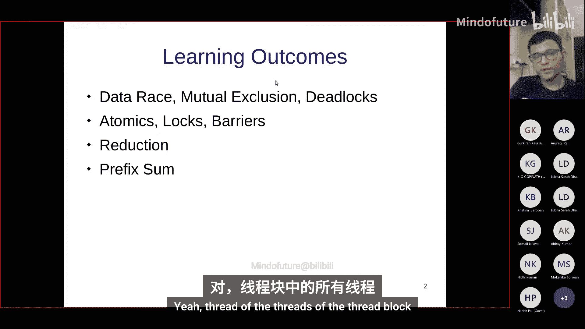

Quickly， anyone want to point that out， which was that global barrier？Lo barrier we saw。

 but like same yeah same thread because。Synncreread is the one， which is I mean。

Global barrier is just what I can say。 it's not any function。 I mean， it's just a。啊。

I mean it's just a mnemonic that I used， it's not actually implemented in the coa， I mean it's not。

 I mean you won't be able to use global barrier as like writing that global barrier in。

You will get the global barrier across all these GP threads， there is something else to it。

 we'll learn that also。But yeah， the sync thread， which we learned in the memory。

That in previous to previous lecture。Is used for synchronizing the threats of the threat loop and。

Yeah， so that is one sort of budget， but it's just a barrier across the thread of the threadblock。

Yeah， so that is the example of barrier， we'll see what is blocks and atomics as we go along with the next lectures。

Then we are going to launch these two new things， which is reduction and prefix sum。

 these two new things we'll be learning。And this are the way， I mean。

 this are the way in which we compute， I mean， compute the data。It allows to compute the I mean。

 compute the operation in race pre manner data race parameter manner。

 we'll learn about these two things in later lectures。Yeah。

 so this is our this is going to be our agenda for next file lectures。 and for today' lecture。

 we will be seeing data is and the。Some bit of mutual explosion between twos just between two threads will be looking this took part。

啊。Yeah， so with this， let's get started。And for today's lecture we'll be starting with a classword directly。

Yeah， so let's。And let's start with a classword。So I want each and every one of you to write the Qa code for call to implement the following functionality。

So。Let us say that we have some fual different data type usingstruct， which is named as point。

 and it has two attributes x and y。And then we are declaring arrow of that type point。

 which has n elements inside。And what each thread does is it works on four elements。

Let's just start zero takes AR out of 012，13。It takes four elements。

 plus four elements in similar manner a thread one will take Er of 4，5， six and7。

In same manner it will go on， so each thread it takes four elements。

And it finds the average of x values， so this are the average of x values and yeah after finding the average of x valuess。

 what it does is。It sees the value I mean， it checks the y value of value all those four values。

And it sees the y value above the average， any of the y value above the average。

 and it replaces all the y values， all the four y values with average。

That is the case one when it sees any of the y value above the image。

 it replaces all four y values by the image。Otherwise what it does is it adds y to some global sum and that global sum。

 I mean， the variable in which it adds that by value is defined globally GP for the GPU kernel think of it like that。

And yeah， so it does that and on course what we do is we will print the number of elements set to average here that we set to average。

So this is the functionality that we want to achieve。I request each and every one of you to try。

Writing the code or at least some steps corresponding to it。And。

Poin out some issues related to this code， like what can be the potential issues that we can face while writing this code？

I'll pause here for a few seconds so that you people can try。

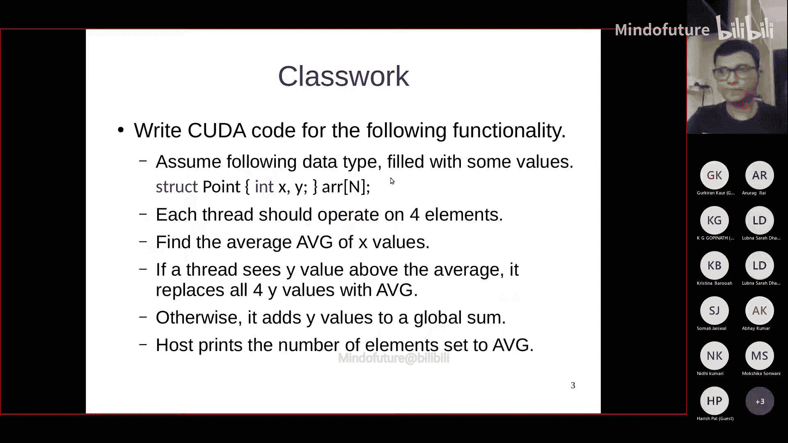

こといちゃ。Yeah， synchronous is the correct centralization construct so specifically。不 is啲。

That we saw in the memory lecture Yeah， so again， I'll be going back to this request each every one of you to try out this。

So that we can。We can derive some important point out of this plasma。Yeah。

I'll wait here for few seconds。

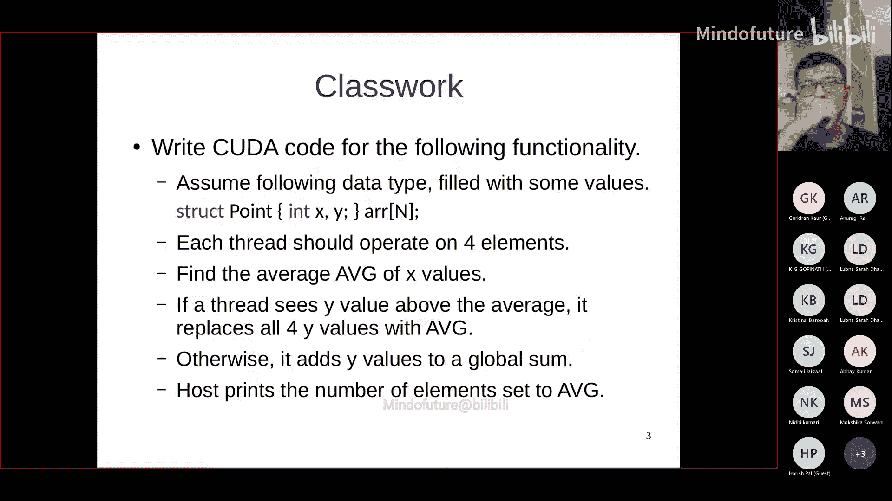

There are no responses。 I'll wait for few more。

食嘅。So if any y values above average， you have to replace all of the time。

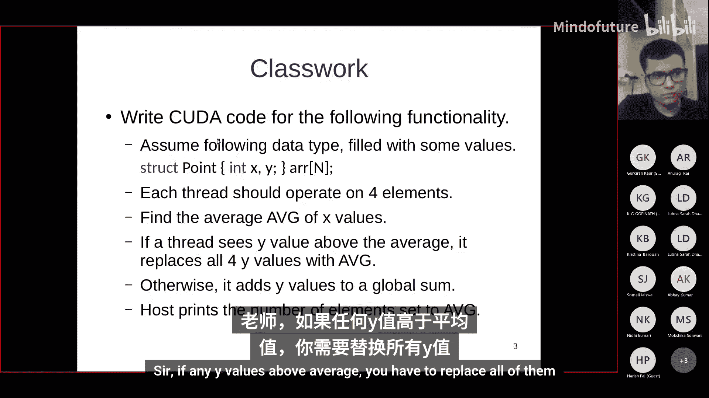

Yeah， sorry， or whatever can you re me， sorry。

If any of the four vivals are above average， we have to replace all of the material state。Yes。

 if any of the y values is about the image， you need to replace all four y values with the image。

You can either write some steps or。啊。I mean， just a brief overview of your。

Approach that you are trying to make with this。This class。July。

 there is some point that I want to derive out of it。啊。Yeah。

We can like first release like n by4 threads of D kernel in which we can access the elements of number I i+ 1 i+ 2+ thread IDx where I red idx the X。

And。Like like for every thread will like assign for of the like four unique elements of that array。

And then we can calculate the X and replace。グドス。Yes， that is correct， so whatever I don't know。

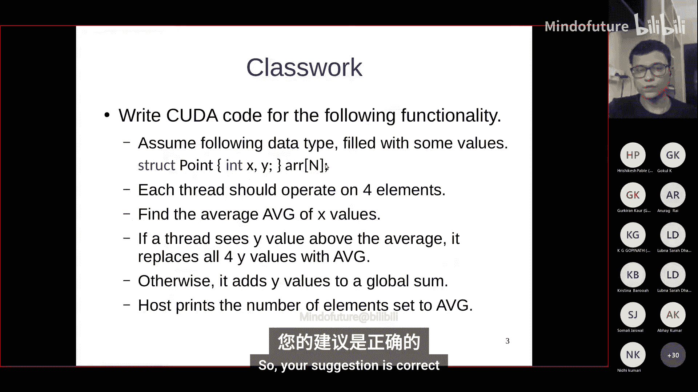

P up。听个。

Okay， anyway so your suggestion is correct。So what we can do is we can。

So let me build up on that suggestion itself so what we can do is we can launch a kernel with the end by forcrs。

And each thread is working on four elements based on based on its thread item。

 so thread0 will be working on0，1，23 form or sorry01，23。

Thread one will be starting from one into four so it will work on 45 six7 thread2 will be starting from 2 into 4 which is89 10 and 11 and so on that is fine so that we can do。

Based on the8 side， it will be assign some values。It will find the average values of x that is also fine because that is local。

 right？Yeah， so I'm hoping that you are getting it so each thread can get that I mean。

Local cement then compute the average of those four values because no other head are interfering with those four values if you are getting it properly。

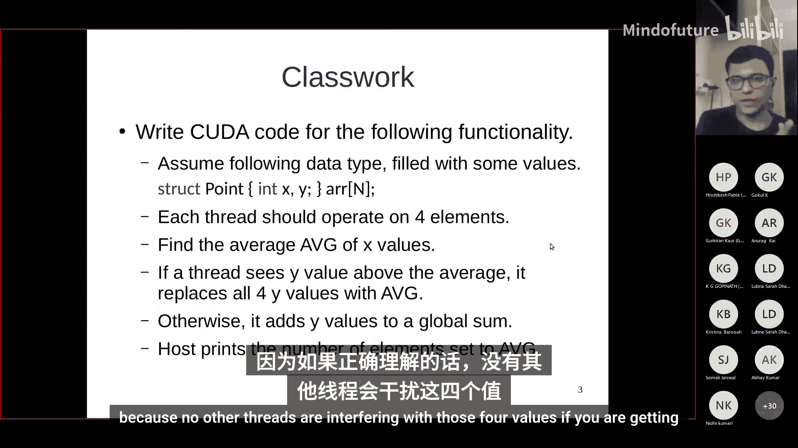

If you see this era of  zero to era of three。やらろ。A of world do era of。7。And era of。E to ya。

11 all these are independent values right so thread one third zero will be working on this Third one will be working on this thread2 will be working on this。

 that is okay。

But what is next？

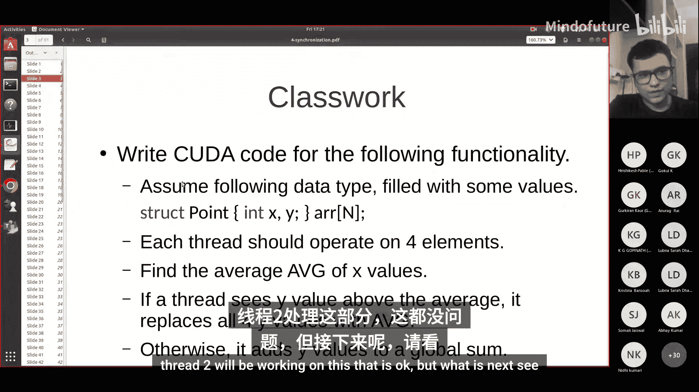

That is fine they can also compute average without any problem because each and every trade is working on that four set of a。

But issue comes at this two point let us understood what this does so if a thread value sees the value sees y value above the average it replaces on for values with the average so that is also okay right。

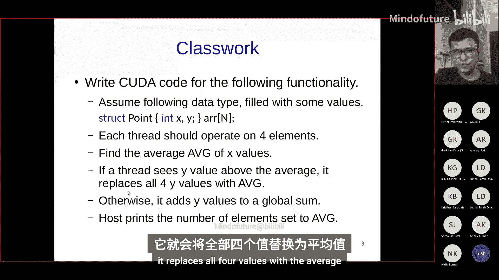

If you see here。Let's say this second thread or thread with Id 1 so that any of the y value here was about the average and it can replace all the four y values with the average because again this four are these four values are。

Worked by only thread number thread with ID 1 and no other threads are looking at these four values。

So that is also fine。

They can replace so each third can replace the value of five， it's I mean。

 if the value is about the average。Yeah， so it can replace all four y values with the average if this is the case。

If if it is not， I mean， if it doesn't see any of the y value above the image then what it has to do。

 it adds the value of y to the global sum。So， here comes the problem。So this postoral this group。

 it's the variable in which we are adding the values its global postoral。说。What will happen。

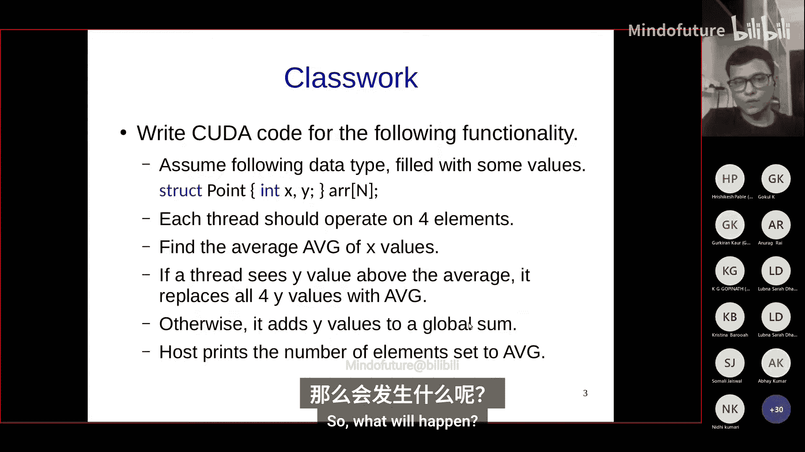

Let us understand this what will happen。So each and every thread is trying to add some value。

In global sum based on。It'sTread I。啊，ok。So I mean， there is sum value。

 which is which each and every thread is trying to add into this sum variable。And again。

 so if each and every third is trying to do this here。

If each and every threat tries to add value inside into a global variable simultaneously。

 then what what can happen， we have seen this right， the data is going to occur here。

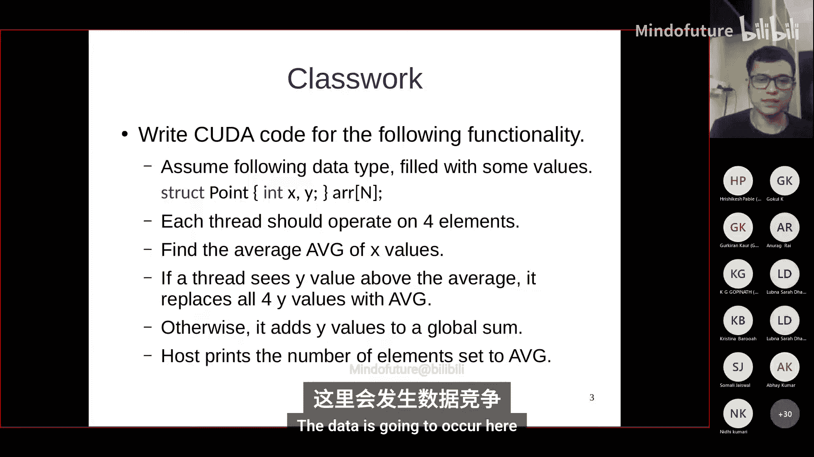

So more precisely， if few people remember。Probably in one of the memory lecture I told that this sum equals to some。

Some plus some value x that we want to。Broken into three statements。Right， it's like。

Reading into registered bus。Then啊。Register equals to。Register equals to register。The sex will happen。

And then some。Will be written back。So it's this statement。

 just this single statement is composedost of this three statement。

And let us say that two threads simultaneously tries to add the value inside this sum variable。

 which is precisely what we are doing here right， it adds the value of y to the global sum if two threads or two or more threads die to do this sum equals to sum plus one what will happen？

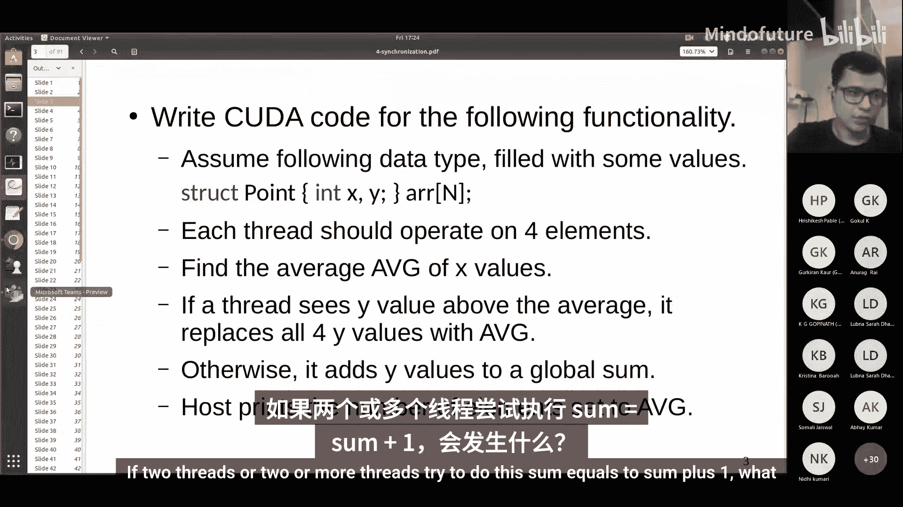

So let us say both the threads write the value simultaneously。

 because let us say some value of sum was initially4。

Both both the thread would have right value of sum as4 into their register。

Let's say thread one wants to do plus two and thread two wants to do plus three。

So final result would be 4 plus 2 plus 3， sorry， 4 plus 3 plus 2。which should be nine right。

 this is what we expect when we do 4 plus 3 plus2， the want thing are to be nine。

 but since they are executing parallel。Both of them would read the value of sum as according to their register。

 theyll do register plus register equals register plus x。

 so thread one will be doing4 plus 2 thread2 will be doing4 plus。

So they have value as six and seven simultaneously into their registers。

And then based on which is writing last。The value of sum might be either six or7， which is neither。

 I mean， neither of which is correct right， we want final value as9。そう。

This is the if you see correctly， this is the example of， I mean。

 this is the case where the data risk can happen。

So this is one point where the data is will happen。Can anyone tell me？One another， I mean。

 another point where there can be data is in the same when you implement this thing。

So this was one of the point where that can be data is。

Is there any another point where the data risk can happen？

We have to print it so all of the threads will be trying to print to the facility out at the same time。

That is okay， printing， I mean， if you remember， I told that。Pnting will be I mean。

 the data will be dumped into the buffer an arbitrary order of printing will happen that is fine。

It won't affect the correctness。 Priing is like。It's for the sake of user that we want to see the final reason。

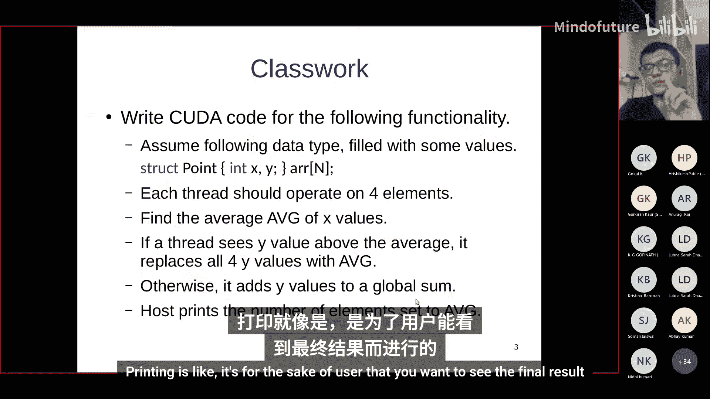

It won't change the answer or it won't affect the correctness。

 here the correctness is being affected。Answer is nine， but it is telling us six or seven。

 that is the problem。In same way there is some another problem also with this code。

 can anyone point out this was one of the problem？

Due to the rate S， there is one more problem that array of structures。

If you people know these areas of structures and structures of array。

 all these are for the optimization purpose。It doesn't affect the correctness。

 even if you use structure of error on the GPU， sorry， errors of structure on the GPpU。

It will give you correct answer just that performance will be lesser。

Because A is better for CQ and SO is better for GGQ I'm not correct， I sorry if I'm not wrong。Yeah。

 I think yeah that was the way it was anyway， so that won't affect the correctness。

 it won't it will affect the performance what are brain。

There is one more issue I'll give you the hint here。

 it is also related to the data as in the same way we are having the I。In same way。

 we are having some issue here like while adding it's the same kind of issue。That is the hint。好啊。

你烦紧帮你食个好啊。

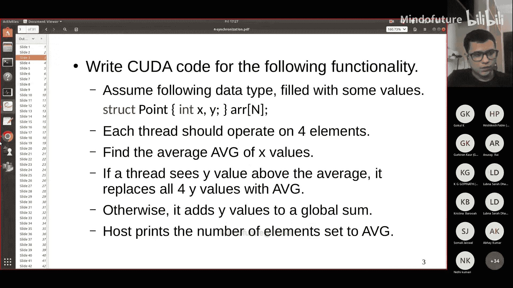

Okay， I don't think that this will be issue it's one because C。

Replacing the value of 5 with the average could cause conflict， it could cause conflict if okay。

 let us come to this one。

It could cause conflict， if。If the threat is replacing entire area， I mean， entire。

A with those y values， but here the。P values are being replaced for only this four let me go back for only these four elements on which it is operating。

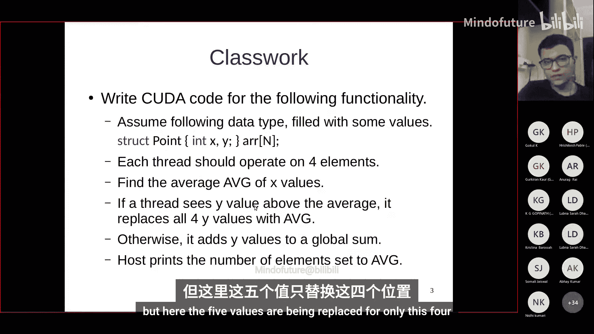

And if it is replacing on in this only this four elements， there is no data is right， I mean。

 it is the four elements which。I mean。These are the four element for which this thread was assigned right。

 so that is not an issue。Any other thread want to be ever looking into this4l mean this four values。

変かそ。I don't think that that is the issue it's one I hope you are getting。Okay， anyways。

 let us continue， I think。Yeah， but that's scope that you have。 So let us continue。

So the second issue is here， the host want to print a number of elements set to average。

So printing is not the issue。It wants to print the number of elements that are set to image。

So for counting that number of elements that are set to average here。

If you see it needs to count the the each and every thread needs to count that how many elements are set to average here to see properly and this will be done inside GPU so again。

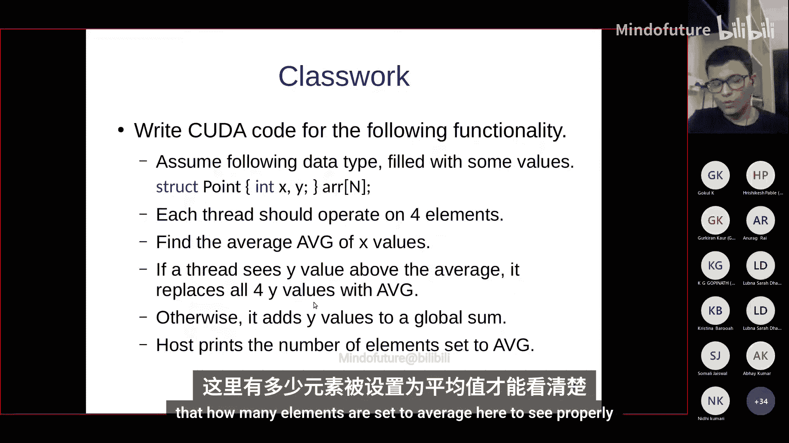

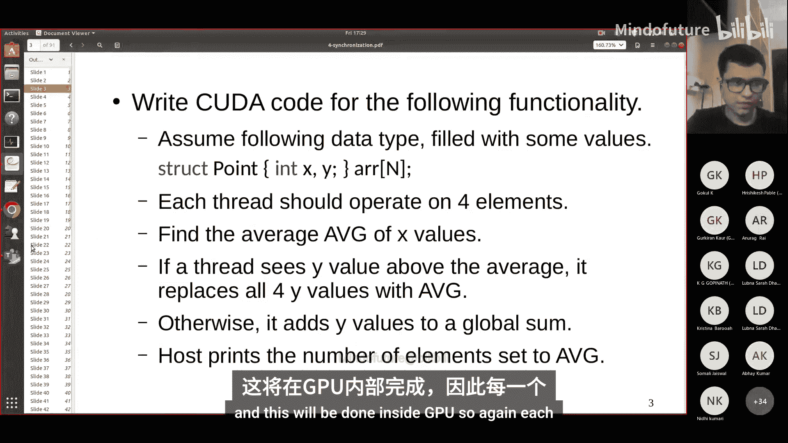

Each and every thread will be doing something like this count plus plus whenever it is replacing that particular viin and biology。

This will also cause it later is right because it is like the count equals to count plus  one。

And if you observe properly enter， I mean this again statement will be replaced by this three statement。

And since there can be multiple threats which are。

SoSince there are multiple threads， which are。Wwhich can have this y values about the average。

 and since they will be counting all those y values simultaneously。

 it can happen that again data is can happen。

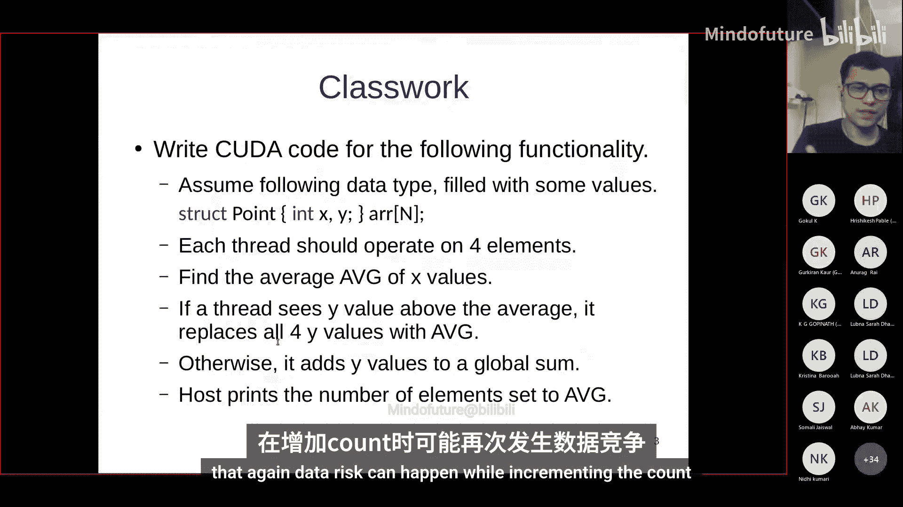

While incrementing the count。So， to Si the。

Second， I mean， this is the second place where there can be the issue。 This is the hospice。

So basically， if you try to write the code corresponding to it。Without atomics or something。

 like without synchronization， any synchronization construct。Then it will be ra， and。It willI mean。

 there are some chances or I will say there are chances that it will give you incorrect result because of the race happening here。

 data is happening here and here。Okay， so any questions up this point？

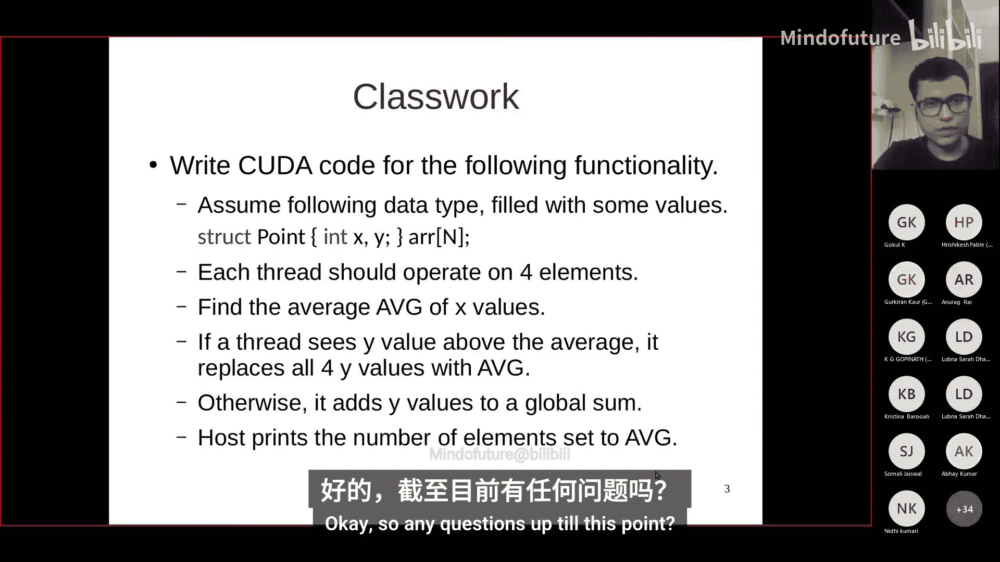

啊。On this slide or any of the previous two types。Yeah， question on how will do essentially。

As achieving the synchronization。 can we do that using global barrier。Or is that okay okay。

 we'll come to this point later， but okay， since you have asked this question。

 let us pick this question up。Here， there is no need of global barrier research because we are just。

 if you see。

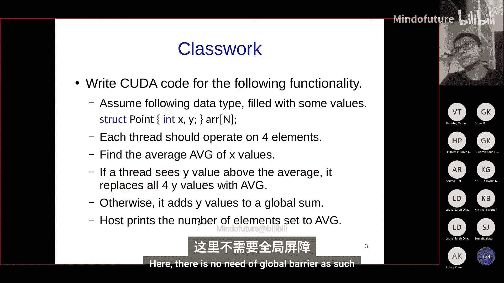

For both the place where there is data is happening， where there are data is happening。

 so in both the case we are implementinging or adding some value then in that case we can use some atomic instruction。

Basically atomic ad。And we can do this thing。Well pass the variable in which we want to add the value atomic。

And then we can do this， right。Under so one more question。 So either we can replace value。

 we can give value this particular count or the global value to the function GPU function。

 and you can keep on updating that value within。Like each thread will keep on updating that value other way we do it in shared memory and return the value and sum the values are。

Yeah， so or okay， so for the second we I tell that if you are only launching the kernel with one block。

 then it's okay， otherwise if you are launching kernel with multiple blocks。等系。Then you are a。有。

In that case， we have to sum the values for all the blocks for each of these items。呃，所。关。

Can it be achieved， can we get the shared memory per block， shared memory value per block？

For the government as an output。Okay， so you can get that to value I mean essentially you can essentially the shared number is part thread right so essentially what you can do is you can。

Print the values that that are for each， I mean， that are for threats of each right now。

That is okay that you can do， but the later thing that you asked was unclear doing what you want to do later。

Since eventually we want to sum up all the values across all the blocks。

 generally it seems like because even the average value。

 how many times average has occurred if you account for each of the blocks。And add them up。

Then it will give you the final answer， so if if we can essentially get the value out of each block。

And。That's the output of the pra。 And you sum them up。O。Yes好好。Yeah。

 please go or combine them in some necessary way if if it's not a。审爱。

If it's possible to combine them in some necessary way， is it possible to achieve that。Okay。

 so I think。It is possible， so let us say that each threatlock compute I mean。

Comput the sum independently， each third of the third computed there sum independently。

Now let's say we want to combine those values。For that again unit will need some synchronization construct。

 either it should be sync thread， or okay， sync thread will not work because it's only part threads of the threat law。

But again， you'll need some atomics， right？Or barrier， some sort of barrier。Because， again， since。

What you'll be doing you' will be choosing representatives out of each tblock right to add that the value that is compute by that entire tb。

Into some global global variable。Each representative of that particular trip block will be adding that value inside that。

啊， global radio。So yeah， so for that again， there will be some super needed also。I hope that is。Yeah。

 that makes sense， yes。so， I mean。There is， I mean。

 sort of this centralronization is inevitable if there are multiple threads performing this some sort of this operation addition or subtraction or something like that。

Yeah， but we'll see how to reduce the cost for it probably in the next pilot lecture。So yeah。

 but this that this move one。

So I hope you are getting it that why there is the data is with this， I mean。

 the code that you will implement implement corresponding to this class。

And we'll see in the coming lectures how to mitigate this issue。So okay， let's now， I mean。

 as we have seen the example corresponding to this data list let's now formally。

Formerally see when their data risk can occur。 You know what is data is right。

 when multiple threads try to。Try to perform the operation on the common memory at the same time。

That is that。We'll get it it this is what we saw。In this previous example。I mean。

 what are the necessary conditions for the data is to occur us see let us see those conditions。

So what data is to occur？All of these four conditions should hold。So first of all。

 there should be multiple threats。For the data is to occur。

 if there is just one thread or single thread execution， then there can to be data is。Yeah。

 so I hope that is clear we need multiple threats。Then this multiple threads should be updating some common memory location。

So if you see in our previous example， the common memory location that they were updating where this variable count or this variable sum。

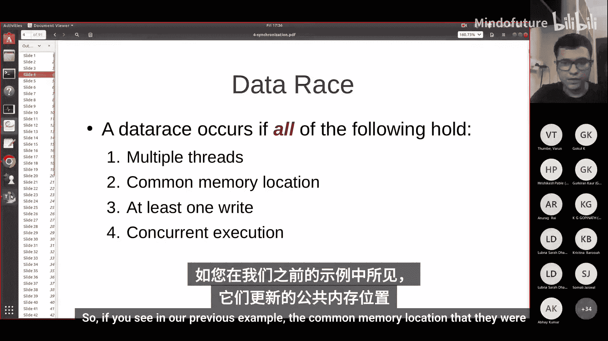

So。Let me switch so they should have some common memory option like some or that we saw in the previous example。

So there were multiple threats， there was common mumm location， which are some count。

Then at least one thread should write so and in that case also multiple threads you are writing right if you see both the threads or multiple threads you are trying to write into that。

Some are variable after reading their value， adding the appropriate content to it and then every thread was trying to write into it so at least one right was there。

And。Then there was this concurrent execution also happening right。

 that they were trying to write at the same time， or I mean， in some intelligent fashion。

 but they were right trying to write concurrently。走。Yeah， so concurrent execution is also limited。

So without concurrent execution， even that let's say you have multiple threats。

 but you are executing that piece of code or that addition operation in time。

In some interludete fashion that let's say first thread is performing and then only that second thread is trying to add and then only that third thread is trying to add the value input in that case there won't be a data is。

This concurrent execution is important So concurrent so without concurrent execution。

 also the data is not possible。So all these four things are necessary for the data is to occur。

Even if you remove one of it out of。Out of this。I mean， the four conditions to remove any one of it。

 then also the data is will come in。It will not occur。

So all these four are necessary condition for the data is。So。

 so we understood that these four are the necessary conditions for the data is to occur so in order to remove the data is what we can do。

Since all of these four are necessary， what we can do is we can just try to remove one of one of the necessary condition out of it then。

If we achieve that， then we can remove the data。That pes， I mean， that。

Take us to the ways to remove the data。So these are the four ways to remove the data risk and even there can be more ways。

 but these are four ways corresponding to these four necessary conditions for the data is to occur。

Since there， I mean since we need multiple threads for data is to occur。

 I mean this is a necessary condition just in order to avoid data is what we do is just be execute sequentially just with one thread。

大 didn我 up to we都你冇啲其他啲。Then second way is privatization or data application。

So we have this data is because of this common memory location side subting in this common memory location。

 right？So this is causing the issue， I mean， this is one of the necessary condition for data is。

So instead， what we do is we do thread privatization。

 that is each thread has its own local copy of the variable in which it is updating the value。

So that is the case if there is a threat privatization or data application among the threats。

Then again， we can avoid the data is since they're operatinging in their private copies。Yeah。

 so that is the way。The third way is separate read and write by a barrier。

 so this is for the third third necessary condition at least one right should be there。

 so what we can do is we can separate read write by the barrier。 so what we can do is we can。

Do all the rates first， so ratess can be done parallel right ratess won cause data is because。

Let us say hundred0 starts are reading the content simultaneously。

 there is no race there protected price if they try to write parallel， then the output can be any。

I mean， it depends upon which thread is writing the last last sorry last week so。

Yeah so that is the case so all the threads can read then there is a barrier and there then there is one single thread writing and again there is a barrier and after that barrier multiple threads can again read or one third can perform write。

So we can separate these reads and write by a barrier。

 and that way we can target the thought necessary condition for the database。

And the fourth condition， which is concurrent execution， can be。啊。

Can be troublefied by using something called a mi explosion？So what is mutual exclusion。

 let us try to understand here itself。Mitchll exclusion is the way in which only one thread will execute the critical section so okay Mitll exclusion is a way of ensuring that only one thread will execute the critical section and what is this critical section。

So critical section is the region of or the piece of the code where these shared variables are getting updated。

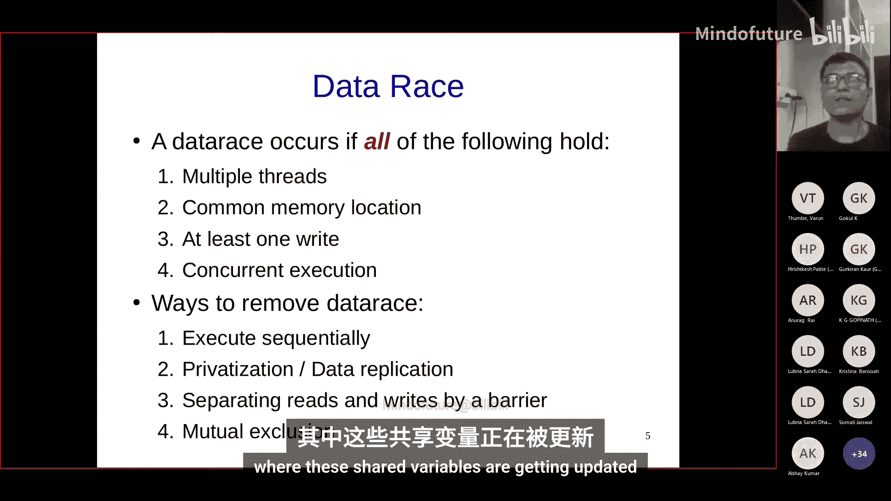

we come back again。So this this thing right sum equals to sum plus x。

 this sum was a global variable or the common variable across all the equation。

So this variable was getting updated right， so this thing need to be placed inside a critical section。

There is some。Some shared variable or a common variable， which is being updated by the thread here。

So such lines should be placed in critical section。

And what mutual explosion says is that。Only one thread can execute a critical section at one time so if that is the case。

 then again we can award the data is because。Sd variables are update by only just one third at a particular particular moment。

 so yeah so this are the core condition I mean poor base in which we can。

Avoid the data risk and these are the four necessary conditions for the data is to occur。

And this all four are needed， even if any one of them is qualified。Then data is water。

I hope this is clear any doubts related to this slide。

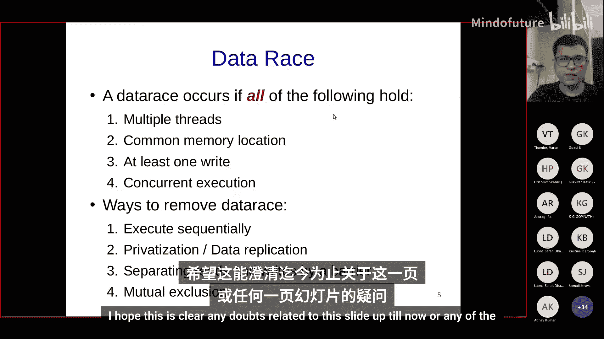

Up till now or any of these slides up till now。Okay， I'm assuming that there are no doubts。

In that case， let us。More part。Okay， so let us start with a class。So we have two threats now。

Thirdban is executing this piece of code。And Tto is executing this piece of code。This one。

I want each and every one of you to think that if there is a data is in the code。

I'll give you some few seconds， I mean I'll wait here probably for a minute or two seconds。

You are for new people to try。Okay， think about it and please post your answers in the chat or either you can unmute yourself。

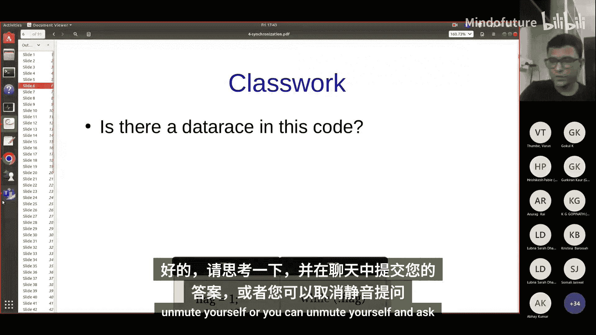

Or you can unmute yourself in us。

Sir， is it possible that two different instructions of the thread like occur at the same time。

 like at two different levels？Meaning， you are trying to say that flag plus to one is executing。

 and then some。あいたゃなはい。So here， the critical section is the son and is to right so。Yes。

 critical section is as one as yeah， so I probably prefer to mention that。

S1 and S2 is a critical section here and assuming that flag variable is common across T1 and2。

 so a flag is some common variable or shared variable across T1 and2。

And this S1 and S2 are not affecting the value of flow。The way the S1 and S2 is returned。

They are not affecting the value of life， considering this facts in mind。

 is there any data is occurring in this school？If P then y， if not then why。No， sir。

 because when the T1 while loop executes， the plug will need to be one。

And T2 while loop will only execute when line is zero or the opposite。ok。Okay。

 probably it might the correct answer， but I think we need to analyze it。Taking multiple cases。

Probably case when tag is0 and probably case when tag is。Anual， but。

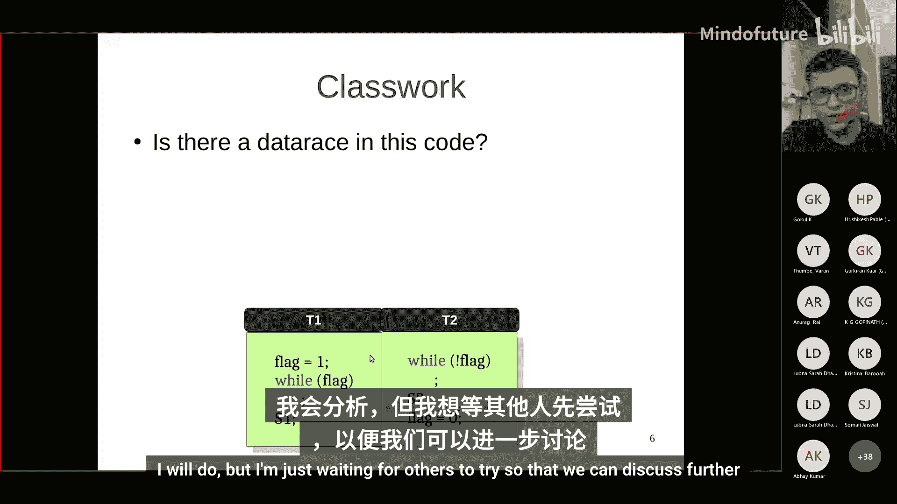

I'm just waiting for others to try。discusscus further。So in the second code， there is no。

Value set for flag。If the value for flag is set in the second quarter on then I guess let's say in the first line before even executing the while statement T2。

Okay， here。你样。In case if we set a value before the wild blue。And if that value is 0， then definitely。

A data is scan。Ocured， because。Yeah， please square how it can happen。

Because when flag is set to zero and let's say it goes ahead。And gets goes into the S2。

And then at the same time， then after that， T1 actually sets the value to one and then goes ahead with the while loop and then reaches as well。

I think probably you're missing something you are trying or probably are' misunderstanding。

 so let us try to understand your suggestion。So flag value was 0， you told that flag value was 0。

So tu2 will start executing it will see that not of black， which is not of0 is 1。

 so it will keep on waiting here because while one， it will keep on looping here。

It will not move ahead。And meanwhile， let's say it was loop here， sorry thread1 came。

 it set the flag values one。went up meanwhile this was looping let's say flag was at one and that it went to next instruction it also start loop right that one also starts plus1 here it will start loop but now let's say flag well is one so not of one is0。

This thread1 was looking here， but threat to Mor because threat not of 1 is 0。

 so it started executing S2。Meanwhile， please note that thread1 was looping because flag1 flag is  one S2 is executed lag is set to0 now since flag is 0 a while of 0 is false so S1 is executed and。

Yeah， execution is finished。Right， now noted。Yeah， I guess I just missed one point where the flag can be set to0 after the wind。

In that case。ok啊。Just after dinner。Okay， okay， black can be set just after the one。

Instead of before after a school set before a school。But in that case， it might be I mean。

 but here we are setting the before。Okay， let me try to understand that also。

Let's say flag was zero we came here okay， we were waiting here flag was set to one because we can keep it one for both the cases。

But still there want to be data。Yeah， there won't begins right。

And its opposite polying loia that takes senses。Yeah， so anyways， that was a good discussion。

 I think there are no other responses anyways， let's continue with this。

So let us analyze this case by case in order to understand if there is a data race or not。

 we need to take multiple or all possible cases and then understand what will happen。

So let us say the case one is flag is not sorry flag is zero。In that case， let's say。

Either of the inter living is happening， lets a flag was set to one and then this statement was executed。

 this flag was set to1 by t1 and then this statement was executed。In that case。

 not of one will be zero， so this will be moving on， it will execute S2。Meanwhile。

 this one will be waiting here because flag is one。 and then flag will be at 0。And since plug is0。

 T1 will proceed to S1 and that thing will happen right so there is no data is because S2 is executed then S1 okay fine no data is because no to critical section are being executed simultaneously so please note that there is no data is。

So， yeah。 So S1 and S2 are the quotes corresponding to critical section and。

Since no two critical sections are being executed simultaneouslyly we are saying that there is not there okay so please keep that in mind so that was first case I mean for the flag equals to zero I mean one another inter livingiving is also possible let's say that initially flag was not set to1 by1 but let's say t2 started first and it started executing this while and since flag was0 not of0 is1 so it will keep on looping here。

Meanwhile， since it is loop here， it will not move on， Meanwhile Tra1 came here。

 it set back back to one。Now， since the flag is one， this will not， I mean。

 this will halt looking here because not of one is0， so it will move on again。S to will be executed。

 and then flag will be made 0。 And again， this while loop since flag is 0， this while loop。

Tracect when looking at this while will more on then as one would be executed。Fine。

 so that is the case for flag equals to zero when flag equals to one again。

 we can see that this holds through no to critical section。Can be executed simultaneously。

 When flag equals to one， let us say that。Even executed this first flag equals to one。In that case。

 again， same thing will happen that because like was set to one。 again。

 it was reset resetted to one by this Steven。So this here T2 won't be looping because not of one is 0 and S2 will be executed and like will be set to 0 and then again this even will move out of this loop and will execute as well。

And so on， so。You can try out multiple combinations of these three statements。

 probably there will be many combinations for two cases。

 one is the case where flag is0 and another is the case where flag is1。

So you won to be able to see any of the case where S2 and S1 are being executed simultaneously by threat t1 and T2。

And if that is the case， we can say that there is no data is this。Fine。

 so I hope that this part is clear if there are any questions。

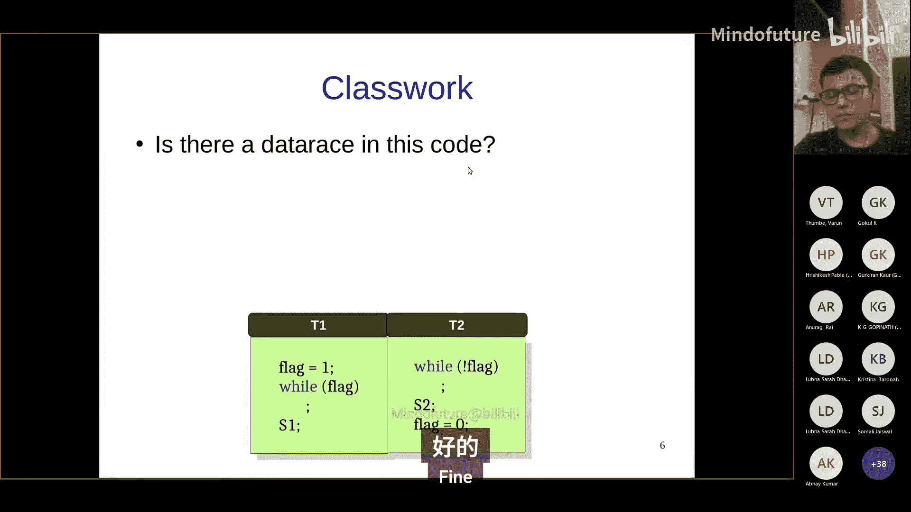

Lated to this thing。Data is thing for this code， then please ask by unmuting yourself。

Else will move further。There is some question， the definition of data this does not talk about critical section。

There' all two conditions of take definition has。All doesn't all the conditions of the。だけ。

ok企啊。So you're trying to say that。Okay， I didn't probably catch your point properly。

 but can you try to elaborate this or probably unmute yourself and ask？

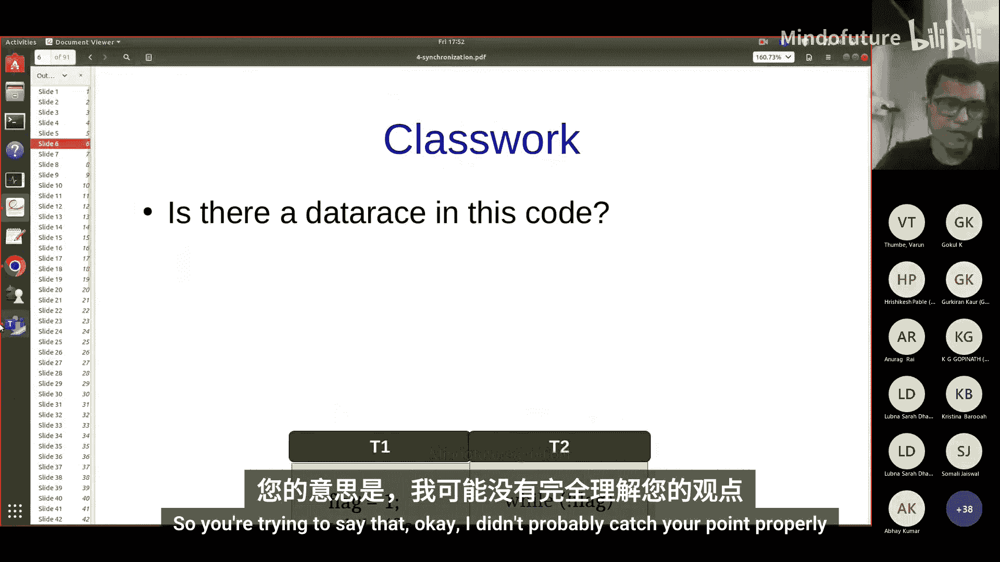

How we are satisfying golf conditions。家。Wing for your。Let are able to hear。Yes其在没得。

if you go to your definition of data is right maybe I'm misunderstanding you mentioned if all the four conditions hold right。

 so I think we have multiple threads， we are accessing flag which is a common memory location。

 we are like writing once to flag like twice to flag and we are executing。

Currently right so I mean by this definition doesn't let all four conditions satisfy in T1 and T2。

Correct， correct this observation is very crucial。 Actually， I was hoping that someone should。

Quant this out so if you see。We are actually satisfying all these poor conditions inive。

If you are able to get it currently， we are satisfying all these conditions here， in fact。

 if you see。Here flag is being written by value 1 and at the same thing is threat2 is reading that value so there is writing and happening。

Into the common memory location， writing happening into common memory location by multiple threads。

 and there is also concurren execution。But still， I'm saying that it's not a data risk why。

Let us understand this in some sense this is a data is。

 but let us try to understand it more in more detail。So if you see at assembly level。

 this instruction setting of a flag。To one is a memory right operation。So let me go here。

 so this memory right operation will just， I mean， it will happen atomically。

So if there is some operation like this addition or something， which was here。

If you say this addition operation， it is split into three operation， right？Like this。

But if there is some operation like this？

Where we are doing writing。Then it's just one assembly operation and that single operation is done atomically even if there are multiple threats。

 so it won't happen that。I mean， at the same time。flagla sorry yeah thread one is writing it of flag as well as at the same moment when it is getting written。

 this thread two will be reading that well。So yeah。

 internal living is possible black one is written written by the value  one and then tractrac2 will be reading or flag2 will be read fast by thread2。

And then writing will happen So inter living is possible。But。Simultaneous。

Reading while writing is also happening will not occur because of the way the assembly instruction executes。

If there are multiple， if one statement is being split into multiple assembly11 instructions。

 then any of the inter can happen and we can get such。

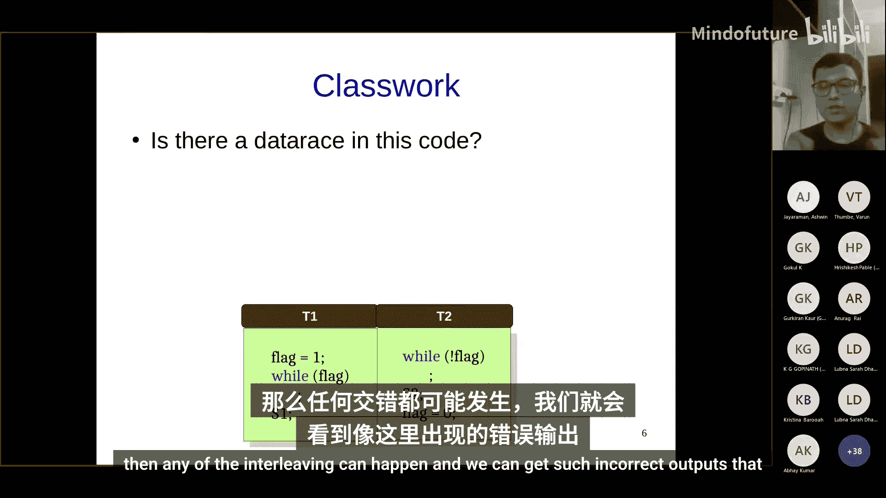

Incorrect outputs that。

We saw here。But here， there won't be a data。I hope you are getting it。In some sense， you can say yes。

 these four conditions are getting pulled， I mean， are being folded at here。But啊。

From correctness perspective， there won't be any issues。

 and hence I'm saying that there is no database。I hope you are getting。

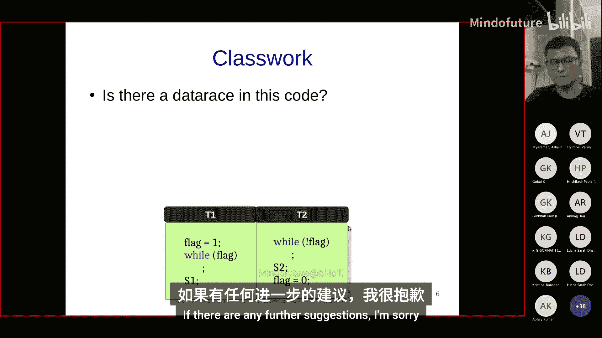

If there are any further。Sugges， I'm sorry， if there are any further questions， Jman。

 then you can unmute yourself and ask。佢哋啲心啊。Sir， but both while loops have a chance to execute together now。

Gocoul can you unmute yourself and tell me how both the loops can execute simultaneously？

Well， you are， I mean， your observation is correct， but I want you to elaborate on。

But based on the timing sort。Let's assume that flag is 0 initially。And now in threadread2。

 the control is enteringing into the through the while loop and into first statement of while loop。

at the same time in the T1 the control is not yet gone to flag equal to 1。

 so the while loop is entered in t2 and then in t1 the flag is set as 1 and then control enters there。

And by the time T1 while loop is over。before that T2 while loop will reach flag so flag equal to 0 and then before flag is again reset to 1 t 2 will go back into a while loop so it will keep missing each other and both of them will happen together。

I missed your part like initially thread was zero， flag was0。

If flag of 0 initially T2 will wait here， I understood till that part。Now。

 what next are you trying to do？You are doing something with this pattern， what you are doing。

Can you please me sorry let's。Yeah， but in that case English yeah yeah please go yeah initially initially flag is zero means t2 will not wait now so it will go into while flag not zero will become one and it will enter right now so no。

 if flag is okay， I think you are misunderstanding。If flag is0。

 then not of flag is one and while one is always true。

 I mean one is like true it internal no it will not enter， it will keep on looping here。

While not of pla means and flag is 0。Its similar to wild one。

And if that is the case it will keep on looking here。

 I hope you are getting it and if it keeps on looking here， it will not end。I hope you are getting。

I got it。好。Yeah， anyways， let's move on Okay， so next question that I want to ask you is what this code ensures。

Does the score ensures anything？Any typical thing in the way the critical sections are executed or anything else。

 does this code ensure in it？First thing that we can ensure is for I mean。

 one thing that we can ensure is for sure， right that it ensures mutual exclusion because。

As we understood by， I mean， as we know the definition of mutual exclusion。

If only one thread enters into the critical section at particular time。

 then mutual exclusion is ensured and here exactly that thing is happening so mutual exclusion is ensured。

But any particular thing related to the way the critical section is executed。

Any comment about that part that you people want to do？

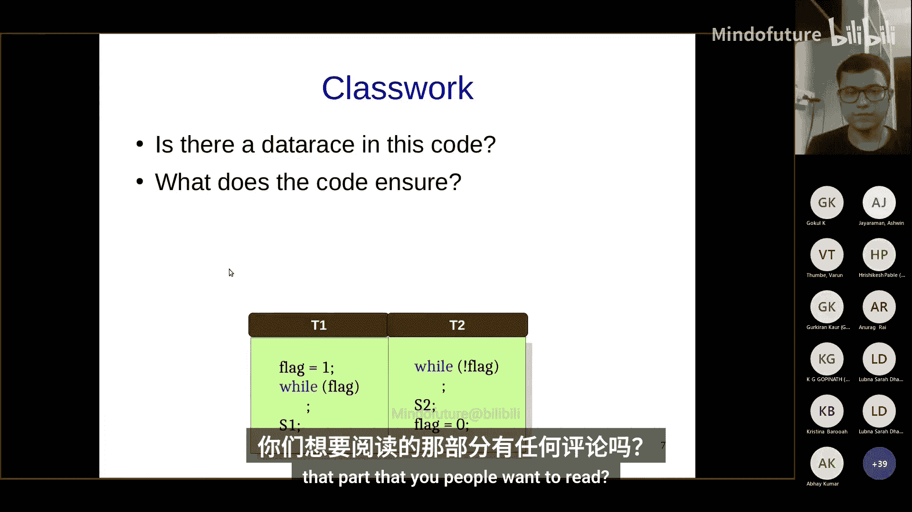

Also like we can say that can we are setting a flag and allowing only one of the threads to enter。

TheP section。That is what is mutual exclusion I told that we are I mean。

 we are sure about one thing that mutual exclusion is guaranteed。

Based on this mechanism that we have implemented using flight。

But there is something else apart from that I want you people to point out。

This court ensures something else， I mean something more apart from the mutual exclusion。

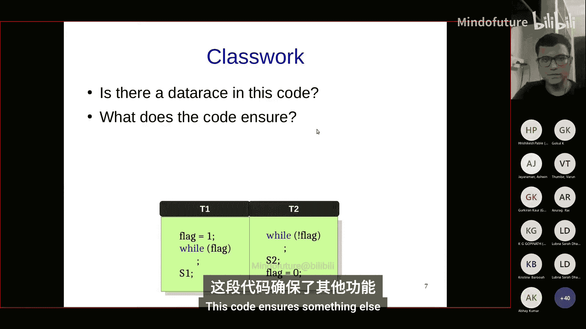

And I take questions。Okay， that part I that makes sense。 Okay， that's fine。

Atomic means only one right at a time， just to let。Okay， so atomic means something else。

 so Ill explain you with with the example， so atomic is something like this you are testing and setting the value of that particular variable。

Atomically， so what is testing and setting let us understand this？

So if you see here you are testing the value right， you are reading the value。

 in some sense you can say that you are testing the value and here are here you are setting the value。

By putting the value of the content of register into some。Se testing and setting the well。

 you want to do this entire thing atally。And that is actually what is I mean。

 that is what is done by atomic instruction。Economically。

 so no other thread can execute while these three assembly level statements are being executed。

 that is what economicomics are。Testing and setting is done atomic， that is what atomics ensure。

As to is outside。

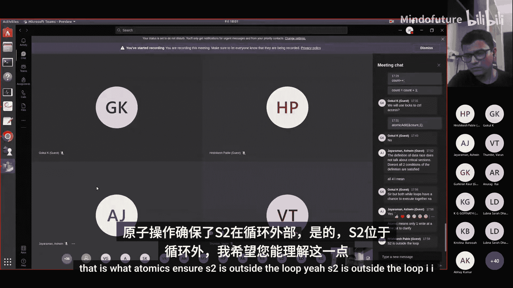

Yeah S2 is outside the loop， I hope you are getting it so this semicollon marks the end of this bi loop。

 I hope you are getting this。E true is outside below。Yes is。

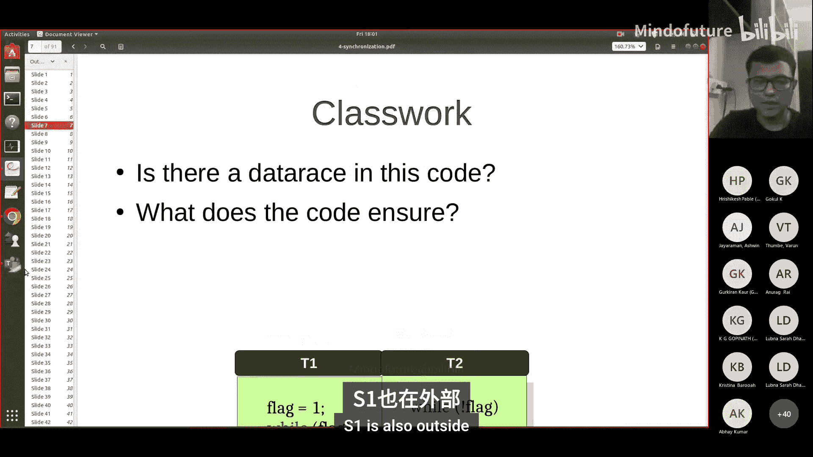

Okay， anyway since we are running out of time， let us continue with this。

So what what this code ensures， I mean， it ensures Mitll exclusion that is for sure。

What it ensures more is that if you see in each of the cases that we tried to analyze right when flag equals to0 and then different execution patterns and flag equals to one and then we tried。

Executing in different。Fashion， we saw that。啊。First， always S2 is executed and then S1。So。

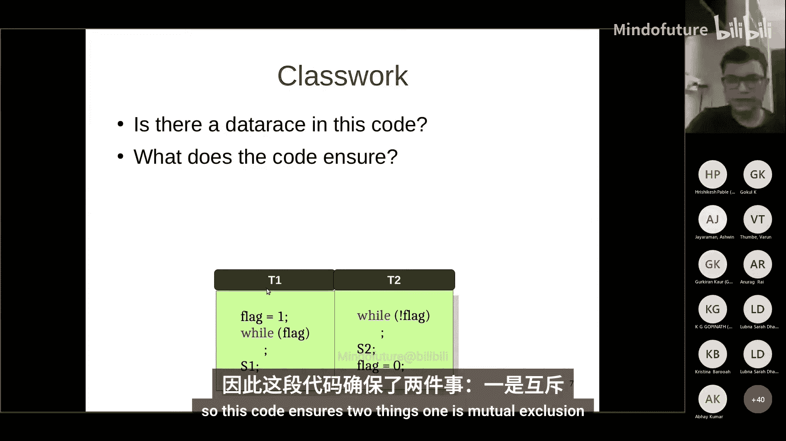

This court ensures two things。One is mutual explosion。Smitchell explosion。 and second thing is。

S2 will be executed followed by S1， so these two things are ensured by this board。

So I hope you are getting it if you are still consistent about it， you can try multiple。

way in which I mean this code can execute with different values of flat。

 zero and 1 are there different values of flux， you can take both the cases and you can try different inter livings of this code。

And inter living of this statements， not quote across third one and third2 and try to see which executes first and which executes second。

 so you will see that S2 will always execute first。And then only S1 can execute。

But there is still one more catch。Okay， we'll come to this。

 can we generalize this virtual exclusion for any threat？

But there is still one more catch to it and what is that catch？It's here。

 so if if initially flag is set to0， then as to execute before S1。Then we saw it when flag is0。

 we saw the cases wereged as two was executing before as。But a finish of the flag is set to one。

Then S2 executes and then S1 executes， so that is consistent with the flag equal to  zero。

 but there is something else that might happen。Or if third one may hung or I mean。

 third one may fall intofin， so can anyone point out the execution pattern？

That that is possible such that third one。Thanksangs。啊。Yeah， please think about it the case。

yeahT2 executes the whole thing till flag equal to0 and flag equal to 1 had already been set in the thread one。

 it had been executed before and now since flag is zero the while loop is stuck。Yes， yes。

 so so what the。what he's trying to suggest is that let's say that。Flack was initially one。

 so not of1 is zero， so threat to will move further。Then Esto will be executed。And just before that。

 let's say thread one has also， I mean， when S2 was being executed， thread one set black to one。Now。

 okay， sorry， no sorry I just misunderstood it， so S2 was being executed， black was one。

Now let's say that flag was set to zero。And then T2 finished this execution。

 so T2 finished now flag1 third one came it started executing it made pla to one。

Now since flag is one， while of one is true and it will keep on infinitely looping here。

So T one might hang because Th2 has already finished its execution of the statement。

And flag will now never become zero。Becoming one here by I mean。

 setting one by one here by the child。Here， third one will keep on looping in。

So I hope you are getting it two cases here。Eer S2 is executed before S2。That is first case。

As to execute before as one in the second case。T2 executes completely I mean。

 S2 executes completely and third one hunt。

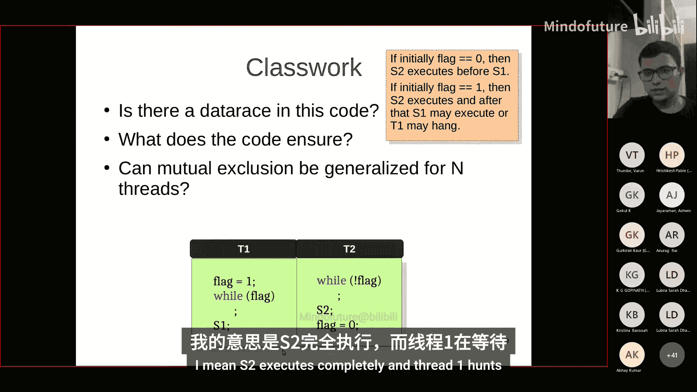

I hope you are getting。

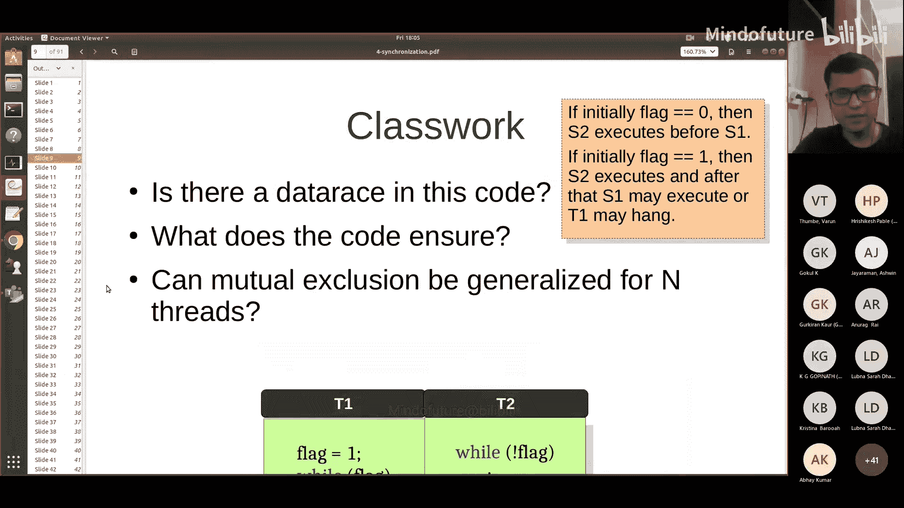

Sorry， is there any question。Hello。Okay， I'm assuming that there are no questions。

Okay。

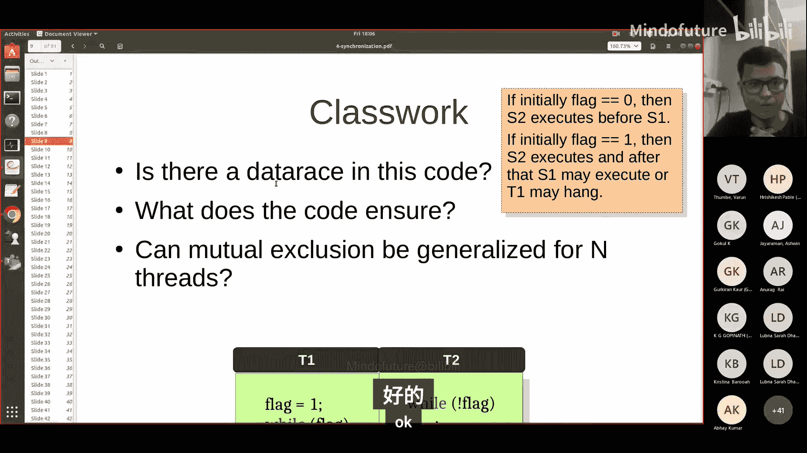

Please unmute yourself unless you have any questions， I can hear some noise from someone。Okay。

 anyways， if you have any questions， then you can unmute yourself and ask， but unless， I mean。

 otherwise please mute yourself。So that our discussion can。没什么题啊。

If D2 is called multiple times it may lock out even。Completely too。 Yes， that is correct co， I mean。

T2 can execute multiple times and it can set flag to zero and let's say even comes after it for execution。

In that case， it won't be able to execute further since flag is set to one。

Before it starts executing its critical section， like is always set to one teach time right by third one。

Yeah， so that is correct。So， let's move on from here。Have small classwork for you again。啊 sir。Yeah。

 and so I had it out in the previous。

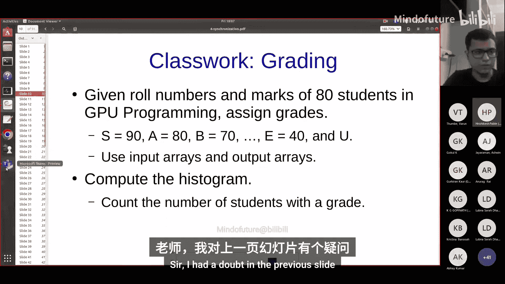

Reピス forで。Yes， so like we are saying that flag is initially zero and the while loop is running。

 so it will come out of that while loop only if flag is set to one right？オッケー here so yeah yes so。

ok so一为食经费。And then the flag will be set to0 and then。It will never enter the the T1 vi。Okay。

 I missed。 I mean， what is your doubt I， I missed that part。

 So like why the one may hang like I didn't get。Let us understand that。

So let us say that flag value was 1， it was not zero first of， lag value was one。系。

So if flag value was one。Not a flag is 0， right。Not a funny zero。So Tito will not stop here。

 it will move on right here。It will execute as to， it will execute as to。It will set like to 0。喂。

And then it it finished its execution， is it okay till now？I， yes I got it。 Okay。

 now thread one came， it started executing， it set back to one， and then it came here。Now。

 since lack of one is true， I mean， lack of one， which is black is one。 so while of one。

So while of 1 is true， it will keep on looping here。

And now there is no threat to set set the flag value to 0。

 so it will keep on looping here because there is no one to make that flag value to 0。你个。嗯你す个。

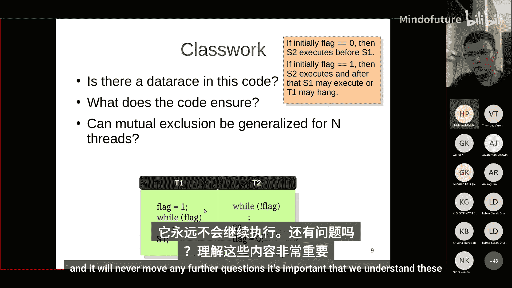

So I hope that you're getting any further questions apart。

It's important that we understand these things otherwise。Later in， I mean。

 as we go deeper with atomics and all those things it will create more compute。

Okay， anyways， feel free to ask questions。Let us try this class where we are given a role number in marks of 80 students。

In the GPPU programming course and or good a programming course。

 and when to assign the grades for those students。So creating system is like this if your marks are 90 or higher then you get some S grade 80 to 90。

 you get A。702822 get B and so on， D C D and E is per 40 to 50。And you for less than 40。

And you need to read the inputs from the input error。

 so input error is given which consists of values and that values do not see marks of that particular stool。

That the student has some role number and that role number is itself the index of that area。

 so student with role number zero has some marks， which is。Les than yard of 0。 So with。

Roll number one has some maps which are placed in era of one and so on。

 We read those mask for input and we want to output。You want to ask put啲啊。His program like this。

 so you want to essentially tell that how many students have U grid， how many students have E grid。

 how many students have T， C or B， but A grid。So we want to essentially count the number of students based on the grade。

 so for grade， how many students are there and so on。So yeah。

 so that is some sort of an histogram computation。So how can we do that sorry count the number of students with a particular grade？

That is what we are interested here。This takes some time to think about how will we write the code corresponding code。

And will there be a database？Invold here or not。Please take some time。

 meanwhile I'll look into the chat if there are any questions。

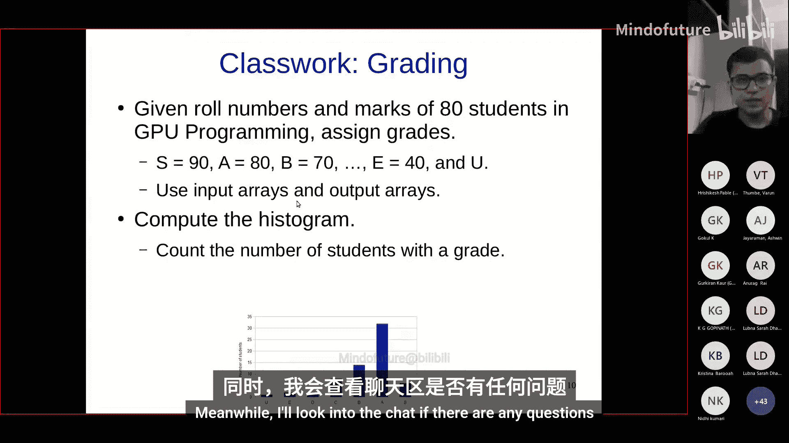

I guess there are no questions so far。

O。Please think about this and post your answers in the chat or whether you can unmute us。

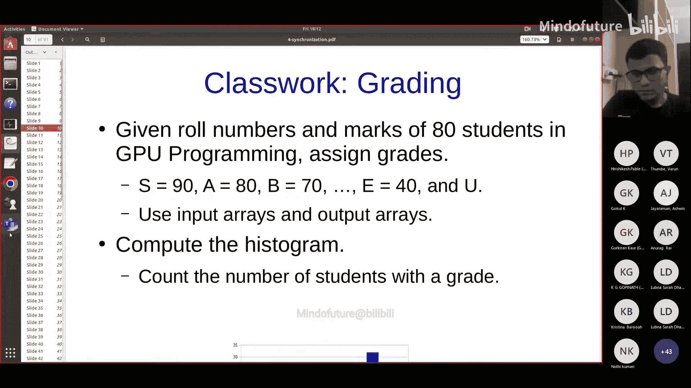

你使边噶。What公在。Writing in the output area。Oreing the value database。Yeah。

 so can you unmute yourself and explain why there is a database like？The way you are computing it。

Yeah。So essentially， we compute the。For us， there can be multiple students。

So let's say the array index0 and array index one of two have。

valueal is greater than 90 then both of them correspond to the updating in the same output array。

Which will be 0。 So you will be updating the value to。Increase the value。

By one in both of the places。 Now， yeah。 So in that case， if only they can occur parallel and。

Probably only one update can happen。 Yes， correct， correct。

 So that is one scenario where the data can。Can you think about the way in which we can avoid that data is？

So that is the next question。 Your answer is correct， that。There are multiple threads。 I mean。

 there are multiple students， which have。Mars about 90 or let' us say about about 80 in between 90 and 80 having a grade。

 then multiple threats will try to write into that variable which we use for keeping track of that particular grade and hence there can be a database。

For incrementing that student income for that particular grade。So there can be consistency there。

But how can we avoid that thing is I want you people to。冇咩关注。Ifation suggestion。

 can we declare count。And please correspond number of students today。

IR at the same element in the data。 Yes， I think this is also very similar to foreign suggestion。

Numb。C。Yeah， similar to。这就し。That output areas。But each cell in the array is that different。O。Yeah。

 each cell in the memory cell， each cell in the array is a different memory location。

But there are multiple threads which are writing to one particular memory location right。

 so let's say for S grade。Sscd， I mean， there is only one entry4 Sscd。

But there can be multiple threats or multiple students who are having S grade and for operatinggrad that count of that student inside that same memory location。

 which is keeping track of that S grade。We'll be doing， I mean。

 multiple threads will be writing at that same memory location， so that is where the database comes。

Even though we have seven， because from S to U， there are seven grades， right， seven possible grades。

 seven different model locations out there。But multiple threats can write into one particular mammal location out of that seven。

想边嘅更加过啊。by order。We could do this。But each thread has its own count value， and we can add them。

Add them to at a time。I didn't got your。point forty but。你般。Go this way。睇色所讲嘅。

And we can add them to at a time。Yeah， probably I'm。

Getting this probably will come to this same problem。We'll see how we can keep one count for each。

That is another way we can do。 Let's come to this itself。 So what we can do So one thing。Yeah。

As one thing we can do that if there are 10 tricks so a array of 10 elements should be used in the shared minute so likewise parallel one array of flags of 10 elements can be or 10 flags can be used。

A area of tin。Porsponding to each element for the count of a particular grid。Okay， and how can we I。

How will we avoid data is with that。10 grids or 10 elements corresponding to each grid。

So it whenever a thread will try to write some data element or some error element in a particular grid。

 so the corresponding flag we check。

Okay， we are trying to say something like this。

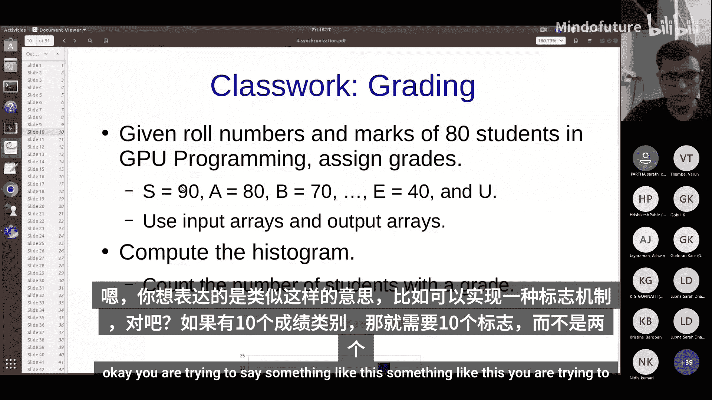

Something like this you are trying to say we can implement such black kind of mechanism。Yes。

 instead of two there will be the number of grades if the number of grades number of categories are 10。

Our number of grades are 10。 So array day of 10 flags will be used。Okay。

 fine10 error of 10plex instead of just one 10plex， okay。

Then you need to write the code in such a way that。There， I mean， their critical sections won't be。

 I mean， won't be executed at the same time， so you need to write the code corresponding。

W will be slightly complicated， I would say， but yeah。

 you can do that that is that is one of the way it can be done。

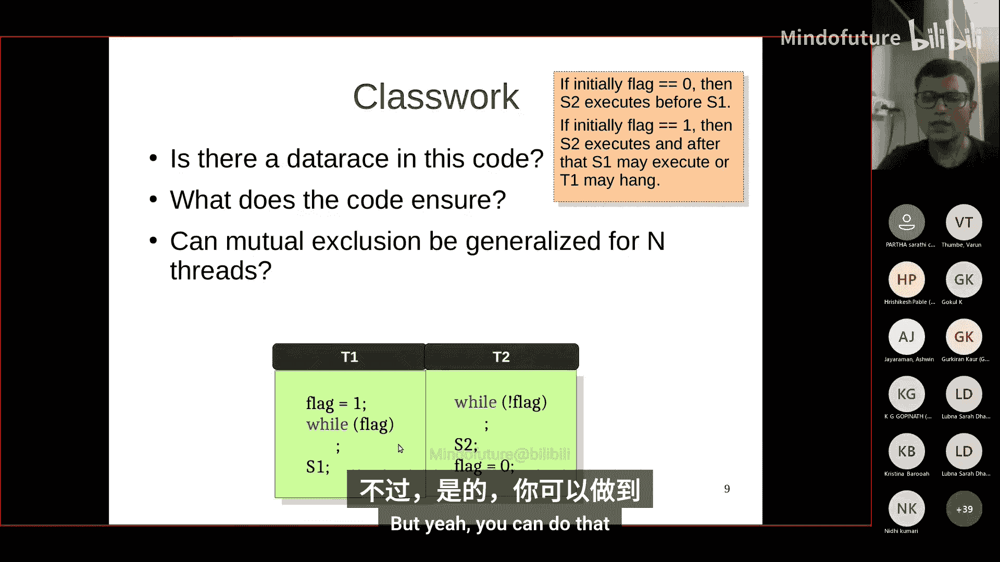

Okay， that's one of the。I 색가락 suggestion。啊。We can implement mutual explosion by setting flights。

Yeah， that is， I mean， that is what this example was suggesting we are implementing here mutual exclusion by。

Using some flags。 so yeah， that is correct Rahiish。

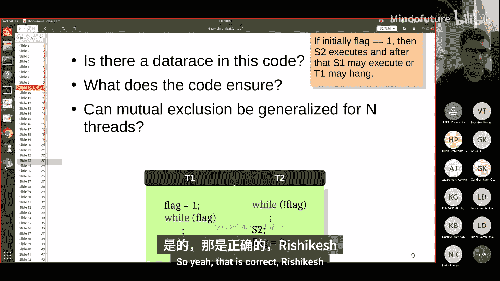

But I was here with Goku suggestion we could do this where each thread has its own count value。

And we had。T to it。2 at a time， I didn't catch up this last part。 but yeah。

 let us come to this thing。Each thread has its own compound value。

So what can we do here is one of the na weR。The呃。A very very intuitive way of doing this is as suggested by many of many of you。

 what we can do is we can。what we can do is like each thread based on， I mean。

 it will be assigned some element based on anxiety in that area。

And it will increment the particular grid I mean here the grid will be an area of seven elements。

Because from S to， there are seven grids， it will increment that particular location in that area of size 7 based on that。

Element in that array ERR right so that is one of the way， but that will have data this。As we saw。

 but in order to avoid this data is， what we can do is。

We can just what we can do is we can just give this area of size7 and just declare， I mean。

 launch a kernel with just seven threads。One thread for each of the grade。

 so I hope you are getting it， we are launching kernel with7 thirds。One third for each grade。

And what each thread does is it goes through all the elements of the area。And if it finds the。

If it finds the element inside that error will be。Followingaling it at grid category。

 itcrements it increments the。Value of that area element by one if it finds that student。

So I hope you are getting it each thread goes through the entire array based on based on its criteria for that grid on which it is working。

It will implement the value accordingly， so one way is to go by student， one thread for each student。

 second ways to。Go by grades， one thread for each grid。In first approach。

 one thread for each student， there will be database and will need synchronization or will need to use atomics。

But here in the second case， one thread for each grade。

Oppposing to that previous case where we have one one thread for each student。

 here we have one thread for each grade， and here there will be no database race。But if you see here。

 we need to do more work right， each thread has to pose with the entire array。So yeah， so I mean。

 if you mean if you want to get some some kind of balance。

 you can combine both this approach and try， I mean， post approach。

 there is data risk to avoid that you need to add atomics。

So that is also overhead and here also there is overhead in second approach。

 you need to go through the entire。 So you can combine both this approach and try to see what are the benefits and how can you。

And what percent you can combine both of these approach， and you can try。

Seeing what are the advantages and limitations， So I hope that is clear。

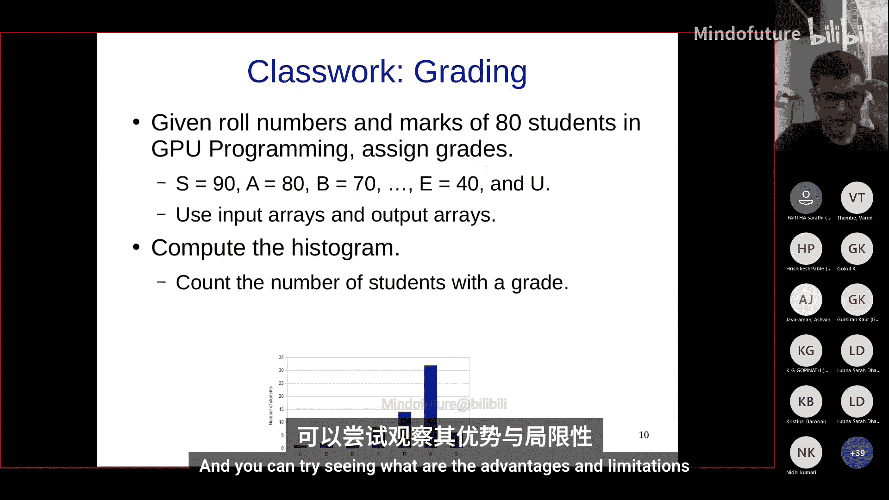

Any questions up till this point for this slide？Or any of the previous。

Yes one quick question so if the number of students is way way way greater than the number of categories so in that case it will still be expensive to go over that big loop。

Every time in each thread yeah that's a very valid question if let's say number of students are much much greater than number of grades because particularly grades are just 10 and students can win thousands。

So in that case， it won't be good to do that， but what we can do is we can try combining both the approaches based on the number of grids and number of students。

So I hope you are getting。Or did I miss your question。Yeah， that goes my question， thanks。

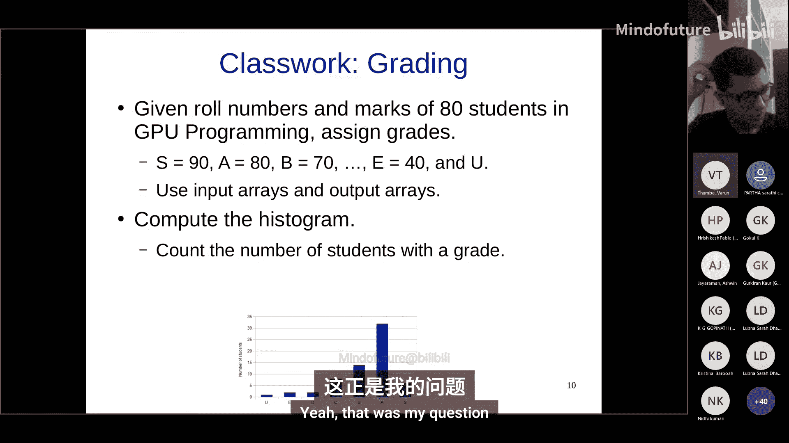

Right。I was here。I think I also hope this can we implement mutual exclusion by setting effects Yeah so we already saw the example prototype it right。

 we implemented mutual explosion by implementing。usings flags， sorry， by setting flags。

Or we can or we could sync thread and have one thread to do counting。

I am not able to properly get your。Suggestion go， probably you can。Im yourself and ask。What I mean。

 unmute yourself。Explain what are you trying to。And Scrad will be only for the thread of the crd block。

 so let's say students are。Very large number， let's say when beyond 1，02。

You need to launch the kernel with more than 10，24。I mean， with multiple blocks essentially。

 so St won't help any centralization， so I hope you are getting that point。There will be some issues。

 but you can try writing again。The way you are describing。I hope that is clear。

Okay， anyways， if you have any questions for that， then you can unmute panel us。Okay， so moving on。

 let us see this last slide。So let us say that we are interested in completing the shortest path from。

 let's say some city， Indian city， let's say Na， which is the center of the India。

To all other cities。So。We are given the graph as input graph of India is input。

 we want to compute the shortest path from the center of India to all other cities。So for that。

 what are the different algorithms that you can use？We can use multiple， I mean。

 there are multiple algorithms available for finding the shortest part right。

 so you can use textile algorithm or T for algorithms。So， we'll be using。Pelman code algorithm here。

 for example， so let us try to understand it we want to compute shortest shortest pass from India centre to all other cities of the India。

So。Okay， so for doing that。Let us say that were are also given with the GPU graphraph Library。

Whi computes I mean， which has some in functions like reading the graph and let's say finding。

 I mean， going through all the neighbors of a particular vertex。And also， I mean。

 you have functions for。Finding the distance， I mean。

 getting the distance between the particular vortex and its neighbor。

So all these routines are given to you。And you are interested in finding the shortest distance and the way it is done is like this each thread operates on a node based on its side let's say idea of thread is1 then it operates on node number one。

And it settles the distance of its neighbor， so what it does is it based on its distance。

 it will compute the distance of its neighbors。And if the captureter distance is less than the original distance of its neighborer。

 then it will update its neighborer's distance， the way we do in Belwint for algorithmism， right？

So in Belelve for algorithmism， we say that we relax all of the neighbors of a particular vortex member。

So yeah， that is what we want to do here。And。For doing that， let us say that we are writing this。

Tplpy subroding or datapy， which is devicepy， which is triple port for theplpy。And what it does is。

It reads this graph as input。which is some let's say class or some structure and it's reading this graph as input and the area of distance。

 so this distance is an area of size v which is number of purchase。And it stores， I mean。

 it stores the shortest distance from source to all other vertex。

 So initially it will be initialized as。So it will be initialized like this。

 it will the distance for the source verortex will be0 and all of the vertexes will be infinitefinity inside this distance。

And as this computation proceeds。They will get shortest distance from the source vertex and yeah source vertex for all other vertexes。

Yeah， so this is the code corresponding， but let us see this figure first， so here the a source。

And let's say we want to compute shortest part to all of vertices。PCD， E gene。

 all the other vertices。And yeah， we have some edges， I mean， edge shortage those vertices。

And for completing the shortest path， we use this GPU cardal。Which is name as T T to Pespy。

And inside that kernel， we compute ID using our normal that equation， right， thread ID x dot x plus。

Block I Xtex into block the botex right that equation we use to get the unique id。

Once we get the unique ID each thread based on its side will work on that particular vertex so lets say I is 0 then it will work on vertex 0 if the thread side is 1 it will work on vertex 1 and so on。

So what each thread will do。It will go through all its neighbors based on its ID so if thread is  I0 it will pick up the wordtex 0。

 it will go through all its neighbors and what it will do is，It will。It will， first of all。

 check its distance。It will add the distance from it to its neighbor into that distance。

And it will call that thing as alternate distance。So。They to say。You want to complete the。

Shortest path from， let's say。From yeah， okay， let's say we want toest complete the shortest path to see。

And what this a will do initially C will have distance as infinity right。

 because this is the way we have initialized rate， so a will have distance 0 since is source。

Every other verortex will have distance inulating。And so what A will do。

 it will go through all its neighbors。 So let's say it went through sea。Its distance was zero。

 so list of  zero is0。The weight of I d comma means0 comma。零ゼcom C or acom you can say。Wwhich is 3。

 so 0 plus 3 is3， so alternate distance to c is 3 and3 is less than distance of n right because distance of n which is distance of C was initially infinity sorry。

So infinity is less than sorry， infinity is greater than alternate distance。

 which is3 phase is less than infinite。So it will update that distance of n。

 which is distance of C to3。So I hope you are getting it the way we are computing it。

Any questions up this project for this computation part， this Sal part？

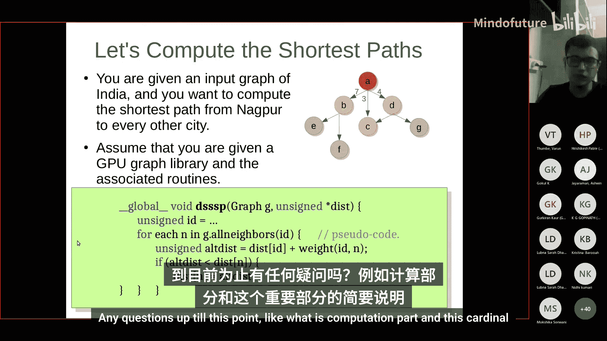

不。

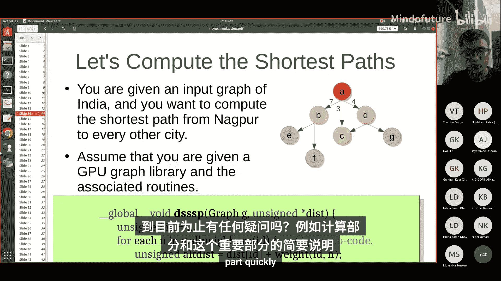

There are no question。 I'll ask you one question here， and then we'll probably conclude for today。

Okay， you can see that are no questions。

Okay， in that case， I'll ask you one question， what is the problem with this code。

 there are two problems。Or let me simplify it since we have less than。

 there are two places where there data there is data is occurring。

There are two places where the data is is occurring。

 Can you quickly point out the two places where the data risk will。I hope that the question is clear。

There are two places where the datas are at least two places where the data race is occurring。

But I want two people to point out two places where the data races are going。

So inside that if statement where we are assigning distance of n。De。

You can have a data like two threads might be assigning。O。Yeah， did this correct啊。

But I want a more elaborate argument for this， right？Yeah。

 that you are corrected two thread might at same time try to assign that。

 but can you explain it with example？Aex。For example， if it takes C。

Then in that case it is neighbor of A and both of them。

 so in like if both the threads are running parallelly。

 then it might appear in that statement at the same time so we can write the of C。Okay。

 so your argument is correct， but there is one small thing that you are ignoring here。

I'll add that point here。There is data is occurring， but there is one more crucial issue here。

 the data is is there， but it is affecting the correctness accuracy。

And why it is affecting the correctness， let us try to understand there is reading as well as writing happening simultaneously。

So reading of distance is happening here sorry here at this inside the hip。

Distances being read and also being written， so let us try to understand what is happening。

So let us say a was trying to update the shortest distance to C and T was also trying to obtain shortest distance distance to C。

And we know that shortest distance to d was 4 right because of this k and lets say D to c as you was having distance of 2 or lets say 3。

 so4 plus37， right？So。And initially， C distance was infinities， right。

 because no one has approached T C right now。So what happened was der the value of distance of n and n is C here。

 it not that neighbor of A and D A C， so n is C here。So distance of any infinity。

 no one has yet updated。What what both A and C read， the value of n was。Infinity。Right。

 because distance of hand was infinitefinity。Both A andC read the value of distance of n as infinitefinity。

Now both for both of them， the altered distance is less than infinity right because for a it's3。

3 is less than infinity for d it's4 to4 plus 3 which is 7，7 is also less than infinity。

Now since both has the value of3 less than value of distance， which is infinity， sorry。

Since both of them has alteredest， which is three and seven respectively less than infinity。

Both of them will enter in this。This。If condition， and based on whosoever updates the value of list of and last。

You might see the final value of distance of c， which can be either three or7 if D update update its distance last。

Then the value of distance of C will be7 if a updates its distance value last。

Its distance value will be three。But what is the correct answer it's 3 right short distance to c is 3 by route of a。

 I mean through a。But it might happen that here T might be the last one to execute。I mean。

 last one to finish this statement because of the data is。And due to that。

 the shortest distance to C might be seven。So that is one problem and second issue that might happen is that。

This and this writing might happen simultaneously。This reading and this writing。

 so let's say sorry this thread thread which was working on a vertex a was executing it。

Updated the value of distance， which is distance of B， which was here， which was its neighbor。啊。

I mean， it updated at the distance of P。After the。Now， before the period add the value。

So we will read this value infinitefinly。But actually， after abblation， the oil distance was。Seven。

 right because a will update it。This B is updated to 7 but。E， oh sorry。

 the thread which is working on B。So it's garbage， I mean， infin， actually not garbage。

 infinity was seen by we。So P saw infinity here while reading。

 but he updated later and it updated8 to7， so this is also the second case where the data risk can happen。

So I hope it is clear if there are any questions here for these two cases， then you can ask。

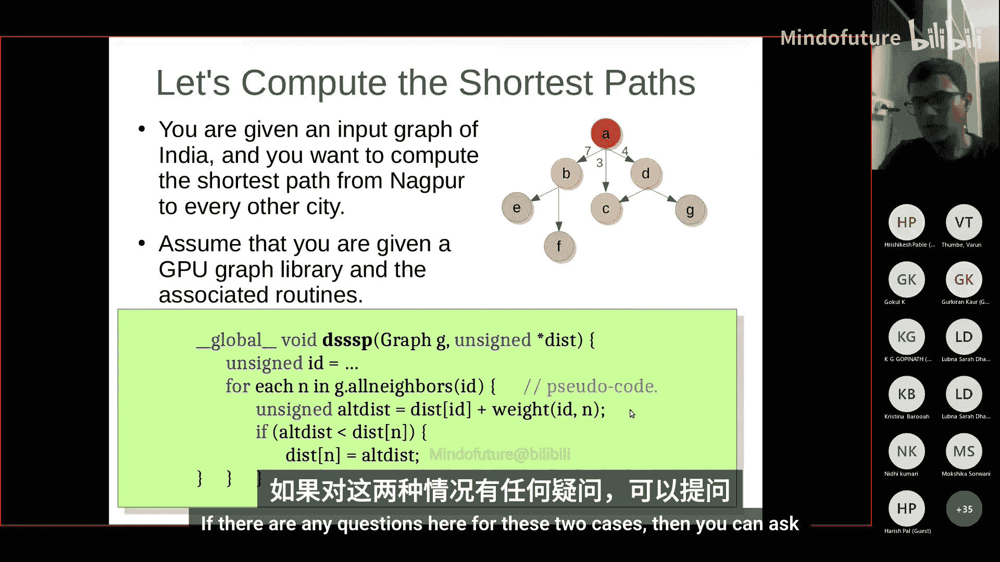

No out of things kids。It's correctness is not affected though right because have that is yeah that is one important point that I missed specifying so correctness is only affected for the first case for the case where。

The data is was between these two things， this reading and this writing。But for the second case。

 when there is data is for this reading and this writing。

Correctness is not a concern because let's say piece value was updated later。After we add the value。

But okay， let's say that it right the values is infinity。

 the right working on P write the value infinity。Let's say this tripleSP was getting executed multiple times then in second run it will see the correct value which is 7 so in that case correctness is not the issue。

But the more serious issue is with case one， which actually can cause the correctness issue。

 so yeah please not that point。Case one is causing correctness issue。

 case2 is just this causing data is but not correct correctness issue。

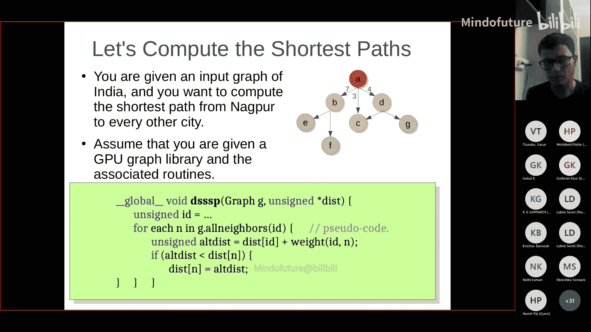

So I hope it is clear if there are any questions， then you can unmute your second。

can you repeat the case to one motion？

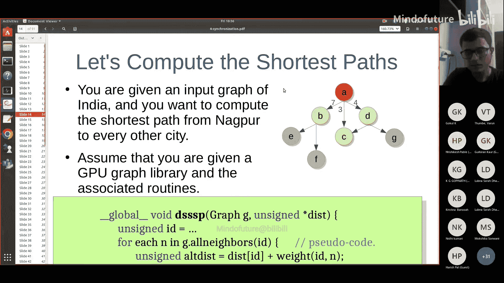

Okay， so case2 is。Let us say that we have this A and B vertex and threads working on this vertex A and vertex B。

So what will happen， Let us understand。So thread， which is working on this vertex a。

is trying to update this distance to 7， right distance of p to 7。明文呃B呃。

Ted working on this vertex B is also reading its value right here。

Because it wants to update the distance of its neighbor， so it must be reading its value。

So let us say that reading of B。Whi has its initial value is infinminit， is done。

Before this writing is done by the vertexi。So vertex is trying to write vertex is trying to write the distance as 7。

Into this distance of seven into this。Be base final distance， right。But what happened is。

7even is written。After the B has read the value from its distance error which is infinity。

 so B add infinity and based on that it is trying to update the value of its neighbor but since it is infinity it won't update anything。

And after that year， they value 7。2 base distance。So that is fine， I mean， that has data is。

 I mean reading a writing are done albeit being done simultaneously。

 but that won't affect the correctness because。This distance is updated right it will be visible to the thread working on the vertex B in the next iteration when this tripleized kernel is invo。

I hope that is clear if still there is any conclusion that you can ask。要。好。Any further questions。

 I'll be there here for a few minutes。Yeah。This。

Ask it， do you have any questions。