# 【Nvidia】CUDA并行编程-｜-Cuda-Programming-Course-｜-Parallel-Computing-Using-Nvidia-p12-P12_L12_互斥锁--BV1MSq1BTEho_p12-

Yeah， so let's start。So hellello and welcome everyone to the 13th lecture of our lab programming。

So in the previous lecture we saw we started off with this synchronization right and we saw what is mutual exclusion and what is critical section and so on and then we saw multiple examples related to the。

Dataase so that we saw the examples where there can be a database。 and then we。

Forly saw the poor necessary conditions that were crucial for data rest to occur and then we also saw how to mitigate the data by targeting each and every four of those necessary conditions。

Then诶。Yeah， and then we left off with this ended this lecture and ended the sorry。

 ended the last lecture with this slide， right so。This was the last light that we saw in the previous lecture if you remember。

 we were trying to compute the shortest distance from the center of India。

to all of the cities and for doing so we okay for doing so we were interested in writing some GPU kernel or something and then we wrote this D plus P GPU kernel which looked something like this。

And yeah， I mean， at first look it was， we observed that this code might be correct。

 but then we saw that there are there is。There is the tuist with this code， especially here。

 so some thread might be reading the distance for checking this condition and at the same time another thread might be writing this into this distance array。

This is an area so yeah， so here there is reading as well as writing happening。

By the multiple threads and hence there is a chance of data this and we also saw with an example on this small graph that。

How the value of C due to data sorry， how the distance of C。

Wwhich can be computed through A or D can be computed wrong due to the data risk。

 so yeah that was what we saw in the previous lecture。So yeah。

 that was the brief kind of recap for previous lecture。For the today lecture。

 we are planning to cover。The mutual exclusion for two thread case in a grid detail so we'll see multiple examples for implementing the mutual exclusion for the two threads and see I mean we'll see multiple examples and we'll also see what are the problem with those examples that we are going to see in this today lecture。

And then at the end of the today's lecture， we'll be concluding with the greater algorithm， which is。

It will be controlling with the Petererson's algorithm， which is kind of。啊。

W is kind of the standard view of implementing the mutual exclusion for the two threads。Yeah。

 so with this， let's get started yeah。

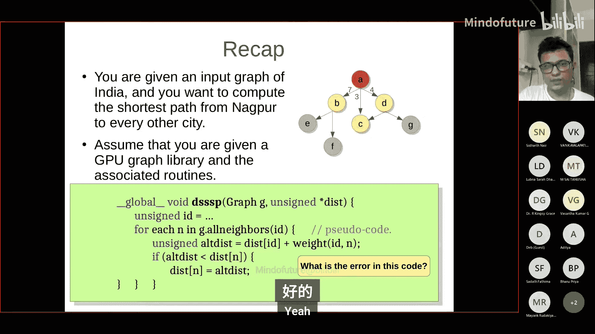

Any questions up this point。我。Up till this point。Okay， I guess there are no questions。

 so with this let's get started。

So okay， so we are here in this synchronization。And。There are typically three ways or I mean。

 there are multiple ways we'll see further there are reductions also。

Perific sum and all those things are there but。Tpical three are using controller data flow atomics and barriers。

 We can implement synization using this three。诶。constructs in a very simple manner so yeah I mean these two atomics and barriers require hardware support while this control plus data flow doesn't require any hardware support and can be done at the program at the software level。

So。Yeah， so let's start with this control plus data flow。

So so what is first of all what is control plus data flow so if you remember in the previous lecture we saw a small example where we were trying to implement mutual exclusion for two threads and in that case we weren't using any atomics and anything we were just using while loops right so that is what is control statement like while if and all those are controlled statement and we were using the data flow normal data flow that acct the execution of program we were using that two things to implement this synchronization or mutual exclusion in some sense so we are in that example we were trying to restrict that only after S2 occurs then only S1 can occur so that was kind of some sort of mutual exclusion that we were trying to ensure by using control+ data flow。

So here is a small class for a few people， implement mutual exclusion for two threads。

Using just control plus data flow， so you are not allowed to use atomics or barriers or anything。

Just using Con data to implement the mutual exclusion for。And。Please try and mean。

 if you have any questions， then you can ask。And post your answers to the chat so that we can analyze the multiple approaches that are。

They are for implementing the mutual expression for the two threads。Okay。

 even if you have any question on this thing， then you're going to ask on the chat。

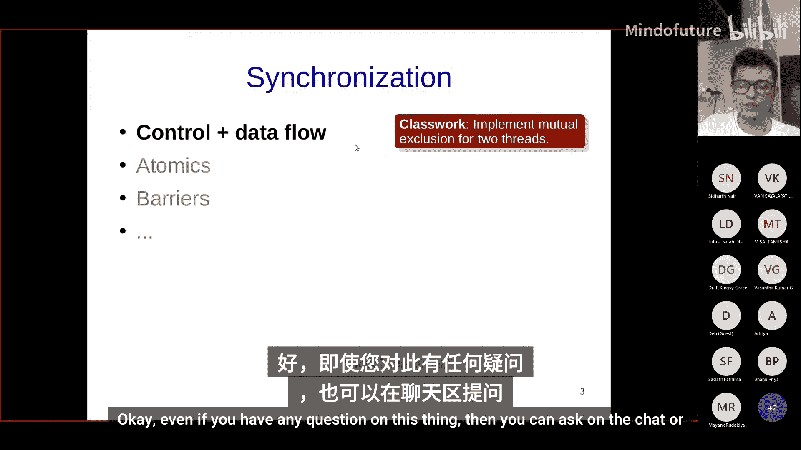

Or you can em yourself。Okay meanwhile， I switch back to these slides properly， I guess。

Most of we are。 So yeah， anyways。

Let me switch back to this side。So， Ill repeat again， the R。

E currently is to implement mutual exclusion for two sides using controlled press data。

So now atomics or barriers can be used just using control and data but we want to implement mutual exclusion for tool threads。

So I request each and every offered to think about it， or I mean。

 just think and write a very simple code which can implement this visual exclusion using two threads for two threads using only control and data flow。

I hope the question is clear， I will wait here for few seconds for ride。

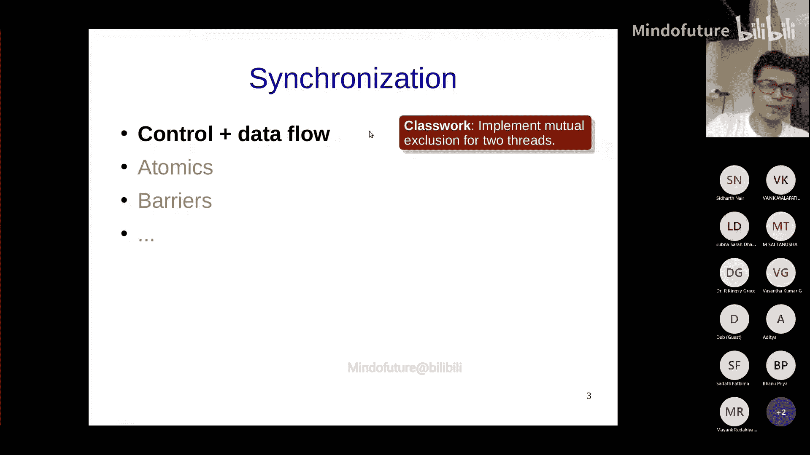

Yes， the port we saw in the last class with whilelo。That can be one of the way。

 but if you remember there was this issue with this code， right？That T one might hang。But yeah。

 that can be a starting point for it any other approach apart from that the one that we saw in the previous lecture。

But any。Or any modification to it， would you like to suggest go？

A occasionally saying in main function itself， we can write we can use if statement， yes， you can。

So allowed to use if statement while statement everything， almost everything control statements。

 all the data， I mean data operations， everything you are allowed to use just are what you are not allowed to use is locks and。

You are not allowed to use locks， barriers， atomics and all those things you are not allowed to use。

So without using them， you need to implement mutual exclusion for。

Even if it's incorrect on firstco， that's fine。Like in the previous case， when we tried。

 like there was。That problem， right， That thread one might hang。So it's okay。

 if any such problem is there， that's fine。Can you write just a very simple quote for implementinging the mutual exhibition？

So mutual exclusion should be guaranteed。If any of the thread hangs or if any other thing happens like Dlock or something。

 that's okay。Will willll tell about it later but。The crucial thing that we want to。

Fcus now is how to implement mutual exploration part threat。

We will also deal with other issues like Tlock and others in the later examples but yeah。

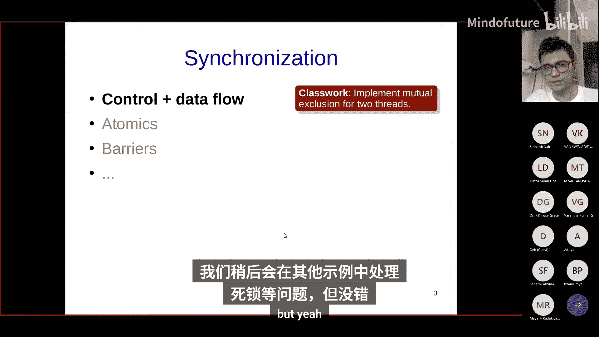

Any suggestions？Yeah， are you going use locks。So you are not allowed to use locks， atomics， barriers。

 and all those。Which requires hardwares of corporate lock。In some sense， you are using some。

Atomics only inside， I mean， internally locks might be implemented using some。

Using some hardware sample essentially。Probly I'll wait for a few more seconds and then we'll cut in。

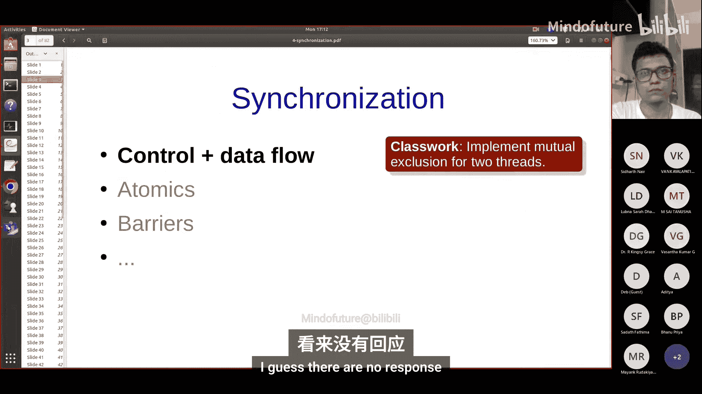

一切。OkayI guess there are no response。 Okay， anyways， I'm hoping that you call are trying， but。

Let us move further。Yeah， so one of the very simple approach for implementing the mutual exclusion for2 threads。

So this is a very， very simple approach。So here are S1 and S2R2 critical sections。搜。

Thread one will be executing the critical section S2。

 thread two will be executing critical section S2， sorry。And yeah。

 inside this as and as to we are not modifying the value of flag。

 which is a shared variable across both the threads。

And we are just two threads because we are I our problem statement is like we want to implement mutual exclusion for two threads。

 so two threads each having its critical section where they are not modifying their flag values。

And let's say we。Now we want to ensure mutual exclusion， right。We want something to， I mean。

 something like this to happen， right， that when S1 S2 is executing。

 S1 should not execute and vice versa。So we can do something like this， right， so let us to execute。

 so pla will be initialized to false。So if let's say that one tries to enter into critical action。

 it won be I mean， it will be cord to enter because。Flag is false and not of flag will be true。

 it will be looping here infinite。And when when when can it proceed to its critical section。

 which is S1 only when flag 1， or sorry flag is set to prove by threat2 after executing its critical section。

そや so。Threat to will enter into its critical section， which is S。

Complete completete its execution will make flag to crew and after that1 thread1 will be entering in its critical section because flag is to not of flag will be false and hence this while loop will break and then it can enter the critical section。

But again， if you observe here， there is one issue with this code。

 can anyone quickly point out what is the issue？It would be obvious by not what what is the issue with this book？

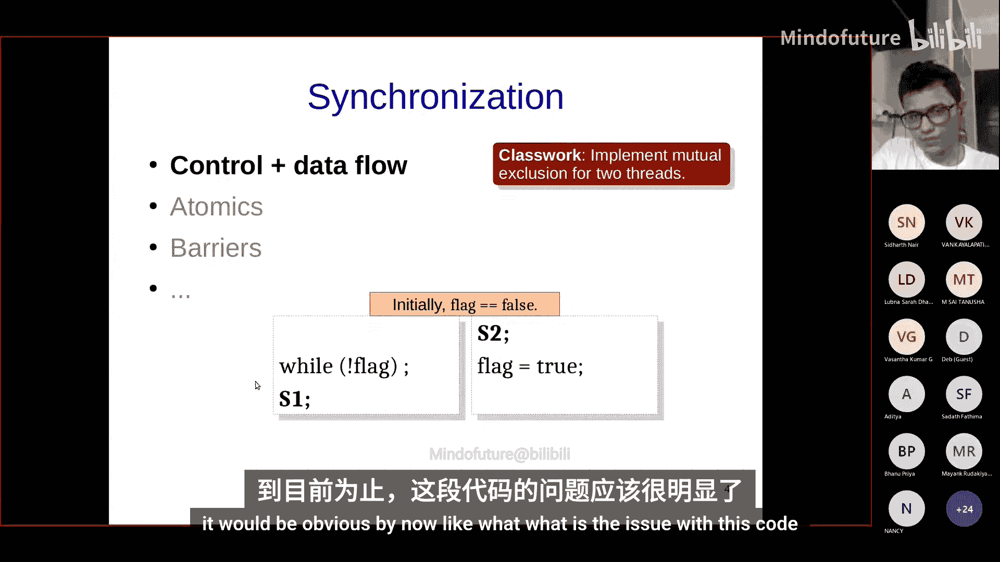

Police saying something。 we can have one third。One part to the writing。

Another thread just dropped above， and one thread dried all。とて。I'm unable to understand。

Initially flag has to be false so we can have it repeated。What can we have to be repeated。

 I can you clarify。So we can have it repeated。ok。You want to add clarification to this thing。

We can't have it treateded as in。你系。

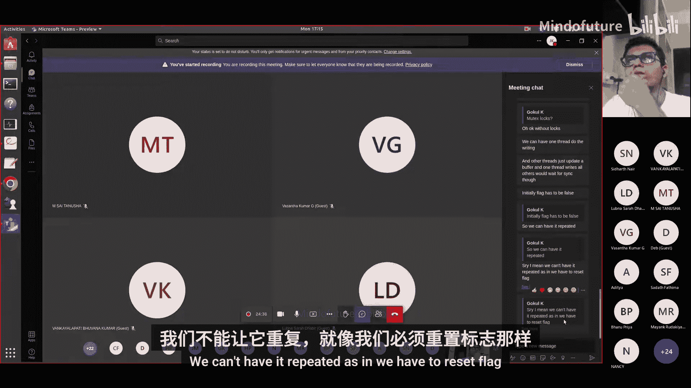

Okay， let us try to understand this。Let us say that black is initially true。I mean。

 if flag is initially， let's say its initially falls here， but let's say it's true。 then also。

 I don't think that。Yeah， there will be an issue with mutual exclusion though。

 like both the threads will be able to enter with the critical section yeah so that's a valued observation that lag initially needs to be false。

Otherwise， both of them will enter into the critical section and there is a chance of data risk because if it's true not of pro will be false and S1 third1 will enter in critical section。

Meanwhile， Tbook can also enter into critical perception。So flag has to be pulse。

 that is one important observation。

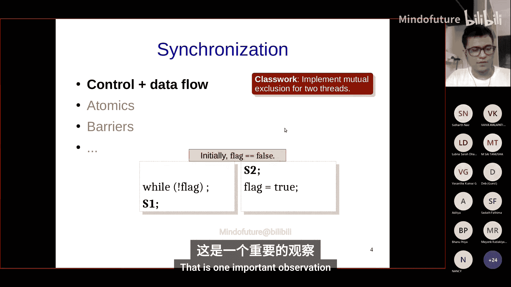

Apart from that， sorry， I mean， we have it big sorry， we can't have it repeatedly。

 as in we have to reset。Yeah， I got that one like so after each and every the execution we need to reset the flag to false because at the end it will be true after this。

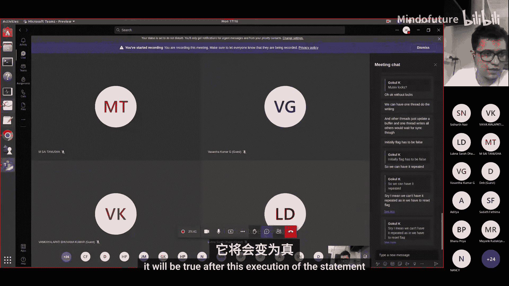

Exec of this statement。

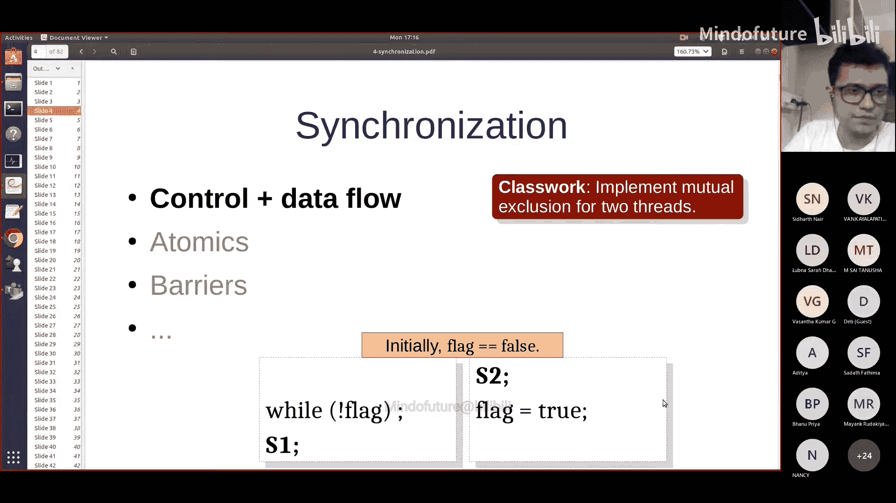

Yeah， so that's a valid point and that's a good observation also。

So that is one problem that is spotted out by Google。あった？Yeah， so yeah， I got that point。

 So we need to ensure that black。Is false at the start， so that is one point。But apart from that。

 there is one more issue if someone can point out or else。I'll point that out。

Okay， anyway let's。Go back to these slide So another issue is like。If you see here。

 the issue is that。Again， we we have the same issue here， right like we had in the previous case。

So here execution pattern is fixed， right only after S2 finishes。S1 can start execution。

Because of the way we have written this core or two fragments of the core。

Only after S to finish sorry， only after T2 finishes the execution。

Only then the third one can enter into its critical section。So yeah。

 because of the flag being set to false。It won't happen that black thread one will be allowed to critical section first and two can later enter it into the critical section。

So only this order is possible first S2 and then S2。If you want ask one to happen and then ask2。

Then we might need to change this code a bit。So probably that is our next class。

Lets say want to allow either S1 or S2 to happen first here only S2 can happen first， right？

Only S2 can happen and then S1 can happen because of flags being set to false and then we are setting back to truth and S1 third1 can enter S1。

The way we are with the execution flows。But let's say now our requirement is slightly different that we we want to allow either S1 or S2 to happen。

First。And yeah， so we we need to implement that functionality So how can we do that。

 Can we modify this code a bit。Such that we can allow either of them to happen first here only thread who can。

 I mean， execute first and then only thread one。Or S2 can happen first and then only S。

So I hope you are getting it us and the question is also clear that want to you want to allow either of them to happen first so how can we。

Make their companies my is my next question。

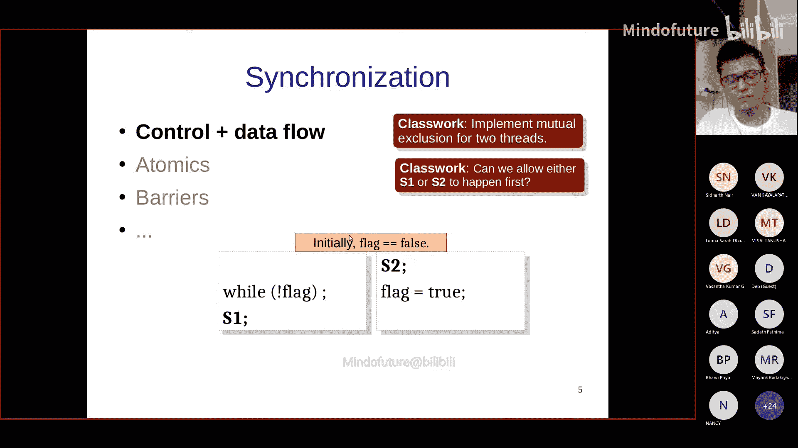

All third question is cleared in case any。Okay， I am answering this question why there is a semi while。

So， okay， so like after a while， look if there is some semicolon like if you see this。

What does the statement say while true and then semial？

It's like in fine look right while this condition is true， which is a。

is for itself execute this statement and we don't actually have any statement it's a semi all so it's like no so。

Luppe is running incle。And semicolon is like。Take it like a dummy statement。

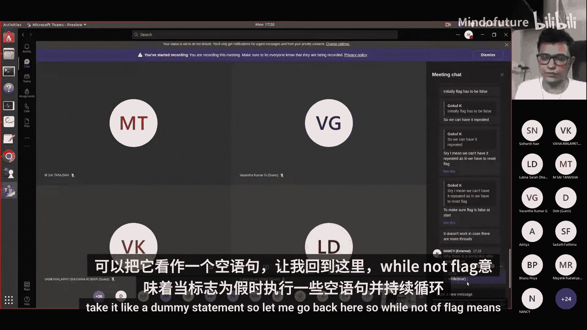

啊，你嗰嘅桥。So while not of pla means while the flag is false。

Execute some tummy statement and keep on looping here and only when flag becomes true so not a flag will become false go I mean execute the next statement after the while which is this S。

So consider this semicolon as some dummy statement。

 so don't consider it as some syntactic mistake or something like that。

It's like writing Noah or something。This is a valid cent project。

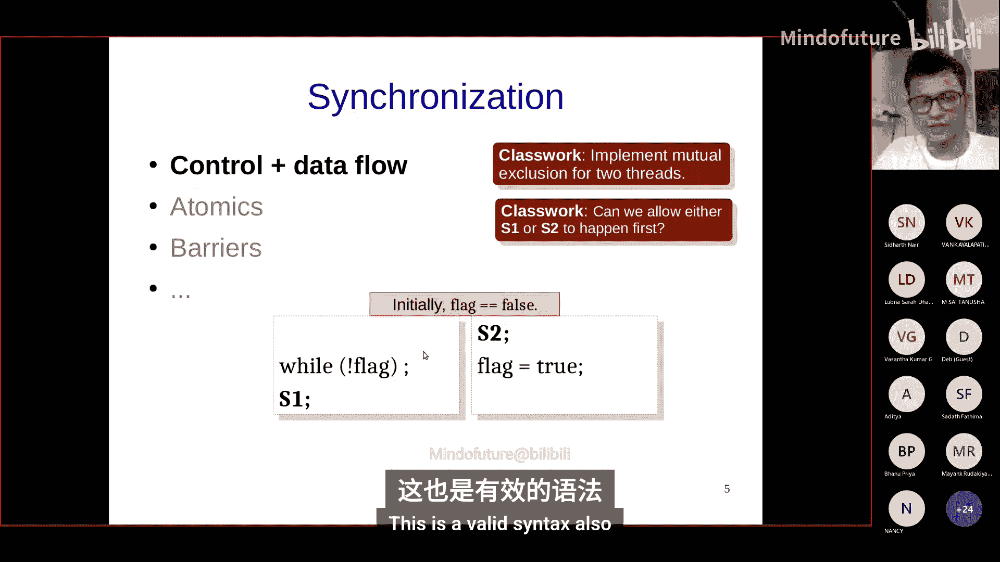

系我表解点嘅。If there are any further questions， then you can ask。

Relative with this wild look or something else also， I mean， related to this quote。

Okay， so I' will be waiting here for a few a few more seconds to for you people to try this out so this again。

 this this code or thisnippet only ensures that S2 happens in then S1。

We want either S1 or S2 to happen， yeah， so that is the question。

Please try or please try to modify this code itself， such that。Yeah。

 such that either of S1 or S2 can happen first and then either of them can happen second。

 so yeah that is the question。Sir， we can do it like we can have a while loop in both of those threads。

 while one of them is vile flag， other is vile not flag。

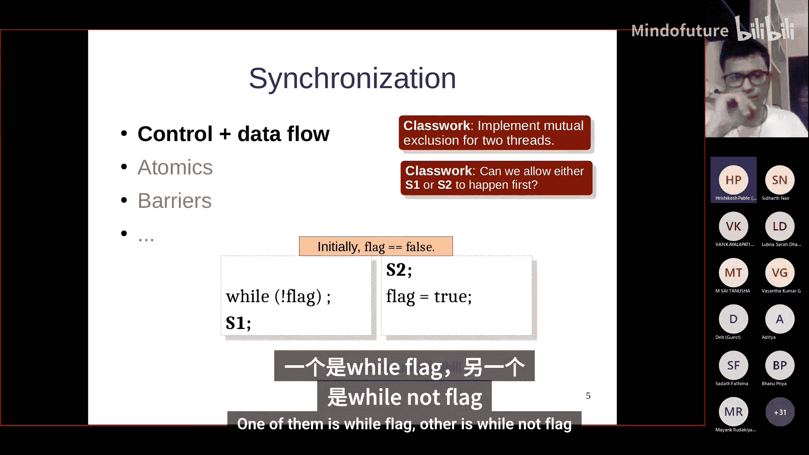

And then the next segment is S1 S2， and then we set the flag like true and false in the two threads。

Okay， I guess that should but so let us try to understand what I guess Rishi Ke was there right so what what he's suggesting is。

Well， I mean。In the same manner we have this while loop here。

 we can place some while loop in the similar manner here。

which keeps onloing until some condition like let's say flag is true and yeah。

 and then we reset the flag the same way we do here。I mean。

 we reset the plaque to false here in the thread one in the same way we are doing in the thread2。

So let us analyze this thing。

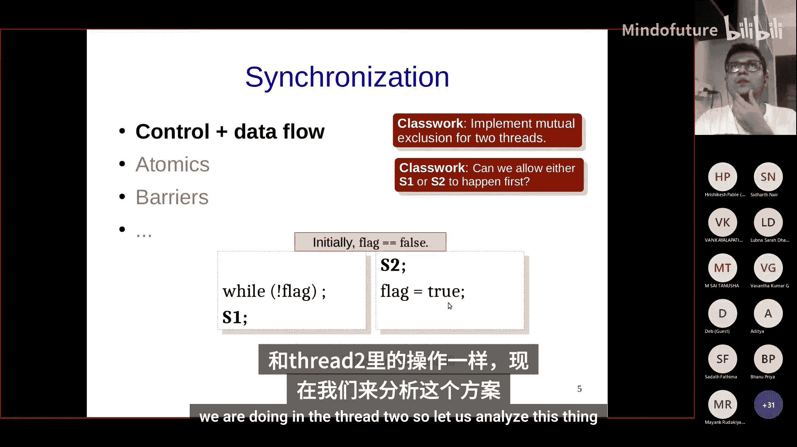

Yeah， but before analyzing that， is there any other suggestion？

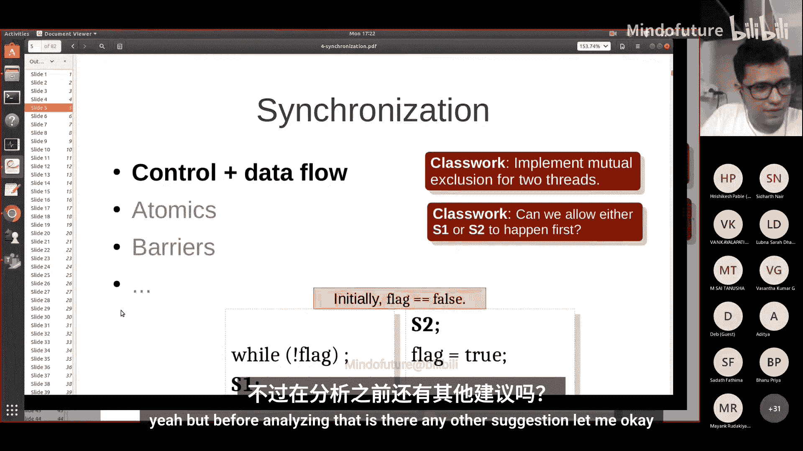

Again，'m。

Okay， I think there are no definition then。Let us try to analyze that suggestion itself。So， okay。

 so that are。Now two while loops， as it was suggested。So yeah， again。

 two while loops are there one is one in the thread one。

 which is looping for while not flag and another in thread2 which is looping while vi flag。

And now flag can be set to any value， it can be their true or false。So。Yeah， so okay。

 and then is there are two critical sections corresponding with thread1 and thread2 which are S1 and S2。

And then flag is resettted to false in third1 and resettted to true and thread2。So okay， so is okay。

 let me ask you a question here， is this code ensuring mutual exclusion？

Or is there any issue with this cor to？Okay， again， repeat。

 is there an issue with mutual exclusion with this code or then mutual exclusion is ensure in this code？

Okay， we are not men。Currently， we can't use scouting some。啊。Yeah， we can do starting some up。

Since we are in control plus data flow， we are in with some of。

So is this code ensuring mutual exclusion， any suggestions， yes， no of anything I mean。It's a yes。

 no answer， right？And I even， I mean， I would even like to hear the reason behind whatever I mean answer to。

I think I don't want to buy like。Let's say a flag is set to true and then also while not flag。

 then it will go on execute infinitely and like。Yeah， so we talking。About this case。

 while likeage so。Yeah， so it will go on to one of the threads and it will go on into continuously like it will never stop executing the threats。

ok 啊不。Okay， my question was different okay， you are telling that one if there is just one thread。

 that's a thread too。And let's say the flag was had to prove。And it came here。

 it will keep on loop in finite ten it would be able to enter the critical section that is correct。

 I agree that。But let us assume that both the threats are executing in that case。

Will there be a violation of mutual exclusion， so please。

 I request to understand the question properly here。So what is mutual exclusion， first of all？

Mitchature explosion is like we want to ensure that only one thread enters into the critical section so here。

Whenever you are trying to say that。Just one thread is executing， which is threat2。

 and that two flag was initially set to true。It will look here infinitely。

 but does that mean that mutual exclusion is not guaranteed mutual exclusion will not be guaranteed。

Let's have both the threats。Where if there was a scenario where both the threats were。

Were allowed it to enter into the critical section by this quote snippet。Yeah。

 yes both of the threads were allowed allowed to enter into the critical section。

 in that case we can claim that the mutual exclusion is violated。

But is there the scenario here or I mean。I'm not just trying to say that it is not guaranteed。

If you are saying that it is not guaranteed， then you should give a scenario where a visual exclusion is violated。

The scenario that you were trying to suggest was the case were。I'll come to that scenario。

 but let us first understand if the mutual exclusion is guaranteed here or not。

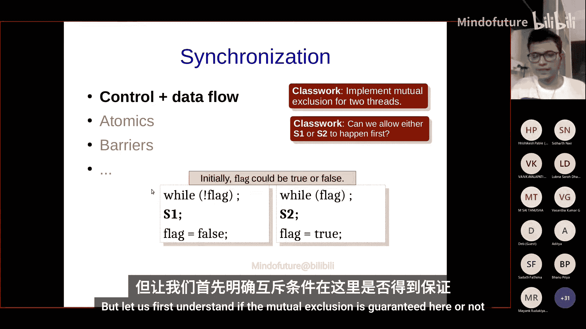

Okay， gofully suggesting there is major exhibition because while look don't happen entirely。ok 啊。

Okay， I hope that I'm hoping that you will call our rank in。

 but let us understand step by step that okay first step is like understanding whether mutual exclusion is guaranteed or not。

And for this port， the mutual exclusion is guaranteed。

 let us understand why the mutual exclusion is guaranteed。So let us analyze this code and。

Let us understand the conditionation that is forbidding the threads either of the thread from entering into the critical section。

 that critical section。So， here the。these two while loops are the one which are forbidding the threads from entering the critical section。

And if you see properly， this while loop are based on I mean they are moving based on this flag right。

 and if you think properly you will see that this flag value。

Can either be true or false and if we assume， I mean let us say that right okay。

Just put that aside this flag value can either be true or false right and if both the threads are executing。

And if the flag value is either true or false10。Either of two threads will be allowed to enter into the critical section right and not both because f flag value can either be true or false。

And it can't be both at the same time， right？And if that is the case。

 only one third will be allowed to enter its critical section。

And once it has left its critical section， it sets flat to true or false respectively based on the thread which is I mean。

Whichever thread it is。And once it has set this flag is false。

Then the another thread can enter its critical section and start executing it sorry。

 enter enter its critical section and start executing it。

So the crucial observation here is that black value can either put or false and not both at the same time。

 hence only one thread will be allowed to enter the critical section。And if that is the case。

 then we can claim that yeah， mutual exclusion is guaranteed here。

But now let us come to the suggestion that was， I mean， that was given here for the。One of the case。

 like let's say that the flag value is set to。True。

 and let's say if thread one never wants to enter its critical section。

 it is busy doing something else。And the T to wanted to execute its critical section。

But the flag was set to。And since the flag was set to through。

W of proof is true I mean while of proof will I mean its true flag is true so while of proof it will keep on infinitely looping here executing norm and hence it won to be allowed it to enter critical section even though the flag one is not inside the critical section and it never wants to enter into its critical section。

So in some sense， is sorry notto is hung in some sense， right？

This issue is called the issue with progress， right？

One thread doesnt want to enter into its critical section。

 but it is forbidding other thread from entering its critical section。Here you see。

 thread one doesn't want to enter the critical session。呃。Even I mean。

 even then it doesn't want to enter into the critical section， it is forbing this threat too。

From entering into its critical section。So。Okay， so first point， mutual exclusion essential。

 second point is the progress is not guaranteed because of this issue。

Right please note that the mi explosion is guaranteed， progress is not guaranteed。

And let us conclude the third scenario。Okay， so the third scenario is whether there can be a deadlock or not for this code or this piece of code。

 can there be a deadlock is my hard question。

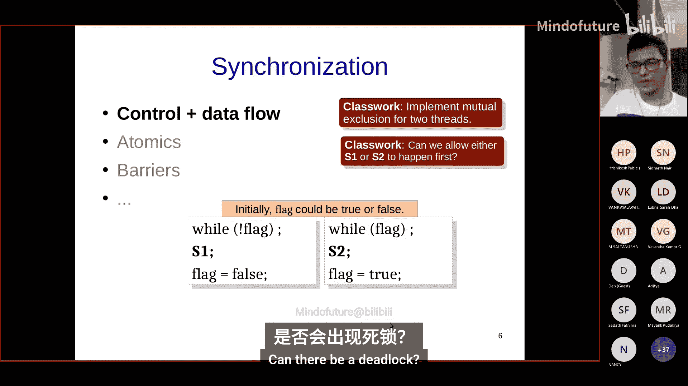

I hope you got， I mean。

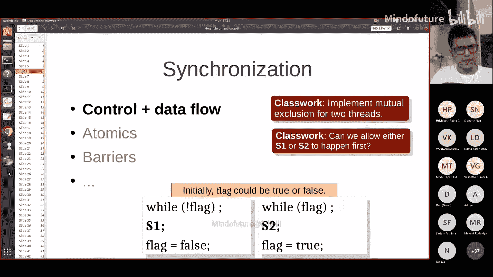

We were able to understand cost to point why there is mutual exclusion and why there is no progress。

So the third question is。

Can there be a deadlock for this？There is a progress I did not understand but deadlock there can be。

Okay， so let me reiterate that thing。So。Okay， first of all。

 let us understand the definition of progress， so progress is something like this， let's say。

T x1 to enter its critical section。But it is not able to enter its critical section because I mean some another thread is forrbding it from doing that。

And that is what is essentially happening here， right？

Let us say the flag value was set to true initially， which can be either true or false。

 so let us assume that it was set to true， right？And let's say thread too wanted to enter its critical section。

But it won't be able to right because flag is true and wild crew will keep on infinitely loop here。

 right？So it is infinitely loop there， a threat who won't be able to enter its critical section。

Only can enter inside its critical section。When thread1 enter its critical section finishes it and set flag to false。

In that case only， once the thread flag is set of false。

 it can enter the critical section and finish it。So in some sense， if you see here。

 if you are observing it correctly。Third one。Is restricting or not allowing threat to enter its critical section。

Because T doesn't want to enter its critical section。

It is restricting another threat to not enter into its critical section。

So I hope the definition of progress as well as the example that I gave was clear if there is still any confusion。

 then。

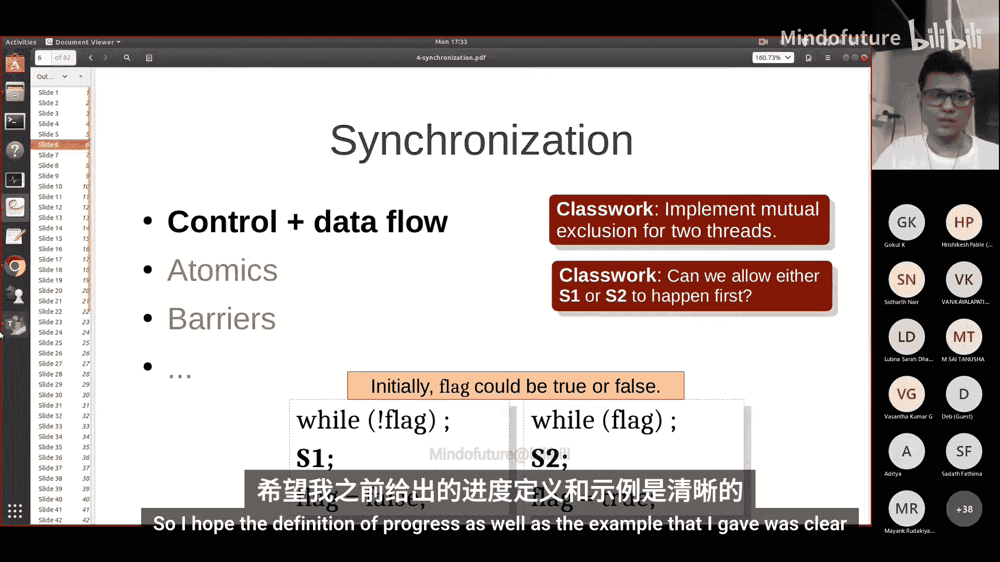

So， but that progress like one threat not allowing another to finish would always happen also if you have mutual exclusion means。

in critical section， only one thing will be able to access the data itself。Okay。

 I guess you missed it。

So。Okay， let us understand it clearly。What is mutual exclusion。

 only one3 enters the critical section， that is mutual exclusion。

But what is progress progress is if one thread wants to enter the critical section。

But it is not allowed to enter its critical section because some another thread is not interested in entering its critical section。

 so I hope you are understanding the difference。Okay， so because the other is not doing it。

 listed also can't do。Yeah， so that is what is progress but mutual exclusion is only one thread is allowed to enter critical section so I hope you are getting the difference between those two。

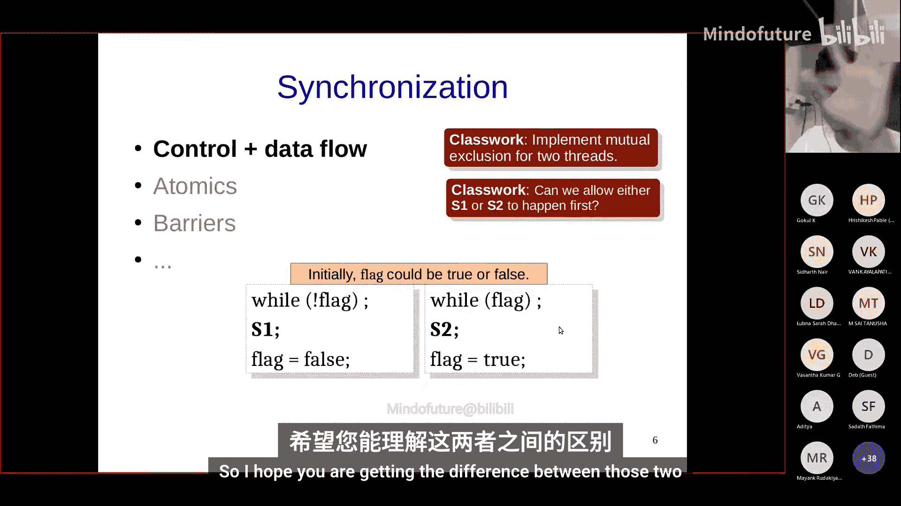

Any further questions， please feel free to ask us， these concepts are quite important for centralchronization。

Okay， mean， please think about the third question that I ask whether there is redlock or not in this school。

Is there a deadlock in this term can appear can。So， for example。

 if S2 has a dependency that requires S1 and S1 has a depend dependency that requires S2 to complete。

Okay okay， that might be the case， but for now let us assume that there is no such dependency between S1 and S2。

So S1 and S222 is dependent。Bunch of statements that。That each thread。

 which is third one and thread to one to execute。And in that case， there can be a dead or not。

Based on this vi loops and all those things。Can it happen that。

Third one is stuck here in this Infinite and T is also stuck in this in outlook can this happen？

If that is the case there is redlock， right， both of them are stuck here at their loops。

Respecttive loop。

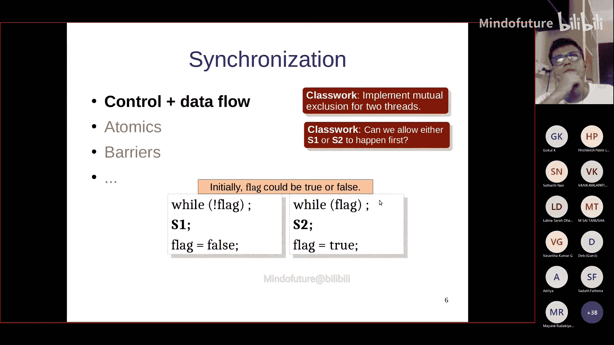

Think about it is that possible。ok anyways啊。

Since there are no response， let us try to understand if is there can be a deadlock or not。So okay。

 so first of all， there can't be a deadlock here because again， let us come to the， I mean。

 let us understand why there can't be a deadlock here。For deadlock to happen。

Ment dialoguelock can happen because I'm sorry， can I mean。

Is is there a possibility of deadlock occurring here， It can occur if both of the threats are。

Stop here at the respective loop， but can that thing happen？Is the question。

So that can't happen right because okay black can only have one value either true or false。

 it cant have I mean it can't have both at the same time and if that is the case it won't happen that T one is stuck here in its wild loop as well as threat2 is stuck here in its vi loop。

都。That is not I mean that can't happen and hence that is no deadlock。

 so it guarantees that exactly one third will be able to enter into the critical section。And。Yeah。

 Tlock is not possible because。It also guarantees that。

Whatre the threats what't be stuck in the in the vi。

So I hope you're getting it three points to observe here。One is mutual exclusion is guaranteed。

Second， progress is not guaranteed here。And third is there can't pay alock here。

So I hope that these points are clear。

If there are any questions done， please feel free to ask。

S what if one thread or worker has the thread crashes。

In that case。Or could not。Okay， yeah， so that again comes to our progress type of scenario right。

 so let's say Cr one was executing this before it executed this flag， I mean， it set black to false。

Okay， and first of all， let us assume that black was true。So this since black。First of all。

 black horse。嗯。Okay， yeah， let us assume that lack was true。And not up to is false。

 so thread zero entered into its critical section and before executing this flag equals to false it crashed。

系。So in that case。This threat too won to be able to enter into statistical section because flag is true and it will keep on looking here。

 So again it will。Boil down to that progress thing， so I hope that this。

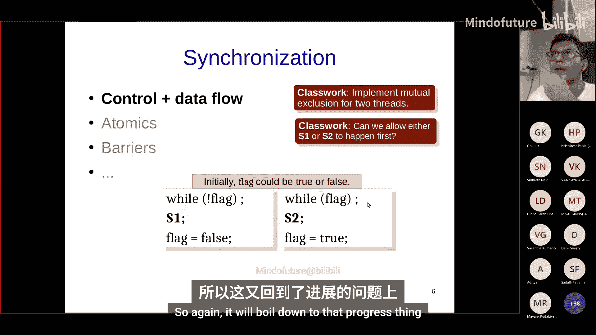

N is suggesting mutual explosion is one of the solution for deadlock。No， not exactly。

 so let us come back to this example itself， right？

Okay， not this example， but。

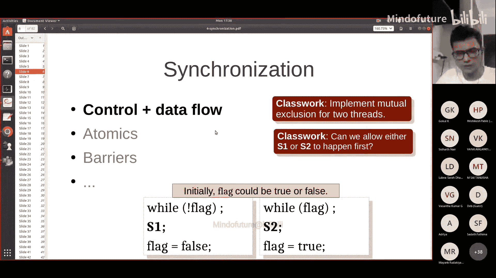

Yeah， I mean。啊。There are the examples we'll probably see one of them that。Big order。

Ensures mutual explosion。But still， there can be a chance of deadlock。

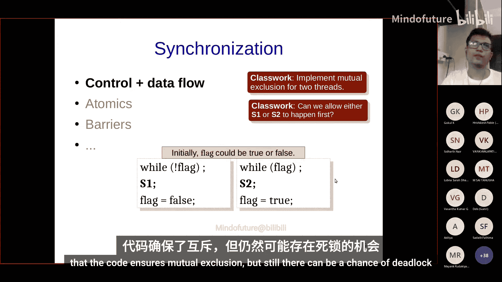

哎。I will disagree with that statement that Mi explosion is one of the solution to dialogue， so。Yeah。

 there are examples probably probably will cover one of it in today's lecture itself that even though your code is ensuring mutualt exclusion。

Still， it is having that， I mean， it can lead to a deadlock， so yeah， this might be I mean。

Might be incorrect according to me， but yeah if anyone else have any perspective to this statement。

 then please feel free to add。

复杰啊。系听过。Yeah。So I want to ask few people one more question here， us。

I want to tweak this code a bit let's I wanted to add。Black equals to。Through here。

 before this while。Before this while can， I mean while。Condition。

 I want to add the statement flag request。And here before this file condition。

 I want to add this statement pla reports。

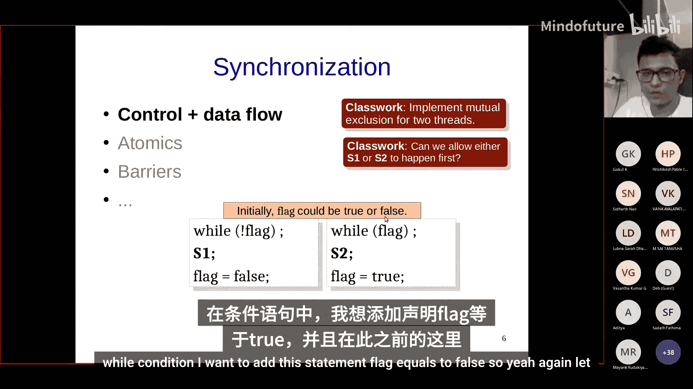

So yeah， again， let me go back to this。In T1， have added the statement。来个 question。

In the beginning of the T1 and in the beginning of the T2 I added this statement blacker。L。

So considering this two statement being added here。

At their respective places before the vi。Is there a guarantee that， I mean。

 is the mutual exclusion guaranteed after adding those to states？Please think about it。

So can you repeat the questions Sir。Okay， so question is。

Okay， anyways let me go back to here。

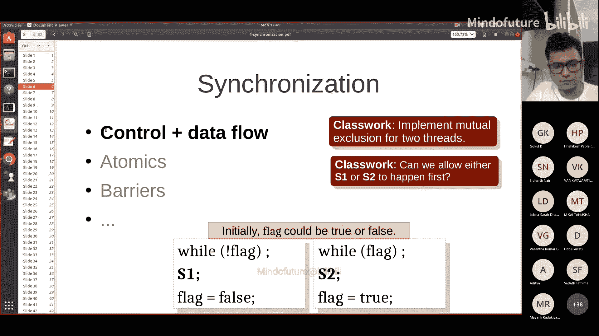

Okay， so here before this by loop， we are adding this statement pla equals to blue。

And here before this final， we are adding the statement flag equals to false and rest the entire piece of code remains the same。

In what they case。If that is the case， if for this modified code。

 can we say that mutual explosion is still guaranteed is the question？Nothingson。好。Because in T2。

 if you put flags sl to fall up there， it will never stop at the while rate。

 so it will just go past it and then secure as to。Okay， I think your suggestion is correct。

 So let us understand what the。What is suggested here？So let us have place flag equals to crew here。

And what will happen and let us assume one of the execution flow。

So let us say flag equal prove flag was set to prove because it was written here。

10 while of not flat， which is while of not true。Is false， right， not of true is false so。

T one will enter into its critical section。Meanwhile， let's say context which happen and。

Threat to started executing。Here it was written while sorry flag equals to P。

 if you remember it was4 T2 it was flag equals to false。

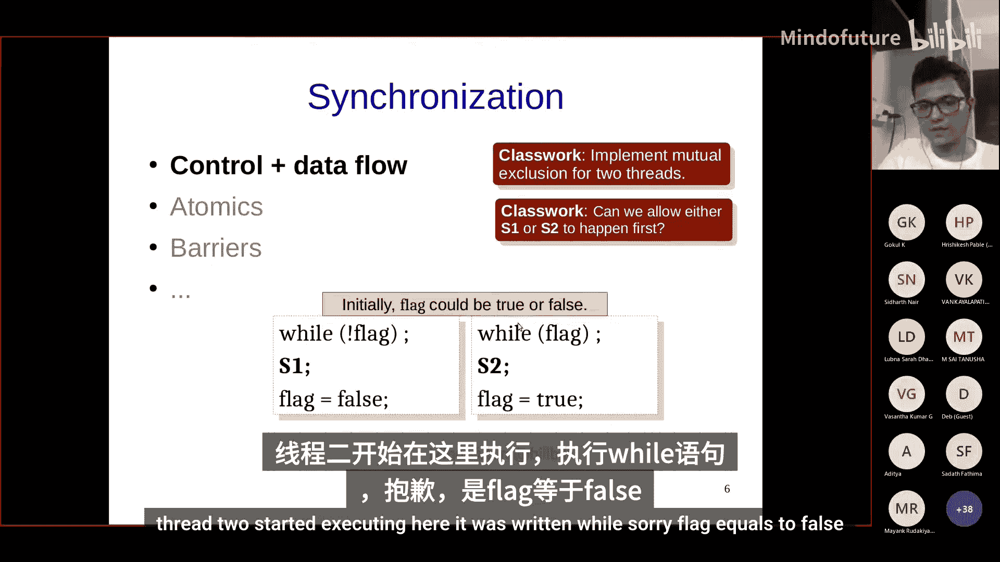

So。Llaack of set to false and while pulse is also， I mean， I mean， vi of false。

 meaning this this thread won't keep on topping here。

 so it will also enter into its critical section。So if you are getting it properly， both the threads。

 T1 and T2 can execute into their critical section simultaneously。

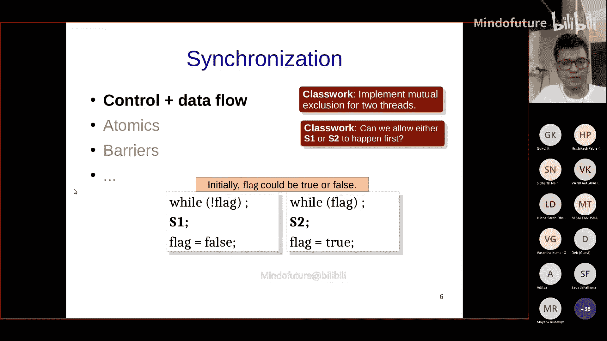

These two statements are written just before their while loop at the respective threads。

So if that is the case， both will enter into critical section and if that happens what we can say。

 we can say that mutual explosion is not guaranteed。And that is not。PPmted right。

 we want mutual exclusion to be guaranteed， so yeah please keep in mind that。

For this scenario。When we add these two statements in the respective threads。

Mitchature exclusion won't be guaranteed and yeah， I mean understand it with the reasoning that I give and if there are any questions with this。

 then please feel free to ask。

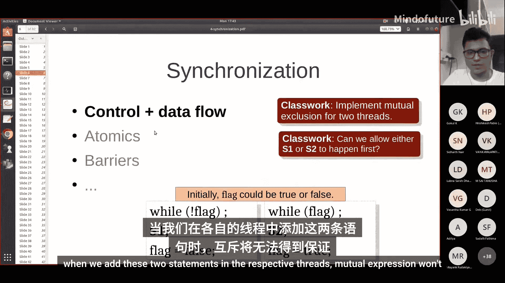

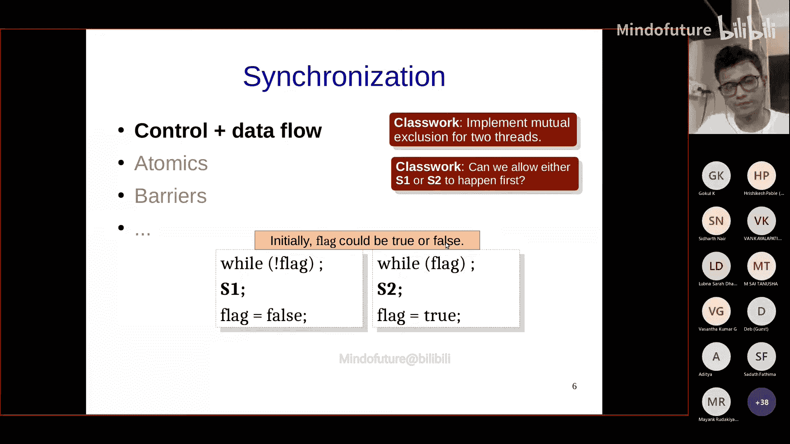

I hope it was clear if there is any questions， then please feel free to us。

Okay， I am assuming that there are no questions， then let us move further。So， yeah， so let us。

Jot down few points related to this board。So first of all this code will only work if both the threads execute right if one of the threads is not willing to interpret its critical section or not at all executing then we saw that second thread might h right that was the I mean our progress case right that progress is not ensured。

So that is the second point here， both thes execute their code in that case only。

We'll finish up with the successful execution else it might happen that one of the thread might hang。

So progress is not connected， so that is one thing， so we assume this thing。

Second thing is we know this right in the previous lecture we saw that。

Either reading or writing is atomic， I mean reading or writing of black is atomic because at the assembly level we saw in the previous lecture right that either just a single read or single write is atomic so it won't happen that the thread is reading the value。

 one thread is reading the value and at the same time at the same instance another thread is writing the value。

Yeah， so if there is some statement like addition， it is split into three assembly level instructions。

Just a reading or just a writing is a single assembly level instruction。And it is done atomically。

 so I hope you are getting this first point also。Second point we cover。

 and the third point is important。So plague is a volatile variable。

So what is this volatile variable does anyone know in C language， you have this volatile key and。

Probably we use it less often， but does anyone know what is volatile？

So if we like the system restarts， the values will not be preserved。

I think that is quite imprecise but。

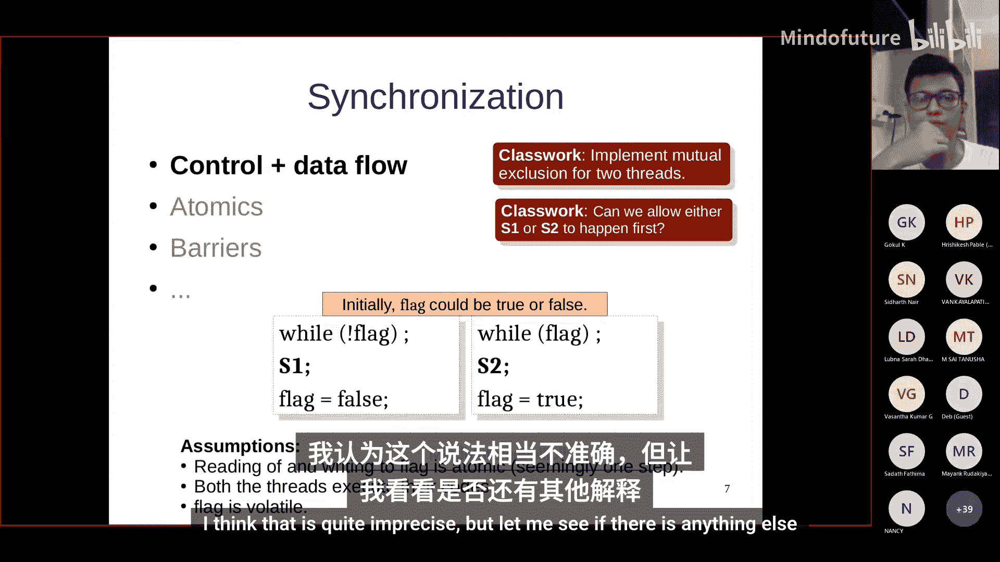

飯行ったり。Ansing memory。What memory can you elaborate related to this。Okay，ing。

Yeah。や上。In the case of switching from one segment to another segment。诶。

So sometimes what it will happen is if you are not。Storing that values。

Then it will lost its context that we call it of volatile time。好嘅。So can你结说喂。

In case of multi threadd programming， so if any thread changes value of a variable then that value will be immediately reflected to all other threads。

 so there will may not be separate copies for the individual threads for that variable if you declare it as volatile。

嗯。Okay， so let us， I think you people are very close to it。

 but let us precisely define what this volatile keyword is。 So when you declare a。

Declare a variable in C with volatile key a key and what is what does it ensure so it ensures that the variable or the value stored in that variable it is written into the main memory and whenever that value of that variable is read it will be read from the main memory。

Okay， that is fine， we are reading and writing from the main memory。

Let us say we don't read from main memory， and what can be the issue？

So let us understand what can be the issue if we don't read or write from the common memory location like main memory。

So if we don't read and write the flags value from the common member location like main memory or。

Add to ourL cache， which are common across all the threads。

If that is not the case then what issue issue can happen。

 let us let us assume that this flag is stored in some register or L1 cash。

 which is separate for each。Let us assume that it's solely in registered。

 which is separate for each thread， right？If that is the case。Then what what can happen。

 let us understand， so flag was initially set to through。

Let us say that this thread one relative file value of thread， which was two from the main memory。

 okay。It read it as true， not of provo was false， it entered into its critical section。

It finished the execution then it I mean when it read the value it also cacheed into its register right so this flag was in the register so register of the third one。

And so it's in registered。And here since the third one wants to write into this。Flag flag variable。

 it will write into them to register。So because of this， if you see。

 this flag value is written into the register and that value is not consistent in the main memory。

And since it's not consistent in main memory。If you see it is not consistent in memory value itself is still true。

 in register it is upgradeed to false， but in main memory it is still true and because of that if you see。

This threat too will never be able to enter into its critical section I hope you' are getting since this value value which is false。

 which is being written by threat2。Is written in registers。Which is private to the thread one。

And the main memories， I mean， main memory。Val for flag in the main memory is still true the flag to threat to won to be able to enter into its critical section。

And that is a problem。By declaring a variable as volatile plug variable as volatile will ensure that such kind of writing。

Whenever being done。Will go to the main memory。And it won't be stored in any local memory like register or Al Ca。

So yeah， I hope that is if there are any questions， then please feel free to ask。

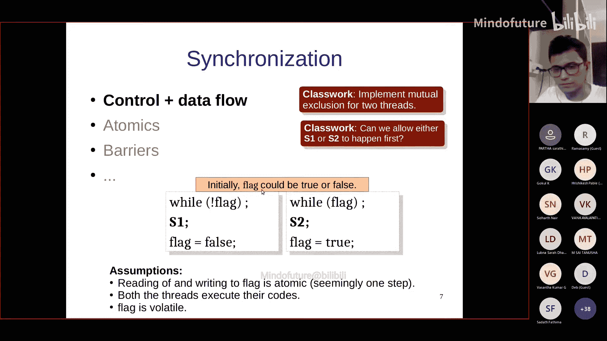

Nary permanent sorry。第我呢个。咁所哋经测。Any questions up till this slide？

As。不跟你们玩。Okay， let's move more。So findイ。Be love we saw。This example。

 right for implementing mutual exclusion among two threats。But now let us implement this。

Lock and unlock methods。But okay， let us come to this thing first before implementing lock and and law。

 if you see here， there is still one issue， if you see clearly there is one issue。

And that issue is that there are two separate cold snippets for two threads right。

 so third one is executing this and thread2 is executing。

But this thing might not be true for every case right。

 let us consider our quoa kernel itself sub there is just one kernel which is being executed by multiple threads。

So what we want to do is we want to just write a single piece of code。

 which is executed by multiple parts。And that single piece of code that we write can be abstractstructed into lock and unlock。

Ps。And so let us say that we have written a single piece of code。

 which is corresponding to the law and whenever。Tread wants to enter into critical section any of these thread it might be thread 100 or thread okay so let us compute just two thread example for two threads and in that case either of the two threads want to enter it executes that same block code。

And when it wants to leave in the critical section， it executes the same unlock code。

So that is our next。Cllaasswork sort of thing。 So here separate code is there for both the， right？

What we want to now do is you want to implement mutual exclusion for two threads such that we want to implement this lock and unlock methods and this lock and unlock method are common for both the。

Thanks。And。Yeah， again， this method should be same for both thread。

And in order to distinguish I mean， since we are writing the CMP support code。

 we need some sort of distinction right to make between two threads so for that we can use our thread I right way which we have already learned in the previous lectures。

And again， we can use only controlless data flow， no atomics， no barriers， no logs。In fact。

 we want to implement block using this standardent data。So yeah， let us start with this。

And let us start with just a simple piece of code。For lock and unlock。

 so please note that this lock and unlock will be executed。I mean， this is a common quote。

So this is a common quote。Either of the thread and trying to enter into a critical section will execute this code。

And either of the threat， leaving the critical section will execute this vote。

So let us understand this， there are two threads having I 0 and1 for the sake of simplicity。No。

So now， let us say that。Okay， let us try to understand this thing first。Which is this lock。

Kind of supporting。Initially， this value of me set based on the TI， which is the thread ID。

 which can either be 0 and1。Then what that thread does is what is the another thread， I mean。

 what is my。What is my， I mean， what is the another thread which also wants to enter the critical section？

So if the derivative with is zero。Then another thread can be 1 minus0 which is 1， so other third is1。

 and if its T is1， then other thread will be 1 minus1 which is 0。So based on its ID。

 it will calculate the idea of its I mean， another thread which wants to enter the critical section。

And then what it does is it sets the flag value total。So。Slag value of me set to pro so it。

In some sense， this setting flag of I mean， flag is a array。

 first of all least note that this flag is an array of size 2。And it has two elements0 with I mean。

 two indexes 0 and1。Since it size is2 and what is happening here is a thread which wants to enter based on it based on its side。

 it sets its value index value in this flag area to through。

So this is some sort of an indication that， okay， I want to enter into the critical section。

Please note that this statement is some sort of an in to another threat。That the particular thread。

Having thread ITSD IT wants to enter into the critical section。

And then what this threat does is while。Other said doesn not want to enter the critical section。

 it will loop on so if flag of other is true。So let's say some okay。

 so let's say the thread0 set the value flag of0 becauseiding will be 0， so flag of 0 is true。

And yeah， so if that' is the case and let's say flag one also wanted to enter the critical section and in that case this flag 0 will not enter into the critical section。

Because lack of other， which is lack of fun will be true。

And later after entering with the critical section。

 it has to unlock it right so how unlock is implemented lag of TID equals to false。

 so flag of TID set to false。I think it is indicating that， okay。

 I have finished my work and I no longer want to enter the critical section。

So you can either write flag of me or lack of TIDS。So I hope this is clear again。

 there are three questions here， three questions here。

Does this code ensure mutual exclusion this ensures？Progress in the justice code ensure I mean。

 ensures that there will be a deadlock or not。I mean。

 is there a deadlock or not with this kind of implementation？

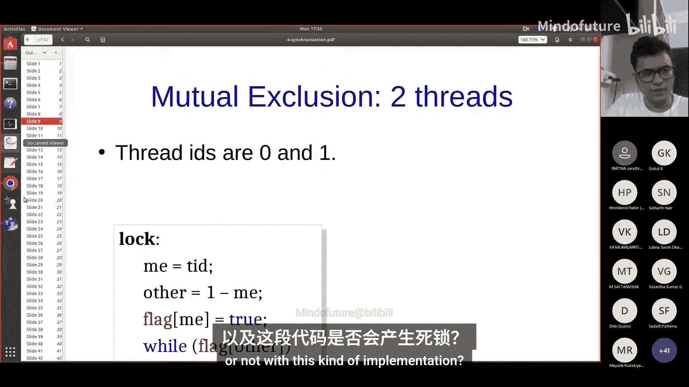

ちね。

I hope that question is clear。 So one out is there。Pleaseick。

One doubt is theyre regarding the quote sir。in case of suppose thread id is 0。

 so it goes for locking the data item or enter tries to enter into the critical section。

 so me equals to 0 other equals to 1。So flag me equals to true。

 but in case of flag other that is flag 1， so what is the value of flag other we have not initialized the one position that is the second position of flag。

Okay， that is a detector yeah。Yes sir， continue sir。Yeah， so my okay， I was suggesting that。

Assume that initially both the location， which is flag of 0 and flag of 1 are initialized to false。

Okay， okay。In that case， yeah I hope you are getting it for thread1 flag of me is flag of0 and sorry for thread0。

 lack of me is flag of0。And for threat with I1， lack of me， lack of fun。

 so it will set the value of those。Location in the areas according。

And three questions that I wanted to ask you people。Does this code ensures mutual exclusion ensures。

Proccgress and does this code leads to a deadlock， I mean lead to a deadlock or not。

And initially flag is both the values， I mean， both the array elements of the flag are initialized for false。

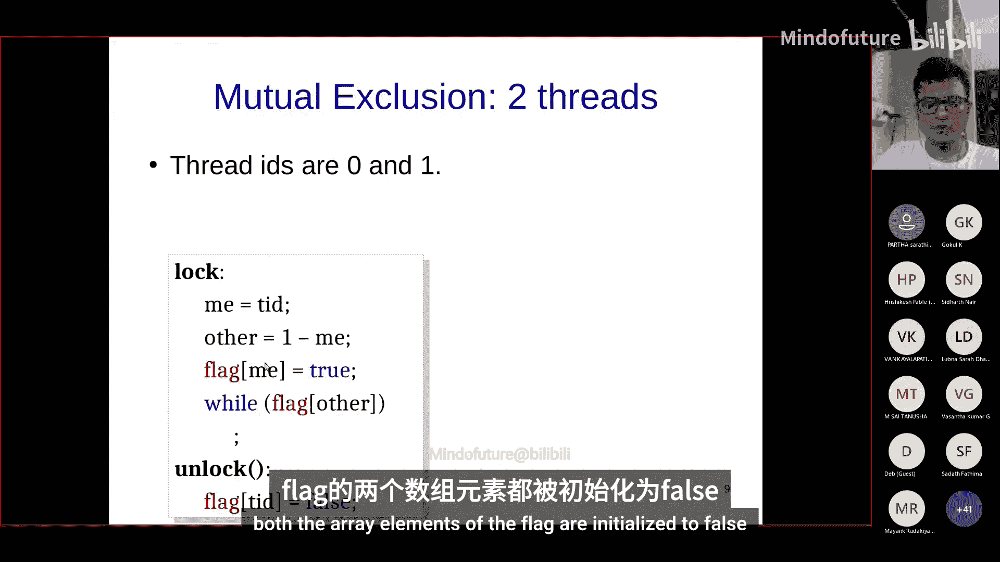

Sir， is it possible for like one thread to crash before it does the unlock， sir？Okay， yeah。

 so that is also an important observation。So， let us assume that。blck呃 sorry。This black array entire。

 I mean， which has two elements inside it is declared as volatile。Those things that we studied here。

 right， that this volatile will cause any issues。Not declaring the variable flag as volatile might cause issues will not happen here because we have already declared flag error as volatile。

That is an important observation， but yeah， let us keep this in mind that it is declared as volatile。

Considering all this thing in mind， now let us think whether。

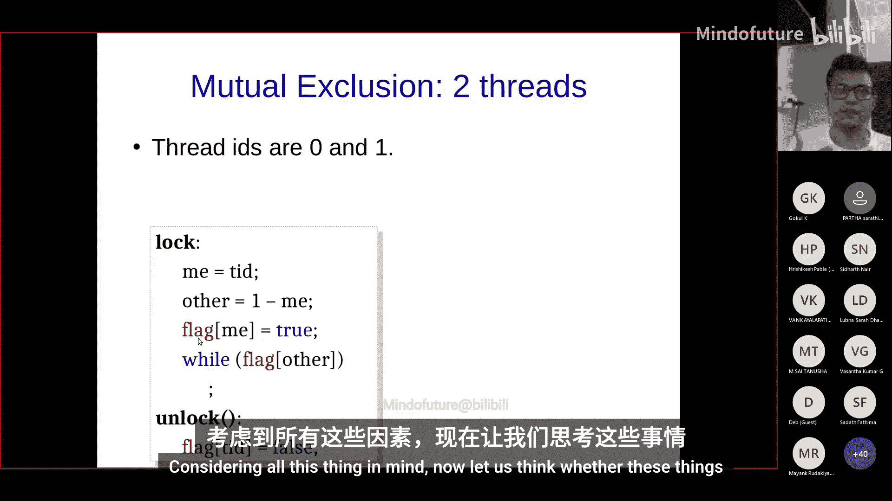

These three things are insured or not， but let me post quickly go that。Mutual exclusion is possible。

 No dead。ok， win事。Mutual explosion guaranteed deadlock。I guess。ok。Let us see okay。

 this is support that you have at least right， so let us understand this by。

啊。Example， so mutual exclusion is guaranteed here if we assume that lag is volatileile。

why mutualtchell exclusion is guaranteed， let us understand。So， if you see。I mean。

 what can be the scenario where mutual exclusion is not correct。

It can't be guaranteed if both the thread enters the critical section。After acquiring the law。

If you see here carefully。To acquire， I mean， to successfully acquire the lock by， I mean。

 by both the threat。What they have to do is they have to check the flag value of other。OtherI mean。

 flag value of the other thread。And if both are willing to enter into the critical section。

The flag value for the other side will be true。She you try different in livings。

 will you realize that。When both of them tries to enter the critical section。

 only one of them can enter into it。And it might also be the case that both of them might stop。

 which is the case for deadlock so it might lead to deadlock。

 so when can it lead to deadlock that is also important to see。So one thing is for sure。

 which exclusion is guaranteed。Because诶。Because we are using this mechanism right。

 because we are checking the lack of other thread， so if other thread wants to enter which is shown by this true setting its index to true。

 I mean that carry element to true。So yeah so that is indicated by this and it' is checkeded here by each thread before entering the critical session。

 so Miche exclusion is guaranteed， but let us understand when can it lead to T law。

Let us see this execution button or let us try to simulate this so lets say had one or sorry it 0 wanted to enter the critical section。

 so it said flag of me which is flag of 0 to2。Again。

 third1 also wanted to enter the critical section， so it set flag of me， which is flag of1 to2。

So now we see both black values， which is flag of0， lag of1 or true。And。

Let's say next statement that both the threats tried to execute was while this while low。

In that case， if you see while of other， which is either flag of 0 or track of1 will be true。

 so while true is infinite looks sort of infinite here。I hope you are getting it so both the threads。

 thread zero and thread one will be stuck here。IfThe execution pattern is like this。

 both of them execute their statement。And then they both come here and execute this file loop。

 if that is the case。Then both will be stuck in the vi and that is precisely the case when it mailed to the deadlock。

Any questions up this point？

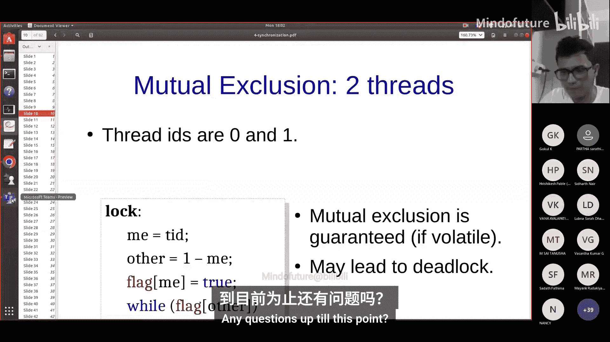

心。Both threads are sync that。Yeah， in some sense， you can say that if both threats are executing in a very lock step manner or some。

啊。Statement by statement， like if they finish this statement and then they are moving through this statement in that case。

 that can get it okay yeah， so that is。An important observation， so yeah。

 in some sort of if they are executing in some sort of simpleness manner， then there can be a Tlock。

So I hope that is clear。And yeah， again， please note that this primitive assignments， I mean。

 this assignment of this type。Llack of some index equals to are atomics， so。

I hope you are that getting this thing， as we discussed in our previous slide itself that such kind of assignments are are at the assembly level just replaced by that single assembly right instruction and they are executed atically。

Anddia， another observation is if one thread runs before the other， then all goes well。

 so let us say if thread。0ero executed this lock entirely this lock。Lock function entirely。

And then entered its critical section and then thread2 came and executed this log log function。

 then it will I mean， then everything will go fine the thread1 thread0 will finish it a critical section and then thread1 will be waiting in its while loop here and one once thread zero finishes and releases the lock by executing un。

Then only this thread one will come out of this while loop because it will set its lack of TID to false right。

 so the thread one will come out of this while loop and can enter the critical section and exit sorry can come out of this while loop and can enter its critical section and finish it。

So I hope it is clear if one thread runss after and the other， and all goes well。In this case。

Hence it can lead to deadlock。M exclusion is guaranteed。

 assuming that we have declared this black air volatile。

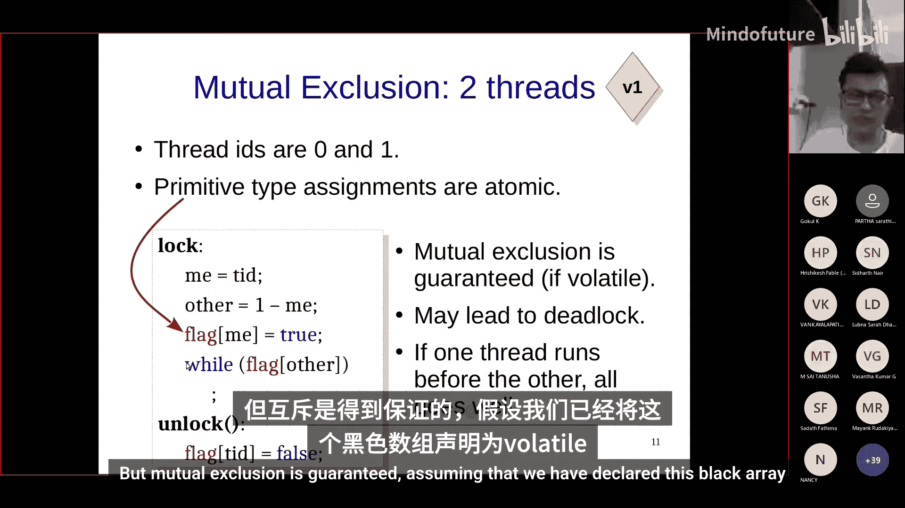

Okay， so any questions with questions after this one。Okay， I guess that are。No questions。

In that case， let us move further。Okay， so we saw that there is one still one problem with this code right that there is no mutual exclusion sorry is there can be a den mutual exclusion is guaranteed。

 sorry but。There can be a dead， so let us tell this， I mean。

 let us say that this was the first version of our。

Lock and implementation using control plus data flow， so this is we1。Now we move to version two。

In which we can guarantee that there can be a mutual exclusion also and I mean。

 there won't be a deadlock。So let us， I mean， let us try to implement it differently。

So again we have two threads each having I0 and1 fine now again we are declaring this variable some I mean something like flag only but now we are naming it different which is I mean we are naming it as victim and again it is volatile。

And how we are implementing lock and unlock methods。First of all， the。

Get the ID of the particular thread， which can be either 0 or 1 into meet some variable called S me。

And then we set this victim as me， it' not that victim is a volatile variable。And then what we do is。

Yeah， what we'll do is we set sorry we have this wild loop right。

 which checks if this victim is me if that is the case then it will keep on looking infinitely。

Else it will enter into the critical section， finish it and we'll execute this unlock method。

Which sets victim to me。ok。They hope this is别。Again， three questions here。

 is mutual exclusion guaranteed？Is progress guaranteed？And。Can there be a dead？

Okay by the way I forgot one thing just let me quickly cover it so in this case progress is guaranteed right because as a flag is set to I mean both the flag values in the array flag is set to false initial。

And let's say one thread， I mean， the， let's say thread one was not willing to enter into its critical section。

 and flag zero was the only one which was willing to enter into its critical section。So in that case。

 threat 0 will set flag of me to0 sorry flag of me to true， which is flag of 0 to true。

And it will check flag of other， which is flag of1， which is false， right。

 because it is bio default diminishized stress false。So it can enter the critical section。

 even though the other side doesn' not want to enter the critical section。

 so please note that here progress is guaranteed。Mual exclusion is guaranteed。

 but it may lead to dead。So I hope it is clear， so let us come back to this slide again。Here， okay。

 please think about these three scenarios， can mutual exclusion is mutual exclusion guaranteed is progress guaranteed and can there be a deadline？

Please think about it and post your answers in the chat and then we'll discuss。

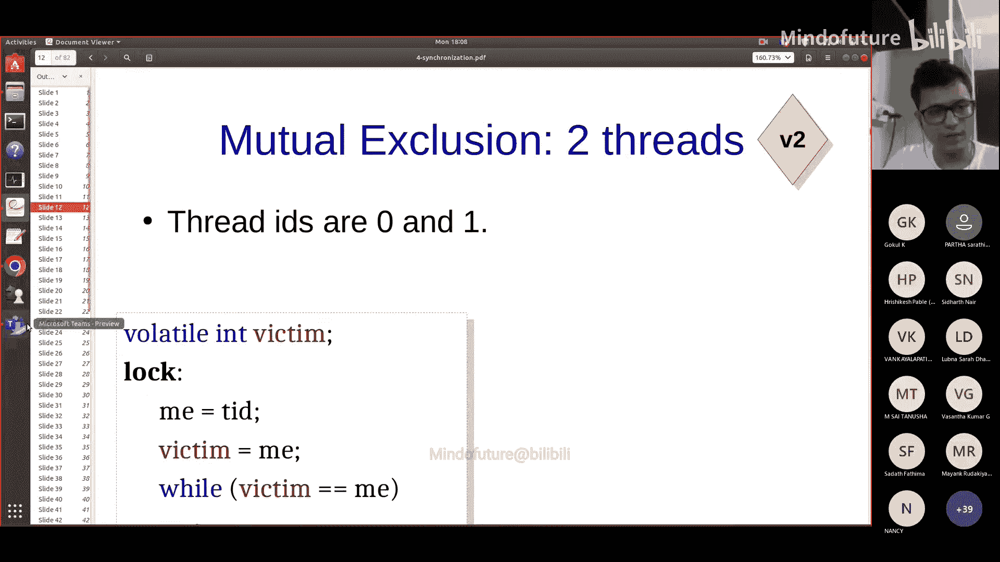

系啊。Suggestions。The two thirds are executed at the same time in both trying to access critical section on Monday。

If two threads are executed at the same time and both try to access critical section。Okay。

 I think we are missing something very， but see， I mean， when the deadlock can happen。

 when both of them are trying to acquire the law。And they are unable to acquire the law。

 in that case they are they'll be waiting in some infinite look， right？And if that happens。

 then we can say that Tlock has happened because neither of them are able to successfully acquire the lock and move into their critical section。

So I hope that is clear， otherwise it can go can go mutual exclusion and execute properly with lock and hand lock。

Okay， I hope that you you are understanding this thing that I told they are able to successfully execute the law and enter the critical section。

Without loop， I mean。If both of them are unsuccessful and they are looping in their respective value loop。

 then we can say that there is a type。He， if either of them is able to enter its critical section。

 finish it and and then it is allowing other side to execute， then there is no at。

Co will is suggesting progress not guaranteed。I'm assuming that it is for the second one。

 so let us see。Progress， not guaranteed deadlock possible。Sorry Tlock not possible Okay。

 Goku is suggesting that progress is not guaranteed。

 but deadlock is also not possible so Dlock not possible progress is not current yeah。

Thatlock not possible。 progress is not guaranteed， okay。Mutual exclusion in re cases。

 saying mutual exclusion guaranteed progress guaranteed。That luck at possible。

Unless only one thread once。The one thread wants to enter critical section ever。And that is infinite。

Progressed。Okay， next say saying yes， Okay， yeah， that's， I mean， this is good that you actually。

 I mean， you been our trying that is good。

But let us try to understand this since we are short of time。

So let us understand this version too and let us see if it guarantees coming in。

Let us analyze this three these three things which I told。

 which is virtual execution progress and Tlock。So。Okay， so let us understand this。 So for this code。

 Mitchell exclusion is guaranteed why it is guaranteed again， this victim is a。

Sort of a variable right so I mean it a it can have a single value at particular time。

So let us say that。For this， I mean， this while condition can either be true for it only one thread right。

 either out of this two threads，0 and1， this while do。Can be true for only one thread right？

Because victim can have value of either0 or 1 based on the value that we are setting here because this means is TID right so TID can either be 0 or 1 so based on that this victim value can be0 or 1。

And if the victim value is either  zero or0 or 1 and it can't be both at the same。

 so please note that。So since its value is either0 or 1。

So either either the while loop of this thread 0 will go for infinite loop or while loop of the thread one will go for infinite loop。

So let us take one example， let us say that threat zero executed this statement it set victim to zero I mean value victim to zero mean T one also set the victim of victim value to one so now。

Value of victim is one right because a thread one set it and then thread to set it。

 so final value will be1。So now when thread zero will reach this statement。

 it will what it will say it will see that victim victim equals to it will check this victim equals to equals to me。

Victim's value is 1 and knee value is 0， so one is not equal to 0， so this value of what I mean。

 so this is false and it will move ahead with its critical section。

And the critical section will be executed by the third one。And meanwhile， sorry thread zero。

 not thread one， so critical section will be executed by thread0 and meanwhile thread one will see this thing right victim which is one。

Eals equals to me which is 1， so 1 equals to  one， so thread one will be looping。

 thread0 has entered sal section。Then once threat0 is finished with its critical section。

 it checks this， I mean sorry executes this。Victim equals to me so it sets victim to zero， I mean。

 initially it was one， so it sets to zero。Which is what is the value of me。

And when it sets victim to  zero， the thread one， which was waiting here because of victim value of victim being one。

Whi is now set to zero by the thread zero。Will come out of the wild because victim is zero and0 is not equal to equal to1。

 which was me for the side of one。And due to this， it can now also enter into the critical section。

And if you observe here。啊。Only， I mean， only one third will be able to enter into the critical section based on the value of the victim。

And both can't enter at the same time because value of victim can either be0 or 1。

 so mutual exclusion is guaranteed。Progress may not be guaranteed why let us understand。

Because let us say only thread， only one thread， which is thread 0 wanted to enter。

And it will set the value of victim to me， right so victim will be set to zero。And0。

 which is value of victim equals to equals to me， which is zero。And it will keep on loop here。

And since we are assuming that thread one doesn' not want to enter the critical section。

 it will keep on looping here indefinitely。And hence it is violating the definition of progress that I mentioned。

So again， mutual exclusion guaranteed progress is not guaranteed。And yeah。

 and the third point was deadlock。So。Dlock can't occur okay， because of the same reason。

 the value of victim can either be0 or1。And it won't happen that both the while loops keep on execute。

 I mean， both these threats are stuck at their while loop because value of 15 can either be zero or。

So either of the while loop， I mean， either of thread will be stuck at its while loop and another thread will be given chance to enter so yeah mutual exclusion guaranteed。

Progress is not guaranteed。And deadlock will not happen。So， I hope this is clear。Again。

 victim is a volatile variable and I am assuming that you are。

 I mean are now comfortable with that what is volatile。And yeah， if threats repeatedly take law。

 then all goes well so yeah by this statement， what I mean is like if they keep on executing this stock and unlock statement。

 unlike that case where only one thread wanted to execute。

If that is not the case and if all the thirds are willing to enter into the critical section repeatedly。

Then all goes well， in that case， there were pain issues。I related to the progress。So yeah。

 I hope that this is clear， so I mean any questions up this this point for the version to a file code。

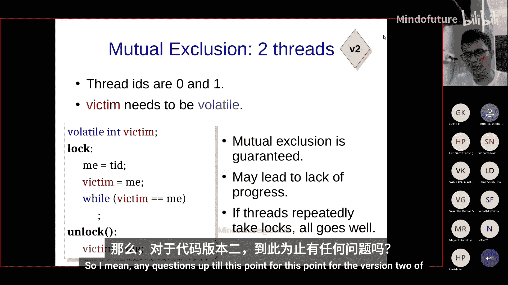

With think解。What we choose。系啲。系。絶対ね。Victim values me， what which is spread。If victim equal to me。

 it in I， okay， I'm assuming that you are missing something here。

So let us understand some victim value is set to me。

And then we are checking victim equal to equal to me。So this will be always true， you are correct。

 but this will be always true only if there is only one thread executing。

If there is some another thread which is executed then it will set the victim value to me so okay let us take the example so value of victim will be sorry value of me will be zero what the third zero so it will set the value of victim to zero。

 but meanwhile thread one will also set the value of victim to me which is one so。

Rly affect will become fun。So now this victim is a common variable。

 please note that this victim is a shared variable among both the third。And。

Based on the order of execution of this statement by both the threats。

 value of victim can be either0 or 1 and based on that they will enter into the while loop I mean they will either stuck at sorry not enter the while loop。

 they be stuck at this while loop and enter the critical section。

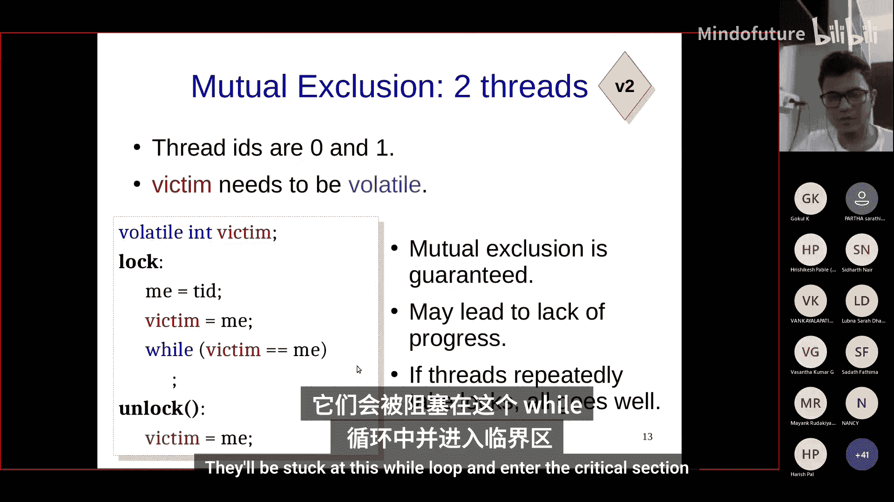

So I hope that is clear。

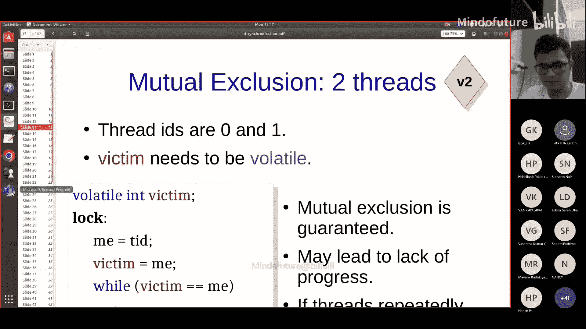

YeahIf there are any further questions， then you can unmute yourself phone us。

But I hope that this is clear that。Both statess are executing this lock and unlock functions。

And this victim is a shared variable， so keeping these two things in mind。

Value of victim can be anything out of 0 and1 and on that based on that value。

Either of the thread will be stuck here， and I mean one of the thread will be stuck here。

 and another will enter the critical section。And once it is finished。

 it will set victim to me so another third can progress from， I mean。

 can move out of this initive and can progress with its critical section。Okay。

 so I I'm assuming that。There are no further questions， and in that case， let's。Mo further so okay。

 so we have seen two examples， two versions so far。

 one was guarantee the mutual exclusion and progress， but was having the dialoguelock issue。

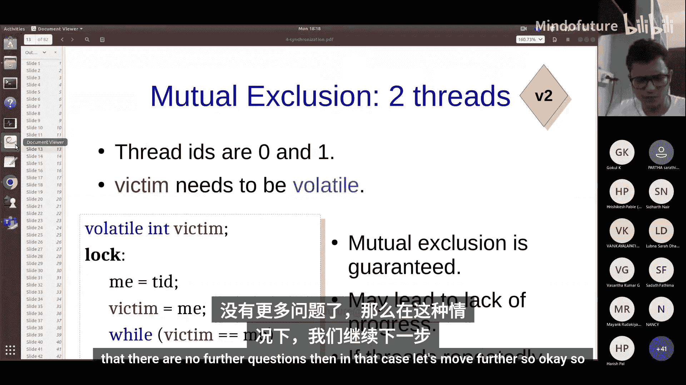

Another version， which is version 2。Is having mutual exclusion and doesn't lead to deadlock。

 but is causing the progress issue， right？So let us say if we want all these three。

 all these three things， right， mutual exclusion progress as well as noted。

So please note that till now both the versions that we have seen as some issue。

 this was having issue with deadlock and this was having issue with progress。

So if you want all these three things to happen， then we need to go to version 3。

 which is the Peterson's， which is Peterson's way of I mean， Peterson's lock。So， let us understand。

I mean， how can we get all these all these three things that we want with this？

We are implementing lock and unlock method。So yeah， let us understand this thing。So again。

 we have to， we have combined both the approaches， which was having this。

Withining one and another one which was having this flag variable flag area。

So now what we have done is we have both the things， one is flag。给。Which is again volatile。

 and again we have this spectrum variable， which is volatile。

So and then what and how we are implementing this。But I can say how we are implementing this lock method is crucial and the way we are implementing the unlock method is quite simple。

 the way we were doing it previously in the version  one right that flag of TID spoil so unlock is simple as we saw in the version  one。

But the way we are implementing， the talk method is crucial。So let us understand this。

So we are setting this knee to TI， which we did earlier。

 then we set other calculative value puzzle based on the value of me。

So for thread does0 value of me will be 0 and other will be 1 and for thread one vice versa value of me will be 1。

I that we' busy， all。And then we set the value of me to true。So lack of me to to。

 so what I mean what is the statement trying to say so？

What is happening here so let's say flag one wants to enter the critical section then what it is suggesting by this said statement so it is trying to say that okay I want to enter the critical section and I'm showing interest of entering into the critical section by setting my flag or。

If black which is having same index as my DID， I mean index， sorry。Not index， but。

The element which is stored at the index， which is given by TID。

sSo threat zero will set lag of 0 to2 and it will indicate its willingness to enter inside the critical section。

This is what the statement does。And then what it does next is that it sets victim equals to me so by this statement what is' trying to say is that okay I want to enter the critical section and I first of all want to give another threat the chance to enter the critical section by setting victim as me so by setting victim as me it is saying that okay I'm selecting myself as a victim and by doing that I'm letting others to enter the critical section。

So let us understand this with this while loop， so it will get clear clear by understanding this while loop。

So。What what this wildlife loop is doing， it is I mean， it's basically the。In finite look。

 if this condition is met so and please note that this is a logical end so。

Both of these should hold for this entire thing to become true。

 and if that is the case that Fred will infinitely look here as we saw right？So what it is。

Being a thread zero， what it is checking， it is checking two things first is。

Is other thread willing to enter into a critical section by checking flag of other？

So if it is willing to enter into its critical section。

 so other thread is willing to enter into its critical section。And。If victim， I'm the victim。

If that is the case， I am the victim and other said wants to enter into the critical section。

 then I'll wait。Here at at the。Otherwise， I'll proceed and finish my critical section。

So hope this is clear。And again， this quote， I mean， is this a v vlon。

Think Peterson lock so this score ensures all the three things， which is mutual exclusion progress。

 and it doesn't lead to Tdlock also。But let us understand why it leads to mutual exclusion。

 nor deadlock and。Why it ensures progress also， so first let us come to the mutual exclusion。So。

Why does it ensure mutual exclusion， so the reasont is simple。

Any of the thread will enter into its critical section for sure， why because the value of 5。

Can be either0 or 1， right， sorry？Okay， so 날 victiming。Can be either zero or one。

And if value your victim is zero。哦等。If value of victim is0， then flag sorry。

 if value of victim is0 and lets say both the threats want to enter the critical section。

And is it possible that both will enter no because value of victim can either be0 or  one and if value of victim is0？

Then like sorry， threat zero will loop here， and value of victim is1。

 then flag1 will loop sorry threat1 will loop here。

And only one will be only one of the what I can say only one of the thread will be allowed to enter the critical section。

 in the case both wants to enter。So I hope you are getting it。flag。

 if both wants to enter the critical section， flag will be set to true for both， so lack of0。

 lack of one will be true for both。But the value of victim。

Can either be 0 or 1 based on which thread is executing this statement last。So。

 both of them will make lack of meS2， so pla of 0 and 1 will bend through。

 but this value of victim can be either a 0 on1 or0 or 1 based on the height which is executing this treatment last。

And based on that， only one thread will be stuck at this one loop and another thread will coincide inside。

It will go inside and complete its critical section and set black papers。So okay。

 so Mitchell exclusion is carrying similarly there can't be deadlock because deadlock can only occur when both of the threads are stuck at their while loopbes and this will again not happen because value of victim can either be zero or one and can't be both。

And if that is the case for one of the thread， this condition will be false and since one of this is false。

 this entire thing will be false and since the center is。

Cond thing is false they'll move to the critical section so one thread will enter into the critical section for sure and once they finish the set flag of TI due to false so flag of other will become false and another thread will be entered into the critical section so I hope that this is clear there there won't be mutual exclusion and there can't appear yet for this code。

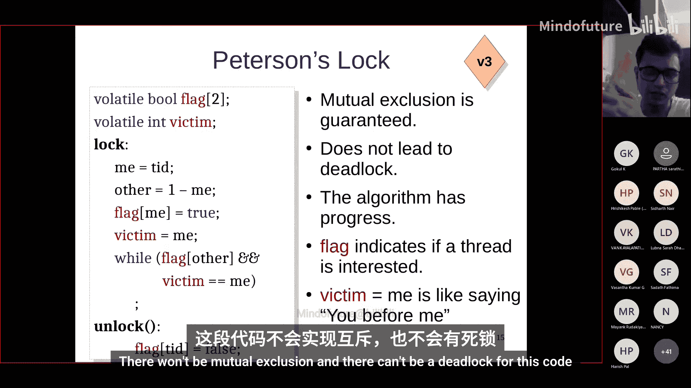

If there are any questions， thank you。That is some question。Assumption is that some else take。要计到。未定。

Yeah， I think you are getting it correctly， but that was for the version too。For this version。

 even that is I mean， that is not even the requirement。

So we saw that mutual exclusion and tlock is guaranteed。Sorry。

 mutual execution is guaranteed and there would be any need at。

And let us see if there is this progress thing guaranteed or not。So when the progress， I mean。

 when the progress requirement is violated。When thread one of the thread wants to enter the critical section and another thread doesn' not want to enter and since other thread doesnt want to enter the critical section。

 this thread which wants to enter the critical section is not allowed to enter the critical section if that is happening then progress requirement is violated but if you see here carefully。

Progress is not violated because flag is initially set to false。 I mean， this both the。

Elements inside the flag array set to false and if only one thread wants to enter the critical section。

 it will set its flag to through and what it is checking its checking flag of other。

which is initially set to false right so this flag of other will false and false ended with anything as false。

 so it is allowed to enter its critical exception。So even though other thread doesn't want to enter its critical section。

 this thread which wants to enter the critical section will be allowed to enter and hence progress requirement is also guaranteed。

So I hope this is clear mutual explosion is guaranteed。

 there will not be any is there can't be any deadlock and progress is also guaranteed。Okay。

 so this is three things should be clear up this point。And。Yeah， again。

 as I said that this black variable is some kind of indication that this thread is interested in entering the critical section。

And the victim equal to me is like saying that you' before me。In some sense。

 T is trying to give other thread the chance to enter the critical section before it enters the critical section。

最好的认丁。Which is therefore declaring this to be flag victim is clear。And yeah。

 any questions up this point。So we'll okay， we'll probably stop here。

 so we'll see what about10 thirds meaning if this is just what two thirds right， this we sense。

Algorithm of Peterson's law is just for two threads and it ensures mutual exclusion and all those things just for two threads。

If we want to generalize for n， then how can we I mean， how can we write the code？

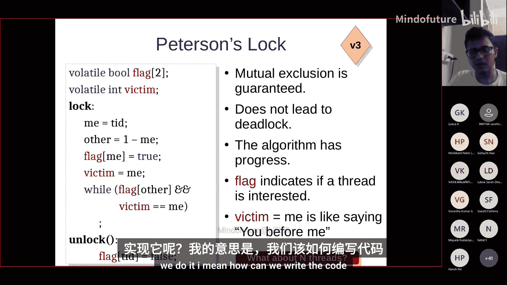

To ensure that， so we'll see this in the next lecture。

And probably we'll also see what are atomics and all those things in the next objective。

Any questions up at this point？

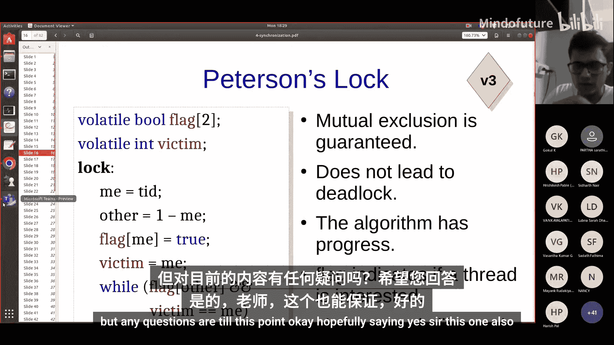

Okay， hopefully saying yes or this one also currently。Okay。

 I was assuming that this one was for the version do this thing that you were tell。ok啊。

Some more question for more pets， we can use a number that comess up。Yeah。

 that is one of the way in which we can do we can use some sort of a sepho or something。

 but yeah we'll see something called a bakey algorithm， which。This is is for implementing the。

This lock and unlock lock for the end， well see this in the next lecture。And。

We'll also see something I mean we'll also delve deeper into the atomics and all those things。

 so yeah， but those are the things for the next lecture。Any questions on on I mean。

 on any of these slides which were covered in two days next？

So if there are any， please feel free to ask， otherwise we'll call it today and will day。

So any doubts related to the Petererson's lock or any of the previous versions that we covered or anything？

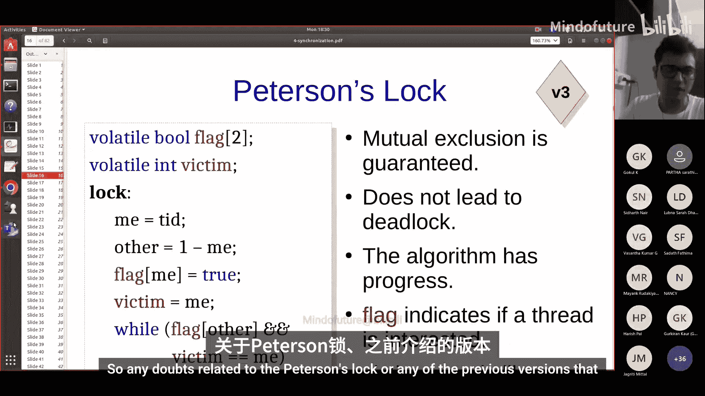

I took two days's lecture on the previous lectures that we covered。If there are any please。

 feel free to ask I'll be there here for a few more minutes。Heth will disperse， then will disperse。

