# 【Nvidia】CUDA并行编程-｜-Cuda-Programming-Course-｜-Parallel-Computing-Using-Nvidia-p13-P13_L13_互斥锁（续）及CUDA中的原子操作--BV1MSq1BTEho_p13-

So。所啊。Okay， so let's start， so hello and welcome everyone to the 14th lecture of our QDA program。

So in the previous lecture， we saw how to implement mutual explosion for two threads。

And for doing that we saw， I mean， for doing that， we saw multiple examples。Yeah。

 and we saw that there are issues with those examples， right。

 so few of the examples were not following the progress requirement and。If you have。

 if you have the examples were relating to Tue and。

So on and towards the yeah and yeah we saw those issues and towards the end we left up with this slide right。

 we saw the Peterson' lock and。If you remember this Peter since lock is the perfect way of implementing mutual exclusion for two threads。

Because it it guarantees mutual exclusion for two threads， it doesn't lead to deadlock also。

And it ensures progress。So all the three requirements are met by the Peterson's algorithm or the Petersons log。

 and hence it's the perfect way of implementing the visual exclusion for two threads。

And then we at the end， we asked ourselves the questions that what about n threats let's say we have more than two threats then how can you implement the mutual exclusion for end threats？

So we'll be seeing this today， so first of all moving on towards a minute before moving to the today's content。

 let us briefly outline what we are going to see today。So in the today's lecture。

 we'll be seeing how to implement mitchell exclusion for end threads using something called a bakey algorithm。

And we will see whether we can use this use that bakery algorithm on GP or part will understand that bakery algorithm in detail。

And then we'll switch towards the next aspect of the synchronization， which is atomics。

Well see well see what are the atomics and I mean， how they are different than this controller and data。

Then we'll see different different kind of atomic instructions。

And also we'll see multiple scenarios or multiple use cases where we can apply the atomics。

And then towards the end if we get some time， then we'll start with the first atomic instruction。

 which is atomic gas。And yeah， probably with that will stop for the two days lecture yeah。

 so with this let's get started。With a todays agent。

 but before move on technical see if there is anything in chat。

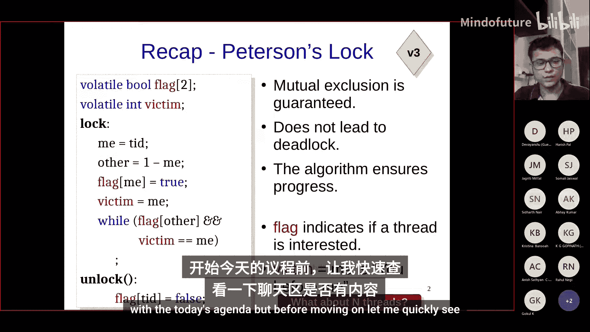

Okay， that is nothing Jack。By hand。Yeah recording this啊 o， so i think嘅。Yeah。

 then let's start with the two days。

The two this agenda。Yeah， so let us start with this bakery algorithm。

 which I said that it's the algorithm for implementing the explosion。Among the interests and。

If you see this， the name itself suggests that it's something related to。I mean。

 this bakery is not the name of any person， but it's a bakery shop actually。

If you see this name are just something， so if you if you will know then if you go to some food court or some bakery then。

You might be given some token and based on that token， I mean， based on the number on that token。

 you'll be served by the shop owner or shop people。So that token indicates when when I mean。

 when your turn will come for party service。So I mean， if the token number is larger。

 then probably you need to wait for longer time and vice versa。

So this is that is what is bakery algorithm， but here instead of。Serving people。

Here we are interested in survey threads and how do want I mean， how do we want to serve the threats？

We're essentially s the thirds meaning we want。each and every threat to execute its critical section。

 but they all can't be sought simultaneously， that is they can't execute that critical section simultaneously。

So far I mean， to resolve that to ensure mutual exclusion。

 what we do is we follow some similar pattern that we use in this bakery that is bakery or food court or some shop that token number is given so each thread is given some token number well see or some label and based on that label。

It will be will be allowed to enter the critical section based on that label and that label denotes when it will enter into the critical section and so on so we will see this thing in detail so that is a brief overview about the bake algorithm。

And this bakeage algorithm was devised by Lile Lamper and yeah， as I said earlier。

 it works for n sets， not just for two setss。It works for more than two third， which is n3s。

And it maintains something called as FFS that is past comp first order。

 so threads which comes first will be solve first。Similar to how we have in the bakery， right？都。

The customer who will be arriving first will be South first because their token number will be smaller than the customer will be who will be entering later yeah so I hope you are getting them so it maintains FfS order in a similar way how we used to have it an actual bakery。

And yeah， this。Yeah， for doing that they use this ever increasing number the same in the same manner。

 we have that token number in that token。So yeah， they use tested ever increasing numbers。

And yeah with this let's see the code for the bakery algorithm so as we did in case of Peterson's algorithm we had this flag but just for two I mean it was just of size two because there we just had two threads but here since we are working with ns we now declared flag of size n。

And this flag which of which is the area of size n is now initialized to all falls， I mean。

 all elements are inside it are initialized as false。And apart from that。

 for maintaining that token or some number use something called this label。

 label is again an area of size N。阿迪。Ith entering this label area will denote what is the。

What is the status， I mean， what is the token number of that thread？

So let us say i entry is some let us say 100 and the token number of that high thread I mean the thread having IDI is 100。

 so totalken number of that thread having IDI is 100。And initially。

 all the total number is finishedized to0。And apart from that， yeah。

 then comes the main thing that is lock and unlock methods。

So each thread that wants to enter into the critical section will execute this lock。Dolock function。

Then they'll if they succeed in executing that lock instruction。

 basically if they don't stuck here at this while loop， then they'll proceed to critical section。

And then after finishing critical section， they'll execute this unlock method。

So I hope you are getting this this this this to lock and unlock methods Okay， so now let us。Go。

 I mean， go and see what， I mean， what is there inside the s and unlock method。

 first let us look at the lock method。So first of all， we are getting the thread I。

 so each thread will。Store it strite in some variable called Sme。

Then as we do in the Peterson algorithm， we indicate the readiness of the particular thread so let's say thread I wants to enter into the critical section。

 then it will set flag of phi equals to do that is flag of me equals to。

This indicatesates that this flag is willing to enter into the critical section。

So by execution of this treatment， thread is， in some sense。

 expressing its willingness to enter into the critical section。And yeah， after that。

 what each letter does is it。It actually generate generates token number or label。

 so how does it how it does， it is like it。Go， I mean it。

It picks label as the maximum out of all the currently I mean currently assigned labels。

 so it note that this all the currently assigned labels are here declared as area of sizing so out of all I mean maximum value out of all the currently assigned label plus1。

So that will be the greatest value。So okay， so let's say the thread okay so maximum value in this label area was let's say 10。

 which was assigned to some of the thread and let's say some thread let's say 15 came and it want to know what is my label。

So what it will do is it will go through all the currently assigned labels and the maximum of those is 10。

And 10 plus 1 is 11， so the thread 15 will get 11 as it stable， so I hope that is clear。

And after doing that， after getting， I mean， after setting plugs through and setting the label as one plus。

Yeah， one plus max off all the labels。For the all the threads what， what the thread does is。

 it checks if。If there is any other there is any other threat。

Whose ID is not equals to my ID so k not equals to me there if there exists k not equals to meaning if there exists some thread。

Whose ID is not equal to my ID means the idea of that thread。

And if that thread has expressed its willingness right setting flag is expressing its willingness to enter。

 so if that thread has expressed its willingness to enter the critical section。If that is true， and。

If the label of that thread。Is less than the label of mine， I mean。

 if it has the less lesser value of the token number than。

The value of the token number that I have then in that case I have to wait because I need to I mean I need to give that thread the chance because it has lesser token number so I'll be waiting in this while loop。

And yeah， please note that this is lexxiographic comparison， so it's not just based on the live。

Label， but it's also based on the I， so let me。

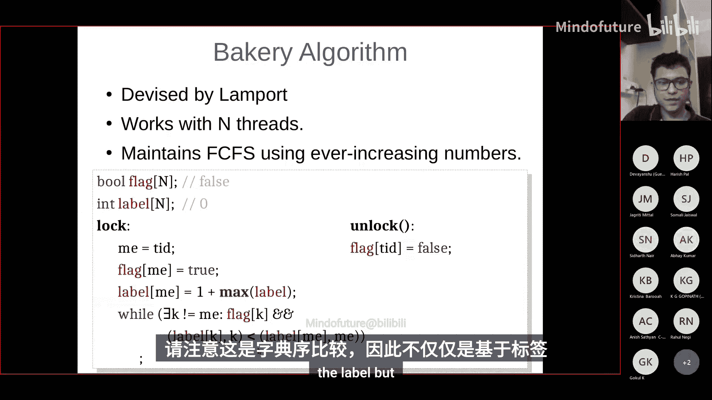

Okay， so let's say。Let us assume this scenario。Lets say both of the threads have same label。

Then in that case。Lets say both of the thread got the label as1。

 but one of the third adds ID0 and one of the another thread had the ID1 then in that case a thread with ID0 will get first chance because。

After I am hoping that you are getting it。 this is the likeographic comparison and。😊。

1 comma0 is less than1 comm over because after comparinging the label， we compare the IDs。

So if label matches， we'll see who has the lesser I。And and if the labels are itself not matching。

 so let us take this example to comma00。Le than。结个嘛定。

So please note that first of all we will be comparing the labels。

 so here the label itself is lesser I mean， lesser than the label of this thread。So in this case。

 this thread will get first chance， even though it has。

Higher thread ID but its label is less so first of all label is compared and then the ID so I hope you are getting this that this is the lexxicoographic comparison in which we are comparing label and I mean we are using label and ID as a doubleple to compare who will get the first chance so。

This based on the label and the thread I and based on the willingness of the threads will will be。

Well be making sure that only one thread enters into the critical section。So yeah。

 I hope that you're getting this。So yeah， based based on whoever satisfies this condition that T will be looping here and other third who for which was sorry part。

Whom this condition is false， it will end up with the critical section and after entering the critical section。

 you will execute this unlock method。So what the sunlock method does is it sets flag of pi equals to false。

And what does this mean setting track of period8 equals equals。

 that thread is saying that I am no longer willing to enter enter the critical section since I have already finished。

Executing my critical section。So that is what is lock and unlock method。

 any questions until this point are on this slide？Any questions。

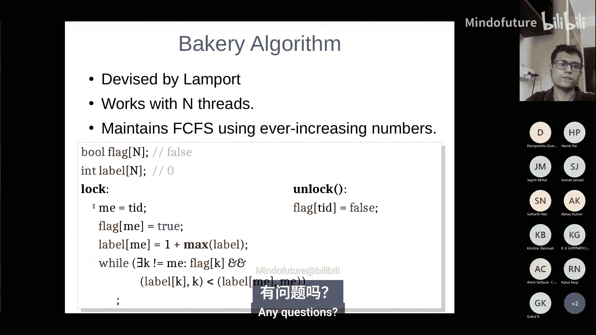

OkayThat is some question。 So like explainy loop again， okay。

Yeah， let us this loop again。Okay， so let us understand the slope again。

 So what this loop is saying is， first of all it is。First of all， we need to understand two things。

 right？Whenever Ted wants to enter into the critical section， it will set， I mean。

 it will set its flag。whichhich is saying that I want to enter the critical section。

 it is expressing its willingness， and then it is calculating its label。😊。

Now let us come to this while loop， what this while loop is doing is it is checking if there is some threat。

Apart from me， I mean， if if there exists k that is not equal to me。

 I mean there is some threat which doesn't have my thread id and it is willing to enter into the critical section。

And。If it label it' less than my label。If it has label， less than my label。

Then I'll wait for that thread to finish the finish the critical section and then only I'll end is what is this。

买 look诶 jack件。And if both have the same level， they'll go a many。

It might happen that both have same level， right， Then in that case， ties will be broken by this。380。

which is k and me please note that K and me both have the thread id K is the thread id of some another thread and needs the third id of this current thread。

So I hope that this is clear， yeah， I hope that this is clear fo。

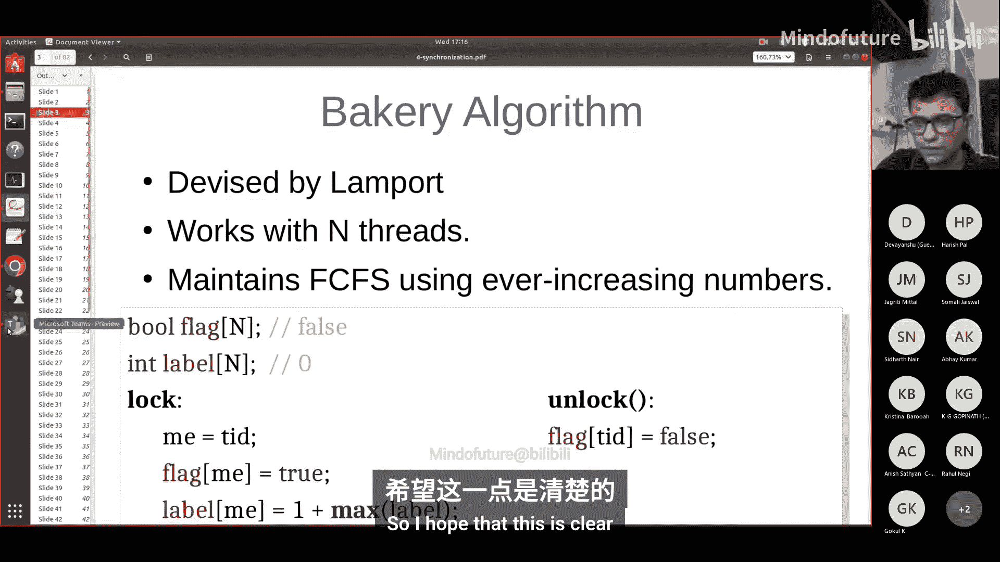

Therere any questions that you can ask？So me colon pla， what does it imply， please explain again。

啊。This one， right。Okay， so okay， I mean， this is not a exact C syntax， so please。

Pardon me before that， but。Such things are not present in C， right。

 So there exist and all those things are not in C。 So is' some kind of a pseudo code for place。

Ignore that， but。Let us understand this I mean don't think that this is a C syntax。

 but what this essentially tries to do is that。It checks up。I mean， this me colon flag case。

 something like it goes through all the thread ideas， sorry， it goes through all the flags。

And if it checks if the there is some flag set to prove。

 I mean essentially it is going through all these flags。

 I mean it's kind of a for loop which is going through all these flags。

And it is checking if any of the flag value is true and if it is true。

 it should it should not be at the index， which is my index， which is the thread egg。

That is how this thing， this small， this entire thing。Will be implemented in C。

 But this is some some kind of a pseudo or place。Ignore that this I mean。

 this try to understand what it is trying to say rather than。

Taking it from a very syntactic or sea style of writing。

So I hope you' are getting this thing that I was trying to explain。

If any further of clarification is needed then this。

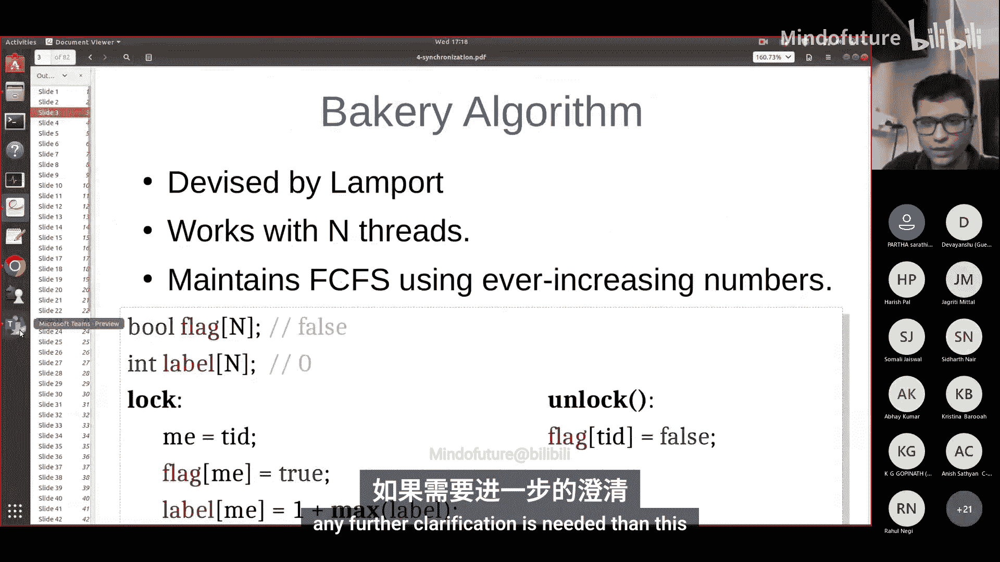

So it's logic it's logical and in the while right， yeah， it's a logical end， it's not a bit wise。

 it's a logical end。So how will the K value be determined？So again， key value is I mean。

 what each start is when it is going through all the。All the well I mean。

 all the elements in that flag array and that index inside that flag area determines the K value。

 right？And K value is nothing but the I of all other threads， apart from the thread， I mean。

 current thread。So I hope that is clear。Okay， this is good that people are。

Understanding and asking the questions。要问呃。This is good， so let's move on further。

 so I have three questions for you。Yeah， I have exactly three questions for you people。

First question is， let us say that let me come back here here。Okay。

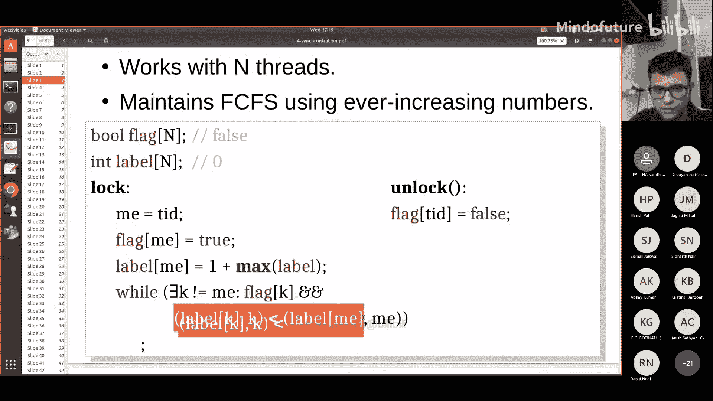

好。Anyways， let us。

I have three questions for you people。 Let us see I replace。This this part of the condition。

 there are two parts for it， this is the first part and this is the second part。

Of this vi condition inside the vi loop， so let us say replace this second part。

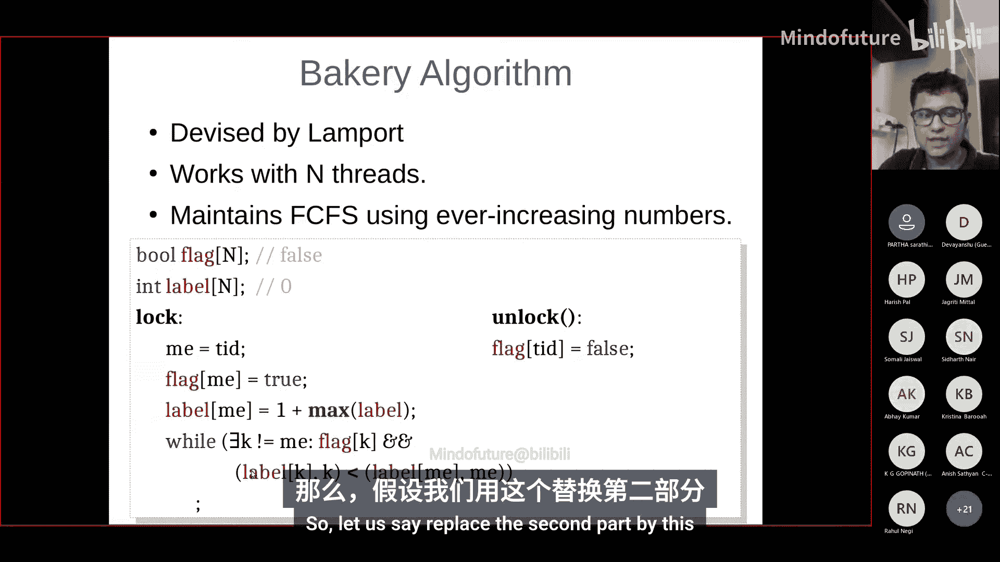

byです。你不。好。你觉咯几。Les than。Lbel of。Me。

I just replace this entire。I just replace this and not entireing， but this this part， this part。

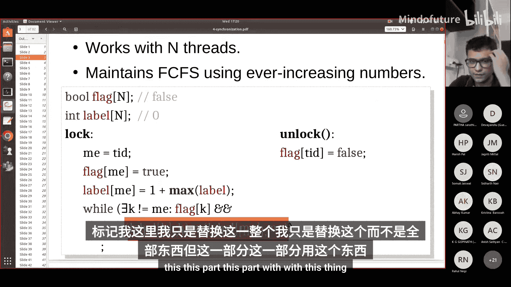

啊。With with this thing。Then what will be the output of the code， This is the first question I。

Output in the sense whether it will guarantee mutual explosion and progress and all those things。

 first of all， will will it guarantee the mutual explosion is the question。

So again I repeat the question， I replace this this part。

 the second part of the condition after this logical end。

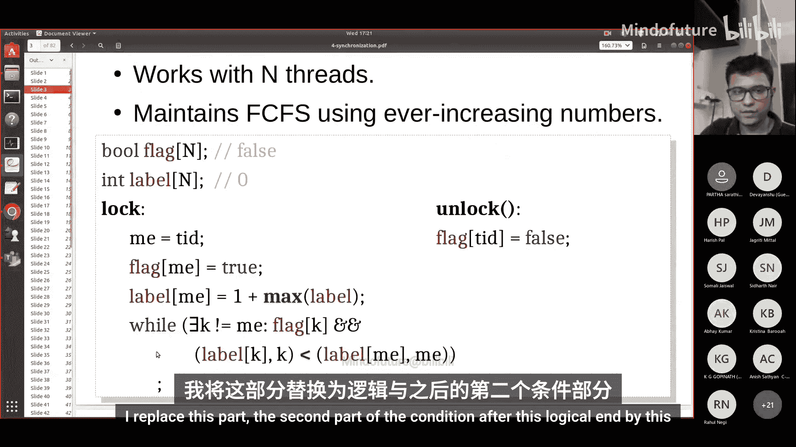

By this thing。男？Will it guaranteeing mutualtchell exclusion is the question。Okay。

 if you are telling there might not be a mutual expressionurs， then why？

Because label values max might change while。Okay， it might change while executing。

 but can you give some。

Execution pattern， which might cause mutual explosion to vit from this。From this slide。

You can either unmute yourself and tighten in。

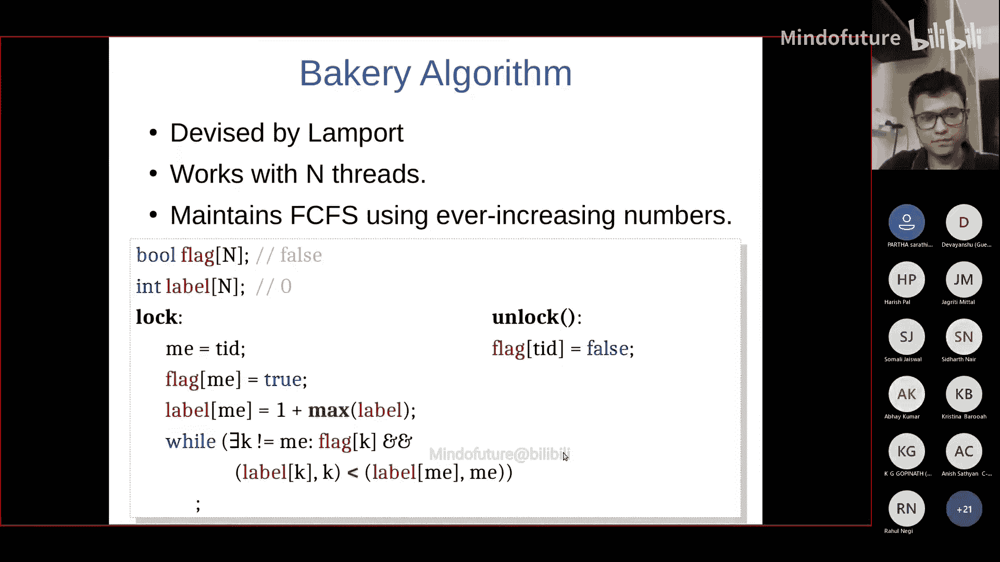

三。Okay， there can be two equal label values。Okay， there can be two equal label values。

 but how how is that possible is I want to is that I want to know from you people。

 how can there be two equal label values？

Can anyone put some comments about that？So we are just trying to brainstorm so like we want to understand if changing pubbits can。

啊。To some sort of issues with this code not。Can there be two， I mean。

 is there a way in which we can get same label values for different threats？

Is it possible for this lockft matter？

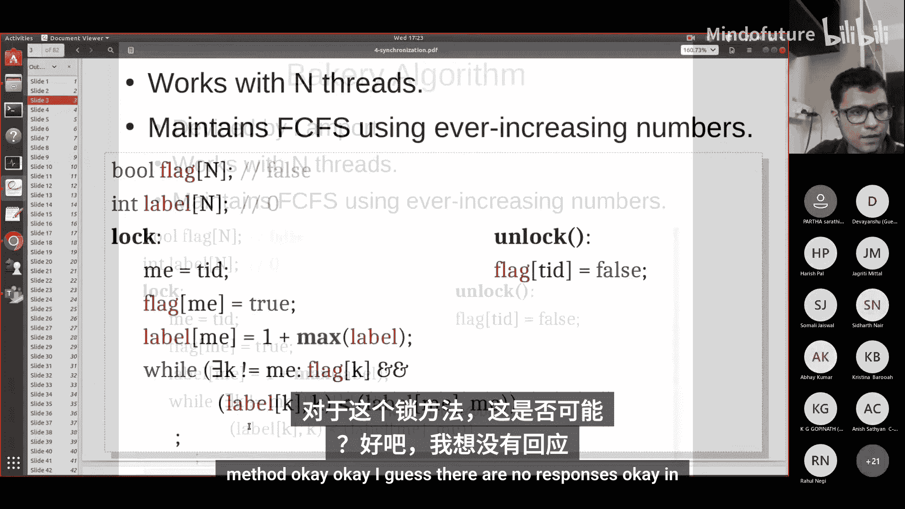

ok。

Okay， I guess there are no responses， okay， in that case， let us try to understand。Okay。

 so so my question was this right that I want to replace I mean I want to replace this S thing with just that small thing in which there is no and not no me so we are just comparing the labels and not the thread Is。

So in that case as I explained， or as someone was pointing out， not as I explained。

 but as someone was pointing out， if we are just comparing based on the labels。

 then it might happen that two texts might have same label， and if that happens then both of them。

I mean， both of them will enter into the critical section because label of k。

 less than label of me will be false for both of them because this is disorder。

 this is strictly less than。So that will be false for both of the threats and both of the threats will enter into the critical section。

But the question is， when will it happen that both the threats will get the same value of label？

Where it can happen， yes， it can happen in this case and it will happen here see when you let's say both of the threads。

Executed this instruction， this entire instruction simultaneously。

And both of them try to find the value of max inside this label area simultaneously。

And let us say both of them found that okay， max value is 0。In that case。

 what they will do is they will do 0 plus 1， which is 1 and will tell that okay， my label is 1。

So for both the threat， the label is one。And assuming that we haven't kept this K and me here。

In that case， what will happen， both are willing to enter into the critical section。

So flag of both is true。 so both are winning and for both of them。

 level of case less than level of means。M sorry， both of them are reading into the critical section。

 So this flag of case。

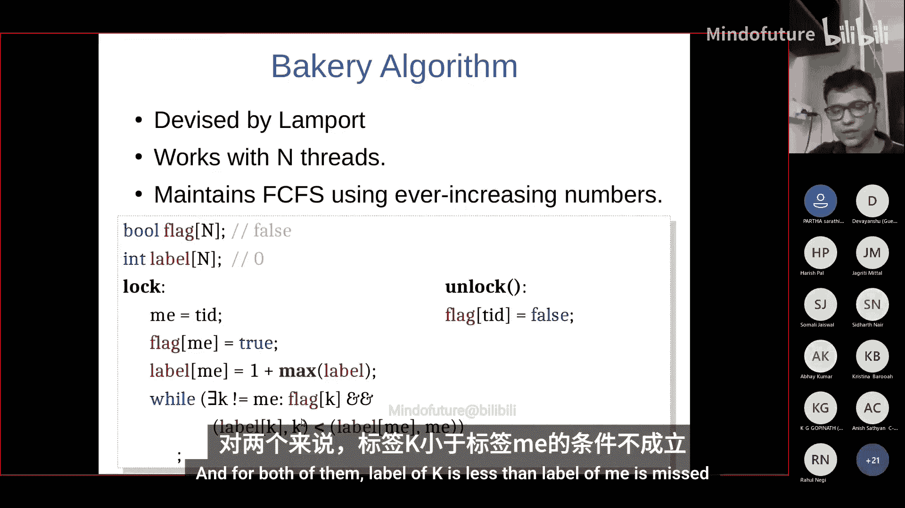

Okay， so again， so let us say both of the threads wants to enter the critical section at the same time。

And let's say this K and me is not there， we just have this label of K less than label of me as the condition along with this this condition。

And they both set flag equals to true flag of equal equals to true。

They set label equals to1 plus max label and both of them。

Simultaneously found the max value out of this label area。And this max value found was0。And1 plus0。

 they both did， I mean， they both found max value inside the level error 0。

So 1 plus0 will be 1 and both will get label of me as1 so for both of them label will be1 and now when they try to enter I mean they execute this value lag of the K will be true because they will find some another thread which is willing to enter into the critical section。

But this conion will be false for both of them because label of case less than label of me will be false because one is less than1 is false for both the。

 so both of them will enter into the critical section。And so in that case。

 mi explosion is not guaranteed if we remove this key and me from here。

So point that I was trying to highlight here is that this kind of。

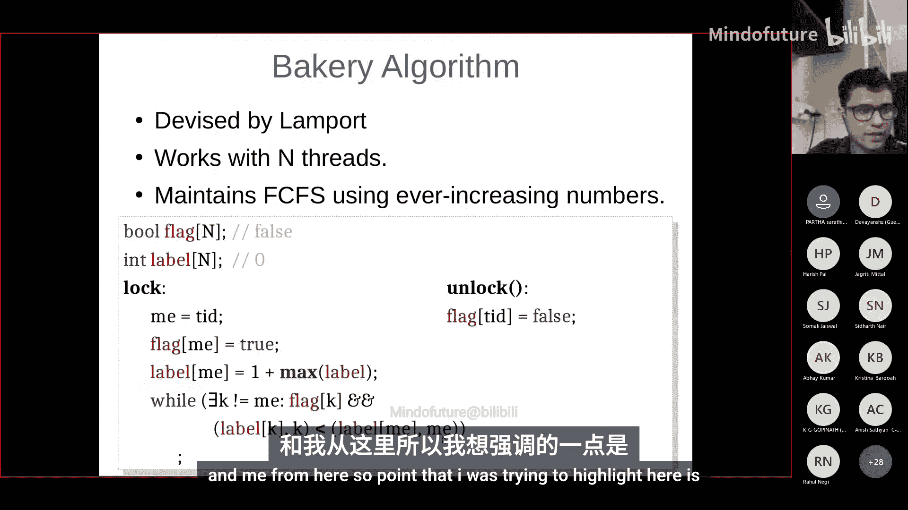

Thing is kind of inevitable for this bakeries algorithm we need to。Have tiebreaker here。

 otherwise it might happen if we just keep this thing， if we just keep this thing。

And it might happen that we might end up losing mutualtchell exclusion， so it might end up that both。

 I mean， it might happen that both of the thread anchor the critical section。I hope that is clear。

 so that was the first question。Second question is simple。

Let us say that again， I want to replace this second part of the condition after this logical end。

With this thing。

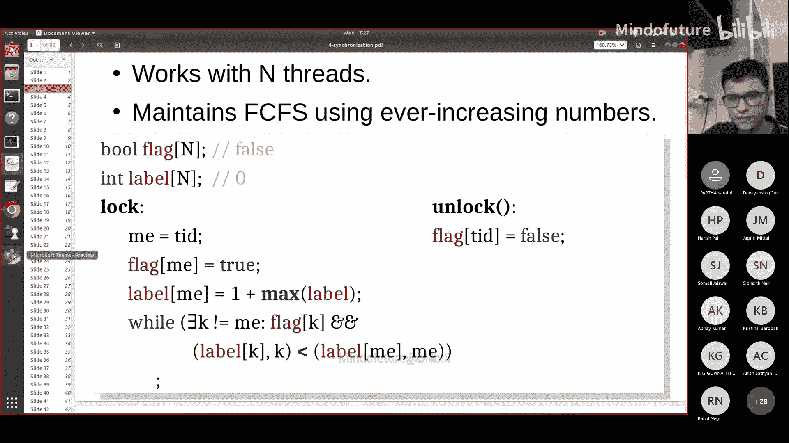

啊。K less than just this simple thing I want to use instead of that label of k comma K less than level of me comma me。

 I want to replace it with just this simple thing。If I do that。

 then what will happen is virtual exclusion guaranteed。Its broken has getting。

Can there be a deadlock， I want your people to think about it。By replaced， this by this simple。

Condition and。

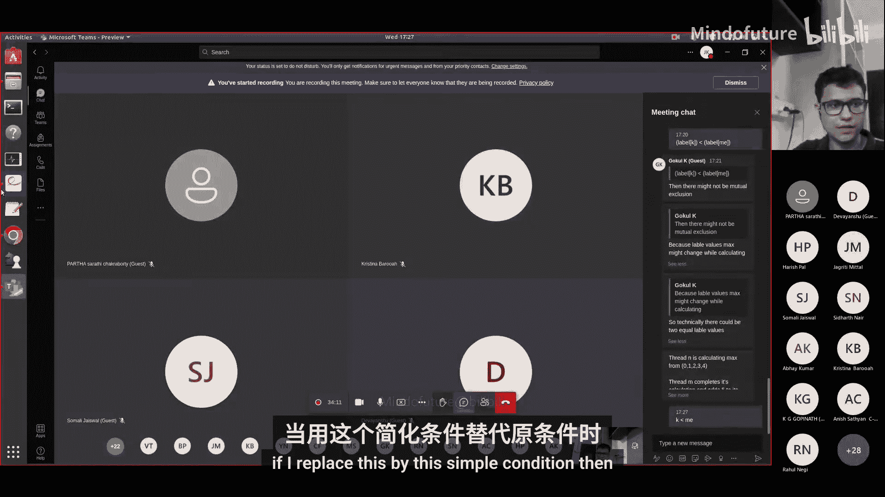

What will help， please think about it and post your answers to the chat。

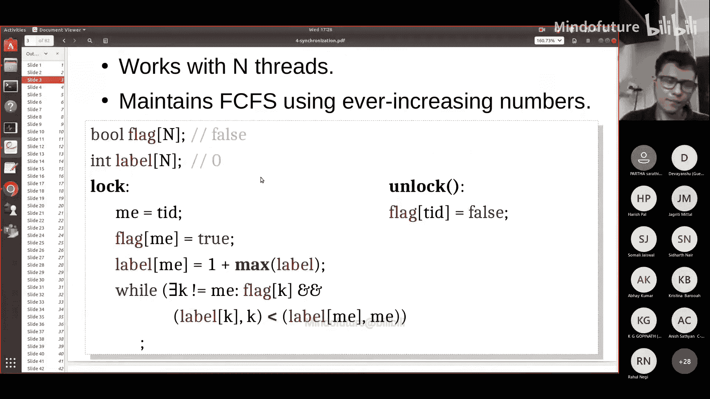

The Veron is saying progress is not current， how progress is not current。Well。

 this is correct observation， but I want you to elaborate how progress is not kept。

Yes缩 essentially。Can you hear me yeah， I can hear here so let's say the first thread comes and the thread one reaches this particular point first。

And then thread zero is still waiting on something thing doing something beforehand in that case。

 it finds that k less than me is not true。Fer。嗯。The third one。O。Oh no， so it's actually the。Yeah。

 that actually seems right， So yeah Kael has then means。I is actually true， and it waits。

For that particular point。呃。Yeah， that that's。Okay， okay， so I'll probably elaborate more upon it。

 So， yeah， your observation is correct。 Progress is not correct and。That thing is also corrected。

Thread with greater thread I will keep on waiting here。

But let us try to see it in a different way when it might happen that it might keep waiting here inde at least。

So let us say that thread with lower I came。And since it was willing to enter into the critical section and。

Other third with greater thread ID was also willing willing to enter into the critical section。

 both of them are willing but。Since the thread with thread having lower thread I will。

Make this condition as false， it will enter into the critical section。And yeah。

 and it might happen that it finishes critical session mean。

 please note that the thread with greater thread ID was loop here。

It might finish thread with lower thread ID might finish critical section。Do unlock。And again。

 enter the critical section。And that this thing might happen indeitely and thread with high thread ID might keep on looping here。

And yeah， this might keep on happening because whenever。The thread which was， I mean。

 the thread with lower I will enter the critical section and will come out and will again enter because this condition will always be false for it。

And in that way， it will never get a chance to enter the critical section and that way starvation can happen or progress is not guaranteed。

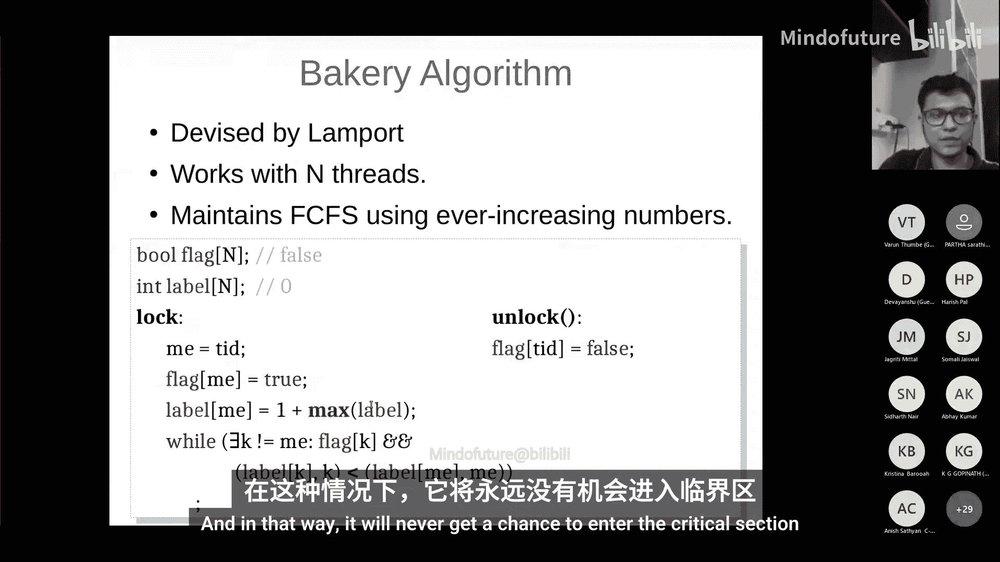

Is what Ill say。Is there any question？几一咁记。これた。You only works days。でてた。啊。

We only accepted A completed， which could be a long time。Yeah， in that sense， yeah。

 that is also correct that。Progress is not yeah in that way， it's correct that with red。

 which is having hard credit might keep on waiting here in that defining。

So yeah， it might keep on waiting independentlydefinly here and in that sense。

 progress is not guaranteed。And one more question， is mutual exclusion guaranteed？Ass the question。

 let us say that we have just this condition k as the mid here instead of this entire thing。

Then is mutual exclusion guaranteed or not can you please？

Think about it or give some example where it is guaranteed or it is not guaranteed。

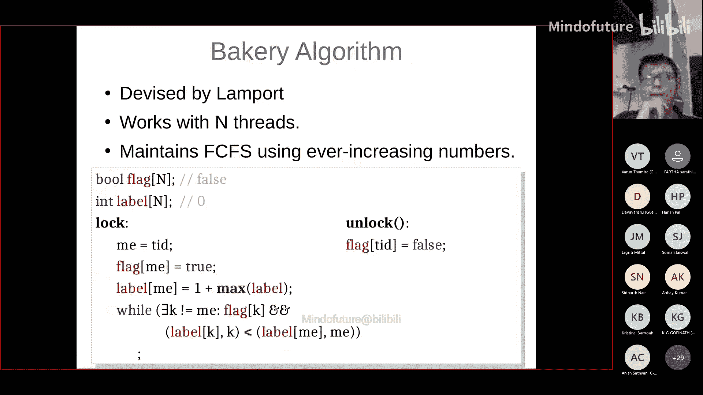

Any suggestions？Okay， anyways， I。That was。There is some noise from someone side。

 Can you please mute other voice。Okay， in case you have any questions you can unmute and ask but otherwise。

 please mute yourself so that conversation can go smoothly。啊。There is some suggestion， Yes。

 because each idea is unique。Order is first third I D， and then next and so on。Okay。

 I guess probably we are missing something here， probably I might be also wrong。

 but let us see this thing。

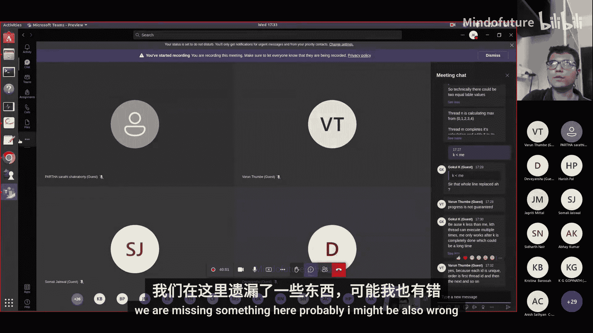

According to me mutual exclusion is also not guaranteed， let us understand why。Let us say this。

 please note that thiss label checking or checking that label of k comm sorryri。Labell of k。

 but k is less than me is inside this loop， so there exists k less than me and this scale less than me here。

I's inside a loop， so let us say that。Thread， let's say some thread4， thread with I4。

Kill and it wanted to enter the critical section and it was checking if there is some thread whose I is less than my ID。

So let's say at that time there were no threads， so it checked for T0。

 is that thread0 who is willing to enter the critical section it is having ID less than my ID。

So at that time， thread0 was not there， so it moved on， it checked what thread1， thread2。

And meanwhile， what happened， okay， so it checked for thread1，32， thread3， but no one was there。

So yeah， fine， so no one is there so T for entered the critical section。

But now let's say what happened Fred  zero came。Meanwhile， Tford was in the critical section。

It saw that okay， there is some flag4 which has willingness to enter into the critical section。

 but my ID which is k equals to k sorry， my ID which is me which is0。

Is not greater than the ID of the thread which is having id equals to 4 so k is 44 the thread 0。

 so 4 is not less than 0， so it will also enter the critical section。So I hope you are getting it。

So let's say some higher idea thread came and at that time no thread was present and it will enter the critical section。

And also。Later， if lower Iic threat comes， then it will also enter the critical section if we just have this scale as than。

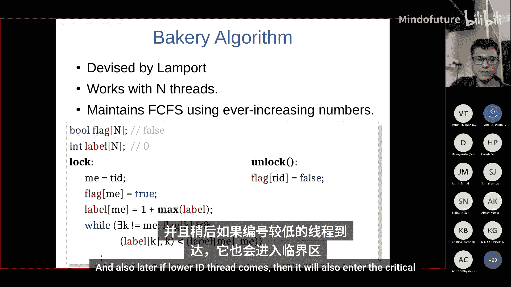

So I hope that you are getting it that mutual exclusion is also not guaranteed if we。

Just use destiny。If we just use K less than me， that mature explosion is also not guaranteed as well as progress is also not guaranteed。

I hope you're getting the reason for both of them。So I had a question， so is the flag of still。

Yeah， in the the checking of the flag is still there in the foundation， right， that's the assumption。

Only the the statement label of k comma k as than label of me comma me is being replaced with k as than is that right？

Yes， this statement， this， yeah， this thing is already there， it is not changed。

What is there after this logical end？This thing is being replaced by Ka。嗯是。Yeah。

 so essentially the flag。Willingness is。It's possible for the later thread I to go ahead with the execution because it sees that the flag is true。

Now， it will see that plague is false for exactly。Yeah because no other thread was there at that time。

 so it will go inside。And later some lower thread ID thread came。

 it saw that some other thread has willingness， but my ID is less than that thread。

 so it will also end or that this will become false。So I hope you're getting this。

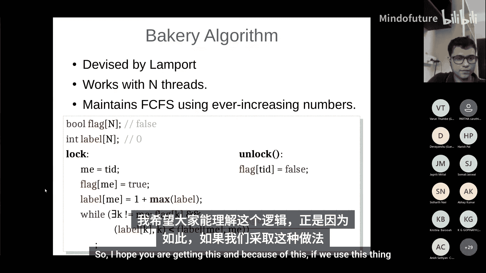

Because of this， if we use this thing， then mutual exploration is also not guaranteed as well as progress。

So I hope that is clear so that was the second part， so again， first part was this。If we use this。

 then mutual exclusion is not guaranteed。If you use this。

 then mutual exclusion as well as progress is not guaranteed， the second thing。

And now comes the third question。My third question is also simple， let's say we use this。

Okay， let us not type here because it is simple。啊。Let us say that I replace this less than by greater than just that change I make here。

Instead of less than I make greater then then what will happen？Arrest all things remains the same。

 just to replace this less than by greater time than what can happen。

Is there mutual exclusion guaranteed is there progress， or first of all。

 let us just talk about mutual exclusion if it is not guaranteed， then let us not move。

Is mutual exclusion guaranteed？Let's think about it。

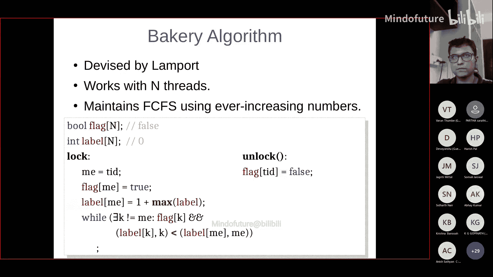

呢个嘅。SoHopeless， some questions sir， what about this？Okay。

 I missed this question what while unlocked student5 reset？

你不。Okay， I guess probably missed here， but yeah。For unlock， it' is not reset level。

 it must be reset plug because label is ever increasing if you see。

Z will keep on increasing it's an ever increasing。Kind of token。

 So please think of it like that that。At shock that token number keeps on increasing right you don't need to reset it unless itself overflow some kind of case。

 but yeah level is ever increasing。We are just saying a minute for unlock， we are just saying that。

 okay， the thread that I mean， the current threat that executed critical section is now no longer willing to enter into the critical section since it has already finished the。

So I hope that is clear， we just don't need to reset the label。

Because whenever next time that thread will enter it will get the label as the maximum value which is there inside this label area plus 1。

 so that is not an issue we will always get the higher and higher value。Unless there is an overflow。

 so that part I'm just ignoring， but yeah。Other than that。

 it will always get higher value than what is present in that this label had maximum value。

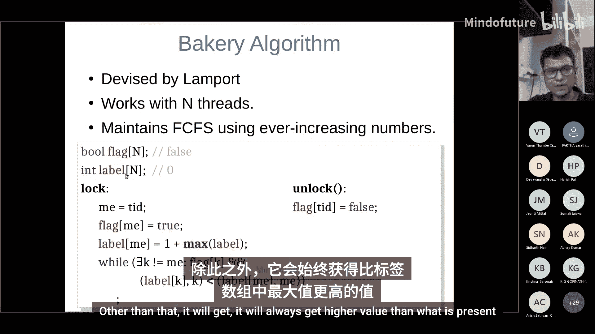

啊。Some responses。No progress， mutual explosion this。ok嘅。Okay。

 just let us talk about Miche exclusion first let us。Only the first thread is the start will enter。

Okay。Michael negative。Yes， overflow can happen that I told。

 but just this meaning just for this example， let us assume that there is this overflow issue present exist。

In that case。Resetting label is not needed is what I'm suggesting。Yeah。

 but we need to take care of that to， which is correct here。

 it's a correct observation that we need to take care of for。Okay。

 let us try to understand this thing also。

So。Let us see mutual exclusion is guaranteed if I replace this。Less than by credit than simple。

So when mutual exclusion is not guaranteed when more than two or two or more than two threat centers is the critical section。

So if I replace this less than by greater then can it happen that more than two threads can。

 I mean will enter into the critical section？So yeah， let us understand this with an example。So。

Let us say that initially Northhar was。Theyre inside the critical section and thread zero came。

And since thread0， I mean， there is no other threat。

 it will make its willingness to probe by setting practical to probe it will get label as one。

Because one plus max level。Which I mean， labels are initially zero， so if we look at1 plus0。

 which is1。It will see that no other flag is willing。

 so this itself will be false and it will enter into the critical section so flag trend0。

Has entered the critical section。Now let's it。A few other third came T23 Im a thread with A23，4 came。

For them， they will get a label accordingly， so thread with ID1， sorry with ID 123 k。

 sorry not 23 because thread with ID 1，2，3 k。Thread with 3D0 is already there inside the critical section。

 thread with ID 12 and 3 K。They'll make select2 through， they set they'll get the label S 2。

34 because one was the max level at that time。And since they execute I mean， even， I mean。Yeah。

 even they can get the same level right， so if they execute this statement at the same thing。

Then they might also get the same level， so in that case they might get the level as。😊。

One plus max which is  two， but let us say that they execute this instruction one after the another。

 then they might get the label values two， three and 4。And yeah， so tried with Id1 got label S 2。

 tried with ID2 got label S3 and fed with Ii 3 got level S4。Now。

 since there are multiple threads who want to enter into the critical section， so for them。

 this is true。And for the thread。With I for us， with ID3。

This condition will also be true because this is now greater than so label of key。W whichch is sorry。

 this is points because level of K， which is。040 sorry， which is140 thread with I 0。1。

Is greater than。For this false right so I hope you are getting it but third with I0。

 which was already there in critical section label is one。And for thread with ID3。

 which is willing to enter into the critical section， label is poor。

So one is less one is greater than four because this is now greater than one is greater than four is false。

And since this is false， this while loop will not keep on looping infinitely and it will also enter into the critical section so third with 0 and4 sorry third with I is 0 and 3。

A now into the critical section and hence a mutual exclusion is not guaranteed if we replace this less than by greater them。

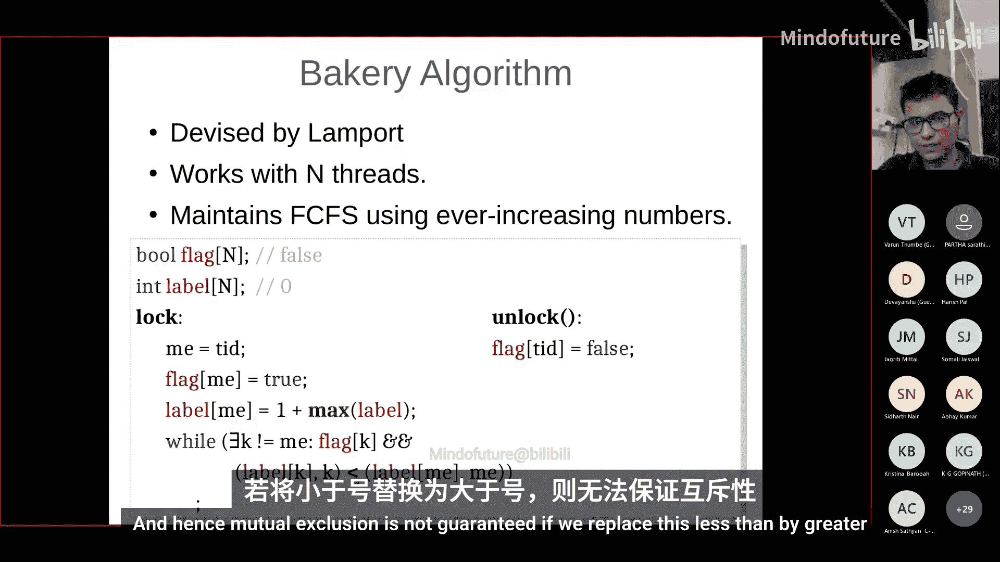

I hope that is clear。

If you have any questions for that， this replacement by greaterta1， I in that scenario one。

 then please unmute yourself and ask。Okay， anyways， if there are no questions， then yeah。Yeah。

 so please note that mutualll exclusion is not carried and let's say if you want to ensure mutualll exclusion while replacing this less than by greater than then。

We need to ensure that label is initialized to int max instead of0。And instead of max here。

 we need to replace it by B， and then we can put this greater than instead of less than。

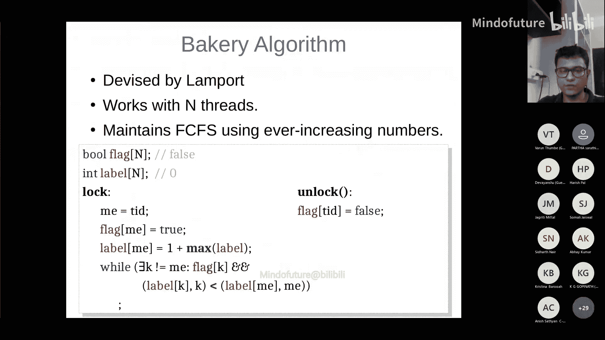

So with this， I am hoping that there are no questions。

So我嘅。Sorry， so I am hoping that you've got this point and。We understood the different， different。

Scenaias also like replacements for these conditions。And yeah。

 I think this should help you people to understand this decrease algorithm better。Yeah。

 but with this lets move on so yeah one thing that you should observe is that this max is not atomic。

So， as I。Told I mean， as I said earlier， it might happen that multiple heads。

Find the max value inside this label area simultaneously and they get the same。

Value as the max value and they replace it by  one plus that value。

So it might happen that since Max is not atomic。Multiple heads can get the same level value。Yeah。

 so I hope that point is clear that max is not atomic and hence multiple threads can get the same atomic sorry same label value here。

And the second point to note here is that。This code will only work in the absence of caches。

And in presence of cacheius， Cashe's mutual explosion is not current because the reason is the same as we understood in the previous lecture。

that this boolean flag of can and this inla of czen both should be volatile。

 should be declared as volatile， otherwise it might happen that whatever value is written inside this flag and label array might be cached locally for I mean each of the course by each of the caches of the course album caches basically。

And it might not be written into the main memory and other thread might read the sta value。

 which is their main memory and hence it might cause issues or if it might lead to。I mean。

 it might it might cause that mutualt exclusion is not guaranteed because of that。

So I hope that is clear， so this fourth tool， sorry。

 this flag as well as label should be declared as volatility。And yeah。

 so this issue should be kept in mind and with this， let's move on with the next slide。

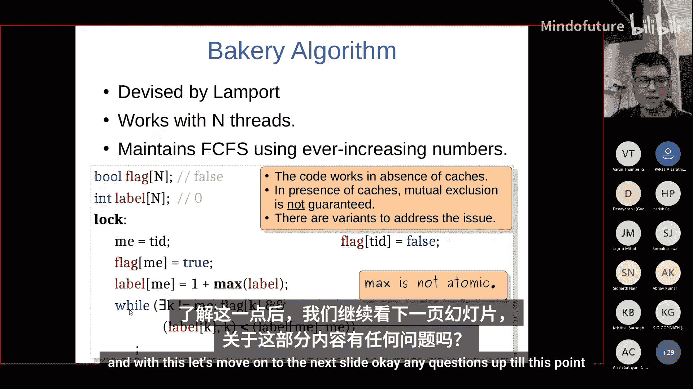

Okay， any questions update this？

But there are no questions， that's fine。So let us understand if this bakery algorithm will work upon GP you or not。

So。Yeah明。When we talk about GPU we think about wars right so across the wars this algorithm is same as GP because across the warp the execution is asynchronous right two threads which are in different what can execute in any manner。

And I mean， in any fashion， and that is how the two threats of CPU execute。

But what happens for the war threats？啊。It lets at this lock code。

 this code for locking I mean this function for locking the。I mean， this function， which。

A farm stay locking part is executed by the war threats。Then what will happen？

Is there any catastrophic event that can happen if a W threat execute this lock code？

Can anyone please I in。I question you to think about it and if anyone have any thoughts about it。

 then please feel free to express those thoughts。So question is I mean。

 I'm reiterating the question again that this lock method is executed by the this warp threats。

 so 32 threads which forms a single v are executing this。蜡诶。

Function and place not that work threads are execute in simply fashion。

 so they'll execute this statement then once this is finished by all the work threads。

 they'll move on to this statement and so on。And then this and then this wild condition。

So is there any issue or potential issue that can happen by this C sort of execution？

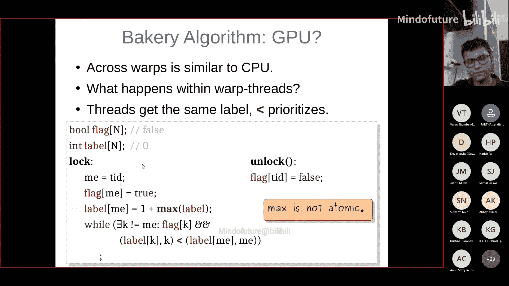

Okay， is some suggestion globally saying that there will be a dead。

Most threads will be stock in whilelo， they'd wait for one thread to complete。

 but that thread would wait for the rest of the year。Perfect， so that was what I was expecting。

So let us understand what will happen。So let us say that walklets are executing this while。

What has are not why， but this log function。So theyll execute the statement then this statement then this statement so for all the warlets flag will be set to so all are within to enter of the critical section。

For all of them， initially， label was 0。 So for all of them， label will be one plus max level。

 which is。1 plus0， which is one for all of them label is one。

 they all are willing to enter into the critical section so for them flag is two。Now comes this part。

So what will happen here？This is true right because multiple third are willing to enter into the critical section。

And。😊，and let's come to this condition so label of k less than k sorry label of k comm K less than label of me so this condition will go only for one third and which thread will be that that will be at0 right because for all of them label is same。

But the lowest thread ID among the Wp thread is 0， assuming that WP has threats from 0 to 31。

 which is sorry IDs from 0 to 31。So， in that case。This condition will be only true for one of the war thread and that war thread will one。

 I mean， that war thread wants to move further。But since we know that war executives in simply fashion。

And since all of the threads are stuck here because this condition is also true and this is also true。

 all of the 31 threads of pops are stuck here。And only one thread wants to move further。

 but it can't move because of that same sort of execution。So。

 it will also keep ondefinitely waiting for these threads which are looping here and this is exactly the scenario of deadlock right that one thread is coming in one thread wants to move but it can't move because other threads are waiting here。

And yeah， that is due to same execution。 I hope you' are getting this that。

We'll be facing D here if we execute this。Block function with one watt 32 w， I mean。

3232 threads of a single wt。

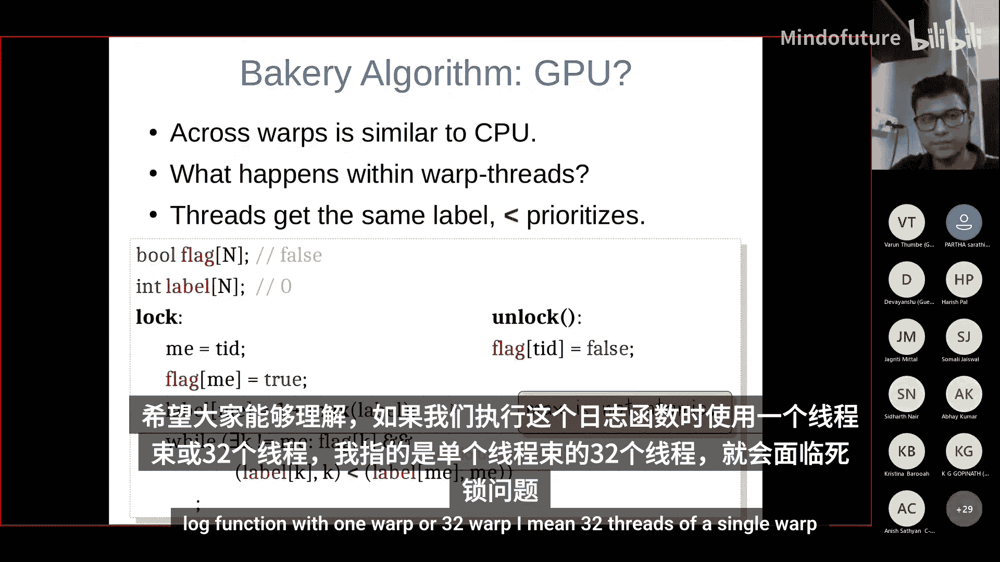

questions up till this point？They don't know then we冇瞓嘅。

Okay， assuming that there are no questions， let's move further。So yeah。

 on GPUs let us understand the this thing。 So on GPUs lock are typically prohibited。Because， I mean。

 if you see， we generally use locks on this CPU， right？

Or if few people might have studies studied this in operating systems we use。

Llocks for handling the critical section for multiple threats and so on。

 but on CPUs that is prohibited， I mean we can use it。

 but it is prohibited because there is large cost involved with it because on CPU threats are。

Few tens， I mean， CPU few tens of threats。While GPUs have hundreds of thousands of heads。So。

Due to such large number of threats and due to massive multi cutting。

 the cost of the overhead involved with the locks is high。So you can think like this this that。

Next said you have just one book。And there are 10 people who wants to read that book。

So that1 if there are less people or 10 peoples or five peoples。

 then only that five people tend to coordinate with each other to read that goal。But let's say。

 you have an entire。Institute， and let's say。All the students of the ins want to read that single book in that case there would be a chaos。

 right because？That is one single book， and there are thousands of students who want to read that single book。

So due to this。There can be chaos and there will be， I mean。

 there will be a lot of schedulecheduling that will be involved。And yeah。

 typically there can be multiple issues with it also。

 so that is exactly what is the scenario with locks on the each GP。In GPPU。

 we have just that one variable and we are trying to。We are trying to I in。

 with that just one variable or one critical section that one thread just I mean that only one thread can execute at one time and we have thousands of that we have thousands of thread who want to enter into that critical section。

And this thing can lead to a problem， so typically logs are prohibited on shape use。

But there are different ways in which we can deal with。This a locking problem on GP， which we study。

So lock are prohibited but they are feasible， so if you if you want to use you can use it。

 but this bakery algorithm we need to modify a bit。Because it will lead to deadlock peroperatives。

And lock are feasible and they are implemented using something called as atomics on the GP and let us see what is atomic now。

 so let us start with our new。New set in thischronization， which is sat。

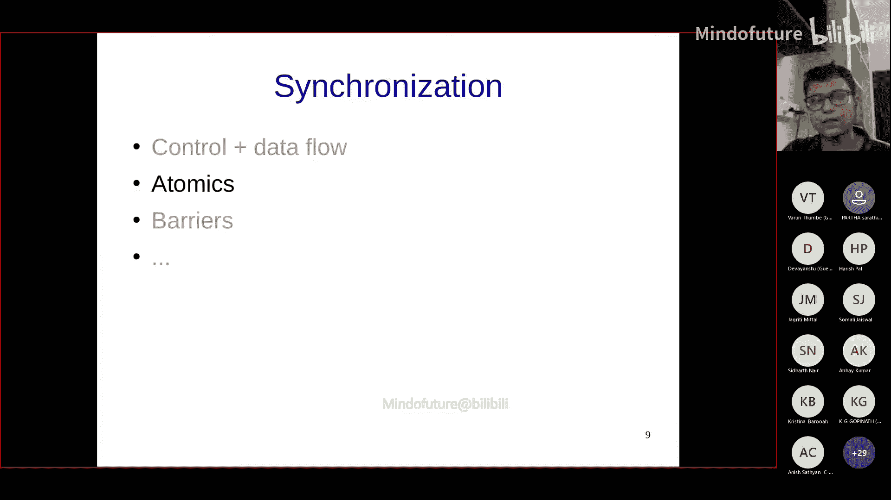

Any questions about this？喂。Okay， I guess there are no questions guess I Okay， okay， anyways。

 there are no questions so let us。

も題た。So let us try to understand what the atomics are。And we'll move harder。

So atomics are sort of a primitive operation。APitive operation meaning the basic operation like add subtract and all those things。

 so those primitive operations like add and subtract and all those things multiplication are supported by the hardware。

In that way， this atomics are also primitive operations。With a sorry。Wse effects are visible。

 either poorly or not。It won't happen that also consider it like a black box。

You can only see it state before the execution and after the execution。

So let's say if you are having a variable and if you want to add something to that variable atomically。

Then either you will see its value before addition or after addition。

 but you won't see its value during the addition， so that is what is the atomicity。

So you won't see the intermediate state， but you will see the initial or final state。

So that is what is atomic is， so let us take one analogy here。

Let us say that you have you might have seen that。sububway sort of thing right so train let's say there is a train which is passing from a subway or sub tunnel。

So when train enters into that tunnel。I mean， before the train enters into that tunnel。

 you might be able to see passengers what we are doing and sort of things if you are of you who is not sitting in the train and you are。

standing somewhere outside and there is some train who is entering into the tunnel。

 then you might be able to see what the passengers are doing inside the train when before it enters the tunnel。

But when it enters the tunnel， you want to be able to see what what's is what's happening with the train because you are an outside viewer。

And similarly， so that that portion is like a black box right that tunnel is like a black box black box you want to be able to see what what is happening while the crane is going through the tunnel。

And once the train comes out of the tunnel， you will be again able to see what what's the status of the crane and so on。

So that that portion， that tunnel portion is like a black box and that is what atomic does you you will be able to see the initial state and the final state。

 but you want to be able to see the intermediate state。and嘅。For doing this thing。

 you need some hardware support， you won't be able to do it as a programmer。

So this atomically testing and setting and all those things need some hardware support。And yeah。

 that is one thing and the second thing is that there are several variants for the atomic instruction。

 so one is atomic gas。Another is atomic min and then there is atomic head and there are many more supported on quoDa。

 so this this all statements are stuck these all instructions are supported on quoa。So atomic gases。

 atomic。啊。Yeah， so it is comparison swap， atomic CS， meaning comparative swap。

 so comparative value and swap swaps if some condition is right。Similarly。

 atomic mean is used for finding the minimum across two values inda。

 so we'll see examples for this and also this atomic a。So it tomically adds this thing。

 atomically adds the value inside a particular variable。

So we'll see examples related to all of these three。Instructions， but yeah。So yeah， again。

 next thing from note here is that this。Atomics are applicable both for the global memory and the shared memory。

If people might remember then there was such sync thread。

 which was only applicable for the threads of the thread block and hence we can only use。

For the threats of the thirdb， but this atomics are I。That across all the threats of the。Okay。

 or are all the third of the tip， so。They are am， they are visible across。

 whatever well do for this A to using these instructions， theyll be visible across all the threads。

It's applicable for both shared and global memory， so yeah that is the point that I want to meet。

And with this， let's get started with our first。

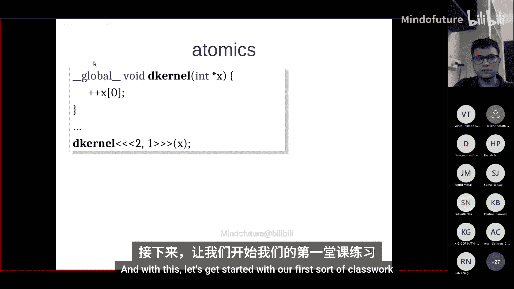

Sort of class， yeah， but before that is there any。Questioners。there are a few questions。

So these atomic instructions are to be used only inside the curtain。

Yes， so this。Yeah， so this atomic gas， atomic main atomic a。

 all these are used inside the kernelal pole。And this is， specifically for the。Gooda。

 so there I think this can only be supported inside， I mean。

You can only use this inside the kernel for CPUs， there might be something else that you want to use。

 but for CPUs also atomics are supported。But yeah， these three things， this atomic gas。

 atomic mean and atomic air are for the GP use。

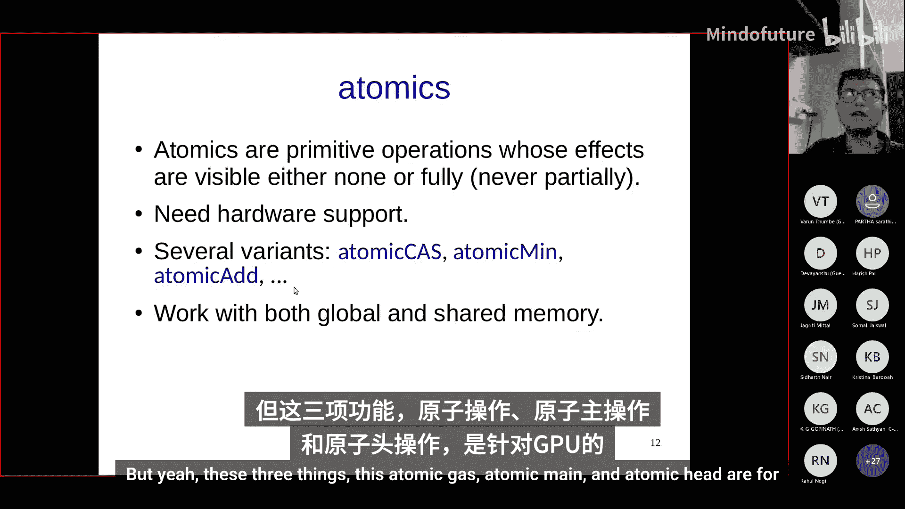

啊。啊。But the atomics can be applied to memory transfer。Okay。

 I'm not sure about this atomics can be applied to memory transfer。

 but I haven't seen any examples so far which。Which does the atomic sorry， a memory transfer atomic。

Okay， I'll say that I'm not sure about this thing， but there might be something which using which you might be able to do memory it transatomically。

 but I need to check this。Okay， so I haven't seen any functions function or some API doing this thing。

 so I'm unable to check this one。Okay， so let us get back to。

Our discussion， so let us start with our first class of atomics。

So let has said that we have this code。There is some initialization happening for this variable we have sorry yeahda the value of X。

 let us assume that。And then we are launching the kernel with two threads to k1。

 so these two threads are from different redlock which that two co one means two separate redlocks。

And then。And then we are。So and then we are passing the address of x to the kernel。

 which is stored in starx。And then the value of this， what I can say。

Memory location which is pointed by x， which is given which is I mean， which can be which can be。

Are they simply using x。This the。Square price 0 is being incremented by using this plus plus operator。

So I hope you are getting this， that we are allocating the memory for this。I mean。

 we are allocating some memory using pua melo and then we are passing point to that memory。

Wwhich is stored in address to that memory， which is stored in this variable x to the GPU kernel。

 which is stored inside this again variable inside this point of variable x。

And then what we are doing is we are incrementing the value which is stored in that。

Hocated memory on the GPU using using this plus plus。Using this press thing and。Yeah。

 so my question is what will， I mean， what are the possible values for the？

After this kernel finishes its execution。So request few people to think about it。Yeah。

 so we are incrementing x with clusterrus operator and I want people to think about will be what are the possible values for the x after this kernel finishes its execution。

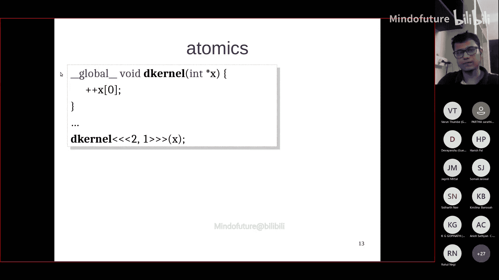

Okay Goal has suggested something， maybe like in SQL using commit。

 you could try to implement that product。Okay， thanks for that suggestion。啊。YeahO。One co is saying1。

2 or 0。 no quo our device。Okay， let us assume that pora synchronizes also there。

But assuming that there is polar device centralized， what can be developed？

I's the question。Please think about it I'll wait here for a few seconds so that you people can try。

As they are from different blocks。So they will run in a synchronous mode。So any value。

 it can take 01。Okay， how can you take the advantage？No， not zero， one or two。哦。let us see this。

 but let them see if others have tried it or not。

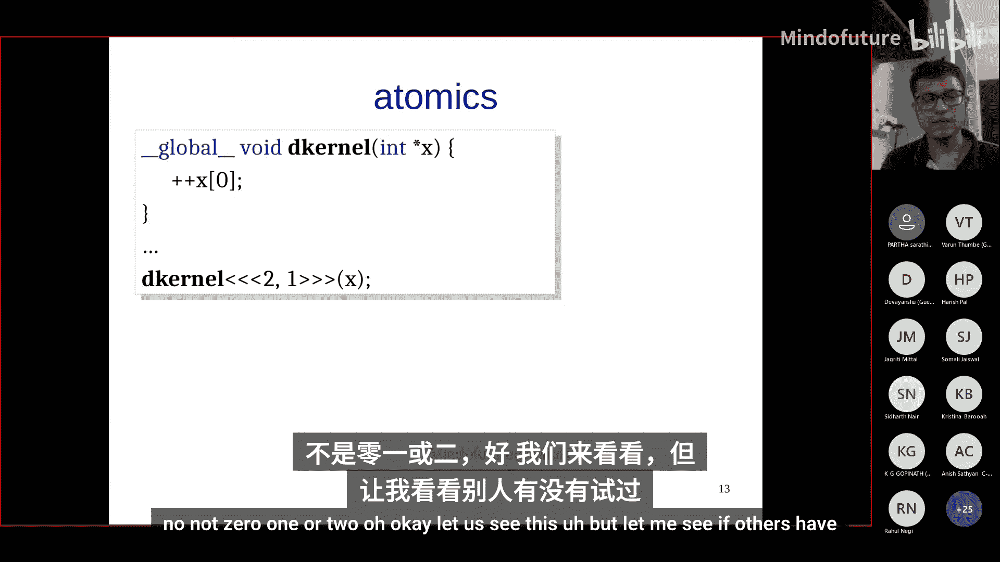

Okay， Go is saying one or two， volume is also saying one or two。

Two means first inement then next student opening。Okay， I think you people are getting it correctly。

さ？On both Oh， yeah， I think you。Thinking or the intuition behind it is correct， but yeah。

 let us understand it step by step。

So。Okay， I also mentioned this thing before。That this single。Statement， this x plus equals to 0。

 sorry， plus plus x then square bracket 0 end of this square bracket。They split into this three。

Three assembly level instructions。

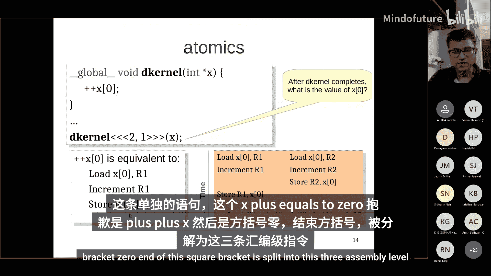

And yeah least note that this whenever we write this。Plus plus x。

It's just a syntactic sugar for this thing， right？啊。It's equivalent into this and as we pick I mean。

 as we have already studied that right this this thing is。S into three assembly 11 instructions。

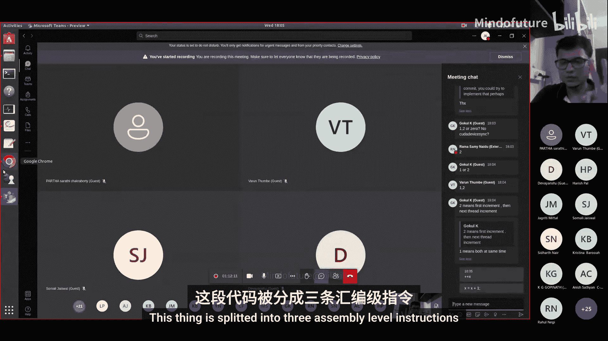

Yeah， which is this this three assembly 11 instruction in which we are first loading the value of。

Loading the value which is present in x of 0 into some register Rgon。

 and we are this register by incrementing the value which is present present inside this register。

And then we are storing the value of this register in the x0。

 which is the memory location from where we have loaded value。O啊。

So what are the possible execution orders that can occur out of this， I mean。

 when we when two threads try to。Execute this three assembly level statement in any fashion。

There can be multiple possible ways。If we check， I mean。

 if we try to determine what can be the value of x， then it can be2。

And those two values can occur if those can occur。We have this first， we have this execution pattern。

That loading is happening simultaneously。Then they both are also implementinging independently。

 so please note that loading is happening simultaneously。

 but only one load will happen at one time because this read and write instruction are。

Just a single instruction at the assembly level and they are done at at for each other。😊。

So either third one will load and then threat2 or thread2 will load and then third one。

 either of the them can happen。Since they are happening one after another。

 theyll see the same initial value， which is0。Then theyll increment the value of R1 and R2。

 which is the value register in which the value is loaded。

Simultaneously because since they have different register， they can do this simultaneously。

So they both will increment value to one and one respectively。

 and then both of them will try to write into that memory location x of0。And based， I mean。

 this store can happen in any order plus the thread2 can store and then thread one and then or it can happen vice vers。

a thread one will store and then thread2， but in either of case since the value which is present inside the register is1。

啊。If any I mean in any of the case， if any in any of the internal living the value which is final value which is scored in x of 0 is 1 right so okay I hope that is clear so if this is the exhibition pattern。

Then the final value will be will be one。But。If they execute one after the another。

 let's say this entire thing happens， what they thread one and then once this store is finished and then this thread will starts executing its load and increment and then store。

Then in that case， the value which is stored in x0 will be1 after they stored for the thread1 by the thread1 and then when the threat to loads the value from x0 into r2。

 it will be 1 and then it will implement and then it will store。So in that case。

 the answer will be two， so I hope that you are getting that two answers are possible。

 which is one and2。

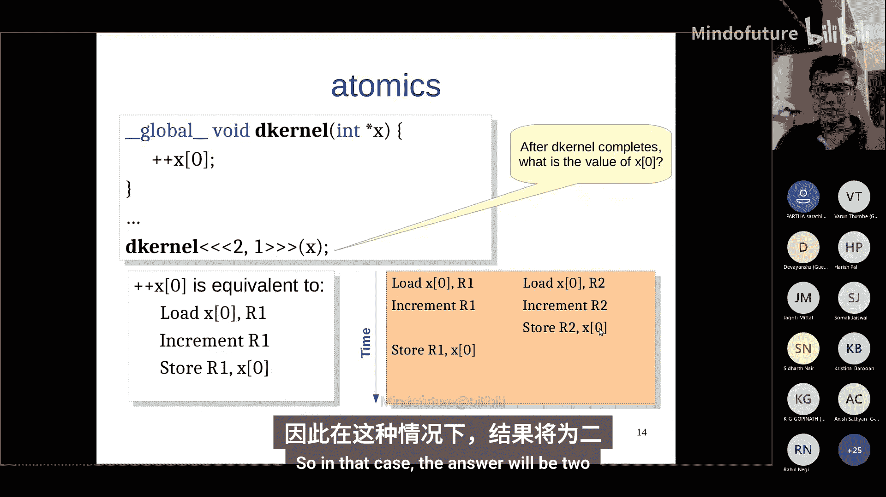

啊。Yeah， assuming that。

This thing is true assuming that they are either the threats from two different thread block or from two different war。

So I hope that is clear。Let us。Yeah， so first of all， final value is stored in x0 to be 1。Or I mean。

 it can be one or two。But let us do another classas。

What will happen if the kernel conration is one coat？

Meaning that they are the threads from the same one， so again this entire thing is same can same。

 but just this one thing is changed here it is one and here it is two now so instead of。

Launching two can with two different threads of different thread。

 not one to launch the kernel with just two threads of same war。

Then what output what can be the different values of facts that can occur？

After the execution of this government。Please think about it and post your answers into the chat。

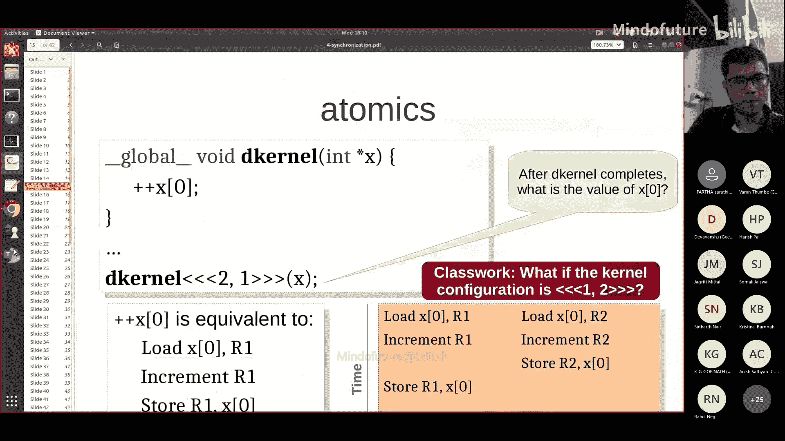

ok嗰 put稳。O。Okay， would you like to explain why it is one vocalcal。我 don't think佢都噶。Okay， anyways， I。

 I think that the。

Yeah， I think that you are getting it。Yeah， when we launch currently using this configuration。你知道好。

I mean， instead of getting output as one or two， I mean。

The output can be either one or two per this configuration right this one。

 but when we launch the kernel as this this using this configuration the output or the final value stored in x0 will always be1 actually this statement this one。

This statement is for this launch concentration。So when we launch the kernel using this launch configuration。

 the final value is stored in x0。Is always one， actually it could be one only it rather than two。

So let us understand why this the value can only be1 rather than two。And for understanding that。

 let us see how the W thirds execute。So。As we know that Wford is executed in simply fashion。

 so theyll first execute this load statement， so both of them will load at the same time。

Since road are atomic， I mean， just a single assembly level of instruction。

They'll be interlived in any manner。 So try to。0ero and third one of the war will execute this load and this load and this load in any arbitrary order。

So both of them will have value value loaded into that register as0。

 then both of them will increment the value register。In simply fashion。

 so both of them will be at this instruction。And once that is finished finished。

 both of them will again try to store and since stories again。

 one assembly level is just one instruction at the assembly level。

The value that will be stored in x0 can also be in any order。

 so threat 0 can do store post or then threat a1 or in either order。

But in any of the case in either of the case the value which is stored in x x of 0 will be always one right because the way in which we execute is simply single instruction multiple data。

Only this load will happen and then only this w thread will move to increment and then only this w threadd will move to store。

So if you see if this order is followed by theov thread， then final value that x will store。

He's always wondering。So yeah， if a launch using this configurations。

 then output could be one rather than two。Is what is the observation that you should， I mean。

 you people not should make a note of it？And。Yeah， small homework that I would like people to try out is that。

If let's say x0 is also sped in multiple instruction because。If you see this x of zero， I mean。

 x of zero， this thing。

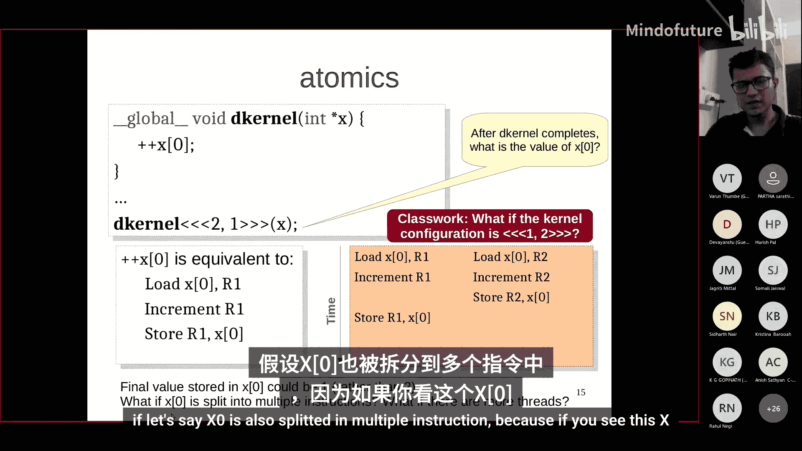

This thing x of0 is actually。Exppounded to this thing， right， because it's a pointer D referencing。

 so it's x plus。This excess space address plus this0 is offset。And then once we move base address。

 I mean， we move our pointer from base address plus some offset。

 we try to de reference using this star operator right。

So it is just a syntactic sugar for this thing this x of0 is synthetictactic sugar for this thing。

And。Okay， so the question is that if x of 0 is also splitted into multiple instruction。

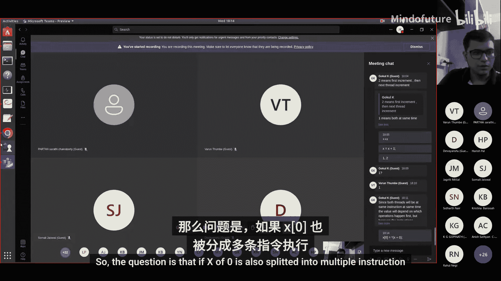

Then。Then what are the possible output of this output out of this this kernel t kernel。

 I mean what will what will be the possible values of possible values that can be stored in next。

And the second question or second homework that I want to give is let's say we have just two threads here right or yeah let's say we have just two threads if we launch the current with multiple threads。

 not just two threads then what can be the output that is stored I mean what can be the value of X。

It's the question。So please try this question up， it will help you in understanding how the I in。好的呃。

Wp threats， I mean， what not war threats， but how do multiple threads work and。

What can be the different execution patterns and it will help you in understanding all those things。

It will be good exercise for you people， so please try that out。As part of your。So I have a question。

 so storing is not really a send storing on a common variable。

For multiple threads within the same warp is notturn。Simpty operation it can occur in any way。

Yeah I this because of the really。Yeah， I mean， yeah。

 the short answer is that its not simply because it has to be interveed in some fashion because storing into that particular memory location。

Even by two different threats can't happen at the same time， that is because the way the memory work。

 only one right can happen to that particular memory location。

Even if there are 1 hundred0 thirds or thousand threads who want to write into that location at。

A particular moment。So I hope that is clear。And yeah。

One other push so in split into multiple instructions means。I didn't get it。

 You have written star x plus 0， so。

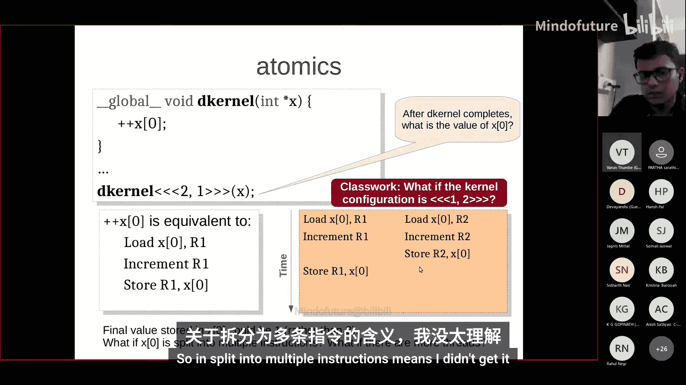

好。

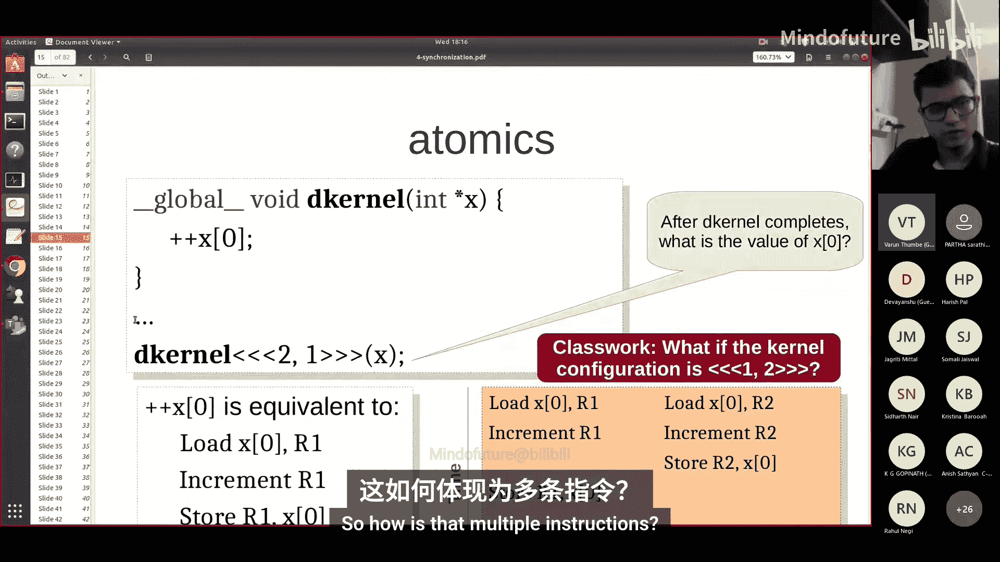

How is that multiple instructions， then what will be the next？Instruction。Okay so I to start。

X plus equals to zero if you want to implement， I mean if。

Look this thing as an assembly level instruction。It might be split into multiple steps。

 right at the assembly level。So， for example， you might load the。Address of act in some。

Some register。Then， you might。Add。Something we do at ADDR， right？Some offset， let's say。Opset。

 you want to add。Then啊。You might want to store it， right， once you are done with it。

So you'll log in store that index。And then you'll de reference it， right。

 because for cutting its value， you also again need to de reference it。

 So this can be the multiple steps that。Might occur at the assembly level。

So let's assume that this well is for t referencing。So these are the multiple steps that might。

Happy my love。Be referencing this or like。For this x equals to 0。So not x equals to 0， but x of 0。

This part， I hope you are getting this。Yes， thanks。Okay， so I mean。

 the key takeaway is that this thing， this is not a single assembly level instruction。

We are splitt this thing。This X。

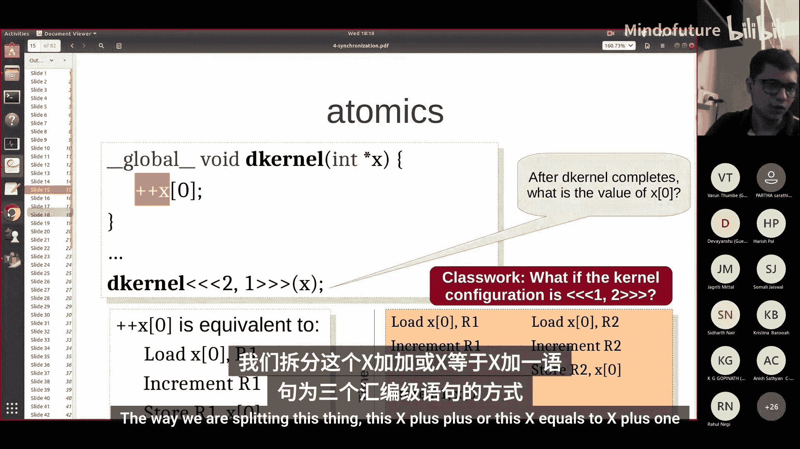

And go back here the way we are splitting this thing。

 this x plus plus or this x equals the x plus one statement you three assembly level statement in the same manner this thing。

Artisting。Can be split into multiple assembly level statements like this。So yeah呃。

Yeah， so I hope that is clear， so if that split is happening。

 then what can be the possible values that can be stored in the x？Yeah。

 so that please try as a homeworker so that you can learn how the different exhibition patterns can occur in all those。

Okay， so with this， let's。Mo on to the next slide。 So this is one small。

Use case are some a small scenario where atomics are being。Kind of， I mean。

 or a real world real world。Application of the atomics。So let us try to understand this。

Let us say that。You have报。I mean， you have this ATM I mean。

 this what I can say that is there are this ATM。啊。I mean ATM machines right from which you can withdraw some money so there are these two ATM machines and then there are two twin brothers who are or two twin twin sisters。

What。Going to this ATM machines for withdrawing some goi at the same time。

So both of them go to that ATM。ATM machine， both of them tries to withdraw the。

Cash from that ATM machine。At the same time， from both of that ATM machine。

And let us assume that they have the joint account from which they are withdrawing the money from the VTM machine and that joint account just have thousand rupees。

And they are trying to withdraw that thousand rupees。At the same time。

 from two different ATM machines。And and in order to do that what this system will do right it will so what this ATM machine will do。

 it will check if the balance is greater than000， which is greater than or equal  to000。

 which is the case because they have the joint account。And the balance is  thousand0， right。

 so it's greater than or equal to  thousand。So this check is done。So yeah。

 this check is done and since both of them are doing it simultaneously。

 this will pass for both of them。Then。what then this system will do or ATM machine will do it will reduce which is I mean。

 since this this is correct， they will reduce the balance by thousand0 and will give cash to the user。

So it might happen that if these two steps are not done atically。T two steps。

 checking of the balance and reducing the balance and giving the cash to the user。

If these two steps are not anatomically， then it might happen that twin brothers or twin sisters who go to this ATM machine might get 200 rupees。

 but if you observed the balance was only 000 right， that the balance of that joint ta was just 000。

So this is not okay right so the key point here to observe is that yeah so first of all the execution pattern is this that we saw right that loading is happening simultaneously then here decreement is happening not increment because we are reducing the balance。

And then， st is happening。So final result that will be stored。

 I mean or the final balance that will occur will be zero， right because？

Thous0 is deducted and then it is stored， but both value of Har and R will be zero because。

In initial balance was  thousand0。And。The value that is deducted from both the ATM systems is 000。

 so 000 minus 1000 is 0 and both will try to store 0。

So the final value that is I mean or the final balance that will occur is zero。

 but what what ended up happening is that they received 2000 rup and the initial balance was just 1000。

So in order to implement this algorithm or this。ATTM system。

 what I would say is that algorithm in this ATM system properly。

 which is checking the balance and then reducing the balance and then if the balance is。

Proper or if it is。Metting this condition。 And， then we reduce the。

Balance and give cash to the user ative issue added。So in order to implement this algorithm properly。

 what we need to take care is this to this two。State， which is checking of the balance。

And reduction of the balance by that particular amount should be done atom。If that is done。

If checking of the balance and reduction of the balance is done automaticallyally。

Then this scenario will not happen that the two twin brothers or sister might end up getting 200 rupees。

So that is what is done in the the teams or I mean in normal banking systems where。This a。

This checking and the reduction is done atically and this is some real world example of how， I mean。

 the real world example where the atomics are being done。

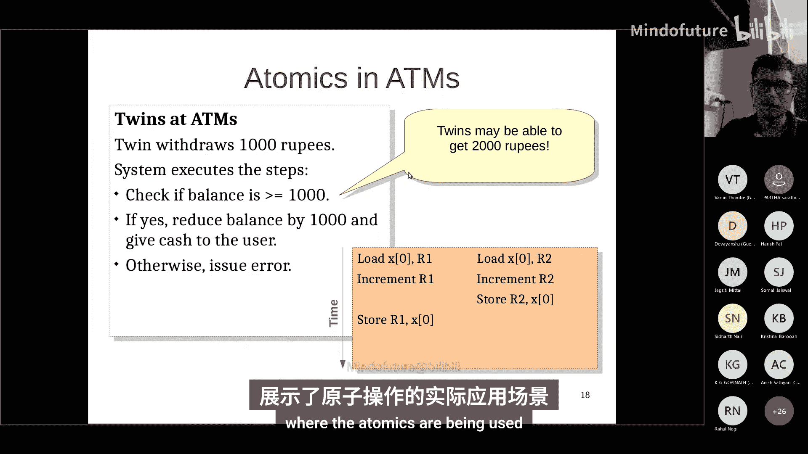

有。So yeah， I hope that this is clear if there are any questions here then。we can ask。Okay。

 any questions up this point？

Okay， if there are no questions， then we'll move to the next slide。Okay， so in order to。Okay。

 so we saw that is there is this issue with this quote right that there is data is occurring here。

That any inter living is possible and hence the value can be either one or two。

And in order to ensure this all or none behavior， which is actually ensured by atomics。

 what we can do is we can replace this thing this。This statement by atomic increment。And what is。

 what this thing ensures the that。Testing of this variable， I mean。

 or testing of the value inside this variable and incrementing it by one。

InIncrementing it by one will happen atomically。So you see this。This entire him。

Loading and then storing。Loading incrementing and storing。

 the center thing will happen atomically and when this is happening。

 no other threads can do loading or incrementing and storing。

So if we replace this thing by this atomic increment。

which is having this syntax in which way first argument is the address of the variable and the second argument is is some upper bound which says that if value becomes this value becomes a value of this variable x becomes equals to this upper bound。

Then you just wrap around， I mean， wrap around the replace the value of x by  zero。

So first is the address or the yeah， this it's actually the address of the。

Variable that we want to atically implement。 And second is that wrap around the image。

So I hope that syntax is clear and the way it works as I explained， this testing。

 incrementing and setting is done atly by at。And的。Yeah。

 so the key point here to observe is that if we launch the kernel with K1 comm， I mean。

 as using this configuration， which is K1 comma K。And it should ensure that， I mean。

 using this atomic increment should ensure that the。

Final value that you will get after execution of this kernel。

 assuming that you have launched using in this configuration。

The final value of the final value of the variable。

 I mean final value stored in this number location。

 which is pointed by variable x will be K1 into K2 irrespective of whatever is the execution order of the threats。

So yeah， I hope that this is clear， if there are any questions。

 then quickly please post them on the chat。

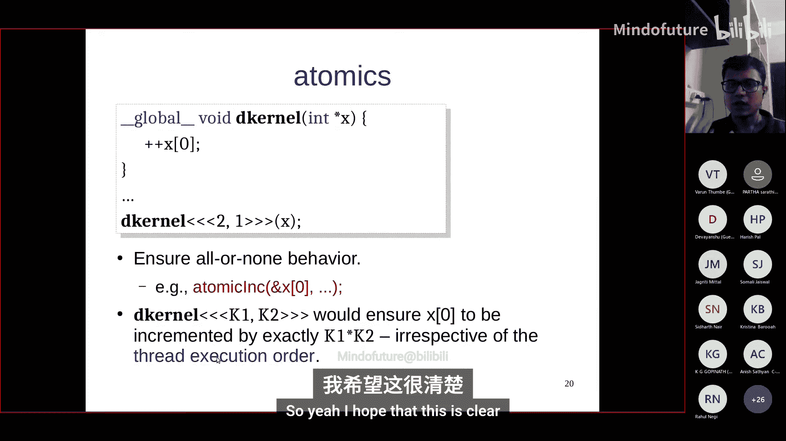

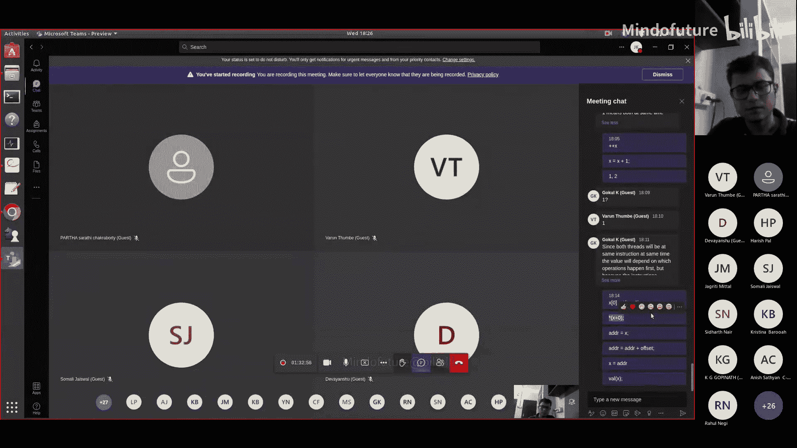

Any questions up this point。Okay， so we have seen this atomic increment。Priefly here。

 but probably we also revisit this。And they later slides if they get done。

And the next comes the atomic case， but I don't want to start the atomic case because we have very less time left with us just three minutes。

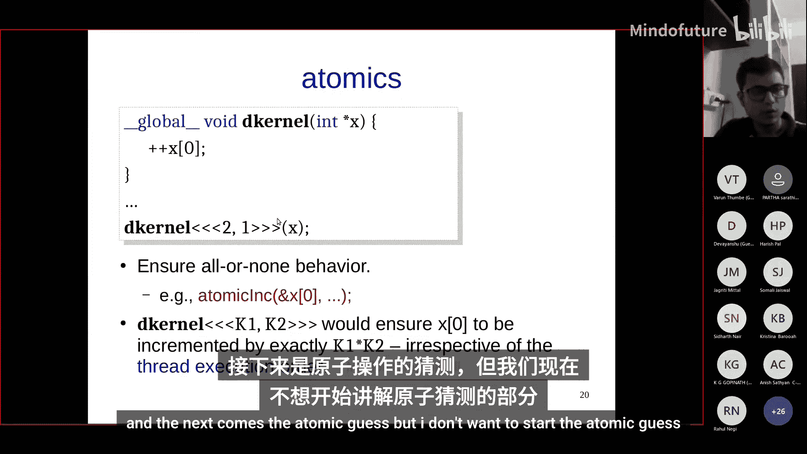

So probably I'll push this atomic case to the next lecture and yeah so in next lecture we'll see the atomic case。

Then we'll also see how to implement lock using atomic S and how to implement single。

 which is something we really seen with the expectation。

And then we'll start with the barrier in the next lecture。

 so probably with probably for a two day lecture will end here。

Because I don't want to start with a new instruction atomic instruction today because it might take some time。

Yeah so I'll stop here if you have any questions I'll be there here for a couple of more minutes and yeah probably then willll disperse if you don't have any questions。

There is some question serve， good atomic cause divergence。Yeah， in some sense， yes。

 it will cause divergence， but in fact， if you see atomics how they are implemented is there is acute queue system maintained。

Let us say that even let us say that warp threads are across the wars。

 if the crs want to perform some operationion atmobil， and they'll be pushed into the cube。

And based on the way， I mean based on the order they are pushed into the queue they'll be executed so yeah for warlets it might lead to some dis so that is。

Correct observation， I would say。But in more sense。

 atomics will lead to something called as serial executions， serial execution， which I'll say。

 I mean。呃What呃。But threat divergence won't be a proper。得过去啊。Yeah。

 I hope that is clear in some sense you can say that for war thread it is some sort of divergence because in divergence also threats execute。

 I mean war threads execute and，That stall the manner。

But yeah here the reason for the divergence is different here the reason is that we want one threat to execute at one time。

 even if it's a one threat。So it's some sort of that diverg shortly， but I won't tell it。 I mean。

 I won't save it as a。这待个。I hope that is where if you feel that something was missing and you can unmute yourself。

Any questions apart from this on today's content or anything else from the previous lectures or anything？

Soir， in case of CPU。诶。So we have hardware implementation of the Singapores。

So testing set instructions are added。 So can we consider these atomics and all other。

These mechanisms in GPU is equivalent to that in CPU。Yes。

 if you talk from the functionality point of view， then the functionality that atomics provide on the CPU similar to the functionality that this atomic gas and all this atomic increment atomic ad provides on the GP。

So functional wise both of them are same， but implementation wise they might differ and I am not very much aware about the implementation details。

From the， I mean， from the very hardware perspective。

 so I want to be able to comment upon upon these implementation aspects， but yeah。

 functionality wise both are same。Okay， any further questions？Sorry， in this case。

 in the last example we have shown that you have already explained in response of one question I think from Mr。

 Goul， that when whatever be the order of the execution of the trades。

 so ultimately the result will be given into K2， that means it is equivalent to execution of the serial execution of the trades。

Yes， in some sense you can say that again。So in that case。So， sir， if it is true。

 then it is equivalent to the concept of serialization in RVM is。

 So that so whether obviously there will be some sort of。That is performance degradation。

Whether in the name of divergence or not， whatever be。Yes， yeah， so I think you are correct here。

 so that will be definitely a performance penalty that will go because of this atomics and。

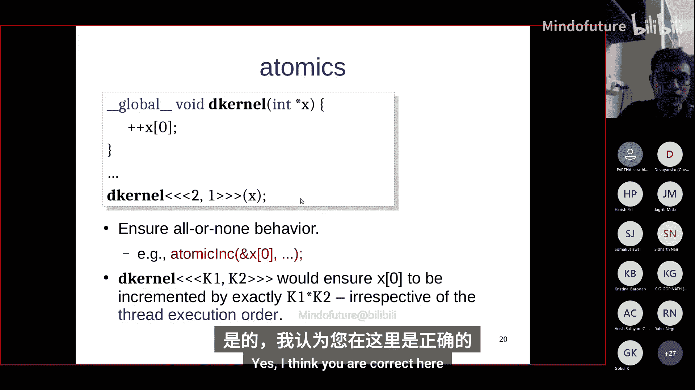

Yeah， so as I told in the previous lecture， so atomics on all these synchronization constructs are the one which will in you the highest penalty。

Then sorry you heard this。That is something。Then there is some this memory things， right。

 so memory has the second highest penalty then comes the。Computation aspect。

 so yeah you are correct at this。Cerialization happens here if you see properly。

 when we replace it with atomic the serialization happen here happens here and each and every thread of the GP I mean each and every thread with which we launch the kernel we serially execute this。

Increment， right， I mean it will increment one by one。

 It won't happen that multiple cards can increment at the same time after we do this happen。

So standardization happens and there is a performance penalty and it's actually very high compared to any memory access or any computation aspect。

 so this is a crucial issue from the GP2 programming。I mean。

 could have a coming point of view and we need to see how to deal with this issue in general。

 we need to take care of such that I mean， we need to write our code such that there are as minimum synchronization construct as possible。

Like such atomics and always。

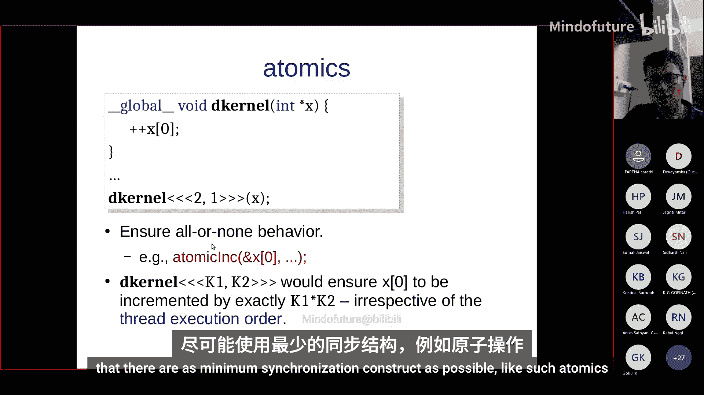

So I hope that this is yeah。Yes sir， yes sir。 thank you。That发 questions。

