# 【Nvidia】CUDA并行编程-｜-Cuda-Programming-Course-｜-Parallel-Computing-Using-Nvidia-p14-P14_L14_CUDA中的多种原子函数与屏障--BV1MSq1BTEho_p14-

What we will be seeing in the two days lecture。 So for the two days lecture will be。Yeah。

 for the today lecture， we'll be seeing the single short shortest path。Algorithm again。

 we saw single so shortest path algorithm few lectures back right and we saw that there is a data reason that。

In that code and in today's lecture， we' will see how to remove that data。

Then we'll start with our new instruction， which is atomic gas and we'll see and we'll learn that how to use that atomic case and we'll also see。

How to implement lock and single sections using atomic tests。

Then we'll see a few more examples of the atomic gas and。Yeah。

 and then we'll start with the barriers we'll formally define what the barriers are and。Yeah。

 we'll see a few of the examples related to the barriers and yeah we'll see a few more important points。

Ptaining to the barriers and yeah probably where there will be stopping for the two day selection so with this lets get started particular people let me。

价值。Okay， so there is no issue with the audio right now。Yeah。

 is that what I'm assuming in case there is any issue， then please do let me know so that I can。

Get to know that it I mean， get to know what should be done。

Okay， so with this， let's get started。This was the last slide that we saw right。

 so in the previous section this was the last slide that we saw。

And we saw that we have this kernelnal D kernelon in which we are incrementing this variable x。And。

Yeah， we were implementingcr this variable and multiple threads if you see this kernel will be executed simultaneously by multiple threads and there is a chance since this x plus plus at the level is assembly level。

Pro into three instruction， there is chance that multiple threads。Yeah。

 so there is a chance that this multiple threads， I mean。

 execution of this kernel by multiple threads might lead to a data list。And in order to avoid that。

 we saw that we need to use something called as atomic incr。To ensure that all on run behavior。

And then we also saw later that if we launch the kernel using the。And I mean， K1 into K2。

 which is as a K1 into K2 that is K1 into K2 threads then。It would ensure that I mean。

 this variable axis is increment exactly K into K2 1 irrespective of what what is the。

Exec execution order by the multiple head。So yeah， and when this effect will be visible。

 the spin result which will be given into kto which is stored in the variable x will be visible after this kernel has finished its execution。

Okay， so that is a brief recap about the last slide of the previous lecture。With this。

 let's move on further。So again， let's come to this。Single so shortest path algorithm， so again。

 as a recap if you remember that we were interested in computing the shortest path from the center of India。

 which is not true to every other cities。And。We assume that we are given the GP graph library to read the graph and performing I mean。

 tra through the neighbors and all those things。Assuming that thing and assuming that each each node operates on its neighbors。

 we wanted to。Find the shortest distance from the center of India to all other cities in the India。

So this is the sort of a typicalpical graph that we will have that is this。

What is are the cities and the edges represent the distance between where the cities。And。Yeah。

 we also wrote the quote corresponding to it if you remember。

 so this was the quote corresponding to it。And we saw that there is issue with this code right and what was the issue with this code that the distance to C is computed wrongly and why this happens。

This is because this rating of distance and writing of the distance here can be done by two threads in an independent manner。

 so it might happen that vertex A and vertex T。Will read the vertex of the sorry。

 we will read the distance of the vertex C， which is infinite which is infinite because initially everything is。

Everything， I mean， every distance is initial I mean。

 every distance of every node is initialized as infinity accept the source node。So distance of a0。

 except that all other have distance infinity， so C has distance infinity。Now。

 what A and B will do is。A and they will direct the shortest distance to C， which is infinite here。

And then since both of them think， I mean， both of them know that the distance to see， I mean。

 current distance to see is infinitefinity。Both of them will try to update the distance of C using this instruction。

And what will happen is a will try to update it to3 and they will try to update it to 4 plus weight of this edge which might be 2。

 so 4 plus 2 which is 6。So in that case， the last threat， I mean， the last one to update。

Will be the I mean， will be the final distance of C so it might happen that final distance to C might be6。

And that is Rob right because the shortest distance is3 and yeah so we might get the wrong shortest distance here and that is because here there is a data between reading and writing here。

And now won I would like people to think that how can we remove this data？

By using the atomic instruction。So please think about it。We have this code， which is ra。

 you know that it has their interest。And now and we also note that the data race is here。

Which is causing the correctness issue， the database， which is causing correctness issues here。

And we want to fix this code， how can we fix this code。

 please think about it and post your answers in the chat。AndMeanwhile， if you have any questions。

 then you can also ask related to this code if。I have some issues。

Liated the lecture that the lecture where we discuss this。

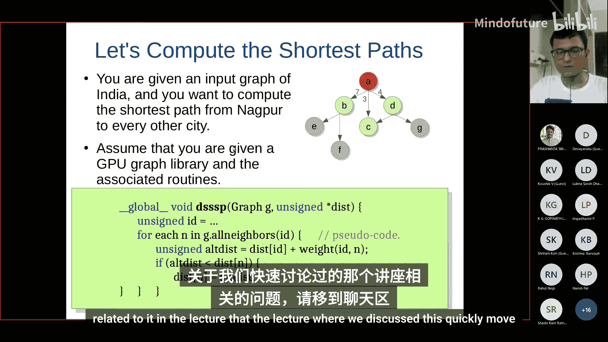

Quly moved to the chat is。Okay， thanks for kind confirming that the audio is fine。Yeah， so okay。

Apart from that， there is nothing， okay。

Okay， so okay question is that this code is a AC and。Data is is occurring here。

 which is causing the correct issues， right？And if you want to。

Mdify this code such that data is is removed and。Yeah， precisely this thing should be modified。

 this part should be modified such that data doesnt occur。They get the correct distance to。

More such a sea。And there are my multiple nodes like C on the graph。

So I'll wait here for a few seconds for you people to think and then we'll start discussing it。

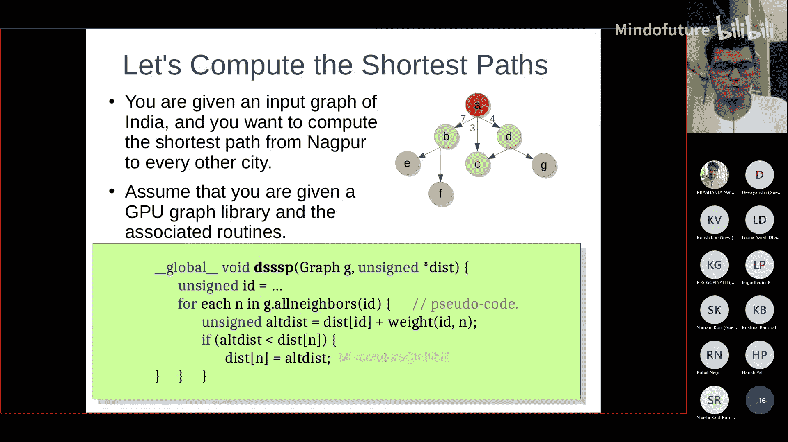

ThereNo response， let me go back to this slide。你。I'll wait here for a few more seconds。

For you people to try out。

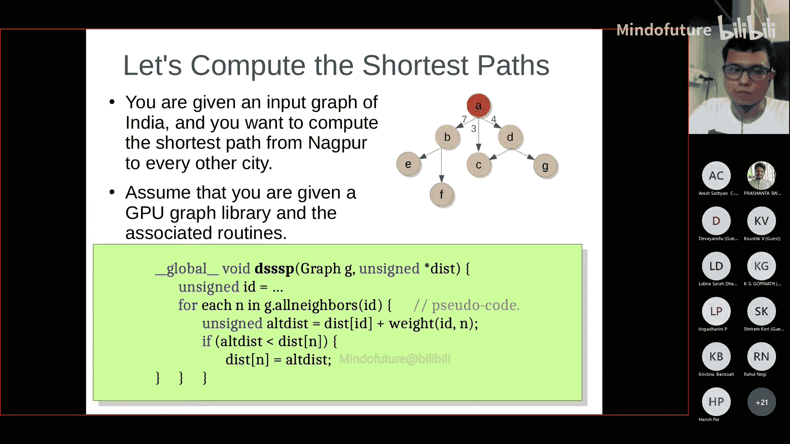

Yes， iss there any suggestion？

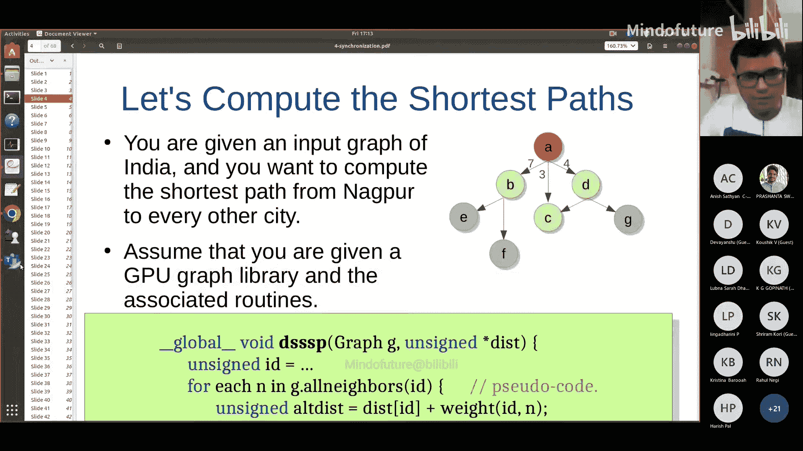

我咩一。Mised it。 but yeah， can you please speak out loud so that。Okay。

 there is some suggestion in the chat Richhiika she saying we can apply mutual excurion for。

T if block using lock and unlock。Okay， so that is。Correct suggestion， I would say。

 but is that anything else we can use， can we use atomics here？

Can we use ats or the michell exclusion is one of the way that is colored。

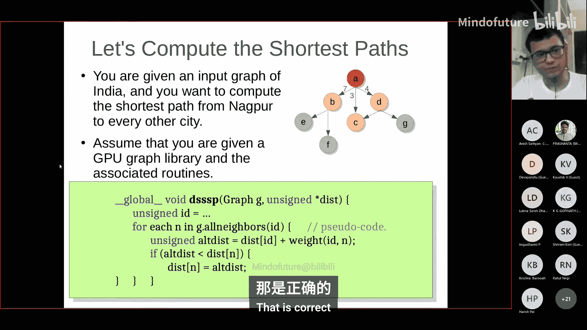

前啊。嘅使审去审审。Moment。I request you to everyone to mute unless you have any questions if you want to。

Discuss any aspect related to this site then please unmute yourself and ask else please mute yourself。

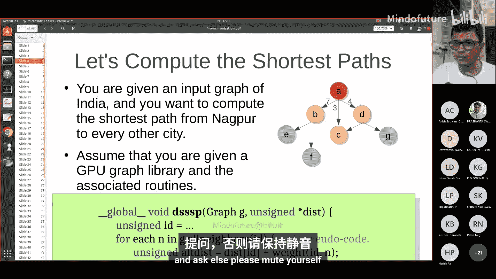

Yes是。Okay， if you have any questions then you can unmute yourself and ask。

要要不呃。

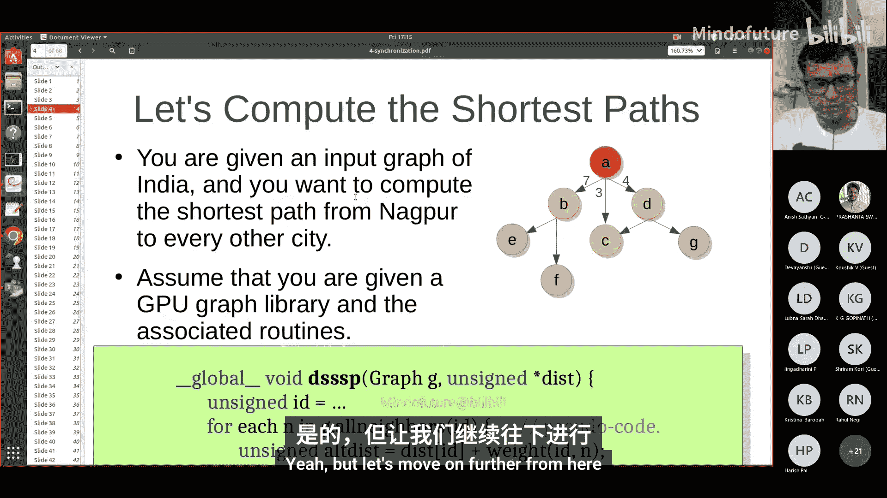

Yeah， but let's move on further from here。So yeah， one of the in which I mean， we can ensure that。

There will be no data risk is to place lock here before entering the condition and then after accepting the condition we can use unlock but the another way is to use atomics and how can we use atomics here so for that we need to see what kind of operations what kind of operation we are doing。

So essentially if you see the operation that we are doing here is。Finding the minimum right。

 so we are checking if the alternate distance is less than the current distance。

 the current distance of any particular node， right？Or yeah。

 current distance of a neighbor of a particular node。

We are checking if that alternate distance is less than what we are doing is we are operatinging that alternate distance and that is exactly。

What is the minimum operation right so we are interested in checking if the alternate distance is less than the。

Distance which is present in this dystoppin， and if that is the case， then we update the dystopphain。

And for doing that， Ua provides us a very nice atomic instruction， which is atomic meal。And。

Using this atomic instruction well be able to exactly do this thing。And yeah。

 and this and and the crucial point here is that this thing which is。Checking the distance。

 whether it is less than the alternate distance or not。

 and then setting the distance to the alternate distance if it is less。Everything。

 this entire thing is done atomically， so no other thread will be able to execute this two statement if some thread is executing this any of these two statements。

And that is exactly what we want right， we want this reading and writing to happen atally。

And hence this atomic min exactly serves our purpose here。

And hence replacing these two lines with just this atomic mean operation。

will help us ensure that there won't be any data。So actually。

 the correct code is this by removing the safe condition and placing this atomic。

I hope that this is clear in case you have any questions here at this slide then please unmute yourself or。

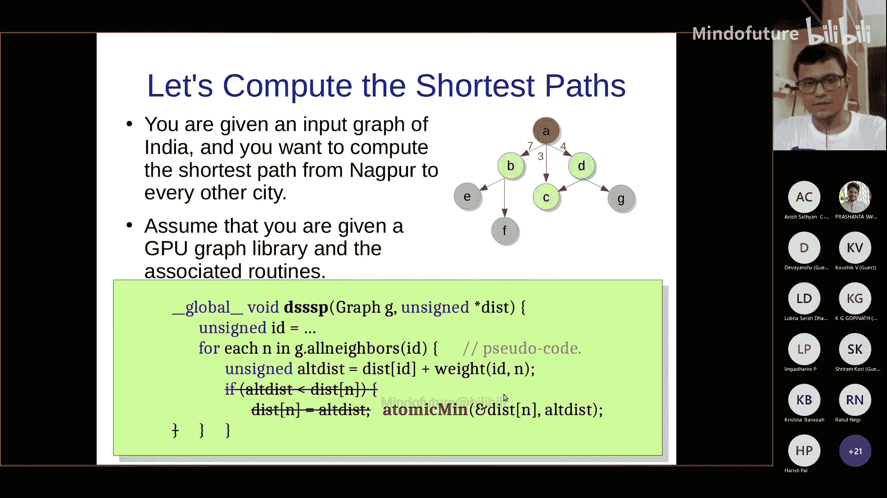

Type your virus picture。sir， can you explain that atomic men statement once？

Yeah， so yeah， okay， synactically okay， I didn't explain it syntactically。

 so what will happen is this。It has two arguments， postasity。

Addres of the variable which is used for the checking and second is some value。

 some value or some again variable。So， the。啊。The value which is stored at this address is compared with this value。

And if this is。This one is lesser than this like here at this value。It's lesser than this。Then this。

 I mean， the value which is stored at this address location is updated by this value。

So I hope that is clear。Exactly this functionality is being implemented by the atom。Jing嘅。Yeah，你谁。

Okay， so checking it and then updating it。

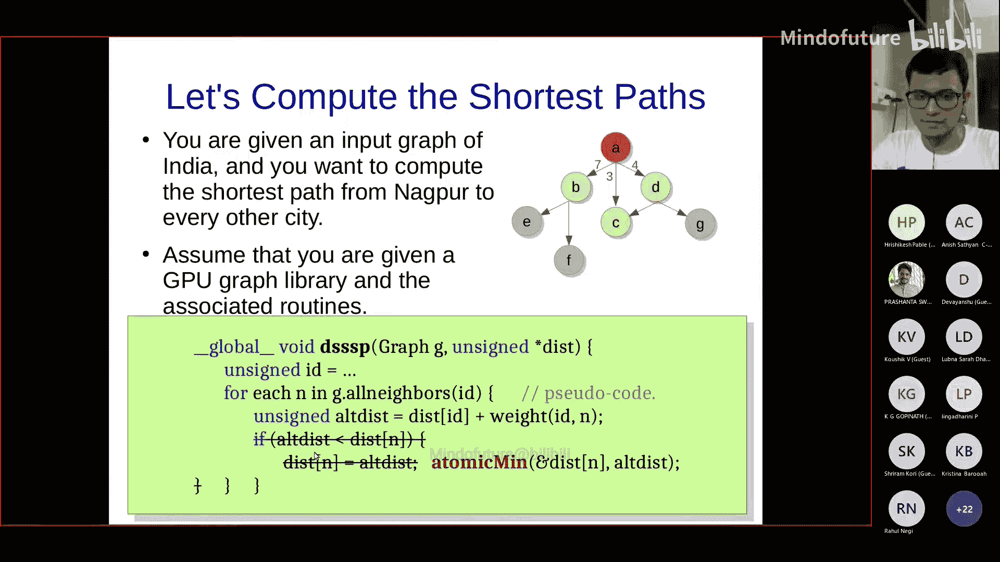

I hope that is clear and again， if there are any questions。Sorry。That is some question。

So could it be possible that all dis value foreign hydrration changes before the talk starts？Okay。

 even in even if that is the case， then there won be an issue， right， if let us okay， let us come to。

What edition what he was suggesting is。Could it be possible that all these value foreign hydrogen changes before the atomic moon starts？

Let us consider this scenario。啊。Okay， but please note that this al test is a local variable。

 so for a particular thread this value won't change right because if it would have been a global variable。

Then some another thread might have changed this value of alternate distance。

But since it a threat it's a thread local variable。

 please note that whatever we declare inside declare it sorry whatever we declare inside a caramel。

Lets say particular int a， then that a is local to that thread。

And no other thread will be able to see the value what， I mean， see or update the value。

 which is there inside that variable。Similar manner here alter all distance is a threat local variable。

So路が出る。Thread apart from the thread which is executing this block or this kernel。

 will be able to update the als。So I hope that is clear that no other thread will be able to update it。

And hence， it won't happen that。Some another third might update the all distance and。It might lead。

 I mean。There is no chance that it might lead to some uncertain behavior because of， I mean。

 the reason is that this won't be updated。

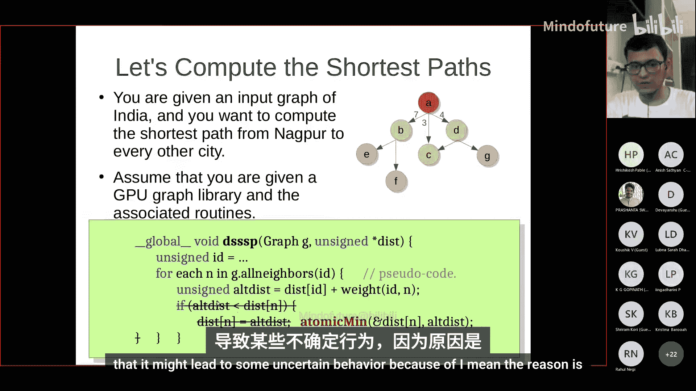

I hope there is good。Okay， so the short answer is that it is the thread local variable and hence。啊。

There is no chance that it might be updated by other threads。Yeah， but if I missed something。

 then you can unmute yourself and ask Co。ok啊 i guess。

Things are okay， so let's move on further。

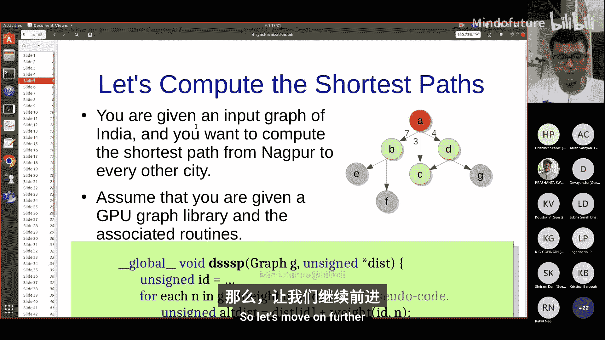

Yeah， so we saw the right code for the symbol so short as but now let us。Again。

 with the atomic tests。Atomic tests again， one type of atomic instruction and its syntax is very simple。

First of all， we need this mean we need to understand this atomic gas function。

It has three arguments， past is the address。Addre of the I mean。

 address from where we need to check some particular value。So I mean first argument is the address。

 second argument is the value with which comparison is to be made。

So the value which is told at this address， which is provided as cost argument。

 will be compared with the value which is。Which is mentioned as the second argument。

Or the value of the variable， which is mentioned here。And if both matches， so value。

 which is at this address matches with the value of this variable x。Then if if that happens then。

The value of that I mean value， which is present at this address location。

Is replaced by the value of five。So again， if this and this matches。Then the， I mean。

 the value which is present at this address location will be replaced by the value of y。So。

 I hope that is clear and yeah and it also returns something and what it returns is the old value of the old value which is stored at the sat location。

So I hope that is clear。In case there are any questions， then please ask for。

Put put them in the chat。And对。Talking about this atomic S。

 there are two typical use cases for this atomic S， one is for implementing the blocks。And。Okay。

 so locks can be used for。Implementing the critical sections。 And second application is。

In the implementation of signal， that is something called a single section。And what is this。

 the single section ensures that only one thread， it can be any of the thread。

 but only one thread will execute a particular block。

And all the rest of the threads wont execute that the piece of code or that block and they can move on further。

 but only one thread will be executing that that piece of code and yeah press can move further that is the meaning of single section。

So this atomic test can be used for implementing both of the things。And yeah， before moving forward。

 the electrical sector。

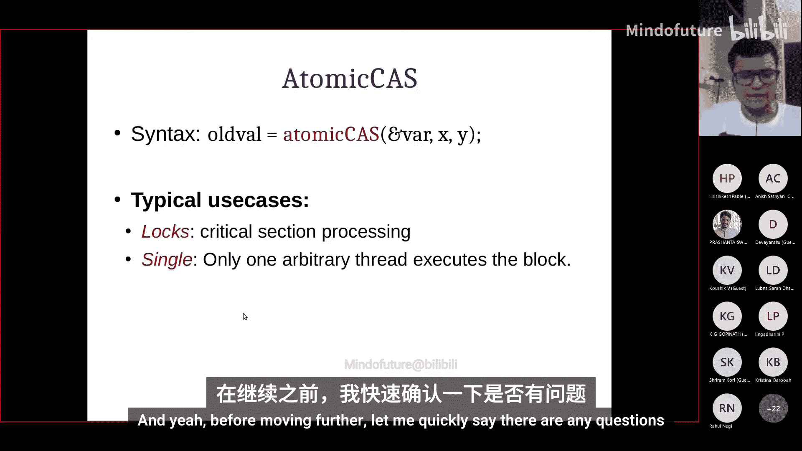

Any questions yeah that is。Could it possible Okay， yeah， this 1 I got little bit。Okay。

 so any questions on。

The atomic gas part or its syntax or。If anything is unclear related to atomic gas。

Please ask them or elsewhere move for them。

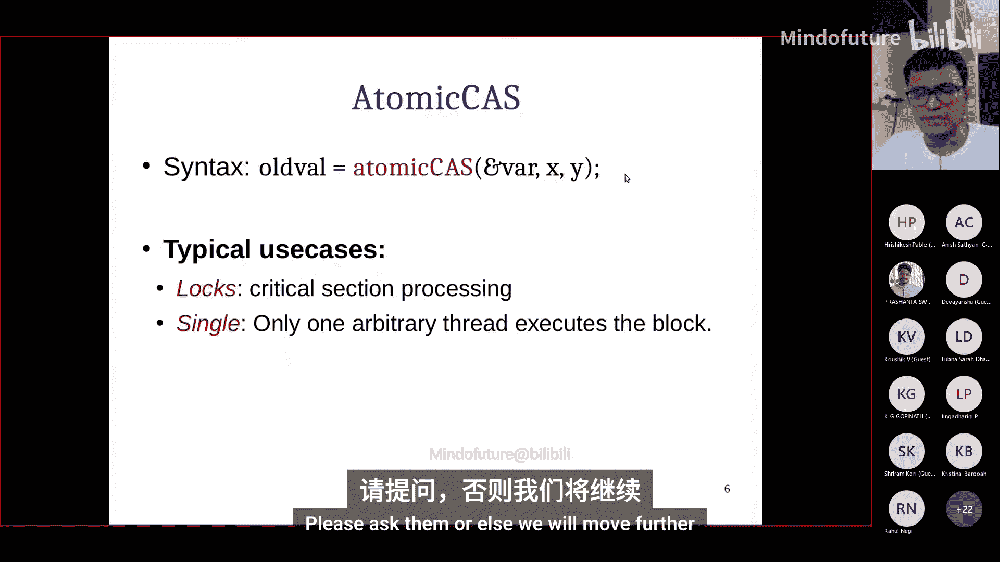

Okay， looks like there are no questions， then let's move further。

Okay， so now let us start with a small password。Let us say that we need to implement with lock using the atomic gas。

 how can we implement that？Okay， so let us start looking step by step。So let us I mean。

 let us start our class。So let us say that I have this lock bar which is some variable and since we need to pass address of it I am passing the address of it using m person block bar。

So this will pass the address of it and please note that this lock bar is initialized to 0。

And as a second and third argument， I'm passing zero and1。

So based on our previous slide and based on our understanding of this or working of this atomic case that we understood。

Will this thing work？Can this thing or this single statement？

We used for implementing the critical section。Or let me put it in different way。

 can this statement alone be used as a locking mechanism？

That thread might in before entering the critical section and yeah。

 I mean should I mean should this statement alone ensure that critical section will be implemented properly？

Or in another words with this one。

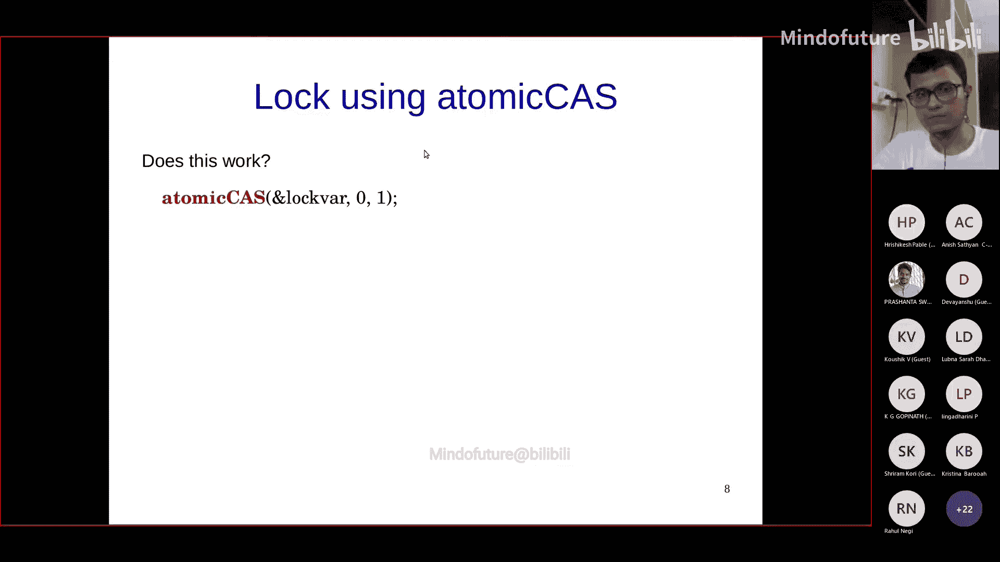

I hope that question is clear， I request each every one of you to think about it， will this work？

啊。So a critical section is after this， so each thread will execute this statement and will try to enter the critical section。

And as we want mutual exclusion to hold， only one thread should enter the critical section。

So will this statement be suffice or will this statement ensure that the critical section is implement a mean。

 which an exclusion is ensured is the question？Please think about it。

 I'll wait here for a few seconds。

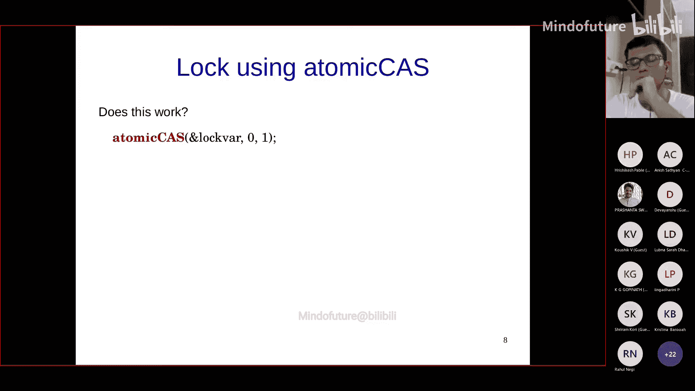

Such if block is shared。One surprise。Yeah， log variable is shared across。All the third actually。

Request also allows to try so that we can get the maximum out of this exercise。So lockware is shared。

As per the reshcious suggestion， take what this applies。Any other suggestions apart from them？

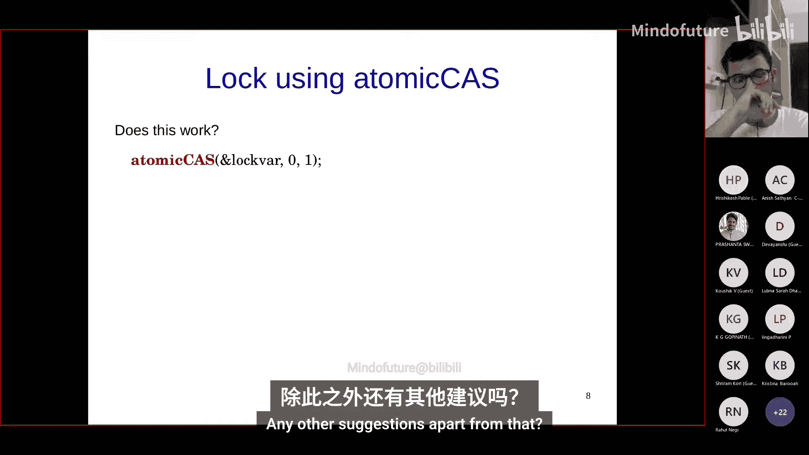

？

Okay looks like there are no suggestions in anys let' us move ahead so again this won't be suffed so let us understand why it won't be suffice because it doesnt ensure mutual exclusion so let us assume that even if the knock variable is initialized to 0。

Even if that is the case， then what what this instruction does it checks that is the value at this at equals to this value。

 yes it is0， right？V of lock value is 0 so 0 is equal to 0 so for one of the threads since this this thing is executed atomically。

 I mean， this is an atomic instruction。I comparing and then setting a standardatomyically so for one of the thread since initial value of lock power is 0 one for one of the thread value of lockwise will be equals to 0。

And for that thread what it will do it will set the value of clockware to1 and then it will move1 and for rest of the threads they will check if value of clockware is equals to 0 but it is not the case right one is not equals to 0 so they will do nothing and they will also move1。

So important point to note here is that atomic。Cas or any of the atomic construction are non blocking。

 So it won't happen that if。L bar is not equal to this value then the10 particular thread will start looping here or like that we had in this of vio looppi while looppi so when the while loop was I mean condition inside the while loop was not getting satisfied the thread was just looping over there but here the atomics are not blocking so even if the value。

Of the lock word is not matching with the value of the second argument。Atomic， I mean。

 what will happen is they will not set the value of lo power to this third argument or the third value in the third argument。

And then move on。So。It might I mean it will happen that multiple threats will enter into the critical section。

 so a mutual exclusion is not ensured。Okay， so we understood that this doesn't work because it doesn't ensure mutual exclusion。

Then how about this we with this thing？That。We place its atomic gas inside of。What I can say is。

We place this atomic gas inside。If condition and what we do is we check if the value returned by the atomic acid is equals to 0 or not if it is 0。

 then execute the critical section will this work。Again。

 one thing that I want to clarify here is that the atomic cast returns the old value。

So whatever was the value inside this this where or at this at location。Is it returned？

And yeah that is in the that is stored as the written value。

 so here the value that is written is being checked， whether it is 0 or not。

 and if it has0 will will execute the critical section。Again。

 will this thing work or is there an issue with this？

Would like to pause here for some time for your people to think。Please try and post your answers。

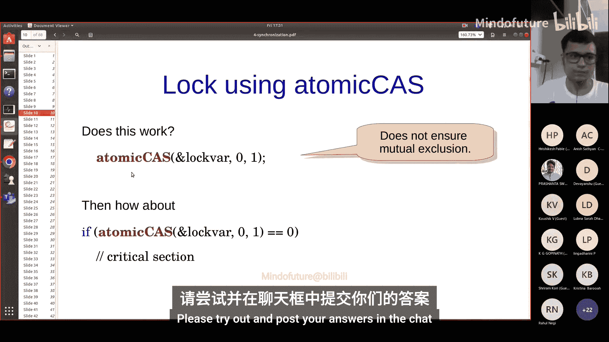

From De here。Yeah please trial。And if you have any questions。

 then also you can unmute yourself and ask or type them in check。

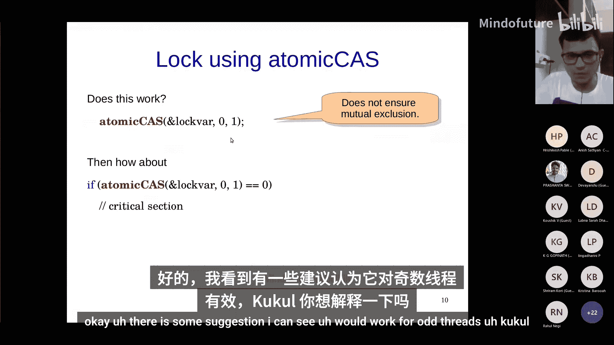

ok啊。There is some suggestion I can see you would work for art threads。Coul。

 would you like to explain why it should work for the arts？

I'm back to this slide and can you explain why that only particular author？I parties a that post。

It will work as long as the lockware value isnt change。Okay， that is not an issue。

Committing mistakes is not a problem。It is important to drag and I would like to highlight that trying is important。

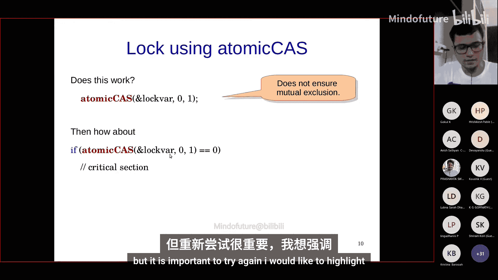

Making mistakes is okay。This border also have same problem would you like to put some light on why it would have the same problem with shish？

Also like for one thread， let's say it implements that statement。

 then it would return0 and then it will go inside that if block。But for others。

 the clock would be one， so it would return like initially it will be1。

 so it will return one the atomic S and one won't be equal to 0 so it will not enter there。Yes， yes。

 So I think。That is the precise thing that M Prishka suggested。

So let us understand the issue here so first of all what is critical section critical section is a piece of code that should be executed by each and every thread。

But one at a time。And the crucial point here to note about the definition of critical section is it should be executed by each and every。

It should not happen that only one thread executes the critical section and all other threads just move further and I mean。

 they not execute it。And that is what exactly is the issue that is happening here。

The lockware initially set to0 and for one of the thread， we will see the lockware as 0。

We willll see that okay，0 is matching with  zero， so I'll replace it by one。

And return the old value which was 0 so 0 equals to0 will be true here and it will enter the critical section okay so far that is fine you only want one f to enter the critical section。

But。What will happen with the other threads， theyll come。

 theyll see that clockware is 1 and one is not equals to0。So they'll do nothing because， I mean。

 they'll not set， I mean， since this hip cell is not matching because both values are not matching。

They will return the old value， which is 1 and one is not equals to 0。

 so they will not at all enter into the critical section。

And they'll move further and start executing the instructions which are after that critical session。

 and this should not happen。As I told， the definition of critical section is that each and every thread should enter the critical section in Amin。

They should enter critical section one at a time。And that is what we are not ensuring meaning what we are not ensuring is said。

Threat should enter the critical section， but here what is happening is that only one thread is entering the critical section rest not just ignoring the critical section。

And this should not happen， and that is the issue with this part。ok 啊。Yeah， so precisely， I mean。

 precisely suggesting it does not block other threads， other threads should wait here。

For the one thread to finish the critical section and once that thread finishes。

 other thread should enter the critical section and start executing so it does not block other threads and that is the issue with it。

So what about this again， making the lock。So let us say that we modified this block like this。

So we now hope this two while loop。And what we do is we again use atomic S and again second and third argument is 0 and 1。

And yeah， so we check the old well and if it is not zero。Then this while terminate sorry。

 if it is not zero， we will keep on looking and if it is zero。

 then this while will the while will terminate and we move to the critical section。Again。

 my question is simple， will this work？Ining one。I mean。

 Cor Etherwards will testing thing ensure the mutual exclusion。I hope that the question is clear。

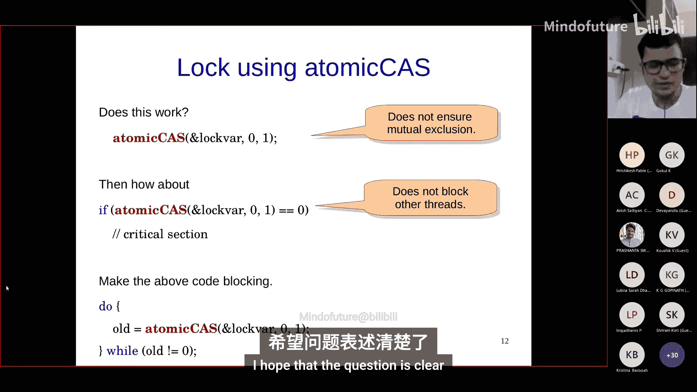

I'll switch back to this article。

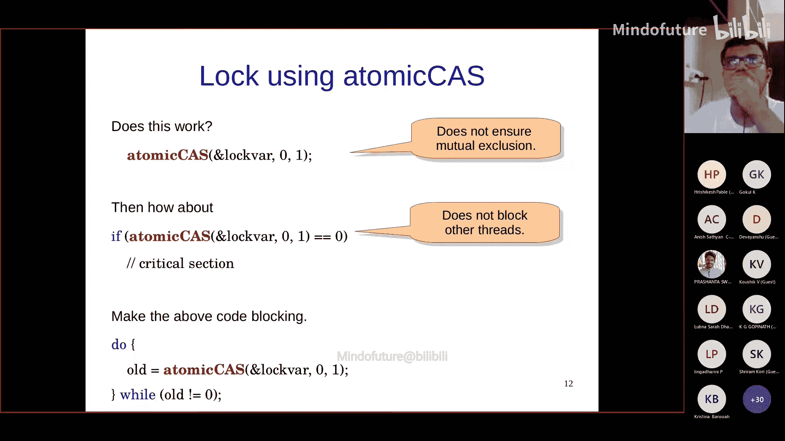

At miss。

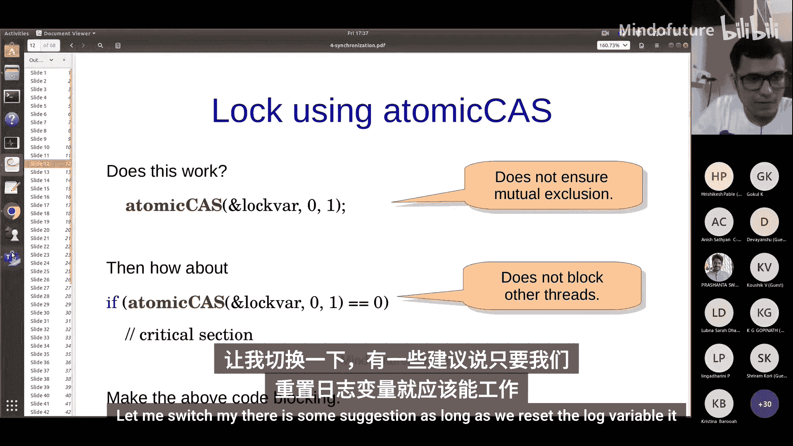

There is some suggestion， as long as we re them law， should work。

Okay， go saying that it should work and。Yeah。And yeah that is correct observation。Once this thing。

 I mean， once this thing， one of the thread finishes this and the critical it enters the critical section。

But finishes the execution of the critical section。 We should reset the value of lock variable。

Who's it？

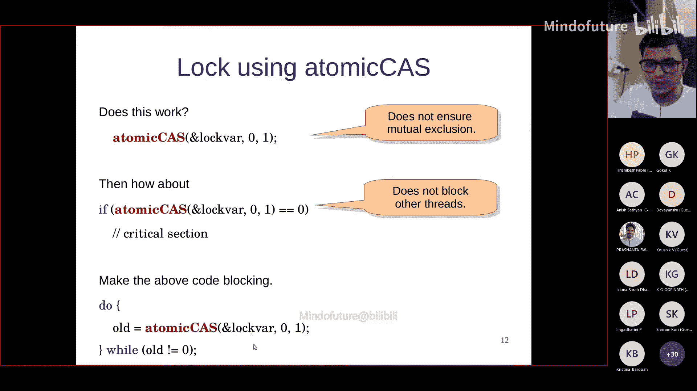

And yes， that is correct observation。I think。The sister director。Observation as well as the answer。

Request others also to try， but yeah， meanwhile well move further with this。

Yeah， so this will work probably。I won't say that 100% at will work， but well come to it， but yeah。

 this code can work。And why， I mean， let us analyze why it should work。Because let us see how。

 I mean， what will be the execution pattern。Let us say that one。

There were multiple cats who were executing and who were willing to enter into the critical section。

Yeah， so lockware was initially zero so one of the thread will see the lock value is lock sorry lockware is 0 will compare0 with0 and will set it to one。

And yeah since the old value of log wave is 0 old will have 0 and0 is not equal to 0 so will it will enter the critical section that is fine and we need to also check if other threads are blocked here because one of thes one of the third have already entered the critical section。

So it it's a minute， since it is inside the critical section， it is important to。

Llock other thread right so since lockware is one now all of the threads that will be entering into this tool while look what else see。

Lock by is one。And this is0， so one is not equal to  zero。

 so theyll get old value as this one and one is not equals to 0， so theyll keep on looping here。

That is fine， they'll keep on looping here。And。The threat that entered critical section will finish the execution of critical section。

 and it will reset the value of lockware 0。 So again， since lockware is set to 0。

 one of the thread will succeed in。Check0 equals to 0 and setting get to one and then since hold value would be 0。

 one of the3 and another running the one that。啊I mean。

Apart from the thread which entered into the critical section， apart from that third。

 some other thread will be entering into the critical section。So yeah。

 the observation here is that if you use this code。Then mutual exclusion is guaranteed in some sense。

But there is also some issue with this code， but we will see this later。Okay。

 let us keep that issue aside for a moment。But I have one more question here。 Let us say that are。

Let us say that our requirement is slightly different and we want to。Just don't want I mean。

We want something else， so we also want that he okay。

 we here also wanted to know that which threat have entered into the critical section。

And in order to know that we need to modify the sport somehow。And I would like you the think that。

Let us say that our requirement is subset that。Along with Mitchell exclusion。

 we wanted to know which thread has entered into the critical section。If that is the case。

 then how will we modify this code？So that we can keep track of which thread has entered the critical section it not that any of this thread can execute atomic gas and can enter the critical section。

So。Yeah， so please think about it， that how can we keep track of that thing。

 that which thread has entered the critical section？Is there any， I mean。

 is there anything that we can do here？

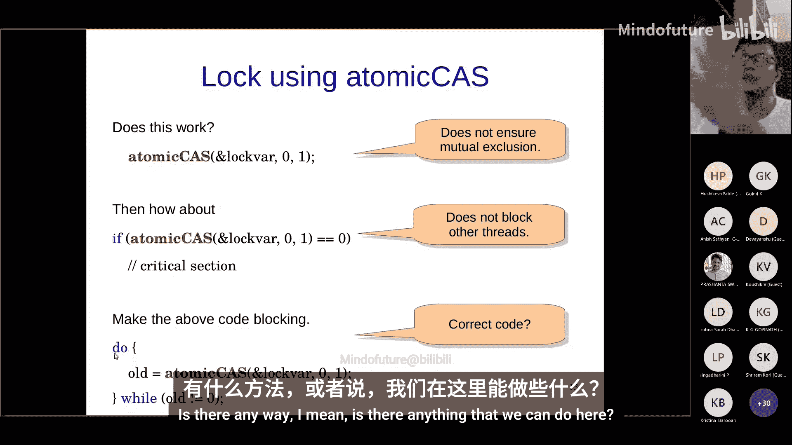

Okay， switching back to these slide so that your people can try。

I'll wait here for a few seconds I hope that question is clear we want we just don't want I mean。

 along with ensuring that the mutual exclusion is followed we also want。

To know which thread has entered the critical section。So that is the question and how can we do that。

 how will we modify this for？Excuse me， sir。Yes。😊，Sir。

 I joined later so I asking one question that is in case of ethnic cash so whether after execution of the critical section automatically lock by be set will be reset。

😊，So it will be done automatically No， no no。So resetting we have to do it explicitly。

 so this is one piece of code which implements some sort of lock and for unlock we need to set lock bar equals to0 explicitly。

 so reset is not turning。Okay focus。Okay。

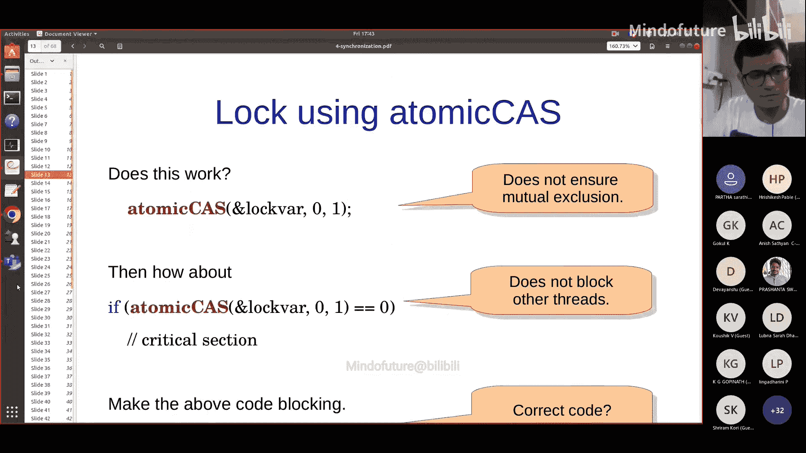

It is some suggestion啊。Okay， there are some suggestion， replace one with thread ID extra text。Okay。

 this is a valid suggestion， but there is a small corner case here go， what if the thread I is 0？

It might be the case that T has ID0， right？

In that case， what will happen？So if T has ID0， then one replacing one by thread IDX。

 what will happen？Okay， I'll repeat this。One is replaced by thread ID extra text。

And if the third id is zero， then what will happen lock where will get the value0 and this should not happen right。

 because if that is the case more than one third will enter the critical section。

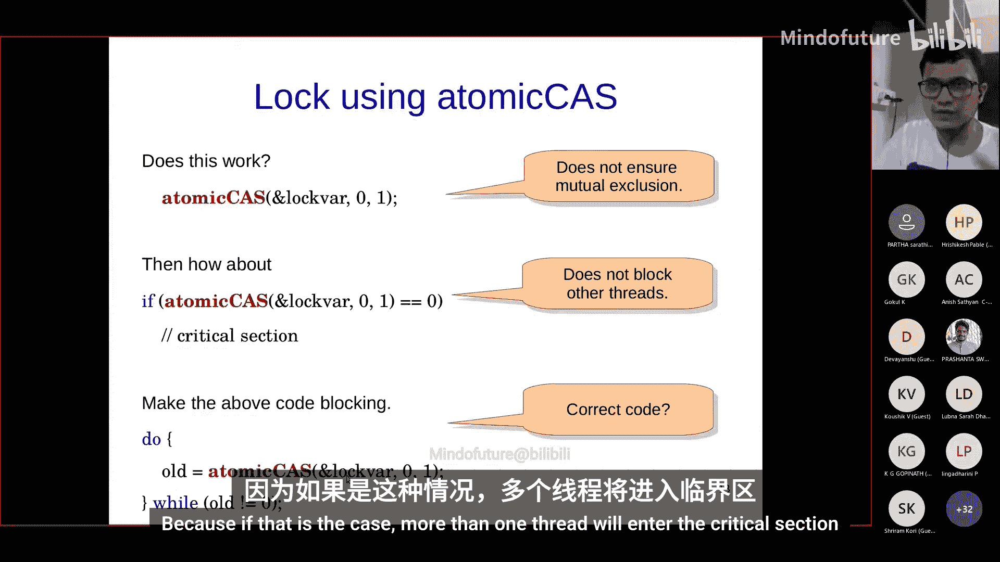

So your thinking is in the right track， but need some refinement， I would say。

You can have a shared area and set value。How ID export accessible？

I was shared at and set the value our。屋企。That is fine。

But that is quite an overhead right I would say is case that we need to have the entire array and we need to set and reset that array and access those elements of the only。

 but we can do something very cheap rather than declaring this entire array。Even cheaper。

Would that replace lockware with the thread ID and send to the value back to us。Yeah。

 that is correct， it will send us a thread ID back， your observation is correct。

There is a formal case here， right that when third I is0， what will happen？

More than one two threads will enter in the critical section at the and that is the issue。

 only one thread should enter into the critical section at that particular time。

Okay so solution is simple。 I'm just building up on the gos。Suggestion， okay， that is something I。

You can have only one shared variable and you put it to。Yeah， again， yeah， this can also be done。

Yeah， but again， coming to your suggestion， Rahiksh， there might be。Data is while writing， also， so。

You need to take care of where are you setting that term？Thread ID Xx because。

It might happen that multiple threads might want to write into that shared variable。At the end。

 it might happen that the thread which is entering into the critical section might not be the one who is amin。

Sorry， the value that is sent into that variable shared variable。Might be different than this thread。

 which is actually entered into into the critical section because of data risk。

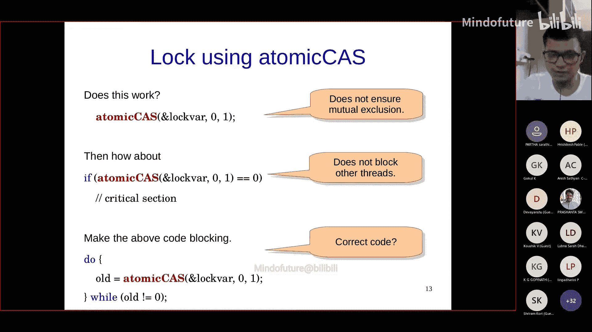

I hope you're getting that point， but I mean， you can I can rethink over that approach。

And refine it a bit so that。啊。Yeah， that is correct， you can check all cost to thread IVX。

But will it ensure that only one thread will enter into the critical section？Its the question。

We are replacing it with， I mean， we are replacing condition with。Tdite the extra tax？Okay。

 I think it should work， but I need to check this one whoul I need to check your suggestion if this works。

 but yeah most probably it should work if we add this into the condition valid condition。

I think it should work， but Im not able to see any issue right now with this， but okay。

 so let us see what I mean。

What I was thinking was slightly different。So what we can do is instead of doing this thing。

 we can do it in slightly different manner。Let us say that we know the upper bound on the number of threads。

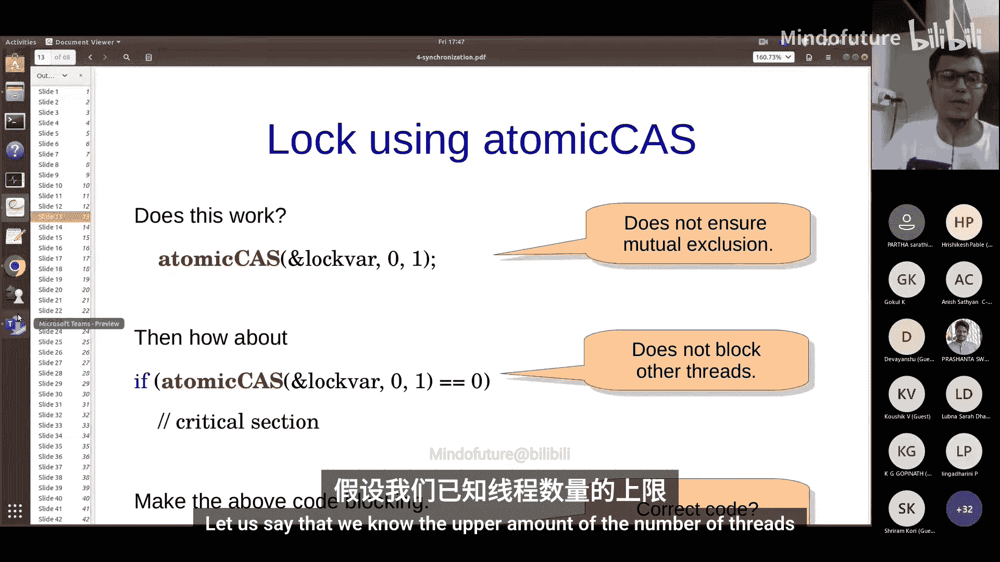

Let us say that we know that right。A number of threats with which the kernel is launched doesn't exceed some 1 million。

 right？So in that case， what we can do is we can set blockware。Lockware to interm。And then。

After doing that， what we can do is。We can check if they log by this inax。

And if that is the case if both of them matches， then what we can do is we can replace this one。

 sorry， yeah， we should replace this one by the thread IDXor tax in the same way coku was suggesting。

So advantage with that thing is that。We won't need to do this thing， I mean。

 we won't be having the data is for。Part the case where threat ID is zero。Yeah。

 so because since we have upper bound on the number of threads that we won't have more than a million threads is what our assumption is。

So none of the threat will have it equals to inter max， right？And if that is the case。

Only one thread will add it to the critical section and yeah。

Mitchll expression is ensured and the value of the lock while will be the thread ID will be which will be entering it with the critical section。

 so I hope you are getting it will set lock while2 into max。Here instead of0。

 well have inm max and here instead of one we will have credit ID。Tur9 exortex。

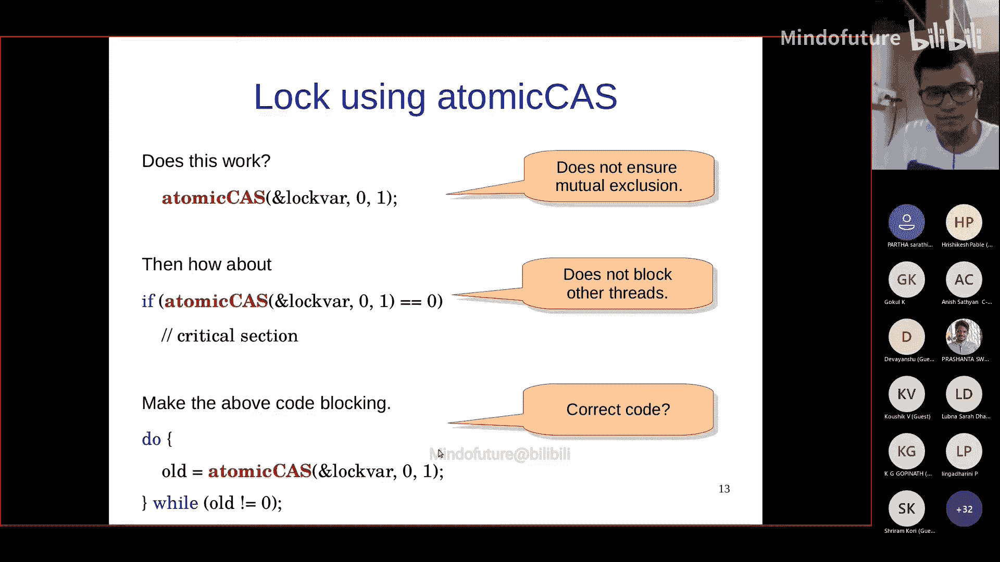

Any questions up this point？Okay， I think that there are no questions in that case， let us。

Mo further with our discussion。Okay， so I told that this code is correct， right？

But there is one small catch with it， I mean， there is one small caveat with the sport still。

That this code works on the CPU as well as it works on the GPU across multiple I mean。

 different vers。But。That is a small issue。With respect to the threats of the same word。

So what will happen when they execute such kind of code？For the threats of the same boy。

 what will happen？As we know that work threads execute in same manner。What would happen is that。

Let us understand what will happen so all the 323s that is all the threats of the thread of the war will start executing this as they executing in lockstep manner theyll start executing this dual value。

They'll start executing this atomic gas， they'll say that only one third succeeds in the sense。

Gett the old value as0， so only one thread will get the old value as 0 because for only one thread。

L lock part will be cost to 0 and。Twin set lockwise as one。And will get old value of old as0。

And for rest of all the war threads， what will happen is since lockware is 1。

1 is not equal to 0 and lockware will stay 1。And the value of oil will also be one for them。

So now what will happen， only one thread of the entire world has old value as you。So for that thread。

 this old sorry， this old naut equal to0 condition is false because naut equal to 0 is false。

So it tries to more， I mean。It will proceed moving towards its critical section。乜。

For all other threads of the war， one is not equal to  zero。不 is true。

So they they all can't enter into the critical section and they will keep on looping here right。

 but since as we know that work startss execute in simply manner。

So that one thread which wanted to enter into the critical section will also be not allowed to enter the critical section because of that samedy sort of execution。

By the war。So that one thread wants to enter the critical section。

 but because of the timD execution pattern of war threads。

 it has to wait for the other other war threads which are looping here。

And what these other website are waiting for， it is waiting for that third which。

Has to enter it to the critical section to reset the value of lockware。

But that will not happen right， because that thread is waiting for the other work。

So here you see that。Kind of a deadlock situation， one thread is waiting for other other threads and other threads are waiting for that one thread。

So this is a deadlock situation。And yeah， so important point here to note that this code will work。

 but only on the CPU end。Across the different， I mean， across the warlets of the GP。

But for the I mean， for the thirds of the same work， this goal will lead to that law。And yeah。

 I mean， precisely speakinging this code， this code will work only in case of MID execution or multiple instruction。

 multiple data sort of execution pattern。For SM IMD pattern of execution like for war threats。

 it will fail， or I mean， it will lead to dead。O so yeah。The point is simple。

 it will hang for threads belonging to the same word and why。

 because when one Warop thread acquires the lock， it waits for other War threads to reach the instruction just after they do while look。

And other workers wait await this successful threat in their Duvalu。Yeah。

 I hope that you are getting this， that this other threads are waiting for that one thread that one thread is waiting for other。

Thanks。Any questions up till this point？As yeah， please Sir， we could。 we could do that where。

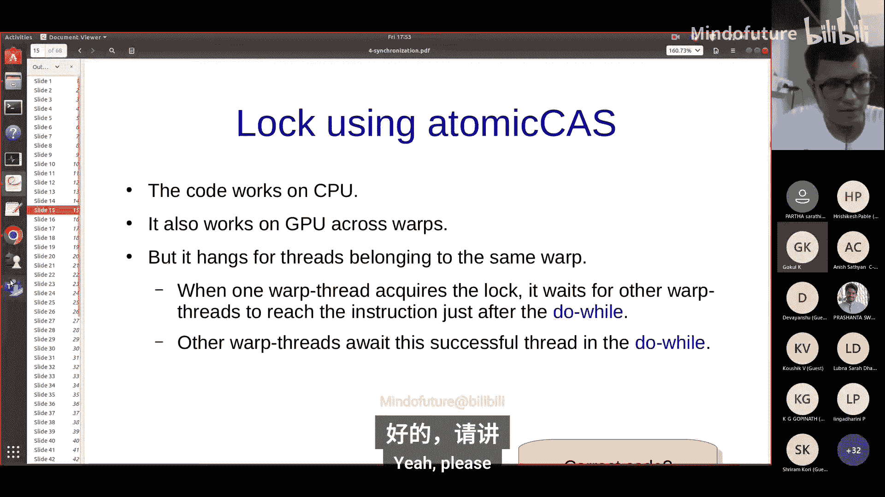

We allow like old what to go through the dual look。

And then we can use that if statement atomic cast that we saw also。Ilow only one I think that's good。

ok啊。So you， you are suggesting that will。En entire what。

 you are suggesting that entire what can execute， I mean go into the critical section and then what I miss that part。

then we saw like an earlier like if statement with atomic asthmanocer。

That all other tips will go past and。Only the one thread will go on， but then okay。

 then those threads might miss the critical section。Yes， yeah， I mean， your observation is correct。

 we can use that。Atomic gas， if condition inside， sorry。

Inside if we can use atomic gas and restrict only one factor to enter。And that can solve this issue。

 but there is something else that we need to do。Ptect。Implement。This atomic thing correctly。

 and we'll see this in next slide， but you are。Observation is almost correct。

 but still there is some small thing that is missing， but will see them。

Any questions up till this point， if you have any questions， then please feel free to ask them。

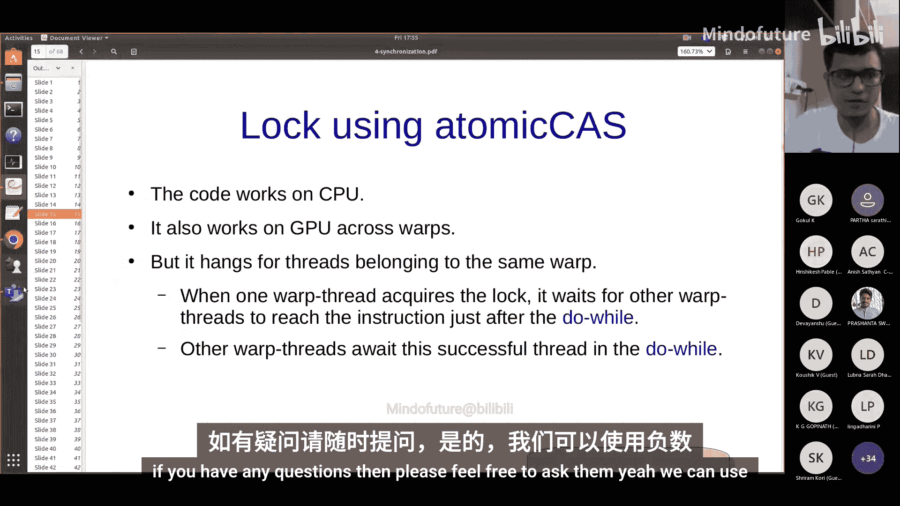

Some situation。Yeah， we can use negatives。Yes， we can use negatives instead of interm also because thread IDt want to be negative。

 so yeah negative is also one possible way in which we can do that。But they mean。

When I thought about it， I thought in terms of interbanks。Yeah， I mean， generally。

 inex is a very large number。The number of threads with which we launch the kernel is emits in typical applications。

 it is generally lesser than in Mexico so we can use that thing。But yeah。

 you can also use negatives instead of things。Yeah， so I hope that is clear。Apart from that。

 any questions。

ok啊。The momentい。So yeah， let us move further if there are no questions。

So we understooddied this thing， which is。This two while loop then entering into the critical section and then setting lock by to0。

 please note that this。The statement is setting log bar to0。

 it is just that this is overlapping with it， but yeah here we are setting log bar to0 so this thing。

This locking here， then entering critical section and then unlocking。Works on CPU as well as the。

As well as between the different sorry as well as the threads which are within the different w on GPU。

But for War threadread， this thing leads through deadlock。So how can we solve this issue。

 can we modify this code in some way？所睇诶。It also starts， I mean。

 it also works for the threads within the same board。

It not that it should work for the threads within the same work as well as across the warps and thread blocks and so on。

So it should not happen that when you try to fix this issue。

 that is within what threats should not lead to that law。The other。Sturing it should not happen。

 it should be working for all the person。Please think about it。

 please try and if you are not able to get it， then we'll see it。

 but they have least tried it so that you can get some。

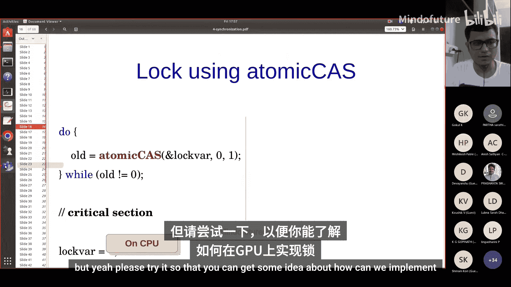

Idea about how can we implement locks on the。But the critical sections of Egypt。

Again， I'll be switching back to this slide so that there。

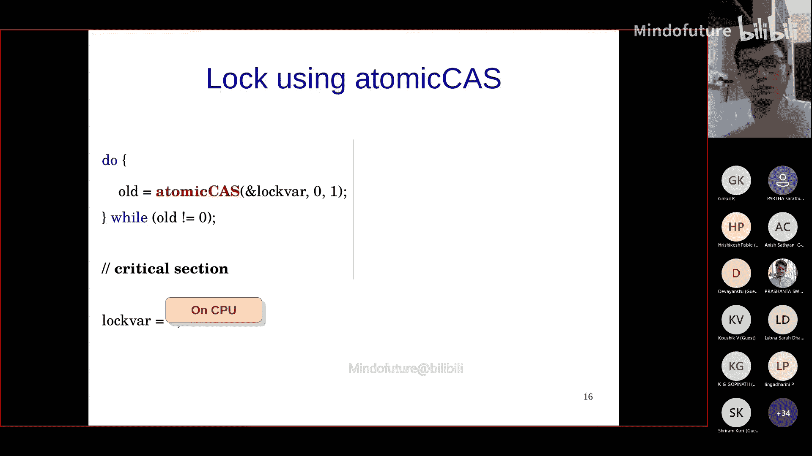

ok啊。I'm unable to see any suggestions anyways。

Since we are running out of time， let me。Quickly， more with the。Solution。So on GPU。

 what we can do is。It turned up。Okay， on GPP， what we can do is instead of doing this thing。

 what we can do is we can。Use one if condition here。

 so let us see how the execution pattern is here now。So we are replacing this， yeah。

 this thing is in， first of all， please not that this thing is same。

So only one of the thread will be getting the old value is0 rest all will be getting old value as one since this atomic cases is atomic only one one thread will get old value is0 and that thread will enter into the critical section because if old is0。

And that least note that this old value is only 0 for13。

 so that thread will enter the critical section。All of the thread。

Will be masked up at this moment because as few people might be remembering from our threat divergence。

Discussion that。This condition is only approved for one threat rest for rest threats。

 this condition is also rest threats will be masked up。

That one third will enter into the critical section will finish the exhibition of critical section will then do lock variabless to 0。

And then。What it will do is it will come out I mean it will come out of this this if condition and then what it will check is it will check if old value is not equals to 0。

We will check this exactly this thing。 Please note that this。

This condition and this condition here inside this while loop are saying this sorry about this。

 this is an overlap here， but yeah， the condition here inside this while loop is same as this condition。

So now， please note that。Out of all the 32 threads。

 only one thread was able to enter the critical section。

 in fact inside the safe condition was able to enter enter the critical section and execute it and set lock1 to0。

Rest 31 thirds were here doing job。Now， after this if condition is finished。

 execution of this if block is finished。What they do。

 all the 32 threads of the work will start executing this file statement。

And since old value is 0 for only one3 which executed this critical section。Only third threat。

Can come out of this while because for only that third old sorry0。

 which is value of fold is not equals to0 is false， so it will come out and will wait here somewhere。

For other threats to also come， but for other threats old which is 1 is not equals to0。

 so this while condition is true so theyll again look theyll again execute next generationeration of2 well。

And they'll start executing this block again of so please note that one thread has finished it is waiting here for other because they are war threads so it has to wait for other 31 threads。

Now， this 31 threads will again be competing for the lockware hitting old value of0 using lockware。

So again， only one thread will win this competition because it's an atomic。Economic operation。

So out of the 13 third， again， only  one3 will get old value as0。

That thread which got overvalue0 will enter the critical section and will set a reset lock to0 mean all 30 threads were here executing no and once that is finished that one thread will be exiting this while loop。

And press 30 threads will again loop again and so on， so execution pattern will be like this。

Initially， one thread will succeed， rest 31 thread will loop again。Then second thread will succeed。

 all 31 threads will loop again， third third thread will succeed at rest 30 sorry。

Third thread will succeed rest 29 threads will loop again。And so on。

 So once all the workshop threads have finished this。Wil loop or the iterations of the while loop。

 then all 32 threads will be here。And then only once they reach all of them reach here。

 then only they can go ahead because of that simply execution pattern。

So I hope this is clear if there are any confusion or questions at this point， then please feel。

This is。A very important thing to understand is this is the way in which we can implement critical section。

Inside the GPU， so if there are any question or any。Simple confusion also， then please ask。

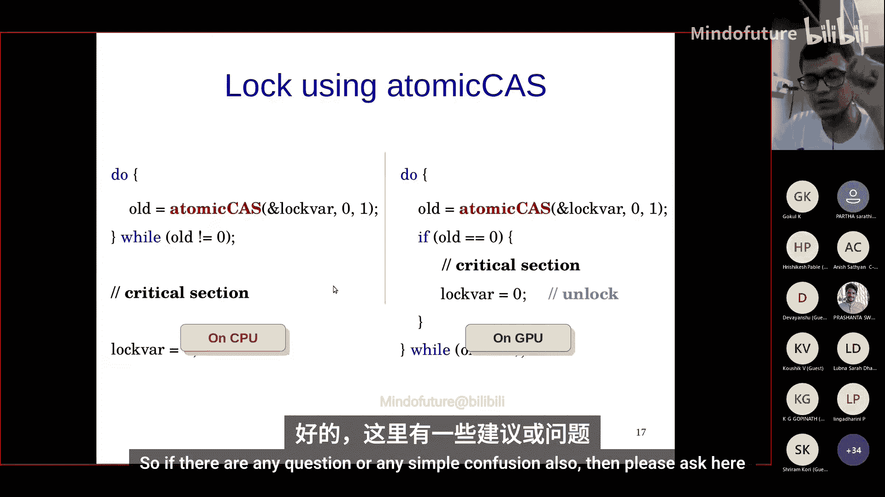

Okay， there is some suggestion or question we could select a work to send。

I you could select a word to send。Then go forward and get condition。他单 change the。那你。Okay。

 I was unable to understand this in vocal， but。啊。If you want， you can。Explain this thing in detail。

Yeah， I'm unable to understand this。Properly。s to send。To ten look over it。Okay， if you feel that。

This thing can work and you can。Try writing a quote corresponding to it， but。

I说 Sam some that idea on this。Okay， okay， but I was unable to get that okay， anyways。Yeah。

 so this code will work for。All the war threats， I mean。Within the wars， as well as the。

Tats within the different wars and the different headlocks and so on。

So I hope that you are clear with this。So with this lets one point。

So now let us try a simpler problem， we want to implement single with atomic gas。So what is single。

 single is a block of code that should be only executed by one thread。And。Other threads， I mean。

 that thread can be arbitraryrbit。 They one that is executing that block of code。Can be an， I mean。

 the thread， which is executing that block of code can be any thread。

And all other threads need not wait for that thread to finish that block of code they can move further so we want to implement that functionality using atomic case and please think about how can we implement it using atomic case。

I think this should be。啊。Easier for you to， I mean， easier for you people to implement now after。

This discussion， yeah， please try out。After the discussion of this law， it will be。

Be too easier for you to to implement this single。Yeah， single do you think I coming guess。

Please try out and meanwhile if you have any questions or any suggestions， then post on chatar。

啊You跟那 move yourself second。

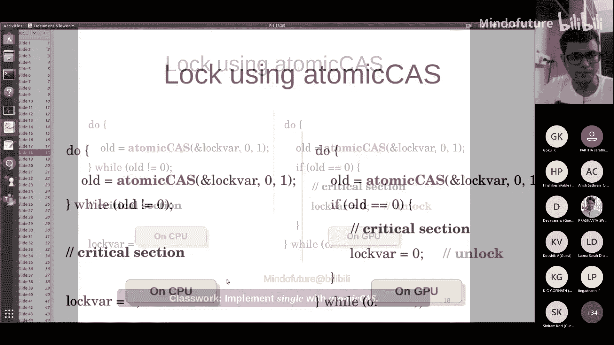

It's statement like we saw earlier。Can you type quickly typing check， how can we do it？六佢。

If there is some suggestions we can put just one if statement and put the critical section inside。

食 up。ok嘅 啊。I think个。Yeah， I think both of you are close to it， I think。Yeah， I mean。

 this approach is also correct we can just put。One statement and the。

Put the critical section inside the pretic of variable。Yeah。

 I think this will work and local suggestion is also correct。成心。呢个边落。Then1。ok 啊。Okay。

 lock well of minus1。So you should initially set lockware as minus1 else。

 no one will be able to interpret。Yeah， but I still think that there might be some issue with this。啊。

L Redis。-1 then -1 put -1 and some thread I。I think this should work。 I think it will work。

Asuming that clockware is initially minus1。唔该啊。Only one third will succeed in。赤经麦啊咪落啊咪。

Succe in that check where lockware is minus1 and it is compared with this second album。

So that third who succeed will set a lock back to its red ID。

And since thread id are unique only one thread。I will enter into the that。

Section or the single section。So okay， I think both of these suggestions are correct。 Yeah。

 but let us see how。

Can we do this？So yeah， typically it can be done like this。

So assuming that this blockware is initially set to zero and we pass this address of blockwise as cost。

And what we do is the second and third acroator against zero on them what we do is。

Multiple cardss are。Executing this multiple， I mean， instruction before this had case。

The first thread to succeed at this atomic case or the first thread。

 which will check this lockware and compare it with0 and will get I mean。

 and will succeed in this check and will set the lockware to one。We'll get the return value as 0。

 right？And it will also succeed in this checking， right， if condition that is0 equals to0。

So that threat will enter into the single section。And since it has set the lock variance 1。

 what will happen with the other threads， other threads will I mean will will not be able to enter into this single section right because for them lockware is 1 and 1 is not equals to 0。

So the value written here by atomic cas will be 1 and 1 is not equal to 0 again。

So they won't be entering the single section and what theyll do， they'll just move on right。

 they won't wait here for。The thread， which is executing the single section。And they'll move on。

And that is what exactly we want， right， only one thread。

We be entering the single section and just finishing that section and all of the third which thent succeeded here。

They moved up and yeah executing the instruction which are after the single section and yeah。

 so this is the one of the vein which you can improve。Yeah， I mean， there are multiple ways。

 but this is one of the way。And important point here to note that it is okay if we don't set lockware to 0 at the end of the single section because。

Yeah， I mean， it won't lead to any issues with our。The way we want the single section to be。I mean。

 it doesn't cause an issue with the functionality of the single section。

 even if the lockware is not set to zero at the end of the single section， I hope that is clear。

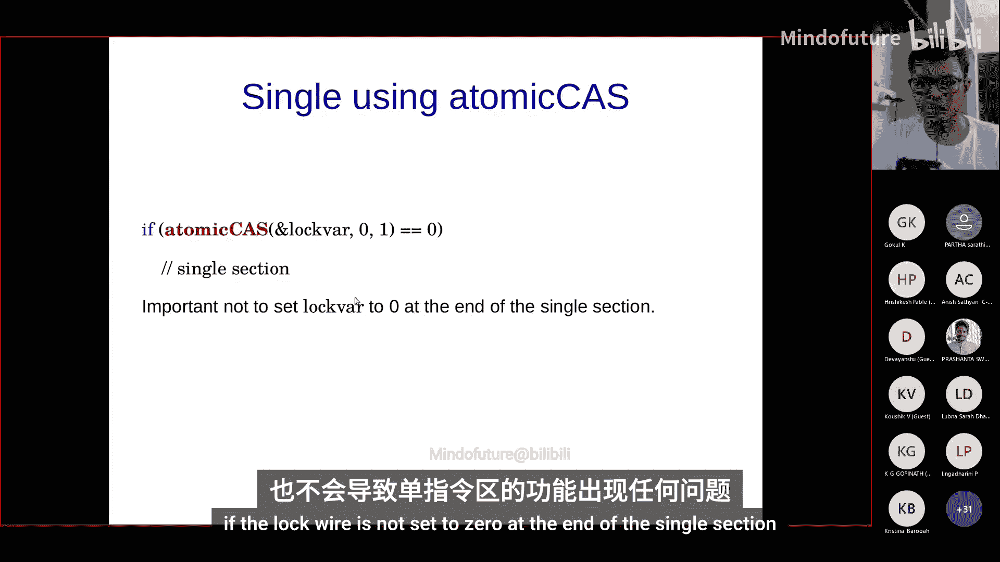

If there are any questions。Okay， thing， but we have to handle what。

Is it related to？대스팅곡을 아。I think it will also work for war sort I think。

I don't think that there will be any issue with the war because let's say there are multiple war threats。

Then only one war pair will succeed here and rest of all war pair will move on in that war pair will succeed with this。

Atomic gas that is getting the return value of 0 will enter the critical single section。

And rest on what threat will wait。But that。嗯。Yeah， rest of what will wait here。啊。안 됐어。

Single section is being executed by the。One that single thread， which is part of that one。

 so all other work threads are waiting here。Meanwhile。

 that one thread which succeeded here of that one is executing the single section once it finishes。

Once that the threat finishes。It will exit this single section。

And it will join that all other 31 threads， which arere waiting here for that thread。

And then they'll move on， so I don't think that there is any issue with。啊。

The word threadread in case of this implementation of S。

But still if you have any questions that we can ask。

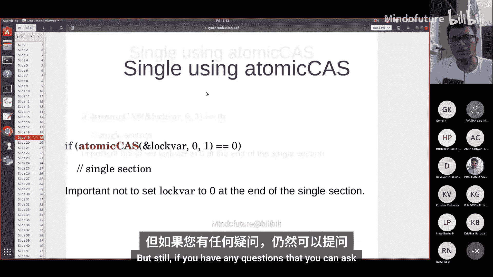

ok，好哈。You saying yes or Okay， I hope that it is clear that。There won't be an issue with。

The war threads for this implementation of signal。If there are any further questions or if you feel that I miss something then you can unmute yourself on ask。

Okay， so let's move ahead。So I want you people to think about what will be the output of this code。

Or what are the possible outputs？哦。That跟。That can generate out of this code。

I'll wait for a few seconds here so that you people can try。please think about it。

 what can be the output with this？好诶。Please post your answers in the chat or。You can unmute yourself。

啊あ啊。You can unmute yourself and tell your suggestions。

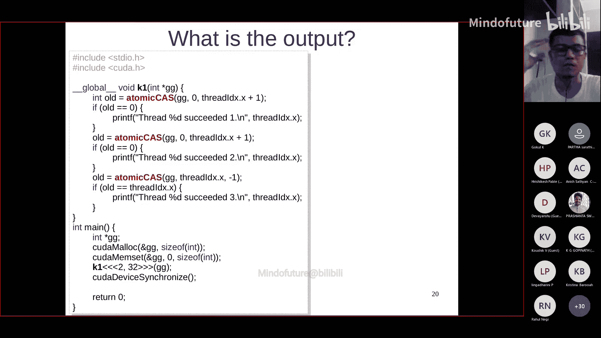

I am hoping that you people are trying， so I'll wait here for few。

More seconds。Please try and even if the answer is incorrect， that's okay。

But please try out for that though。啊啲跟。

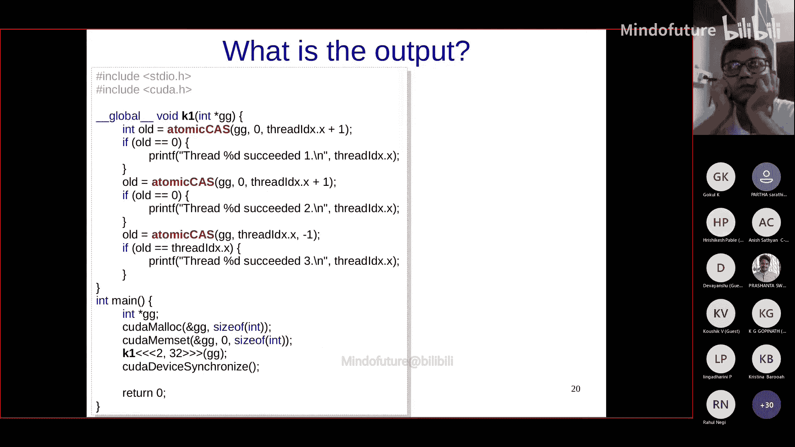

系个。Okay， since there are no suggestions and。

Since we are running out of time also， let us try to understand this。

Go and let us see what can or what are the possible outputs with this code？

So initially we are declaring this integer pointer and we are allocating the memory using code ML on the GPQ。

Ofp the size mean of the size of single and teacher。And that allocated memory on GPU。

 which is exactly， I mean， which is justoring exactly one in T。It is now being pointed by G。

 which is point on CPU， and that is pointing to some location on GPU。

Then we are doing this UA website， which is some new function and I mean it's very intuitive。

Po is used for setting。Some memory location on GPU。

 so here we have this in teacher declared on GPU right so we are setting its value to0。

Then you are launching carbon with two blocks， two thread blocks。

Each having cut two threads or each with one word。So two blocks with each with one board。

We are launching the kernel and we are passing this G， which is。Yeah。

 which is the vintagete declared on the GP。啊这 memory。Then what we are doing is we are。Yeah。

 then what we are doing is we are。Using this atomic gas。And we are checking at the value of G is0。

So one of the terminal succeed here， right out of。All the 64 please know that。Yeah。

Hes noted this tunnel is sponsor with 64 threads。Exactly one thread will succeed。

With this check of Gg equals to0， so one thread out of that 64 thread will succeed。In this check。

 which is G equal2 and it will set value of G to3 ID x dot x plus 1， that is ID plus 1。

So it can be any of the third， right， it can be third zero or third1 or third5 or third 10 or third 331。

Of any of the block， it note that there are two block and out of。T off any of the block。I mean。

 it not that we are we are。 I mean， we are not using any。Block Id here。

 So block I is not coming in picture， so it can be。Thread 01 or any of the thread from 0 to 31。

 having thread IDd from 0 to 31 of block 1 or block 0。So one thread out of both， I mean。

 out of any of these two blocks will succeed in this check and will set value of G with third ID plus third ID x x plus1。

Okay， since this atomic case will be success and will get old value as zero。

This printer will be definitely， this printer will definitely occur。And what it will bring。

 it will bring the threat percentage d， which is the threat which succeeded here。I mean。

 not Fredwick succeeded here but。They value， yeah， the third succeeded here。

In executing this atomic case， it will print the third idea of that threat。诶Yeah，他。

With their Idy succeeded。Which is and then one will be printed。And then again。

 we are doing the atomic case， what this atomic case is doing。It is checking value of T with0。Now。

 please note that。When this atomic has succeeded for any of the thread， even if its a thread zero。

It is replaced with。Td ID x X plus 1 and says thread ID cannot be negative or less than  zero。

Third ID third ID x dot x plus 1 will always be a number， which is greater than0。

And if that is the case， G wont be equals to 0。And if that is case this atomic gas。I mean。

 this comparison will not succeed in this atomic case and if that is the case the value of G won't be replaced with this part by any of the third out of the 64 third。

Henceence。The second printer。No matter which thread it is， it won't be printed in any of the case。

And yeah， and again， we come to this third atomic case。And in this third atomic case。

 we are comparing G with third ID extra text。有。啊。Let us understand which thread will succeed here。

这词的啊。Which which set this G value to。Third ID x text plus1。The thread。

 which is its successor or I mean， not successor， but the thread which is having ID just one greater than it。

 will succeed in this atomic case， right？The value of G will be third ID xtro x plus 1。

 and let's say that third ID xtro x plus 1。Then the thread。

 which will succeed here will be threat2 because value of G would be set to1 plus one， which is2。

 so two is equal to3 id xex and this will。I mean， this check will succeed only for threat2。

Because it is true。And if that happens， then G value is set to minus1 and old value that is written is。

Valex1， no， that it won to be one。Yeah sorry it will be two because that was the value inside the GG now it is set to minus1 but yeah initially it was 2 so old value that will be written is 2 assuming that the thread one succeeded with this atomic S then threat2 will succeed with this atomic S and then it will yeah and then it will enter inside this if condition because old is2 thread ID is 2 and it will print this thing。

Now， one more question， will it happen that this printer is always executed？Well。

 that thing is also not guaranteed because let us assume that threat the last thread of a war of Imen。

Last third of the work， it might be either of the work from block1 or block two。

But let us assume that last thread of either of the block succeeded or I mean last thread of either of the one inside this both of the blocks succeeded and that is thread ID sorry value of G will be set to thread ID x x plus 1 which is 31 plus1 since I go from 0 to 31。

Tite GC will be set to 31 plus one， which is 32。And no thread。will have ID 32 here。

 so Gg is 32 here and no thread will have ID 32。So if that happens， then no thread will enter here。

In this condition。So again， two cases。Tread from 0 to 30， I mean。

 thread having I00 to 30 succeeds with this atomiccus， any of the thread out of that 0 to 30。

If that is the case， then this will be executed this and then this。And if that is not the case。

 that is the last third success here， that is start 131。Then this succeed。

 but this printer will not be executed since GG will have 32 and no thread ID will be 32。

 T ID is not export to 32。So this can be printed then this or alone this will be printed based on who is executing this atomic case。

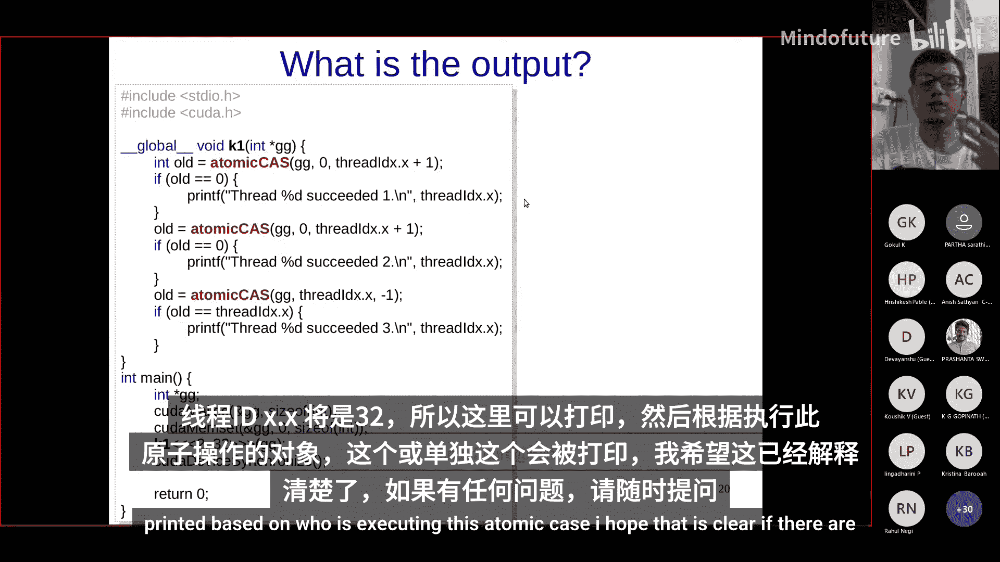

I hope that is clear if there are any questions here， please feel free to ask。

Yeah当 done呢啲嘅委。等后。Sorry， can you repeat I you missed？Some of your words。

 the atomic cast will return the Y value also for this。Yes， it will return this no， no。

 it will not return y value， it will return the old value， which was there in Egypt。Okay。

 so please let us clarify this。So it will return whatever is all value in this world。As far as order。

It will never return this viral。It might return X well if these both are matching v and x are matching。

 then it might return the X well。Because that was the world of value in the world。

But it will never happen that it's returning viral。

Unless it is the case where x and y are matching and the value of y is equals to x。I hope that is。O。

so I mean， to keep it simple， it returns the old value， which is there in this cost argument。Okay。

 any further confusions here， if there are any， please ask otherwise。

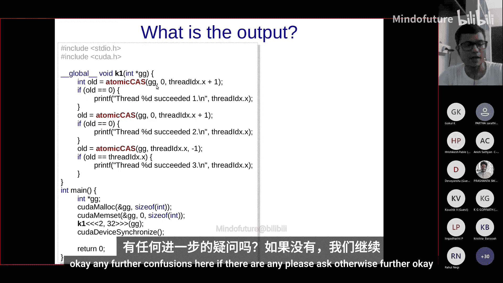

Okay， I see that there are no questions Okay， then let's move further we have few minutes more。

Okay， so as I explained。64 threads， I mean， K is launched with 64 threads and some threads out of the 64 threads。

Sorry， some thread out of 64 updates， G G2 thread ID plus1 here。

So one of the thread out of the 64 third upgrades this C to third ID plus。

Then warp threads do not execute atomic together， at least note that war threads even war threads do not execute atomic instructions together。

 even they execute in they'll also be serialized for executing the atomics。Like this atomic guess。

So that is also done sequentially or serial。And irrespective of which thread executes the atomic cash。

F atomic S， which is this no thread be G value will be seeing Gg value is 0 because it is because it is set to thread ID xt x plus1。

Hence， the second printer will never execute as we discussed。

And if any of the threads out of any of the threads having Id from 0 to 30 executes this atomic gas then。

The啊。Id， sorry thread selling I from1 to 31。咁诶。Be succeeding here。And。Based on what， I mean。

 Based on what side is， I mean succeeding here。That threat sorry。

 the idea of that threat plus1 will be succeeding here。And it will set Jg value to minus1。

 and then it will execute this I mean enter into this condition and print this statement。And。

If it's the last thread， I mean， last thread of that one， then this condition would， I mean。

 this point won't happen。AndYeah， so that is written here。 Otherwise。

 no one would update G G to minus-1。And no one would print his third printer。

 That is what we saw right， yeah。And yeah， so the most expected output， I mean， are the most。哦。

Most probable output out of this output。When we execute this code is that you will see that。

Thread 0 would execute the cost printer。Just this。Yeah。Fd0 print print this post printer。

And then thread one will succeed in printing this。太不道。So that is the most probable。

It is not that this is the most probable output， it doesn't mean that the other outputs are not possible。

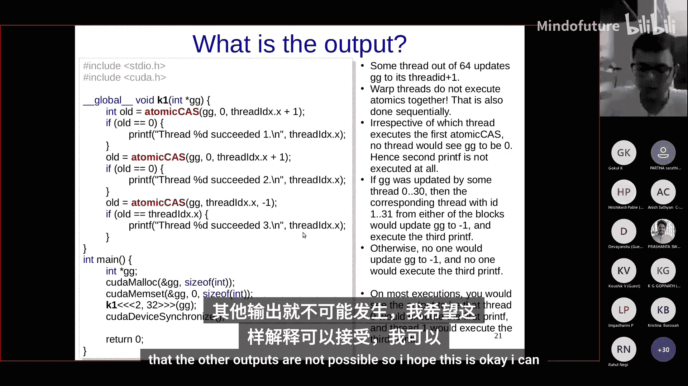

So， I hope this is。ok I经。Okay， there are no， I can say that there are no other questions。

So。If that is the case， then let's move on further。So till now， we saw this control plus data flow。

And we also saw multiple things related to atomics， right。

 we saw how to use different different type of atomic instructions like atomic main atomic increment。

 atomic gas and。In the same way we saw， I mean， we saw how to use atomic wind。

 we can also use same syntax button。A slightly different manner or I mean， syntax is same。

 but we can use different atomic function， which is atomic max。And it's very similar to atomic mean。

 it takes to argument and。Yeah， but it's。啊。It's functionalctuatel。 It is different。 It instead of。

I mean checking for minimum it checks for maximum so that's indeed change so yeah we saw multiple atomic instruction。

 which is atomic main max increment， atomic gas。And yeah， with this。

 we ended with the atomics and now let's。Let's start with the barrier。So yeah。

 so let us start with a barrier probably let me see how much time with them okay so we have few minutess。

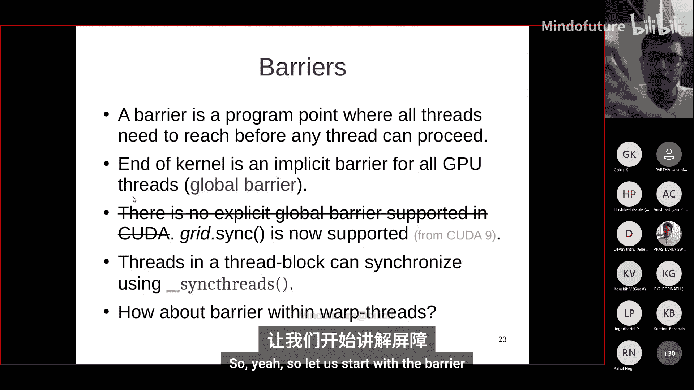

So。一啊。

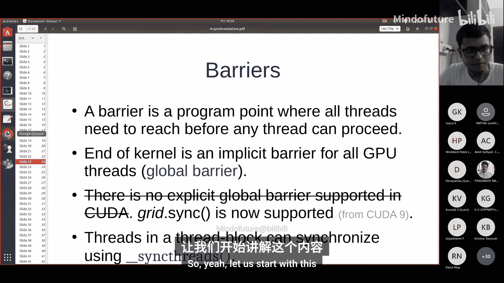

Let us start with this probably well。Cover this slide， and then will。Stop， so okay。

 so what what are the barriers。Probably we have seen this barrier before during the memory lectures where we were using that sync thread。

 so that is one sort of a barrier。And what this barrier does， it is so okay， so first of all。

 what is barrier so it is。Synchronization point or a。

Program points where all threats need to reach before any threats。

 any of the thread can proceed quarter。So let us come back to the analogy that I gave during the memory lecture also for Syn。

So let us say that we， all of us decided to go to。Football ground for League football。In that case。

What we will do will move in asynronously from our houses。

To some common point where we'll meet right so will asynchronously or in。Different， I mean。

 well asynchronously move from our houses and we'll try to reach at that common point or that common ground。

And after reaching that common ground， well together move towards the。

Football ground for playing the football so that reaching that commonplace is a centralchronization point。

We move at different speeds from our home to reach that common point。

And that is what is asynchronous execution we are moving at different speeds to reach at that commonplace but。

Once all of us reach out that common ground， then only we will move further。

To a football ground for playing the football， so that is what is sort of a centralchronization point or barrier。

And yeah， so I hope that you forgot got it that there it is a program point where all Fs need to reach before any other F can proceed。

And。Yeah， so this point is important end of kernel is an implicit barrier barrier for all the GPU threats。

So。Carnal， I mean statement which is after kernelnal will only I mean yeah。

 so not statement after the kernel， but the end of the kernelal or the the place where kernelal is finishing。

All the I mean。Conal will not end until all the threads have finished the execution of the kernel。

And so yeah， in some sense， we can say that end of the kernel is an implicit barrier for all the Jeku threads。

And yeah， so initially the global barrier or the barrier across all the threats of the GP， which is。

The all the thirds of。All the third blocks。Was not supported。

 so we know that threats between the I mean， threats within the threat lock。Sorry。

 thread within this thread block can be synchronized to sync thread。不。

If you want to synchronize the thread which are across the thread block。

 then we haven't seen any synchronization construct for it so far and it was also not supported。

A few years back， but now it is supported using something called a script toing。

And it is supported from quoda 9 onwards， So this this is quite powerful it can be used to synchronize。

All the thread across all the thread box， as well as all the grids。So yeah。

 so Schthron is important and it's kind of a global barrier now， which is supported。

And for the threads within the thread block， as we all know that it can be， I mean。

 they can be synchronized using something called a sync thread。

And we saw this during the memory lectures and yeah， one last thing。

What the barrier within the waters， How can we。Ensure that there is a barrier。Between the， I mean。

 within the war。I mean， first question is， do we need the barrier within the water？

No right because warb threads themselves execute in simply fashion。

 so only cost instruction will be completed and then only they'll move to the second。

So in some sense， if you see， there is some implicit barrier for the war thread， so yeah。

 so point here to notice that for warp threats there is an implicit barrier and we don't need any barrier for warre。

Again， for war threats， we don't need any barrier。What threads within the thread block。

 there is a barrier and that barrier is syned， which we can use。And for。Ths across the thread law。

 that is now。Synchronization construct， which is called re S。

Is supported and yeah using this construct sequenceance interfaces threads。

 which are within the different thread blocks。So I hope that is clear three things work。

 third block and。Mip， I mean， threats of multiple threat blocks。好 great。So yeah。

 at all the three levels， we have now the support for adding the barriers。

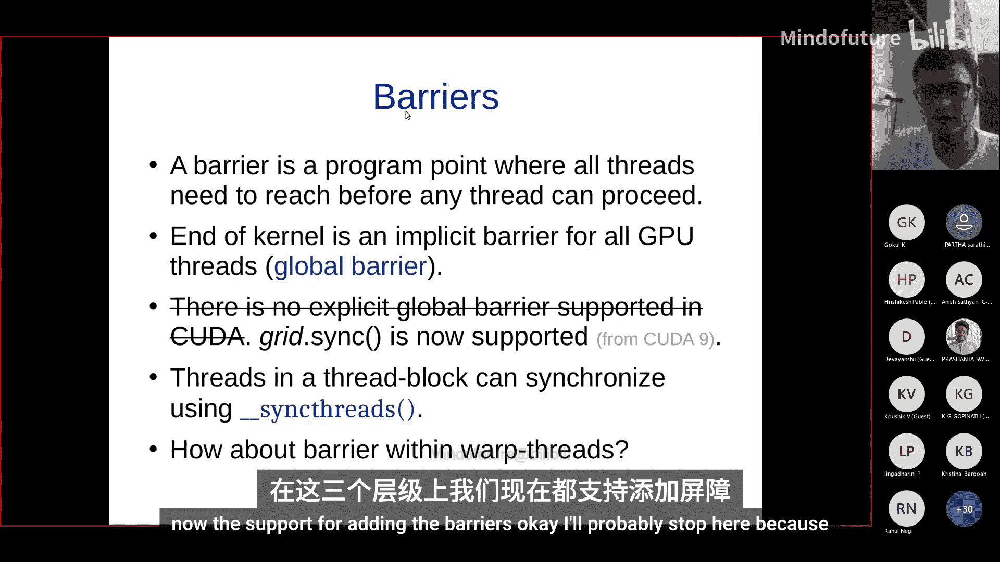

Okay， I'll probably stop here because we have。

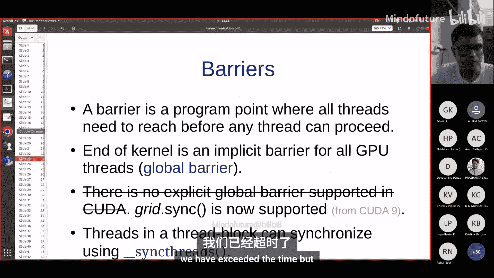

啊。Exed at time， but if there are any questions， I'll be there here for a few more minutes。

From me who what3 makes more。And if there are no questions。

 then we will call it today and we'll discussperse。

