# 【Nvidia】CUDA并行编程-｜-Cuda-Programming-Course-｜-Parallel-Computing-Using-Nvidia-p15-P15_L15_屏障、归约与CUDA中的前缀和--BV1MSq1BTEho_p15-

Yeah， so let's get started， so。

Yeah hello and welcome everyone to the 16th lecture of our good AP。So。Yeah。

 so in the previous lecture， we saw multiple things related to the atomics， right， So we saw what。

Yeahah， so we saw啲诶。Single so shortest path algorithm。

 which was having database and then we fixed that database using atomic mini。

And then we saw that atomic gas operation。 And yeah， we saw how to， I mean， how to。I mean。

 this saw the synax of the atomic gas operation， and then we saw how to implement the lock and single section using that atomic gas operation。

Then later， we also saw a few examples related to the atomic case and then we started off with the barriers。

Yeah， so。There we left in the previous lecture， so yeah， we started with the barrier。

 which is another synchronization construct and。We saw this slide right， this was the last。Like。

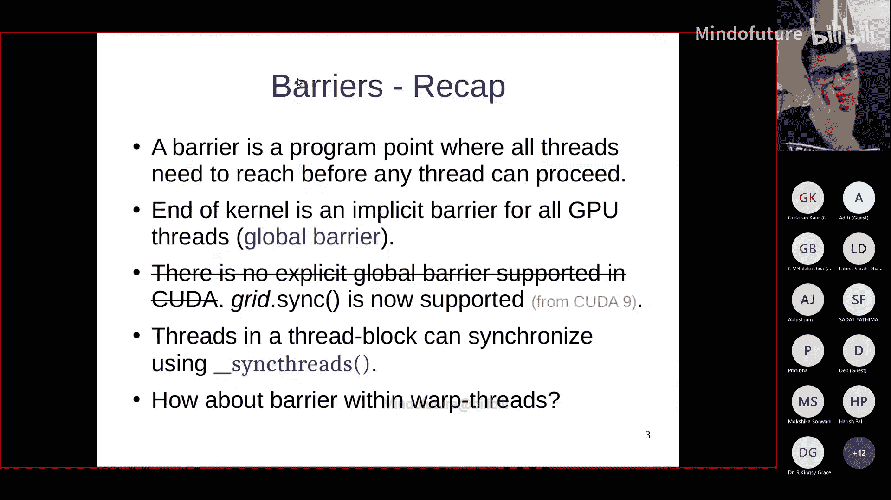

I guess that is some noise from someone's。Hequest。Have you want to new time。关し。Please mute yourself。

Okay， if you have any question， then please feel free to unmute yourself and ask otherwise。

 please mute yourself so that we have minimal。Disttractions， yeah。

So yeah， this was the last slide that we saw in the。Have we selected so。We saw， I mean。

 we started off with a buried and we saw what is buried， which is the synchron I。

 which is the program point where all the thread to reach before any other threat can。

All third threats need to reach before any threat can proceed further。

So that is what is the barrier and then we saw that the end of the kernel is an implicit barrier for all the GPQ trends。

And from quoda 9。 I mean， from quoda 9 onwards， there is。

This grid dot sync available which acts as a global value that is as a barrier across all the threads of the GPU。

And as we all know that there is the sync thread， which acts as a barrier for all the threads of the thread block。

And we later also saw that。We don't need any period for the threats coming。

But the threats are the same part because they execute in that same dimension， right？So yeah。

 so that is what we saw， I mean， these are the things that we saw related to the barrier in the previous lecture。

And yeah， so with this let's get started for the todays content。

 so but before that mean before we start let us see what we are going to。Look， I mean。

 what we are going to look today。In today's lecture， we'll be seeing。

A few more slides related to the barrier will see an example related to the barrier and then we'll see。

Data and control synchronization related to the barrier。

And then we will end period and we start something new， which is called as a reduction and prefisome。

 so first we will see the reduction today。And then we'll yeah， in the reduction。

 we'll see what is the reduction when the reduction is applicable。

We will also see multiple ways to implement reduction and there will anti reduction and then we will start the prefi。

And in prefixsome we'll see what is prefixism， how to implement the prefixsome。

 and few of the applications of the prefixction。So yeah that' is the outline for the today's lecture and yeah。

 that is what is our agenda are today。

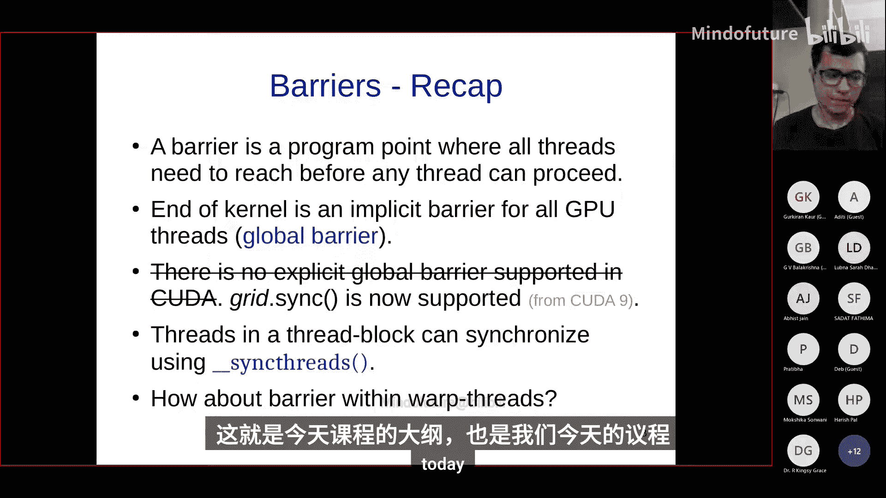

So with this， let's get started yeah， but before starting， let me see if there are any questions。

ok 啊。I think there are no questions that is。Okay， then let's start with the today's content。

日啊 so。Let us see one example it is a barrier， so we know I mean we know this sync thread right so this example corresponding to this sync thread。

So let us see this， we have this cardinal D cardinal， which takes two argument。

One is the unsigned ineach pointer， which is vector。

 which is pointing to some array which is allocated on the GPU。

And the second thing is this vector size， which is the size of the area。

 which is pointed by this vector。Doctor pointed。Yeah。

 and then we are calculating the ID using our usual formula using this our usual formula and then what we are doing。

The other a。Assigning vector5 equals to ID。Sorry， just a moment。Yeah， so then what we are doing。

 we are kernelal D kernelal and。It is taking two arguments。 One is the。

Vctor I mean one is the point integer I mean its a pointer to I mean it is a pointer of type unsigned integer which is pointing to some memorym location on the GP and second is the vector size which is the size of the area which is point by this unsed the integer vector I mean pointer of types integer vector。

Sorry， uns in teacherger， not vector， inside in teacherger。And yeah。

 it's the size of that error which is pointed by this pointer of type un feature。Yeah。

 then we are calulating the ID using this。Standard formula that we know。 And then we are doing。

The standard type of assignment that we know that is we are doing vector5 equals to ID。

What each thread will do based on its side， it will assign sum number to it， which is actually side。

So， third0 will。Assign0 value to the element0 of the， which is vector。

Thread one will assign will assign value one so the post memory I mean first element of the error which is vector and so on。

 so thread thousand0 will assign。Value thousand0 the to the element， the element thousand00 in this。

Add it just。And then after doing this assignment， that is after the initialization。

We have the same thread， which is a barrier across all the。

Which is buried across all the threads of the third block。

And then what we are doing is where we have this safe condition， right？

What the safe condition is checking is it is fast checking that whether。

The thread is the last thread of the。I mean， last third of the all of the threads that are launched。

 so if it is less than vector size minus1。Then it's not the last threat it is some threat from  zero2。

N minus one， because n thread is the thread is which we'll be working on vector size minus1。

So if condition is satisfied， then is not the last， it is not the case that it is the last。

Second condition is that。Is vector of 5 d plus 1 not equals to  ID plus 1 so I mean this check looks quite ideal right because the way we are assigning it is。

If some thread is working on some element then。The next。Next element will be I plus  one only I mean。

 it will be assigned the value I plus one， right because。

Each thread is assigning vector of 5 equals to ID。Whatら。

For a particular thread working on some element， what will be the value of its next element it should be ID ID plus1 ideally if this barrier is working properly。

 right？So I mean， both of the checks looks ideal， I mean， they should be satisfied and this I mean。

 they should be satisfied and they should be satisfied。And sorry。

 this should be satisfied and this must not be satisfied because it is not equal to。

So if that is the case， so for 0 to n minus1 threads。

 this will be satisfied and this must not be satisfied。And。If this is satisfied。

 that if it is the case that the second condition is being satisfied。

 then we are trying to print that Sttra doesn't work。And it will only， I mean。

 this synr doesn't work will only be printed， there is some issue with this barrier part。I mean。

 if this battery is not working properly。 So， yeah， I hope we are getting this that the。

40 threads from 0 to n minus1， theyll satisfy this condition。Okay。

 one point that I want to clarify here is that n is the number of threads with which we are launching begun so for 0 to n minus1 threads。

呃。Yeah， or probably let me put it in this way。There are 0 to n threads and for0 to n minus1 threads。

 conditions this condition will be satisfied and this will not be satisfied if this barrier works properly。

And if that is the case， then this print will not be printed， but is there any case。

 my question is this， is there any case where。This printer will actually be printed。

So please think about it。 I hope that you understood the question if there is any。

Confusion related to the question then you can then you can ask or yeah， otherwise we can。

Tell me the case where this print up will be printed。

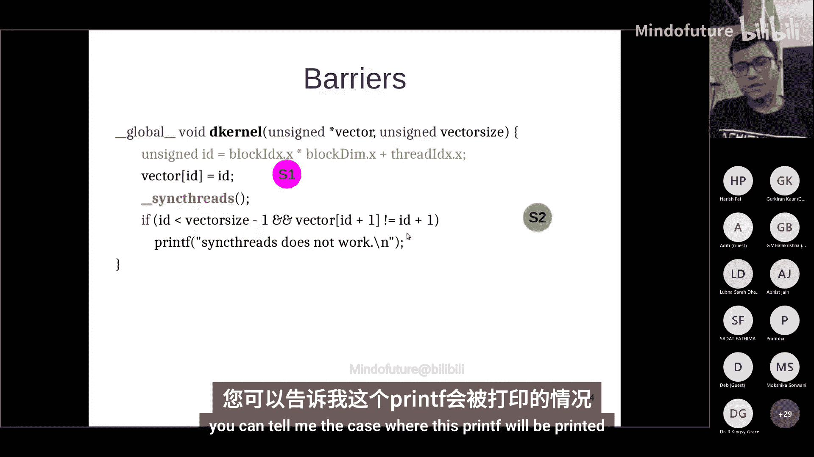

I'll probably wait here for two seconds。

The if sync thread works properly， there will be no case where this printer will work。

Because all the initializations will be done。Before coming to this， if checking。Yes， that is correct。

 your observation is correct。Please think when synd will not work。I mean， we are using I mean。

 we are quite choy here， right， we are using sync thread。Is there a case where， I mean。

 can you give some scenario where this condition checking as well as the initialization are happening together？

By multiple threats。

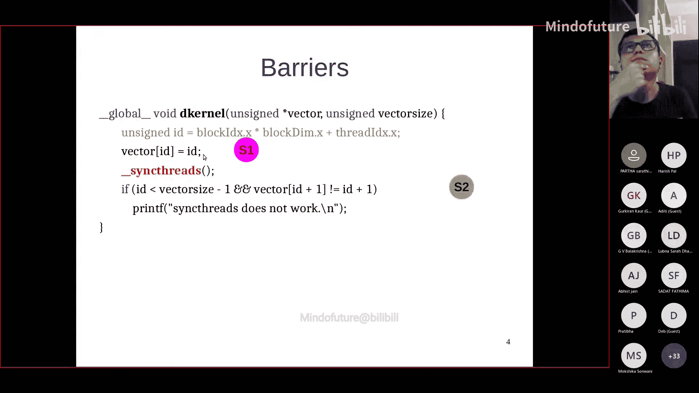

Let me go back to checking。Okay， I guess there is nothing in each chat。

 so let us try to understand so yeah。

These are like sync threads would work only inside a particular block right so if the the vector size exceeds the size of a block then it is possible。

Yeah， perfect。 So yeah， that is what I was。啊。Expecting。

 so let us start to understand well it will not work。

Let's say we have this vector which is some area right so it it's sub size greater than 102。

 but let's say's sub size 2048。And if that is the case， then we need to， I mean。

 we need to launch kernel with two thread locks， each having  one，0 two4 threads。Right。

 because we have area size 20 for it， so we need two blocks， each I mean， each having 10，2 pers。

And if that is the case。As pointed out by someone， if that is the case， then this sync thread。

Whi is the I mean， which is the barrier across only the third within the third law。

Can only stop the threads are which are within the thread block， so what can possibly go wrong here。

 let us try to understand this。So let us consider this scenario。的。0 to 1023 threats。

 that is threat serving I from 0 to 1023。Finish this initialization part right they finished this initialization part。

 So they all did this thing vector of 0 equals to 0 vector of 1 equals to1 and so on so on until vector of。

1，0， two， three， equal two 1，0， two， three。They finished it there each year since all of the threads within their third block have finished there。

A prioror statement and they have reached here， they can move further。But。

Let's say the threads of the second thread block， which were having I from 102 4 to 2047。

 we still here doing some computation， I mean they haven't yet finished this operation。But。

this syn thread is buried across the thread of the T log。It can't restrict other threats， which are。

 I mean， it can't restrict threats from 0 to 1023。To wait here。

 they can move further because the statement are already finished by the threads of the thread block and sync thread is just a barrier for the threads of the thread block so they can move further。

And now what is the issue that can happen here all the threats from 0 to 1023 have this condition satisfied which is their id is less than vector size minus1 please note that vector size here is 2048。

So for that， this condition is satisfied。And。This condition will also be satisfied for some of the threads。

 which will be the last thread。So if you take this block and I mean。

 this is the first block that we talked about and this is the second block that we are talking about。

And if you see this last thread of that， I mean， please consider that these are 1024 thirds。Here。

 I mean due to lack of this space we here we have only just shown four threads。

 but let us assume that these are 1 zero two4 thread， but and this is the last thread。

Then in that case， what last thread will check， it will check it。vectorect of  I plus 1。

 which is 1023 plus 1。Is not equal to 10 to 3 plus1。And this will be true， right。

 because 102 fourth thread， which is in some another thread block。

Have not yet executed this instruction。And if that is the case。

 then vector of 102 per will not be close to 1024 I hope you are getting it。And if that happens。

 this becomes true， this is already true， this becomes now true because the thread within other threadb false thread of the other threadb has not yet executed this。

And hence， there is chance that synt doesn't work， might be printed。So I hope you are getting this。

So， yeah， I mean。Please note my words， it might be the case that sync thread doesn' not work。

 might be printed， so there is a chance。I'm not saying that will happen and it will happen during each run。

 but there is some chance because of the way the threads execute， I mean。

 threads across the thread box execute。And yeah， so there is some chance that it might be emit and and if you replace this syn threadread with grid dot sync。

 then。Then there is no chance that this will be printed right because grid sync is varied across all the threads of the threadb sorry。

 not all the threads of the threadb， but all the threads in the GPU。

So if you replace this sync thread by grid or sing。

Then it is ensured that whatever you are writing inside the sprint will never be printed。

Because in that case， only initial I mean， only after initialization is finished。

And only every thread will check to I mean go what this condition check and if that is the case then。

You will never fall inside this printer。I hope you are getting this point。

 if there are any questions， then please feel free to ask them。

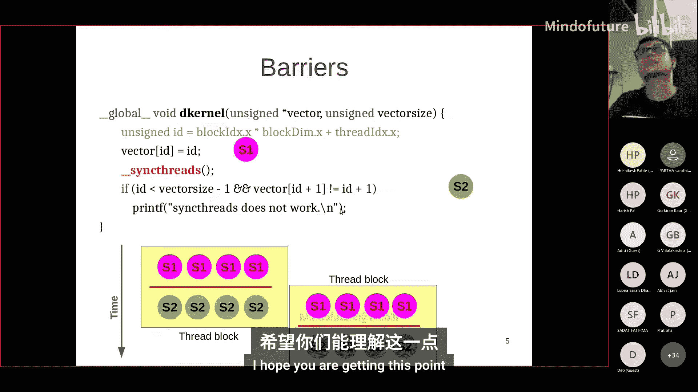

Yeah I think that is some question。It is kind of bad to ask doctors so long。

 but after seeing critical sexual problem， I have got the doubt of。This unigned idea。3ite section。

If it is local girlfriend， could you say why it is。关车。O啊。I guess hopefully your question is whether。

Okay， I guess your question is this that this ID calculation is critical section or not if I'm understanding it correctly。

Okay， so the short answer to is it it is that this is not a critical section because。

When you declare any variable on inside the kernel its threat local variable。

 so each I mean each thread within the kernel will have its own copy of the I。

And they are calulating some value value of the ID independently。

 they are placing it into that local copy， which is this ID variable。

And hence there is no critical section in word， Cri section is the part of the code where you are updating the shared variables。

Here ID is not a shared variable， it is kind of a local I mean。Separate we a lot of。

Private variable policy there， so it's not a critical section。

 I hope that that was your question and I hope that it。

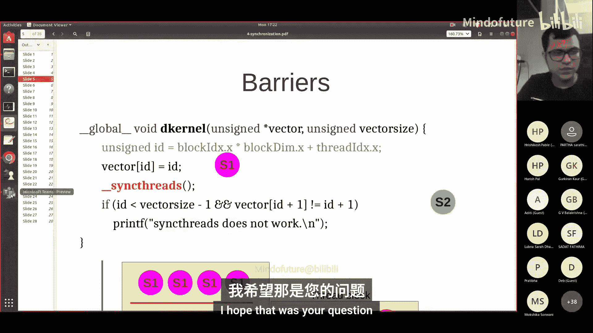

I answered it the。In the right manner， I。系。If kernel don't have coraivynch syndrome Britain。

 would the threat still have barrier after end of the post and start off the instrument。Yes。

 so by default。Okay， let us try to take up this question。 Let's So okay， that this question is。

As by one is quite interesting。So let us say that you have something like this。我讲晚问题度做过。And。

Then you have the second kernel K2， and there is no quo device synchronize in Bwill。

And I hope that question is like。Is it the case that when kernel one will finish that is all the threads of kernel one will finish their execution then only the kernel2 will start is the question Im hoping so I'm actually sorry is the question that I'm。

Is what I understand。So if that is the question， then yes， so answer to it is simple。

 so only kernel one will finish。Then kernel2 will begin because there is something called a stream。

 stream is something like a Q， take it as a Q。So。So this kernel K1 and K2 are pushed into something called a default stream。

 unless you specify any stream， both of， I mean， any of the kernel that you write are pushed into the default stream。

And the way the stream work is， yes， I mean。That the kernel is taken for the execution one after the。

Clonel one will finish the execution。Then only， the next kernel will be。啊，包这22。

Take you from that stream。And it will be taken up for the execution。

 So K1 will finish execution and then K。 So I hope that answers the question。

 If two panel don't have quota device as input input and then。Yeah。

 there will be a barrier after end of the first tunnel and the next the start of the second kernel。

I mean， there is no barrier as such， but it is ensured due to this concept of screen。

 which is actually。啊。Which is actually the way the kernels are being executed on the GPU。Yeah。

 I hope that this clear I mean clears your ta yes， but one more thing so even if the number don't match if it's2 coa 102 per in the first one and in the second one is different even then it will。

Yes， it can be anything things so I。It can be anything。K3， K4， it can be anything。Can be。

It can be automatedted。Third third kernel might look something like this。 It might have 32 block and。

1，0，2，3，3。So。So the point that I was trying to make here is that whatever you write。

 whatever kernels you have written right， they are pushed into something called as default stream so think of it like this there is cave and then。

Okay。结果。They're pushed into the stream。And then this。

Schedulr will take K1 for the execution once it is finished， it will take K2 for the execution。

 once it is finished， it will take K for the execution。So that is how streams work。

 but there is some part， I mean there is something to it。

 you can specify that I want K1 and K2 to go to different stream。In that case。

 they might execute in parallel。And probably as part of this course， probably if you'll get some。

 we'll look into this string。But yeah， I'll just want to， I mean。

 I would like to make here a point that P default， this is the execution pattern， K1 K2 K。

But you can specify that I want K1 K2 and K4 to go to different streams in that case they can execute in parallel。

 but you have to also specify that。Okay， I don't want them to go into De stream。

 I want them to go into some another stream。And if that is the case， they can execute it better。

 so I hope that you are getting。

ok啊。Okay， yeah， so let us move further。So let us continue our discussion with the barrier。Yeah。

 so important point here is that synched is not just about control synchronization。

 I hope that you understand what is control synchronization control synchronization is。Like this。

 so only if all the threads have reached some point， then only they'll move to the next instruction。

 that is what is control centralization。But。Okay。So synchron is not just about control synchronization。

 it is also about data synchronization mechanism。So let us understand what。

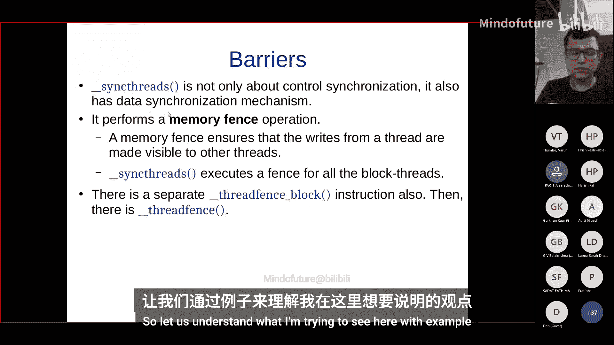

I'm trying to say here with example。So let's say there were some statement， let say S1。

 bunch of statements。Whichhi I'm telling it as aspen。Then there was this thing， right think？Thanks。

Saint Per。And then there were a bunch of statements which were to。So。

What what this statement is trying to say is that。

Synchroned is not just about control synchronization。

 it is also it has data synchronization mechanism， so let us understand this。

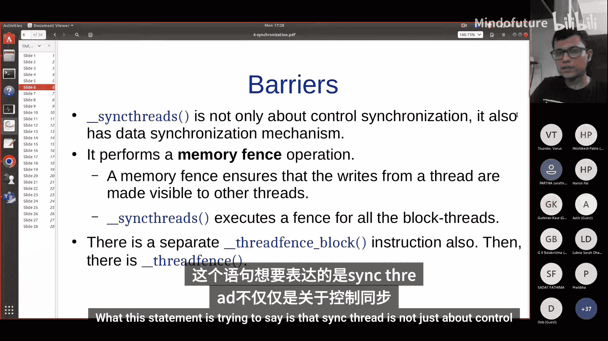

So it's not just that threats will finish S1 and then wait here and then we move towards S2 that is correct that will definitely happen control synchronization is definitely there。

But it ensures something more。 It ensures that there is also data synchronization， that is。

Then the thread， I mean， thread moves to the statement which is， I mean。

 bunch of statements which are S to。It ensures that all the rights done here by the statements which are present in S1 are visible to all the threads。

So I hope you're getting this it ensures that。When the threads of the thread block， by the way。

 synchread is for the threads of the thread block， when thread is of the thread block。

Reach here at this point， S thread。And then move towards the bunch of statements as to。

What it ensures all the operations that are done by the threads of that third block。

Here at the S1 are visible。When they move to S。So it is kind of data synroronization。

 so it ensures that when they start executing this effects of this are also visible to all the threats of the threatlock so that is data synronization。

So。Sin third。Or yeah synchd ensures data as well as the control synchronization so I hope that this point is clear it's not just about control。

 it's also about data synchronization。And。

Yeah， but how does it ensures data synchronization。

 so there is something called as memory fence operation。

Which ensures that whatever rights that the threats are doing， for example here。

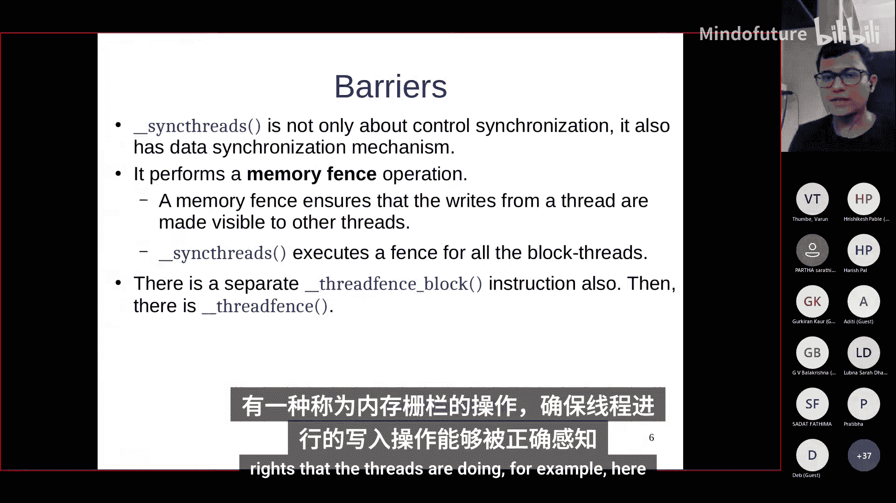

Let's come back here， whatever rights that the threads are threads of the threadb are doing here at this。

S1。Are visible when they reach here as。So。

Yeah， so that is ensured using something called as memory fans。

You might recall that volatile keyword right that we used to talk about。

 it has this similar kind of mechanism it used to ensure that that variable。

Is being written to the main memory and is being read if any of these threads want to read it read from the main memory。

 so this operation of the memory fence is somewhat similar to that。

It ensures that writes from a thread are visible to all other threads and how does it ensures that by writing it to the main memory and reading。

 I mean， letting other threads hold from the main memory。So yeah诶 so。Key takeaways。

 this sync thread is data+ controlled centralchronization and datacentchronization is done using something called as memory tense。

And sync thread executes a fence for all the threads of the thread block。And for doing that。

 there is a separate instruction called as a thread underscore underscore thread underscore block。

So think of it like this， this sink thread。impmplicitly calls this threat trends under I mean。

 this underscore underscore threat trends underscore law。Inside it。So。It will ensure that。

Both I mean， it will ensure both control synchronization happens as well as the data synchronization using this。

So yeah， this instruction threat pens block is used for I mean， this used for。

DaData synchronization for the threats of the threat。

So yeah I hope you' are getting this one and apart from that so this T fence block only ensures that I mean。

 it only ensures data synization for the threads of the。踢落。

So but let's say our requirement is something higher than this， we want data synchronization across。

All the threats of the GP then in that case there is some another instruction which is thread fence I mean underscore underscore threat fence。

And it will ensure that， I mean， it will ensure data synchronization across all the。

Threds of the GPU。 So when I say all the threats of the GPU， it means that whatever rights。

Whatever rights are done by any of the threat。Willll be visible to all other threads of the GPU after the execution of this3。

So I hope that this is clear if any confusion or any questions at this point are on this slide or previous slide please。

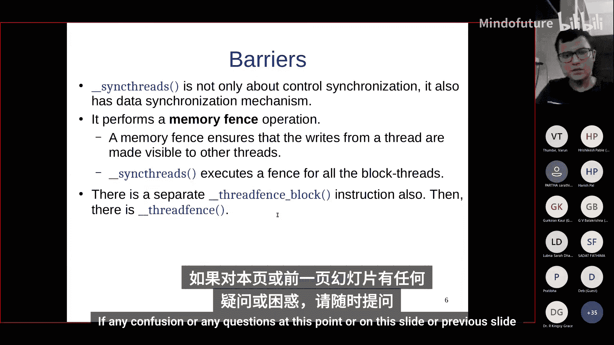

Thank pretty to us。Okay， I guess there are。

No questions in that case， let us。More part that。Okay， so let us start with the。

ANew sub topic That is a reduction， so。Yeah， so typical。ACase in which we use the reduction is。

Is for the scenario where we want to convert set of value to a few values or typically one value。

So let us start with an example， so let us say that you want to compute this some of the n numbers。

W are that in the area。And sum is kind of n to one operation right， so you are given n values。

 you want to convert it to a one value， which is a single value which which actually is the sum of all those n values。

So we are doing end to one conversion and。So it's some， I mean， this operation can be converted。

This operation can be done using reduction， rate， because that is what is the reduction used for converting the set of values to a few values。

So。Yeah， so that's the example of reduction but。Yeah， but let's come to this point later。 But okay。

 so so far， we have seen。阿 mean。So far， we have seen。I mean。

 doing the addition operationion or doing the sum oppression using only one type of。

Using only one way that is using atomomic， right。Okay， so first of all。

 sequential way of doing it is like， let's say you want to compute some of past and natural numbers then what you're do。

Start from I mean toolss just try to loop right and in that you will do this。

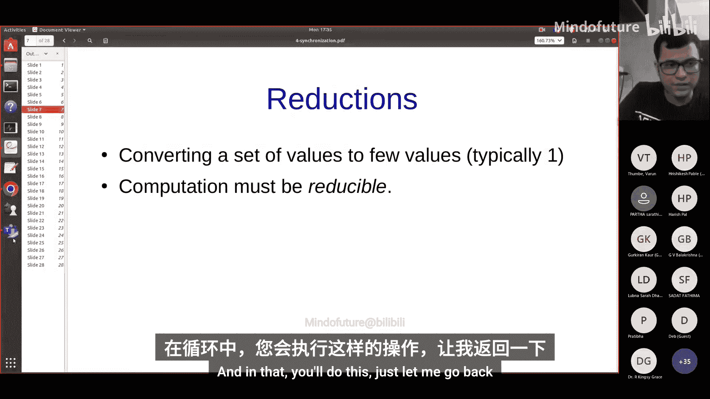

嗰病。Some plus equals，2。Some plastic question stool。I write， well， where I is going from but to end。

But if you see this， this thing will not work on GPU right。

 because there is a data is right because this plus equals2。I hope that you remember that。

Plus equal2 is nothing but sum plus I and this thing is again broken into three assembly  level instructions。

Due to this breaking， I mean， due to this thing， breaking of this instruction into three assembly instruction。

啊。I meanan there is a chance of data is that we saw a couple of lectures back right and so to avoid this what we do we do this right？

Economic。And。And some。And some write we do thisす。But okay。

 so this is one of the way in which we can do。 But there is a drawback with this approach。

 right that there is a lot of。Sequentialality involved because if you see。

 if you have have this thing inside the loop， because the eye is a lot variable。

And if you do this thing inside a loop。Okay， so let us say that even if you are not using any book。

 let's say you have。You are doing it like this， let's say you are doing it on GPU。Tommy Cad。

Lets say you are doing this operational GP using atomics and then let's say you have just one thread block and。

You are doing this。So each  node is adding its own value based on this product。And yeah。

 this looks bad， but actually this is a serial operation， even if there is no loop。

 you have completely removed the loop， still this is a serial operation because of the atomics。

Because at one moment， only one thread can add the value inside this sum。And if you see it properly。

 each and every thread is adding the value inside sum one after the another。

 and hence there is a lot of sequentiality involved。And essentially you are doing nothing in pattern。

 plus there is the overhead of this atomics。So if you see this。

 this thing will perform even worse than the。CPU serial core， because that is。

A code and it will calculate the final sum。So， yeah， the point here is that。

Using atomic is one of the way that we can calculate sum parallel on GPU。

It's not a very good way to go。 I mean， good way to go with， because of the。Sequentality in one， and。

To improve this， we can use something called a reduction。And。For doing that。

We need to understand how the reduction was。

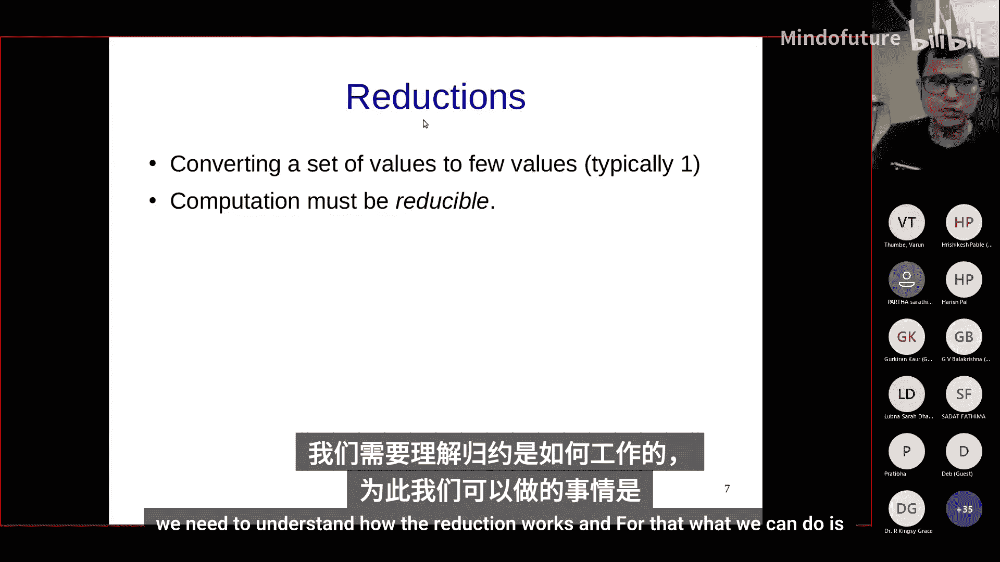

And for that， what we can do is we can start off with that array， lets say we have some array。

Who buy 6。What we can do is。You can launch cu with n by two threads。

 whatever is the size of the tear。We can what we can do is each thread adds the access value。

And after that， the what will abicum， so2 plus3 ishi and sorry2 plus 3 pihi and 5 plus6 is 11。

So after first pass， the error will become this and after the second pass the error will become 5 plus 11。

 which is 16。So if you see at each step， we are reducing the size of the error2。

Please note here one thing that we are using all the threads of the GP I mean。

 we are using multiple threads of the GPU， not all the threads， but。if the size of the array is n。

 then in the first pass well be using n by two threads。

And in the second pass we will be using n by four threads and it is the third pass n by threads and so on。

 So in some sense we are using the。Multiple crs or。More than1 thirds which are available on the GPU。

And calculating this sum and the second advantage that we are getting is we are reducing the steps from end to log inly。

So please note that we are reducing the size of error by half in each hydrration。So if initially。

 there were。N elements then in second step there will be n by2 elements。

 then n by4 and n by it and so on， and at the same time we are using multiple tracks for each during each equation。

So I hope that is clear， okay， it will be more clear with the upcoming example。

So that is the brief kind of。Overview of the reduction and for making use of this reduction。

 the computation should be reduceducable when I say it。

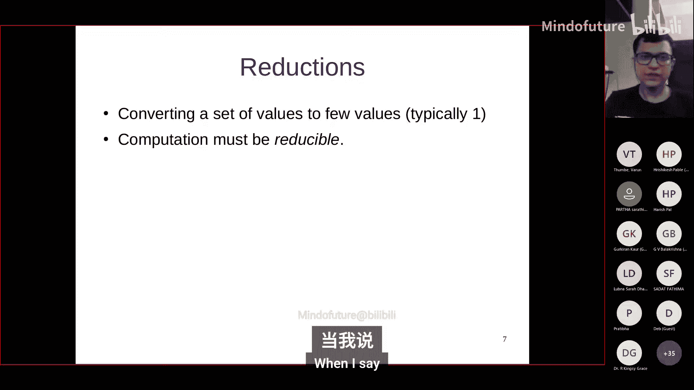

And anyone啊。Tpe back in the chat， no audibles。O。

Okay， sorry for that， I hope that now I'm a to everyone。

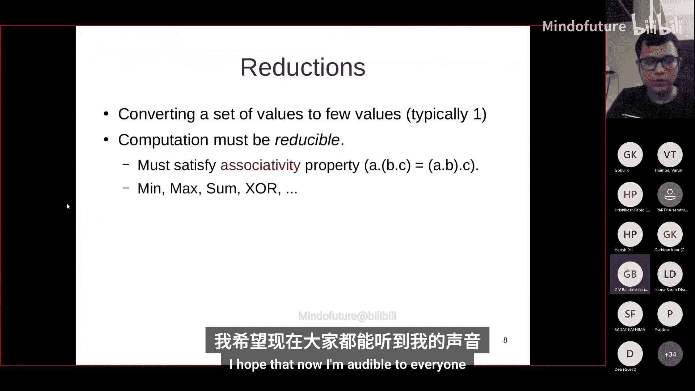

Okay， so when was it。 Okay， yeah， so we saw that the。

I mean we saw a brief overview about the reduction and。

We saw that for performing the reduction， the computation must be I mean。

 computation or the operation must be reducable。And what what do I mean by reducible。

 I mean that that the operator or that compression must be must follow the associivity properly。

And what is associivity， that is， I mean， what is this property associivity。That is呃。

When B compute with C and then compute with a should give same answer as a compute with B and then compute with C。

 so this dot can be any operator。We can replace it by plus or star and if that operator that is plus or star follows this thing。

Then we say that that operator plus or star is associated。And there are many。

Operators like main Max XOR， which can be I mean， which are actually associative。

Can you give me some example of the operator which are not associated？Again， I repeat the question。

 can you give me some example of the operators which are not associating？

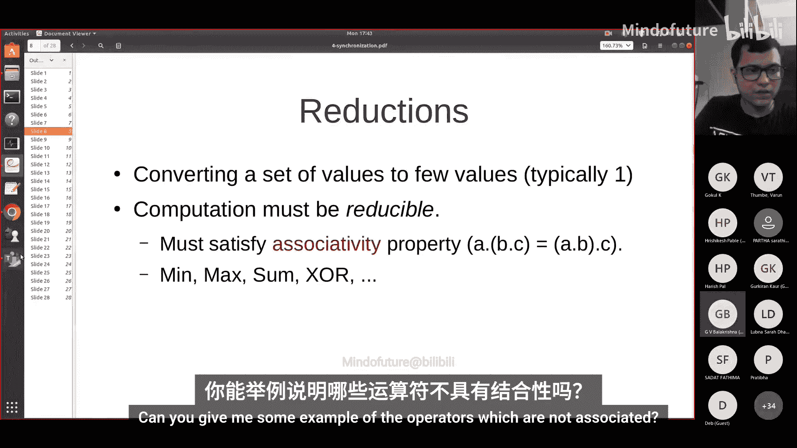

I hope that I'm audible now。questionest。So thread pins is GPU white and memory pins is block white。

Okay， red fence is GP while。T fence block is block wide。系好 that。

A clear vocal based on our。So this Tp block is。Block white and this thread his memory GP white。

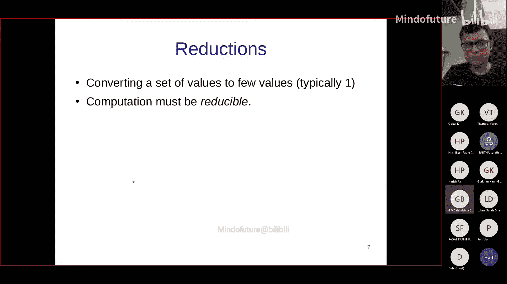

Ske is saying matters multiplication。Pishcious saying division。屋企啊。

I think matrix multiplication is associated if you， let's say we have three metrics a。BM。Yes。

 I sorry， it's not the committee sorry。Yeah， it's not competitive， but it's associated。

 so ABC are three matrix。这色线。系。You can take any of the I minutes proved theoretically but。

Just for the quick check， you can take any of the examples for the mattressric ABC and you can check this that it will follow。

I agree with Harish that division is not。Soc。So other examples such Army。

Other example of the operator which is not associated with subtraction， right。

 subtraction is also not associated。

Yeah， so key point here is that you'll be able to apply reduction。

Only when the operator is associated。So as pointed out by you people like division。

 there is division， and then there is subtraction， all these of are not associated。So for them。

 you want to be able to apply reduction。But for this。

 all this operator may max some addition multiplication， all these things。

 well be able to apply the reduction。And yeah， we good I mean， well be looking how to。

I the court reduction now。Okay， so as I discussed， all this operator mean Max and some which is addition and all those things。

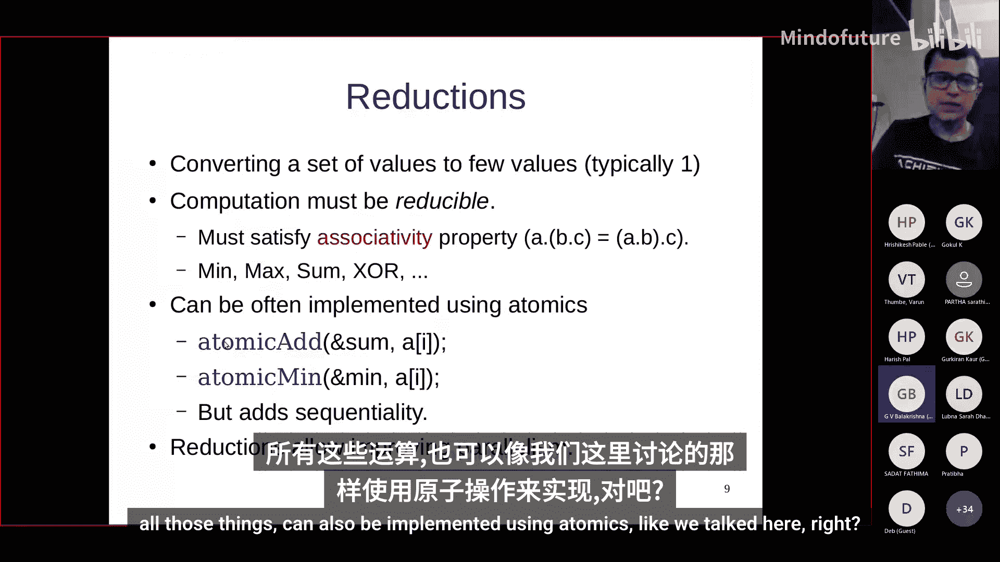

Can also be implemented using atomics like。We talk to。 Let's say we have。

 we want to calculate some of。Po and number， then we can use that。

But。Using atomics will have its own overhead that is it will add sequentiality。

 as well as there will be an overhead associated， I mean。

 some overhead associated with atomics itself。Yeah， so that is the issue with them。

It will add the sequentiality across overhead and。It will also not make use of the amen。

 idly threads are working in parallel， but min。They are working in parallel but doing guitar task sequentially。

 so that's the problem， so in order to improve the parallelism。

We use something called a reduction and it actually allows us to improve the parallelism。

 so let us see how to actually I victorially see how the reduction works。

So let us say that we have this area of eight numbers or let's say n numbers。

How do we do a reduction？Each thread， first of all。

 we launch the kernel with n by to third CPF area of seizing and each thread。

Will do the sum hchescent element for the first pass。

 so 4 and will be4 and3 will be added in place here， which is7。

9ine and three will be added and will be placed here。

 which is what similar to this two will be added and placed here。

 this two will be added and placed here。So first pass will have n by2 threads and each third what it will do it will sum the adjustment element。

In second pass， we'll reduce the number of threats， there will be n by four threads。

What they'll do they some of the adjacent element now please note that these are two adjacent element after the。

Computition that we made or we did decided to adjust an element。

 they'll be summed up and they'll be placed here。Again。

 these two adjusted elements will be summed up and will be placed here。So n by four threads。

 does their competition places the answer？And we have this area。

Now the third plus third pass will have n by element n by8 threads， not element n by8 threads。

They do呃。I mean， they'll add up the adjacent elements and we'll place this up and that is what is our final。

result in this case， but if there are more elements then this will go on from n by4 to n by8 to n by 16 and so on until we reach the single element and that single element will be our final answer。

So I hope you are getting and。It crux of how the election works。

And if there are any questions at this point in case， feel free to ask the boss。In the next slide。

 we are going to see how to implement testing thing。 So yeah。

 please feel free to ask if there is any small。

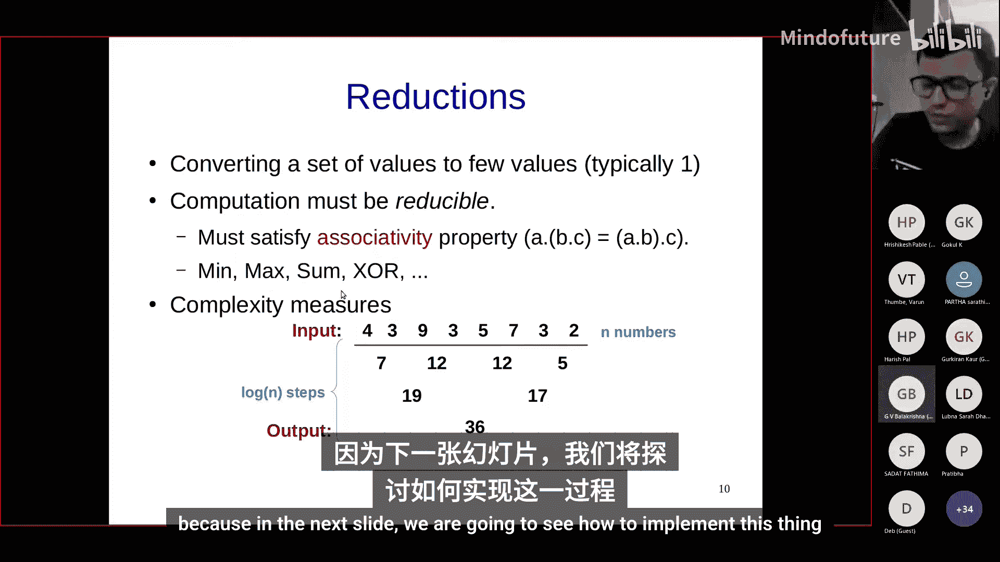

Tiny tiny bit of conclusion here。I think there are no questions。ok 啊。Yeah， this is a good question。

 what if n is not even in that case we need to do this。啊。Yeah， in that case we need to do this。

 we need to use seal of n。That is because， I mean， we need to launch kernel with zero off n by emission because。

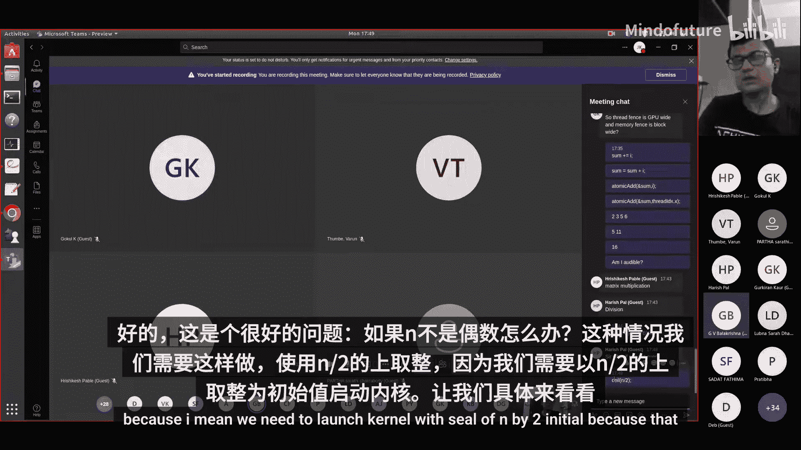

That。OkayLet's come to this。So let's say we have nine elements here then in that case。

First eight elements will be summed up like this right and the ninth element will just go as it is so let's the ninth element was some 10 value 10 then it will go straight like10 here and then again they will be paired and then。

Probably last element will be。Cped here as it is then again they'll be paired and then last element will be capist and then this element and the last element will be taken part the some and they'll be placed here so I hope you are getting it。

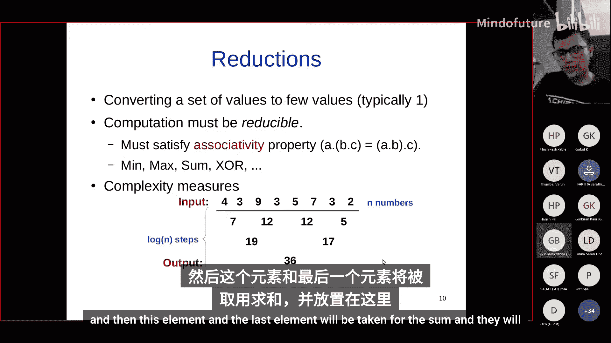

So small modifications we have to make based on。The corner cases are I would like to say。

So I hope this is clear。Okay， I'm assuming that is clear and if there are any questions。

 then please feel free to ask。If you think that I missed something， then please feel free to us。

Yeah， let's move one。Okay so as a class let us write the code for implementing this reduction。Yeah。

 let us write this code， so let us understand this。Yeah。

 so how to implement this reduction that we saw。Yet。So you saw this thing， right。

 how to implement this thing。So one way to implement this like this。

 so this is the same area that we saw in the previous slide。This one。

And how can we implement this one of the ways in which we can implement this like this。

 we can take this element four and sum it with pi。This element three summit with seven and so on。

And then we can place it here。啊。And in in the next class， what we'll do is。

Take this element and then well sum it up with this one sorry this one well we will take this 1 and then sum it up with5 and so on here we have just four elements in the second pass but if we would have ifPA had a minute。

If that would have been the case that we have more elements， then we'll sum up accordingly。

And then so on for the next steps or next passes。And。Yeah。

 so is the code corresponding to its implementation？And let us see how can be implemented。

 So this offset is the。呃。This off OFF is some is something called this offset and。It shows the。

Number of threads are number of elements with which we want to I mean the number of threads in a particular past that will be active so initially we have n by two threats because in post pass we have n elements right so。

To operate on n elements well need n by two threads。Then during each pass。

 this offset will go on reducing in number that is it will become half of the。Half of the value。

 which was there in the previous pass。And what will happen in each pass？

If the idea of the thread is less than this offset， what that thread will do。Pable。

It will add the value thread ID extra X plus offset is let us complete the example and understand。

Here for the first pass the offset is n by2， so what is thread IDx dot x plus n by 2。

 so for the first thread it is0 plus n by2 which is this element， right？For the first thread。

 it will be 1 plus n by 2， which is this element。And so on。 so third ID X text plus offset is。

The element， which is。And by two steps away from it。So if you see essentially we are doing this only。

 we are jumping n by two elements ahead for each。Each first invite byte elements。

 and we are adding that into E of thread ID extractorex， that is this， this。

 this and this memory locations。So yeah， so after first pass， we'll be having this array。

And please note that now we don't need this later half。Later half of the area。

And in the third pass will。Mo I mean well add the n by fourth element after it so here n by fourth element is 12 so oh sorry yeah 12 so 9 plus 12 will be added and it will be placed in thread ID extrat which is 21 10 plus 15 will be added and it will be placed in this thread ID extrat which is one so 15 will be placed here。

And yeah， and so on， if there were more elements。And this note that after this passed the half of the area。

 which was this。Which was in the previous past， this one now becomes useless for us。And so on we。

I mean， they go on doing this thing。T we， I mean， we reach the point where we have just single element。

Which is 36 year。And there are competition finishes。

An important point to note here is that we should have a barrier after each and every。诶 bus。

 because诶。Otherwise， there can be issue because let's say if we don't have varied after each and every past then what will happen two passes can overlap。

Reading and writing can happen simultaneously。So in order to avoid that issue。

 we need to have a barrier which is syned。After each and every pass。

 assuming that we are just using one。T了。If you are using more Flocks then we need to replace this by current do sync。

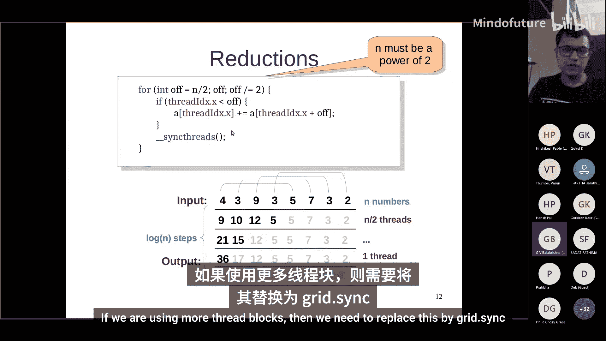

I hope this is clear any questions update。We could say for last thread as。我唔计佢。Okay， okay。

 it is corresponding to this hoacious questionnaire。We could say that for last term Adv would here。

Yeah， that is one of the way in which we can do。I think that will work， but。

In that case you need to con it with I mean you need to concatenate the error with 0 so lets say you have odd elements。

 then you need to make the number of elements even by adding appropriate number of zeros at the end that is one of the possible solutions。

Yeah I hope that is。

Yeah， any questions related to the reduction？And one point is that n must be power of two because if you see we are dividing it by2 each time。

And if and is not the power of tool， then we might lose out some elements。

 let us say that there were some more elements here than。If you say this code。

 the way this code works is that it assumes that the p is power of two because we repeatedly divide it back during each pass。

They might lose out some elements， I mean， adding some elements which are。At the end， if if we don't。

Assume that thing so yeah， but we can tweak this code， I mean。

 we can work offline on tweaking this code such that it even works for the case where the end is not the power of。

TheApp， this is the high level idea of how we can。Use the reduction to perform。啊。

The operations like additional and so on， like， you can also extend it to。

The competition of Min or max and。The crucial thing here to note is that we are not using any atomics here。

 if you see we are not using any atomics。And another important thing to note here is that we are just using log n steps because the size of the array is reducing by half in each pass。

So login steps we are using。And we are not using any atomics。 Yeah， I mean， there is a barrier。

 but still， I mean， we are not using any atomics and steps are lock compared to the sequential code where we will need and step to。

And steps to perform the addition so if there are n elements we need to I mean if we go about the serial lit。

 then we'll need n iterations right so that those are the end steps but here we just need lock end steps。

Okay， so I am hoping that this is clear。Okay， so we saw one way to implement the reduction。

 There is is another all。 I mean， this there is some another way to implement the reduction where we can。

Take the first element and last element， and then add it。

Second element and the second last element and added， and so on。

So this is another way to implement the reduction and how can we do it we need to I mean。

 just simply tweak this code a bit， we need to simply tweak this part of the code。

So instead of doing this。EF thread IDX dot X offset。

 which was used for doing this type of competition。

 this addition with this and this addition with this。Instead。

 in order to do this type of computation where we are taking question last element。

 second and second last element， and so on。We need to do we need to change this line to this。

Here what we are doing is。We are。We are taking first element。And what we are， I mean。

Not cost element， but the particular element， which is this are either this element or this element or this element。

 we are taking that particular element。Then what we are adding to we are adding。I mean。

 we are adding the element， which is a2 into offset minus str x minus minus1。

 so let us understand this with an example。So let us say that it was zero element， so yeah。

 index starts with zero， so this was0 element。So to the zero element what we are adding we are adding。

2 in2 offset offset is n by 24 the first iteration， I'm talking about first iteration，2 is n by 2。

Sorry， offset is n by2。 So 2 into n by 2。W is end。N minus third I X x。

 which is 0 because we are currently working with0 element n minus0 -1。 So n -1。

 this is n -1 for this。T think about this argument。So it will add n minus1 element。

 which is this one， so it will add two to four。For the second thread， it will add。N minus1 minus1。

 so n n minus2 element， so for the third on this element， it will add n minus2 element this one。

And so on。And。If you say this was for the first pass， for the second pass。And will become sorry。

 offset will become n by4 and。The appropriate computation will be done。

 so this will be added with this and this will be added with this and so on。So I hope we are getting。

 There are multiple ways in which we can implement this reduction。

 This is one of the way then this is。This is another way and so on you can even come up with your own way for implementing reduction。

So I hope you're getting it any questions before I move。

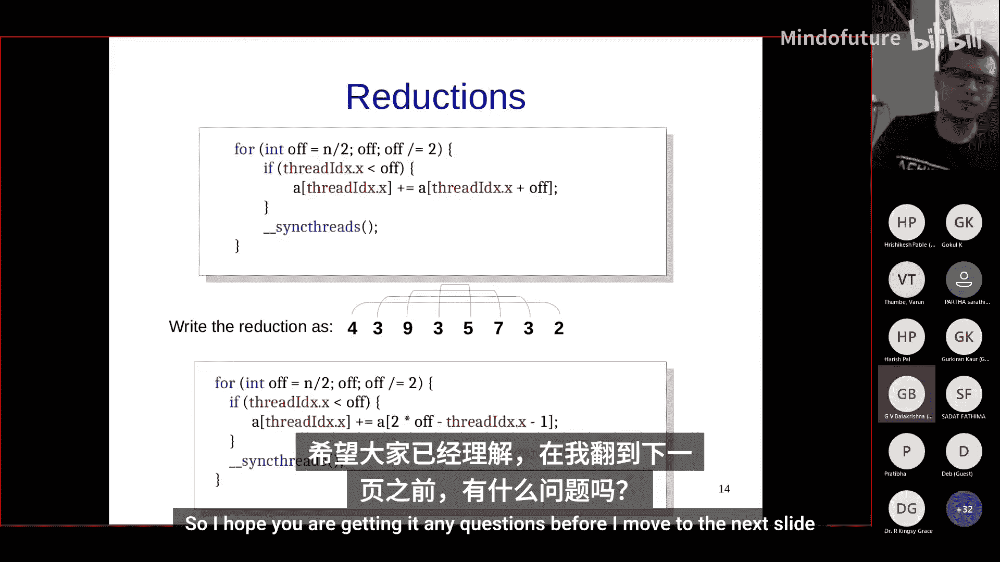

So here I is shared with people。Yes， obviously array shared variable because I mean shared variable in the sense。

 it's a shared array。This array， entire array is visible to all the threads of the GP。

I hope that is clear。Otherwise， if it's just a。I mean， if it's just a threat local then how， I mean。

 you won't be able to perform reduction well。I hope that is clear。And in fact。

 for all the examples that we have seen until now。The area that we use were declared on the GPt global I mean where inside the GPSst global memory using quoda mono so it is visible across all the GPU threads I hope that is clear。

Okay， anyways， let's。

唔好快递。So yeah， so initially we looked at this diagram， right that。

We are using I mean we are adding this to adjacent element and this to adjacent element and so on。

 so we haven't implemented that one right we implement two variants of reduction this one and。

This one， but。This first one that we saw was different than both of them。

So this can be implemented in the following way what we can do is we can assign one thread for adding this to one thread for adding this two and so on。

And can we can place them here we can place them consecutively that is faster， I mean。

 the first well， I mean。The value that is added by the first thread will be placed here。

 second thread will be placed here and so on consecutivesly。And so on。

 we can continue this for the rest of the end phases。So， that is fine。But there is one issue here。

 and the issue is that。And the issue is that there is a data is and how there is a data is。

That whenever you whenever are you， I mean， whenever you are adding four and  three and are placing here。

You are reading this value  three， right？And at the same time， what next thread is doing。

 it is reading nine and three and it is placing at this location where three is there。

So thread0 is reading  three and thread one is adding this to and writing into this。Location。

 which is currently three。So this reading and writing are happening at the same time and it might happen that this third0 might rate the value 9 plus3 which isque instead of three and it might compute the wrong sum。

そう。Yeah， so again， coming to it here 1， which is this one is being read by thread2 and written by thread 1。

It is being read by thread 0 and it is written by thread1。

 thread 1 which is computing 9 plus 3 and it is placing at this location it is being yeah that thread is writing it and the thread 0 which is computing4 plus 3。

Is reading it。So e of 1 is being by 3 read by 37 written by 3 and this can cause the data risk。

And to solve that， we need to separate this read and write operation by thread0 thread one。

Using some barrier， so it requires a barrier in some temporary location。

I request you people to try this out as a homework。

 how can we implement this sort of reduction so we have seen two types of reduction till now。

 this is the third way in which we can implement the reduction。

Please try this out and if you have any questions then you can ask。So yeah。

 with this let us move further， when they prefi some party your letters。

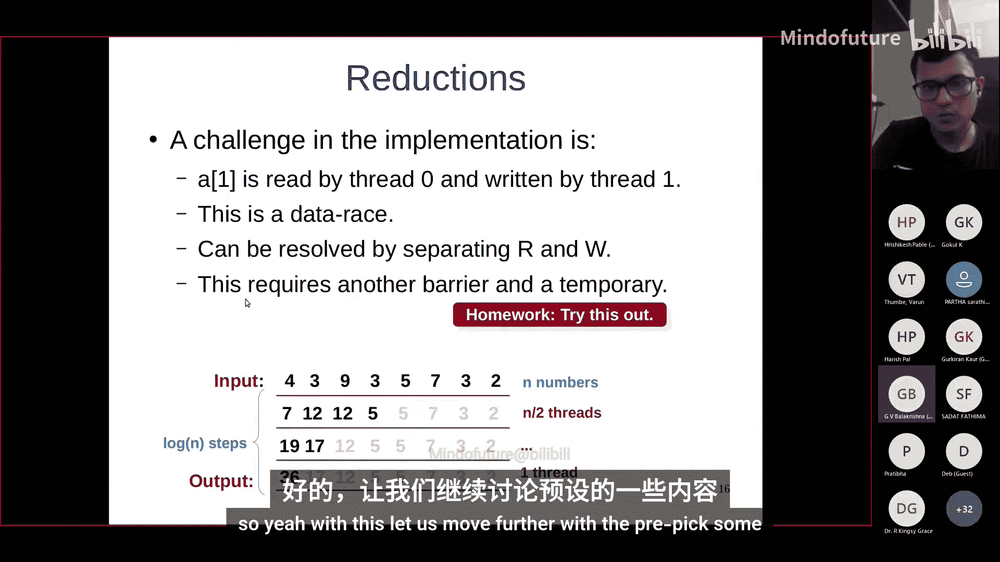

给钱。There is anything in chat。I that is some question。

So but we are using thread ID extra text so that for thread with IDN， it will be segmentation for。

ok o 啊。

So there are a few assumptions that I'm making here。Here开。

There are a few assumptions that I'm making here， first is that we are using just one thresholdread。

Second assumption is that not second is not the assumption， but second is the fact that。

Thread IDX tot X goes from zero to number of threats。If there is just one third block。

Let's say we have launched the tunnel with 1024 threads and one thread block。Then Her ID X text。

Will go from 0 to 1023 and if error a is also of size 1024， then its indexes will go from 0 to 1023。

 so there won't be any set part I guess。But if still you think that I missed something then。

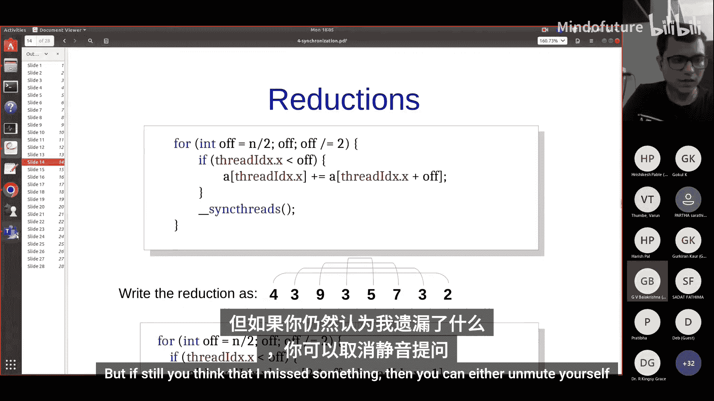

You can either unmute yourself or can ask。I mean， a new doctor can ask her if we can be a attention。

Yeah， that's okay。I mean， it's okay。系。We confused somewhere， but yeah。

 please feel free to ask so that sometimestime it might happen that I I miss something out and you people might。

关 that can so。

Yeah， please feel free to ask the question is what I'm suggesting。O， so呃。With this。

 let's start with the terrific sum。So， yeah， first of all before。Yeah， let us start with a prefi sum。

So。Where is， I mean。We first of all， see the typical application where this prexum is applicable。啊。

Yeah， so assume that we have big threats and they want to push some work item into some central workplace。

And for doing that， prefi will be helpful。And first of all。

 I am assuming that you people know what is prefisome or let me just clarify what is prefixsome。

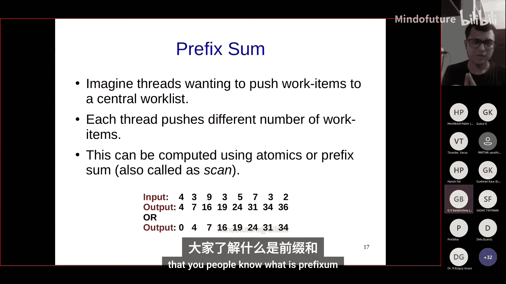

So let's say you have some error 1，23，4 5。Let me just keep it in。Next's say of this input area。

Then what is prefix sum prefix sum is just the cumulative sum so yeah I'm assuming that few people are going still but I am just reiteerrating just for the clarification purpose so prefix sum is nothing but the cumulative sum across the error element so if you calculate the prefix sum for this array this one it will be this one。

1。And three， and6。唔等等。So what we are doing is we are just calculating the cumulative sum so  one plus。

Two is three，3 plus three，6 and6 plus four is 10。So。

 this is what is the prefixsome and yeah so let us come back to this slide where I left up so let us start with the typical application of the prefixsome。

That we want to yeah， so each third want to push some work item to the central world。

And each thread is also pushing different number of the workRC items。Yeah。

 for implementing this type of scenario， we'll need prefi sums。And yeah。

 let us understand with this example on why do we need pre some per type of example？

So this was the input area 4393 pi 73 and each element of this array denotes the amount of items or work items that a particular thread wanted to push into the work。

 so thread number0 wanted to push four items into the work。啊。

Third one wanted to push three items into the work。

 T two wanted to push nine items into the workplace and so on。So。If you see， we can calculate I mean。

 we can have two I mean， we can calculate this perfectfi sum in two ways。First ways。

This and second way is this， I mean， first way is the one in which we start off with the。I mean。

 we start off with the first element of the。A is the initial value and then we keep on adding it。

 or we can also start with the zero and then we on adding the elements in the error。So based on that。

 will have slight difference in the。Not slide， but。

This one that have will get the different cry sums。If you see both of them。

 both of these are the valid prefisome for this area。

It says that we are fixing different initial values。Yeah。

 so this both this area are the prefisome for this input area。

And let us come back to how this thing this specific sum can help us in。

This scenario where each thread is pushing some work item into the some central workplace。So。Yeah。

 so if you see this one this。Final array， which is a prefi sum for this input array。

There is some advantage that we will get here what is that advantage if you see thread1 knows from ammin from where to where my work begins so thread one will know that my work am in the items that I have pushinging to the work list biggest begins from the in0。

And n ends at the index4 minus1。The thread0 knows that the elements that Ive pushed into the workplace are beginning from the index0 in some area where I have pushed my items in some area。

It begins from index 0 and end that the index 4 minus-1， which is 3 thread one knows that I have。

Push the elements。I mean， the elements that I have put in the work list。

Begins from the index4 and ends at the index。7even minus one， which is six。

And so on for the third thread and fourth thread and so on。就冇必嘅点嘅。If you have this。

Input error which says that this thread has pushed as much element and if you want to in some markets then if you want to know the。

Stris or the。Start memory in memory sorry， starting and ending memory locations or the indexes。

For that particular thread， that。I mean， for that particular start。嗯。

From where it can access the its pushed item into the work， then you can use this perfect sum to。

Get that thing。I hope that is clear if you have any questions then。

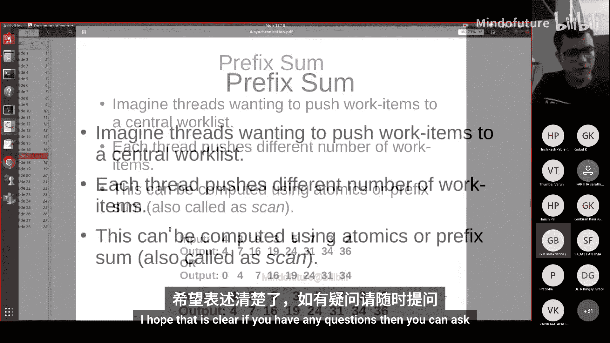

So Im assuming that it is clear just in case you have any question， please feel free to ask。

For the today's lecture， probably I'm going a bit quick by a minute。

But。哦。Sweftly， but yeah， please feel free to ask because。啊。All this。All these aspects。

 like we sum introduction are quite applicable in multiple scenarios and。Yeah。

 it will be good to learn all these things yeah。So I am hoping that this is clear and。

definition of forific sum is clear what is perfectific sum that it's nothing but the cumulative sum or the。

Arele， elements and。I hope that this example where refix sum is applicable is also clear。And yeah。

 so with this， lets more， let us write the quote to implement the perifi sum。So。

Let us say that we have this input area which。Which was having eight elements， x0 to x7。

And what we want to do， we want to calculate pre sum。

 which is nothing but for each element we want some we want to calculate this sum from。I mean。

 starting the not。 okay， we want to calculate the graphic sum which。

hass the sum of all the elements which are prior to it， so for this element it has no prior element。

 so its just the x0 sum from x0 to x0。For this element， it's some of all its prior element。

 which is x0 to x1， so which is this。For x roots some of all its prior element which is x0 plus x1 plus x2。

 which is this and so on for last element it is some of all its prior element which is x0 plus x1 plus x2 and so on until x1。

 which is this。So we want to implement this functionality， right and？For implementing this thing。

 write mean， we want to write the code corresponding code。And yeah。

 this is one of the typical examples that we saw。Now。

 let us look at the way in which we can implement it。So again， we will have multiple passes here。

In first pass， what we can do is each thread。Will some of it suggest an element。

 so start working on this element， okay for the first element， there will be an no thread。

 but for the second element。What it will do to start working on it well。

S this and this element and will place here。For the second thread， what it will do。

 it will sum of this and this its neighboring elements and will place here。And so on。

That is for the first pass。What the second pass， What will happen？It will。

For the second pass we willll have just， I mean， and it will start with n minus two threads。

 so our second pass we'll start from here。And this element will be summed up with the。

This element and will place here so you are I mean you now you will now be able to see that we are we have compute x0 we have compute the sum of x0 to x2。

And yeah， here also we have compute some of xplexone。

 so please note that this and this value are just copied down as they are。And for this。

This value its incomp using some of this one in this one， so it's x0 plus x1 plus x2。

So I hope that we are getting the way we are performing this up。Or the prefi， so。In the first pass。

 this thread is one， so each thread is summing up with its access and element， which is just one。

Much right back to the second pass， we are summing up the element， which is。Two step backward to it。

 So we are summing up this element with this one。And for the success in pass this stride will go on increasing。

 so the element element will of the sum up the element which is three stride， I mean three steps。

Back I mean three three steps， which is backwood and so on， so it is something like this。

So in first pass or indeed the past iterationeration。Each thread will be。

We be performing some with its previous element in second pass。

 each thread will perform some with its。With the element， which is two。W index back？

In the third pass， each element will。Perform some with the element， which is four steps backward。

And so on， so。This tide will go on decreasing by the fraction of ammin by the factor of two。

 so initially it's one ammin。Decreing but increasing by the factor of two。 so initially it's one。

Then it's two， then it's four and so on。 then it will become 8 and so on。 So if you see。

In each iteration， we are increasing this。Stried by a factor of two。And if we。Go on doing this。

 then the number of iterations that we'll need。To finish this prefix some or finish all the iterations of the prefixsome will be。

Lg and write， because if you see， we are increasing this divide by two in each each step。

 So initially it's one then  two then4 and 8， and so until。

In the case that well just will have one operation to rule in the last typeeration， right？

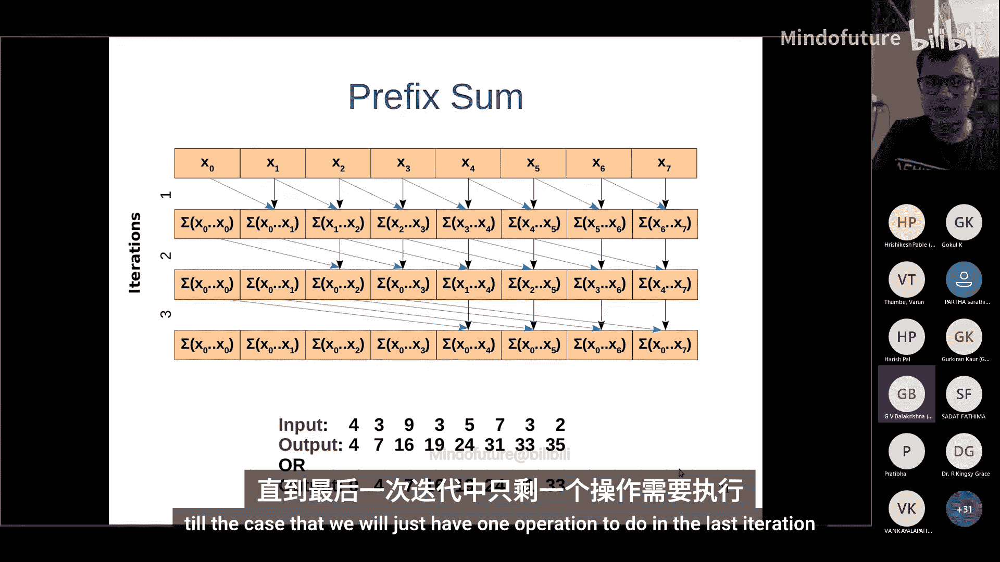

So I hope this is clear if there are any questions， then please feel。

I there is some questions are that prefis some values are used to tell indexes。

Yeah， I probably I might be some， I mean， I have my。I might have missed some things there。亚缩。

This prefix some values are used for telling the indexes only。Let us pick up some。

Random thread random。So let's say threat2。It wants to know that。啊。

What are the indexes from where the items that I've pushed to the workplace begins？For that。

 it has to。Go till immediately it has to go to the second index， so it will see that this value 7。

 so it's workless begin from the index 7 in that array。So。There it knows that the index starts from。

 I mean， the values7， so its work starts from the7。And it goes still。16 minus1。

 which is 15 so from7 to 15 are the elements of its work list and that is actually the nine elements。

So the nine elements that were pushed by this。Threat to are starting from 7， ending at the index5。

 So I hope。

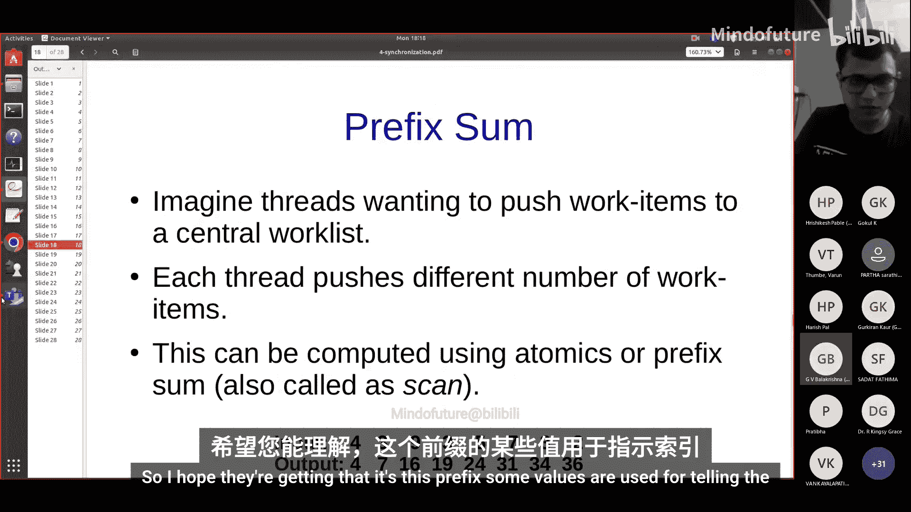

They're getting that it's dys specific some values are used for telling the indexes。

Where the workplace items were pushed by。Pplace items are pushed by that thread。嗰啲时就系翻。Okay。

 I just repeated it。

So I hope that you people are。So yeah， I hope that people are getting it。

Why do we need prefix some and how can we compute the prefixsome also in some？啊。Yeah， in some sense。

 like using this， I mean， we can compute different。So。O so。你得屎啲。Quote corresponding good。So。

This can be one of the way in which I in， this can be one of the potential ways in which we can implement the perfectfi。

So if we see what we are doing it here。We are starting offset from one。

 we are going till then and then we are multiplying the offset by two please note that。

This offset or the that I was talking about initially it was one。

 then it was getting two and then so on。 I mean， then it was becoming poor and so on。 So in each。

In each。In each pass or in each iteration， it is being multiplied by the factor of two， so one。

 then two， then four and so on。So yeah， that is what we want that that offset should start from one。

 then become two and then four and so on and in each at or in each pass what we are doing here are。啊。

阿 mean。Each head will add the value of the。I mean its it will add the value which is at threat it's id minus the offset location right so when the offset is one and the thread which is working on this location this element it will add。

The value， which is Id minus。Offset which is offset is one for the first pass right。

 so ID which is this one minus offset which is1 which is this element。

 so it will add this and this and with b here。Similarly， for the thread with I2 will。I do。

Id minus offset which is 1， so 2 minus1 is 1， so it will add this element to this and we will place here。

So I hope that this is clear for past one what will happen is。

Offset is one and each thread will end up adding the element which is just before it as we are doing here。

And willll place edits。Paraite location。This thread I and then we have syn which is the barrier。

 I mean we need barrier across each pass right or each iteration because otherwise there will be data is。

So I hope this is clear。There is one small issue with this this code。

 which is that this code has data is。Now。Why does this code have data， let us understand？So。

When if you see。Whenever you are whenever they thread one。

Is reading I mean it is reading this too well and it's writing at this location now this location is same right so it is writing it I mean here we can see it differently but it is actually modifying this x1 only so it is reading this x0 x1 and modifying x1。

At the same time， T2 is reading this and this and it is modifying this。

 so if you see thread1 is writing to this location and threat2 is reading from this location。

So reading and writing are happening simultaneously here at this statement。

Here and hence there is a data race。I hope you are getting it。 Third one。

Is reading this x0 and x1 and writing it to x1 so it is modifying the x1 and threat2 it is reading the value of x1 here and x2 here。

 so x1 is being read as well as written by multiple threads and hence there is a data risk and to solve this。

This data is what we need to do is we need to write this syn thread that is we need to differentiate I mean we need to separate reads and write。

And that we can do using syn， So first of all， we we should we should complete reading but。

 so this is reading part， right。So we read this value， place it in some temporary variable。

 which is this temporary variable is a thread local variable right so each thread will have its own copy it's some into to time particular right so that。

I mean， that integer time declared will be local to each and。Once that is done。

 we can write sync thread。 So T will be stored in the local。Local variable which is private copying。

 which is actually the private copy for each thread。

It will be stored in that private copy for each thread。And then our。

Then we have this syn thread which is the barrier so yeah since we have barrier this writing and reading are separated。

And then what we are doing is we are writing into this third ID extra text location。Sorry。

 not writing yeah， actually we are writing， but what we are writing we are writing。

This value added with temp and then we are writing back to I mean。

 we are writing the added value back to the author IDXtex。

So I hope it is clear there is a data is here in order to separate that I mean in order to remove that data is。

 we are separating read and write by a value。So now， since we are doing that。

 data is gone and please note that this thing third is already there here。

This synchron is for separating two passes or two iterations。That syncht was separating to ittration。

Well， where is？This thing thread。Was for separating this read and I mean。

 read and write that was happening by the multiple threads here。At the same member location。

So I hope this is clear that。啊。There was a data is here and we can remove it using and by separating grids and write using S card。

So separating gradientan rides in time using this synched or barrier。And okay。

 so let's conclude this prefix sum code with a final version。

 which is just a polished version for this this code。So okay。

 offset starts from one door still and it is increasing into multiple of two。

 so initially it will be one then will it will become two then four and eight and so on。

And hence this is a lock and itration， please note that this iteration， this for is。

will run for lock and iterations because。Ouret is increasing in the。

Chunks of I mean in the multiple of multiples of two， so1，2，4，8 and 16 and。

To reach this value and it will take log n steps， so log n iterations and in each iteration what we are doing is。

We are checking this ID if it is。Greattter than offset then what we'll do is we will read that value。

 we'll read that value in some local variable and then well have synt and then we'll write I mean write that value by adding that value with the value that we add here。

So reading and writing are separated by the same thread。Yeah， so that is what we wanted。

 right we want to。Add two elements。Which were separated by that particular offset， this offset。

And we want to play， place in。That particular memory location， I hope you're getting like。

We are doing here， we want to read this value and this value， which are separated by some offset。

Here offset is four， so this value and this value， but here the offset is4， so this value。

And this value are at being added and it's placed at this location。

 which is determined by the head ID。So， yeah。So。That is what we want and this code。

 which is the final quote for performing the criticismism， will work。

For the array or any of the array。And yeah， one thing I think here。

 this code will not ensure is that we need to check what the case where。

The size of the area is not in the multiple software， as we had in the case of productions， right。

Yeah， the offsets are。Increasing in the multiples of two。 So I think this court needs， I mean。

 it will。Probably not work for the case where the SSSI is not multiple software。

 but we need to check that Yeah so any confusion till this point。

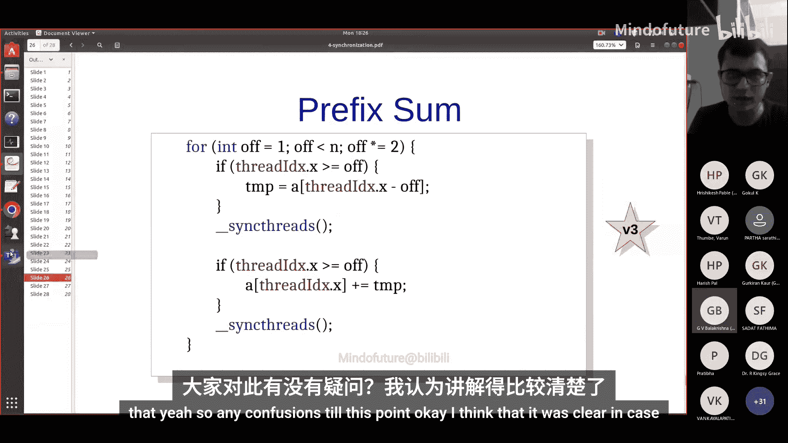

Okay， I think that it was clear。In case any question， I mean， if you have any confusion or question。

 please feel free to ask。I think that it is important to ask questions here otherwise。

I mean， even smallest out can get troublesome later。Yeah， I'll just leave that。

 but yeah please feel free to ask the questions third if you please tell me the difference between version2 and version 3。

It's just， I mean， both of them are C， it's just that we are writing it different。

So if you see every， I mean。Theyre just。Removing， I mean， we are， I mean。

 writing separ conditions for。觉得啊。This reads and writes。And then we are placing the synfers。Yes。

 thank you sir。Yeah， if there are any further questions， then please feel free to ask。

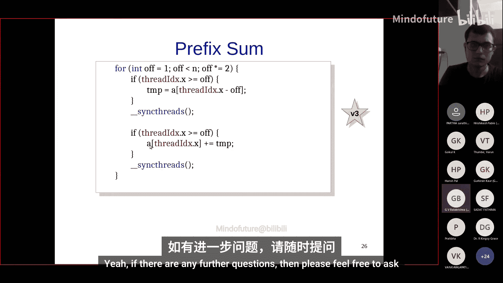

啊。I said this topic is quite。啊。Okay， anyways， please feel free to ask the question， but I mean。

 I feel that this topic is quite interesting but。Anyways。

 if you feel that there is some thing that I missed somewhere。

 then please feel free to ask the question。

Okay， anyways， let's move further。So I hope that you understand how to implement the prefi sum。

For some taste of it and。Now with this， let's move ahead。

So typical application of the prefix so let us come to the applications of the prefixsome so typical application is the one that we saw right that we want to implement the work list kind of functionality where each thread is pushing some some amount of data items into some area which is work list and we want to keep track of the starting an ending index for particular error so in that case we can use this。

This prefi I right， so we saw that this this are the elements that each threat I' in。

And a third one pushes or third zero pushes four elements， third two pushes three elements。

 third three pushes nine elements and so on。And。If you want to keep track of the indexes that starting and ending indexes in the work for a particular threat。

 then we can use prefi。So that is one application apart from that， there are also other applications。

Where the cumulative sum can be used actually， so perfectific sum is nothing but we are doing cumulative sum。

 right？So we can use this pre sum in the histogram competition， so next said we have one。C of。

 I mean， we have data of population for a particular village or particular city over the period of time and we want to see what is the cumulative sum of all all that population over the period of time then we can use this graphicfi sum and we can plot it as a histogram or something or similar chart or something。

Then for finding the area under the curve we can also use the perfectfi sum because area under the curve can be typically modeled as perfectfi sum。

 then there is something called a swim victory or the binary text tree。

Which internally uses this specific sum。发的。Perform the operationsperforming the operations efficiently。

 so you might be interested in this reading about this spend victory on some Wikipedia or somewhere but yeah please check this out that is the application of prefis I inside it so。

Yeah， so for this also we need I mean， for implementation of finger。

 it also we need prefium and prefium can be efficiently completed。

And the GPPU using its multiple threads。So I hope that this was clear。啊。

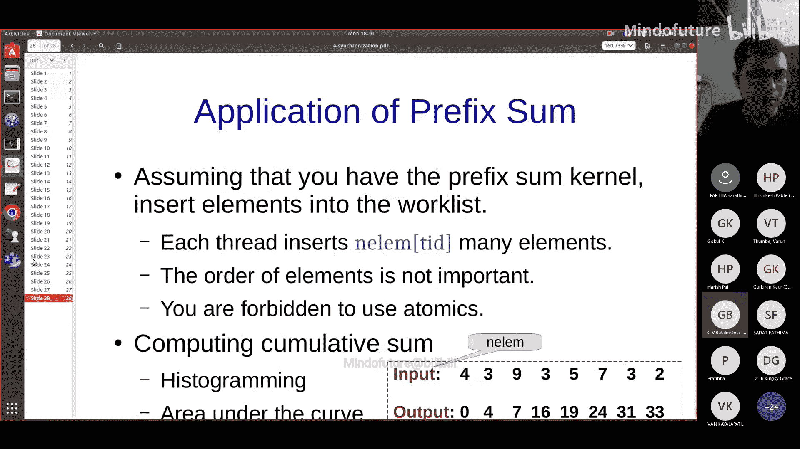

Any questions up this point？Okay， the question is version  three done for war threads？No。

 actually it's done for the threads of the thread block， it's not for the war threads。

Yeah， if you see， we are using thread IDXt and we are using sync threads。

Here the assumption is that we are just using the threads。Of this say， I mean， yes。

 we are just launching the kernel with one tracklock and we are using。

The threads of the one thread block。 So in that case。

 we just don't need to compute the global thread I and。

We can just use thread ID extra text to get the unique ID we can use sync threads。

Syize the threads of the third look right。In our case， we have just one third block。

 so syncthread will suffice for our purpose for synchronization of all the threads that are launched because there is just one third。

So yeah and the next question I guess was for this。

 so here also the same thing applies here also we are using CA IDensing right。

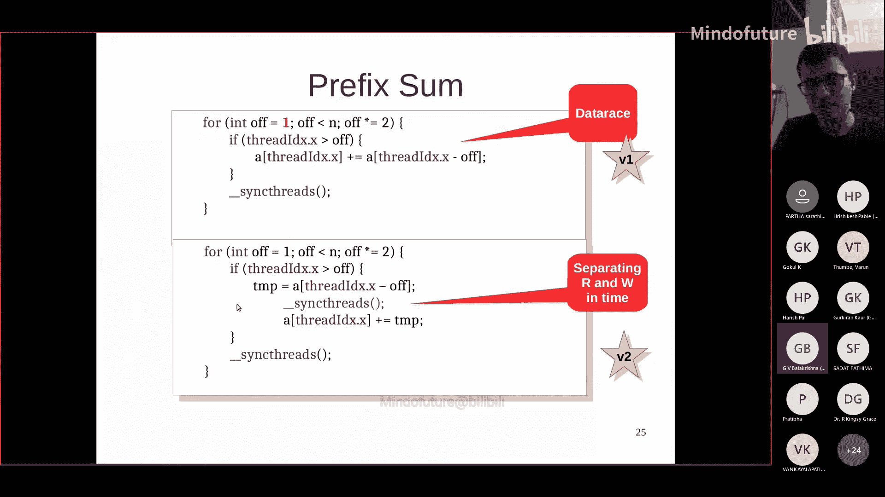

My answer to this is that this version three and version two。Both will work for the threats。I mean。

 heads of the same threato。If you're launching kernel with just one track， then it will go。

But if you are okay， so let me come back。

If you are launching kernel with more than one thread box。

 then in that case you need to replace this thread ID extract X with global thread ID that we used to。

Computer right that block IDX dotex into block dim totex plus thread IDXt。

So we need to replace this thing by that and instead of using sync threads。

 we need to use grid dot sink here。At both these places。Yeah， but it depends upon your department。

 right that whether you are。Performing prefis， I'm using block threads， I mean。

 block threads are using all the threads of the GQs。

So I hope that is clear you need to tweak it based on your requirement， whether you are using。

Multiple threads across the thread block or you're just using the threads。

 multiple threads of just one thread block。

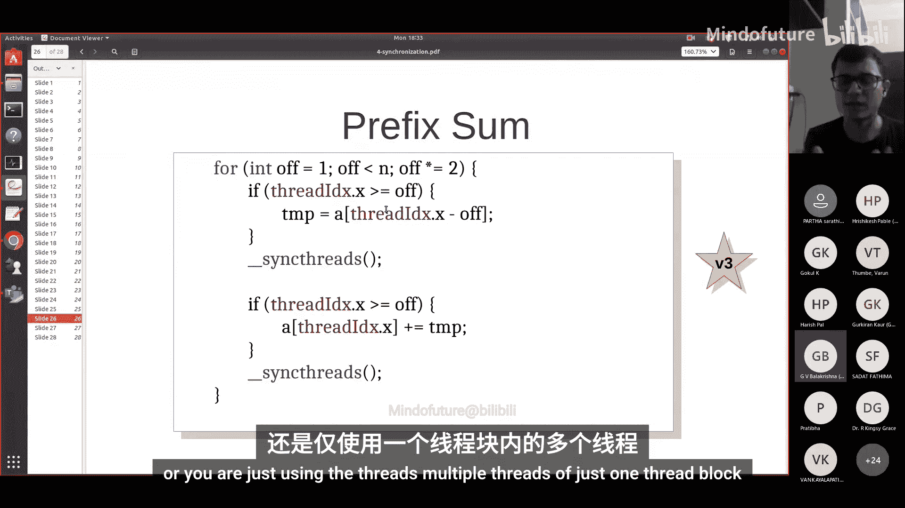

So I hope that was clear。Okay， version to version to the synchronism if statements so I thought it might cause issues with workers。

 or let us see that probably I might have missed something over there。

Yeah， it's inside。Yeah， that is a nice author， actually。It it might cause some issue， Yeah。

 it is correct。Synchronous inside day。Yeah， that is actually a very valued observation， I would say。

It might happen that few threats might not enter into the safe condition。It might cause red， yes。

 that is correct observation。

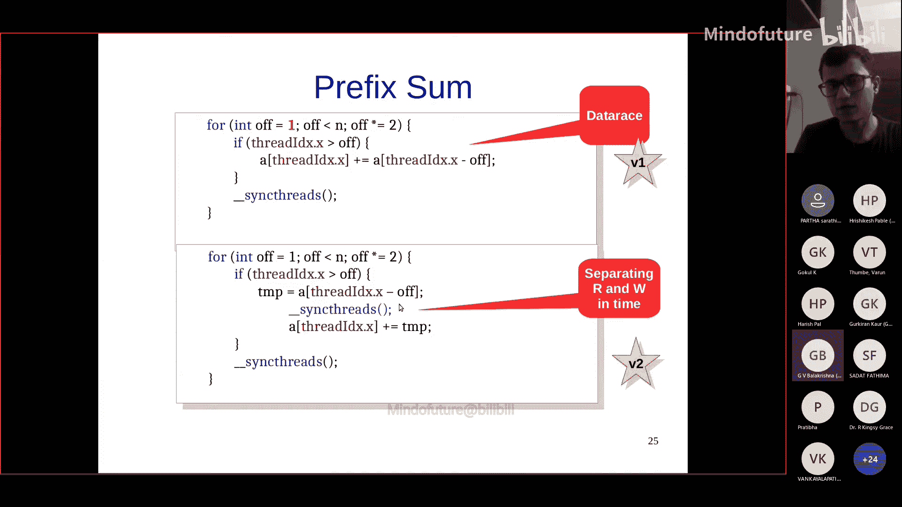

Yes。Yes， that is correct。Yes， yeah， so the observation given by Google is correct。

This code might fail for the case where few war threats or even few threats of the same threat log doesn't enter inside the safe condition。

And in that case， since few threads are not entering。

 all other threads will keep on waiting here for this input thread。And if that happens。

 then there can be a deadlineg。But for the version three， it might， I mean。

 this thing will not happen right， because even if some threat doesn't enter inside this。

If conditioned， they'll wait here right at the symptom。

And once the other third which have entered in this condition， they finishes。

 they'll come here and then rest of the third can proceed。所以 yeah that was呃。

A good observation that I would say that that this thing version 2 might lead to Dlock because of this thing and insidely。

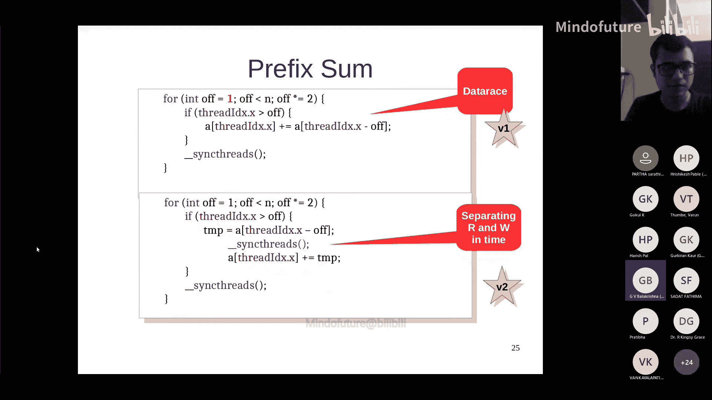

Any other questions apart from that？Also， we said that like where the threads are pushing some elements into the work list。

 like what does that mean exactly me？啊。So， let us。

廿。个。

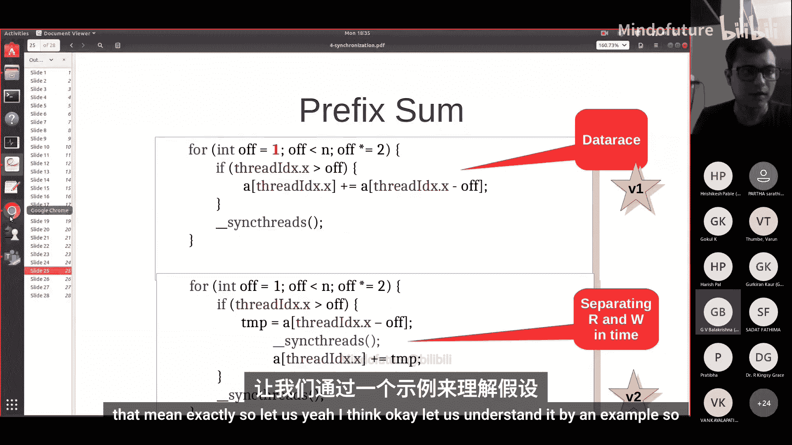

Okay， let us understand it by an example， so let us say that。Carciro had some。啊。

Some elements to push inside the work。 So it has， let's say four elements to push。

 and that four elements were。富 five three and four five。Then there was threat to。

 it has to push three elements into work。There were some I'm putting some random elements。

So how would the workplace look after pushing these elements？So work list is nothing just， I mean。

 nothing but an array and that area would look something like this for part24。边点样 say系。

After these elements are being pushed by T zero and T1 with the workplace。A Saudi workers work。But。

Then the prefium comes into the picture。We know that third one has sorry thread zero has pushed four elements。

 third one has has pushed three elements。Now we wanted to know for each thread where doest。

Pot elements begin and end， so that can be done using in prefiel。

So we will complete brief some for this area。Whi is four which is this。

So it will be0 comma4 right if we do prefi sum， assuming that we are starting with zero。So。

If that is the case， then we can know the start and end for each。Td right， so for Trade0 it was。

It was I mean， its workplace for starting from0 and was ending at 4 minus-1， which is  three。

Pay this。啊。All the elements which are pushed into the work are by the thread number0 and similarly for thread1。

 its work starts from poor， which is here。And goes till the end of the work list。

So I hope that is clear。也写过这个。

