# 【Nvidia】CUDA并行编程-｜-Cuda-Programming-Course-｜-Parallel-Computing-Using-Nvidia-p16-P16_L16_CUDA中的函数--BV1MSq1BTEho_p16-

So hello and welcome， everyone to the。17th lecture of our Qa program。

 So in the previous lecture we saw。Things related to the barrier right so we saw what is global barrier。

 what is sync thread， which is which is a barrier across the threads of the third globe。

 and we saw an example related to the sync thread， and then we。

Then we saw that there is something called this third fenceence block and third penence。Instructions。

 which allows us for which allows us to perform data synchronization。And after that。

 we started off with the reduction and we saw what is reduction and we also saw how to implement the reduction。

And yeah， it with that， we ended off with the reduction and then we started with prefix sum。

 we saw what is prefix sum。We saw how to implement it。

 and then we also saw few applications related to the prefiixer。

So there we left off in the previous lecture。And part in today's lecture。

Our agenda is going to be functions well see different types of different definitions of functions in quoa till now we have only seen one type of functions which is de using that global underscore underscore global underscore underscore keyword which we call which we call it as kernel right but there are also other ways to。

Defin a function in coa we'll see today those different ways and。Yeah， after that。

 we'll also see multiple examples related to the functions in order to understand。

The idea and the data idea of the functions， each and every functions in the detail and then。

Towards the end， if if you get some time， then we'll touch up over the thrust library。

 which is the parallelel。Caral Alths library available at Ga。And yeah。

 we'll see how to use vectors and reduction prefixum。

 all those things which are available in this thrust library。Yeah。

 with this we conclude today's lecture， so without the。Wasting any time further， let's start so。

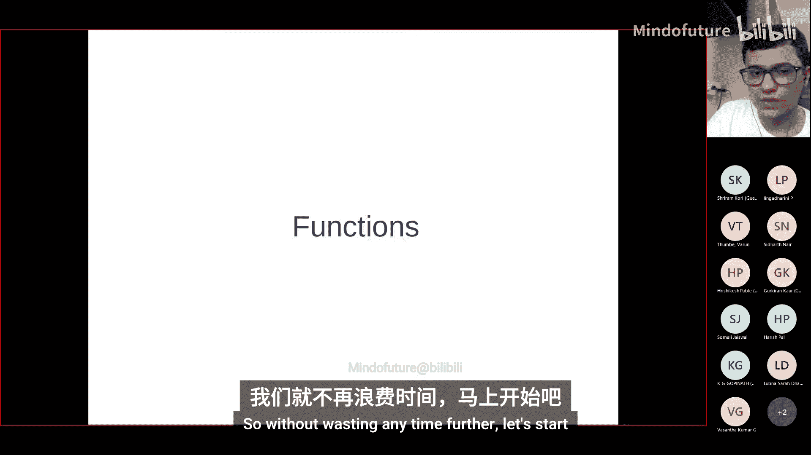

If anything this。

So recording this weekend， there is nothing in check okay， so。Okay， so let's start。So yeah。

 so as I told， there are multiple ways to。Dlared the function in the declared the function in the ka。

 So one of the way that we saw was using this underscore underscore global underscore underscore keyboard。

And typically function declared using this keyword is named as kernel right。

 so that's where it's kernel from。And we know that when we declare this， I mean。

 declared function is in this keyboardword， we call it from post that is that is callable from the post and it is executed on device。

 so host is CPU， so we call it from CPU。And it is executed on the GPWS device。

But this is not the only way。There are two other ways in which we can define declare the function in the quoa。

One is using this underscore underscore T underscore underscore keyboardword。

It says that this function is a device function that is it。

It will be run on the device that is it will be run on the GPU。

So it is executed on the GP and it is also callable from the GPU or device。

So think of it like this that post will launch a kernel so CPUU will launch a kernel it will run on the GPU kernel will run on the GPU and meanwhile GP kernel or this this function kernel function might invoke some another function。

 which is device one。And since this kernel is being exploit on the device。

 it is being this device monkey is being called from the。deviceevice。

 so it is call from the device and it is also executed on the device。

 so I hope that example was clear。And yeah， so this so that was this device type and global type。

 both are executed on CPU。But note that this device type is。Called from the device。

 whereas this global is called from the post， which is CPU。And yeah。

 we willll see the examples related to all these three types， but yeah。

 but let me just complete this。Sentex part so third type is this underscore underscore post underscore underscore so what this type I mean。

This declaration type says that this function， which is declared using this。Under underscore， post。

 underscore and underscore。Will be executed on the post， and it is also callable from the host。

So yeah， so from host meeting， it will be called from the CPU and it is also executed on the CPU。

So yeah I hope that these three types are clearing。

From where they are called as well as from where their executed is also clear。And yeah。

 as we know that this。Function declared using this global keyword defines a kernel and it must return a void type。

 it can't return anything apart from void。And yeah。

 and program may have several functions of each of the kind。

 so you might have a program in which there are multiple types of functions so there is a global function and then there you have multiple device functions and even even if if you can have multiple。

Cardinalal inside that is multiple global function， multiple device function。

 multiple post functions you can have。So you can write program in such a manner。

 then the same function of any kind can be or maybe called multiple times， so you might call。

Clonnel multiple times， or you might also call device function from a kernel multiple times and so on。

 So I hope that is clear and yeah as I told， post is CPU and device is CPU。Any questions on this leg？

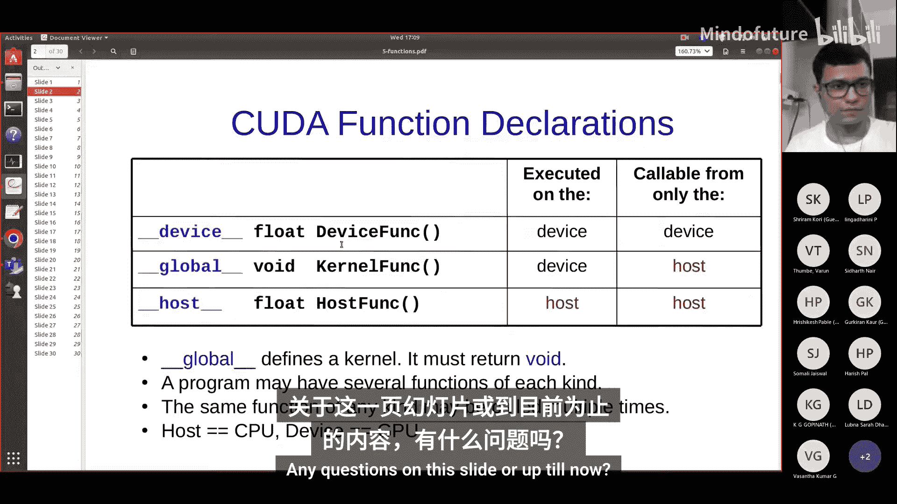

我得边度。Okay， there are no questions。 then let's。

我 ahead诶。Yeah， so let's move ahead。So yeah， let us see one example。So yeah。

 I've included this library standard libraries that we need for running the CODA program。

Then I have declared four functions and that is note that this this example is split into two slides。

This is the first slide and next is the second slide so this entire two slides is composed of one exam and mean they together represent one exam。

So。呃。Yeah， so in this slide， there are four functions that are being declared。So。

What is this host device function？Wse return type is what and it is named as DH fund and we are printing that I can run on both C and GP。

And yeah， this function as we saw， I mean， here we we are declaring it as both post and is。

Can run on CPU， as well as CPU and。Can it be called from CPU and GP both will see it with the example problem？

But yeah， so second is this device function。So this device function。You see。

It is calling this thH fund。TheH one。Can call the I mean。

 this D fund is a device function and it is calling TH fund， so this D fund。

 which is the device function can call DH fund， right because this is device function。

This key one is a device function and this DH1， this device source function。

 so since this is a device function， it can call the device source function because。

Anything written inside it， this D fund is I to be runable on both CPU as well as you。

 So from T fund， we can call both。系了。Not both， but we can call this post post device function because。

Yeah， it is unable on both CPU as well as CPU。So I hope this is clear that from this T fund we can call DH fund。

Because since this is device function， test T1 is a device function。

 we can call device force function from it because。

It is assumed that anything written inside it is runable on both post end。

But vice sub versa is not possible。 if you see from device force function。

 can we call device function。No， because it might happen that you are calling this device host function from the host or the CPU。

Since you are calling this device host function from CPU and since this end things written inside it are ran on the CPU。

And if you are calling this device function。From this CPU。

 this is not correct because we saw in the previous slide itself that。This device。

This device function， whatever is marked your device， should be callable only from the device。

So if we call this function the D fund from CPU because it's marked as a device post we can call it from CPU。

 so if we call this from CPU this function， this function if we call it from CPU。

 then it will be the things written inside it will be random on CPU。

 and if it happens that we call D from it， which is a device function。

Then we are calling this different from CPU， which is not elaborate。 So we saw that in previous time。

 so。Calling T TH fund from D is possible， but calling。D fund from T fund is not possible。

 I hope you are getting this point。Yeah。So yeah with this。

 let's move on for that then next is next in our list stress is。T current。

 which is marked as global and we know， I mean， we have seen multiple examples related to it。

 right this。Undersco underscore global underscore underscore and this D kernel。

 so this this is our standard kernel。And。From this we can can we call the key1 yes because this is kernel and kernel runs on the device that is GP and from the GPU we can call the device function because device functions are callable from the device and since the kernel is running more device that is fine。

Defan from T， we can call different。 That is fine。 Now， my question is， can we call。

Can we call this TH fund from T car is my question。Request you to think about it。

 can be call TH fund from the dec？Is it awesome。

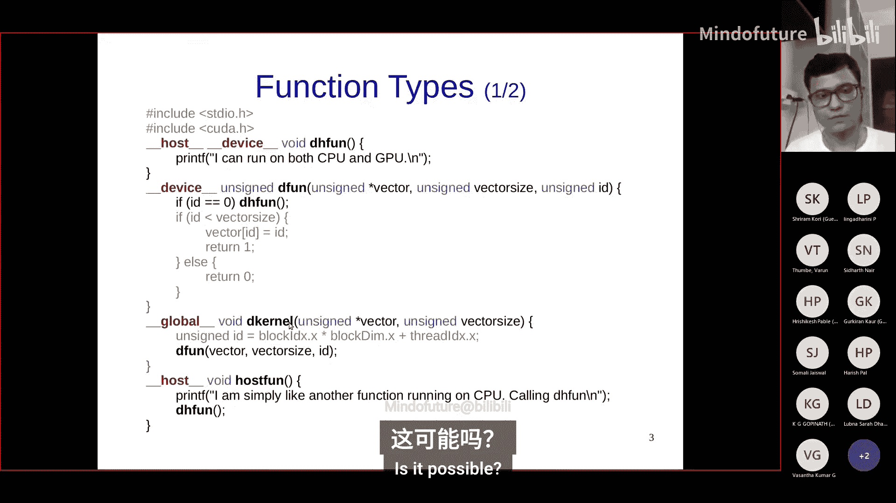

Please think about it and post your suggestions in the chat。I think that is some question。

What does having both post and device means Okay， so having both post and device means like。

We want that code to be unable on both device as well as post or that is either on device or that is on GP or CPU。

So it might happen that CPU might call that function or GP might call， I mean。

 that function might be called from CPU or GP， so that is the meaning of it。

There is still any confusion that you can ask go。

Okay， by the way I'll switch back to this slide， so my question was can we call this DH fund from the Dcon is is what I mean that was my question。

 so please think about it and。Po your answers in the chat。

 can we call that a minute is this call possible？Or will it give some error。

 comp time error or something？

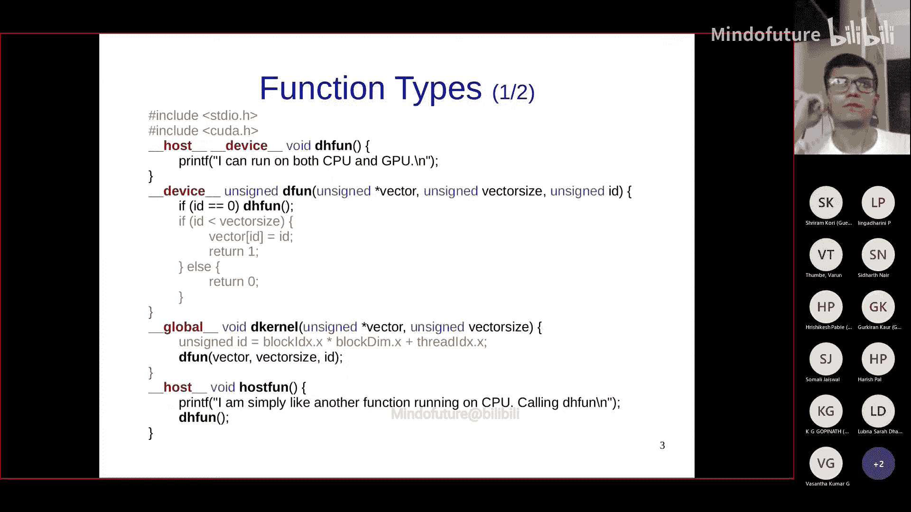

There are no responses， probably I'll wait for a few more seconds。

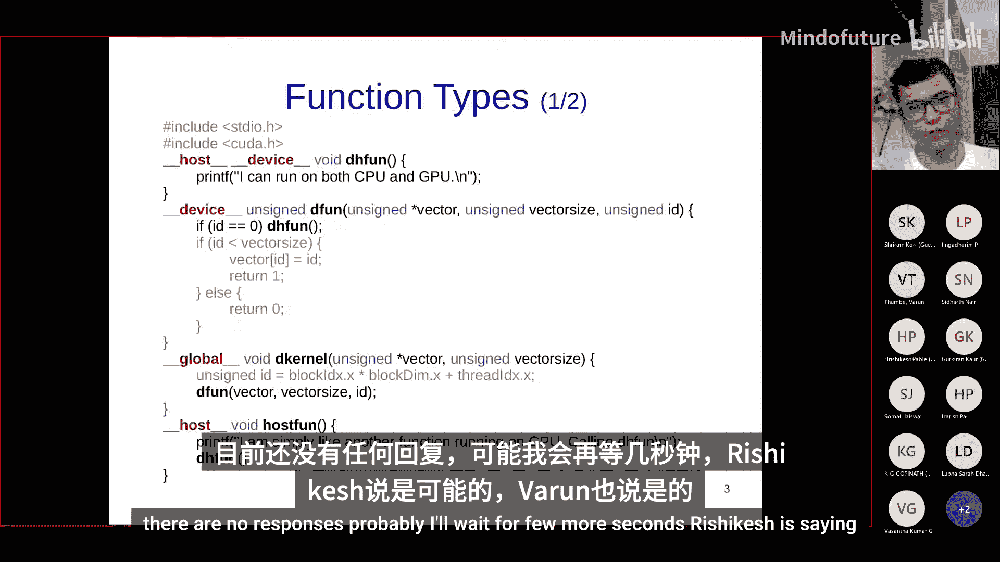

さ。Did she case you thing。Yes， possible。I don't saying yes， since pHH1 is call on device。

Yes， so I think you people are。Getting it correctly。

Since we are running this tea cut on the device that is on GPU and since that TH fund is marked as device host。

 that is it can either run on device or on host that is on CPU or GPU。We can call B fund from thecon。

 right， because thecon is running on device and this is also marked as device， so we can。

Call DH from sorry DH fund from tcon， so that is absolutely possible。

Then next in our list is this underscore， underscore post， underscore underscore。

The Sri function named as post by， which is marked as post this underscore underscore post underscore underscore。

So this is post function。And。From that yeah inside that we are printing something that I am simply like another function running on CPU that is fine。

 but from that。Yeah， so one thing that you should observe first that is that this will be。

This function will be ran on CPU， it is called from CPU as well as it ran on CPU。But yeah。

 next important thing is that it is calling this TH fund， so is this thing possible？Can we call。

DH fund from this post fund， which is marked as post。

Can we call this so TH from this post one we are calling TH1。So in fact。

 there are three questions here， if you see， can we call。Okay， first of all。

 let's go with the first one。 Can we call this DH fund from DH fund from post fund is the question。

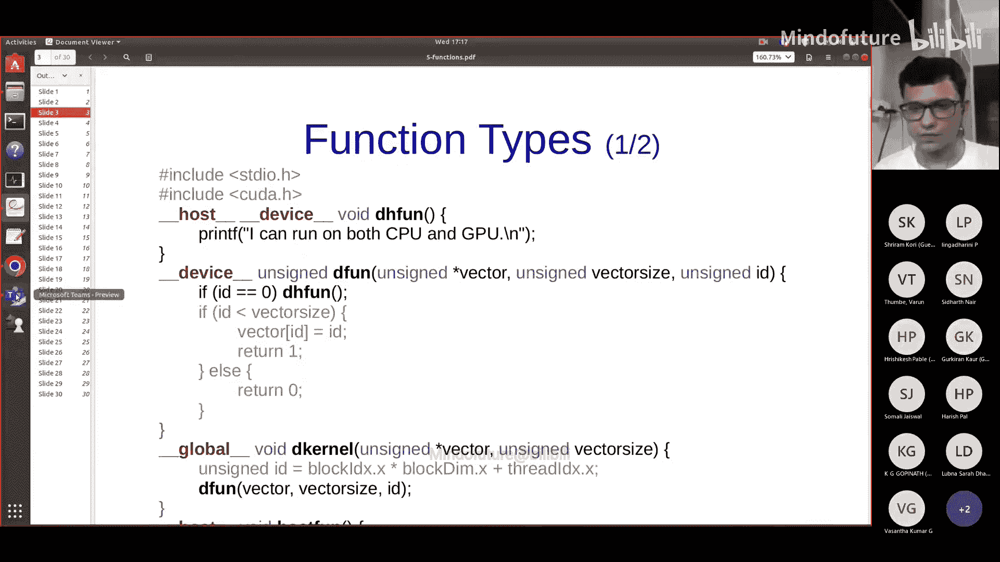

Yes， so I think Rushke is suggesting， yes， that is correct。

Yeah， so we can call DH fund from the host fund because since this is running on host。

And since yes sorry the edge1 is Matt as post device。

 so it can run on host so yeah calling it from host will not cause any issues and it is properly I mean it's correct that we can I in。

It is correct that we can call it from the sea。That is fine， so we can call DH fund from post fun。

But my next question is， can we call？T T fund from the host file。Okay。

 so I'll put both the questions， can we call T fund from the post fund and can we call T kernel from the post fund？

So question is， we have this function post fund。We know that we can call TS fund from the post fund。

 that is perfectly fine， but can we call D fund from the post fund and can we call D kernel from the post fund？

Its my next question， so there are two parts to this question， I hope you are getting it。

Please think about it and post your answers in the chat。

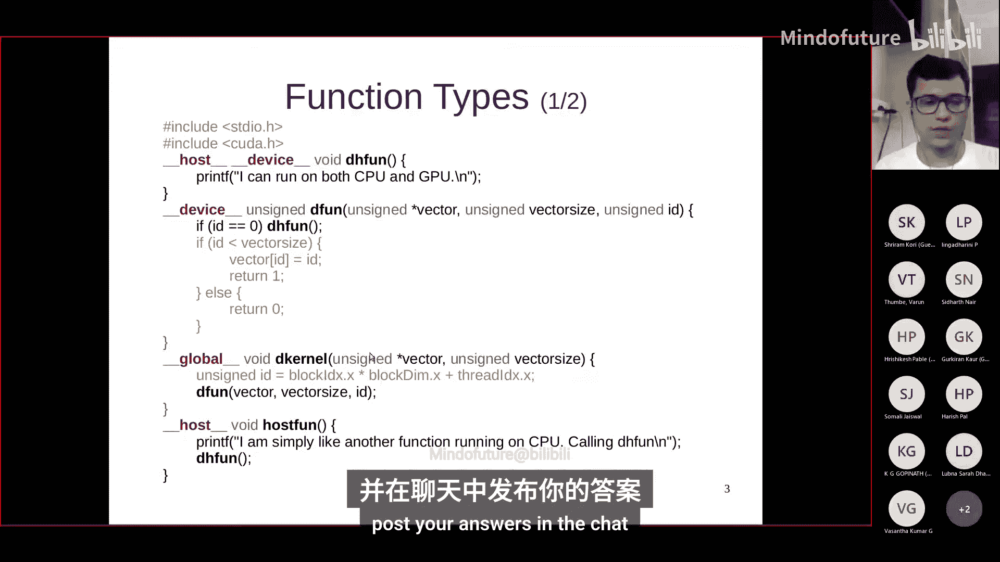

I thinkThere are two responses that let let us。W to understand them。 So Baron is saying no and no。

The situation thing no since both run on GP。ok 啊。嗯。

Would you people like to add some comments while you are saying that。

We can't call t kernel from the post one。

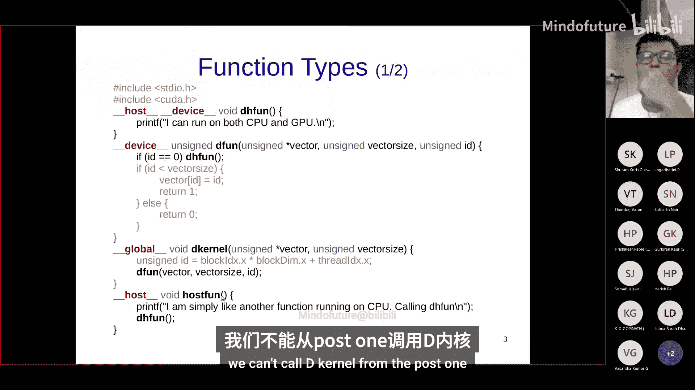

Okay， anyways， will come back to it but。please think about or you can type your。

Sugges in the Jack probably I might have missed something。

And Googleku is suggesting deco kernelius deep unknown。嗯。屋嘅。Yeah。

 I think that is good that you people have tried。O， I think。Reation， but both are saying same thing。

 vehicle color can be quiet。

Okay， I think you people are getting it now， so let us try to understand it。So。So post function is。

 first of all it is ran on the CPU right it is called from the CPU and it is running on the CPU。Now。

 let us see this first thing that can be called D kernel from the host fund。

I think few of you very confused here can we call the kernel from the host one so initially I think few of you told that no。

 but let us try to understand that it is possible and why it is possible because。

This host one is running on CPU and if you see。We can call the kernelal。From this CPU， that is host。

You can call the Kman。From this issue， which is awesome。

And since this is a post function and it is running on the CPU。

 we can call the kernel from the post function so calling。

D cardinal from the host function is possible， I mean it won't give you any issues。But。

The next question that I asked that is， can you call T Feng？From host function， that is not possible。

 right， because we saw that。This def was a device function and device function are only coable from device。

 if you see here， this they are only qualifiedable from device。

And this host function is not a device function， it's a ho function， so it's running on CPU， not CPU。

So if you try to call this host function。Sorry， not host function if you try to call this key fund from host function。

It will give you some comp compile time merit or some runtime merit。 Yeah， so that is not possible。

 but yeah， take will can be called from postpon。 So I hope that。

Thatchpoint was clear any part of questions。

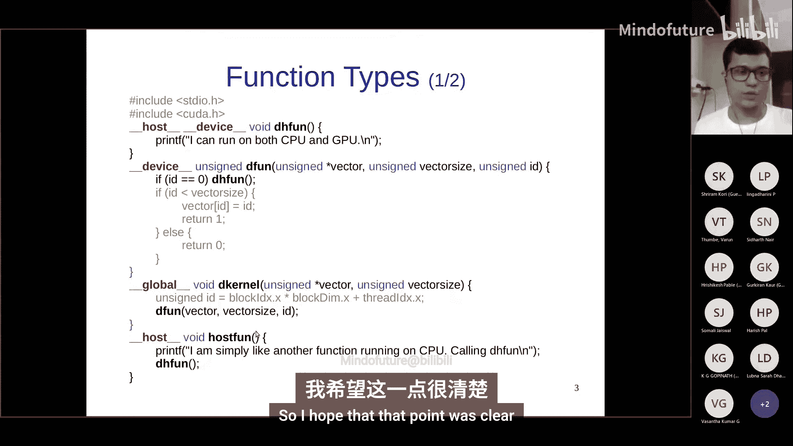

ok啊佢 has some到 sorry。Let me go back to this question。So if it can run in both device and post file。

We can't call people from。Okay， I think you are confused here that。

Let us come back to the。Okay so啊。I think Google doubt is this that this deep fund or sorry TH fund is being is I mean。

 this is the function that can run both on CPU as well as you。

Then why can't we call this Tan from it？WellI think that was the question。

 that was the co's question。And the answer to it is simple since this TH fund is， I mean。

 is runnable on both CPU as well as CPU。And if you see that。

This function might be called from the CPU right， so it might happen that this。Dvicice host。

 I in this function， T1 mark as device host。Is called from the CPU and if that is the case。

If it is called from the CPU and if it is after calling， I mean after。Calling it from CPU。

 probably we are calling this sorry T fund inside this TH fund function。If that is the case。

 then we are violating this thing right that this device function can only be called from device so here we are calling it from post。

Because this at runtime， if you see them think of it from runtime perspective。

This function which is marked as device host is being now called from the I mean it now being called from the host and it is running on host if we try to call some device function from host what will happen？

We I mean， we won't be able to do that， so that is why it is not allowed。

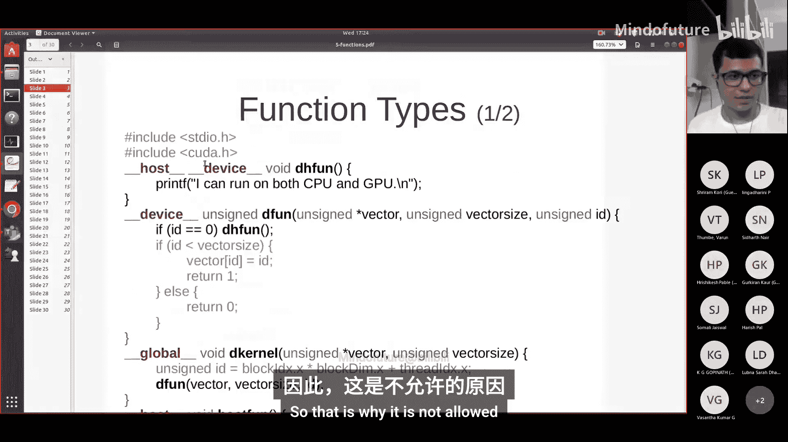

一啊。First of all， is it clear Goco or did I missed something？第二 sir。好啊。

If a moving on to the next question， what's the difference between？Andersco andco post， and。

A normal C function without any identifyifier。 Yeah， that's a good question。 So first of all。

 I would like to add one point to it like。

Yeah， that even if I don't write this post， right， let's say I have removed this post。Then also。

 there is no need of ammin， this function will run on CPU only right there is no need of ammin post in this case。

Because if I would have removed this voice。Then in that case also。

This function would have a random CPU。Then why do we need this host？So the point is， I mean。

 this is a quite crucial point， why do we need this post and why this N media people have introduced this。

Keyard post。The answer to this is like simple， so if you see。

There might be some functions like this where you， I mean。

That you might want to call from device as well as the post。So in that case。

 you need some some keyword to mark that okay this function can be also called from the post and as well as the device so for that we need this post。

Keyboard， but coming to the warrant question， what's the thickness group we underscore。

 underscore post and a normal sequence function without any identified？

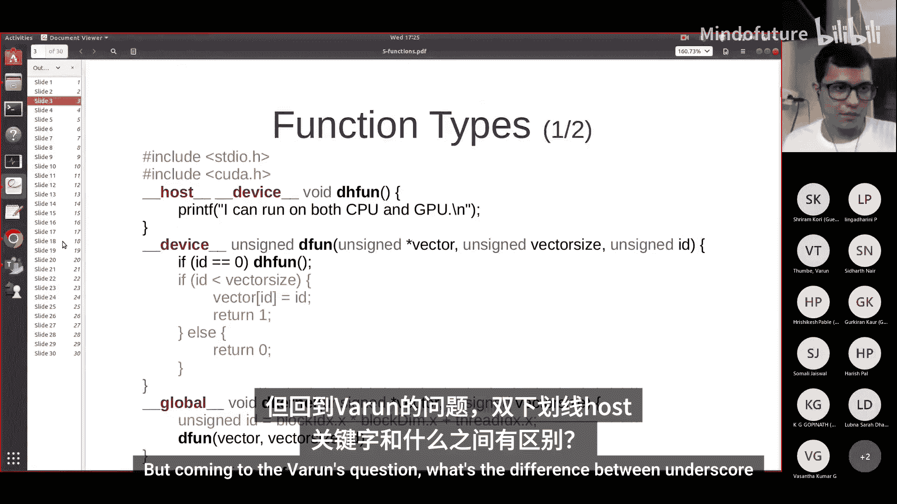

If your question is that what is the difference between like？

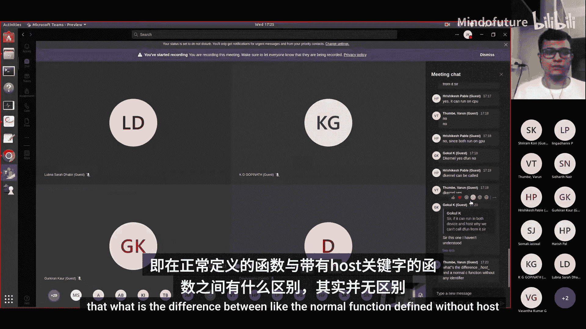

The normal function defined without host and with this postquiword， there is no such difference。

 both of them will be ran on the CPU。So in that way， there is no difference。

 but the main idea for introducing this world was to。啊。I I mean， was for to。Mar the functions。

 which we wanted to call from host as well as device。So in this case， even if you remove this host。

 same thing， I mean， it's one and the same I would say。

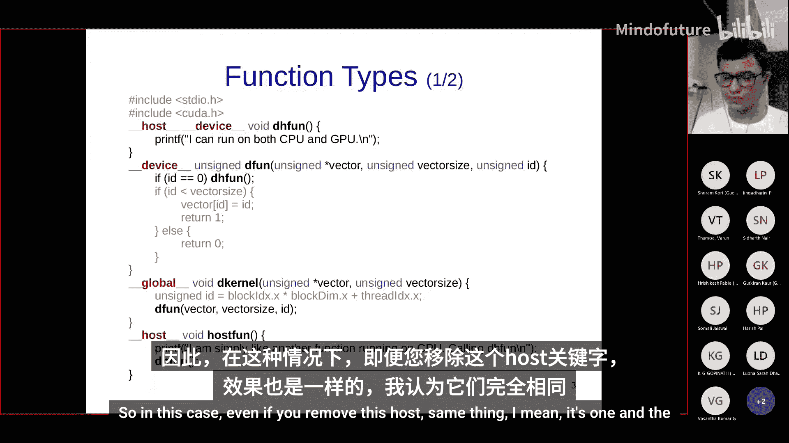

I hope that is clear。

Yeah。Yeah， so let us move further with our discussion so yeah yeah so this was the first part of our code so this this example is being continued here from so this is the main part。

That same piece of code， main function for that same piece of code are。

Doing some computation we are doing some computation inside the mean and then we can call the kernel from the main right that we saw I mean we see this in multiple we have seen this in multiple examples that we can call kernel from the main that is from the CPU。

 we can call the kernel from the CPU。And then we can call the host function also from the circle。

Since it is marked as marked using post keyword， we can call it from the CPU and we can also call DH fund from the CPU。

We can also call this D front from the CPU it is marked as host device。But can we call， sorry。

Can we call this D？Deep on here。Can we call this tea from the this is my question？

Is it possible to call def from the main or CPU？

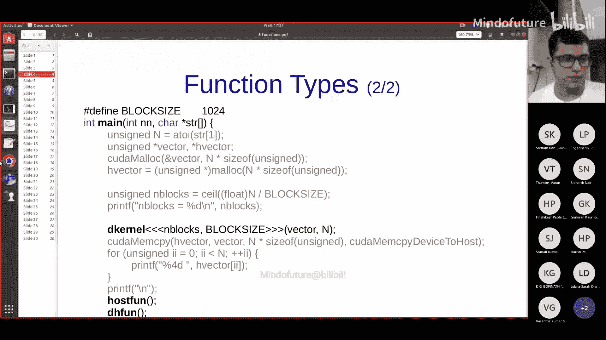

好啊。What you saying though。Yes， that makes sense。

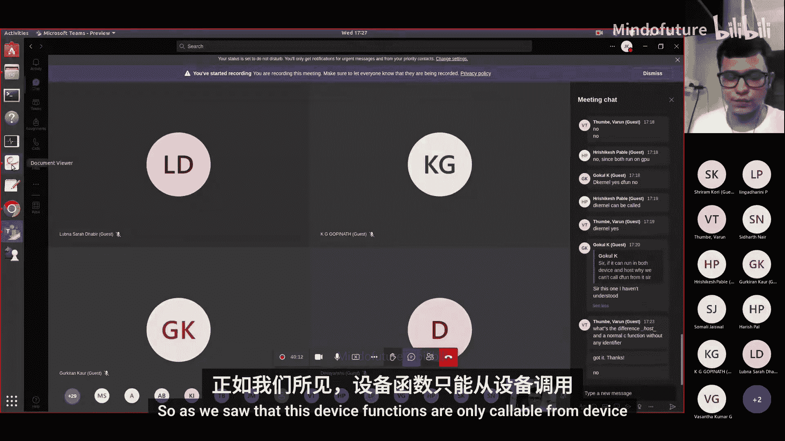

As we saw that， this。Devicice functions are only callable from device and if we try to call this。

D1 which is marked as device from me， which is from CPU。 it will give some compile time error。

 and hence we can't。Do that thing。So。Yeah， that is quite obvious， I would say。Yeah。

 so the key point is that we can't call T1 from the mean Okay so let's move on from move further from here。

And。Yeah， so this is the typical。Diagram that， I mean， function called diagram that we are。

Perceiving in this example that is male is calling。P cutttle， main is calling D kernel。

 it is calling postpon and it is calling T。Fine， this this thing we know。

 then host function is calling D。 So yeah， let us go。Post function is calling T sorry。

 Post function is calling T1。Then D fund is also calling pHH fund， if if you remember。

 and Dcon was also calling pHH fund。So yeah， this thing we already saw。

So one more question that I have for you people is。

 what are the other arrows possible in this diagram？So this much we already know。

 right that this much is already possible， the arrows that are shown here are already possible I。

Already。Possible function calls， but what are the other possible function calls possible for this diagram。

 so what are the other arrows that you can put。InDespite them。Yeah。

 so one thing that you can think is how about DH fund to deepen can you do this DH fund to Den can you do this from DH fund we are going to deepen。

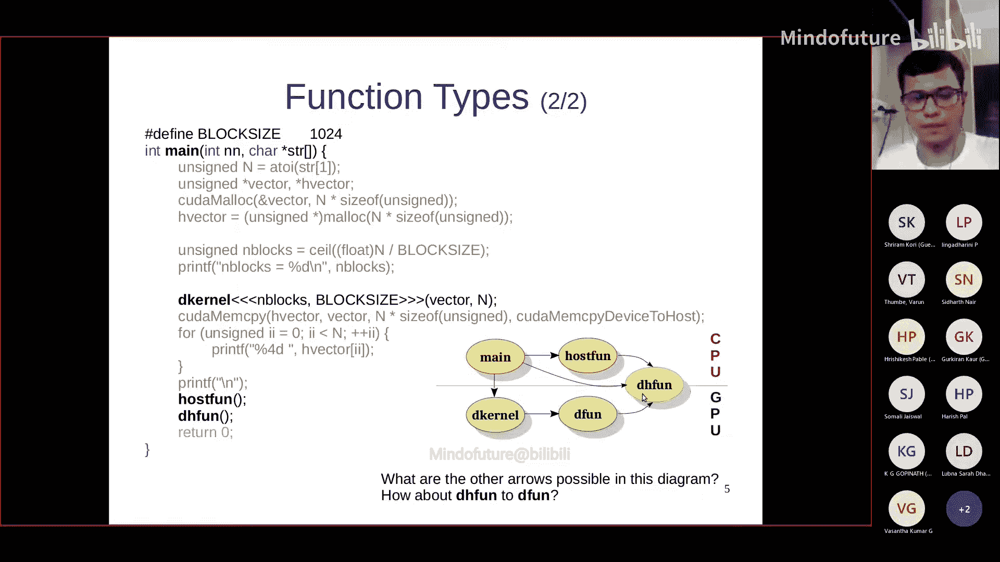

又嚟都咩过噶。Okay， Goly saying that。It is not possible。Yeah。

 request others to also think and also think that what are the other possible。

Arrows that are possible in this。带着。I'll wait here for a few seconds for you people to think that what are the other possible arrows that you can add to this diagram？

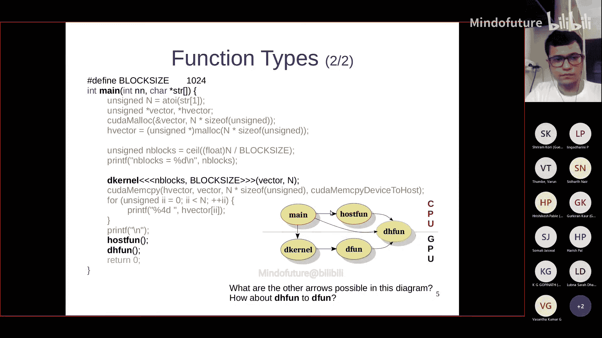

Okay， Goku and Va are saying no。

Yeah， I think that is correct that you can't call。Deefund from Dment with this arrow。

From here to here。From TH1 to D1 is not possible because。

The reason is the same that I gave in the previous slide right， I mean。

 it's the same question in fact that。This DH con might be called from post and if it is called from post。

 then it is running on CPU and calling deep one which is our device， I mean。

 which is which is something which will be run on CPU sorry GP。Cannot be called from the CPU。

 so this arrow from T1 to D1 is not possible。Apart from that， I mean。

 the question is now slightly different which arrows are possible apart from。The one， okay。

 so this one is not possible from here to here it's not possible that we saw。

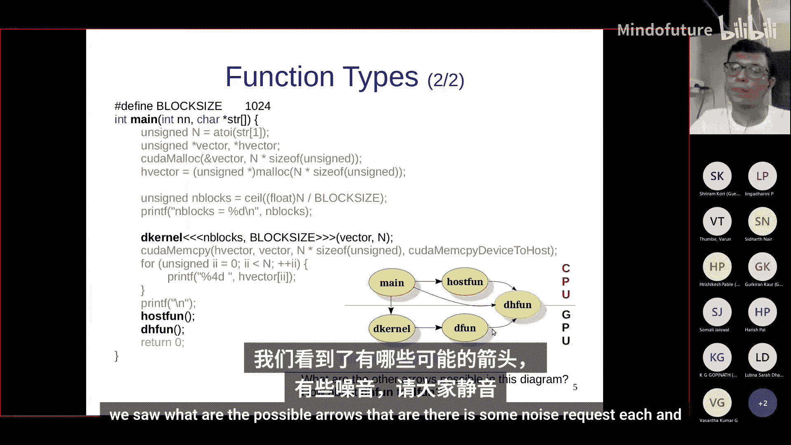

What are the possiblearrow that。好。s some nice request。

T and everyone to mute unless us if you have any question。Myly you listen。Go。I think。Yeah。

 if you have any questions， then please feel free to unmute and ask our unless， please mute yourself。

So there are some responses。 Let us try to understand them。 the kernel can call。DH1。

 So thehike is saying P kernel can call DH1 let us see。

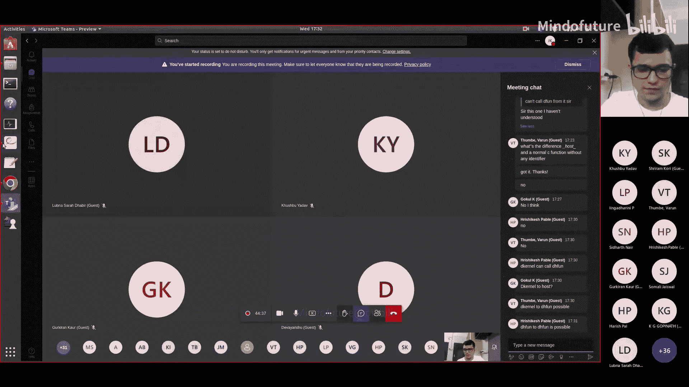

That is correct D kernel can call TH， so that is correct observation since D kernel is running on device。

And since since this TH fund is marked as post device， we can call。

D kernel from D sorry yeah DH1 from D kernel， which means that from device we can go to device source function that is correct。

 so thisarrow is possible that is absolutely correct。

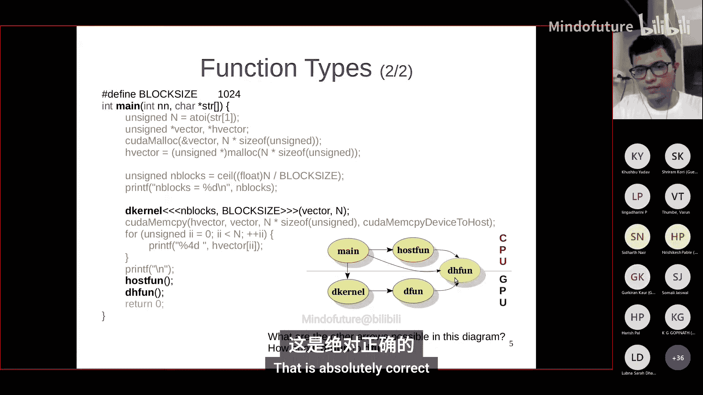

等。Yes。T can to host。Ex先。

From。T kernel to post meaning post function I am assuming。So， let me think about。第二。不s function形。So。

I don't think so that you'll be able to call post function from the D cardal。

Because this Dcon is something which is running on device， which is executed on device。

And this post function， which is marked as post。I's only callable from host。

 so since this is running on device。You can't call it from， I mean， you can't call it， I mean。

 you can't call this post function since it is only callable from the post。

So I think that this arrow。Calling the cardal Asari， this arrow this。

Calling post function from Dcon is possible。But yeah， if you feel that I missed something。

 then you can check this out， but I feel that this is not possible calling post function from the kernel is not possible。

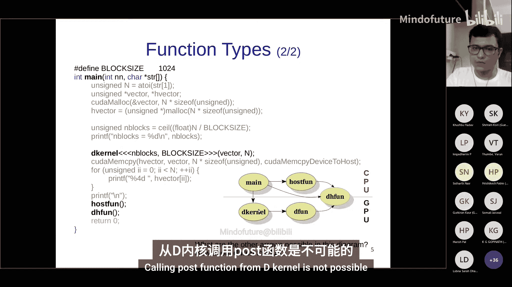

OkayLet us move to other suggestions。而家呢度。BH1， I think we already took this one right，ksh told， yeah。

 this one is same as this we cannot do。Then。比方都。DH1 to DH1 is possible。 Yeah。

 this is a good observation so。Yeah， let us take this up。

At this one， yeah。So yeah， let us take this up。いや、そ。Recursive calls are always possible。

 So if you see from TH fund， you can always call T fund。From hostman。

 you can always call host one from mean， you can always call me。

So recursor calls are always possible from dec kernelal also you can call dec kernelal there is something called a dynamic parallelism probably probably will get time will see。

 but every recursive call is possible， so you can call。

Main from main host function from host function and so on function deep from deep。

 so that all is possible， so that is one good observation。

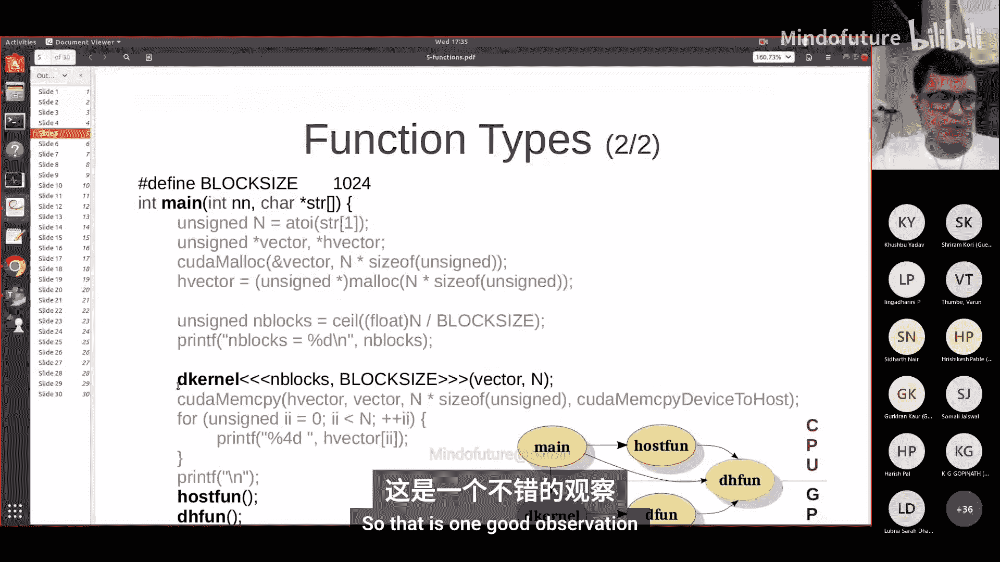

part from that。That deep2 different deep。Yeah the same thing。

 different to different is also possible。Yeah， so this is， I think good。

Stitgeitions are I think， on the correct line。So I would like to ask you one more question here。

What are all calls possible to the d kernel so can we call d kernel from the host function。

 can we call d kernel from the device host function， can we call d kernel from the。AT function。

 So this arrows from here to here， here to here and here to here are possible。

I repeat the question so can we call D cut from the post function TH1 and T1 is my question。

Can we do this？I hope that question is Claire， we want to call Dconner from all these three。This one。

 this one and this one。Please think about it and wait here probably for a few seconds。

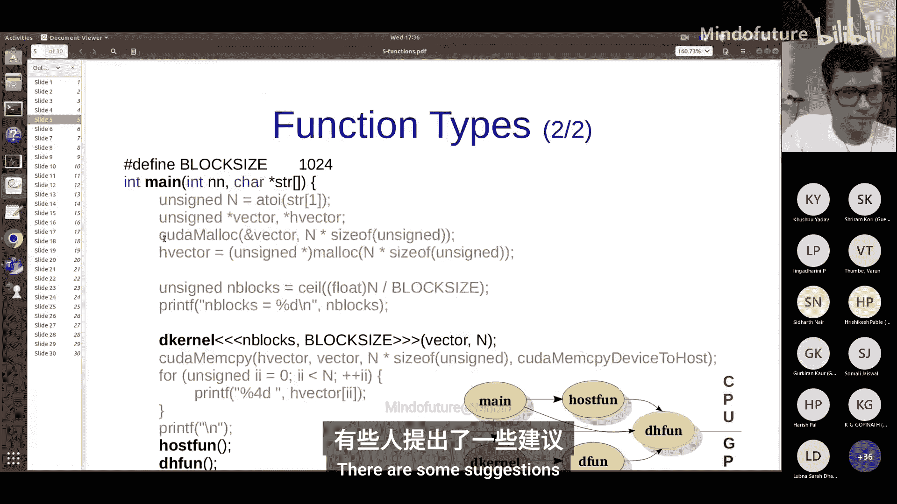

Okay， there are some suggestions。What do we saying decocon？From postpone， possible。

Yeah calling T color from postpon is possible。 yeah， so that is correct。

Only from main end post function， the shicacious thing。Gopefully saying yes。Yeah。

Aon is saying not from DH1。Okay， so I can see some mismatch work。

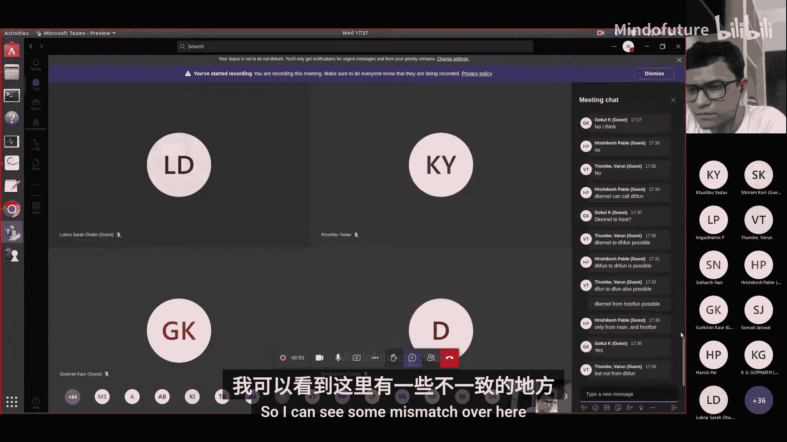

Okay， so as far as I understood from you people， people are telling that from post function and the name we can call the current。

But from。TH fund and T fund， we cant call T kernel。啊。Actually。

 I think you people are correct as far as。What we saw in this light because this was Marez's pose。

But。Yeah I'll like to add something here。 There is something called as dynamic parallelism also。

So I told that there is this loop also possible， right that you can call kernelnal from kernelnal。

So if you take dynamic parallelism also in picture。

 then in that case from device also you'll be able to call the deco kernel。

 so from device force function as well as device function。You'll be able to call the tea government。

 but you need to take care of a few things there okay please。Please try to understand here that yeah。

 these two things we already you know from main end post function。

 we can call deco since it's called from CPU。But from device and device force functions also。

 we'll be able to call the decocon。And for that， we need to study something called a dynamic parallelism。

Wwhichch probably will see if we get some time， but yeah。

 least note that we can do this thing also from DH function and deep， we can call a decocon。

So I hope that is clear。

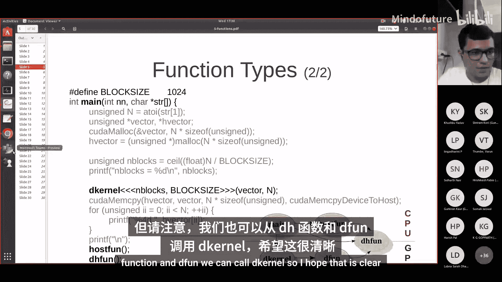

you can have the quote from D Frank。Okay， I hope that what I explained was clear。

Co police saying because it will be device namespace。系啊。Would you like to add something？

Kt understood it properly， but。In what context were you saying that it is？Okay， anyways。

 if you feel that you need to add something to this， please。

Type them on the chat or you can unmute yourself phone。

Yeah， but short answer is like。This D kernel can be called from main host function， DH1 and D。

And yeah， so I hope that is clear。Any further questions apart from。

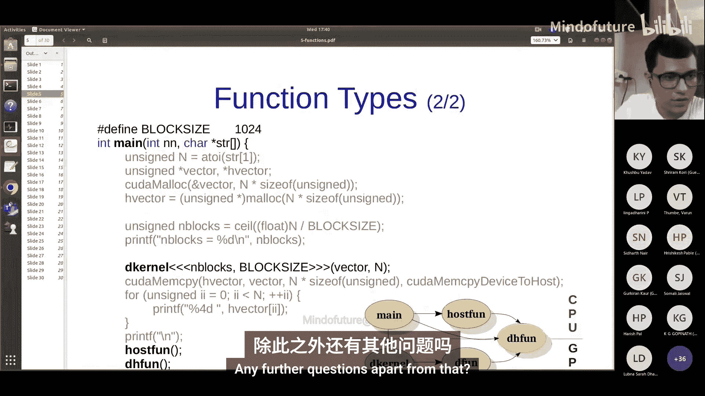

Okay， there are more questions in that case， let us。

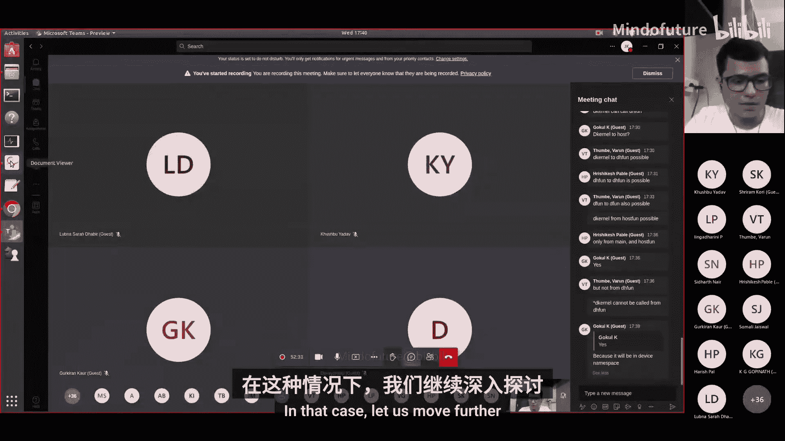

O。So let us see this thing that is a post end of memory。

So whenever you have this type of function right which is declared as host device。

 which is I mean which is callable from both device as well as the post this function is kind of very friendly with something called as post style of memory and what is host dial of memory I have already specified this in。

Think few initial lectures that is host of memory or unified virtual memory。

 It's also called this unified virtual memory。 So this memory is kind of。I mean。

 this memory is kind of。Common between or common meaning common meaning that it is。

Maintained across both c and GP so let's say if you have declared some variable as post catalog。

 then you will have separate copies for both c and GP and those copies will be kept in sync so yeah it's kind of like。

You update some variable and that update is seen across both CPU and GP。

And this poster memory is kind of very friendly with the post device function since。

This post end of memory can be accessed from both C and GP and since this post device function are also。

Called and run from both CPUN。 So it's kind of very friendly with it。

 And let us see one example example related to this。啊。Host I to memory and yeah， this is the example。

So here we are declaring a integer pointer， which is counter。And yeah， then we are。

Allocating memory is on the， I mean， we are declar this post end of memory。Which is， I mean。

Which will be declared on both CPp and C and will be captain sink。And。

The address of that memory is pointed now by this counter counterpoint。

 which is in particular pointed。And then we are setting this。Mem location to0 using star counter。

 so we are t defencing that address and we are placing value0 into it。Into that memory location。Then。

Then we are printing that。But I can see， we are printing that value inside that mamor location。

which is pointed by the counter and then we are calling the car。

 which is named as print k with just one thread。And we are passing this address。

 which is present in counter。And this kernel is this here marked is in global and inside kernel we are calling this point。

 which is again first device function。And again， we are passing the center and yeah inside the kernel we are。

It is calling fun， which is implementing the。Counter。

And yeah it is in in the counter and then we are printing the value of counter and then there is CDS cS will wait for the CPU till all these GP threads finishes。

Here at the card， and then we are calling again fun from CPU。And again。

 we are passing this counter value。And then again， we are printing this counter。

So I would like to ask you a question if you have understood this properly that this whole dialogue of memory of pin memory。

 which is also known as unified virtual virtual memory is common， I mean its a kind of。

sharedhared between CPU and GP or is like a separate coffee called CPU and GP and it's like Captain Sing。

Keeping that in mind， what will be the output of this program？And yeah。

 please think about what will be the output of this program。Yeah。

 think about it and please type that in chat。Only thing， I mean。

 only observation that you have to keep in mind here is that this post dialogue memory。Is kind of。

Caping sync between CPU and GP。 So whatever changes that you will make on CPU or CPU will be visible to the。

A there I mean。To its other part， so if changes are made on CPU。

 it will be visible on the GP and if changes are made on GP， it will be visible on the CPU。

So changes to this postal log memory when I say changes its it I mean。

 the changes those are done to this post log memory are visible。To the either of them。

 so keeping that in mind， please think about the output of this。

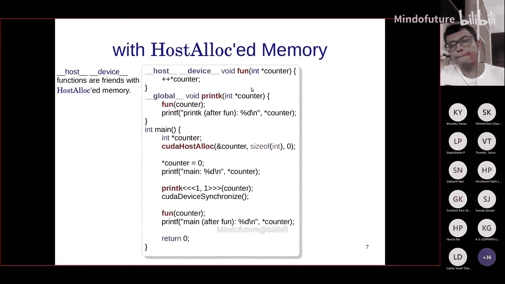

There is some。Response main is0， grid case one， main is1。

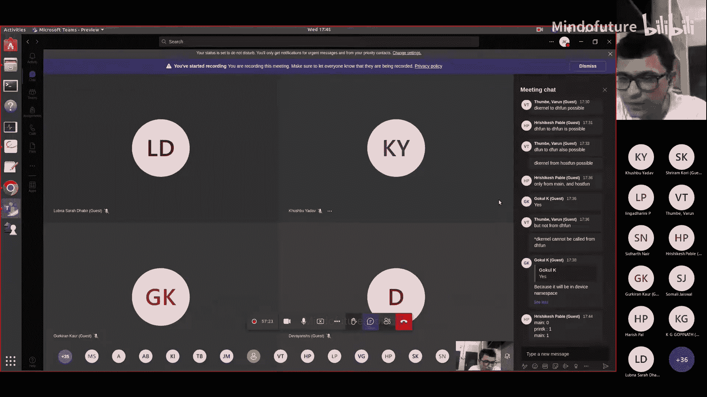

They request others to trial wait here for a few seconds for young people to trial。

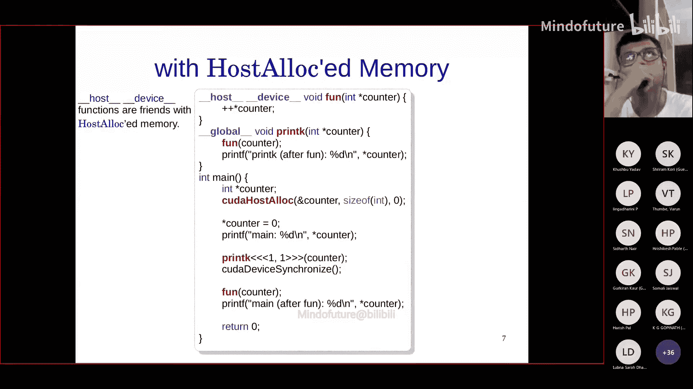

Last two are after that fun。Okay， I think probably we are missing something here。So。

Let us see I think last man should print to re if I'm not wrong。

 but let us see and let us discuss it。

Yeah， let us discuss this。Request others to also try meanwhile so that we can understand how these things are。

Postal of memory。So okay so let us try to understand the output of this program。

 so here we have declaring the integer counter and it is pointing to some sorry integer pointer which is name this counter which is pointing to some coastal of memory。

So， yeah， that that。Copy will be capped in sync between CPU and GPU， so whatever changes are made。

 it will be visible to both。And。Yeah， we are initializing it to0， so on CPU as well as CPU。

 the value of counter would be 0。Now we are printing it from CPU。

So the output here will be definitely zero， right， because we have done no operation on it and we have just finished ice threat。

So here， if we print it from CPU， even if we print from CPU， the output will be zero。

Then we are we are calling this garden and we are passing its address。And what we are doing。

 we are calling this from Kaal， we are calling this fun。And here we are again passing some matters。

 which is the address of this counter， which is the postal of level。And we are incrementing it。And。

After implementing， we are printing it， so。Here， since we are implementing it。

 the output should be one right because。Increment is done here and then we are printing。

 so output will pay1。And then。In this CPU。Since CPU will be waiting yet and this function will finish and then C will move further。

And then now pre that value of Converse one because here when print K was called one I already had。

And now we are calling this fun。From the CPU and we are passing this host all memory and since this copy is kept in sync the CPU will also CPU will also see the value of CA as1 and since this is called from CPU and here since we are updating it by1 mean we are adding one to it further。

The value will now become2。And when we print it from me， it will print too。

So I hope that you're getting this。

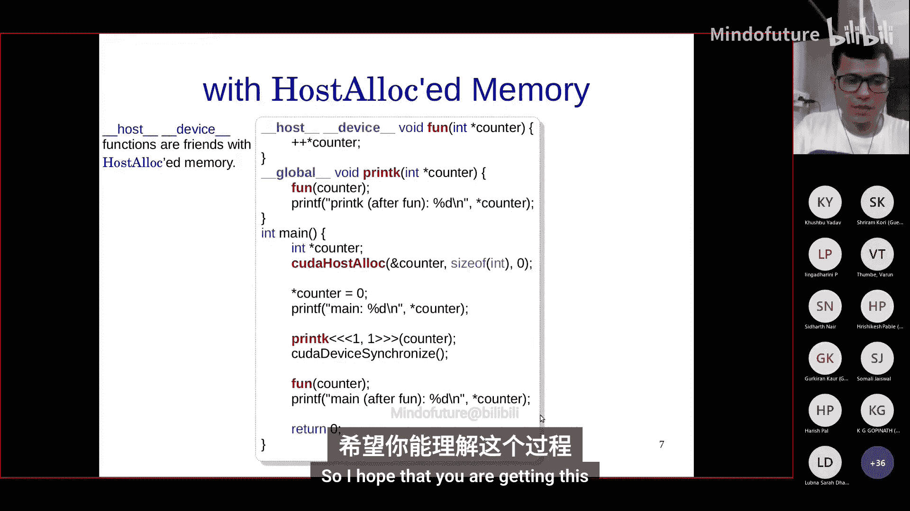

So output will be 0，1 and 2。I hope this thing be clear if there are any I。

There is any confusion this Bill。

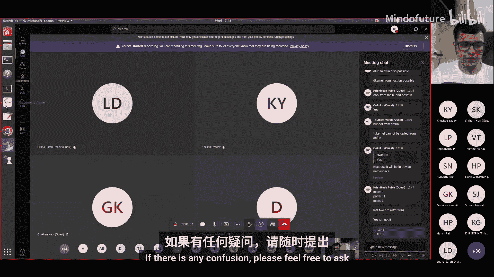

Okay us the key point to note here is that this。This hostel of to memory， this Captain single CPN GP。

Whatever update that Cp is making here， it will be visible to C so it won't happen that。

Whenever this function is called from the CPU， it will see the values 0， it will not happen。

It will see the updated value which is being updated on the GP， so that's why the output is 01。

I hope that you are cha this thing。So。Yeah， that is fine。I had one more question here。

Let me say that I added something。Something inside this post device function let I say that I added this thing right。

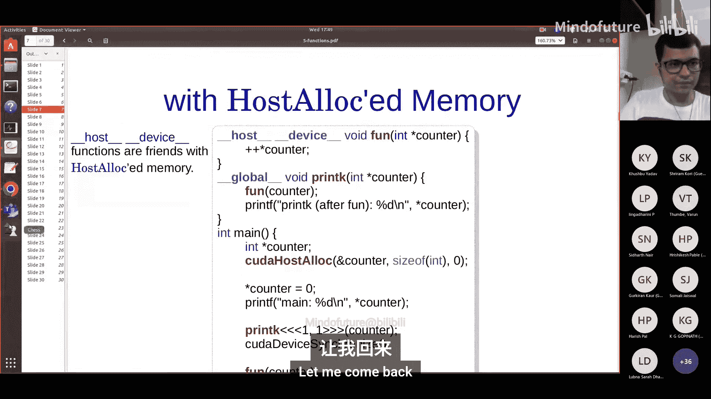

你咁。Let us say that I added this。Pnt h。Please consider that this Pf is printed。

 so I added the statement。

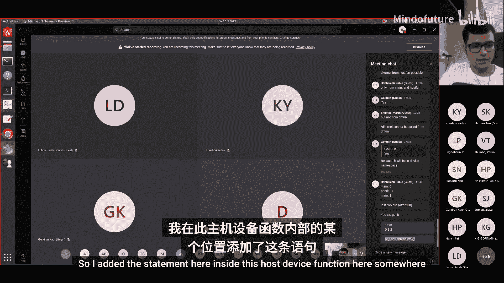

Here inside this post device function here somewhere。 Then please think what， I mean。

 will this program compile and。I mean， first question is that whether this program compiled or not is's my question。

Assuming that I have added this new statement。Here in this post device function。

 Well this program compiler。Please think about it and post your answers at the chat。

I'll wait here for a few seconds so that you people can。Think about。What can be the possible。

What can be the possible execution that is， will it compile or will it not compile。

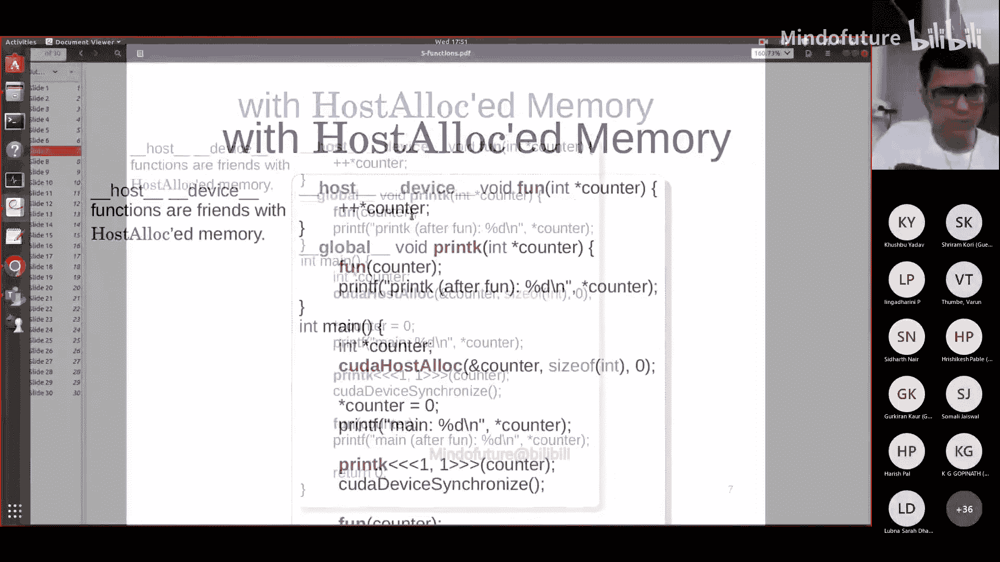

Properly go is properly compiled， but runtime error。Okay， now because one kernel， what only saying。

 No because when kernel is launched， it doesn't know what。P that。Okay。

 I'll try to say that right I mean， try to point out that from kernel we can call printer I mean inside kernel printer is。

Definine， so。If you might have tried them， we can create something inside kernel， so that is fine。

Yeah， that's okay if you're getting wrong and that' not going issue。So。Yeah。

 let us try to understand this。 So answer， simple answer to it is no。 like you can't write。

Such type of statement。

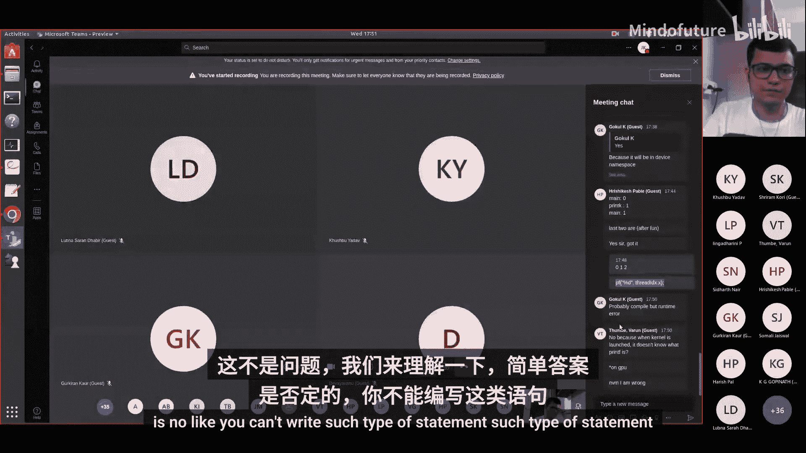

Such type of statement。Inside the post device function， the isnt is simple。

Because since this post device function is callable from both post and device。You need to， I mean。

 whatever you write here should be such that。It mean should be executable on both CPU as well as CPU。

Let us assume that you have written that statement here， right。

 that you wrote that thread ID x nor x1 here。But let's say this function is called from the host。

 then it doesn't know what is that thread id exorex。So in that case。

 it might give some compile time or runtime error。乜啊。Yeah。

 so the point that I'm trying to derive here is that whatever you write insert the post device function。

Should be the intersection of both。And intersection of both that you can do on CPU as well as CPU。

So on CPU you can do that thread IDXtex， but on CPU you can so if that is the case。

 you can't write that thing inside the post device function。And yeah， one point that I。

O I mean that I recall from Bar's suggestion is that can we write printer yes print is possible because if you see a few people might have read that I mean given even here its given right that we can run printer from the kernel。

So from device print is possible and from most also print is possible。

 so if that is the case its it falls in that intersection part right？If that is the case。

 then you can mention print have insert the post device function。

 and it will compile as well as run properly on either from host or device。

So I hope that is clear and。We already saw the output of this board， which is 01。Any questions。

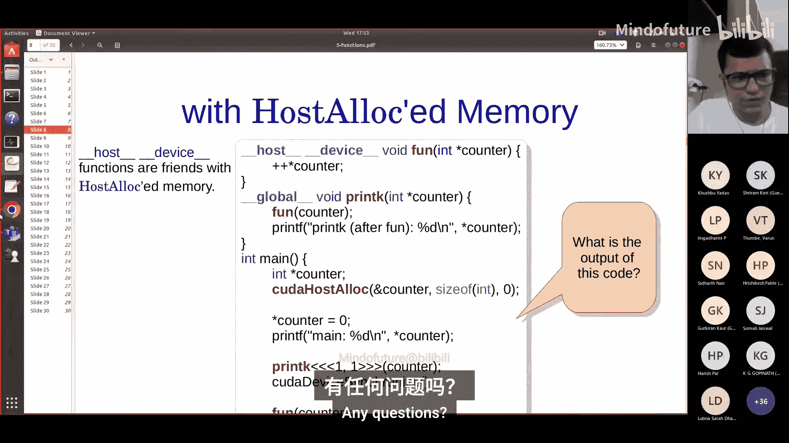

I have a question regarding the calling of B kernel or a device function from a DH form in this case。

 it is the fun。

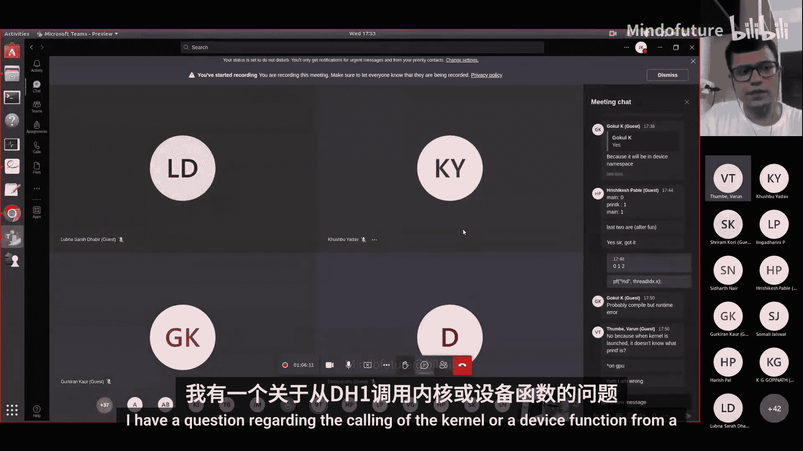

A the first function available。So can we， you did say that we can call colonel from here as well。

As well as deep。As well as a device function， is that correct and if so。

 like could you again give the explanation。That's doing。Yeah是。

So you are telling so as far as I've understood your question is that。

We can call the carddiinal from TH function that is a device post function as well as the device function。

So， yeah。 so that is one thing to like。Even we can call kernelal from the another kernel。

 So kernelal is callable from device function as well。

That involves something called as dynamic parallelism。Yeah， so the point here is that from device。

 you can call cardinals， so since this is device。You can call the kernel from here and in fact。

 you we know that from the poster， we can definitely call the。Cdial， right。But from device also。

 we can call the kernel， so from post device。He'll be able to call the current as well as from alone device function that this post is not well be able to call that current。

This print care in any of the garden。O。Yeah， but I do recall in the previous example in DH fund。

 you were saying that D fund is not possible to be called。In the previous one previous here。Yeah。

 we can't call it the other way is not possible。OhOkay， so that is not okay okay I understood。

They're trying to see。So from DH1， calling D is not possible that is because。See this defish fixed。

 right？Okay， so this T fund， when something is marked with global。

 you can call it from device as well as the post。When something is marked as global。

 you can call it from device as well as the post。But when something is marked as device。

Which is the case with default。You can't call it from device force function， why， because。

This function， which is marked as device host， might be called from the host。

And if you are calling something from post， it is being called from the CPU right。

 and if you are calling something from CPU。And you want to run it on device。It should be from the。

 I mean， it should be called from the device。And why this is the case because。This device function。

 if you see。Will be run with， I mean， with will be run with multiple threads and when is this possible only if it is called from some kernel or something。

 right？And that is the reason why you can't。Call T as1 from C1。

 because it might be the case that it might be called from the post。I hope that is clear。Yeah。

 but if there is any further confusion or any minor confusion also thinking。

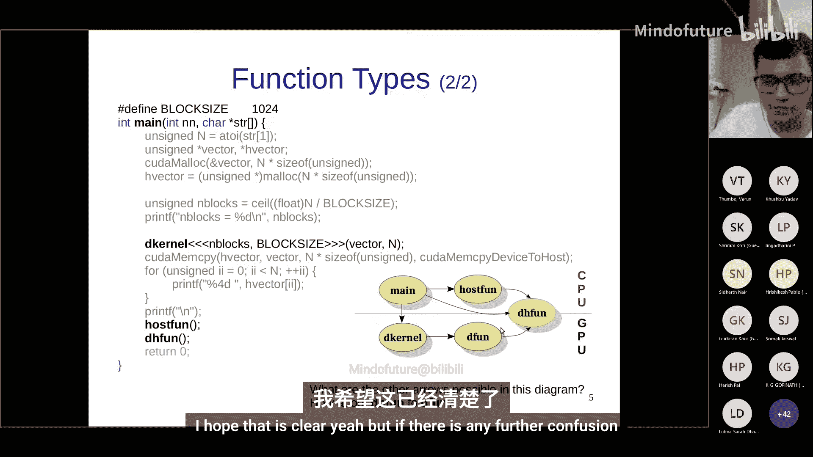

Some question。Sorry for the data。 I have some models。 Okay， that's fine。 can， can we have a post。

functionction。Device。Okay， I probably。Miunderstanding this question。

 but if your question is that can we have this？Alone host function and alone device function， yes。

 that is correct， I mean you can have this thing。Most devices the combination of both。

 you can always declare these separate separate， separate things right like that declaring it as a loan post and declaring it as a loan device。

If this is possible， then what。About adding post device function。Okay， so。Okay， so yeah。

 I if I'm not if I'm correctly understanding your question， then your question is like。

Why do we need this post device function， I mean， if or okay， your question is like this if we can。

MarMarcanic function as post device， then why do we need a loan post or a loan device？

I mean can't we just declare all the function as the post device function itself， right。

 so I'm understanding our question in that way？So that case过。See。

 are there is first this one thing right that this post device function can't call other device function。

So if your requirement is that from device function you need to call some another device function in that case you need to you can't market as post device。

 so that is one thing。And host device function is。It's only limitation， as I said。

 like you can't call any host function from it， you can't call any device function from it。

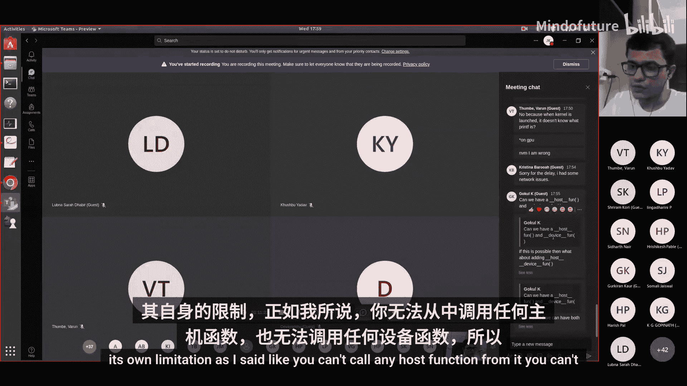

即表。portly remember here。From D fund you can't call Vo function from D1 you also can't call D。

 so that is its limitation you won't be able to call these two things from there。

And if you want to do that， then you need to either specify as deep or。I mean， either using a device。

 keyboard or else a post keyboard。What of the gas like。

According callinging the post function or the device function。

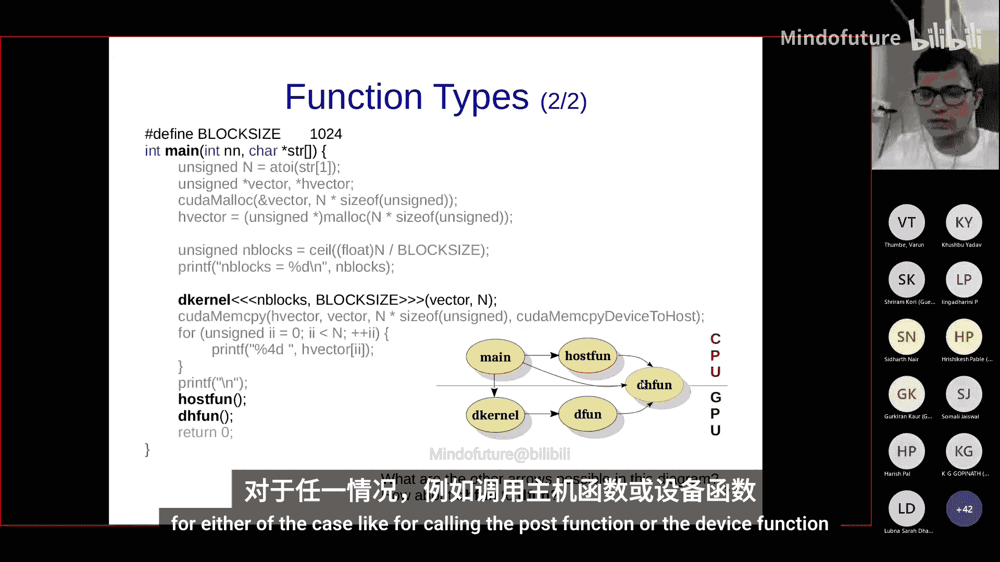

Did I understood it correctly or？Okay I think I misunderstood it。I mean， I meant it we can have。

Function name fun in both post site and device site， as long as。

They can only be called from post device respectively。Began her。Yes， see。Name doesn't matter。

 So you can。Name it in any manner you can name it as one or something else。

 even if youre I mean you can even give your name to the function， so that is fine。Second part is。

 and if it is possible。Can we have host device function fund Yes that is possible you can have host device function fund。

So if your question is that can we name it as one or something else， then I mean？

The naming is not an issue。 You can give any name。If I understood it correctly。

 that was your question。S， like I think God for like he's saying that like if can we have the same function as post and device？

Both of them in the same program。Oh， okay， okay， probably I misunderstood。I haven't tried that thing。

Okay， I haven't tried that thing， but I feel that there will be compile a error because。

You are marking the same function as。Same， I mean， same identifier you're using for both I mean for two different function in that case。

 I think there will be a。Compile a error。 I think so， but I haven't tried this one。

 so I need to try this。So I request a， I mean， who could you try this out order？

Check this out on Coab or somewhere。Please let us know what is the case with that。But I haven't。阿你。

Okay， I'll see this one probably I'll try this out。Go ever somewhere。Okay。

 any other questions apart from this？Excuse me。 Yeah， I have one go。Regarding the last example。

So as we are using host memory。

So in that case， in case of the fast function。So that is a pan。

So if you add underscore underscore host underscore underscore， so in this particular case。

 there will be no problem。As we are using host alert me， am I rightly understood sir？

So in we use to that。If we use thread I， then in that case it will it might be a key problem and obviously be problem。

Yes， yes。Okay， you安 the。

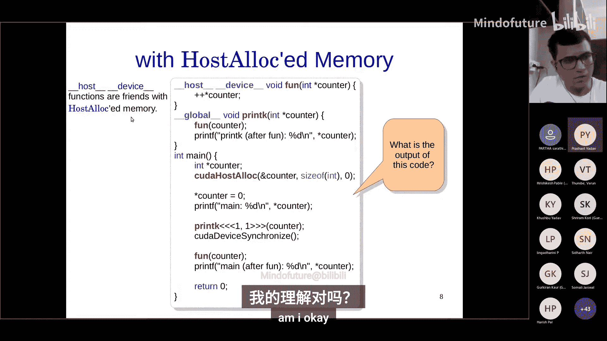

Your voice is breaking。Yeah， your voice is breaking Prussian。

I can't get it properly。Can you repeat？For this particular example。😊，Yes。

 so adding underscore underscore host to F function will not create the problem as we are creating first developed memory。

A， yeah， perfectly if you if you remove this device part and just keep this forced。

Then also that is fine， but yeah， let me check。No， I don't think so because yeah there will be some issue。

 Yeah， so sorry for that。 Yeah， there will be some issue because。You are calling this。

Let's say if you remote this device part。Then you are calling this。

I am not saying that to remove device so if as you added horse。Undersco， underscore host。

So whether it will create any problem for this particular program。Where are you adding posts。

 so I missed that part？Under underscore host and underscore underscore device for fun function。

You have already added that， yeah， it's already there number。最は。Yeah， okay。So in this case。

 there will be no problem。 Am I currently understood sir， Yes， absolutely。 I mean。

 there is no problem with this code。 It will compile run and give correct answer。

 as we expect that is 0，1，2。There is no issue with this。Yes sir in case of counter。

 if we use inside the function， if we use3 it dotx， then it can create problem it can create problem。

Yes， yes， perfect I mean， you understood it properly。

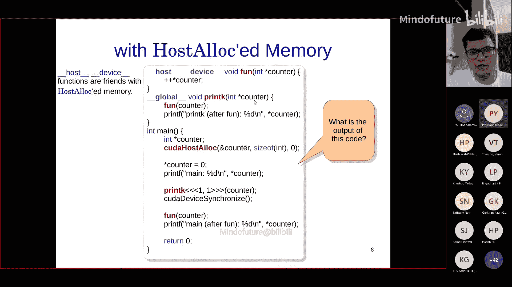

O。给啊。Any questions apart from that。 Yeah， this thing I need to try this one I need to check。

Apart from that， any questions till this point？

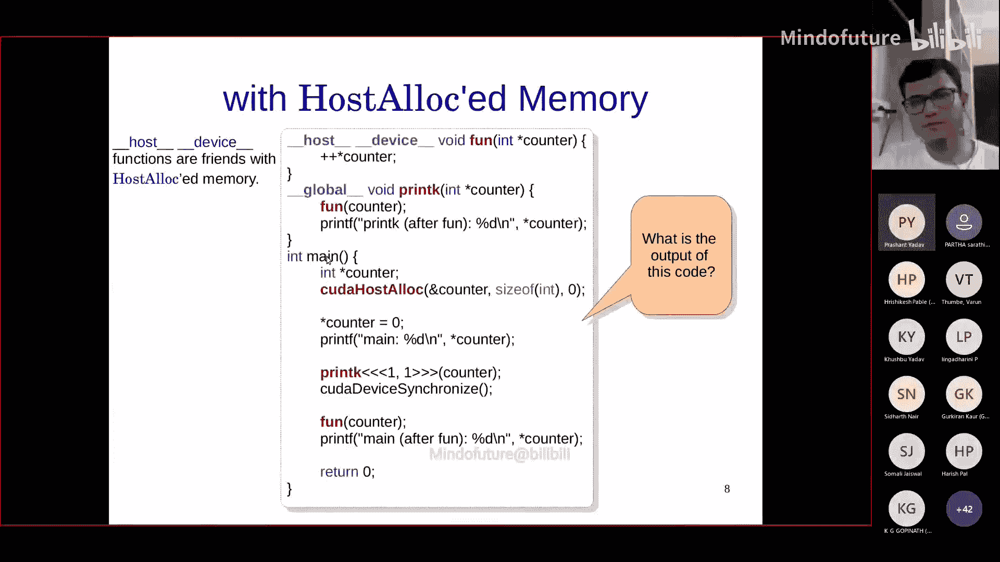

Let me quickly see if there are any questions， I。

There are none， so let us move further from here。so ok啊。As we saw。If be呃。

Add something like this inside a host device function that is separate。

It will give compile time error， right？Because if you see。This sink thread is unknown to the host。

 so if you call this。Function fund from post， then it will not know that what is the sync threat and hence it will give some compile diameter because a compiler won't be able to identify that what is synct when it is called from post。

So this is same as our previous example or previous talk that I。

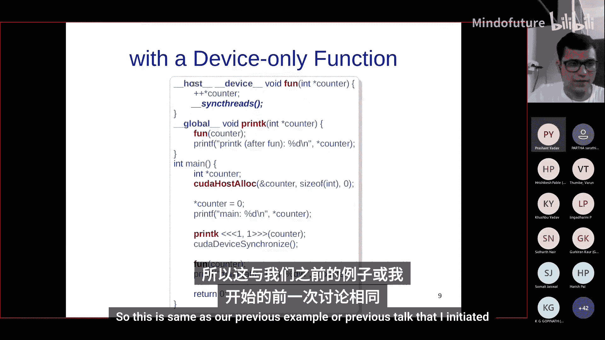

Initiated that what will happen that what will happen when I add this line。

This thing is similar to that， like adding sync threads will cause similar issues as adding third IDx stock。

So I hope that this is clear， adding anything which is not falling in the intersection of post and device that is something which can be ran on CPU as well as CPU here in post device function will cause some issues。

Okay， apart from there， there is。Yeah， apart from that。

 there is nothing from this structure yeah you can't add synctt here since put some post device function Sft is only known to device。

 but not。Fine， yeah， so key takeaways synynched is not available on CPU。

 hence this might cause issue。Okay， so let us come through this thing。So here， instead of post a log。

 instead of saying that I'm postal loging， I mean， postal loging some memory。

I do code ML that is now counter， which is an integer pointer and CPU is pointing to some memory location which is declared on the GPU。

So company is point to some member location on GPU。

Now I'm initializing that counter printing that counter from me。

Then I'm launching the kernel passing that address of counter and then cds and then again calling fund with that。

Passing that counter address， sorry the address that is stored income and then number。啊点解喐咁。So。

Will this code compile properly or will it cause some issue at compile time or run time or coming？

Will it cause an issue or will it go through swift or smoothly？As we accept expected。

Please think about it and post your answers in the chat or。

Please feel to discuss also if we be something with。Yeah， thats go。Sure for discuss。Yeah。

 please think about it。

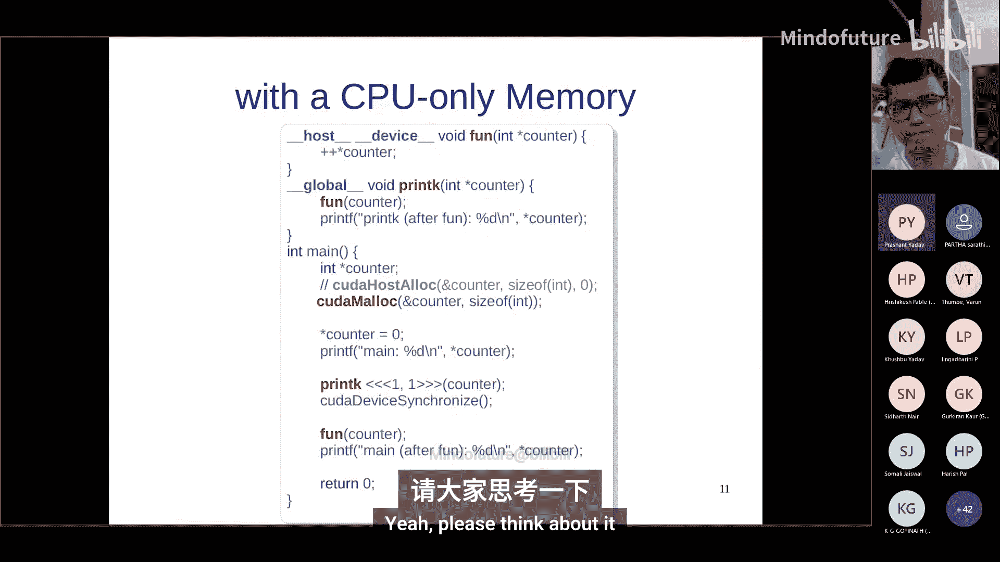

Its really。There is some question from I think Cos。He thinks are too buda host enough。

Make it so that。Devicice can tell that memory address is pointing to post site。

And turns that memory addresses pointing to ho side。啊。Okay。I think， okay， Im not sure how the。I mean。

 internal details are for this quoa hostel。As far as I know， it is two separate memories between。

 I mean， cap C as well as C。On the D of CPU and D of C by the way， and both of them are kept in sync。

使啲咁好思。I request teaching everyone of you to mute unless you have any questions I。Okay。

 so coming back to。The question by okay， so as far as I know the implementation of post memories like that。

 there are two separate copiess and they are captain in sync。So。The question is so that。

So local is trying to ask that。They said that the device， I mean。

 device is able to figure out that the memory， I mean。

 the correct memory or the correct value is currently。啊，按第。I mean， on the post side of the device。

 I don't think so it is like this that whenever the variable is updated or some memory is updated。

 which is not as post lot。It will be updated on the both end and whenever C wants to create the value。

Of that post variable， It will only read from its copy。

 but that copy is in sync with in sync among both C and G。 So whenever it tries to read anything。

 it will read correct。Value since it is kept in sync。

I hope that I answered your question in case I missed something then please do let me know both regular Malo also work。

O， I thank you啊呃。

Probably that is what here。啊。啊，呀。Let us say I have just used Maok or puda meok here instead of pua hostello I have used here pua meoc right。

 or let us say even if I have used malloc here instead of pua meok or。Co have you。

And what we will have So here there are two scenarios right。

 let us analyze one by one apart each of them。Let us say that I have Bua Maoc here and let us say that I have Maoc here。

And what we have so for ka meop， we have this slide right， the center slide is for ka melo。

Please consider that this slide remains the same just we have changed this quodamaoc to melo。

 then what will happen， please think for both the cases what will happen。

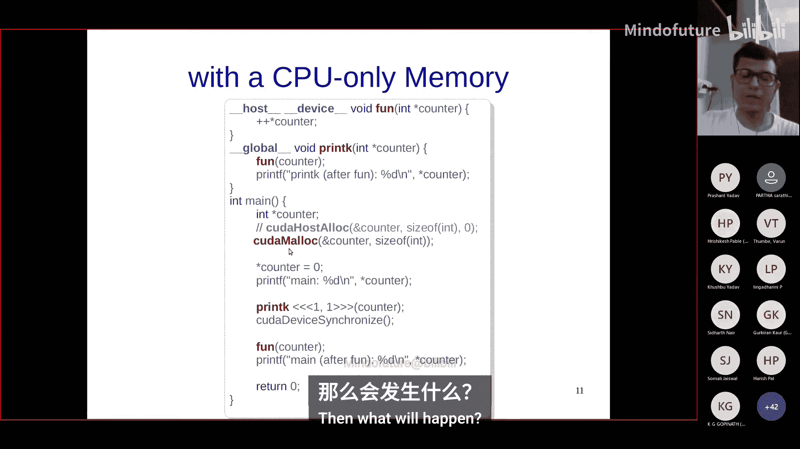

我会吃的。Okay， we got it。咁 think噶。Yes， don' st。 yes。They matter。After executing print， okay。Okay。

 so let us analyze that step by step So okay， first of all。

 let us analyze this case where we are using quo ML。

So， here， if you see。They are allocating the memory on GPU。

 this counter is pointed to CPU pointed to some memory location。

 but it is pointing pointing to this memory location， which is on GPU。Now， if you see。

 you are trying to deaf some memory location， that is on GPU。Here。

As well as you are trying to de referenceence some memory location， which is on GPU here， on CPU。

 here and here。From CPU trying include data some location on GP。Then what they will， I mean。

 what can this。Lead to it can either lead to segmentation fault or。

It can lead to printing of some garbage or yours， I mean。

 such issues can happen when you try to do this。So my point is that this code is incorrect。

If you use just quoa meoc here instead of post law。

 then it is incorrect since this can cause issues you are trying to access C this number location from CPU so that is incorrect。

Now， coming to second part。They not good单咯。Then this is fine， you can initialize it on CPU。

 you can print it on CPU， that is fine。But when you pass the CPUs address to the GP and try to access。

 I mean， try to dereference it here on the GPu。So please note that you are deacing CPU address。

I'm in T referencing CPU address on chip。That will cost Se on GPU or some garbage value printing on GPUs。

So that is also incorrect， So either replacing。Thisa host by Ka melo or melo。

Will lead to some runtime issues。 It might be printing of garbage value， or it might be。

The case that you might encounter a setpoint。

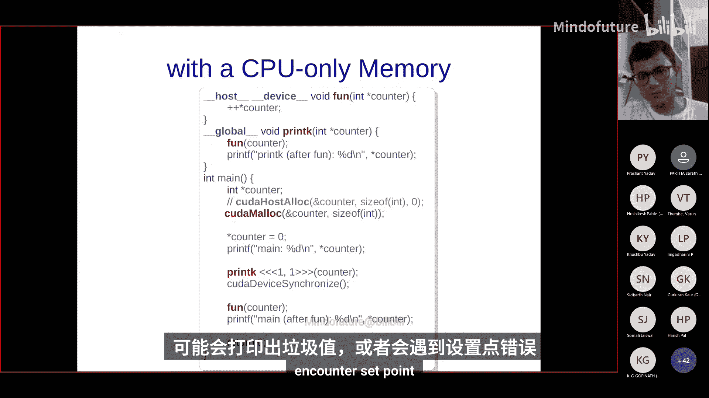

So I hope that this is clear。Okay， maybe regular malllo won't be able to make this city go。

Wt be able to make this CPU side and CPU side copy or update them So that one。Yeah， yeah， I mean。

 absolutely， so regular melo will not take care of this thing。

That two separate copies are maintained and they are captain sync， so all these things will be only。

Made short when you are using postman。And。

Hence， if you see that's why this code was working properly， this post dialogue was working。

 I mean was working properly， not this one， but yeah this one this post dialogue was working properly because we are maintaining to I mean post is maintaining two copies and keeping it in sync。

So that is why it was working。 And if you replace either with quodaoc or Malock， it will。

Of course issues is what I'm trying to suggest。Yeah。

 so counter cannot be accessed on CPU is what is the takeaway from here。

 this counter cannot be accessed on the CPU since it's allocated on GPU。

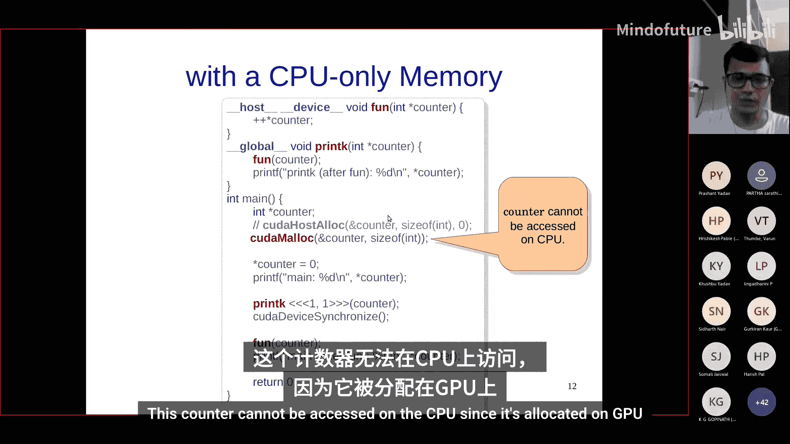

I hope you're getting it。你ject。Okay， I think there are no questions apart from that。

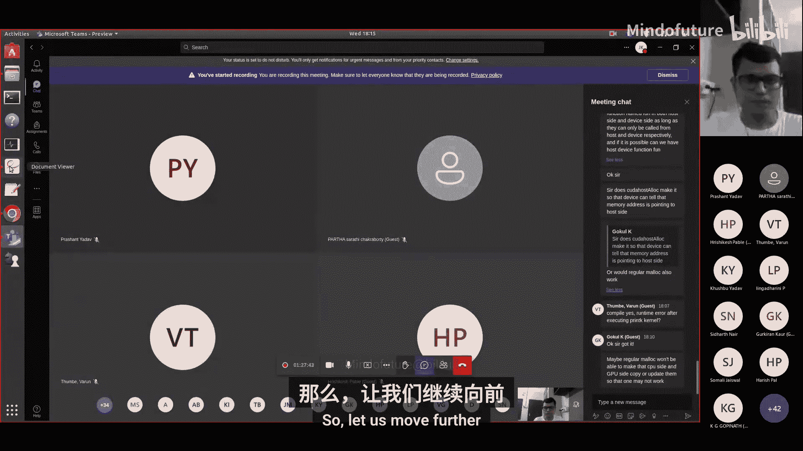

Let us move on that。Okay， so let us try to understand this。

 let's have declared global variable in teacher which is named as counter。

Let us say that I'm trying to access counter inside this post device function then。

Will this thing work， I mean， will it cost some comp time issue or a current time issue or something。

 or it will work properly as the question？

Okay， please think about it。 I'll probably with I think like it will cause it because it counter is on the CPU and the kernel would be the function would be running in GPU。

Yes， perfect。 I think you got it。 So this when we declared this variable using such syntax， which is。

I mean， it is declared as a global variable and this global variable is something which is declared on the CPU and if something is declared on the CPU and since this is a host device function it can be called from device。

And if that is happening， so in fact， this can happen here So the function is being from the print key。

 which is current were calling the function。 So it is called from the device。

And if we try to access some variable， which is such， I mean， like such counter。From T device。

 which is from GPU。Can cause support right， because the characteristic， I mean allocated on the CPU。

 we are trying to access some CPU mail location from C that is not valid。Yeah。

 I hope that you got this point that this is also not correct。Okay， so yeah。

 probably we got this that this is not correct。And， because counter cannot be accessed on the GP。

Okay， fine， we got this thing， but what about this？

I declare instead of declar it declaring it as end， declare it。Post post device encountered。

Now what can be the output of this mean， output of this program or will it compile and run correctly or posttropo it will give some error during compilation or anything？

Okay， and let you prepare to think part a。

I think there are no responses。

Yeah， so like me。Okay， let me。So， yeah， this is also not value because。

You can declare a function as a host device。But you cannot declare a variable as a post。

Okay， what time trying to say here。This is not。So this is not the value。But yeah。

 you can declare this thing。So can declare a variable as a device using a device keyboard。

If you do that， then you can access that variable inside a device function。

 So let's say this host was not that and this host was also not that。 And you are accessing。Counter。

 which is declared as device inside a device function。 So that is valid。 that is fine。

 but variables cannot be declared as source so this is。

This is not valid， this one is not valid。And。Because of that， this thing is not a valid declaration。

And hence， this will also not work。

So I hope you're getting support any questions on。

Okay， if you have any questions， then please feel free to ask。ok啊。Yeah。

 so next one is like what I just Id or just what I just said that we are now declaring that this。

Variable， which was initially host devices， just a device。And if that is the case， this is I mean。

 this is now some variable which is allocated on the GP。

 it not the developer mark something as device it is。Allocated on the GPS memory。

And if that is the case。We can call this， I mean， we can call this from host device function。

 in fact， we can call it also from device functional。But yeah。

 we can also call it from post device function。But there is one issue here， and that issue is that。

Since this post device function can also be called from the post that is CPU and since it is being called from CPU we are accessing some memory which is there on GP from the CPU。

So that might lead to s at runtime。But during compilation， it will give you the warning that I mean。

 it will give you the comp warning during the compilation that you are doing something wrong here。

That is where you might try accessing some GP memory from GPU。That is fine， it will give warning。

 but at run time。if you try to， I mean， if this is the execution button that is you're trying to call Caral and from kernelnal。

 you are trying to call function。Whi is this post device function and inside post device function since it is being called from device that is GPU。

And this counter， I mean， this post device function will be ran on the GPU since it has been called from kernel。

 but it will be ran on GPPU。And since you are accessing this counter from GPU。

 since it's completely fine， counter on GPU are accessing it from GPU。So this is by。

 it will not cause any issue。So for this example， it will just give you comp and volume and will run perfectly。

But the case where it will give issues is where we are trying to call this function。

 which is fine from the CPU itself from main itself youre calling。

Then in that case it might give some problem， so I hope that this is clear。Question。不会。

There are no questions letting。So okay， let us try to look one classwork。For the啊。

End up today's lecture。 So let us。Look at this class。So。Yeah。

 so this classwork is about incring all the elements in the area。

We want this code to be from col from post as well as you guys。

 so how how are we writing this quote let us understand？So yeah， so we have this area declared on C。

Of size N， then this there is this point at DR and we are quoda unlocking the memory of size n of size n integers on GPU and making DRR point to that memory。

Then we are initializing that memory of CPU。Plaing， I mean。

 initialization is done in ER and then this values in ErR being copied to T。And yeah。

 so this is your incredible copy noticed this thing。

Then we are calling this function fund and this function is posted as function to note that。

And since it's been called from the CPU。Since it's being called from the C。

 this loop will run on the C。Hi， so this is sequential porttail now。Calling it from CPU。

 running one CPU， then we are calling it from GP。And we are passing Dr。 It is not that Dr is， I mean。

 Dr is pointing to some memory。Some memory which is allocated on GPU。

 so here it would point to some memory allocated on GPU。

Then we are calling fun now fun is being called from device。Sorry， one is being called from device。

It will。Yeah， this era is also pointing to some device memory and it one is calling called from device。

 so now this loop， which is being ran by single thread。Will be serial on GPU。

So this loop is now running on GP if it is called from PR deep。Yeah。

 and it is run by one GP thread on GP。Yeah， in that way， we can in some sense。Icrement this adding。

OnC as well as。But the question is， this is a very post central code， right？

Everything is being done on the post， I mean。Even if you see our device when they are。

callling GPU Carll， we are using one thread and we are incrementing the elements in the area in the same way with two times CPU1 by one right。

So can we avoid this for loop in fun？Which is causing a bottleneck， right。

 because we are using one G2 thread and。And could exceeded。So let us look how to avoid this loop。

So yeah， we can avoid this loop and for that， what we can do is。

Instead of instead of calling this min， sorry， not calling， but instead of incrementing this ARR。

 each value in AR here1 by1 using this group。What we can do is， we can。

Call the kernel with n threats which was actually the size of the eraR and D。

 you can call the kernel deep with the n threads。And that n threats。Will， I mean。

 each thread will implement one memory loop one element in that and so here we are passing that era with erara is。

Adddress and we are calling control with N heads。Then for how we are calling this function。

 So each thread is in this。Deep1， actually， so there are answers each thread will call this deep。

And based on its thread ID， it will increment that memory location。That primary location in the area。

 So I hope that you are getting this。 So here each thread is implementinging the。

Particular element of that RA D error。And don't see you how we are incr， so on GP we are okay。

 it is being implementedcr in parallel by entrance。But on CPU。

Here we are on CPU we are implementing it serially right one after the another using this for loop and addresses passed appropriately by doing AR plus II。

Here are plus0 is past here are a1 is pass so strike I mean we are passing the base address plus offset。

 so based on that the memory address will be compute and that value will be increment。

At least note that this one is host device function， so it can be called from CPU as well as CPU。

So that is fine， so yeah， we were able to do this， but there is one more point too。

What if I don't want the poly loop in main， but still want GPu parallelal code。

 so I don't want this group in the CPU and still want this GPu parallelal cord to be。

Running with entrance and in that case， we can still tweak this code for。So this is device centerric。

And sequential on CPU， but it is device centered， it is being run with entrance。

 but it serial on the CPU。Now， let's say I don't want to look in the main part also。

 and how can I change the。The function or this function。

So what can I do in this case is that let us keep all this thing as， I mean， as it was previously。

So again， now， let's say I want to eliminate that loop here。

Which was here So what I can I do is I can just simply call this function as PRr combine。

So when it is called from CPU， this host device functional。 when it is called from CPU。

It is being passed and is the argument， second argument， and it tells that okay。

 the number of elements that I have to increment。Then I'm being called which this function fund。

 which is post device device function。When I'm called from CPU， I have to increment and elements。

 so loop here is now shifted to here。I， when I am called from C。

 I have to implement an element and that value is past here。And when I'm called from GPU。

 so please note that this deepon is being launched with Android。

And this refund is internally calling fun。And it is passing the appropriate address by Er plus third ID extra text。

 so each thread will get one unique element in the direct agreement。

And when when this function point， which is Roized function is being called from the GPU。

It will what it will know that I have to just implement one element since each thread is working on one particular element。

 right？For that case for the case where this function point is being called from GPP I'll pass one as。

And if that is the case， N will be one and only one。

One element will be cr this for loop will just run for one it。And yeah。

 appropriate element will be implemented based on the。Address computed by this base plus offset。

And that appropriate address location will passed and that element will be driven。

By just one it of the when called from the。接别。That is from Davis Depot。Inending called from the CPU。

 it will be increment it will。This n will be n which is past here and it will this follow will learn M times。

So I hope you are getting it that we have eliminated I mean， not eliminated。

 but we have shifted the form that was in the CPU view to here device function post device function。

And yeah， by， by using this mechanism， kind of。Increment and area， which is。I mean。

 we can implement the RA on both CPU and GPU。So hope， this is clear。

Any questions up till this point？On the material power today。We'll wait here for a few questions。So。

 okay， so for today's lecture， we have covered。Functions and。

I不呃。Shele also planning into touch put upon trust library。

So I'll just briefly mention what is trust and probably then country。So。

Trust is a parallel algorithm library similar to STL if you know。

 I mean if you people have code in C++ then you might be knowing what is STL which is a standard template library or ME it supports various data structures like SA and map and so on so it's quite handy and useful library。

This thrust is in some sense， very similar to this。STL， which is on Sa。

And it supports many things like vectors and it also supports that those things right。

 we started in the previous vector like reduction， prefixum and all those things if you see。

 there are input functions that are available in the trust library。So， you can just。

Use those functions to do reduction and sum。So we I mean， we saw the code for them。

 but that was for understanding how it works。To get with taste topic its implementation and so on。

If you want to quickly do reduction of， we can boost thrust。I mean。

 input functions available in trust reduction for， you can also use factors like if you have used ST then you might know what is vectored so there is a vector container available。

Similar to that， trust also has vectors， you can explore this thing。

And one point that I want to highlight here is that similar to c plus plus STL。

In trust also programmer is oblious to the I mean， oblious to the。啊。

Obligous to when the code is being executed， so if you go in C++ S。When you use set。

 you don't know how that set is being implemented if you have understood it or if you have tried understanding it in great detail then you might know that because a set is implemented using something called a stack like3R。

Se， but an inspired pi research tree。That is okay， but how it is thing， I mean。

 what is its actual internal implementation you need to de deeper input you need to open up the STL and all those things to understand that。

The similar manner in thrust also。Itcent implementation is there， but for programmers。

 what I mean they are just。Users of this those APIs right。

 so for time it is like a black box and they are using that part that vectors and sets and all those things which are available in thrust。

Yeah， so programmer is obous to where the code is being executed on CPU or GPU。

 so it might happen that trust is using some， I mean。

 it is executing some part on CPU and some part on GPU and so on for maximizing the performance benefits and for those things。

So yeah， you can explore this trust library， we want people to cover it in grade detail here due to lack of time。

And yeah， so I'll probably stop here since we have already。Overstar the time。

But I'll wait here for a few minutes to take up the question， to pick up the questions。

Thepan will probably dis。

