# 【Nvidia】CUDA并行编程-｜-Cuda-Programming-Course-｜-Parallel-Computing-Using-Nvidia-p17-P17_L17_CUDA中的支持功能--BV1MSq1BTEho_p17-

啊。

Yeah。So okay， hello and welcome everyone to the 18th lecture of our quo programming so in the previous lecture。

We saw things related to the function right so we saw what are the different kinds of functions like post function device function。

Then post device function， then global function， which is also on thecural lender。So on。

 and then we saw a。Typical examples related to this different different types of functions。Yeah。

 and then towards the end we saw， I mean， we touched briefly upon what is first library and what are the functionalities that it provides us。

And yeah， that we。Ended with the previous lecture， and that was the outline for the previous lecture。

So project today lecture， we are planning to。Look into the support aspects of the GQ program。

 so we'll see。What are we make pie and first of all， see， what are we make pie and。

How could I the make files， What is the structure of the make balance one， And then will。

C1 use case related to the make file on， I mean use case related to the how to use make file for running the KoA programs that is compiling running。

The quota programs then well see the debu sorry， then we'll see the debuing aspect that is。

We'll see how to debug our quoUDa program using something called as quoa GDPDB。

And we'll see some examples later record， and then later we'll see what is propfiling that is。啊。

Like how to measure measure the time that is。Associated with our Pua program and。

That important doing that well see something called a sandway prop and yeah there will probably end with the bud structure with the prop。

So okay， so with this， let's。

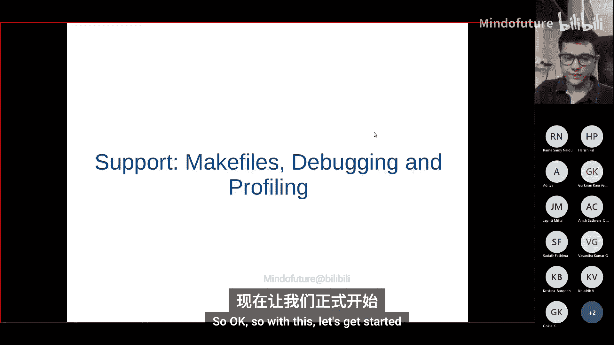

Get started of selection proceed that is。Okay， so that is nothing going be checked。

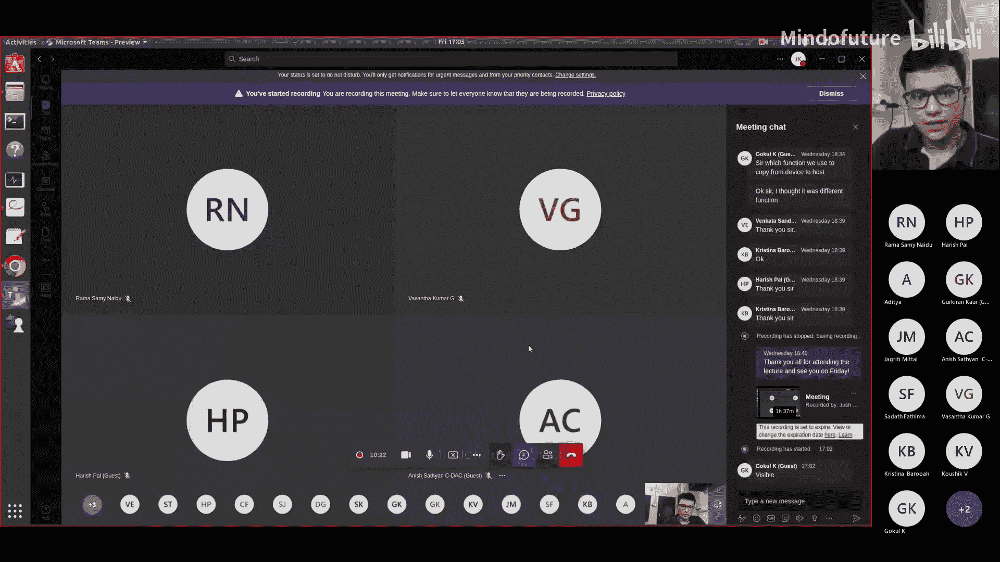

Yeah， so okay， let us start with the。Good this。so。Let us possible。See what are they make files。

 so make filess are nothing but a set of commands。Which contains。Targetets and the variables。

I mean they are associated with targets and variables for。Compiling the object file。

 and to remove them， so。Yeah， so far so in the typical make file you can write ta in such a way that you create multiple object files and remove them and。

This is typically helpful for。A large project where you have a lot of。I mean。

 it will save a lot of manual work because you can just write everything in make fileile and then can just run make we'll see the examples related to it。

And。Yeah， so moving on further， so make files are typically used when there are dependencies among files。

Consider I mean， consider that you you are handling a very large project and。

There are multiple files and let's say file 8。cu。Has dependency on some。

Who otherwise files like C dot C and D dot C， So C dot C and D do C must be compiled post and then only A do C should be compiled。

And once that A A dot C is compiled， you should。You should run some， I mean。

 you should compile and run some another file， another good app file， which is let's say hello white。

c。So such kind of dependencies there that can be model less directed ascyclical。And。

You can use typically use this make files for resolving these dependencies or I mean。

 I would say that you can write the make files to automate the。

Exec of your of automatic execution flow of your project。And yes。

 this is typically useful for in large projects， where there might be。

Many dependencies among the pilot。So the example that I gave was a very small one but。

Consider that you have a very large depend tree， and there are a lot of dependencies going on。

 So for that。I mean， how NIA can help is that？You just need to。

Look and resolve those dependencies and write them in N only once。

And you can run it multiple times I mean， you can run it as many times as you want whenever you are running your project。

 I mean， you want to run your run or demonstrate your project。So yeah。

 so you can just write it once and run it multiple times say my make fileile you can write it once and run multiple times and it is I mean make fileile is nothing but the setup command so。

Yeah， I will see with the example it will get more clear with the example in the later slide here。

 but I am measuring that this is clear that it really helps in。

The case when there are a lot of dependencies and in case where we are working with a very large project。

O so moving father that。Once we have written this make file。

 which is just nothing but the set of commands or the instructions。

We need to run this makephi and for that， we have something called a make utility。

And it's a command line utility to process the instructions which are or the commands。

 which are written in the make file。And。Yeah， and。Yeah， and then， and then the。Sorry， yeah。

 and then we put all the files are the necessary。Things are files that are associated for running this make file into the same same director or the current directory in which the make file is。

Present so yeah I'll give that example， I mean we'll see the example towards the end and it will get this slide I mean this point will get more real with that。

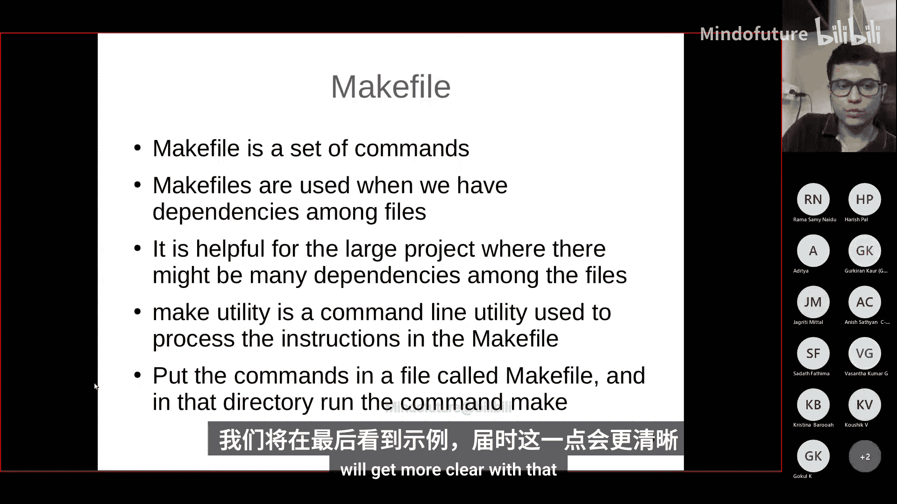

Any questions up to this point？Let me。

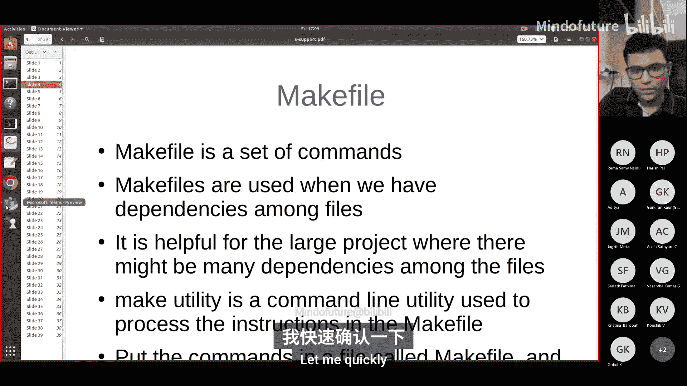

Okay， I， I am assuming that the。We are clear up till this point， so let us move on。

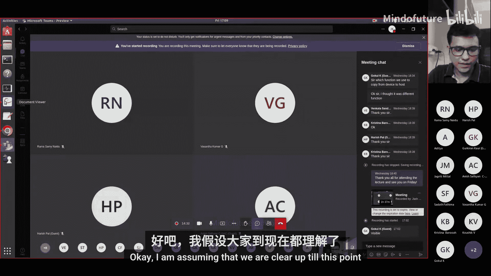

Yeah， so typical syntax or the typical structure of the make file is， I mean。

 it looks something like this。You have targets， then you have prerequisites which are separated by coal and then there are these commands。

So and you can have this you can have multiple combinations， not multiple combinations。

 but multiple such。啱。Multiple such blocks， which are known as rules so this entire thing which is target thenricrequisites and then followed by command this entire thing makes a single rule in the makep and you can have such multiple rules inside a make file。

And now let us see what are these each and everythings， what are targets。

 what are prerequisites and so on。Yeah， so the target is nothing but the。File that is generated。

By this set of commands， or it can also be some action that you want to perform。

 so it can be either file name or an action and prerequisite is nothing but the set of set of commands or set of actions or set of files that are needed for this target or。

Or this set of commands or this target to execute。 so let us say that as I gave in the I mean。

 as I gave one previous example， right that。For running hello。cu。

 you might have some pre requestquis， let's say for running hello。cu。

My requirement is that I want A dotcu and Bt C to already run before them before that before the hellello do co is executed。

 I want AC and BC to execute。So that whatever output that is dumped into some file and hello world might be reading from it。

 so in order to make sure that the correct file is being red I want this A dot c and we dot c to run so here a dot c and we dot c are prequisites and target is the。

Our Lt C file， so target can be hell and prequisiteors can be A and B。

 which are the name of the file。So it can be either file limbs or can be some actions。

 so we'll also see we'll see the examples in April to clear， it can be actions also。

Yeah and both of them are separated by columns and then we have this set of commands series the which are the series of the steps。

Yeah， so here each and every command will be。I mean。

 they have been in a very similar fashion to the way we write in the terminal。

 but yeah we'll see this with the example， what are the commands and what are the typical commands that we use that we can write here。

So， yeah， and one thing to observe here is that。Whenever you write the rule and whenever you are writing the command for a particular rule。

 it must be separated by time otherwise。That will be some issue when you try to run the make so yeah please note that the commands need to be separated with a tap character and not space so this is not space but it's a tap。

Okay， so any confusion related to what is rule， what is command， target and request。

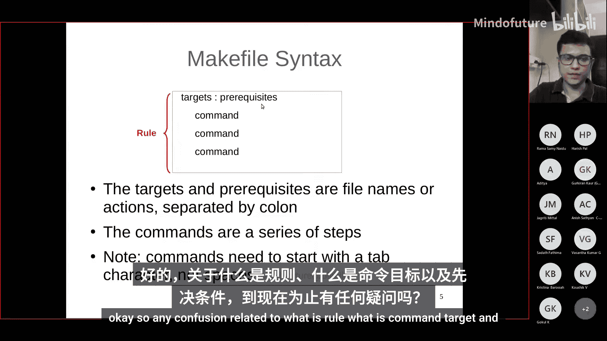

At this point。

Okay， if there are no questions， let's move further。Okay。

 so let us see one very simple example related to the make file。So here our target is hello。

I think you can corre it， the target is hell。And prerequisite is nothing which says that this target or the commands which are written inside this。

到ello。诶 game。Can be run without any prequisites。 That is。This target， hello。

Do not wait do not need to wait for any of the。Preic I mean any of the previous files or any of the previous targets so yeah so this hello world can sorry this hello target can run and what what command it executes which is the the command it execute is this。

Echo hello， so。Whenever you typically write this thing inside the make file and then when you run this make command。

 so one thing that you should observe here is that this entire thing this whatever is there inside this white box。

Has to be written in the make file and you need to place that makep in。

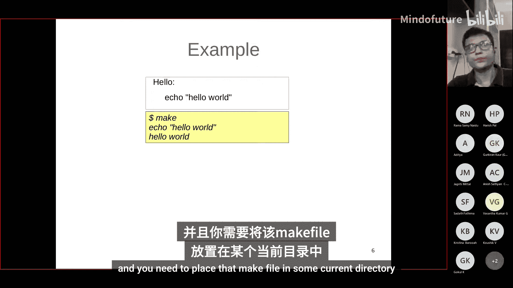

Some current directory， so I hope that the point that I'm trying to make is clear so。

There will be a file called NAC file that you need to place in your some current directory in which you are。

诶。I mean， creating some projects so your project might be having some multiple number of files like hello or C and。

Pa or see and so on and inside that since this files might have some dependencies among them and since you want to resolve or act you want to。

Make sure that dependents submit youre writing this makepoint。

Now this make file should be inside this current directory whenever you are trying to compile it。

 so this make make file should be inside the current directory in which are all these files out there related to the project。

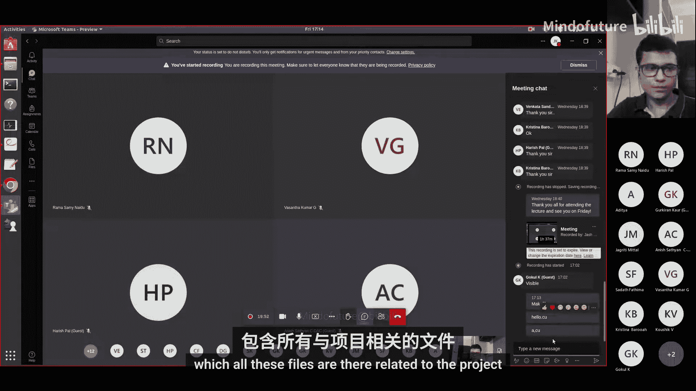

And。Yeah， so。Whatever。ThisWhatever is this in inside this white box should be written in that make file。

And this make file should be compiled using this make command and whenever you run this make command it will start executing from this point so here it will see that this target hello can be executed without any prequisite so it will start executing the commands inside this hello target。

This award will be executed。It will bring the output hell。Since E， I mean。

 you people might be what is echo commercial， would print whatever is there inside it。

Such with plenty hellweight。So yeah， so point here to observe is that the center thing will go inside the make file。

We have to run the make file using make command on the terminal and what are the things that are going on here。

 the hell target。Requisite is nothing。And this echohelo is the command。And this entire thing。

 this entire。エ rule。I hope that is clear。So， let us move further， so。Yeah。

 I think you people might remember this program that we saw in our initial lectures， right。

 that we are launching the kernel with just one warp and we are printing hello 32 times and we were having the series。

So。Let us try to write a make file corresponding to this Uap program。So， I mean。

When I say let us try to write the make file meaning we want to run this quoa program first of all。

 we need to compile this， then run this and then。Once we get the desiredd output。

 you want to delete the binary binary file that is generated related to this。P up program。

 So how can we do this thing， So quickly， let us look into it so。Yeah。

 so this can be one of the typical way in which we can compile and run it。If you can see here。

 there are multiple rules here now， please note there are there is not just single rule here。

 there are multiple rules。Specifically there are three rules here， first is this this one then this。

And then this， so three rules here and。Yeah， and let us see how are the dependencies that are？

Being generated here。Here， first of all， we can see that there is some target called clean。

 but it is dependent on some b。Now this black is。Again， dependent on hell。And then we come to Hello。

 but Ho is not dependent on anything。So first of all。

 what is which target will be executed is this I mean， which rule will be executed is this hello。

So the target hell has no prequiquisites。Hence， this rule can execute and this commands inside this world will be executed。

And yeah， what I mean what it generate so what it does is it。Comps this hellello。

t C file generates the binary file corresponding to it， which is hello。So in this case。

 the name of target and name of file are same， so please note that。And once this， this。

The rule is finished。Now this rule can execute right because it was waiting for the hello。

And hello is already done。I mean， this rule is already， I mean， this one is already finished。Hence。

 this can execute this black， I mean， the target black can execute it will like what it will do is it will run or s shallow。

So to run this binary file， which was being compiled， I mean。

 which was being generated by compiling hellello do C。And。

What it will do it will print hell 32 times it because running this code app program gives us。

I've put hello 32 times and after that， what will happen？Since this is finished。

 this rule is finished， which was having targeted as black。

This can now execute this route can execute and this route which is named as screen can execute and what it will do will remove hello by Nify using R comm。

So， this a。Yeah， and so this the hello world sorry， this hello binary file。

 which was created by compiling hello。 C。Will be removed。 So what has happened。

 We have compiled a small quo program。Ran it。And then remove the binary file after running it。

 so when we it note that the entire thing is inside inside a make file。And。

And please note that this program， which was hell。cu， was also inside the same directory。

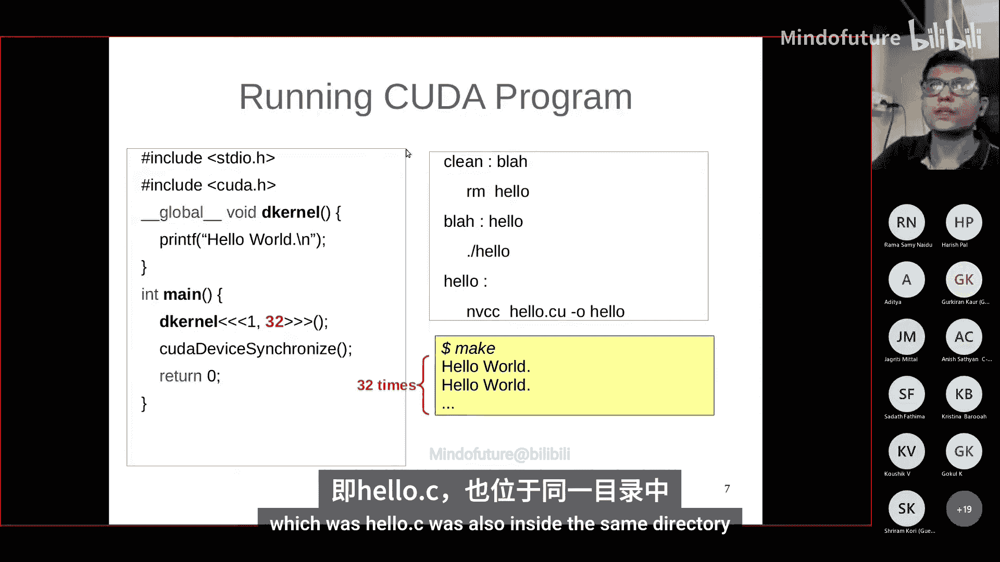

Again， this。This make file in this hellello dot co but inside the same director。

And what we did was we ran this。I mean， we kept all these things inside that make file and then we ran make。

And what it did， it compiled that hellello or S Ka program， it ran that program。And then it cleaned。

 I mean， it removed the binary fat that was generateded。

So get this output and as well as the binary file halo， which was standarded， will be removed。

So I'm hoping that does。

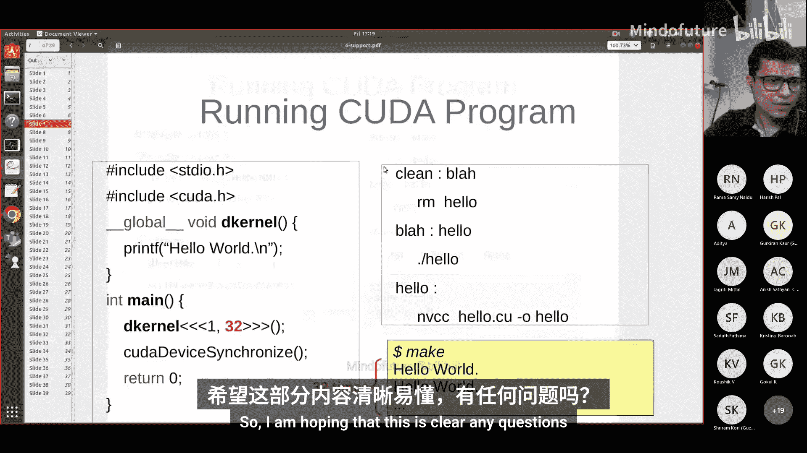

Questions。I guess there are no question back。

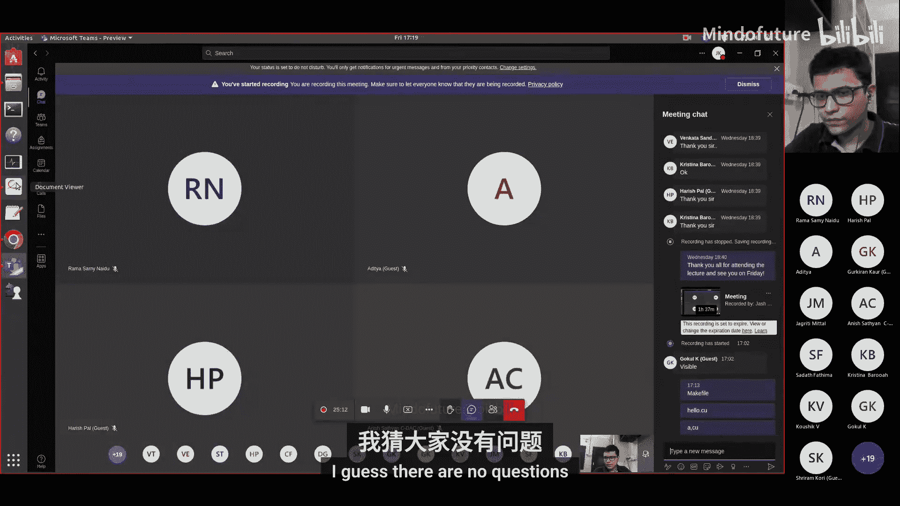

Okay， so come into the variables instead of。Writ this。

Names what the targets and prerequisites what we can do is we can also declare the variable。

What we can do is we can name the variables like file1，5，2 file。

 or we can give any attribute at the name also。And then we can assign strings related to it。

 So please note that this assignment， this this one should be string and this column equals to assign。

Kind of an assignment operator so。The string， this string hell is assigned to this variable file。

And similarly， file to it to file2 we are as bh。And similarly for fighting。

And if you see this program is exactly similar to what we did here。

The small change here is that we are using variables instead of。Hard code names， which are clean。

 blind and hello。And。How to reference this variable inside the make file。

 we need to use this dollar and then currentlyly prices or dollar and this circular prices to or the normal parentthesis to。

Reference this variables so internally it is same as this this make file there is no change but。

What it demonstrate is that we can use variables inside the make files and yeah it can be one of the examples on how to use the variables inside the make files so it might make your code more readably。

And yeah， so。呃。Variables should can only be stringed and typically this colon equals to operator is used for same and as I said this tall and then this godly parenthesis。

 all this normal parenthesis are used for referencing the variables。

And here when we run the make and see the output， it will be exactly the same for。あ despite。So。

 I hope that the。This is clear， so yeah let us see。

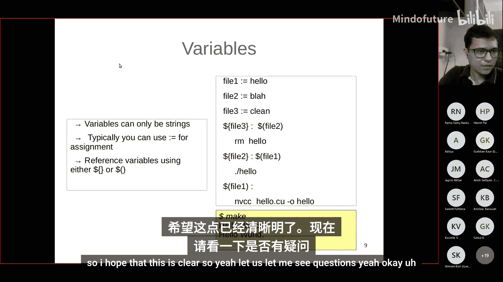

Let me system。Questions。YeahOkay， so I guess there are no questions left to me。

もぱた。ok， so。So， so there is this all target， something called this all target。

What you can do using all target is that。啊，你跟啊。Declare a single target。 sorry， Yes you can。

Define a single target， and then you can specify multiple prerequisites to it。And inside it。

 you can write no commands or I mean， it's simply just a combination of target entryquiss and there are no commands in。

And what will happen when this？He started out this rule is being evaluated。So， we'll see that。

I am at this all target， and I have this H1 H2 and HS splitquis。So I can earn before this。

S1 S2 and H3 are finished。This H1 h2 and h3 will be compiled and then。

 I mean sorry not compiled at it， but this H1 h2 h3 will be。Executed。

 That is they will be the commands inside them will be executed。So this hello one hello what sorry。

 hello1 dot see， hello 2 dot see and hello 3 dot see。

Will be compiled and run one afterctor the another so。And then once they are finished。Will， I mean。

 this odd target will be taken for the execution， but testing set has no。Come on is inside。

It will also finish。 And then what we'll do is， I mean， what。The execution will come here， which is。

啊。At the clean clean target and since clean Ta has no prerequisites。

What it will do is it will remove this。啊。This generated pi files， which is hello and hello and hello。

说。Typically， all target can be used for。Ma the multiple targets run at the I mean in the particular order。

 so here h1 h2 and h3 will be executed in that order。And for doing that， we can use this all target。

 so I hope that it is clear that we can use all target for making multiple multiple targets。

Run at a particular time。So。Yeah with this let's move ahead So okay。

 one thing that I forgot to mention here is that this is this example also shows one more thing right that。

Here we have just one target and multiple periodicquis。

 so this thing we have already seen in the previous， I think no I don't think that we have seen this。

 but yeah so。One point to observe here is that there can be multiple prerequisites as well as multiple targets。

Here there， this is the example that we have。One target and multiple periodquisites。

And until all these prerequisites are finished， we want be executing the commands of this rule or this mean specified under this target。

 so I hope that this one is clear now let us come to this multiple target so this is opposed to that what we see SR item。

说。Here， if you see this rule， this one。Thatる。Here， there are multiple。

Multiple targets actually and no prerequisites， so in the previous case there were multiple prerequisites and one target。

Here there are multiple targets and no prequisites。And then again， we have all target。So。

So first of all， we'll try to execute this one。And it and。Willll see that， I mean。

 compiler will see that it has dependencies on call1 qua one and Q3。

So carbon Cal2 and co3 will be then。 So here， please note that call2 carbon Cal2 and Q3 will be then one after the another and first。

So then callman will be。嗯。Called it will run this I go 1 and I go 2。

 That is it will compile it and then run it。啊。Once then again。

 for quad it will be run second time and second time and for quad will be run third time。This。

Algo1 and all Algo 2 will be compiled and run actually three times one by call 1。

 second time by qua 2 and third time by qua3。And the calls are being made from this。

All target so yeah， so they'll be run thr， each of this algorithm will be run thr， s go1 in Al2。

And once that is finished， well reach this clean target。And what I will do is it will remove this。嗯。

This binary files that are generated， which is L 1 and L go2。

 which are generated by compiling this L 1 and L2 dot C files。So I hope this is clear that。Yeah。

 that when there are multiple targets for rules， the command will be run for each target so here。

Sinceた multiple targets here。And。Since calls are made， here we are making calls for each， I mean。

 each of these three of them。So commands， which are。There， which are return for this。

Multiple targets， this is call1 call to and call3 will be run for each of this call that is called1 call to and call3。

So I hope that is clear that this will be run three times， this command will be run three times。

It is their rent。So they will be done for each target。Here each target represents call 1。1。ok啊。

It is smooth。 Okay， so let me。

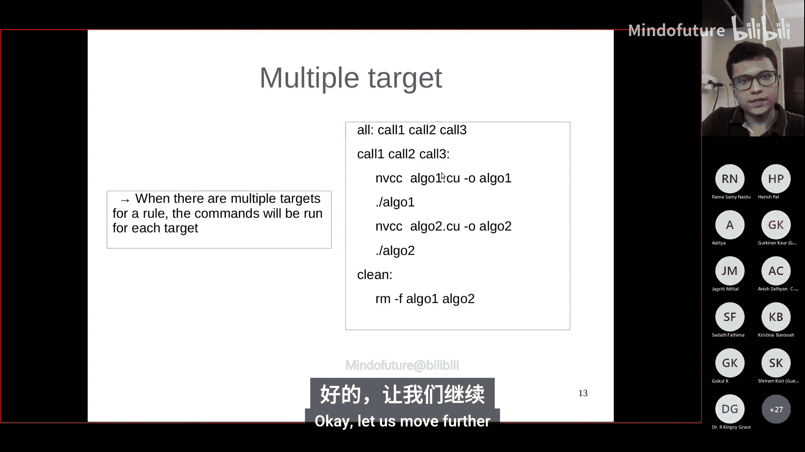

That are any question。That is some question。That one has pretty% edge to and will order expectation。

As对。I just missed the example that was interesting。

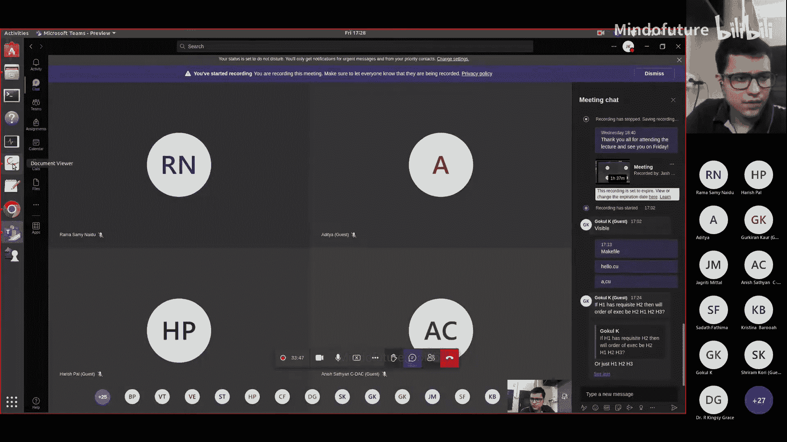

Okay， you are talking about this。They let me just quickly go back。

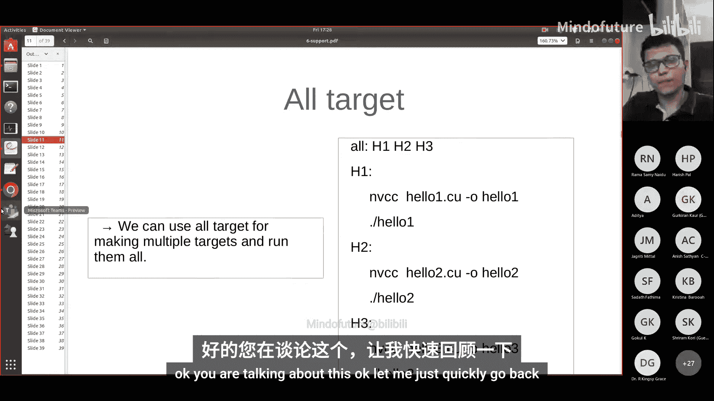

If A1 has pre liquids attached to them。Will order of execution B H2 H1 H2 S。Okay， so what the。

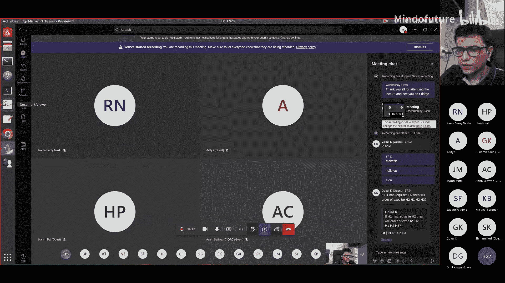

Bment has particular edge。Okay， in that case， Pataal H2 will be executed。

And I think then h1 should be executed， letting me see what。

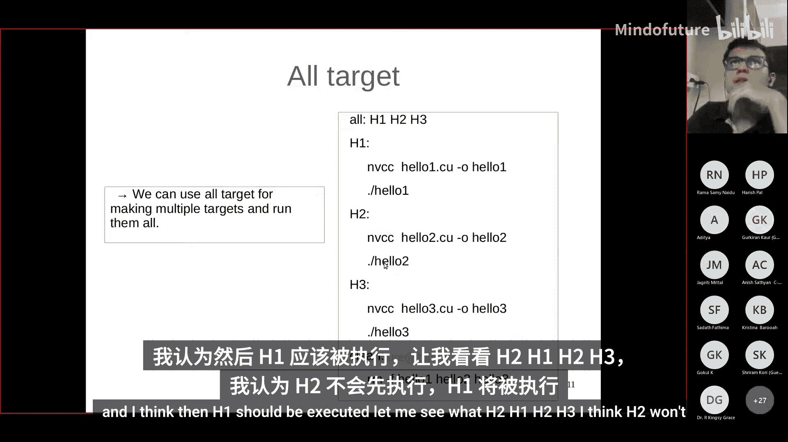

H1， H， H2， H1， H2。I think H2 wont be executed first h1 will be executed since the has period equation。

H1 will be executed then H2 and then H2， so yeah， it's just H1 h2 h3。

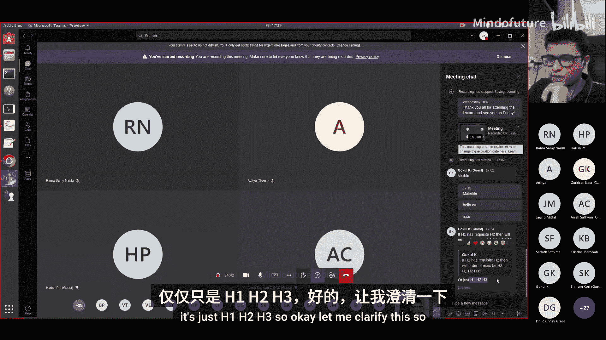

So okay， let me clarify this So whenever okay， so let us take that example， let's say that。

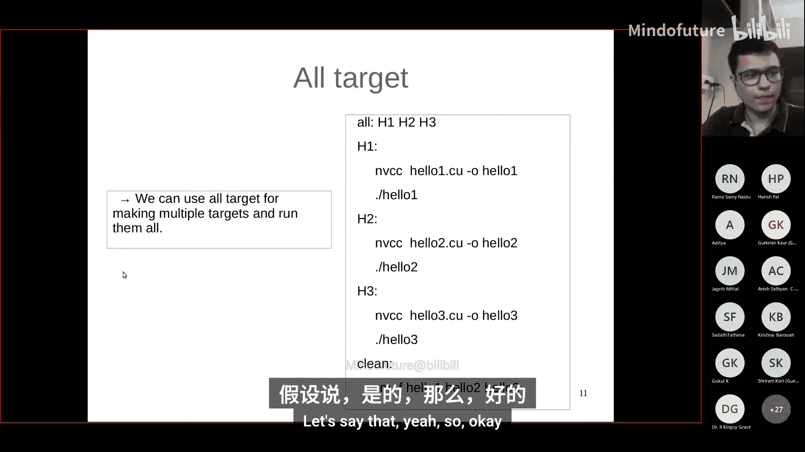

听个。Yeah， so o。

Yeah， so let us say that here there was H2 so H1 had some prerequisite H2， which was this one。

 which was the target。So when that that is the case what what will be the execution flow so first of all all target will be run and it and it will see that I have dependency on h1 h2 and S3 so I just can't run right now I need to first of all。

I mean， this as cream must be finished for me。It will just first start running I。

First try to execute the commands that are very natural。Now， since H1 has prerequisite on H2。

What will happen is it， I mean， this command cannot turn right， so it will go to H2。So S2 will be in。

 and then edge1， and then edge3。And then all command will be done。

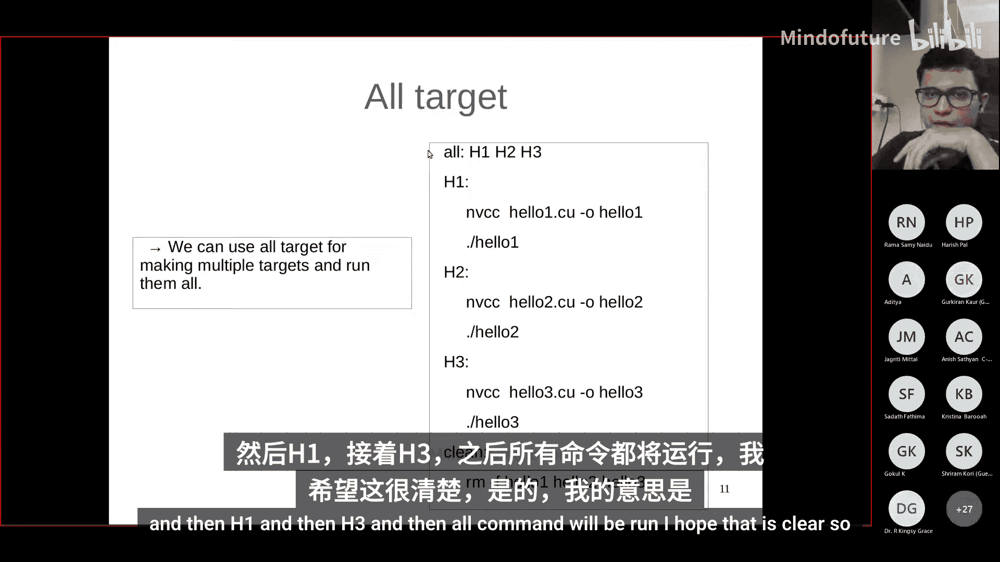

I hope that is clear。啊。Yeah， I mean， if if I missed something， then you can。

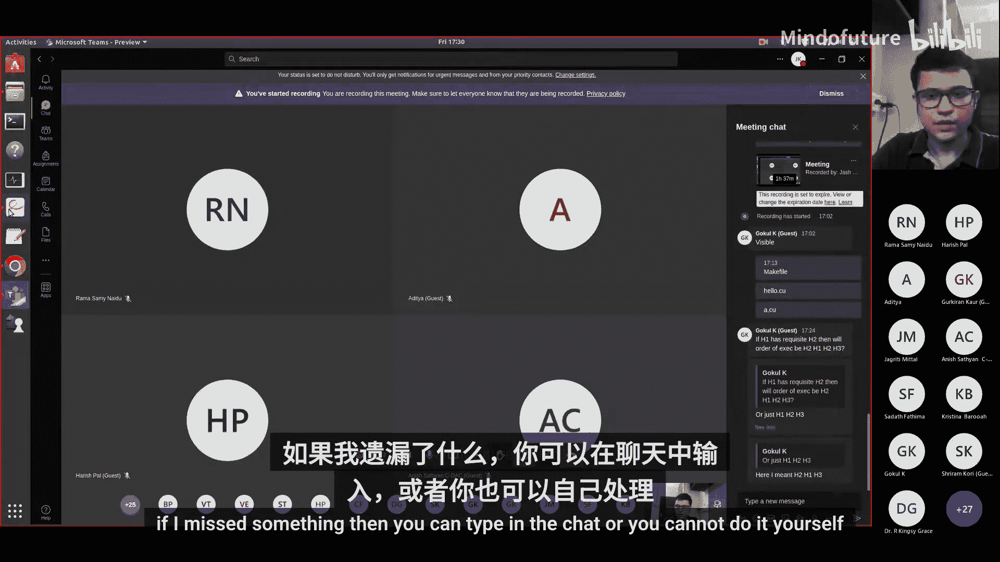

Type in the chat， can unm it yourself。

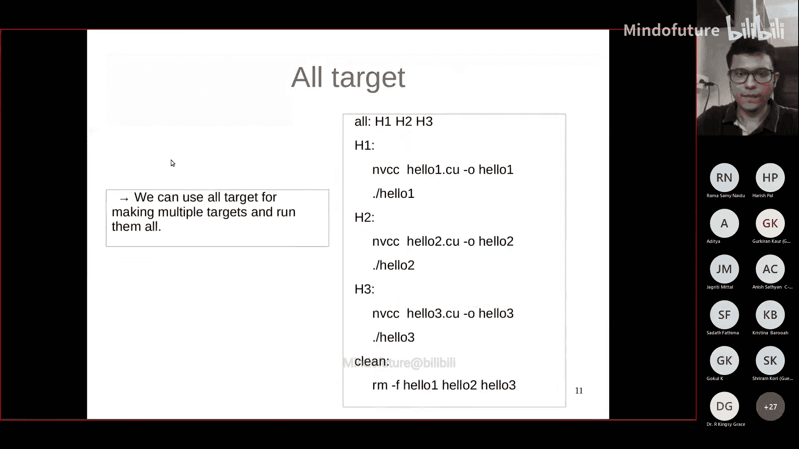

So I had a doubt in this example itself， like won't H to be run twice because like once as a prerequisite to H1 and once as a command in all。

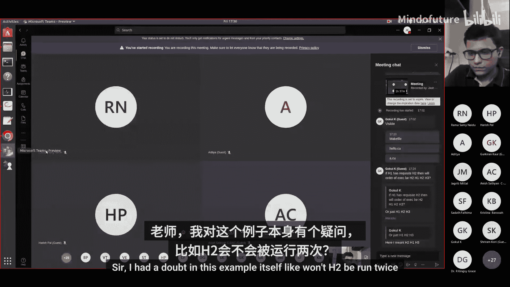

Okay， so assuming that you are， I mean， that example is that here we have edge two。啊。to I mean。

 as far as I know it should be executed once， but I need to check that probably I'll check this one and get back to but。

I don't think that。Mentioning prerequisite， meaning that it should run device。

I need to check this probably。Well， I'm not sure about this writing edge 2 here。

Willll make it run twice or not。Ially as perR example。We are mentioning that in all target mix。

I need to check this one， probably I'll check this。After the lecture and we add in that Google group。

 yeah， I'll reach you。I get back to you。Yes。

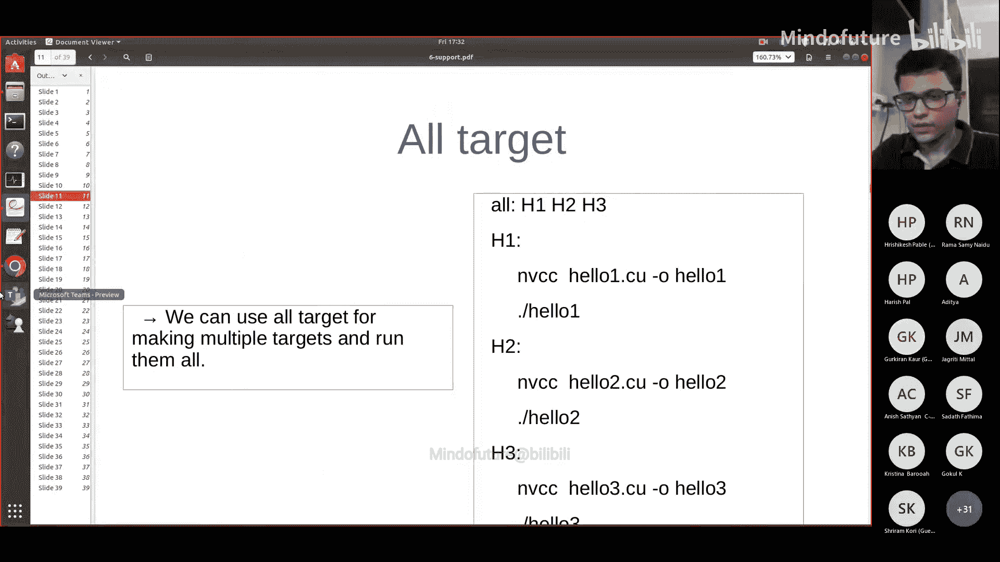

So this part I think the doubt is valid， I think go st is valid probably it might happen that。

H2 end I mean， ends up executing twice。

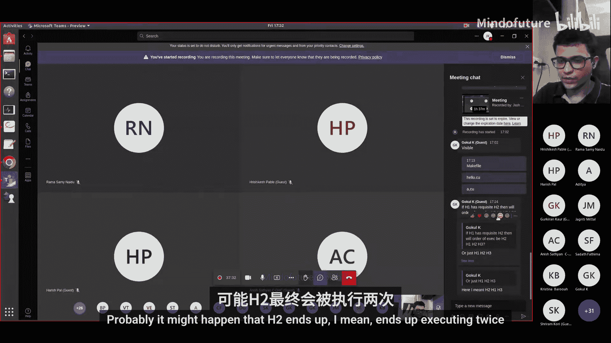

I need to check this I。O，大家 so。Yeah， so I hope that this one is clear。

 this multiple targets is clear that we can specify multiple targets and based on the calls that are made each。

 I mean they'll be run each time whenever the call is made from you all come sorry all target。

And yeah。No。That is， I mean， we saw this variables and multiple targets and all this things。

 So that is fine。 But apart from that， we can also have。Conditions and loops inside the mag and。

Yeah use first of all， we'll see how to use conditions inside the。First of all， yeah。

 so this EQ and if not EQ are typically used for writing conditions。And yeah， like else。

 else is also there like for branching and all those things。

 So let us say this example to understand it better。

 So we have declared this variable right targeted CPU。Is x 36， and we have set it to1。And then。

What we are。그런 게。We are checking if this。打击摄表。Is equal to x at6 or not。

We are checking this value variable， so probably I have。

This example is probably wrongly written because。If you see here the variable name here and here。

 it is not matching。But okay， let us assume that there is some variable which is declared and which is actually target CPU target underscore CPU。

 not target underscore CPU is like 76。Yeah， let us assume that there is this variable target underscore CPU。

And we are checking if， values， exit， if it is the case， then okay， okay， okay。

 I sorry you I misunderstood it。Yeah， so there is this variable target underscore CPU which is there somewhere。

 let us assume that it is there and it stores the value of I mean it stores the which type of CPU is it it is in form of some string。

And。What we are doing is we are checking if that value is x 36 or not， if it is the case。

 then we are setting this target CPU is x 36 variable to1 yeah variable to 1。And yeah。

 please note that we have declared this variable here and。If that is not the case。

 then we are checking if the target CPU variable is equal to x 36 underscore 64。

 that is that is 64 but machine having x 36。So if that is the case。

 then again we set this variable to one else we reset it to 0。So yeah， so at the end if ourCP。

 the target CPU is x86， then this variable will be set to 1 else it will be 0。

So this is one of the examples using which we can。Set this variable based on our target CPU。

And so this typically demonstrate the。Usefulness of if。

If conditions is academic one and similarly like if there is this if not equals to ifQ， I mean。

 opposite of this ifQ， there is an if an EQ。And。This will I mean this will compare this whatever is there here with here and if they doesn't match then it will print whatever is there I mean whatever statements are there here else it will print this one I mean not print but it will execute this here in in here in this case it's echo statements it will print no。

And yeah， here alsos a statement。So here we have declared a variable and there is some small error here I should have add column here。

So like typical assignments should happen using this column equals to so this is wrong。

 so fo column equals to some strings I have assigned some string to4。And then what I'm doing is that。

I'm checking if this four is to okay。And it is actually not equal to okay right so this one will be executed and the output completely who not equals to okay because who is some string。

 it is not okay。So of course is not equals to okay maintain。If that was not the case。

 if this was some string instead of O and it would have been no。Okay。

 so I am hoping that are conditions in Nepal are okay。And yeah， similarly， in that way we can。

Also used loops inside the makefi and。What I mean is there are I mean。

There are the advantages of using these even loops inside the Macle and we'll see one use case related to it。

 but first of all let us understand this loops also。So let us say that you wanted to execute some。

Some food or some foodda that you compiled。 let's say it was Al C and。It generated the binary file。

 which is al， and you want to run this al binary file with some。Randdom。

Random inputs which are provided during command line and。

This inputs that that you wanted to provide to this algorithm were。

From 100 to 000 and the way it is providing the inputs is like costtafo given 00 and 200 and 300 and so until000。

This slope will start from 100， it will increase Mmin。It will go on increasing in the steps of1。

 So first of all， you will run this algorithm with input as0 provided。

During the command command line and then it will be run with the 200 as code and so on，1000。

 So this go Al go Al go dot C is run with multiple。

Multiple inputs which are provided at run time or I mean using command line and。

What are those multiple inputs that those are from 100 to000， I mean， 100， 200， 300， and  so0，000。

So yeah， I mean， this is one of the way in which you can you can use loop inside the midp and yeah。

 this is this was about the wide。They can also use four loops inside the Mac file and。For that。

 I mean， syntax is very， I。Similar to the value and。For that。

 you need to just specify the looping variable here and then in is keyword and then。On this。啊。

Numbers that you want to， I mean， the for which you want to run the loop so yeah。

Algo will be run with 32 as input 10 and 900 as input and yeah so this is。Yeah。

 this is for the for look and I hope that these two examples are clear。

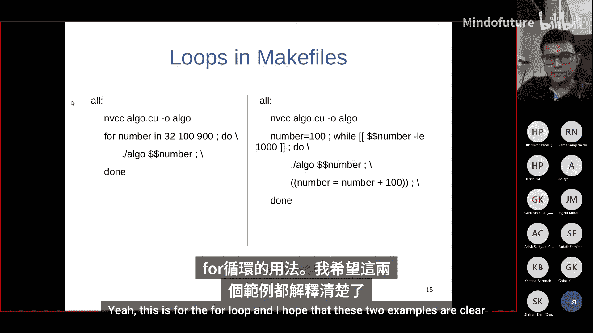

呢个会窄。

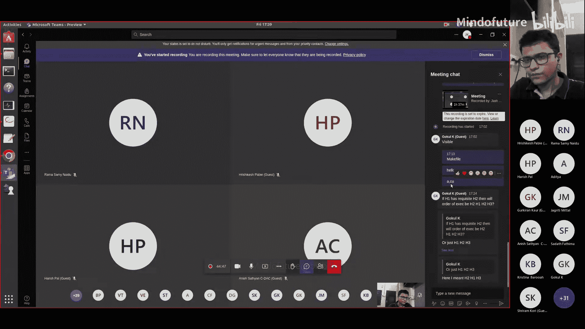

I guess that are more on。ok， so呃。Okay， so let us move on further and let us see one complete example。

Of a make file where we can use all the things that we have learned so far。So yeah。

 so let us take this example and there was a file called there is a file called vertex removal。

And that vertex remove what is I mean， it's a quo file and what it does is does some it removes some vertex from some graphend。

Yeah， I mean， it is ran on multiple graphs。Let us say that we had this vertex removalmoval。cu。

Fing some director。And in the same director， we had。

We had the test caseses or the graphs on which we wanted to run the。This。

What text removal or C file and those graphs were in the same file。

And so first we need to unzip those files。 So let us see step by step what will happen。 So okay。

 so here main thing that we want to do is want to run。This ka program。

 which isex vertex removal or C on the graphs， multiple graphs， and to automate this process。

 we can write a make file corresponding to it。And let us see how to write the map。 So first of all。

 we are。Writing this all command， which is dependent on vertex removal。And yeah。

 and this whatex removal has no dependency。 So what it will do is it will。

It will first of all compile so what it is doing is since it has no dependency。

 it will run its command and what command it will run it is compiling this。Vtex removal。Dot C5 and。

It isoring its binary into vertex removal。As a verex removal。

Fing so once we are compiled and we have this binaryry， which is vertex removed， we can run， I mean。

 we can run this command set this set of commands。And which is part of the old target。so诶。

So what we are going do here is that will as I go， we want to run this vertex removal。

On this set of crops and these graphs are there inside this。Bench do sip which is some zip file。

 so we'll unzip that file and will'll move move all the test case which are generated in some test case。

Folder， which is there。 I assume that there is some folder just case folder。

 and we are moving all this。Fes that are generated。 I mean， not generated but that are un into that。

啊。That quarter that， not sorry， I think I missed something yet。

Yeah yeah I'm correct so yeah so this zip file was there inside this example folderer I mean it was there inside example test cases and text testpens or dot zip so from there we are unzping it and we are moving all the unzipped file there into our current directory。

So okay， so it something like this so yeah。

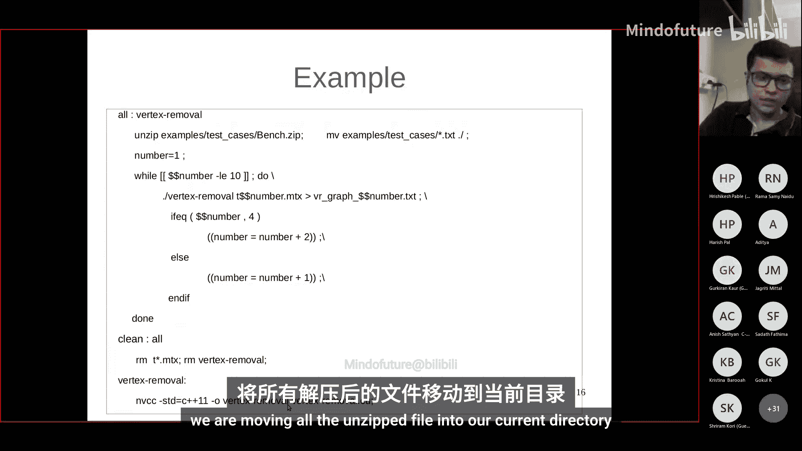

So in the current directory， we are having this。So。I move all dot C。And。Apart from that。

 I think there was nothing inside this current directory and this test punches are I mean it。

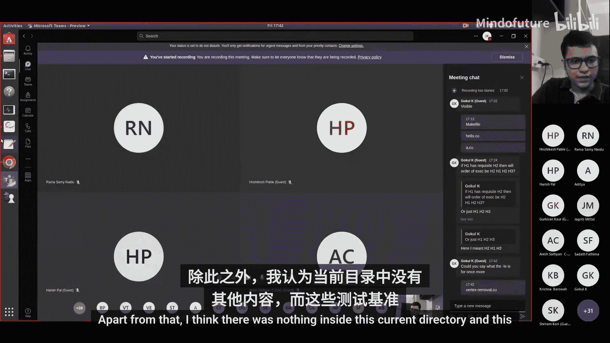

Test cases on which you wanted to run this file where they are in examples test test case and test bench start zip。

 soping we are unsyping that file and moving all the unsp file into the current director which is shown here。

And then after that， what we are doing is。We are running the loop， That is。

Wch I mean the number is the looping variable and we are running the will look from one to 10 it as it will be run from one to 9。

 so it is less than okay so it is less than or rep to so it will be run from one to。And， and。

For each expression of bio， what we are doing is we are。Running a particular test case if you see。

 So this T then dollar dollar numbered the。Mtx is some。Graph by format。

 so what is happening is we are running this binary file which is generated here。

On a particular test case and that test case is determined by this number。啊。

I hope you are getting this so during fast ateration which test phase will be run which is it will be T1 t1。

mp so fast ateration this number will be replaced by one。Yeah， so this。

Dot slash vertex remove t1 dot MTtx will happen and whatever output is it is generating。

 it will be dumped into this VR graph underscore。One dot TxT。So this entire thing actually let me。

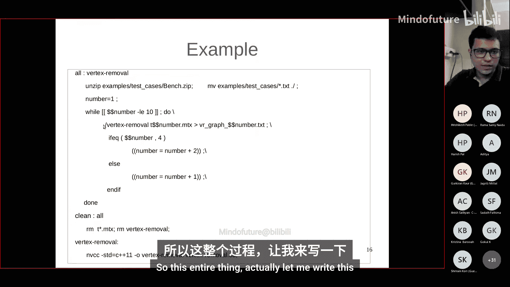

Yes。Will be like this， so。So in fast iteration， this thing will happen。

So this dot slash vertex remote will be ran on t1 or 10， which is some graph。

 I mean some test case which is which was there in that same file， which we un separate it and。

Then we ran this and the output would be stored in this。

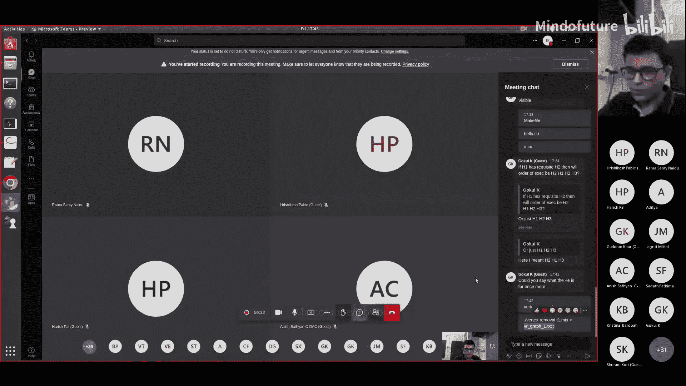

And this will go on。呃。Yeah， so and what we are doing here is that we are also using this。

If conditions here， itel conditions here， and what we are doing with this S condition。

 we are checking if that number is4。Then we are skipping the number by two。

 so we are not running the test case number five， so if you see this execution pattern。

You'll see that the test cases on which we are running the program are one to four and then from  six to 1。

And we are skipping the fire because。Because the number of test cases in this test。

 sorry bench do zip where。Having this I mean， inside this this p5。

6 was tip5 do MPx was missing and hence to。Ensure that this tfi is not I mean Tfi is not n， I mean。

 the execution of T P is skipped， are we have written thes。

Condition to make sure that it is not run on it。 So after four， this number will jump to 6。So yeah。

 so T122 T3 t equal will be executed I mean， this vertex removal will be executed on T122， T3。

 t4 and then。P6， D，78， T9， and T10。And all the results that are generated by running this verortex removal on that particular test case will be stored in this VR graph in that particular number。

So I hope that you're getting a flavor of how to use a make file tool。

Automate the execution of the quoa program。 So this is one a very simple example that I used to。

 I mean， I used for。Running some Pua program on multiple test cases and to check what are the results。

So and if you see everything is automated here， so you just don't have to run each thing one by one。

And。Yeah， so that is the beauty of the make all that。

If you have multiple dependencies and you have this repeated execution of your ha program on。

Multiple test cases， then you can just part of it using make file。And this is very， very， I mean。

 this me didn't come very handy when you are working with large projects。

It might be a Puha project or something else also， so yeah， any questions at the list。

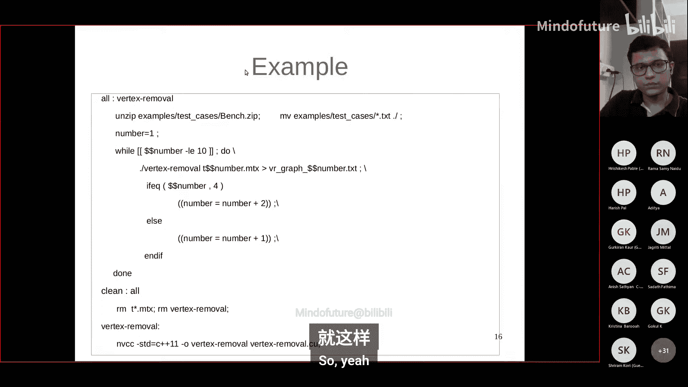

Okay， I think that is one question， could you say what this minus I is？

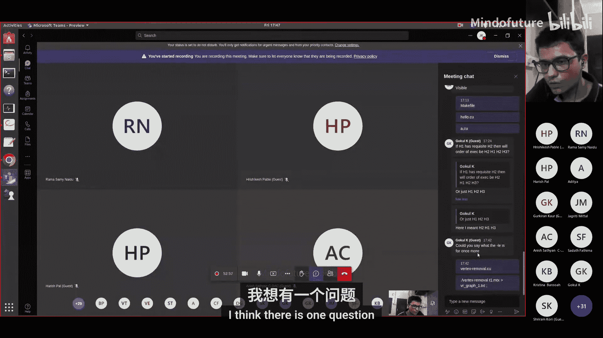

Okay， so yeah， sorry about that， but this l is less than or equals to。

While this number which is I mean initialitized to one， so this number is just a variable。

And you I have to this。Okay， this number is just available。啊。Until it is less than 10。

 what we are doing is okay， so this minus cell is less than or equals to so until it is less than or equals to 10。

What we are doing is we are。Running this wildup， so from1 to 10 we are running the wild loop。

So I hope that is where this minus area is just。

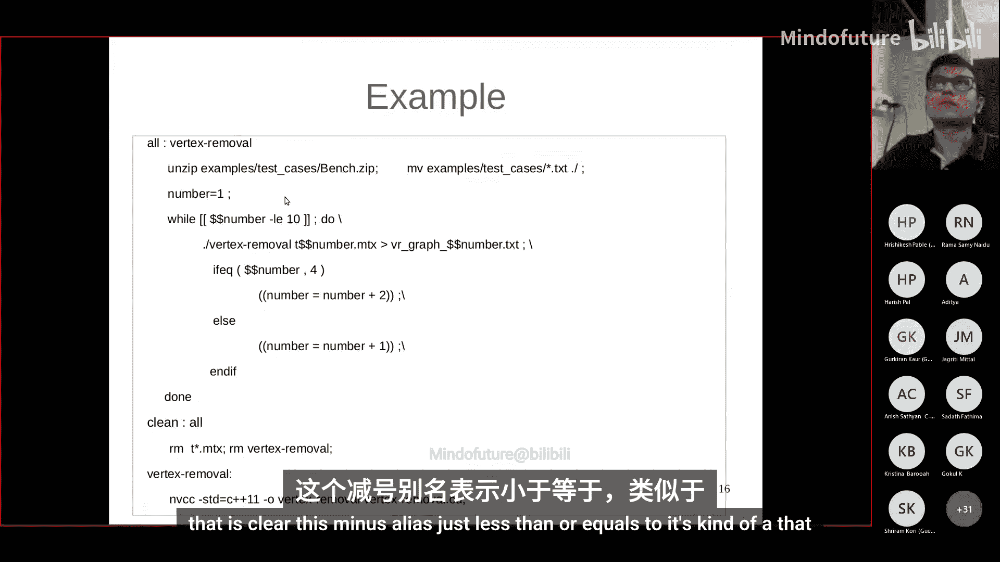

Less than or equals two。时间的发。えっとです。That we used to write in normal looks like。オは放た。

To here and yeah we are skipping the number five because we are doing number plus to go when number is full。

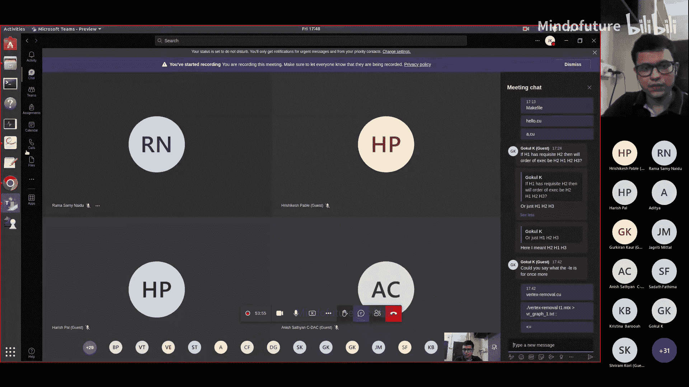

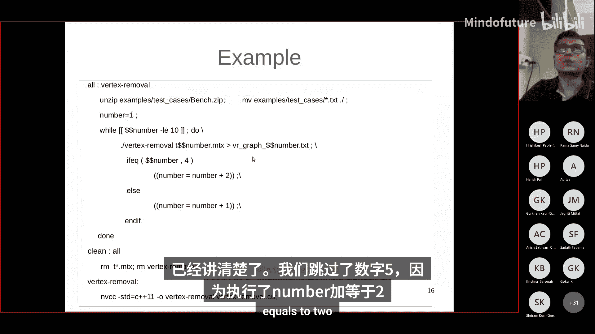

Any conclusions or questions at。This point。Otherwise， we'll start with ebugging and profiling。

She might take something。

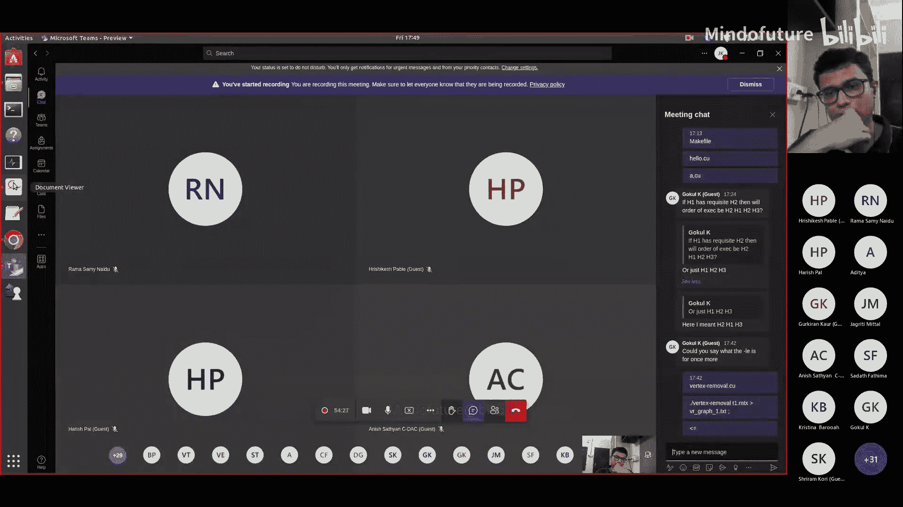

Okay， I'm assuming that there are no questions。So， okay， so let us。呃 start个 so。Yeah， in general。啊。

Debuing the department programs is difficult because there is no。I mean。

 there is no determinism involved in the ballot program。

 so in sequential program we know the order of execution that this would be executed than this and then this。

 but in ballot programs since multiple fairs are executing。TheM instruction。 So， I mean。

 there can be arbitrary inter living， and the outputs can be different， so。

Let us understand this with an example， so let us say that you have a triple S application right that source single source short as part。

Application， so。In that case， let us say that there were multiple， I mean， multiple parts that were。

 I mean， multiple shortest path from one source to that destination。

And since there are multiple possible parts， which are shortest actually。So， the output or the。

Value of the shortest distance will be seen but。The shortest path that is calculated by the algorithm or the actual path。

 which is。used for moving from the source to destination， which is the shortest one。Can be different。

 I mean， it can be different if we run on the parallel if we run on such parallel hardware like a GPU so。

It might happen that I mean， there can be a different inter livings of each side。

 and based on that the。How put are the shortest part that we get。Might be different。

 So I hope you're getting that getting this point。The value of the shortest distance will be same。

 but since there are multiple shortest path it the same that shortest distance value。

Based on the inter living or the execution of the threat， there can be a， I mean。

 there can be different different shortest distance possible。So this can。

So this non determin non determinism is possible while executing this parallel programs and。

Since the output can be different， the tapeking can be quite challenging during part parallel programs。

Yeah so in gender。Yeah， so in general， the debuing of pilot program is difficult and we'll see how to debug them using this code。

And one more point is that there can be multiple intermediate values also。

 and this number can be really very large。Lettter say that you are running your algorithm on a very huge data then the number of intermediateitt steps are。

Yeah， the number of intermediatemitted steps that it might go through will be very I mean it might generate will be the number of intermediatemitted steps that it generate might be very large and the endbugging is again。

The bargain will be very challenging。 So， yeah， and。Yeah， so let us come to this ka JDB。

 so it is just to take in the KDa programs， which are running on real hardware， which is LGB。

And it is just an extension to the GD， so JD is used for。Debuing R C programs。

 and it's just a extension。 Could a JW is just an extension to the J Jd。And it allows this。

Multiple things like break points and single steps and rewrite memory contents。

 that is what are the value of the variables and so on。And yeah。

 we'll see these things in the upcoming slides。Okay， so let us take one example。So。Yeah。

 let us see this program， so we are including standard Haer file signal。

And then we have this kernel in which we are passing some pointer。

 I mean it is standard teacher point which will hold some matters。And then we are initializing this。

WeFirst of all， we are dereencing this point of x and we are。Assending the value0 to it。

And then inside Ma， what we are doing is we are declaring a pointer passing this pointer to the。

Cal and yeah we are launching this kernel with two comma 10 I mean two coma 10 which is two blocks and 10 threads in each block and then we are using quoa device synchronized。

 So if you see here the are arrow that。阿明德。一。Mistake that we are doing here is obvious right。

 so we have declared pointer， but we have not turned through themlo。Declaring pointer is okay。

 but this pointer should point to some value memory location that is。

That is on the GP right that is that part we are missing here， right that this actual point to some。

Some valid memory location on the cheap view and that part should be done using toda me and assigning the allocated address of the allocated memoryory to this pointer。

And that part we are missing。So。Okay， so that is fine and that is the mistake that we are doing and how can we debug this problem？

One way is to write the print and check I mean print and check what will happen So first of all。

 one thing that we should observe is that when when we try to run this block。

It might lead to a setfold because we are trying to deefence。A location that is not， I mean。

 this x might point to some random number location might point to null。

And if you try to rereference signal， it is not quite derecing and it might to support。そやそ。

This program might crash this what I'm telling and if it it crashes then we'll try to debu and one of the way to debu it is we can write printer。

But when we write this printer， it might not print anything。Because。Yeah。

 because this program already crashed here and then the kernel will return and it will just。

I if you will just continue its execution our procedures。So， okay。

 so in order to get the insight what is happening here。

 what we can do is instead of just using this print app which actually doesn't print anything。

In this case， and actually， it's a bad way of debugging a program。

 writing a print What we can do is we can。Use this呃。This function that is available in Ga。

 that is Qa get last error。So， what。What this function does is it returns the last error that was reported by this food amy。

So please note that whatever err that is occurring inside this kernel。

Might not be reported back to CPU。Since this error is being， I mean。

 thiss nu point of three difference is happening on the GPU。It might not report back to sequence。

 That's why we might not know what is actually going on。

 So in order to know that we have this function could our。And what。What it will do is it will。

It will tell you the last error that was reported， I mean。

 it was reported by this Buha kernelal cage。And it will be stored inside this variable ER。

 which is of type Pa error D， which is Pa error type and what？Okay， so andprint what the error was。

 I mean what they。Er which was reported by this coulda get last error we need to pass this variable error to this ka get error name and quoa get error string。

 so it will print the name and。String corresponding to that error so here the error code was 77。

 which was printed by this ER so。Serra is consider it as some unside in。Yarard was 77。And。

Ard name corresponding to this 77 number was quoa error illegal letters。

 so it saying that you are trying to access some illegal letters。

Whi is actually correct this since we are not initializing this I mean。

 since this x might point to null and we are not initializing any memory location and making it point to this pointer x。

 it might happen that it is pointing to null and we are since we are being null pointer de referencing here well it should actually。

So this could error illegal address and that is what it is this。

Uak get last terrorist is trying to suggest us。And then this quoa get error string。

 what it is printing this that and illegal memory access was income。

 so it's trying to tell us that you are trying to access some illegal memory location。Okay so。

These are the multiple。Ar reportss corresponding to sorry yeah multiple error reports corresponding to different different types of errors so zero deants code as sex that error was no error。

 and there are different different kinds of error like。

There's this1 corresponding corresponds to that you're using some invalid device。

you are trying to reference to some GPU which is not already there and then this is this9 represent this。

 this invalid configuration that probably you might you are launching kerneldial with some invalid configuration and so on so what you can do is you can try to write a program to invoke each and every type of the error from zero toin。

And I believe this is a body of people。Okay， so yeah， so this was。One of the way to。

Check what is the error that is being reported by the colon？But more。More better way to do， I mean。

 more better way to develop up the QUDa program is to use quoDa GDP。

And it is very similar to the GDP that we have for。Abugging the secret program。And yeah， Paul。

 let me see if there are any questions in the chat。

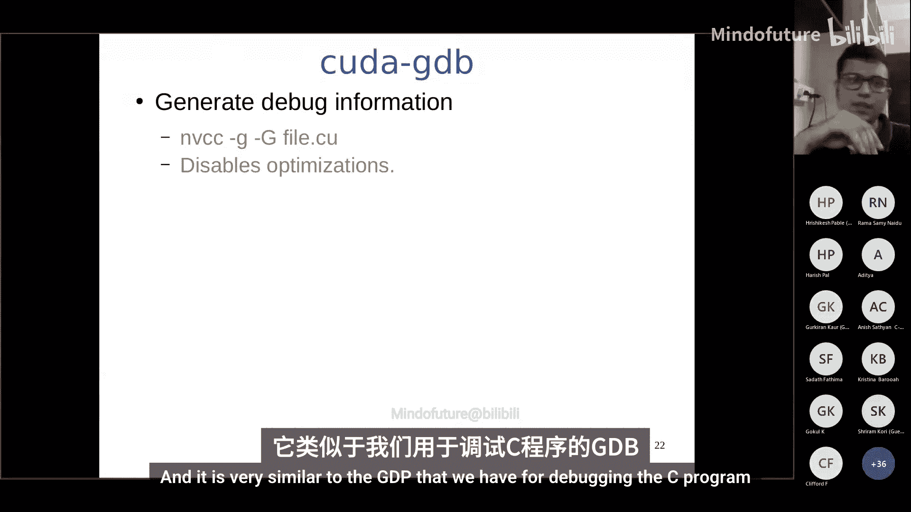

I think that。

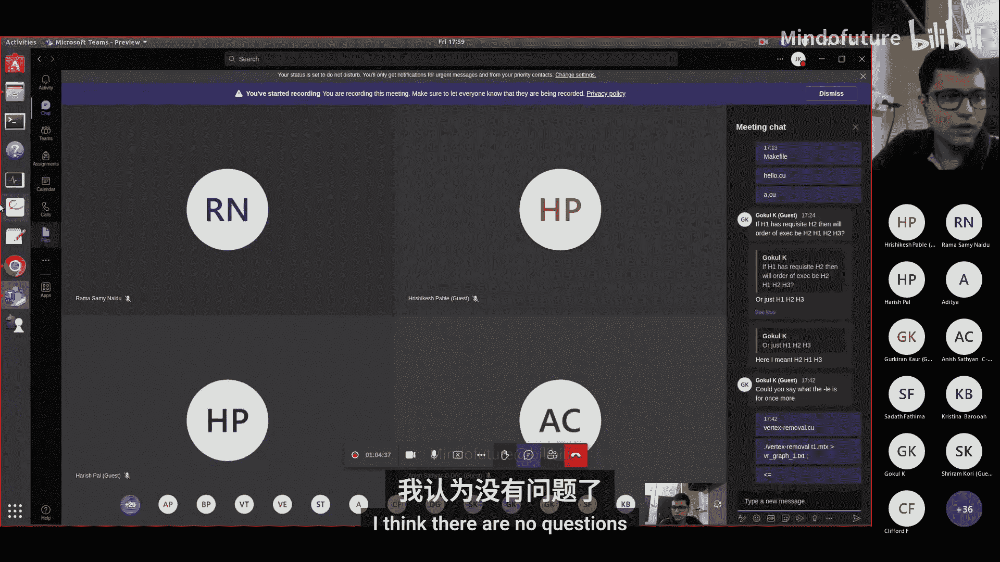

No questions， Okay， so in that case， let us move further。So okay， so yeah。

 so one of the good way to de the quo that program is quo GDP。Yeah， so how can we。啊。

Eva our programs is quoa J， so we need to。Compil it using this minus G minus small G minus capital G flag。

So this small G represents that we need to compile this C programs and this capital G represents that we want to compile the QUDa programs。

 so please note that since Uai is some sort of an extinction to the sea。

 we can always debu C programs using。U at GDP so this minus G flag shows that we are combiningil these normal C programs and for sorry we are debuing the normal C programs and minus G capital G presence that we want to。

Think got the GPU specific part of the goodA program。So okay， so yeah。

 and then once the binary file is generated， so this compilation will with this minus Gn small Gn minus capital G black will。

Generate the binary file corresponding to this5 or C codei。Then啊。We need to run this。

Grated binary file， which is8。2 using this quoa GDP。And then will and then in the prompt。

 we need to type run。And then it will start running from the first instruction in the main。Yeah。

 and it will stop at the point where it might encounter some error。And yeah。

 that is how we can pinpoint that what's going wrong in here and then the data will print the information corresponding code we'll see in the later slides。

And one more point to note here is that since UDa program might be running with the large number of friends。

啊。The quoa GDPP has provided some notion of focus that is we can focus on a particular war or。

Or a particular。or a particular thread block or a particular set of threads and so on。

 so we can switch our focus to these things that is a particular thread or a particular。

Towar or a particular threadlock also on。Or even a particular kernel or a particular grid。ok啊 so。

Let us see one example related to this quoatA。So yeah， this is the same kernel that we were having。

 right。We were doing this。Nll pointer e referencing here。

 right that this x was declared as a pointer but。On the CPU。

 but we were not assigning assigning a proper address to it that as it was not being assigned the。

Address corresponding to any of the GPU memory location hence there can be a Melpointer day reference in。

So let us assume that we have compiled our program using this syn flags and then we ran。

A randomandic quoa GDP using， I mean， by typing this around here。

And then QDa GDPP starts running this a or binary file。And then what is saying that。Yeah。

 it is running the threads。And this LWP light process， which is actually threats。

And then it is saying that there is some Buha exception， which is device illegal address。

Was encountered and then it is given details related to it that。

This program received signal would exception underscore score 10 that is a device illegal address and where did it encountered this error that is at the line number six here。

And what was at the line number six， this print up statement was there。

And there it encountered here error and if you see here it is also showing the kernel launch configuration that we launch the kernel with two thread box so here please note that two comma one comma one it is showing I mean it is。

Showing all the three dimensions that we have learned in the competition lecture。

 right that there are three dimensions to the。Cred and three dimensions with the third blocks。

 so here the we have two thread blocks and we have only just x dimensions， so if you remember here。

We are launching it S2 commt and so here we have only just x dimension for grid and tread ys that dimensions are one。

So it is showing that this is the Caral launch configuration in the。呃。

Pointer x is initially pointing， so this x was pointer and if you remember here。

 we were passing it as the argument here。And the value of that。Yeah。

 the value of that pointer x is in size to0。So this is kind of a good I mean indication to me that since this value of I mean the address which was pointed by x was0 and since I'm doing this star x here in the print tab I'm trying to dereference the null pointer and it will definitely give me null pointer deferencing error。

Or the runtime matter and could I think that it's。Trying to access some illegal address。

 And that is what it is actually。 So I can。Understand from this entire thing that。

It is trying to access some illegal memory location and where it is happening。

 it is happening somewhere here。And yeah， apart from that。

 it is also printing some information related to。The grid and threat block where it is currently trying to focus。

 so it is saying that I'm at Carnal zero， grade 1。And this block and threat number0。

And I'm running currently on device zero， which is the。0 GPp and on streaming multipress 13。

And on war0 and lane zero， so lane is a particular threat。

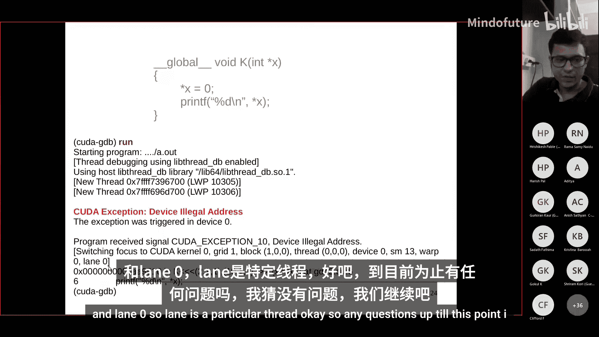

Okay， so any questions update this。

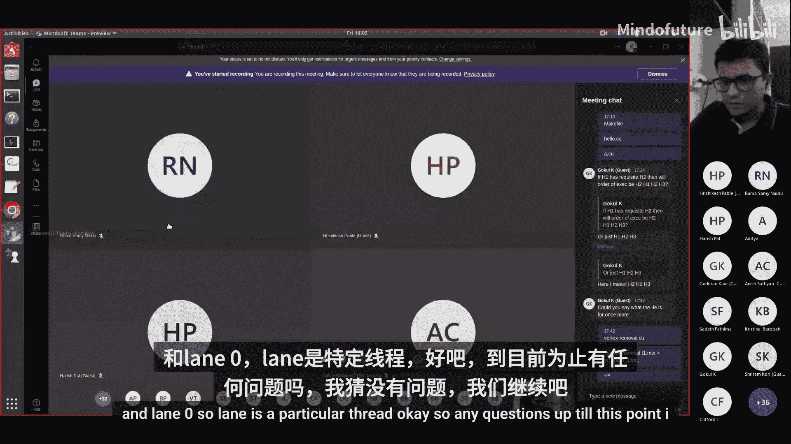

I guess there are no questions， let's go further it。Okay so。啊。Yeah， so for quoa GDP。

 we can using quo GDP， we can also print information related to kernelinnals。

when I type this info ha kernels， it will give the information related to the kernels or all the kernels that are there are that are currently running。

 so it is printinging that this kernel zero has no parent。And。

What is the sta it I don't know this what is the sta but yeah it is having I mean it it has grid number as1。

 it is currently active， it is probably running on this streaming multicrossor which is its SMM mask and then it has this grid dimension it has this block dimension and。

Yeah， this iss invocation。I mean， this is its invocation。系啊。

I mean this is the way it is being in work， so case the name of condom and x is the argument that we are passing and its initial value is 0。

 which is0 x0 and x as similar to 0。So yeah， this will give us some information related with the Qa kernels。

I this in popular governance。啊。Infota cans。Instruction and then there is this info threads。

Which will give us information to return to threads。

Which are currently running and if you see it is giving some information that this thread。

 which is numbered this one。Thishich is part of this eight out and。

It is using this lip C dot s or do6。And yeah， so it is currently saying that there are three threads。

 thread one， thread to and thread three。And。Yeah， if you see for this example， we were， I mean。

 we were launching 20 thirds there were two。2 red blocks with 10 threads and。But if you see here。

 it is just giving information related to three threads and why do so because it is not actually showing the information related to the CPU threats as GP threats that is showing the information related to the CPU threats。

啊。Yeah， so these three threats are C third and。Since we are working here in threads。

 I destroy showing the information see with threads in with hers。And你。

Prain the information related to the GP threads。 We need to use this info quoa threads instead of the info threads。

 And by doing that will。Get the information related to the threads which are part of that kernelinal。

 which were launched right using 20 threads。Yeah， so this is the information related to this。呃。

20 threads that were part of this that kernelnal。 So if you see here it is saying that。Yeah。

 so it has two threat blocks， which is0 and1 and each threat block has。

9ine threads and total count I mean total count of the threads which are part of this kernel is 20 and then this this is the program counter corresponding to that them。

Thatであ。That is this file name corresponding to。Then and the line number is probably the line number that they that I mean。

 that is the line number where they halted， which is line number six。

Is the line number where this error was there， if you remember。And yeah。

 so this is how we can re the information for each thread using this info code。诶有。Apart from that。

 we can。Check， what is the current focus of a particular。I mean。

 what is the current focus of the Kuda JW using this command ka current block thread。

 so we will say that currently I'm focusing on current0， block 0 and thread0。

And in order to change the earth switch the focus， what we can do is we can specify the block and thread we want to to which we want to switch the focus。

 so Ho app block and third0 will help us in switching the focus from。

0 block 0 third of the kernel 02， block 1，0 third of the card0。

 so here it is saying that now focus is switch to the kernel0， grid 1， block 1 and third0。

And then it is giving some information related to the device on which it is executing streaming multipro。

Yeah and yeah， and then again if you type this quoa kernel lock thread。

 it will say that it is now executing， I mean it is now focused on kernel0， lock1 and30。

Since we have there， I mean， since we have done this focus switching， it is now。

Showing us the appropriate information。ok 啊 so。Apart from this。

 you can also specify breakpoints in your。Preick points in your file which you want to develop up so you can。

Te that the breakpoint should be the first instruction of the make using this using this break make sorry。

 break make main sorry， break main。Instruction， so what it will do is。

As soon as it reaches the beginning， a first instruction of the main main function it will。

Start executing step by step， so that is what is the break point。And also。

 you can specify the break one using。Yeah， you can also specify the break point as a line number here。

What we have done is we have specified break pilott C following 223。In this file file or C。

 the breakpoint is as inserted at line number 223。And as soon as the。Program， I mean。

 the law will reach at that line， it will start executing step by step further and will show the information related to。

I mean， each and every step that are being executed by that good a。

And it will show the information related to the variables in all the states and which are being。

modified by each I mean， by execution of each and every statement in word GDP， or sorry。

 by the execution of each and every instruction in that program。And then that is this。

Yeah and you can also set the breakfront using this on break on launch application。

What it will do is， I mean， this thing this statement will do is it will。

At breakpoint at each at each， I mean， during the each entry of the kernel， so during the。

I mean during the execution of the cousin， there will be one break point I mean at the beginning of the garden。

 there will be one break point。As soon as the current executioner begin。

 we'll be able to see the step by step details of what all is changing and so on。

And yeah you can be also be very specific。In inserting the break point。

 so you can write this thing that break for5 or C at line 23 if the third id is 1 and if the value of5 is less than or equals to5。

And yeah， less than five。 so this is part is conditional treatment and if this condition is satisfied then。

There will be breakpoint inserted and for all the threads here in this case， it's just one thread。

So for that said， all the data in information will be different。Okay。

 and after inserting the breakpoint， once you have inserted the breakpoint。

 you can see the step by step execution by using this step or by pressing the end。And yeah。

 it will show you each and every detailed information for each and every。I mean。

 date exhibition for each and every instruction that are being executed inside that。Program。Okay， so。

Apart from that， there is this， I mean， they have seen this thing， right。Info I mean info threads。

 info apart from that， we have seen this info threads and info quoa threats and apart from that yeah infoals info Qa kernelals we have seen。

In for Qa kernels， info，a threat and this there is this things In Qa essence。

This can be used to get the information related to the streaming byor。

We can get the information related to streaming by pressureor using this。Instruction and。

What it print is that which streaming multiposa are currently being used so if you see here 13 and 14 streaming multisor number 13 and 14 are being currently assigned with some threads。

If you remember， we had launched kernelnel with two tread blocks and each trot block were having 10 threads。

And。Yeah， so yeah so that the thread block number okay so there were two thread block so one third block was assigned to this 14th streaming multiposor and 13th second third block was assigned to this 13th streaming multipossor。

So yeah， I hope that this is clear that。It is printing all the streaming multi persona currently which is being occupied and which is not being occupied。

Yeah啊 so。Yeah， and apart from this information related to the cardinal warps stemming mudor。

 you can yeah cardinal thread steming mudpressor， you can also print the information related to the warps using infokua warps。

And。Yeah， it will again print all the information related with a particular work so there were two words right and first work was going to streaming multipressor number 14 if you see here。

And the second warp is going through the string multipressor number 13。

 so two thread blocks each having one warp， one warp is post warp is going to 14 second streaming multipressor 14 second is going through。

Sming Vibraa 13。And。When we do this info pua works。

 it will show that information related to the work。

 so here it is saying that on TiY0 on streaming multiple supporting。

This ver is that there is some and the information related to it is printed。So yeah， so typically。

The block I is printed， and then。Which thread is active and so on and threadide is printed and so on。

 and there is some mask and all those things are also printed。So yeah。

 that is the information related to the wars。Can try。啊。I mean。

 you can try to see the multiple things related to it like。What this。

 I think this is some I related to you what or some device or something。And then this is this。

What is this lane number and mass number and so on？Okay， so apart from that。

 you can also get the information related to each and every they start using this。

Comman which is info forkua lane， so this lane is actually。Related to the thread。

 so when you type this input quoa lane， it will give information related to each and every thread。

So if you remember， there were。啊。10 threads in each block， right？

And the ideas were going from zero to9。On streaming streaming multipressor4。

 there was one block acid， there was one thread block as。

 and that threat block was having 10 threads inside it。

And the information related to that 10 thread block is being printed here。And。There is this。

 I think program counter， I think this one is the program counter and then there is this。Td idea。

 And then。啊。This device or something is there and then there is this yeah and then it is printing that it is accessing illegal address。

 device illegal address because we were trying to do that star。I mean。

 we are trying to dereence the nu point right， so it is saying that the exception that it is facing is this device letters and。

So you can get information related to each and every thread that is being currently executed using in Pakua linkss。

And as a homework， you can try to。See what， I mean。

 what sequence of steps you should perform using this code at GDP or what commands that you should run on quo as GDPp to identify the error in this program。

And yeah， this program is having this dangling point and。Exception。

 and we can try to see how to get that。How to catch the error using code at GDPD。Okay， any questions。

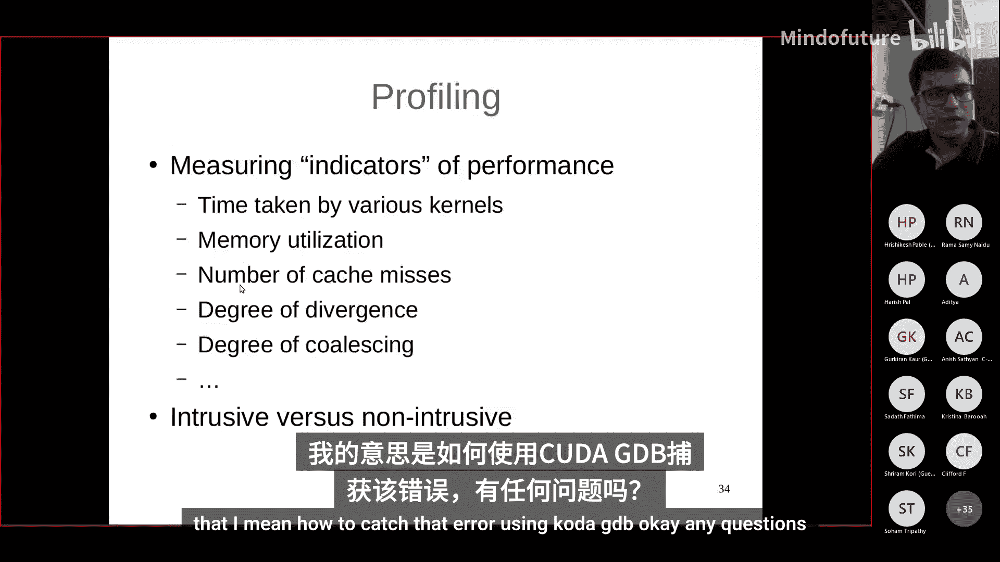

Okay， if you have any questions， then please feel free to ask or else I'll just move on。

Okay I will briefly touch upon the profiling part so profiling is typically useful when we want to measure the performance of our QDA program。

In order to time our permits you can use profiling and apart from there there are also other ways in which I mean。

 or other indicators of the performance like how much memory you are utilizing how much cash cash misses are happening。

And all those things and what is the degree of divergence and what is the degree of coering and all those things。

Wwhich indirectly shows the mean， which indirectly shows the performance of your good algorithm。

And all this you can do it， I mean， all this you can check or all this you can keep track of using andcro。

Which is a profiler， I mean， this kind of profiler provided by the Qa。And。There are two types。

 I mean there is this intrusive and non inrusive thing which is which says that I mean。

 when you need to change your program in order to，Profile it。

 Then it's kind of an inrusive profiling because you are adding additional statements in your program in order to。

To check its performance or in order to get some insights from it so that is inrusive and non inrusive is the case when you just don't need to add any additional statements inside your。

in order to get the information like timings and all those things。

In order to time your kurdle or any of the QUDa program。

 what you can do is you can also use some input functions like right that get time of day and so on。

 so you can insert those statements inside your ka kernelle。

And that will become introerate because these statements inside you are adding the instructions inside your QDA program to I mean。

 for the timing or checking the time of your kernels。But the other ways to， I mean。

 other another way non inclusive， that is you just don't。You just don't need to add any instructions。

 additional instructions， this profiles that is en profen the。And we ci on all those things。

Will help you。Will help you in checking the performance of your code app program。

So let us see one example。And we。Yeah， then we'll probably end this class。Yeah， so。Okay。

 as I said this MBP is non introducedrusive that is you just don't need to add any extra statements inside our quoA program in order to get the。

Detail performance details so no change required to the binary file or the input file inputput file and。

The way you need to run it is that you need to use this and Pro and then specify the binary file that you want to profile。

Then you need to use this。YeahIn order to profile the parts of the programs。

 you need to use the pull app profiler start and stop instructions and。Yeah。

 you also need to use this API inside your quoa program that is quoa Pror API dotage so you need to include this and you probably might need to include the include this instructions in your。

Programs。And。诶呀 so。And we if you want to program the sorry you want to profile the part of your program and you need to use profile this flags。

 which is profiled from start and off。Then you to provide this final effect。

 so let us look one example related to this。So this is thea typical QDa program that we want for profile and if there are three kernels here。

 one is the K1 K2， second is K1 how the K。And these scans are being invoked multiple number of times。

 that is each one is being invoked 100 times。And。Yeah and we want to know which kernelal we should optimize in order to get the performance benefit or which kernelal consumes the most time so this thing can be done very swift using this en Pro so you just compile this quo program and。

Run this binary file using N prop， and it will give you some。

It will give you some indication of the performance。 that is。What I mean。

 what time each and every car is taking， so you'll see that 39% of time is taken by K1 as K2。

33% of the total time is taken by Ka and 26% of the total time is given so from this information you。

You just understand that K2 is the most time consuming kernel and yes it must be since it as using atomics so yeah。

 so k2 is the time consuming and you should be you should first try to profile I mean not profile you should try to optimize K2 and then K3 and then K1。

And what else it is saying that this。Yeah， this。95% of the total time is taken by the sorry kernel launch that is quoa kernel launch。

And that is quite the。Intuitive， right， since we are calling。The kernel100 times。

 I mean each kernel 100 times in total there are 300 calls， so cardal invocation that is I mean。

 so if you see here the calls are 300。It will take something and that is come I mean。

 that is totally taking 95% of the total。Exhiition time of the program。

 So I hope you are getting the。啊，你个得的。You can use the sand crop to get some detail about the。

Performance related to your quota program， and it will give you a very detailed。

Pated overview of what's going on。And耶稣 let us冇耶稣。Let us conclude the。And we profit this slide。

And UProf provides a device specific profiling， so you can get device specific profiling for a particular device you can get。

啊。A detail of I mean， you can get a performance details specific to a particular device you can also use prim profiling that is。

The program is being ran on some particular device and GY somewhere else and you want to profile it。

And if you want to profile the program， then。You can do it using N。啊 and。Yeah。

 and the last point is that it will dump all the files， I mean。

 all the output in the CSsV as a CSsV file and。You can check that file and see the details a little to it。

It the to a pu program。啊。也所以嗰个。だたか。This example learned。

These points were clear are any questions that please feel free to ask otherwise。

I think this was the last slide I have。

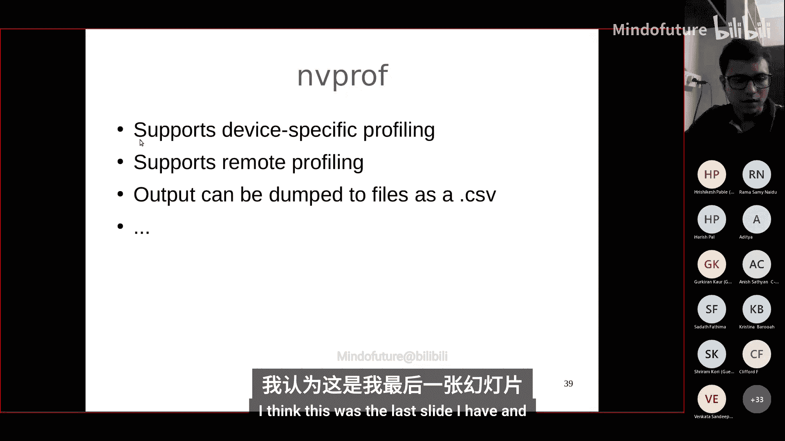

If there are any questions， then please feel to ask council。Call it today annual will display。

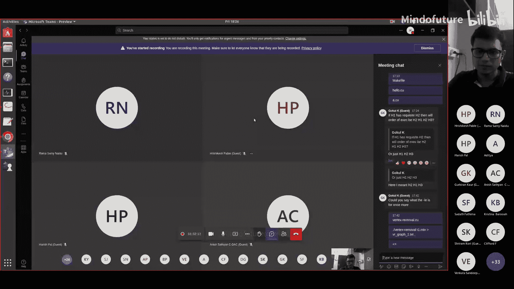