# 【Nvidia】CUDA并行编程-｜-Cuda-Programming-Course-｜-Parallel-Computing-Using-Nvidia-p18-P18_L18_CUDA专题--BV1MSq1BTEho_p18-

Yeah， so hello and welcome welcome to the 90 lecture of our quo program。

 So in the previous lecture we saw things related to the。Support， right。

 support aspects of the quo program。 So we saw what how to write the make files。

 We saw what are rules， What are。Targetets， what are prerequisites and what are the commentsments。

Associated with the makep。 And then we saw multiple examples directed to the makep we use variables。

 stiff conditions and。Foreign pile loops inside make byland。 Then at the end， we saw。

One complete example for running a QUDA program on multiple test cases using a makeP。

And then we saw debugging aspects of the QUDa program。

 so we saw how to use KUDA GDP to rebug our quoA program。

And later we touched briefly upon the profiling aspects that is how to time our Ga program。

 that is how to know how much time our kernels are taking for the， for running。

Which will help us in determining which kernel to optimize and so on。

 So that information we can we can get using。Iser NVP or NV site and we saw NVP specifically in the previous lecture。

So yeah， that is where we ended off in the previous lecture。Yeah。

 that is the outline that was the outline for the previous lecture for two day lecture we are trying to cover three specific things one is dynamic parallelism that is。

Yeah， so that is when we are calling kernel from within another kernel。

 that is what is called as dyam parallelism。So we'll see how to do that。

 we'll see problems filter good and we'll briefly touch upon the computation and the memory aspects of the dynamic。

Falism。And then we'll start off with a multi GPU pressing。

 that is when we have multiple GPPUs associated with RCQ， how to program them。First of all。

 we' will see why why do we need multiGB processing and？

And then we' will also see how to do multi GPP program using multiple APIs and functions that are available in Ka。

And yeah， that is that is what we see multich person and then well towards the end well see this what putting that is what is what putting and what are they。

Multiple functions that are available for performing this work putting and we'll see all these things towards the end of the today's lecture。

So okay， with this， let us start， particular let me see if there is anything we share。

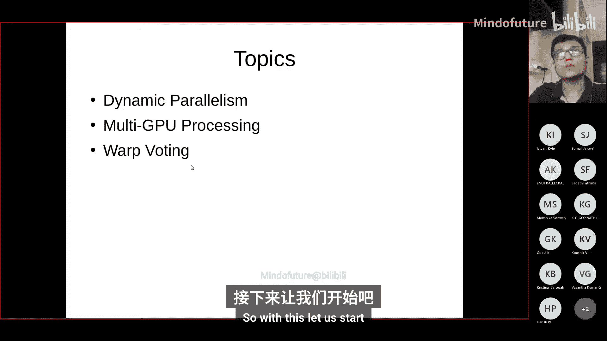

Okay， recording has started。There is nothing to be checked， Okay， fine so。

Yeah， so let us start with the today days content。O， so。Yeah。

 let us start with this first subtopic that is time vdism。

So this denium parallelism is typically useful in the scenario where we have nested parallel that is we are launching a kernel with n threats from the CPU that we know right we can launch a kernel from CPU with n threats。

And then that each thread of that kernel will be launching again and another kernel with enter。

 so I hope we are understanding that。There are n third。

 but each 30 second launching a account with1 third。In total。

 we have N coin that is n square threads that are running among chip。啊。This， I mean。

 this dynamicF parallelism can be useful for modeling such kind of nested parallelism scenario。

 which I told like there are n threads and each thread is again again launching in other threads or doing some nested kind of operations。

So let us come to this example that is nested poly loops and we will see this nested poly loop can easily be modeled using I mean easily be modeled using dynamic parallel。

Yeah， we have this out loop， which is running for some constant number of hydrs。

 let us say that there are Nhyrations of the out。So ourer loop is running from0 to n and then again。

 inner loop is running from some。F or that is some function of I and least not that this I is the outer loop。

So this value of Fi is known at runtime， so it is running from F to n。

 so outer loop is running from 0 to n。And for each iteration of outer loop， this inner loop。

 which just this J is running from F to n。The number of iterations in the inner loop are variable based on。

 I mean， vary based on this function happen。So to model such kind of scenarios。

 we can use dynamic parallelism。So what we can do is we can launch a kernel from the with n threads。

 which can model the outer loop， that is this outer loop was running for n aration side so。

One particular itemeration， we can have one thread。

So we can launch the kernel from CPU with entrance that will be suffice for the outer。

 but for the inner loop。What we can do is from that kernelal has which is being ran by an。

We can launch another kernel which will run for n minus s number which will be launched with n minus s number of threads。

So I hope you' are getting it the scenario loop is running from Fi to n。

 so the number of hydrs that it will have is F n minus F。

So we are launching a kernel from CPU with entrance and each side of that kernel。

We launch again another carman。With n minus s3s and that kind of a launch and execution pattern can easily model our I mean。

 can efficiently model our this kind of。Ned the for loops。And yeah。

 they can then place this whatever work we are doing in that kernelnal。Yeah。

 so we will see this with an example， but yeah， so the important point to observe here is that。

There is this fite， this function。Whose value is known at run time。 So whenever we have this。

In that group which I mean postits are not known until the run time， we can use dynamic paradigm。

 we should use dynamic part but。But the case where we already know the values of I mean， not values。

 but we already know the number of hydrogen for which the inner loop and outer loop are run or lets say for example that we already know that inner loop is running from 0 to1 and sorry outer loop is running from 0 to n and inner loop is also running from 0 to1。

In that case， what we can do is instead of just using dynamic pism， well we can use the dynamic pism。

 but instead of using dynamic pism， what we can do is we can just unrollse the loop and can do this work。

I mean， do this what？That the help of just single kernel。How we can do that。

 We can just launch that kernel with n into n threads。

 that n squared threads and do that computation this work。Inside that single kernel。

 instead of using dynamic， I mean， dynamic parallel that is launching the kernel from within a kernel。

 we can use just single kernel and。Don't check with antis。But yeah。

 when there is such kind of scenario that。啊。There is outer loop and inner loop iterations of inner loop are dependent upon the outer loop we should I mean we need to use dynamicism because it it ease I mean it eases down the modeling of such kind of scenarios。

 so I hope that is clear。Okay， so typical examples of。

Dynamicism are the algorithms where we have highererarchical data structures that is let us assume the scenario that we have a tree。

And each node of three can have any， mean it can have a variable number of chi。

The notes that a particular sorry but number of chart that a particular node have depends upon the type of node notice so in that case。

It is this kind of scenario right。Let's say we are loop over the outer book that is P all the nodes of the tree and。

Based upon。The whatever node it is， we are going through all of its that is f of I。

 so consider f as a neighbor or function， so we are going through or or the child function so we are going through all the child of a particular node which is I。

So in that case， since the number of node that each child can have might vary。In that case。

 probably it I mean we can use this dynamic parallelism to model this kind of algorithms where there is there are hierarchical data structures。

 so this is one of the example， then there is this。Example of the algorithms where we use recursion。

 So if people know， then we can model recursion using something called a recursion tree and。

And the number of calls that a particular node of that recursion tree might make might vary right so yeah。

 since that the number of calls at a particular node in recursion3 that might I mean the node of that recursion tree make might vary。

Again， it comes， I mean， it boils down to this kind of processing， right where number of。

Iterations of the inner loop are not fixed and hence again。

 it can be modeled using something called a dynamic parallelism。And then again。

 there is another example that we have work that can naturally spread into the independent matches。

And each batch I mean each batch can be processed paralleld as well as the amount of per in each batch is not uniform that is each batch doesnt have the same amount of per in that case again。

The amount of work is not fixed， so it is again like this that。

The variable amount of work is being done that is the inner iteration。

 the number of iteration of the inner loop is not fixed that is the amount of work that is to be done by inner sorry that is to be done by a particular batch is not fixed hence。

Okay， we can use dynamic pism to。Model this kind of scenarios。And yeah， so again。

 I will repeat this point that。Not all the nested parallel loops needs dynamic parallelism。

 that is if we know the number of iterations。Of the loops， that is。

 if you know the number of hydrogens of the inner loop and outer loop。And in that case。

 instead of using dynamic parallelism， what we can use is we can just ung these loops。

And we can use static parallelism that is。What we can do is we can just launch one single kernelal with the n squared threads instead of launching。

 I mean launching kernelal with1 threads and calling again kerneldial with1 threads from each of that thread。

 so I hope that is clear。So for a， I mean， that the loop poundss are already known to us。

 we can use static parallelism。That the。Number of iterations for。

R loop is not it cannot be determined during compile time we can I mean we should use dynamic parallelism and these three examples are for the scenarios where we should use dynamic parallelism。

And yeah， I hope this is clear if there are any questions on this slide related to。

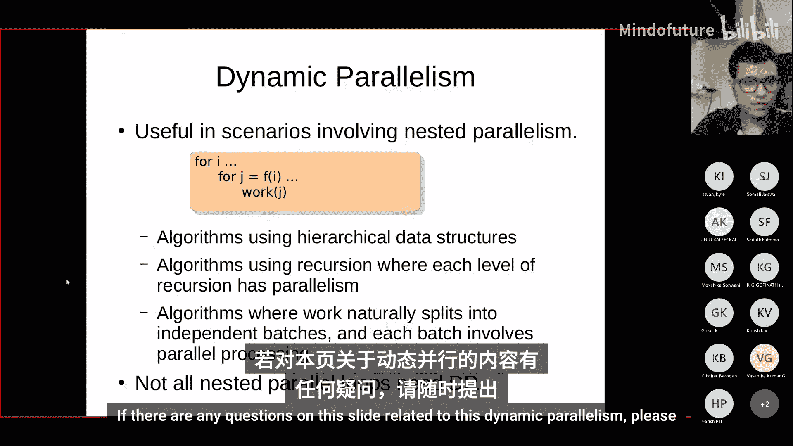

This dynamic partism please。

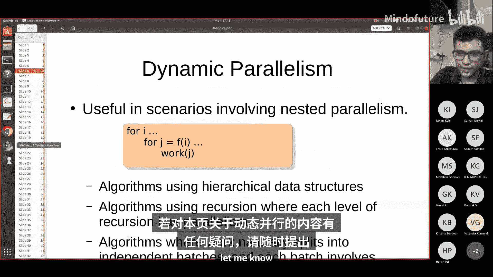

やの。Okay， I think there are no questions。

Okay， in that case， let us move further So yeah， let us。Start with one very simple example。

Related to the。Dynamic parallelism， so。We have this main function in this main function。

 we are calling this。They're calling this cardinal parent and this parent is being launched with three threads and yeah all these three threads are from this same board and then we are doing coiv as synchronize。

And within this parent kernel， what we are doing is we are printing the ID of that thread。

And then again， we are launching the cardal from within a kernel piece。

 not that this parent is a kernel base， not that it is marked with global。

And they are printing the idea of that thread in that kernel。

 and then again we are launching a kernel。which is named as child with Pyths。

 so I hope you're getting it， this code will be rank by three threads independently and this kernel which is child will be launched by three threads。

And in that， we are passing the thread ID that is idea of that particular thread。And。Yeah。

 what is this child Let us come to it。 So this child kernel is。

Is again garden because it's marked as global and it is taking。Some argument。

 which is the idea of the thread with which I mean， sorry idea of the thread。Who has invoked it。

 That is such's father。And。What we are doing is we are treating the parent that that is its father。

And the。Child I D。 So parent Red I D and child I， we are printing。So yeah。

 this is a typical example of the dynamic dynamic parallelism because we are。

 if you say we are invoking a kernel from within a kernel。

 so a parent is a kernel and from that we are calling some another kernel discharge。

So let us see how to run this program， so I ran this program using NVCC。Dynamicpar。

 co so this file name was let's say D and PRr。cu， so end this column with this NVCC dynamic power C。

Which is the name of the file， and it gave me error that is。

Calling a global function chrom a global function is not allowed on the compute capability sorry on the compute underscore3 architecture or E is only allowed on the compute 3 architecture or E。

Okay， so it is saying me that you can only use dynamic parallelism if you have compute capability of 3。

5 or higher， so that is not a big we can just specify it using。A big flag， which is a ER C。

So we can specify that the compute capability that I'm using is SMm and score 35。

So I specify that and then again rerun it。But again， it gives some error to me what is and what。

 what it is trying to tell tell to me is that。Carinnal launch from device or global function。

 that is we are launching a cardnal from device or a global function requires separate compilation mode。

So it is it is trying to indicate me something that you need to use some separate compilation mode and why it is telling to me this I mean why it is saying this is that。

This child kernel that we are calling from the pan kernel needs to be linked with this。

This parent kernel and for doing that， we need to。Specify another flag， which is。

RDC and this RDC will make sure that linking of the。

A childil kernel will happen with a parent kernel and yeah just for that we need to set this RDC track to through。

And RDC stands for I think， relocable device code or something。

So when you set RDC flag to through and depth and when you compile it it using， I mean。

 if you use both of these flag that is。A is equal to asyn pi and r is equal to true。

 and then you pass this file。Then it will compile properly and then you can run dot s it or。Okay。

 so this is fine， so yeah this file can be， I mean， it will be compiled and run properly。And okay。

 so next question is， what will be the output of this program？

Considering that we have this program written and we are comping and running it using this commands。

What will be the output of this program， I request each and every one of you to try that what will be the output of this program？

Please try out and twist your answers in the chat。I'll wait here for two seconds。你ive thanks。

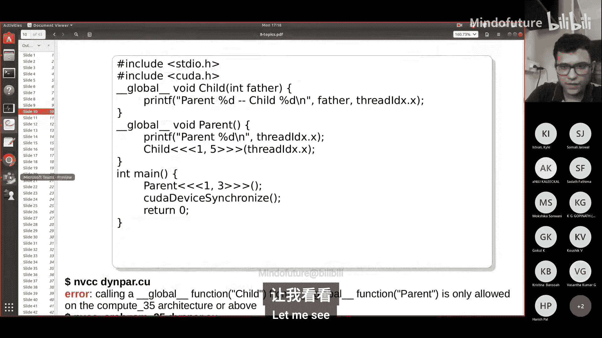

ok so。There are some overheads associated with the dynamic pism。

 so I think Goku's question is is there in downfall to dynamic pism or is it okay to use it when static parallelism is enough？

Yeah， so there are some downfalls to the dynamic peism first downfall is that it。

It has this kernel called overhead selfrite that when we try to call a kernel from within a kernel。诶。

I mean， there is a kernel called。 I mean， kernel are。Called from within a kernel and since。

 I mean we are in working large number of kernels right now。

 there is this kernel called overhead associated with each lung。

And that will definitely slow down our processing and we should be careful about that that is one point and that is another point related to memory that we will see later in this lecture。

And yeah， in general， my observation is that。If if you can do some， I mean。

If a work or a particular task is task can be accomplished with。Static pism。

 then you should not go for dynamicism since it has some overhead and some cost involved with it。

Otherwise， if it's inevitable like for the cases where we saw right that。

The amount of competition that we， we want to do is not。Fix in some some I mean in some group。

 then in that case we have to use the dynamic policy or that we can go for it。

But that is fine since we have no other alternative。

But the case where static pism is available and we can use that we should go for it first is what my suggestion is。

I hope that was clear for。来。哦。There is some response。So。Blan时嘅 science balance。再。Okay。

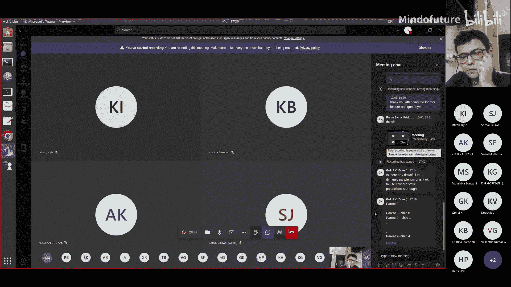

Any other response apart from okay， I'll switch back to this slide so you people can try。Again。

 so I reiterate my question， what will be the output of this program？

Please note that there are two print print statements here post。

Inside the parent kernel and another one is inside a child kernel。Please think about it。

 I'll wait here for a few more seconds so that you people can try and I'll keep this slide as it so that you can see the code。

And yeah， I'll be here for two few seconds。

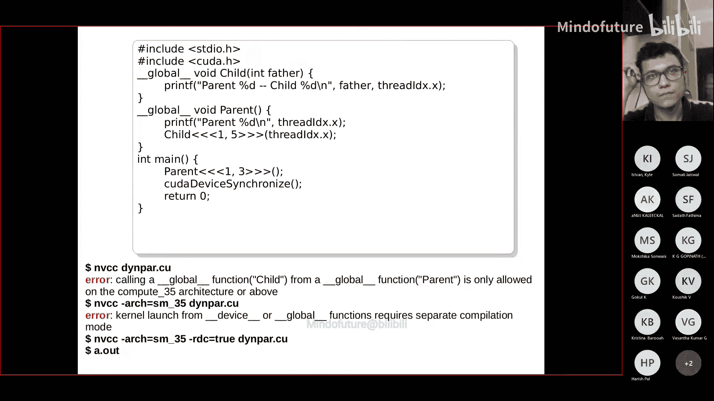

Soir， I had it out there。

S， don't we need a kuda meok for passing that thread Iex there in infa don't we need to declare it as kuda by using ka melo that further Okay I think this is a good question。

 but let us pick this up。So what he's suggesting is， why don't we？是不是都口 damage们 look further。

I looked， I mean， passing this thread ID exortex。Here， we don't need it， because。

Let us understand why we don't make it， so whenever you declare this variable in farther here。

It is local for each thread and since it's a local variable。

Each thread has its own private copy and hence we don't need。

To do coam if you want some common variable across all the threads for the launched kernel。

Ithi is here， which is child。You need to look what Im love。But for a third local variable。

 that is known of goodal melon。Think of it like this。 we were having right， we were passing that。系啊。

What I can say， we are passing some information to the kernel from the CPU， right。

 using some parameters。For that， we weren't doing any code ML unless it was an area。

Unless it was an array， we were just passing it using some like this。Iing some variable。So for that。

 we don't need goodam。一十不。And yeah， one more point that I want to clarify is this further。It is here。

Will only be。I mean， it's a thread local variable set。

 its value will only be visible to the particular thread。啊 so。Okay。

 I hope that you're getting it that it' threat I mean thread local variables。

Each thread will have its own copy well we are not here modifying that variable further but。

Please note that it's a third local variable hence。Yeah， so yeah I'll leave there。

 so instead will have its local copy， so let me go back to。

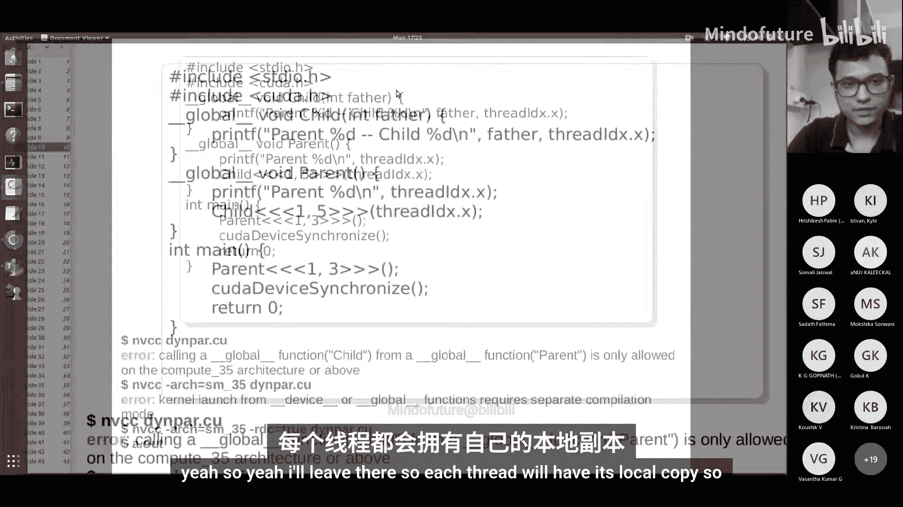

啊，我其实有啲心啊。The goal is suggesting parent zero then April between， parent0 child zero。

 parent zero child。嗯， o i think嘅。This looks correct to me。 Okay， let us see with。

This court along this court。So can this output the。Would be like some， Some will。

 It will be like this。So let us understand why we are getting this output。Okay， let us呃。

Understand step by step， so here all the here CPU will launch the kernel with three threads and then CPU will wait here at CDS。

 right？And then what is happening at this。In this parent con。

 so since these three threads are the warp threads。They'll execute this print statement。

 so they'll print do this print up and only they'll move to this car launch。And so first of all。

 they will print this。Parent and then particular thread ID so。So this thing will be printed。

 parent of zero， parent1 and parent2。And since these three threads are the W threads。

 they'll finish this statement and then only they'll move to the kernelner launch instruction here。

So this will be printed and then each of these three threads will launch their child cardins。

So three child coals will be launched。Each with fighterys。And what this child current would do， they。

Dell。Yeah， they'll print this statement， that is there are five threads。

Each thread will print what is its parent and what is its sideing？So。Since there are fighters。

 we have this。F statements。For each and every。Parent， I mean for each and every parent right。

 so this this colonnal child was being launched by three threads。And。This。

Each three launch we having five We having five， so。So this is for the first thread， first launch。

 this is for the second launch。And this is for the third one。

 So I hope you're getting it getting it that。It tried zero。Within the pattern。

Is printinging this past blue blue blue set of statements， then the thread one of this。

Parent K is printing this maroon maroon set statement and then this。Thread three of the parent。

Is printing this black set of statements。And since we have five threads for each。Call here。

 call to child here will have this five statements being printed that is child zero child one child2 child3 child。

 so I hope you are getting this this parent zero and then child zero parent zero and then child one and so on till child4。

And then again， for parent 1 and then for parent 2。So I hope that this is clear。

Any questions up to this point， it is important to understand this。

So please feel free to ask any questions。

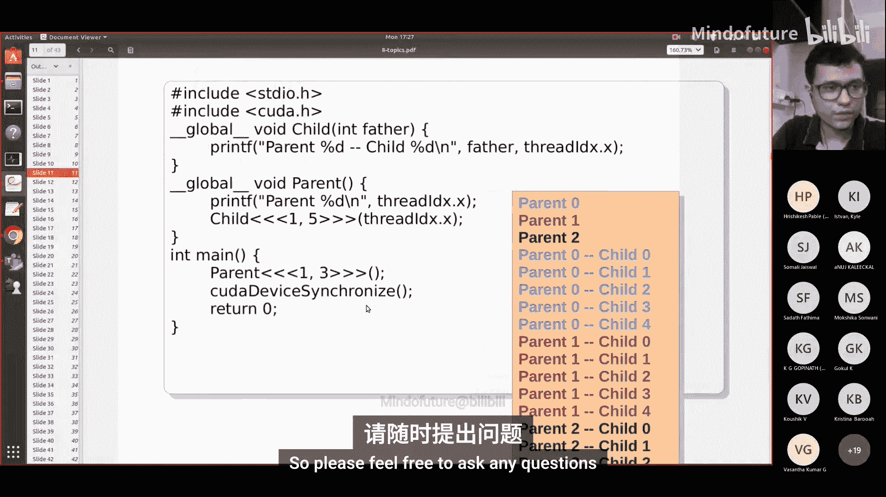

Any questions？On this slide。

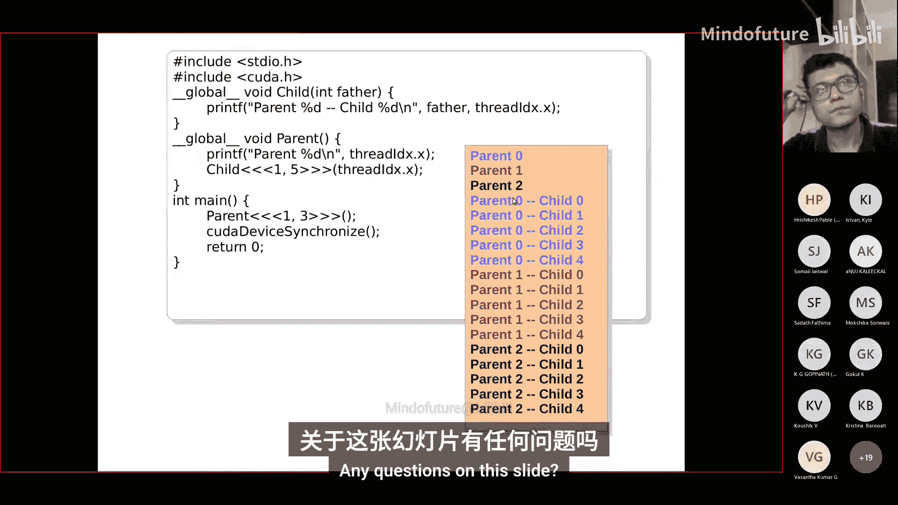

Okay， I am assumings that the okay， if there are no question， let us move further。

Okay， so I would like to ask you one question here。Can it happen that the。

This maroon set of statements which are printed by the thread with thread ID 1。Of this parent call。

Are being printed before this blue set of statements。

 so my question is like can this moral set of statements come before this blue set of statements here？

So this will come here and this will go down， can this happen is what my question is？

Is it possible or it will never happen？Please think about it。

 I'll wait here for a few seconds so let you。

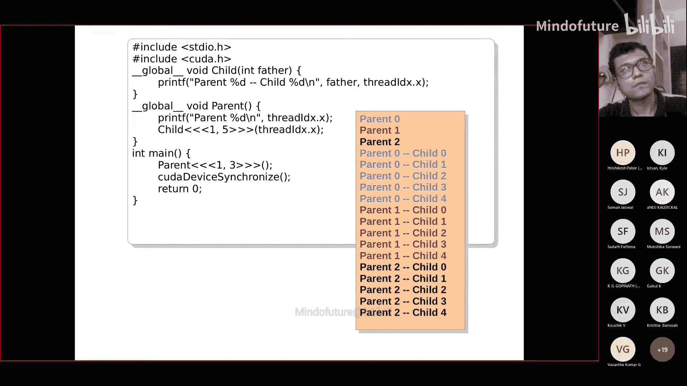

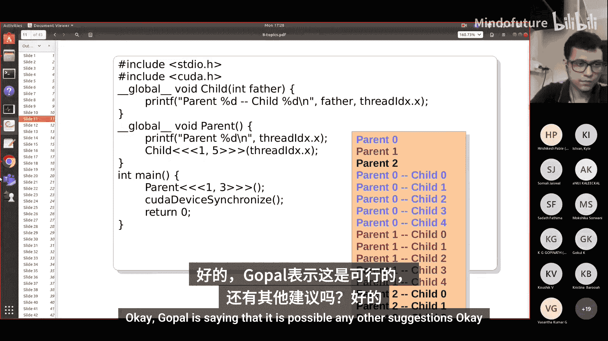

Google is saying that it is possible。Any of those additions？Okay， let us。

Go back to this slide so yes， this is possible because。Since each thread， so okay。

 so let us understand this， so what threads were doing this print statement so thing these three things were printed。

Now， warp threads， which were having tid from 0 to three， they launched the kernelal。

And this launch can be arbitrary， so thread， I mean， they'll launch the kernel。Here， and then。

It might happen that， though。Pnt buffer， I mean the things， I mean。Sorry。

 the output that was printed by the parent one。Sorry。

 the buffer in which the output was being dump by the parent one came first to the。啊。嗰啲啊。

Color and it was being printed first。 so that can definitely happen。 So this。This entire。

Maroon set of statements can precede the new set of statements。

Because printing can happen in arbitrary order right since this calling is happening by all the three threads simultaneously。

The printing can happen also simultaneously and they can be jumbled in arbitrary manner。

 so even it can happen that this parent who is printed before all this。

Parents even parents went on all this blue and Mar statement。

So that is definitely possible because three threads are。

Calling the colonel simultaneously and they are being executed are I mean， help print as the。I mean。

 they'll run concurrently this print statement， so that is definitely possible。

So I hope that is clear， but what cannot happen is that this。Printing of this parent0 child zero。

 parent zero， child one and child 2， child3 child， that is this highest set of statement for each and every parent。

They can't jumble because they are walk threats and the way printing of the walk threats is being done is that。

They'll be placed in the buffer one after the another so parents zero child， parents zero children。

 parents zero child， and so on。Till parents are child of each of these parent， parent。

 one parent and parent3， they cannot jumpmble。Yeah。

 so I hope you are getting this that internal juling is not possible but。Across parents。

 there can be a jummbling。

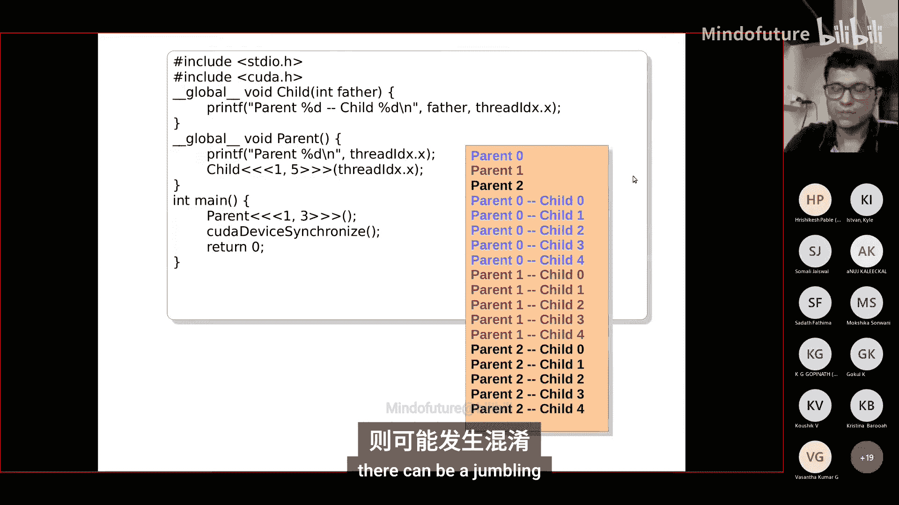

So， yeah。Any questions up till this point。There is some question， child is spoil at the same time by。

W， so I assume that will be， for instance of child。The child is called at same time by what。Yes。

 that is quite exciting。Yeah， that is correct yeah， so I think this is correct observation。

Okay， so let us。冇话系。Okay， so let us。Examineine what will be the output of this program。

 I'll wait here for a few seconds for you people to try out what can be the output of this program。

Please in， please feel free to unmute yourself and discuss or you can also type your answers in the chat and can discuss。

So， here we are calling。A parent condo in with1 threats。I'm Ga Walterters， and。Td ID extra text。

 I mean within the parent kernel if the thread ID X text mod to is 0。

 please note that case defined has defined as2。Third ID xtro x mode2 is0。

We are calling some child cu with two threats。And we are passing this thread ID。

And then we are printing something and inside this child。Carinnal， what we are doing is we are。

Printing some number based on the idea of father and the current idea of this。

So please think about it and post your answers in each chat and probably then we will discuss it。

Discuss that over。

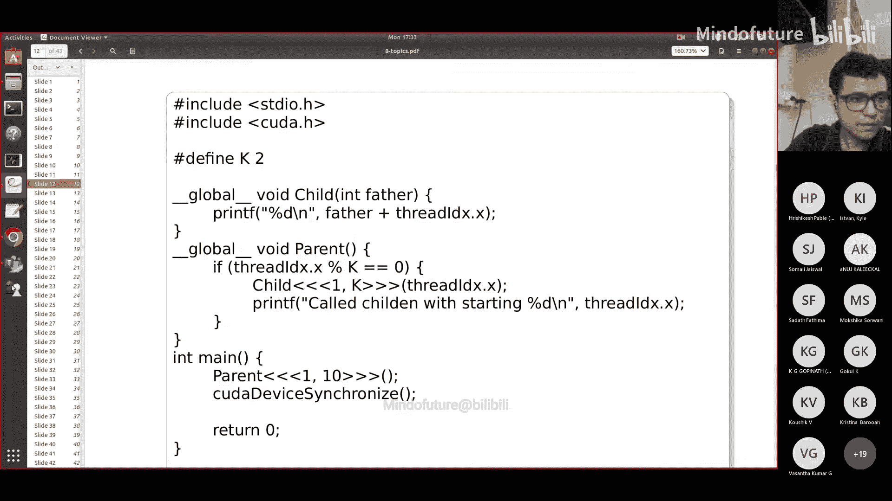

O啊。You can probably wait for you。

Please， please try out and。公 your ances。That is。

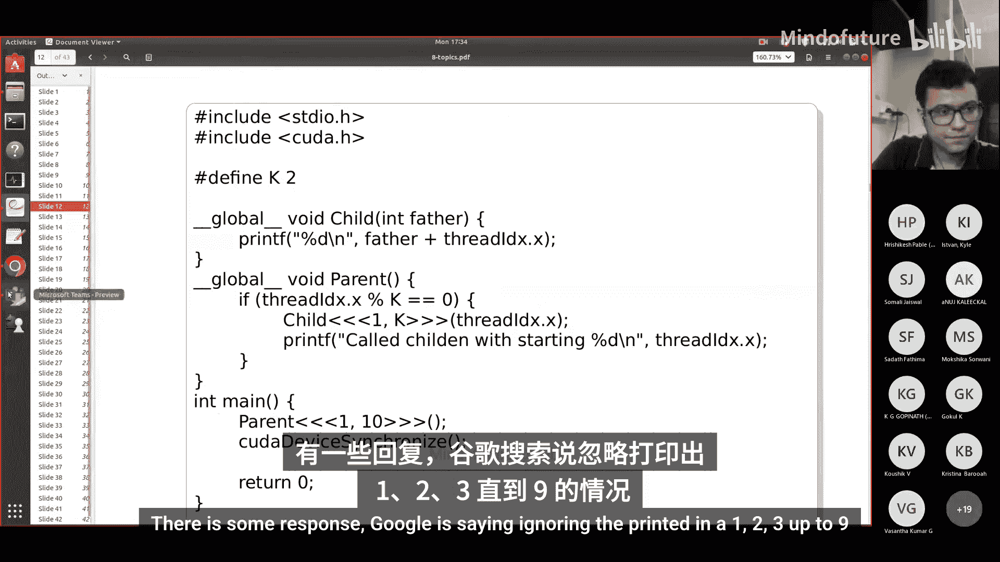

There is some response， Goly saying， ignoring the printed in。运到几日到嚟。Okay， I think this is。

Correct up to some extent， but。Yeah， I mean，02。Yeah， that is correct zero to nine。

 but why are you ignoring this？questionOkay， so let us understand this。I think you're， I mean。

 you' are probably getting this thing， but。系啊。Partially。

 I would say so if there is some point that is still missing。 So let us understand this。

 So this can be the output of this problem。 So this is one possible output。

 There can be multiple possible output， and we' see them。So okay。

 let us start to understand it step by step， so there is this parent launch here。That is。

 we are launching the kernel from CPU within 10 minutess。有。

Based on the thread I that is if it is an even thread， that is we are doing K or2 right， if it is 0。

 that is we are checking if it's an even thread。That is for thread with I 246 and 8 will go sorry。

 0246 and8 will go inside this if condition。And what we'll do is we'll launch this tunnelner。

And what we are doing is we are passing thread ID so for thread  zero， thread ID will be 0。

 so father value will be0。And0 plus 0 is 0 and 0 plus1 is 1。

 so please note that we are launching two threads。And hence。

 the thread I will be 0 and1 for each of the launch。And this value of father might vary well be zero。

2， four， six and eight。So based on that， the values that will be printed will be 0，1，2，3，4，5。

67 and ari。0， one，2， three， four， five， six， seven and eight， nine， so I hope you are getting it。

What they first first launch。Of this child garden， so please notice that there will be pi launches for first lunch。

 part is zero。And since father is 0，0 plus 0 is0 and 0 plus one is1。 so this is by the first I mean。

 not first launch， but they launch by the。Third with third I0。

For the launch with for the launch done by the thread with thread ID2， it will be。

2 plus 0 and 2 plus1， so two and  three will be printed。For they launch with， I mean。

 for the launch by the thread having thread Id 4， it will be 4 plus 0 and4 plus one， which is。

Four and five and so on for the threats with ID。Six and eight so。We'll get 0，1，2，3，4，5，6，7，8， me。

 That is fine。But something else is also there right， after launches are being made。

 we are printing here something。And what we are creating called child with starting personally。

Essentially we are printing the thread ID right， but we are also printing this some strain here。

And for which threads that will be printed， which will enter inside the safe condition and which threads will enter inside the safe condition。

 those are the threads 024 six and eight。So called children with。Call children with starting 0，2，4，6。

 and 8 will be printed。So I hope that this is clear and this is one of the possible output。

So now my question is simple， can this entire bunch of statement which is called with sorry call children with starting0 and2 and4 this。

 I'm calling this entire P statement as some bunch of statement。Can this thing happen。

 so considering that this is a bunch of statement， can this type of output be possible？

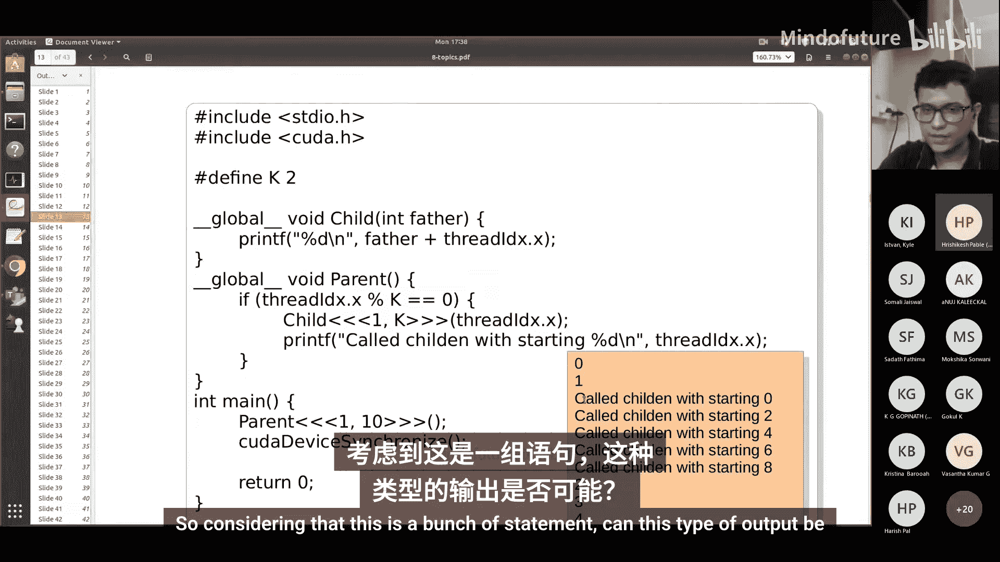

啊。Zero is printed， one is printed， two is printed， three is printed。Then this bunch of。Statements。

Spprintter。And then there's 4，5， and so on。Is printed till。你。Is this output possible？

This type of output。But there is some response already， Iika is saying yes。Do you like to buy。

Yeah， so like as you said in the previous example also like the if like the vote threads。

 there cannot be any juling， but like when0，1，2，3 are over。

Like the that bunch can appear and then the other words can appear。

I was unable to understand it completely， but。Yeah， let us understand why that is possible。呃ok， so。

What I mean， why this can happen is that。This gardenal launch here is asynchronous。This呃。10 threads。

 I mean， Carel is his parent kernelel is being launched， but it's being launched with 10 threads。

And fivehirs are entering the safe conditions。If it are if condition and they are launching the kernel and they are moving on。

All these five threads which are launching this kernel they won't wait at this kernel to finish I mean they won't wait for this child kernel to finish and then only they will proceed to next statement that will not happen theyll launch the kernel。

And then they'll move on to the next segment。So please note that the safety execution is still there。

 so they'll execute this statement and then move to this statement。

But the point that I'm trying to highlight here is that it will not happen that theyll launch。

 I mean they'll finish this statement， then wait for this child kernel to finish and then only proceed to this next statement that will not happen。

So they can launch the kernel and then move on。So if that is the case， what can happen is。

They can launch the gun。And meanwhile this kernel child can print some of the values which can be 0。

1，2，3 and meanwhile that printing is happening， the p3s which are entered I which have entered inside the safe condition might print this。

Bnda。So it might happen that this bunch of statement， which I was telling。

 can appear at the beginning or can appear after this 0123 or can even appear at the end after all this 0129 is printed。

 012，3 up 9 is printed。So I hope you are getting the crux of it。This。As， as， as we have in CPU that。

The kernel is being launched and then CPU mode in a similar way on the GPU。

Threats will launch the kernel and then they will move on。

 they will not wait for the child kernels to finish。

 theyll move on and execute the print statements that are after it。

And due to this asynchronous kind of execution between parent and the child panel。There can be the。

 I mean， there can be any jumbling that can be possible by between this statement。

 this bunch of statements and this 0 to9。

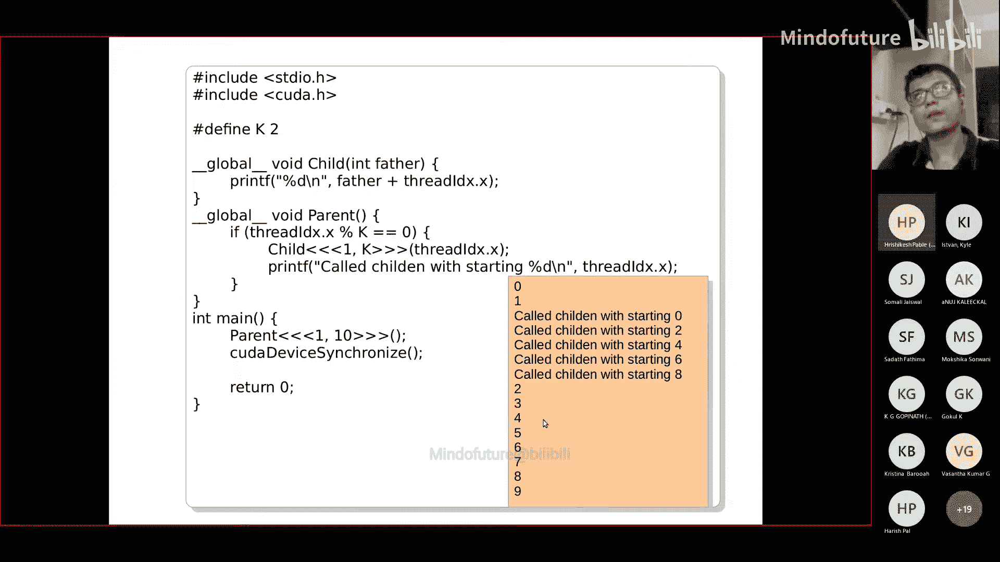

I hope that you are getting。你诶。I mean， we are getting the concept or I mean。

 the point that I was trying to highlight。There is some question it shouldn't be possible because works that。

Thats， but maybe a card。Ens really fast， faster than the other。

I am unable to understand this question。 It shouldn't be possible because what。

But maybe if a current lens really faster。Yeahた。People can you unmute yourself and tell whatever youre trying to。

So I hope you are getting that。This launch。下明。あ面で。Parent threats won't wait at this launch。

 theyll just launch it and then they'll move on and hence there can be jumbling。

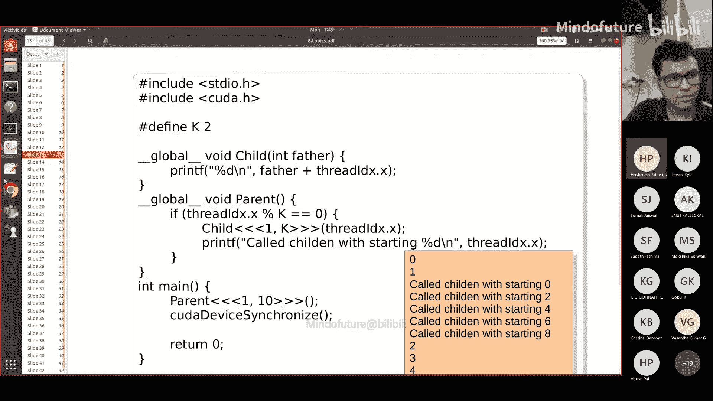

If I am probably not able to。Okay， okay， okay， I understood。

 So you are trying to understand why it is happening。 Okay， that's fine。

The second question is sir there is it likely sorry， then is it like heavy diverg？

In what context you are telling this have eye version？Can you you elaborate I mean。

 elaborate for this highway div？Why you are telling that that is heavy div？

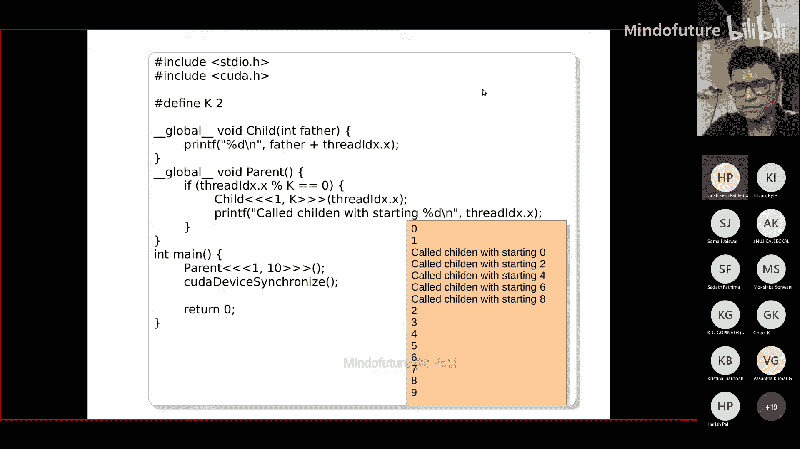

就系这个。Okay， if you have any questions， then you can unmute yourself and ask。

 Ill probably I'll move ahead from there。

Okay， so let us。Brief out the computation and memory related aspects of the dynamic plants。

Parent kernel is associated with a parent grid， we know that this when we launch a kernel from a CPU set associated with some grid in a similar manner。

 child kernels are also sorry child kernels are also associated with a child grid in a similar manner as we have this grid associated with the parent we are also grid associated with the chis。

And the point here to notice that one parent grid or one parent kernel， sorry one parent kernel。

Can have multiple child crs associated with it。Because we are launching， I mean。

 each thread of a kernel is launching multiple。sorry。

 each thread of a kernel is launching another kernel hence。For a particular parent parent condo。

 there can be multiple child grids associated with it。So I hope you are getting it。

 so if the launch kernel with ns on each side of that kernel。

Is launching another card within it with answers then。In this case， with one pericon。

 there are n child grids associated。So I hope you are getting this point。And then。

 as I mentioned in the previous previous example， that parent and child cus may execute asynchronously。

So here， child kernelnel， which is being called here and threats of the parent kernel are executing asynchronously。

And if you want to synchronize them， you need to add Qa device synchronize that as we do in CPU you need to add you need to add this CS here。

And yeah， this point is important， a parent grade is not complete unless all its children have completed。

Soや呃 so。The point， this point， what it is trying to suggest us is that。

parentent threats and child threats can execute simultaneously。

But one thing that you should observe is that they the parent sorry parent thirds will execute statements that are after this launch right。

 so they can execute those statements， but the parent will only end after all the child kernels are finished。

Here in this case， the sprint apps can be printed by the parent threads。But the parent card here。

 which is ending here， will not finish until all the childcur are over。

So I hope that you are getting this point that parenthood is not complete unless all its children children have completed。

Okay， so let us come to the memory aspects of this dynamic parallelism。So法第呃。啊。This a。

Tarent and child governanceence。Its a。Same， I mean。

 this parent and child cardins share same constant and global memory。

 that is they have common global and constant memory。So you want to。

Have some information which is common between the parent and child kernel so let us say I mean we need some variable which is common between parent and child kernel and in that case we must allocate that variable on the global memory using code MLO so it will be if that is the case then both parent and child kernel will be able to that see the copy of it。

But there is one thing here that。Parent and child garden will have different local and shared memories。

So what this statement is trying to say is that let us say you have declared a shared error in the parent kernel。

Okay， so you have a shared area in the parent condo and you are passing that shared pointer to that shared area。

Inside some child kernel， so please note that it is declared on the parent kernel that shared is declared on the parent kernel。

And you are passing its address to the child kernel。 And if child kernel tries to access that。

Sharre then it might be， I mean， it might cause issues right that it might cause segmentation support or something like that because。

St kernels。And thepar kernels have different shared memories。

Please note that please note these two points properly that they have common global and constant memory。

 but different local and shared memories。So this will help us in determining。How to。

To processing when we are using tiny parallelism。Especially memory related。

And memory related rusting and so on。So yeah so next two points are about yeah。

 so what next point says is that all global memory operations in the parent before the child's launch are visible to the child。

Whatever。Operations are being done by parent before the launch of the childca are visible to the child threats of the child garden。

 so in this case。Let us say that before the launch of this child kernel。

 there were some statements or some memory operations being done by the parent kernel。

And in that case， all the operations that are being done by the parent can will be visible to the childcas when the child call is male。

So think of it like a， so child fence is being executed before the child kernel is being caught。

So I hope that this point is clear and the next point says that all global memory operations of the child are visible to the parent after the parent synchronizes on the child's completion。

So whatever operation the child kernel is doing， it will be visible to the parent kernel only after。

If parent synchronizes on the child completion that is if there is some sort of a quoa device synchronize which is a synchronization construct。

 if you are doing that， then what will happen is whatever memory operations that are being done by the child I mean childca is inside the child kernel will be visible to the parent kernel so let us say after this child call we have CBS and then we are doing some memory operations then。

Whatever operations are done here， what our memory operations are done in the child。

Carlonnal will be visible in those next statements after CS。

So I hope that these four points are clear， any questions up to this point？

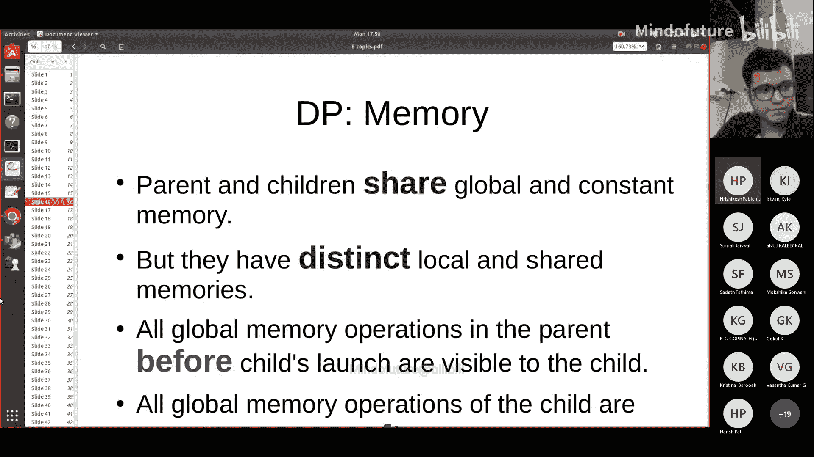

Some question because guys stuff。Persec may happen when other warfares is still in the。

T may happen when other markets。Okay， yeah， I mean， prints can happen in any order。Yeah。

 that is why we have this arbitrary jumbling in that example。So， I hope that。

Example was clear in case you have any question further， I mean， questions further on that one。

 then please feel free to us。

In fact， if you people have any questions after this point， then please feel free to ask till this。

This slide。I'll probably wait here for two seconds and then we'll move further。

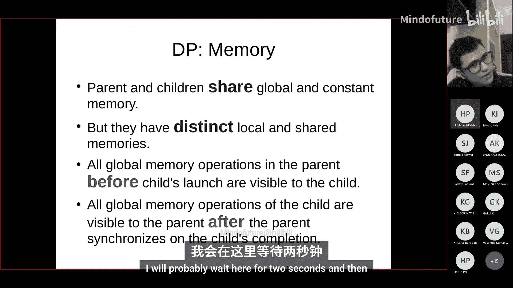

To the multiG crossing。Any questions up to this point？我啲诶。Dynamic parallelism part。

Okay， that is the I mean， if you have no questions， then let's move further。Okay。

 so let us now discuss multi pressing。So first of all， why do we need multich processing because？

I mean， answer to it is quite trivial that if you use multiple GPUs。

 then well have naturally we'll have more number of courses and since we have more number of courses we can。

Accelerate our computation further as well as since we have multiple GPs。

 we'll have more memory also， right？So when we put all the GPUs together， we'll have I mean。

Thats a4 and if if you have some。16 but I mean， 16 J off memory then we have 16 four， which is。啊。

64 g of memory right so that is an added advantage that we have more memory as well as more competition so we can。

S sorry scalear algorithms for。Larger inputs， I mean， not scale， but。

T run our algorithms for the larger inputs。So。Yeah。

 that is one definite advantage of having multi GP processinging。

And one point that you should note for this multichpic crossing is that。啊。I mean。

 we might be able to do multiple CPU GP handshakes， but when I mean， we sorry。

 we might be able to do multiple CPUQ GPQU handshakes when we have multiple GPUs。

AndBut the question is， will it suffice， I mean， doing multiple GP CPU GP handshakes？

will surprise when we are， I mean， we are trying to transfer data from CPU to JPU。So okay。

 so I hope that you are understanding this point， that is when we have multiple GPs。

We need to do multiple secureQ GPP handshakes that is。Since okay。

 since it each GP will need some data to process， we need to do。

Data transfers from CPU to GPU right so we need to do some CPU GP handshake。And。

The question here is that will it s， so the thing is that。

Cp is a I mean CPUU works serially right so we need to transfer data to GP 0 GPp1 GPpU to JPU3 serial and this might cause I mean this might create a bottleneck so we need to use some parallel parallel。

CPU library like OpenM or something to parallelize the data riser between C and GP。

They might use multiple threats to transfer data from GP to CPU to GPU0， GPU1， and so on。So yeah。

 we need to take care of this multiple GPU， CPU GPU handshake and。For that we might use， I mean。

 we might need to use parallel。Thats at the CPU level etc。Okay， so I hope that is clear。

This is a typical。Diagram， I mean， fortypical CPU GPU kind of。啊。Sorry。

 this this a typical diagram showing showing the。CPTQ呃。archrchitecture or multi GPU architecture。

 so we have this central CPU and it is connected here with four GPs。

And the point here to observe is that。When we have this kind of architecture or when we have this kind of sector。

What we might need to do is we might need to transfer some data from GPU 0 to GPU1 or GPU 0 to GPU3 and so on。

And for doing that， it be it might be easy if they can do it directly from GPU0 to GPU1。

But that functionality might not be available all the time。

 so if you see here this GPU0 and GPU by GPU1 are placed inside the yellow box。

So they can say that this GP GPU0 and GP21 are having peer access so that is they can access each other's memory directly without contacting CPUU。

But that is not the case for GPU0 and GPU2， so if they want to contact I mean。

 they want to communicate some information each with each other via Imin。

If they want to communicate some information with each other， then they have to do YSC。

GpU0 will transfer data to CPU and then CPU will transfer to GP2。So yeah， so that is one point。

 so data transfer can be done across CPU2 is one is that using ER access that is directly from one GPpU to another CPU and another is via CPU。

And this second way is slightly costlier than first wave。

There are two steps in world right from CPU to GP to CPU and then CPU to GPU。Okay。

 so I hope this one is clear， this diagram is clear。Now let us move further。

 so in general a CPU may have different types of devices that is with different compute capabilities so you might have a CPU。

Which is attached with multiple， different。Sorry， which is attached to GP having multiple different compute capabilities。

Your CPU might be attached with one Keplular GPU， one voltage GPU， one MP GPU and so on。

 and that is perfectly fine you will be able to program all of them and without any issues actually。

So yeah， and the one point that you should observe here a note here is that。

All the GPUs which are attached with your CPU are nicely numbered from 0 to1。

 so let's say if you have four GPUus， then they will be number from 0 to3。And yeah， and the。

Standard function。Or this standard API to set a particular device is the sca set device。

 So whenever you do this。And I mean， all the statements that comes after this Ho asset device I。

 so please note that this I is a device number so。Let us say that you are having four GPUus from 0 to 3。

 which were number from0 to3。And if you do this could asset device of one。

 so you are doing code asset device one。So you are setting device，In some sense。

 you are setting GPU1 as my current GPU on which I would like to perform the person。

So all the statements that will come after this code asset device one， I mean。

 this code asset device statement。Will will be executed on the GPU1。

 I mean not all these statements but the statement statements related to the GPU so let us clarify this with example。

So please note that this there is here this quoa set device， so I' am setting my device as GPU0。

Then comes this kernelnal launch now since I have set the device0 Im okay I'm setting the device0 so my current GPU is the GPU0 so next statement that comes after it is cardnal launch so this kernelnal launch will now go to GPU0。

Since I have multiple GPU， I have to set this I have to do this code asset device。And by doing that。

 what it ensures is that this mean this kernel will now be executed on the GPU0 and this data copying using quodaM copypy will also happen across CPU and GPU0。

Now in similar manner， what we can do is we can set device quota set device as one。

 that is I am marking now GP GPU1 as my current GPU。And then I'm doing kernel los。

 so this kernel k2 will now go。I mean， now push to the T one。

Please note that this cuts1 sorry K1 was pushed to GP 0 K2 is now pushed to GPp1。

And then we are again doing quoda Mco that is stopping data from GP1 and CPU。So I hope that is clear。

That based on this Q asset device， whatever are the next statement after it。

Then will push to the appropriate GPU。I mean， if they are associated with GP in some sense， then。

Okay， so there is something wrong with this code。From the parallelization perspective。

 and I want you people to think about what is something that is wrong with this code。

IPro work with the chat so that。

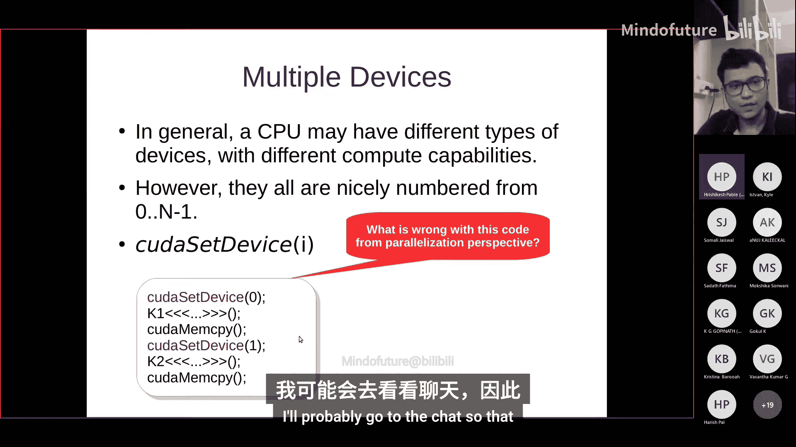

The go is saying， oh， is this why we need device to device and then go？Okay， I'm not sure about it。

 but I think this device to device is about。Copyping from device to device， I guess。

I haven't used this thing much， so I'm not the 100% sure about it。

 but I think it's related to this multidisciplinaryu thing only device device。Yeah。

 but I need to check this one。

Okay， any suggestions about this thing？

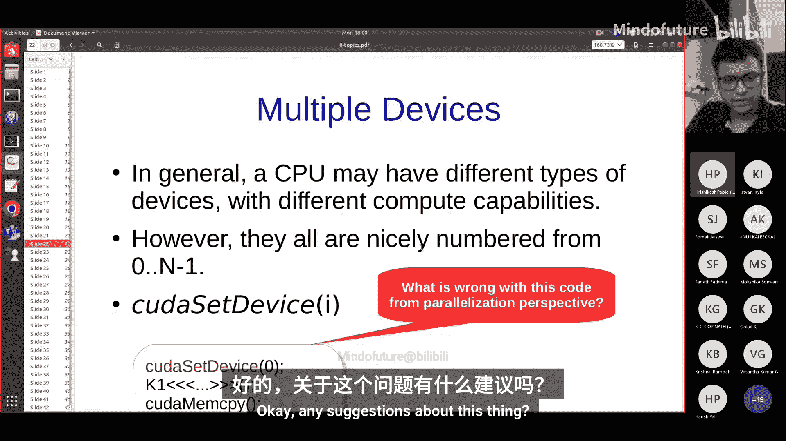

It呃。That what is wrong with this code from parallelization perspective？Any suggestions？

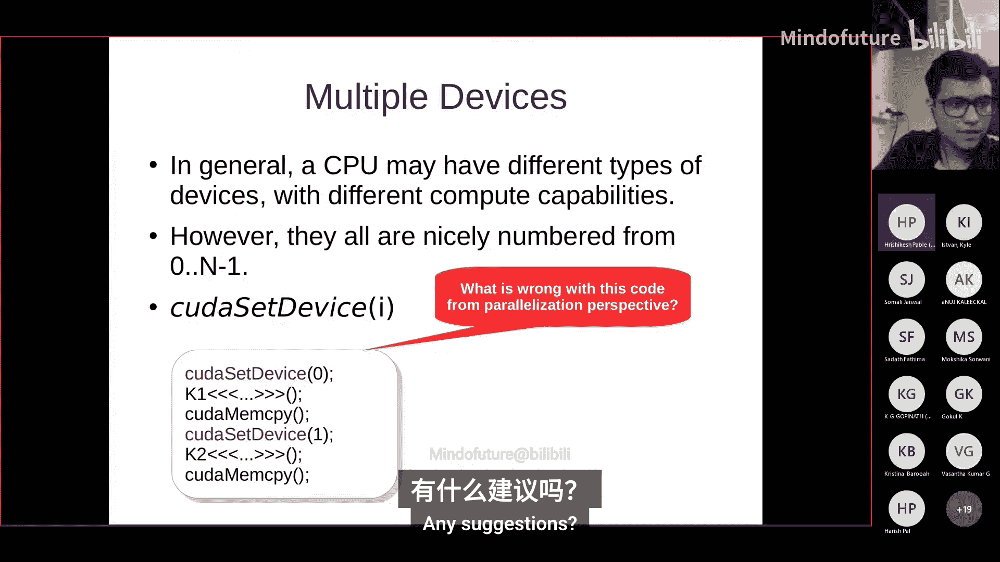

ok 啊。

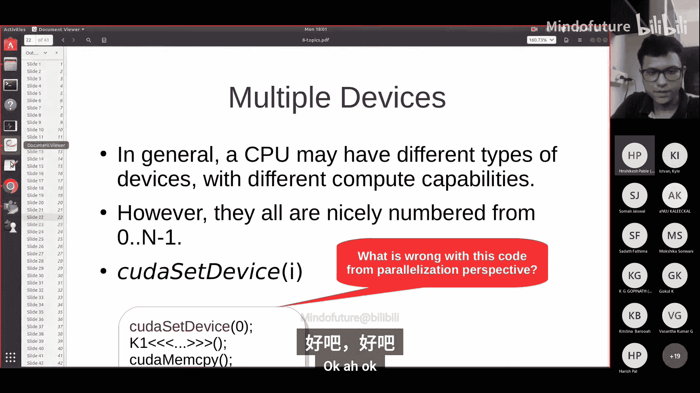

Okay， so that is some， I mean。Let us understand what is wrong so。

Since this quoda M copy is blocking we know that this quoda M copy is blocking right so since this quoa M copy is blocking。

 what will happen is。This kernel launch， I mean this K1 kernel will be launched will be executed on GPU and it will be I mean CPU will move on right but it will wait at this quo M copypy it won't be able to go further to this next statement quoa C 1 and launch will be able to launch K2。

So the issue here is that because of this quoda M copy， what will happen is that K1 will be launched。

Then0 only K2 can， I mean， K2 can be launched so this。

Execution of K1 and K2 will be serialized and if this execution is getting serialized what is used of I mean what is the use of having multiple GPUs right if we are executing them one after the another only then what is the use of the multiple GPUs。

So in order to make sure that this K1 and K2 can be launched simultaneously we need to replace this quoam copy by quoam copy I saying that is this kernel launch will happen that is then this K1 will be executed on GP20。

Meanwhile， what M company is also happening。CPL will move further， it will then go to this statement。

 it will send the device to1， and then it will launch the kernel K2。

So now please note that kernel K1 is being launched is being executed on GPU0。

 kernel K2 is being now executed on GP1 and these two things are happening simultaneously。

Because of this non blocking nature of quoda and copying。

So C2 can move on inevitably launch kernel K1 and K2 I one after the another。

 but the execution can happen simultaneously so K1 is executing on GP is0 and K2 is executing and GP1 at the same time。

So I hope that is clear that we need to replace this mam copy like mam copy I to make it done blocking。

Okay， so let us move further。So yes， so let us come to some APAs that are available for multiJp crossing。

So Puak device count will give the number of devices that that you have on your current question and this and sees some variable and we are passing address of that variable and what it will do is this APIP will give the I mean it will place that I mean place the number of device that you are having on your current question in this variable C。

In the similar manner we are having this Qa device can access peer APA。没去。Says that， I mean， I mean。

 which。I mean， it checks whether it， I mean， it checks whether you can。

Access GP from to GPU2 that is this prominent2 or two numbers is noted at this。あ、実さ呃。

Indexed by the numbers。 So as I have mentioned here。

 the each and every GP is numbered from 0 to n -1。 So this from and2 are just numbers， so。

Let us take an example。K our device can access here and then there is some boolean variable and we are passing the address of that boolean variable can。

So and can and then for from into where we want to check if。

From device1 we can access device two from so here we'll place one and here we'll place two and if this is possible if we can access device。

2 from device1。Then this scan variable will be set to true by this quo set producta device can access PF APIPA and。

Yeah， so that is it。 And this thing， I mean， this APIHX can be can from device access to device。

 That is what we want， I mean。That is what it will indicate in this scan variable。And if， I mean。

 if the。I mean， if the excess is possible， if the PR access is possible。

 then we need to enable this PR access using some API cord quoar device enable PR access and then again it it has some variable peer and then pro 2。

诶呀。So one point that you should note here is that at hardware level this relation that is pro and2 orsymmetric。

 so if you can access device2 from device1 then it also means that you can access device one from device2。

And yeah， so that is clear from hardware level， but from programming level。

 there is assymmetricmtic right here we are what we are。

Assuming this set from and our I mean from and2 is different and to and from is different。

 so if you want to check if you can access device，One from device2。

Then you should place two here and one here and check what is the value of Ken。

 but since at the hardware level that is symmetry， you can assume that that will be also true if you can access vice serverrs right？

So I hope that point is clear that at hardware level there is a symmetry， but at software level。

 there is a symmetry impose I mean enforced by this APIs。Yeah， so yeah。

 that is one point and the next point is set。Maximum eight pair connections can have。

 I mean a device can have it maximum of eight peer connections so a particular tip can be connected with each other。

Cheap use and yeah you will make 64 bit applications for it。Yeah。

 I hope that this slide is clear and this APIs are clear。Probably we'll move to the next3。

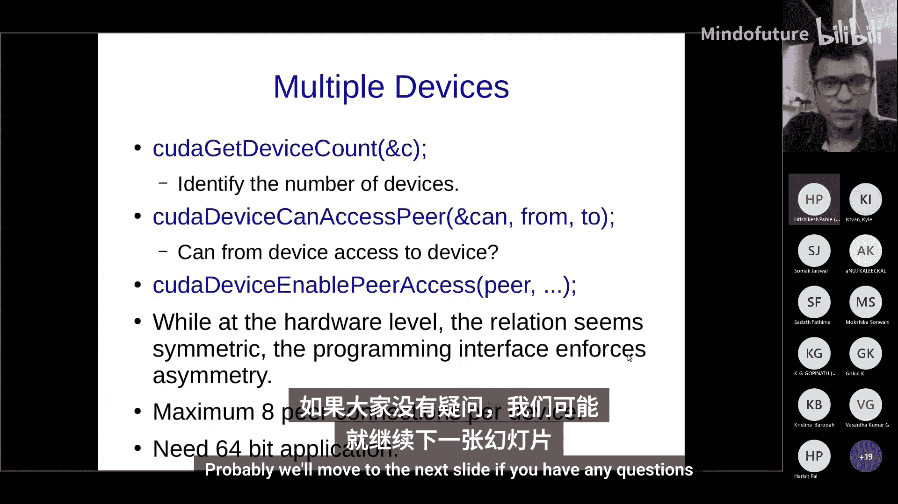

詳申請。啊O，好 that is celebration。Sir is it clear to ever not locking on？Bing on G2 perspective。

 how we achieve on blocking in multiple CPU calling GPU。ok 啊。Okay， this part。

 I'm not sure about how to avoid okay， when you are。啊。

Talking about multi Im assuming that you are using some P threads or open MP and I'm not sure if in that case there is。

Some notion of blocking or not， blocking or not。 So I'm not sure if。

When one thread is launching some particular kernel， let's say you are having Open empty code。

 which is running mean and inside that you are having kernel launch。

And I'm not sure if after the kernelal launch， that particular thread will be it or not。

So that part I'm not really sure about， but I need to check this part。Okay， so yeah。

 I'll say that I'm not clearly， I mean， I'm not really sure about because I have not tried testing。哦。

Yeah， so let us move further。

Yeah， so first of all， let us see this small example。Related to this。Printing the。

 I mean enumerating each and every device that you have on a particular machine。

So here we'll use the API that we learn， so we have this variable device now。

And we are counting the number of device that we have in current machine using this。Yeah。

 this could coulda get device count the API and we are passing this device count so inside this device count well get the number of device that we have。

And then we are using this variable device and as a looping variable and then we are looking at for the number of device that we have on our machine so from zero to device scale we are loop and what we are doing is。

We are using， I mean， we are declaring a variable of type quoa device prop which is nothing but a structure。

And once we are declared the variable of that structure type， we are passing it for this。

Could I Act properties。And we are passing device number to， so for this device number。

 we are interested in getting all the properties of it。And then， we are printing some。32。

Properties related to this device like device somebody we already know because。Yeah。

 device number you already know。We are printing some properties related to like its major number and minor number。

 we just hold in this device prop variable， which is a two device prop type。Okay。

 so any questions up this point else willll move to the board voting quickly we'll finish that。

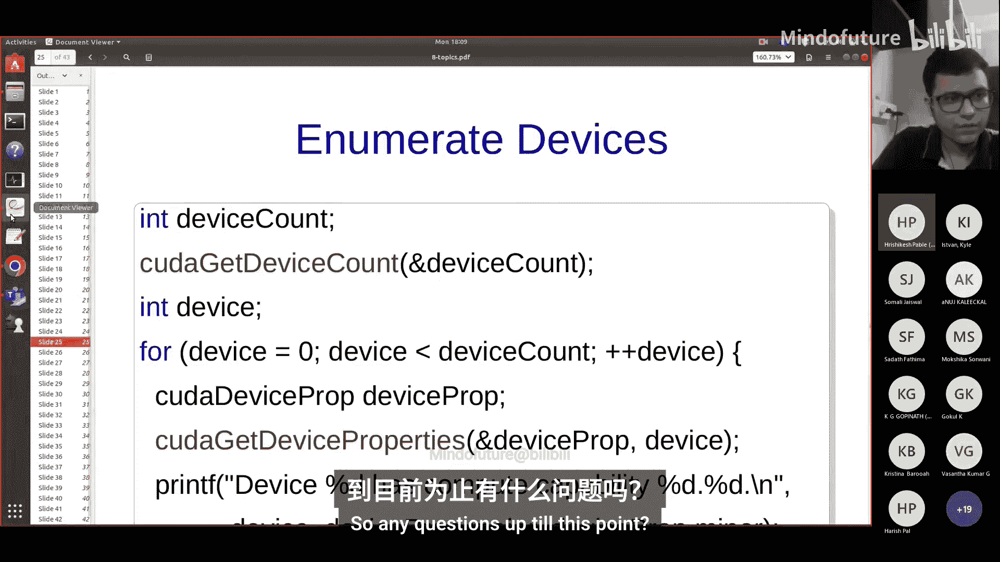

Yeah so I think that that。Yeah， for this question， we need to definitely check if。

How the CPU threats work internally like， are they blocking or non blocking？As far as I know， like。

In open MP， there is no notion of， I mean like simply executioner so so I' am measuring that you will be able to。

Do multiple copying simultaneously without any issues。But yeah， I mean， someone， I mean。

 someone should check this thing that。Whether we are able to do it smoothly or not。Anyways。

 let us move further with。

W working。So。Okay， so。Sometimes we might be interested in doing some operations like。Okay。

 so sometimes you might be interested in doing the operations where we need the entire walk to operate on a particular data item。

So let us say that we are doing some graph computation I mean we are running some graph algorithm and the operation that we are doing is like we want for each node of that graph。

 we want to traverse I mean we want to count its neighbor or some we want to go through all its edges now the number of edges that a particular node might have varies right it varies greatly like for some nodes they might have large number of neighbors let's say 102 204 for its neighbors they might have。

And for some nodes of the graph they might have just two or three neighbors in that case for a node having large number of neighbors。

 it might be good to assign an entire walk to it rather than assigning a single threat to it。

And whenever we are assigning the entire war to a particular date item。

 we might be interested in doing some。Some properties or some conditions related with it related to that one and that is where this wart protein comes into the picture。

So， that a。This呃。Functions like underscore underscore， all， underscore underscore。

 any underscore underscore ballots。which are used for checking a particular predicate I mean which are used for checking if a particular predicate or a particular condition is true or not for a particular one so this underscore underscore and sorry underscore underscore all function will check if all the what that satisfy a particular preor or not so this predicate is like a condition。

And what this underscore underscore score all does is。

It check if this condition is true for all thevoters or not。And if it is true。

 then it will return some value。That is， I mean， if it is true。

 then it would return through for all the work。And。Then there is this underscore underscore any。

 but check if this predicate is true for any of the war threads。

And if any of the boxford satisfies this predicate， then it will return true for all the boxoxford。

And then there is this underscore for ballot and what it written。

 what it does is it checks if this predicate is true for Ammin。Now sorry， yeah。

 so this unpo disc ballot checks it how many， which war threads。

 not how many which warlet satisfy this predicate。So， based on the。

Ts which are satisfying this predicate， it will return some return value see how to。

 I mean what it will return and so on in the upcoming slides。And yeah。

 actually this ballot is just a generalization of all in any。Okay， so let us。

See these things with example。So yeah， so this is our quota program， we are launching it with。

4 ws actually 10 to it is， I think four opide particles 6196 and12 it 1。30 so four ws。Yeah。

 we are launching this kernel with four words。And then we are having quoa deviceyise and inside our kernel what we are doing。

 we are using this all predicted。And we are checking with thread ID extra X is less than 100 or not。

 if that is the case， I mean， for which work this condition is satisfied。Well。

 we want to check this and this we are using this underscore underscore all function。

And if all the thirds of the word are satisfying this condition， then the return value will beroll。

And then one of the representative of I mean， you pick one of the third as a representative of the one。

 which is the qua of each one and then we print this value of one so request to do。

Try out what will be the output of this。Okay， please。

Type in the chat or you can also unmute yourself and tell what will be output on this program。

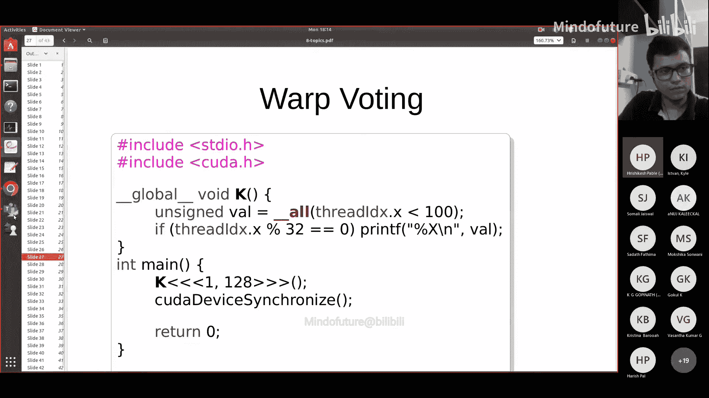

Any suggestions？

On what will be the output of this program。Theport true values。Okay，4 true value。 someone suggested。

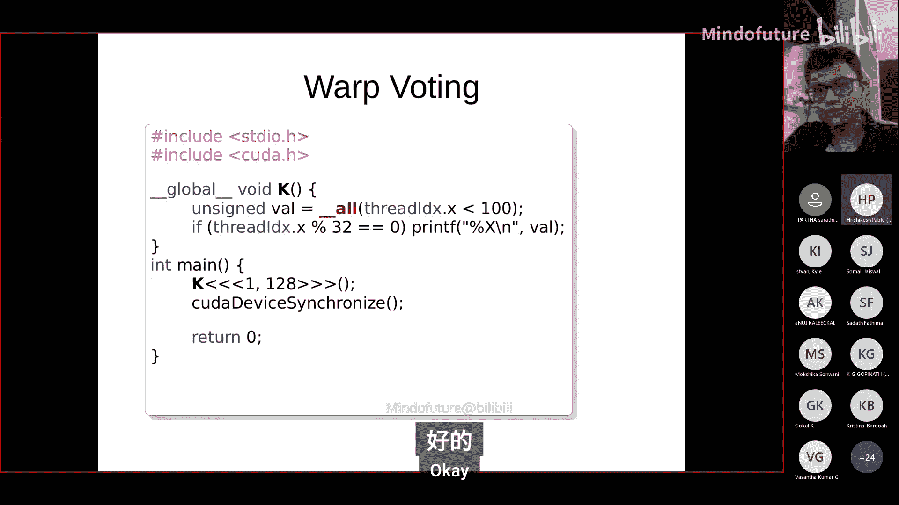

Okay， go saying throw， row， through false。

Okay， I think this is correct。Let us understand this so for ver number01 sorry for war01 and 2。

This is to right because for this condition， this thread ID extra text is less than 100。

Its true for the threats from 0 to 31， it is what number 0。322 6p。

 which is Wp number  one and 64 to 96， which is Wp number2。For all these threads。

 this thread ID extra text is less00， which is true for all the work threat。

 so this all will give true。For the warp 0，1 and2。But for the what number three。

Which contains the threats from IT 96 to 127。Only first four threads I guess will have this condition as true for rest that condition this condition will be false and since that is the case this fall。

Will return， I mean， will it return false for that last work right or these workp number three。

 assuming that wars are from0 starting from0。Yeah， so so they are good be。1，1，1， and0。

 or you can also interpret as true， true， true and false。Okay。

 so I hope this is clear now I have just made a small change， I will replaced this。

All with any now what will be the output of this。Program quickly， I mean。

 that would be very personal for you。Very easy for you people now。

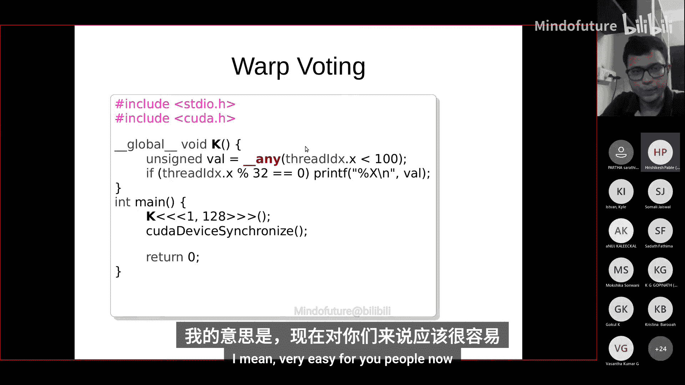

Yes， so yeah as Gole is pointing out it's all true now， yeah so let us quickly see this thing also。

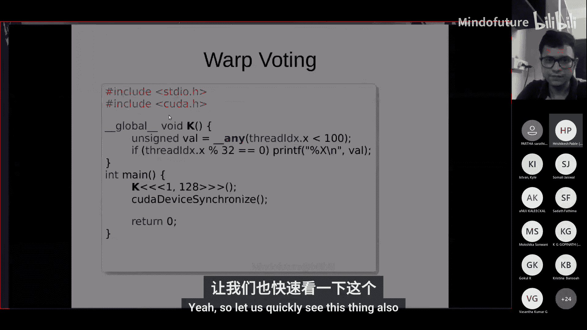

So since now for the last so okay， so for first three words it is definitely true right。

 but for the last work now。Since past four threads of that last war are now satisfying that condition and since we have any so。

Since any of the thread of that last work is satisfying this condition。

The final output that will be stored in well will be one， so the last one will I mean。

 so the final output will be one even for the last one。

So I hope you are getting it for the previous case it was。All and hence it was zero。

 but now since it is any it is one now because at least one third of that last work is satisfying this condition。

And had6 one。So I close， that is correct。Now let us come to this ballot thing。So what。

What this palette thing suggests is this palette function suggests。It tries to。啊。I mean I mean。

 it tells us which threats of this what satisfy this condition。So， this condition， I mean。

 which threats of the work are satisfying this condition and based on the threats that are satisfying this condition it will set the value 1 and0。

 so let us understand what will happen here。So。Qu the first word。

All the threats will satisfy this condition， right？

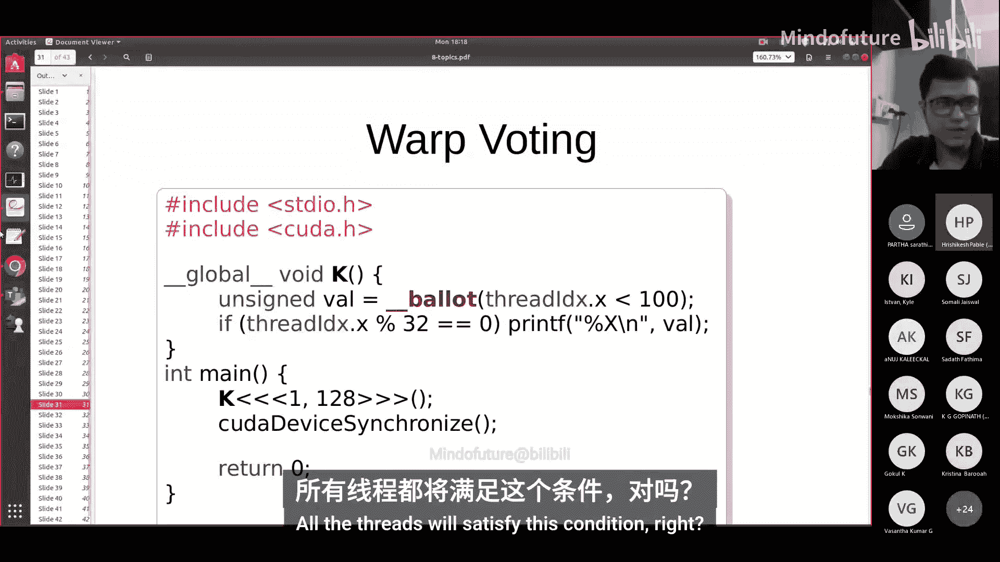

What this pal will return is。It will return all once。32 times。For the password。

And similarly for all the work， second work also and third work also。So for board2 and3。

 also this it will return 1，1，1，11，32 times。And for the last work， what will happen。

 so I'm talking about last work now。For last word， what will happen is since only post four threads of the lastword satisfy their condition。

So it will return 1，1，1。And for rest all， bit set will be zero， right？So last quarter at once。

Last four bits are one， one and rest quality MS bits are zero for the last one。

Now it won't print this thing， it will print the hexardationimal format for this。

So hex are aimal format for this all once 32 times is nothing but。This thing， right。

So if few people know the exactx Eal representation then。F is nothing but I mean。

 F is nothing but this， right？

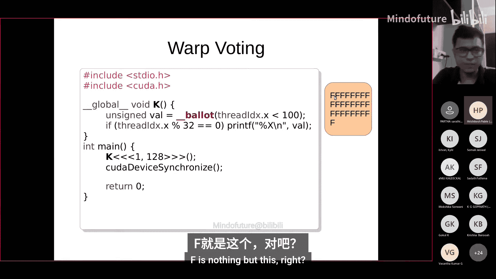

F in Hxard asimal。Ex asmalF is nothing but。Thiss 1，1，1，1。And since each war has32 threads。

32 divide by4。There's nothing but eight。So for each one， not for each one， but for first。

First three ones， eight apps should be printed， right？

For first three vers， eight apps should be printed and that is what is the case right first for W plus swap we have eight apps printed for second verb and third drop also seen eight apps are printed。

And for the last one， if you see here。

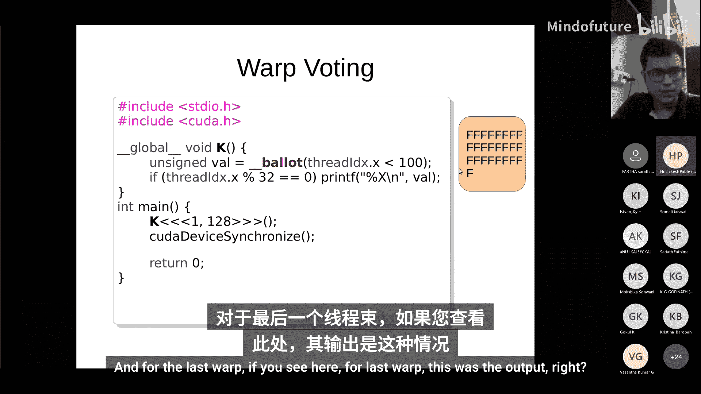

呃。For last swap， this was the output right all zeros and then last four were one， one， one。

 one last four bits were one。So if you see what is the exact assembled presentation of this。

 it's just single F right because。Lading zeros， I mean。Leading all bits are zero， so。

That won't affect the final value and。The actual number is just this last four weekss， which are。

Wwhich are four right I mean sorry which are four ones right and in hexile asim it's just an f。

But in last form， it will just bring that。So I hope you're getting this and let us move further from this。

And in similar manner， if I replace this。啊。Condition here。

 the condition was third ID x dot x less than 100。 But if I replace it with third Ix mo2 equals to 0。

And all odd threats will satisfy this condition。 Sorry， no， all。Even threats， I guess。

 or even threats will satisfy these conditions and or odd threats will not satisfy this condition。

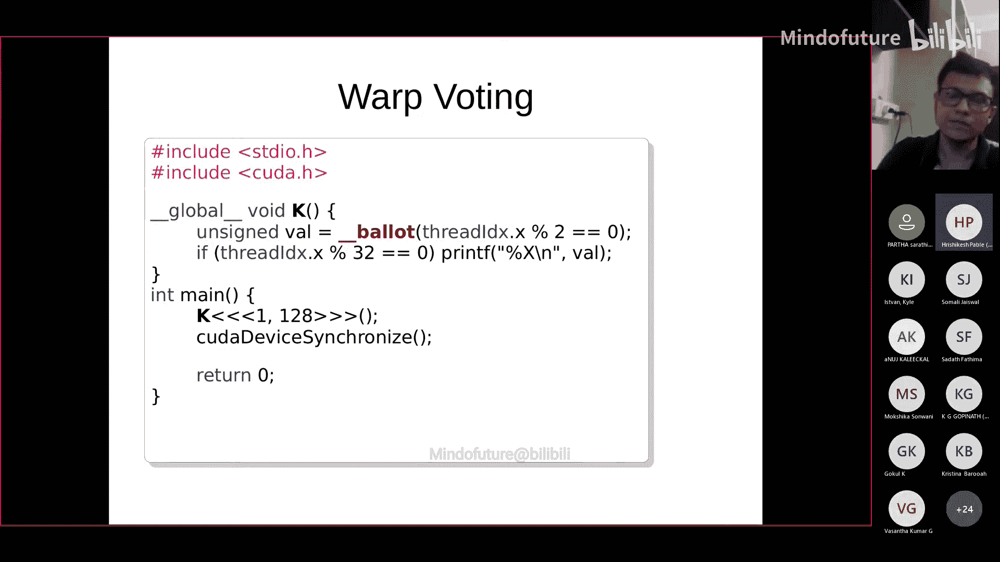

So output will be something like this。For thread zero， it will be1 for thread one it will be  zero。

 for threat2， it will be1 for threat2 it will be0 and so on。This will go on。 And if you see。

If you find the exact assembled for this pattern， it will be nothing but 5，5，55，555。printed8 times。

 so 1234567 m， so this will be the output for one1。

And this will be this output will be seen for each and every word I in all the four works now。

 because here our condition is not something like this less than 100 its。

This thread ID X X mod2。And。Yeah， so I hope you are getting it so you will get all。Fes， I mean。

 eight files for each one。A5 for each of you'll get and this will be the output of this program Any questions up this point。

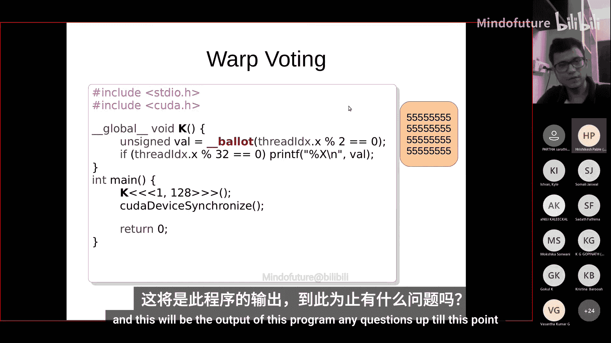

你啊。咁ma some has type something。Okay， what， I mean， for what is。What question are you。

Suggesting this output Rammaamiami。No， for that four works。Like all ones followed by sorry。

 all zeros and the last eight bit is last four bit is one。 that's what I get Yeah， yeah。

 that is good。Hopefully， think if we have a ballot of。Sorry， if you have a ballot， 00。

0100 can be issued。Tread Is。3，4， seven are satisfied。 Yes， that is precisely what will happen。

So it is it will be go from I。The thread ideas will go from the significant bit so this last bit is part thread  zero second last bit is part thread one and so on so yeah this one is for the。

开的。0，1，2， three， yeah that is correct， so  three， four，5， six，7 the other this is correct。So yeah。

 precisely this three four and seven threads are satisfying this condition。Okay。

 I hope this part is clear Google， if you feel I miss something then you can and ask。

Okay， so let us move further from this， let us finish our discussion with this war of voting。Okay。

 so。They can in general combine this war putting and atomic tool。

To efficiently to do atomic operations， so let us see how to efficiently do atomic operations by using this work coat。

So let us say that you have this condition， I mean， you are doing some atomic increment。

 so this is an atomic increment you are doing。Or some variable counter。Based on some conditions。

 so if this condition is satisfied， you will incrementally counted by value。

And this is what we want to do and what will happen is this will be executed by many of the war threads。

 right， assuming that this condition is true for many of the warfas。

This atomic increment will be executed by many of the authors， but not all。

 let us say out of 32 authors， 20 were having this condition too。

 so they 203s were doing atomic increment。And rest threads were not doing anything， but yeah。

 203 were implementing it。So the problem with this type of approach is this type of code is that it has high contention that is。

20 atomic calls are being made right and that is quite costly let us say that 20 I mean 20 grids 20 officers were satisfying this and 20 times atomic is being called。

And hence， there is high contention。But we can optimize this thing by using palette。

And let us see how to do that so for doing that what we' will do is we we will choose one thread as a leader thread。

And well collect the workcom by using palette， so we know that palette gives us a thin mask or。

 right？They have seen this right the ballot gives some indication that which thread is satisfying a particular condition。

 so we will calculate a mask based on some condition。And。I heard呃。

Calculating that mask will set how many bits are set I mean。

 how many bits are set in that mask by using some popxy function。

Popy and then providing some mask to it。Will return the number of sack pits inside this mask。

And yeah， so these two functions will be used to implement this this statement efficiently and we'll see that in next slide。

And the apart from this two function， there is this underscore underscore FFS function。

 which takes mass and returns the cost set so if let's say the。Yeah， first headbit from the LSP。

 so from LSP， let's say that third bit was the false head and it will return three。And。

Yeah and how will do that atomic I mean this statement I mean how will we optimize this statement is that only leader will perform a single atomic at and that will reduce the contention that is we are not doing atomics I mean we are not calling atomic function 20 times we are just calling it once and that call will be done by the leader。

Now， let us see how that is being done。So this was the original code that we wanted to optimize。

Now we want to optimize this using ballot and propps C that we saw in the previous slide。

How can we optimize it。So。This condition， instead of doing this thing。

 what we'll do is we'll write this condition in pal。

And what will what will this thing do is it will give us the number of heads that are satisfying these conditions。

So we'll get I mean we'll get the mask based on it right。

 so nexts say 20 threads were satisfying that condition。

Then in this mask that 20 bits will be set to1 and rest all 12 bits will be set to  zero。

So this mask will be having。Inter living of 1010 and 21 will be there and 12 zeros will be there。

Now we are taking one， I mean， we are。Picking up one thread which is thread0 as the leader。

 so thread IDX do x mode 30 to 0 will pick up0 thread of warp0 s leader 32 thread of warp 1 s leader and so on。

 so we are taking one thread from each work as a leader。

And what that thread is doing is that it is just doing one atomicmail。 Please note that and。

It will that leader thread will。Take a lead of adding that final value in the counter and the way it will add that value in counter is that it will count the number of set bits in in this mask。

 so by using this popy function it will come to note that okay 20 thirds where。

The threads which were satisfying this condition， which was this so 20 threads were satisfying this condition and since only 20 threads are satisfying the condition I only need to do 20。

20 times this a， Imin。I only need to add 20 numbers to this counter and that I can do just by doing one atomic a。

So I hope you are getting this initially。The 20 thread were satisfying this condition and this atomic increment was being called 20 times but now。

Only just one atomic call is being made and that is using this。下明。That is using this， and I mean。

 how we are counting this。The threats which are satisfying this condition using Tot and proppsy。

And I hope that this is clear that here 20 atomic calls were being made and here just one atomic call is being met and that too by the one way that that we are taking from each one。

Any questions up to this point so this is the more optimized code I hope you are getting this here only one atomic call is being made by one readerer。

And here。The number of atomic calls that will be made will depend upon how many third satisfy this condition it can be one。

 it can be0 it can be。Even happy to in worst case。Okay， any questions up play this point？

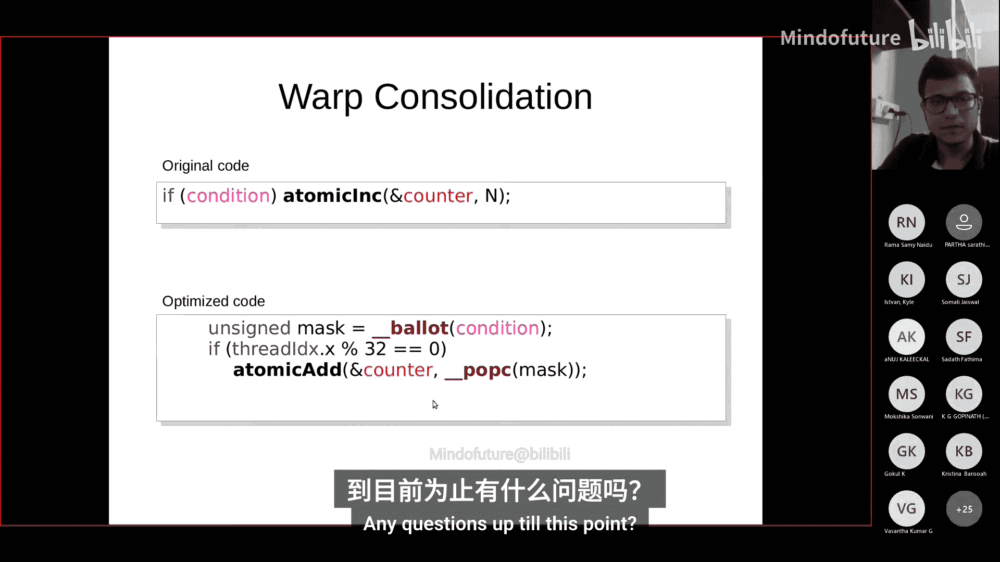

Could you explain how one atomic call again。我口稳。Atomic part again， andpsy or。s边。

I don't understand this， but have one at column。Okay， I'll explain this Poy。

And there is other question also， can we use multiple masks？啊。Okay。

 can let us come to this question also。

Okay， so啊。So this proppsy function is nothing but it counts the s inside this mask。

So what this ballot does is it based on this condition， it will set the bids。

I mean set the 32 bits right so let's say we have 32 threats， I mean 32 work threats and。

Based on whether this condition is is being satisfied that sorry is being satisfied by satisfied by a particular website or not。

 it will set those。Bits inside that 32， I mean， it will set the bit inside that 32 bit。

Binener number， right and that。And that the entire thing forms a mask and what proppsy does is it just counts the number of set bits inside that mask。

 so I hope that the particular that。

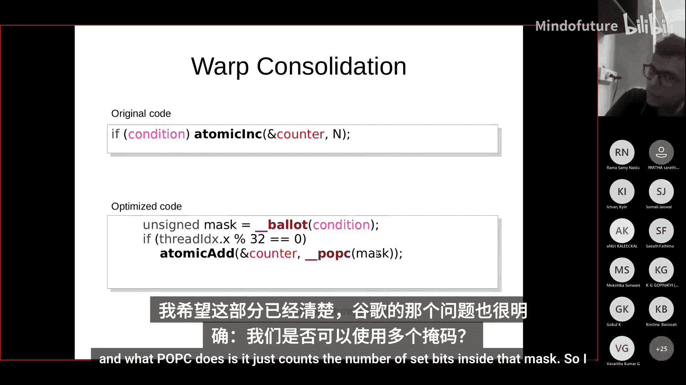

Question by Go is clear。And。Can we use multiple masks？

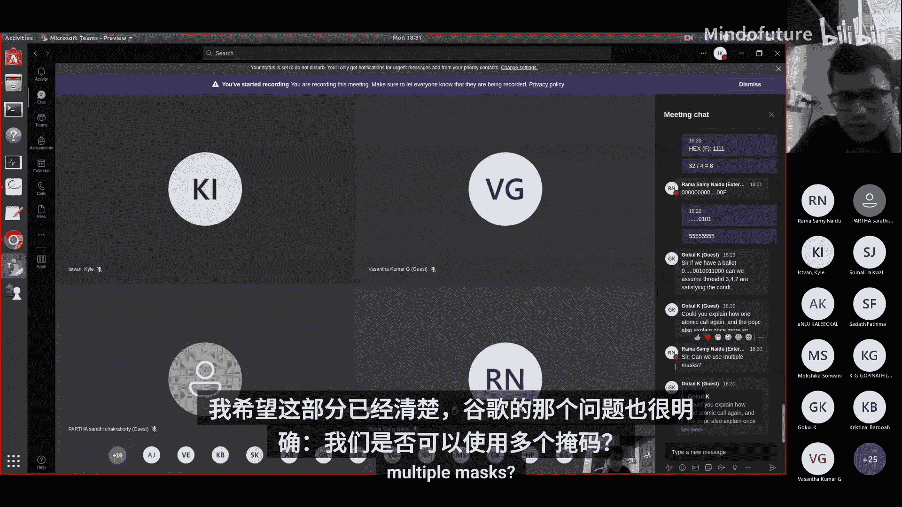

后边啊。Okay， this pop will take only just one month。But。You can definitely。

Find the multiple masks right so what you can do is you can use ballot multiple number of types and sorry multiple number of times and you can just keep on finding different types of masks based on the different types of conditions so I hope that you arem。

你个都。诶， probably诶。

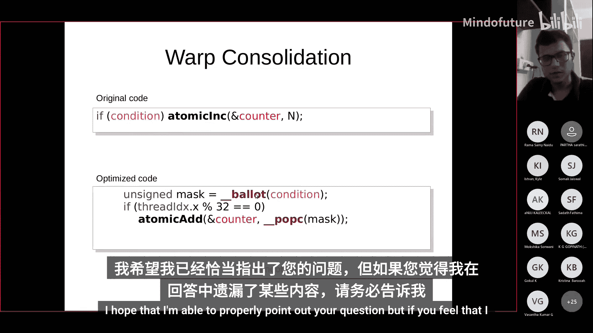

I out a question， but if you feel that I missed something in your question。

 then please do let me know。Yeah， that's fine， actually I was worrying for one condition how we can use multiple moss。

I have only one condition to be satisfied。But then I want to use different mass sets。Is it possible。

 I was wondering just a gay question might be。

Okay， you have just one condition and you want different mask。

 I don't think that will be possible because。A mask can be unique based on a particular condition。

 right， because if you see there is one to one mapping between condition and mask。In some cases。

 I want to toggle between the two mos for the same conditions。I'm not sure how to do that。

 but currently what's going on in my mind is like。Since you are not modifying a condition。

You'll be back with the same mask， whatever， I mean， whatever the case might be。

 but coming to your question after toggling the mask based on。Something I need to unit， I mean。

 I think you need to tweak this code a bit。You have to think about it。 How can you。

Keep the conditions same and keep on changing the mask so you can once you calculate the mask。

 you can。Probably do some operational masks to change the value of it。Paestion。

 what your requirement is？

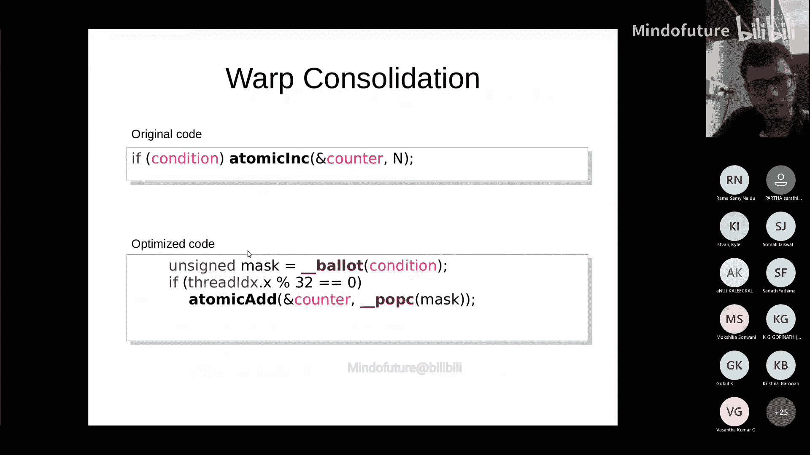

OK到庭。How， how we can only sorry， how we can have only one atomic calling the optimistic Okay let us conclude。

Okay， so see initially， based on what condition was I in。

 how many workers were satisfying this condition？That many atomic atomic calls were being made right。

 so let's say out of 32。W threats， 20 were satisfying the condition。

 then there were 20 atomic increments， right？But here。

Since we are first of all callibcrating the mask right， so this condition is same here and here。

 please note that this condition and this condition is same。And。

This condition being satisfied by I mean， whatever third are satisfying this condition。

 they are calculating to I mean， they are setting the bits。

For those threats as one and that is that information is stored in mask， right？

Now we are only taking one thread here， I mean， out of all the work threads。

 we are only just taking one thread as a representative out of all the work thread。

And then based on the number of increments， I mean。

 based on the number of setbits in the mask we are。Whi we can calculate is in proppsy。

 we are incrementing the counter。So I hope you are getting it here only I mean one increment is for the warp thread。

 so here 20 wp threads were doing atomic increment here only one warp thread that is later that we pick is doing the atomic operation。

That is at。So we reduced the。Number of atomics that are being， I mean。

 quality to the atomics that are being done。

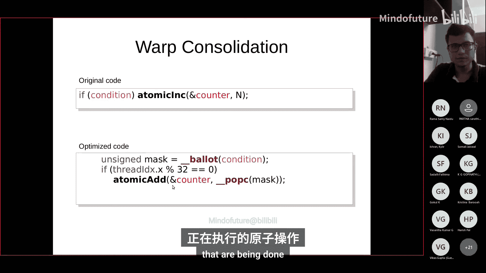

So hope you are getting what I'm going to say。

Okay， I will come back to the questions later， just let me finish。Yes。Okay。

 so I think now it will be very simple part this coming。This code is very simple right now。

We are launching a candle with four watts that is 10，28 threads and。You think。

We are using pilot here and again we are checking that standard condition。

 they provide extra access lesson entered or not。And we are storing the final mask in this unsial well。

And one representative of the mask is I mean one representative meaning the I mean here we are choosing the cost thread of the every warp as the representative so zero thread of the Warp0。

 32 thread of the warp gun。60。Yeah， 64 third of the W2 and so on。

I will print the value and since we have four wordsatts， the four values will be printed here。

And what Pops is printing， the number of set bits and the number of set bits here for the walkp1 will be32 right because all the32 threads of the walk1 will satisfy this condition。

Similarly for war2 and War3， but for war2， only four threads will satisfy the condition。Hence。

 the output will be 30 to 30 to 3 to and4。So I hope you' are getting this。So yeah。

 let us finish this with the last slide 42。And yeah。

 so this slide has some point that I want to derive。

 So if a v puttingtting function is used is executed within the condition。

 so here walk putting function is。Which is ballot and opps are executed within condition。

 Some threats will will be masked， so they。Here in this case。

 even threats will enter or or threats will be masked and they would not participate in voting。

So here only。Out of 32 threads of the war only 16 threads will enter right because we have this condition right so out of  32 threads of a war out of those four ws。

 I mean we were having four wars and each having 32 threads。So for each work。

 only 16 third will add up and similar， I mean， as we saw in the previous example。啊。

All the threads of first walk satisfy this condition the same is true for second and third work。

 but for the fourth walk only fourth third satisfy the condition and since now half of the threads are on the entering。

The number of。Set pits will also be half， so initially it was 32 32。

 32 and4 here now it will be 16161692 I hope you're getting this since only half of the threads are entering。

Here all the threats were written， but here we are I'm introducing the number to half。

 I mean based on if it is an even third or wrong threat。And based on that， we are printing this。

Number of whichs that are set by the ballot function。

And we are counting this a number of setbits using Popsy and then we are printing it and。

The numbers would be 16， 16， 16 n。

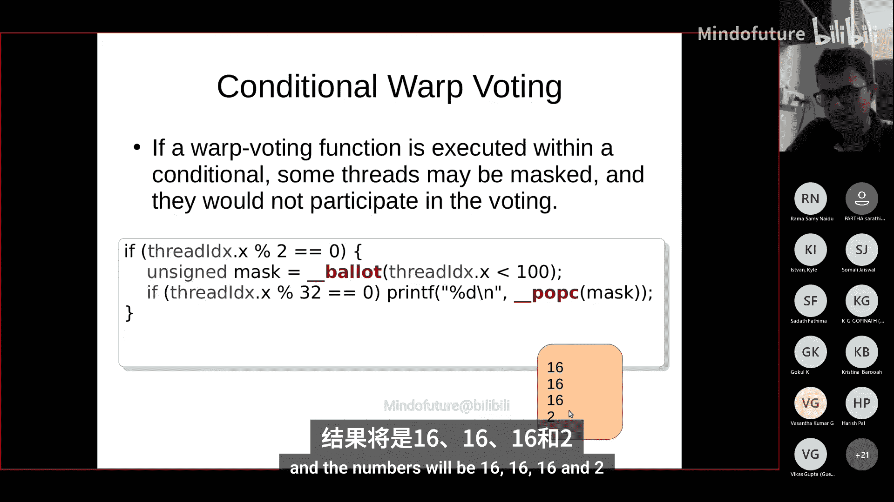

Okay， so any questions up this point I'll be there here for a few more minutes。

 I'll take all of your questions。

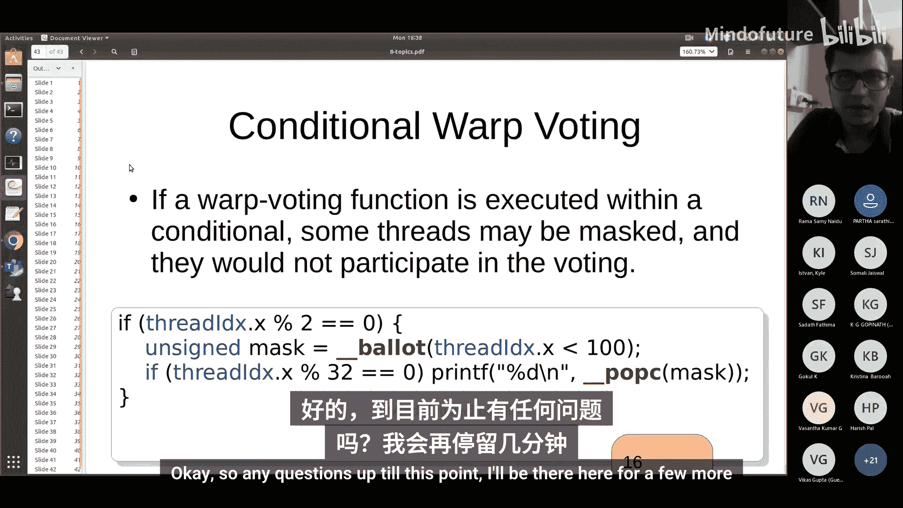

Yeah， so let us come to the questions。I think I answered this question how we have only one atomic colon optimized。

If there was any。I mean， if something was unclear， then please still clear to ask。So in this code。

 we have。We have N sets we are adding end to contact for every。Whatever the events are right。

Which code you are talking about， gocal。

Oh sorryrry sir。 that 1 I get out that I。

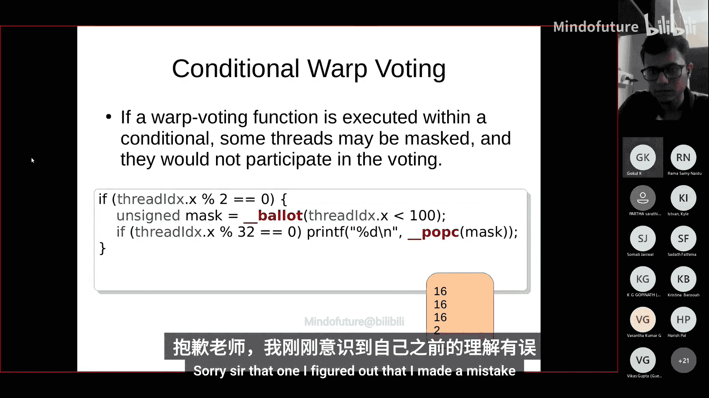

Okay， next thing。Okay， let us come to next question。Okay， that's fine。

So is there any way to get sorry， is there any way to set the arch？

As some members what that can add dragon colour。Okay， I'm not sure about the cola， but。Yeah。

 in need 또 Jack this out again。さとして。So coming to this part。

 this dynamic parallelism I haven't tried on coEC， but on Linuxux machine。

 I mean in the case that you have you are having GP on your system itself。

 then it will smoothly by specifying this。IT it up break go。

啊。Sa。Yeah， if you are having GP in launch on your system， then just doing this thing will work。

 but I'm not sure about that thing and I need to check that out。

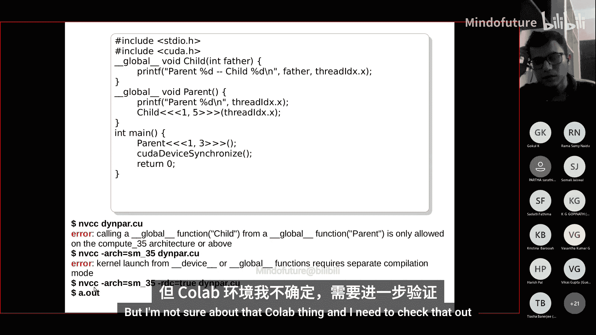

Okay， so this part I will probably look input will。

Poing protect that go group。