# 【Nvidia】CUDA并行编程-｜-Cuda-Programming-Course-｜-Parallel-Computing-Using-Nvidia-p19-P19_L19_CUDA中的多维数组--BV1MSq1BTEho_p19-

Hello， welcome welcome to the last lecture of our QA program。So in the previous lecture。

 we saw things related to the dynamic parallelism， right。

 so we saw how to launch a kernel from the innerner kernel and。

Then we saw multiple examples to T rule， and then we saw the computational memory aspects related to the dynamicic parallelism。

Then we started off with multich program， and we saw multiple APIs for。

Going multiship program and then we looked into work reporting that is。

How to use this underscore and underscore all underscore and underscore any and underscore and underscore ballot and proppsy and dysfunctions which are used for what put there there。

These are examples related to them and then finally we。

So how to do past atomics using this of protein functions and there we ended up I mean that we ended our previous lecture and。

Yeah， so that was the outline for。The previous lecture for the two days lecture。

 we are planning to see this multidimensional a ina。

 that is how to use the multidimensional errors inla。And following that will。

See three use cases for it。 There is three examples for it。So yeah， with this， let's get started。

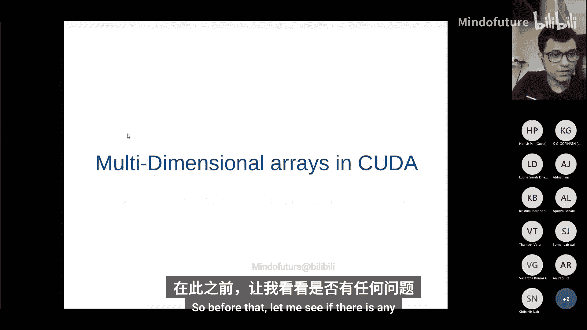

Before that。Okay， so there is no further questions so let us begin。

So let us start with our first Q case， or our first example， which is matrix squing。

So we have already seen this metric querying application in context of。I mean。

 they have already seen this metric occurring in。Computation lectures right so in that using those lectures we saw how to do metrics for。

But if you remember I mean， during those lectures， we are using one dimension vary。For representing。

 for representing a metrics。 And we were accessing metrics like。

We're accessing 1D metrics using this formula to access it in a 2D manner。So， okay。

 so essentially we were not using two dimension or3 dimensional areas or I minute。

We are just using one dimensionary for performing metrics， I mean， for five metrics going， but here。

Well see how to use actually 2D matrix， or that is 2D machine array for performing matrix query。

So we'll see example for that， but let us briefly recap what we saw in that in those computation lectures that is how complement。

This is our CPU application for performing the matrix burn。So。We are I mean。

 we have this function CPU square which takes this matrix as input。

 which is nothing but the one dimensional landing。Which represents the dimension measure metrics。

And again， the result。Aric， which again represents a two dimension matrix。

So here metrics contains the input， I mean， this matrix pointer。

Wwhich points to some one dimensional area contains that input matrix where the result is the I mean uns pointer which points to the final I mean points to the area in which will store the final result and the matrix size is the size of the matrix that is we have 32 cross32 matrix。

And for performing the metrics。Squaing， what we do is we go we have this trip nested loops， right。

 so we go from I。Sorry， B I goes from 0 to metric size G also goes from 0 to metric size。

 similar decay also goes from。zero to metric size and what we do is we do this result of j equals to matrix of K into matrix of kjs。

 but since if you observe here since the mates are I mean not matrices but these pointers which points to some array are one dimensional array。

 we need to access this mattressrices which are result and matrix in I mean we have to access this two dimensional array in one dimensional way right because theyre pointing to the array I mean they are pointing to the one dimensional array。

So this is， I mean this is okay， but let us， I mean， in order to make it more readable to a program。

 let us see how to obtain more。Better way that is by。

That is by accessing it accessing and declaring it in 2D。So yeah。

 but before that let us quickly look at this GPU version that we saw in our computation lectures。

 so here in order to parallellyze this CPU matrix querying the application。

 what we did in those lectures were that we tried to parallellyze this two outer loops right。

It was our。For that we want to paralyze this to our loop and for doing that what we it is we wrote this kernel。

 right？We is spread and。It was launched with N command that is30 where any is 32 so 32 blocks and each block having 32 threads。

And we are passing this matrix result and end is the arguments there。

And what we are doing inside the kernelal， so this kernelal takes this three things as simple。

 which is passed during the cardinal call。And what I do is it calculates the idea using the standard standard formula that we know。

负责这个。

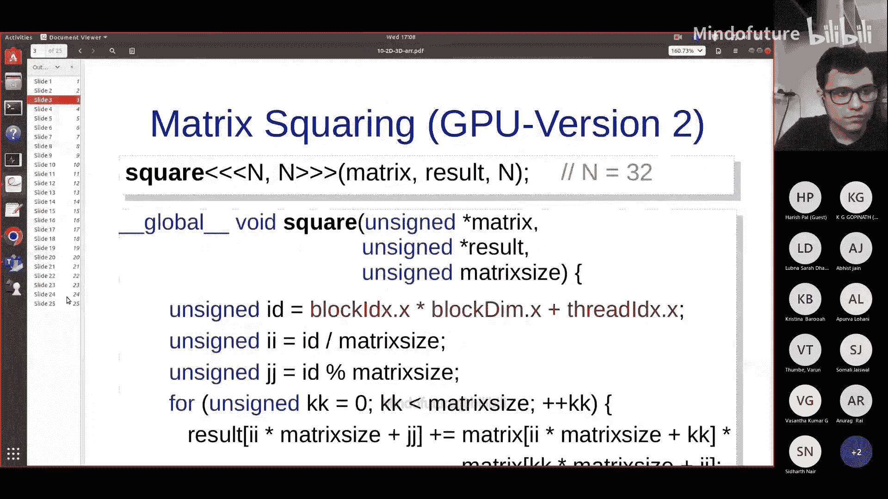

对的。Sorry， is that a question。Hello。There was some。Voice from someone side， if there is any question。

 then please feel free to。Unmute and ask。Yes see。Okay， no issues okay。

 if is if there are no questions， then I'll move that。

So。Yeah， so this is the typical。呃，级标呃， I mean。This is the metric scoring application that we parallellyzized it on GPU。

 so we parallellyized the I and cell loop at the out two loop。And what we did is like。Yeah。

 so we were launching this cuddle with and comment that is。32 blocks there are any 32。

 so 32 blocks and each block having have 32 threads。

And then we were having this standard formula for calulating the ID and ID will go from 0 to 1023 right in this case because n is 32 and n into n is 10 for ID will go from 0 to 1023。

And how I and G are calculated。I and J will give us the unique tu， so when I0 I0。

 II will be 0 and JJ will be 0。And when it is 1， I will be 0， J will be 1， so 0，0，0，1，0，2， and so on。

Until 031 and then 101213 and so until 131 and so on。

 so we'll get unique tual for if you remember from our computation lecture。

And with this unique couple of J， what we do is with this we can aggregate this INJ loop as we have this unique value of our INJ for each thread and what we do is we just now the scale loop and then we perform this regular computation that we are doing here。

That is a result of Ij plus equals to metrics of IK into metrics of Kj。Okay， so so far good。

 I mean so good， so like we can parallellyze this application on GPU。By eliminating this o loops。But。

The thing is we can do it even better， that is instead of。Wriing this， I mean。

 instead of declaring this metricsrices， which are metrics and result as one dimension layer and accessing them as。

Accessing this two dimension data structure in one dimensional way。

 because they are declared as oneD data structures right so instead of accessing this。

accccessing them in this way what we can do is we can actually declare them as a two dimensional matrixes here。

 please note that this metrics and result are just one dimensional areas。And since they are 1D。

 even though we have stored 2D data it， we need to access them in 1D， I mean。

 this manner is I into metric size plus J。Now， what our requirement is we want to declare them as a two dimensional data structure and we want to access them as a two dimensional data structure。

 not like this， not like this in  one day。manneranner you want to actually access them and declare them as two dimensional data structures。

 so for doing that well now see the version 3， so GP version 3。

So for doing that we'll see the quote corresponding words。

 so this code is written across multiple slides。So this is the first light and yeah。

 so let us see how to do this。So。We have this。Metter is A and particular on CPU please noted now this。

This A and PR are2 dimensional mat， so and command we are declar。And similarly。

 and we are declared as N common N crosscent， and then we are declaring this。

variables block per team and thread word block， which are of type D3 and we are passing the cell 1 comma 1 and comm2。

So， what it is I mean， what it is doing is I mean， it is specify that we want a grid of dimension1 come that is we just want to launch a kernel with one grid。

And。Inside that grid， that single grid， I want a thread block which is dimension and command。啊。

Please note that this grid is grid and threatlock are too I mean。

 this grid and threatlock are now two dimensional， so since we are specifying two dimension it' is now a two dimensional grid and two dimension threat block。

And gridit is just I mean there is just one grid because it's one common for Tlock。

 we have specified its sizer as N command。Since N is 32。

And command is 1024 so it's  one3 and 1024 threads in that thread sorry one thread block and 1024 threads in that thread block sorry for that so and then what we are doing is we are initializing the value of。

Initizing the mattress A and B， please note that I have just added comment yet but。I mean。

 I have not added the entire code for the initialization here。

 but please assume that there are there was a code or subroutin which initializes the value of AN。

And after this initialization happens， what we are doing is this is this part is important。

 we are doing this quoam and copy to symbol。So what this kam and Proto symbol does is that it copies values from this mnemonic。

 so please note that this array I mean this。Ara variable is nothing but a mnemonic when it comes to C plus so it copies the value from this mnemonic or a symbol。

 which is a or B to this D。 Now what is this D will come to it it a。It's again。

 a matrix which is declared on GPU， but we'll see what it is in the next slide。So okay。

 so we are doing this quoam and copy to symbol， it copies all the values which are there in this matrix a。

 which is on CPU to the D， which is the matrix on GPU。

And how many element elements does a copy that is equal to size which is n into n I have not specified size here but。

Okay， so please consider the size was some variable which was image size to and n into n。

 but yeah I have not specified it here， but yeah it's n into n and the0 is I think it's the value I guess。

I'm not sure about this zero1， but okay I think this is a default value and this part is important good I am copy De。

 So what it says to us is that。I'll let compiler to figure out what is this A and what is this A that is compiler can figure out I mean what is the direction of the data transfer。

 whether it's from CPU to GPU or GPU to CPU。It will figure out that， okay。

 a is on the CPU and D is on the GP， so I want to transfer the data from CPU to GPU。So well。

 I hope that this is the Qa computer symbol， so we are transferring this data from CPU matrix A to B which is the GP matrix and similar here from B。

 which is CPU matrix to the GP matrix。And then what we are doing is we are doing this。

So we are launching this kernel SQR and we are passing this。Block birding and threat bird block。

 which were particular here and here。And then we are passing this。Value of， which is。32， right。

 And then after doing that， we are doing quoda M copy from symbol。 That is。

They are copying the computed result， which was in TB， we'll see what， I mean。

 how the competition happens。So we'll copy this value D， I mean， which was there in this。

Matx Tb to a。Please not that is this area on CPU and then we'll finally print the results coordinate。

 which will be our。I mean， which will be our final metrics which contains the multiplication result。

And yeah， now let us look into the cardinnal part。So this is how벨。计添加下个。Yeah。

 I think they should not be sample， but it should be square。Yeah， this part is。

Please consider this name as squared instead of sample。But yeah。

 so let us look into the details of it， so we we have this kernel right SQR。This one。

And which is this， so it was launched with one grid and 10，24 threads in it and threads were I mean。

 where Tlock was having two dimension。And yeah， there were two dimension x and y。

 and there were  threads 32 threads in each dimension。Yeah， so let us look into this kernel later。

 first of all， let us see this thing。So if you remember this DA and D where I told that there are mattresses declared on the GPU。

 so how we declare it on the GPU， we specify it to using this underscore underscore device underscore underscore。

Inint and then D ofs androcent。So this will declare our metrics similar to how we did it on CPU here。

But on keep you。So now this matrix subsize and pron is on GPU， which is T， similarly。

 they are declaring GP on the GPp of size N Pron。Now this D and Db are on GPU and we are also transferred values to it from A and B to D and Db here on GPU。

Now， let us come to this scandal part。Now inside this kernel we need to calculate the unique tael for ING right so how will if we do that its simple here because we have this two dimensional thread block right so thread ID x text will go from0 to 32 and thread ID x y will go from 0 to 32 because if you see here x dimension I mean there are n threads in x dimension and n threads in y dimension so thread ID x text will go from 0 to 32 or n is 32。

And。T ID x dot y will go from 0 to sorry0 to 31 or 0 to 32 yeah it will go from 0 to 31 third ID x dot x will go from 0 to 31 third ID x do y will go from 0 to 31。

And yeah well have the unique combination of G and， so J will be 0， I will be0， J will be 0。

 I will be 1 and so on， J will be0， I will be 31。And then J be 1 I'll be 0， J be 1。

 I'll be 1 and so on， J will be 1 and I'll be 31， and this will go on until the last。So that is a。

Jail B 31 I will be 0 J be 31 I'll be1 and so on until jail B 31 and I'll be 31 so you will have unique pair of I andG and。

For each thread， O， well have unique pair of I and J for each thread and。Yeah。

 after having that unique pair of INJ for each thread what each thread does is it we have this forward loop right。

 it does this computation， this sport loop computation and this forward loop computation k goes from0 to metric size and this is important part now the way we are accessing the metrics here which is T and D。

Is in very similar manner to how we do it in CPU that is in two dimensional manner， right？

Please note that we are doing Dp of Ij classical to Dp of IK to Dp of Kj， which is very。

Please note that we are not doing this type of thing right， IA into matrix size plus Jj。

They are not accessing。A one dimensional matrix， which is one dimensional data structure in two dimensional manner。

But we are actually accessing a 2D dimension data structure in 2D manner。

So that is what is the difference， that is we are we have what we have learned is we have learned how to。

Declare a two dimensional matrix。On GPU and access it in a two dimensional manner on GPU。And this。

This thing can be generalized to even three dimension or high dimensions。

 so if you want to do some three dimensional operations。

 then what you can do is you can specify this。I mean， you can add more dimensions here。

 so this T can have more dimensions， let us say there was a third that you mentioned。Of size N。

 similar accordingly， and you can just calculate the value of IJK accordingly。Based on the。

based on the size of the gridits and the thread blocks and so on。

 and then you can simply do this Dp of IJK plus equal to Dp of IKj and so on and yeah that is the way you can even access three dimensional metrics on the GPU and the most important thing here is that we have avoided this complicated。

lic I mean， complicated formula formula calculations right here that IA intometric as plus stage now assume that you are going to even hide dimension that is3 dimension then this formula will only get more complex。

So。That thing can be avoided by using this， I mean declaring this。

To what three dimensional layer is on cheap event and accessing it directly as two dimensional or three dimensional layer。

So I hope that this is clear。Let me see if there are any questions。

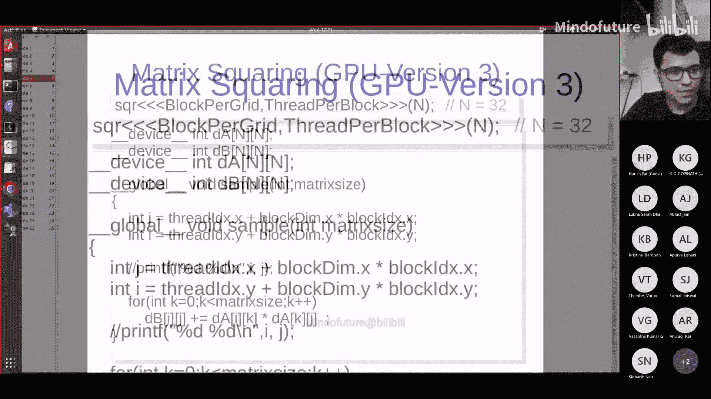

Okay， I think someone has raised behind please feel free to ask the questions if you have any。

So the program what you have discussed right now is simply squaring or it is like sigmoid function Mac。

It looks like a Mac。I think it's simply squaring as far as object。

 it's just performing the metric squaring。这个 squareing means是。

Simply multiplication of why you are adding that one on Db。GV of5 J is equal2 you are adding。

 so I was wondering is it like a Mac or simply square？

And I think it's simply scoring so one thing I'll do here is that after this lecture ends I'll upload the code for it in the same Google sheet that we use right I mean for recordings of the lecture so this code I have already tested and ran once。

I check the results， so I think they are performing squaring only as far as I remember from my last check that I made。

Yeah， but just in case if I missed something， I'll just upload the code and you can run it on either your own personal machine or wholeab or something。

So yeah， so yeah， one point that I forgot to mention for this lecture is that。

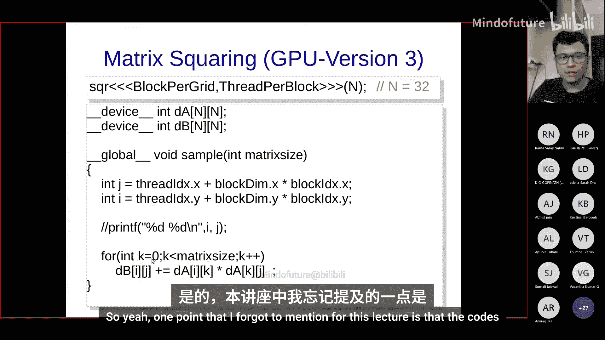

The course that I am going to discuss in this lecture would be there in that。Folded that。

 I mean all quotes link right that was that was there in that sheet。

 So we won't find this quotes on that。Link that is presentation onship。

 so I'll explicitly upload on all these quotes that we are discussing today。

And you can run all these course on either on Holab or and check the results。

And even you can modify it and see how。How， how the results vary and so on。Okay。

 so any other questions apart from this？

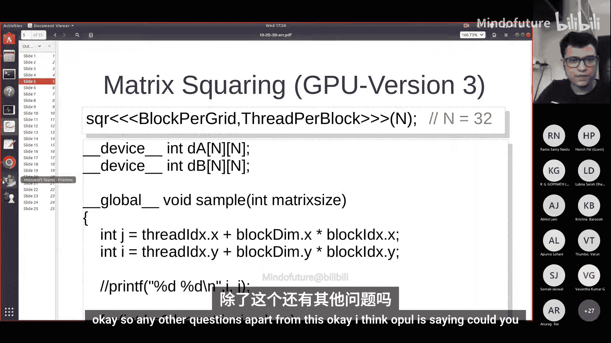

Okay， I think for saying， could you say the put I copy from to single。

Do you want me to repeat that toam and copy from into simple order？

Let me just do。But it clearly kept， I mean， we kept of。

U I and copy from to symbol what it does is is it copies the data from provided symbol and CQ to the GP so here a is nothing but a mnemonic right so name of an array is nothing but a mnemonic so it will copy the data which is there at present at this address or thisneonic。

From here to the。Whatever location， I mean， whatever address is provided here that is on the GP。

I mean here we are not explicitly specifying whether it is CPU or G because we are using quoda m copypy default so what quoda m copy default says that。

I mean， it says that okay， I'll let compiler to determine what is the I mean what is the。

Pa in which we are transferring the data time whether it's from C to GP or CU to C。

 so it will figure out that okay this A is on CPU and D is on GPU。Similarly， he will in this case。

 it would figure out okay the T is on GPU and。A is on CPU， so it will transfer from GP to CPU。Okay。

 so that is what is Koa macro call and this is the source。

 this is the destination which both are the mneonic I mean。

 both of them are the mnemmonics right because。They are just this simple。

 I mean that name of the a assist placeholder， right？In C plus plus， so here D， as well as the A B。

 okay， T D B， A and B， all are T demononic， so they just hold I mean。They just told the addresses。

 and。Pm I'm copy symbol and from symbol we transfer data from。St at this address to this address。

And how much data will it transfer， it depends upon this parameter， which is size。

So this much data will be transferred from this to this that is from source to destination。

I hope that is clear。

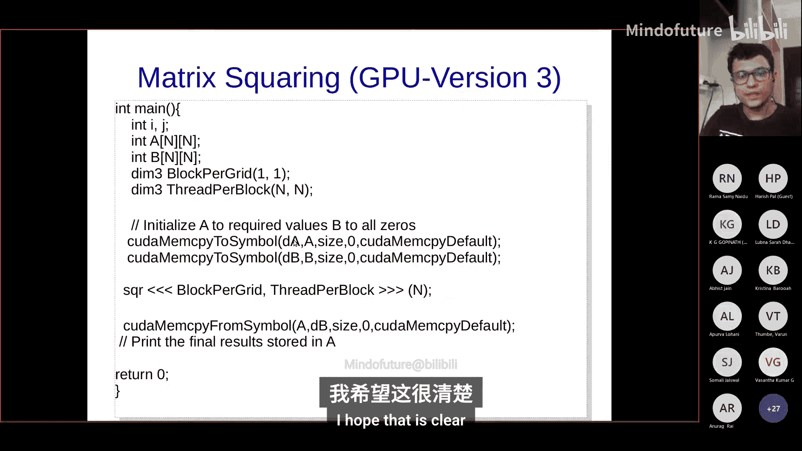

但是。Questions， okay， there is some question。Dra is this sport there。In this work we are just doing。

Like beで。我冇设定。Okay， I I'll okay， I'll leave this thing to。Code itself， right。

 so Ill upload that code itself。 I put that code itself in the sheet and your people can。

Check that by running it on your machine or。Okay。 Okay， so I think。

So far we are clear with this matrix multiplication and I hope that we are getting flavor of testing right that we are。

Accessing， I mean， we are declaring as well as accessing。A multi dimensional a food are here now。

As opposed to what we used to do during our computation lectures， right that we will just。

Declaring it as just one dimensional matrix and。Sorry。

 one dimensional area where we were accessing that two dimensional at matrix and one dimensional form。

So we are not doing this thing， we are doing something better， which is more retable like this。

So I hope that you understand this， I mean understood this and with this let us move further with our next application that is our second use case which is。

2 minimum algorithm so。Let us understand what is the2 minimum algorithm。

 So here we have a window of size to cost to cross two and what we want to do is want to。

Go through each window of size2 plus two on the given input matrix。

 so this is our given input matrix and we want to go through each and every window of size of size 2 plus2 and we want to find minimum value in those windows and we would like to place that value in the output matrix so。

For that， what we do is yeah we'll go through this window that is I'm taking this example。

Well go through this window， which is our size2 cross2， well find the minimum value in it。

 which is 2 and will place in the outputward matrix。Then again we'll go to the next window。

 which is of size2 per 2 that is this1 and the minimum value here is 3 so we'll place three here and so on next window is this here the minimum values is  two and well place two next window is this。

And the minimum here is two。and we'll place here and if you see this operation is very similar to the convolution app that we do in image processing and so on but here the window sizes fixeds there we can use different different size of filters or feature detectors and so on。

So yeah so I hope you are getting this we have this input matrix we have a window of size2 plus2 and we want to perform the minimum operation on that window size and we want to place certainly some output metrics so please note here that the size of the output metrics is smaller than the input metrics but。

Gentrally is not， I mean， it is not the case。 so the example that we are going to see will see that we are copying this。

Potra and last column as it is in the output matrix。

 so here have not shown that so this first row and last column which doesn't change right because of the way we are performing the operation are copied as it is here。

And what changes is this middle part， this one？This part of the matrix and that change is reflected by this。

Mats， artwork metrics。So okay， so I hope you got this， what is this 2 minimum algorithm？And yeah。

 the study operations like the study minimal algorithms are found in many fundamental algorithms。

Interpolation and convolution， operation and filtering and so on。And they also I mean， they are also。

Applied in several real world scenarios like assessmentic processing。

 or weather simulation and image processing。So this is a good example of how to process a multidimensional array。

 either on CPU or GP， so we'll look I mean we'll look the code for both of them。Okay。

 so let us first formally define。It's a 2D minimum algorithm。So yeah。

 so that this is the formal way of space。Output element is the minimum of the input element within the window。

 and here the window is subsized to across2。So in terms of formalte is like this。

We want to go through I minus1 j I minus1 J plus 1。

 Ij and Ij plus 1 and want to place the output value in。

In some output metrics which is go so a is the input matrix O is the output matrix and co of I chain is the place where we are placing the final output value。

So coming to this figure， it's like this。Just like me。Yeah， so for this value we go， I mean。

 we'll see this value， this value， this value。And well find minimum output of all this and well place here so that is what we are doing here for IJ we are going to I minus1 J plus I minus1 J plus1 and IJ Ij plus1。

And we are placing it over5。And。Okay， rows go， I mean。

 rows are going from0 to n minus1 and columns are going from 0 to m minus1 that is we have。

M cross N metrics， so this is not a square matrix， it cannot be a square matrix。

 it can be a rectangular matrix also。And considering that in mind and considering that the competition boundaries remains intact。

And also， assuming that the。Initition budgets are。I mean values in A are initialized using some random function we want to write a CPU code corresponding to this 2D minimum algorithm。

 how can we write a CPU code corresponding to this 2 2D minimum algorithm quickly can anyone。呃right。

I mean。Spec by how we can do this one CPU。It won't be that difficult right because on CPU's straightforward。

 how can we write the code for2 the minimum algorithm in CPUU？

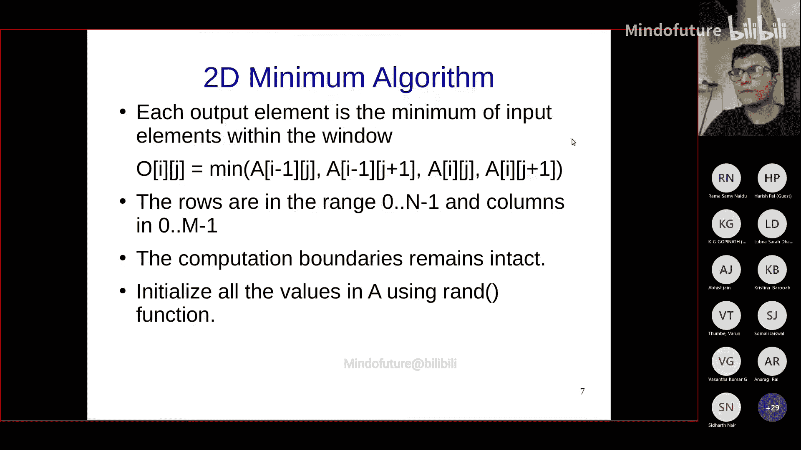

I'll probably wait here for your response。They go to some question， but self first straw and last。

我s going ask school at啲。好。

I probably missed it， I mean。Of咩。Miss something here， but what I was trying to say here is that。

Since。Okay， since。For the first row， we don't have I I minus1 and for the last column。

 we don't have J J plus1。we wont be able to do 2 d minimum operation for them right for this row this post row。

 we don't have i minus1 right and for this column we don't have j plus one right？

So we want to be able to do 2D minimum operation for this row and this column。

So they will be copied as it is here and here。So final output metrics， how would it look？

It would have this row in this column copied as it is here and here。Apart from this， this part。

 this three cross three matrix here， which is shown here。Will it be coming like this。

It will become like this。 That is what I was trying to suggest you when I was saying that。

First join last column remains intact。

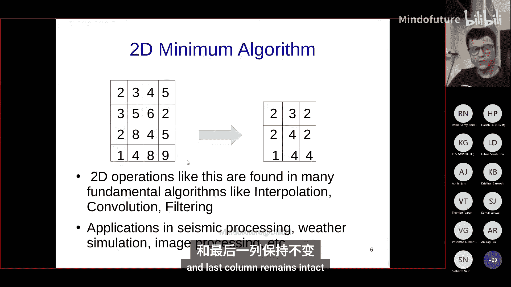

If there is any partial confusion， then you can。

啊，O。No problem， so please think about how we'll just write this simple CPU code corresponding to this 2 2D minimum algorithm could be really verified community。

There is nothing much going on here。I'll probably wait for a few seconds here for you to。

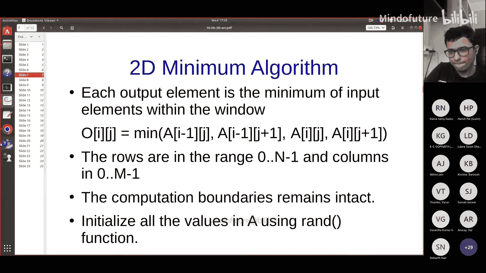

Okay， some response for CPU code， we just walk through array and use。Why you come Yeah， I mean。

 that's correct， so。A lot has given some suggestions。Look for each element of our computer is inform。

Yeah， that is correct， so this is what T want so howterizing。Yes， so this is good I mean。

 this is what I want， so there is nothing much going on here when it comes to CPUU2 the minimum algorithm。

Let us see how to do it on CPU then we'll come to the GPU part。So here I have written two functions。

 one is in it and one is compute so if you remember。

We want to initialize the value of8 to all the random values right。

 so in it function I have to declared two errorss。One is grid and one is previous grade。

 so if you see。Here is the inputer and who is the outputer。So in order to this， sorry， simulate this。

 what I'm doing is I'm using input array previous grid and output array grid。

So our previous grid will contain the input values and grid will affect the execution of the algorithm。

 the2 minimum algorithm。This grid will final grid will contain the final results that we want。

And how we are performing the initialization， it's very simple。

 we are just running through nest loops and we are calcrating some random values in random function on C。

And then we are initializing both grid and previous grid using those values。

 so initially grid and previous grid both are initialized to are input I mean are input metrics。

Both O and A contains the initial input that we wanted， right， which was initial using random。

And now inside compute function， what we are doing is we are passing this grid and previsskecate。

 which we are initialized here。And what we are doing is。What we are doing here is that will。

ha two nested loops here again and first nested first loop。

 which is outer loop which goes over all the rows of that matrix will go from 1。

 it will not go from 0， please note that it will not go from0。Because。

Firstt row and last polymer are ignored so。Rose will start from1 and go till n minus1 and columns will start from0 and will go to go until n minus2 so please note that it is less than symbol so n minus1 is meaning that it will go from 0 to n minus2 and I will go from 1 to n minus1 so first one last columnig and the way we are calculating this I mean this value of this I mean sorry each output value which is stored in the output matrix which is created grid of j is using this our standard formula this one。

So yeah， so this is the same， I mean， this thing， the entire thing is same same as this one。

So I hope this CPU code is clear we are not doing much here。

 we are just using this formula and I mean we are using D astro tubes。

Using this formula to get the final result。Okay， so this this is fine now we want to do this same thing we want to perform this 2D minimum。

 I mean， we want to implement this 2D minimum algorithm on GPU。And。For this implementation。

 what we want is what what our requirements is we want to eliminate all the loops that is we don't want any doubling nested troopss here。

 we just want。One thread to operate each data item， which is the one output element。

And compute the final result without using any loops。So that is our requirement。

 I request two people to try this out first。你过来啊。Present at GPU code for the study minimum algorithm。

And it will be a good exercise for you people and。One hint that I would like to give you here is that the code is very similar to this matrix spread code。

But here in matrix carrying， we were having properly nested books and we were。

We were parallellyzing two loops here and third book was captured as it is， but in this case。

We are parallellyzizing both loop and there won't be any loop inside the government。

 so I request each everyone of you to try。Thinking about how we can write the GPP code corresponding to this4 minimum algorithm。

 and then we'll discuss。Meanwhilewhileレ。

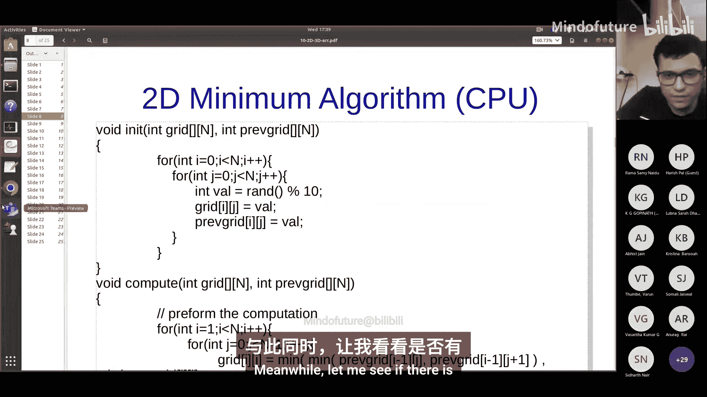

And we just walked through first one last morning。系。好。go is standing call a kernel within kernel。

For what you want to call a third within connect Google， can you clarify。

To mean I go who right so that。Others can see this code and try to paralyze this on the GPP。好计。

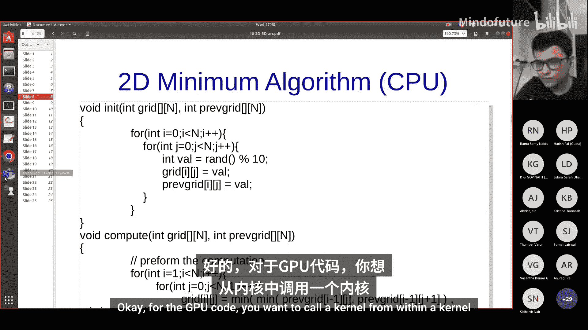

Okay， for the GP code， we want to call a card from within a card。Can you elaborate on that。

 how will you do that？Well， in this case， this is not a irregular application or a personal one that me clarify this。

So I specified this thing right in the previous lecture when the loop palms are not known that is we don't know how much I mean for either of the loop if we are unsure about how much itions it is taking then in that case it is a good point to use the dynamic parallelism but when the loop palms are already known here we know that n is 32 right？

In this case， loop bounds are already known for both the loops。

 that is we know how many times both the loops are。In that case， we can use dynamic parallelism。

 that is correct that we can use it， but we can also implement this entire thing。Without诶。

Without using dynamic paralleluralism is what I'm suggesting and when there is option of going for static paralleluralism instead of dynamic parallelism。

 we should go for static pism since there are lesser overheads。That we saw in the previous lecture。

 right？Yeah， but in case you are interested in panelalizing it。Uing dynamic peism。

 then please feel free to do that we can discuss this even quality dynamic peism。

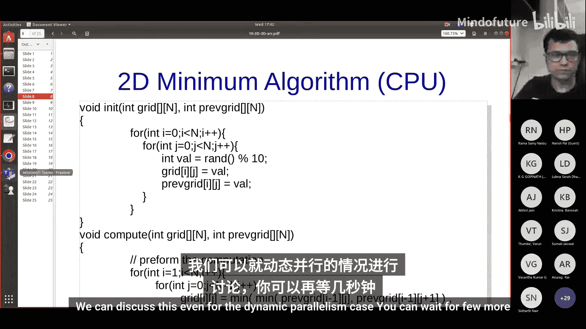

We can wait for a few more seconds and then we'll discuss the GPU code for it。

Just in case anyone wants to try this， I mean， try paralyzing this on GPU。

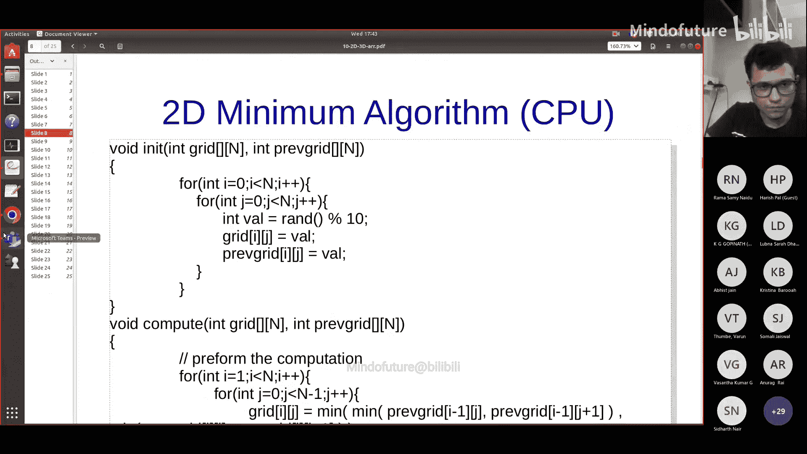

That is some。I stared the extra。Okay， that this is the standard for much is。Let's right。 Let's do。ok。

Okay， I think this is correct。I did something like this only， I think this approach is correct。

 let us go。Well， this is part that。At least some of you are trying。啊啊。

1000 in CPU it will be sequential， so we will be able to compare with upgraded values in previous row。

 but what about。嗰啲你 good下嗰啲咩嘢。Okay， you are talking about GP， right？本呃。This is a valid question go。

 but if you see here， we are using two separate areas for input output。

So reading and writing are separated if you see here。

 so we are reading from one area or one metric and then we are writing to another metric。

Data is or issue that you are pointing out will only happen when we are reading。

 I mean some thread is reading as well as the other thread is sorry。

 some thread is writing and other thread is reading from that number which will not happen here since we have to separate。

Cres， which is grid and produce grid。

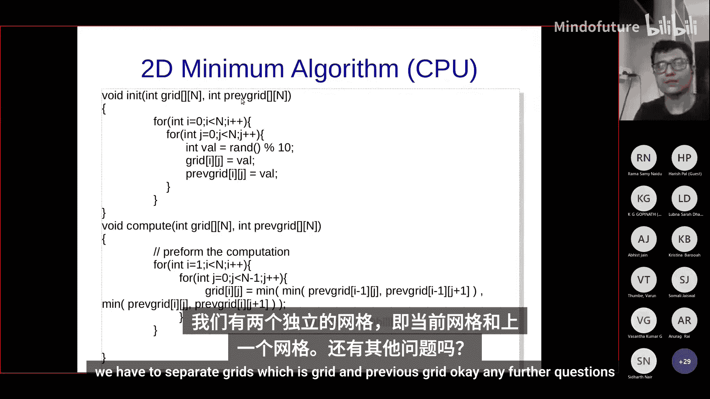

Okay， any further questions？啊。Yeah， so I think this approach given by Baroon is。

Probably its correct one and probably I also thought the same thing， so yeah let us look into it。

 so let us look into how to implement a 2D minimum algorithm and shape here。

So again， if you see we are passing this grid and previous group which was initialized you on this CPU。

Then then we are initialitizing well， any32， please note that any32 and then we are declaring this block per and thread block as 1 comm1 and N command that is one thread block and that thread block has n command thread that is32 the 32 threads。

And the grid and third block are two dimension。Size here， which I missed in the previous example。

Previous in the previous example， I missed。Adding this line。Which is declaration of size。

 so size is declared as n to n little size of it and then we are doing this。

QuMM copy a symbol that is we are copying the data from grid to the T grid and previous grid to the D previous grid。

 so T grid and D previous grid ared on the each and we will see in the next slide of how they articulated in the similar manner that we saw in that。

Matter scoring application right， and then the amount of data that we want to transport from grid to de and previous grid to T previous grid is equal to size that we declared here。

And then we are specifying that code dimension co for that is。Yes， but that。Pi default， it can。

 I mean， compile pi default。Decide which which direction the radar transfer is。

 and then we are launching this cardal sample with this parameters that is blocked or grid。

Third but and they're passing this value n that is 32。

And then we are doing quo amount copy from symbol that is we are transferring the compute value back from de grid to grid。

 so De grid will have final result on GP which is now transferred to CPU is which will be stored in grid。

And grid is the area on CPU it not that grid is the sorry， a this 2 dimensional matrix on chip。

ああ、セピュ。Great estate estate two dimension matrix on CPU。啊。Yeah啊 so。Okay， so yeah， let us come to this。

啊。Yeah， this kernelnal part。This cardal， which is a sample， which was here， is this one。

 and we have seen this launching part。 Now let us come to this part， which is。

Or the declaration of this De grid and previous grid。Yeah， be grid and。

De revis are the two dimensional matrix similar to this。

Cid and previous grid declared on CPU so but this degrade and three previous grid are declared on the GP which are of size and crossing。

Similar to what we have on this CPU。And then as Vaon wrote， I mean that kernel part。

 this kernel is very similar to that part， so in this kernel what we are doing is。

We have this input to matrix size that is 32， which has the value 32。

And we are calibrating the value of I and G and please note that this the way we are calibrating this。

I mean， we we are crating the value of I and J。What will happen is we will get the unique tuple for ING。

 so I hope that this is clear the way we were having indeed that matter scoring application that will get the unique tuple for。

The IN G and。After getting that unique double for each thread so far each thread will have that unique value of IN and if that is the case we can completely eliminate the move that we saw here right in the CPU code。

We can completely an this to loop because now each head has the unique quality of high engine。Okay。

 so， but one thing that you should keep note of here is that。

We need to specify the safe condition here， otherwise， it might happen that。

There might be a set part on GPU because。For the first row。

Partte firstor which is i equal to0 if you do i minus-1 then。

It will access the row minus1 which is not there right， minus1 is not there。

 so it will lead to separate end。J J should be less than n minus-1 because what they last row。

We don't have J plus one， right， because for the last row J plus1 will re this effort。

So this condition is important， I should be greater than 0 and J should be less than n minus 1。

And if this condition is being satisfied by any particular trend。

What well do is we'll calculate the minimum music that standard formula。

And please note that here again， we are using that。I mean， we are again。

 here we are using the 2 dimension matrix for performing the operation for performing the 2D operation。

So we are not using one dimensional array and x signal to two dimensional matter。

 we are actually declaring a two dimensional array。On GPU and accessing your coding manner。Yeah。

 so the final answer will be in D grid and this de grid will be transferred from GP to CPU and it will be stored inside grid。

So I hope that this is clear then you can print this grid and you can get this final result that we were expecting here。

So I hope that this is clear this GPU code is clear for the 2 minimum algorithm。

 this kernel is clear。So， okay， any questions up this point。

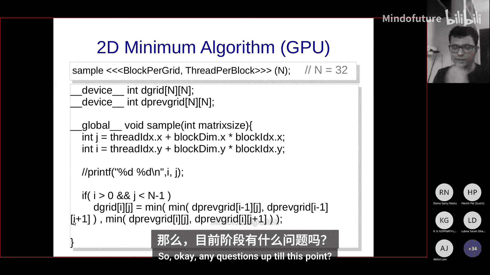

Any questions up for 2D minimum I the model？Matri wearinging application or any either of two。

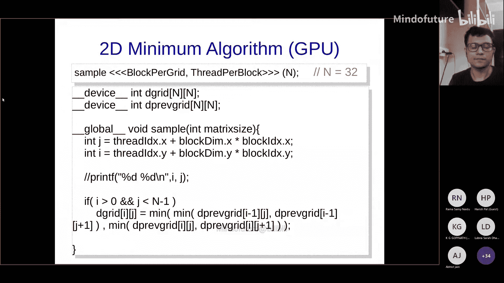

Okay， I'm assuming that there are no questions in that case let us。

Look into the last application part today， which is。

Stencil computation， oh sorry， which is stencil computation。Yeah。

 so let us look into this stencil computation and this is very similar to this 20 minimum。

2 minimum algorithm。So in this extensive computation。

 our formula is slightly different compared to hoody minimum algorithm。

 but there is a one small catch here that well see later during this。

During this example of stencil competition and well tweak this stencil competition a bit in order to get。

啊，摸呃。A more involved scenario here。 So okay， so first of all。

 let us start with this problem itself so。En to design and implement a s competition where in each it cells compute their values within ones and the way they calculate the values according to this formula。

 so each each cell it looks into the。These the two cells that are above it so i minus1 J and I minus1 j plus 1 so im above neighbor and the neighbor which is above and in dial to it so these two neighbors are being looked by a particular value and what it does it does is it adds the value of this two。

Neighbors into the cell， In cell， so。This is the functionality that we want to implement again。

 arrows go from0 to n minus and columns go from 0 to。And -1。

And as we saw in the 2D minimum operation， the computation boundaries remains intact。And yeah。

 for this application， you want to initialize all the values of the input matrix。

 which is a to zeros。And。Yeah， the program that we want to write should run for 10 impressions that is。

If you see in 2D minimum algorithm we just ran it for one at so we are taking the input matrix。

 we're computing the minimum in each v and were putting it in out output matrix。

 but here we want to do it 10 times so after cost iteration all the cells will have their values computed I mean computed using this formula at once and after 10 ats their values will be compute 10 times is in this formula。

So I hope this is clear the idea is clear， I mean， what is the problem that we are trying to address is clear？

And victorially it looks like this， so for I mean for this value that is I mean。

 if you want to complete this value in output matrix。

 this is the output matrix if you want to compute this value in the output matrix。

We'll take these three values in the input matrix， this one， this one and this one。

Please note that if this is the I Ia J cell。Then this is the Ia J cell of the input input matrix。

 J I minus1 J cell in the input matrix and I minus-1 J plus1 cell in the input。

So this is exactly what it is right， this one， this formula。And pictorialia is shown like this。

So I hope the problem statement is clear。And。We would like to implement this functionality and its implementation is quite simple。

This basic implementation that I'm talking about is quite simple。So let us come to CPU part first。

For this CPU part what we will do is we will have this outer loop outer mu loop。

 which will run for10 iterations right that we wanted to have 10 iterations in the outer loop right？

If you remember here that we are having this thing right that we should run5 for1 editions。

sorry the outmost loop goes from 0 to9 that is for the time nition， that is IL will go from 0 to9。

And then what we are doing is will perform this stencil computation that is will go from 1 to n。

 sorry 1 to n minus1 place not that we willll ignore the zero throw here。Because for the0 throw。

 again， we don't have i minus1 and for the last column I mean， last column we don't have j plus one。

So again， first row and0 throw or the first row in this case， and the last polymeric node。

So it'll start from I equals to one。So from i equals to 1 to n minus1 and from j equals to 0 to n minus2。

 we'll do this thing， which is nothing but our formula that we saw in that problem statement slide。

And。What we are doing。Please note that we are using two different metrics for input and output so as you see as you can see here。

Input matrix is different and output matrix is different， so input matrix is previous tensil。

 and output matrix is tensil。And after doing this for one single iteration。

 what we are doing is we are copyping the data back from this。

AComp data which is stored in stencil to previous stencil for the next iteration because for the next iteration。

 whatever value that we have computed in this current iteration will become the input for the next iteration right so let's say iteration0 stencil I mean in iteration0 the value of stencil I mean each value in this stencil metrics will be computed using this formula right。

And for this iteration this， I mean， not for this iteration。

 but this previous tencil previous tenscil was having the input values right that we should use for computing the。

Output values which which are placed in this stencil matrix。

 but now when we move to the next triteration we need to place this computed output into this which is there in the stencil matrix to the previous stencil so that it can serve as the input for the next trieration so next triteration will again take the output of the previous hydreration and will compute。

The output put the next direction， and this will go on。

So I hope you are getting why we' make this one that is copying the data back scil the previoustencil。

So okay， so this is a simple CPU port per sil computation。Okay。

 well now I'll ask you people to write the GPU code for this again it's quite simple after seeing that two examples。

But there is a small twist that I'll add to it later， but yeah。

 just try writing a CPU code corresponding to the CPU code。And。Yeah。

 probably paste your answers in chat or you can even unmute yourself and see。

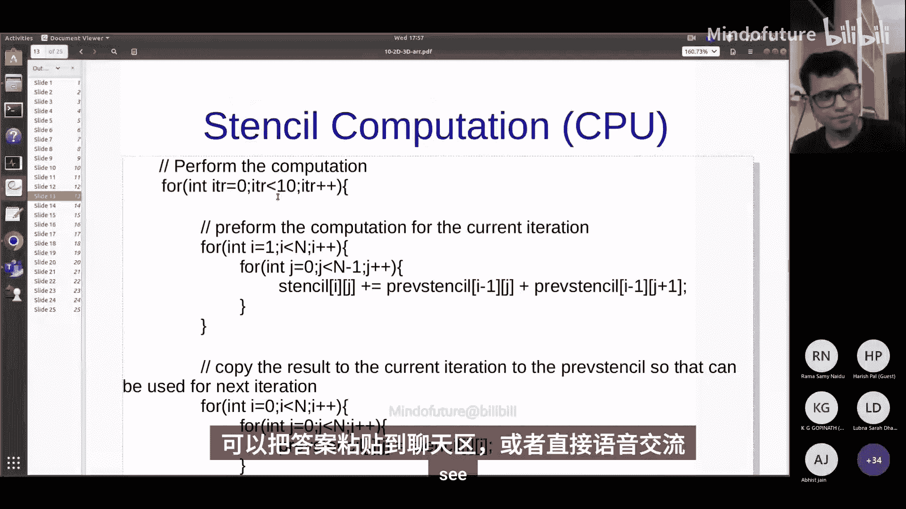

Can I'll switch back to this slide， I'll wait probably for few seconds。

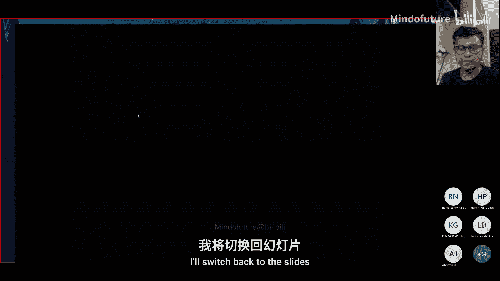

For you people to try out writing this GPU code corresponding to the CPU code。

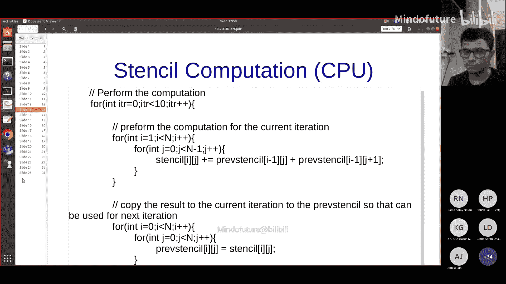

And some responses name is1 kernel。Launches and could I copy after reach。

Result from previous government into the next part。Qud will be similar to previous example。Yes呃。

That is exactly what I wanted， because。Yeah， that is what I've done， but let us see。The conditions。

 stencil formulaula， S copy。For what you need say。Gocal get for I mean， why using sync traininging？

Again， I mean， there is no data is or something happening here that you need synt。

Okay， anyways。Let us quickly look into。the GP port and then I will talk about it slight the different variation of the stencil computation。

So okay， G to code is very similar， as someone pointed out that will。

Use1 aterationtion ands this is quite that's quite na implementation。

 so we are using10 attion and in each iteration we are using this I mean doing this cardal launch and again there is one grid and。

32 and 32， the design to end threats in a thread block sorry one one thread block and。

And that redb is having any2 n thirds that is 32 to 32 threads。Size is 32 to 32。

 which is 1024 and then。We are copying the data from。

Sttencil to D stencil and previous stencil to deep previous stencil。

 and then we are launching this kernel during each eye。

And then copying the data back from Dtenensil to previous sil based this is important that we need to copy data from Dtensil to previous stencil as we did in CPU court here。

And thistensr to stasil。And currentlyists。Also similar， like as we find that 2D minimum algorithm。

That what we'll do is。again， we will have this D stencil and DP stencil declared S2 dimensional matrix that is ofs and crossne on cheap using underscore underscore device。

And we'll see this sorry， we'll have this global。I meanSo we will have this cardinal sample。

This is declared as standards for for global。And if you see， this part is very。

 very similar to the2 minimum algorithm。Were calculating the unit value of I and j for each thread that is each thread will have unique couple of I J and then same condition which we saw in the。

2 minimum algorithm that will apply here that is to。

Avoid the competition of first row and the last column and then this formula is very similar to what we saw in that problem statement light of the stencl computation。

Okay， so far， it was easy， right， because。There is no much thing involved here is。

We are just doing the things that we have already seen in the 2D minimum algorithm。Now。

 this was the original statenil competition right that want to do this competition now I'm adding a slight restriction to this that。

The updates should happen in place inside the input metrics itself。

 that is if you remember here we are using two separate mat right this was the input metrics and we are reading these three values and writing it to output metrics。

But now my requirement is different， I don't want to use， I mean， I don't want extra space， I mean。

 I don't want to waste extra space for the output metric。

What I want to do is I want to just keep this input matrix as it is and want to do this stencil competition。

 calculate the values that store results results in this input matrix itself。

 I don't want to declare the output matrix and do calculation and then store the value in output matrix and so on so I just don't want to do sorry I just don't want to use any extra space I I just want to do the computation in this input matrix itself that is the stencil computation。

So that is the extra requirement that I'm placing here。

The updates should happen in place inside the input materials itself。

 that is you are not allowed to use any extra space either for doing the intermediate the computation or for storing the final results。

Now if this is the problem， I mean， if this is the question。

 then how will you write the quote for for performing distance strength or computation？啊。

Please think about it。 I'll probably wait for few seconds or let us first discuss the CPU code for it。

 then I'll probably ask you people to write the CPUU code because CPU code is quite simple， right。

Will will have I going from0 to 10 that is sorry I are going from 0 to 9 that is。Yeah。

 from 0 to 9 and then I going from n minus1 to 1 that is we are going through each row from bottom up that is from n minus1 till1 and please know that we are ignoring the zero row because of that restriction of i minus1。

And then J is going from 0 to n n minus2 it is not that this is less than so it is going from 0 to n minus2。

 and then we are using this formula。So on CPU it is okay。

 we can use this code and it will give the correct result。 Now， again。

 I'll come to my question that if I want to do this thing I keep you this。

I want to do this in stencil competition， intenil competition on GPU， and how can I do it？

I want you people to think about it and share your approaches in chat or。Is that， I mean。

 you can also unmute yourself by。Say what you think about it。

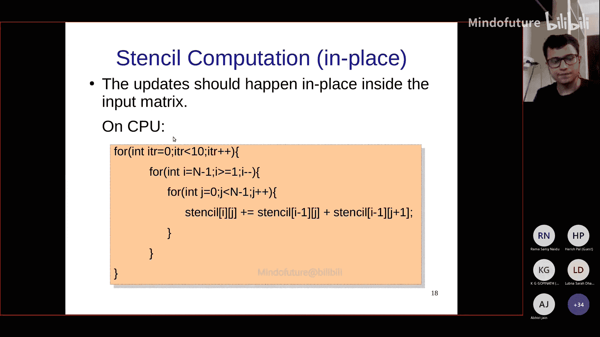

Meanwhile， letting。They don't want values to be co pay strengthen by ex。

You don't want the values to the profit to prevail tension。But its where it may be used person。

But okay， local in that case， we just using separate outcome metrics， so that was not the issue。

Probably that the issue that you are pointing out might be relevant to this case where we are doing in place of。

Yeah， but please think about this， meanwhile I'll look into the， I guess it there my popular motion。

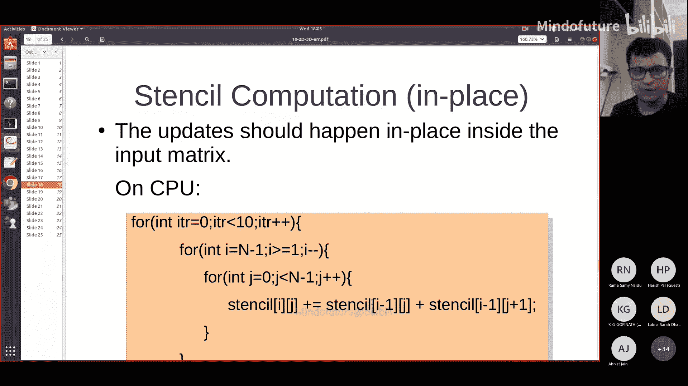

For doing input matrix itself could be used standing。O啊。I have not thought about it， but I'm in。

I think you can do it using dynamic parallelism well anything that you can do statically you can do dynamically I guess so that won't be the issue but my suggestion is please first try doing it strategically because dynamics have I mean dynamic parallelism have its own overhead。

Yeah。嗯，要星日金你睇。Good， so I think you plan on getting the。

Ps of it that。If we do in place computation that， then we might， we might see some data in the。啊。

Courote that we were using here， right。If we use this earlier code， then we might。

They might encounter some data。This is the important observation， actually。

 that if we do in place strengthil compression then there might be some data race。

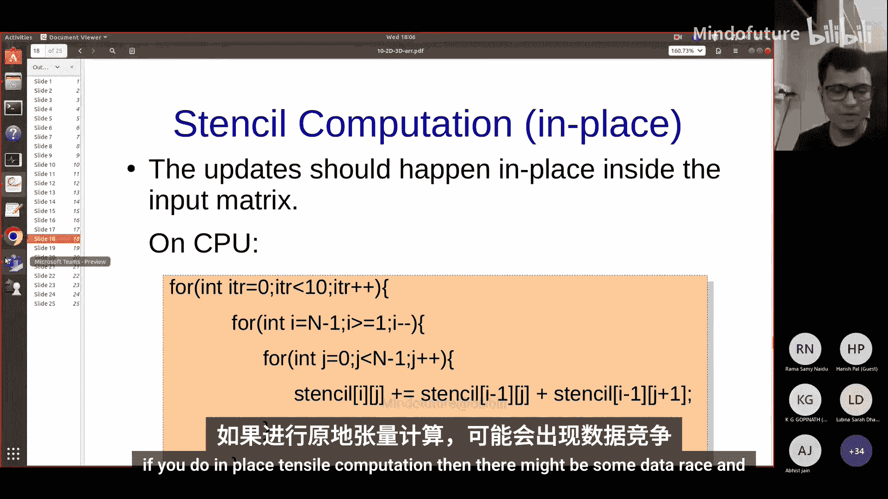

And we need to use some atomics or we need to some， I mean。

 or we need to do computation in slightly different manner so that we can avoid this data is。

It might be using atomics or something else。 or even if we can use sync tracks or something。Yeah。

 any。Suggestions by any amendment？But probably I'll move forward one thing。There are no objection。

ok i think噶。Let us move ahead。Okay， so yeah， this is our problem that is we want to perform stencil computation in place and let us try to understand how can we do it on cheap。

So on GP， what will be the issue？Paious this sector。Whenever a particular thread。

 which is working on this cell。calulating its value from by adding this to value and placing the added value I mean adding the sorry。

 not adding but whenever a particular thread is performing operation on this cell by adding this this and this value and whenever a particular thread is performing operation in this cell by adding this this on this value and placing it here and here。

 that is they are writing the thread that is working on this cell in this cell are writing their values in this their respective cell that is here and here。

What can happen is that。Another thread， which is working on this cell can read the value from here and here and can write here。

So the crucial observation here is that the value from this cell。And this cell。

Are being the as well as written at the same time by the multiple threads。And if that is the case。

 then we know that what has happened， which is， I mean the data is circle right here and this will occur everywhere。

It will occur across the entire metrics across different rows。

So it can happen that whenever some thread is writing here。Other threads are writing， I mean。

 some thread is reading value， which is working on here from here and here。

Other threads might be writing on this two cells， so it can occur I mean across entire metrics。

 so I'll just shown one example here， but it can occur across the entire matrix or entire stenil。收。

Okay， so how can we mitigate this data is the question， So one way that I thought is to。

To the competition in slightly different manner。 So I haven't explored the options of atomics and。

S threads that you were suggesting， but that can be a good exercise to try。

So the way that I thought of doing it， it is that since the data is is across the。

Trits of the different rows。 That is。The threads that are working on this row and if the threats that are working on this row two different rows that is on this row and this row。

 if they work together， then it can lead to database。

The threats of same row can work together this won't lead to any data is。

 so what I was trying to suggest is this that。If the threads which are working on this row。

 that is they're calculating the value from this and this， this and this and so on。

 if they work together then there is no issue because they are reading the values which are heading in the row。

 which is just about them right？So in that case， there what many data is。

 So what can be done is that。Like the execution pattern with this so once the row which is at the bottom finishes its execution。

 that is threads which are working on the row which is at the bottom most is has finished its execution。

 then only the threats which are。Whi will work on the row， which is above it， starts their execution。

So we can write the code in such a manner， so first this should execute， then they should execute。

 so I hope you are getting it that。Fs will first calculate this value， this one for this row。

 and then theyll calculate for this row。So yeah， it will hamper our performance that is we have reduced the amount of parallelism that we'll see with the example that parallelism is reduced。

But correctness wise we are good right because this will give us the correct results。

And there won't be any data race what I'm trying to suggest。

So let us quickly look into the code for it。

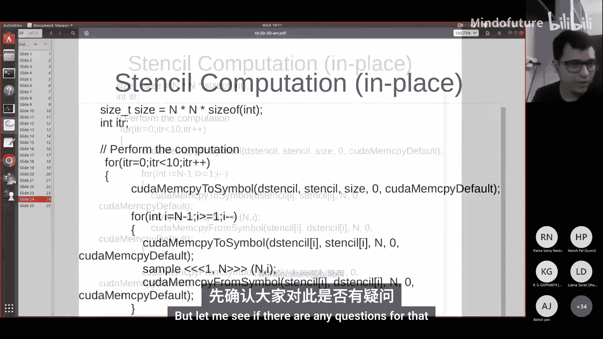

にたられに。Questions。我咧。If you just use aomic card even。

So even1 comma 0 might get updated after to to comma 0。Use just atomic at a 1。10。

Might get updated before it。Yeah， I think。Using economics is a good option。

Please note that whenever you' are using atomics。啊。Make sure that not everything is serial。

 so what I'm trying to say is that。Please try to write the code using economics in such a manner that。

I mean， such a matter that not， I mean， at least some parallelialism is there。

 it should not happen that。Everything is happening seriouslyly， as we saw in the case of that。

Summation operation， right that。We eliminated the roof in that case， but still， I mean。

 due to atomic， everything was happening serially。So in this example。

 we will see that there is some parallelism still there that is rows are， I mean。

 values of0 are compute parallel， but across0 or0。So， I hope。

So is there any way to pass the valuable to the other local media？Okay。

 is there a way to pass value to other。That's local variable。

I think you can do that but for that you need to have a common memory location that is you can declare some variable variable globally and what you can do is one thread from its local value will place value place its local value in that global variable。

And then another thread will create that value which is placed in that global variable。

I hope that was clear that。There is a way to pass the value to other。Local behavior。

We can do that using that same global memory we we can exploit global memory methods of what I was trying to say。

Before we update itself， we could compute the value and send it to other。嗯。Okay。

 I think this might be doable， but goku， I think we need to。Be more concrete yet。

 that is you need to suggest how will you do it。You need to write， I mean。

 we at least need to write some pseudo code or something corresponding to this so that。

We can have at least some idea related to that。That had with them broken。

Look to see its values here if its local variable holds value will use at else。

 it will use the value of cells amount。嗯。Yeah， looks good， but。

How will you implement all this is what I'm suggesting you to look into implementation aspects。

 I think they should work。But I think that core will be slightly complicated， but yeah， sure。

 I mean you can try this one。Well， so。

Let us quickly look into this intencil competition quote。

 I mean in quote corresponding to this in placetencil competition。So。Yeah。

 the we have done is this that again， sizes and into n input size of pin that is 10 to per input size of pin。

 then IR is there， which goes from 0 to 9 that is we have 10 iterations。Now。

 what we are doing is we are。Copying the initial stencils。

 so please note that now we can't use that deep previous stenscil or previous stencil that we can't use the extra space so what I'm doing is we I am copying this stencil that is there on CPU to GPU it is D stencil。

And then for each row， I'm launching your kernelinal。Now。

 please note that I have apart from that this iteration loop。

 I have one more look on the CPU which goes from my1 to1 and the first row is discarded because its I mean because of the time and is one issue。

そ。I will go from n minus1 to 1。What we'll do is we work on row by。 I mean。

 will work from one row to another row。 So we'll go from。

Poom of row will work on that that is will calculate as well and then we will go to the one row above and then the another row which is about and so on till we is the first row。

So。For a particular iteration， what we'll do is we'll copy the row current row from stencil to t stencil。

Then what we'll do is we'll launch the kernel and during the launch。

 apart from passing the size of the matrix that is n， which is particular。

 we'll also pass the row number that is on which row currently we are operating。

That is i value right and then after performing the operation on the row we'll copy that row back from dec ssil to stensil。

So I hope you' are getting the way we are doing the computation and then after the entire calculation is finished that is for a particular iteration。

 we copy the distensil back the distensil。And now let us look into the kernel of this inal computation。

So please note that we are now just launching the kernel with n threats because we are just working on one particular road and that。

Number of cells in one particular row is just n， which is 32。And yeah。

 and then I are the arguments that are password and we have T stencil， which is sub N crescent。

 which is declared on the GPU。And。Yeah， so this sample is the name of the cardinal。

 which is declared is standard going global。And the matrix size is 32 I is the current row on which this kernel is working。

And now we just need to calculate the value of G right because now we just I mean we are just working on one row and for that one row we have just 32 threads and we just need ID unide is from 0 to 300 to 31 for each cell of that row and once we get this ID we already have the row number。

And based on the row number and the ID that is the column。

 I mean column in that particular row on which that particular thread will work。

 what will happen is based on。The idea of the column and the row on which currently this。

Conner is working。 will conclude the。I'm sorry， we will not calculate it。

 but we calculate the particular I mean， will complete the particular。

Or will compute the particular value of the distancetensel that is distensel of Ij using the standard formula。

So， okay， so I hope you are getting this that this garden is launched。

N minus1 times in each iteration that is we are。Doing competition for each row one at a time in order to avoid this data is that we saw here。

So in order to avoid the data is， we are doing row by0 computation and that is done using this thing。

 that is we copying the rope from CPU to GPU， then we operation it and then copying that from GPU to CPUU。

And this is the way we compute it。If there are any questions， I'll take up those now。

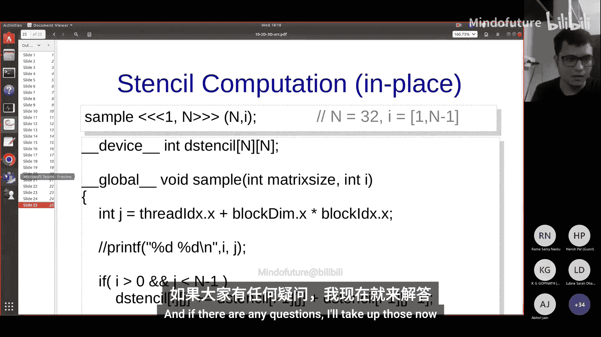

不。see if there is yeah， so this was the last night that I wanted to present and。

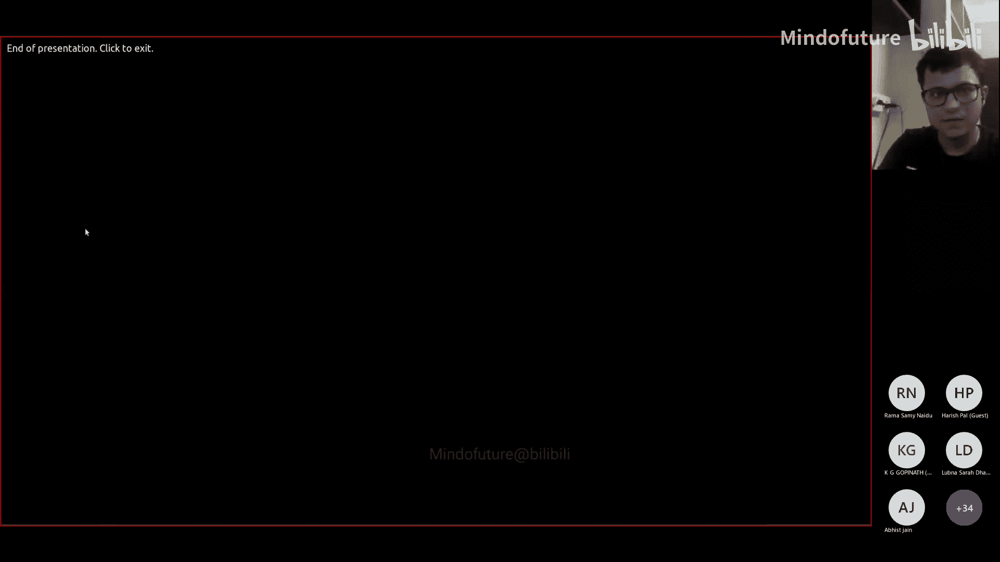

If there are any questions， then。

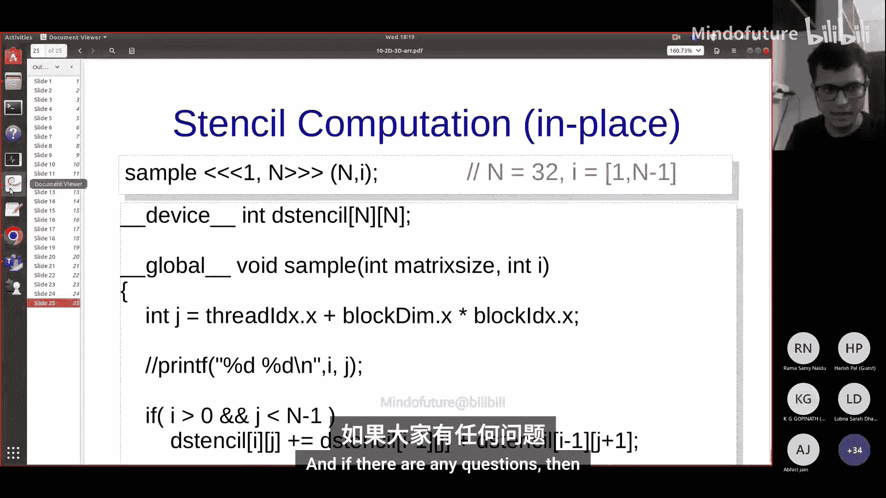

Please feel free to ask them。Yeah， any questions on。Any of the three examples that we saw today？

Yeah one good question。Yes。What will be faster if we。Do it the second day relative to if we do it。

usinging copy and then parallelze because although we are copying。

 but we get much more parallelization。Yes， so this is a good question actually。

I think the first way is better because in that case， we have a very large amount of parallelization。

 right？In that case， we are parallelzizing both e loops。

And I think that that first way is much faster， although have time that thing。For the large inputs。

 so I learned that run them on small inputs but put the small inputs we just don't get the exact I mean we just don't know which is faster for the small input so for large inputs haven't tested。

 but I feel that first one is will be definitely fastered because。

We have a very large amount of colonism here， that is we are parallelizing both the loops。

Even though we are， I mean， there is a disadvantage there that we are using more space， right？But。

As a tradeoff I mean we are using more space but we are getting more speed up and in the second case the advantage is that we are saving the space but the time will time taken will be more so it again comes to trade off and coming to your answer I feel that the first one will be faster。

Yeah， so that's my answer。So okay， there is one question from Toku， sir。

 would atomic style implementation disorder lower Can this Rvi kernel call？Okay well。

 it depends upon how you are implementing this atomic style implementation。

If somehow if you are able to implement this。Atomic style implementation in such a way that you are able to get more parallelism than just for。

 I mean， here the amount of parallelism is restricted to that single row， right？So if somehow。

 if you can achieve more parallelism， than using this atomic approach。Then I mean，1 n。

 because here the parallelism is restricted to n if you can get more parallelism than n。

Then I think that it should work but you need to think about how will you do that。

I haven't thought about implementing this。

This one that is simply sil competition using atomics， but that will be a very good exercise for。

Me as well as you to see how can we implement this using the atomics？

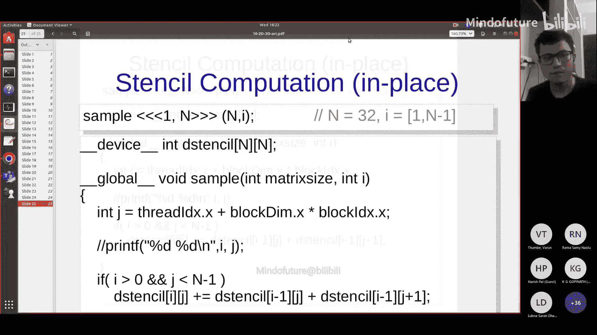

Any further questions And I mean， when I say implemented using atomics， I mean that。

Without hampering bi parallelism， So parallelism is our。Key goal here， right。

 that we want to attract more and moreism， even though we are using atomics。Okay。

 any further questions？

