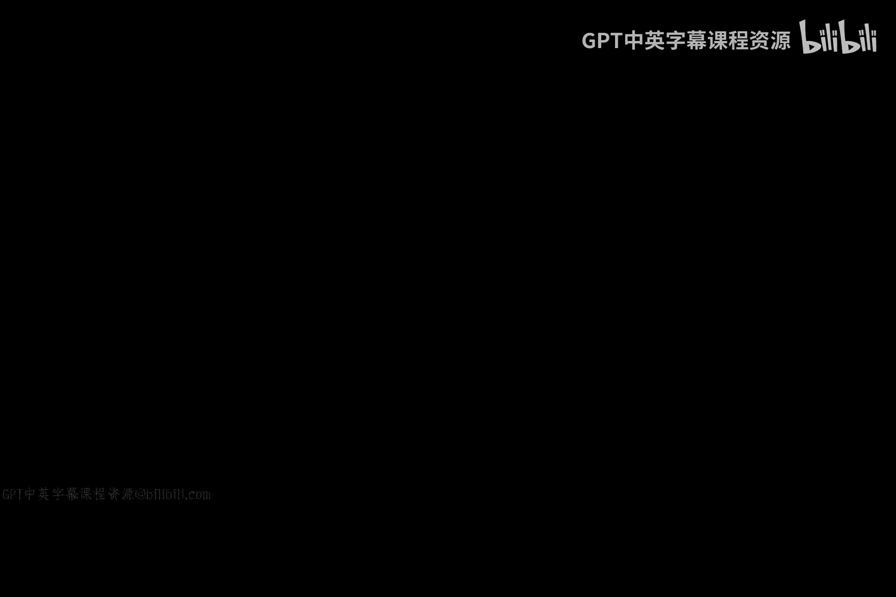
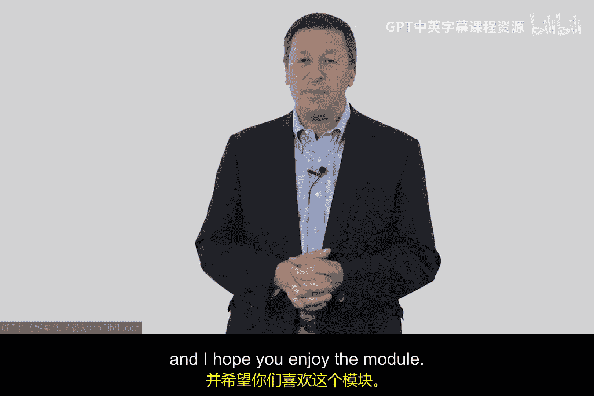
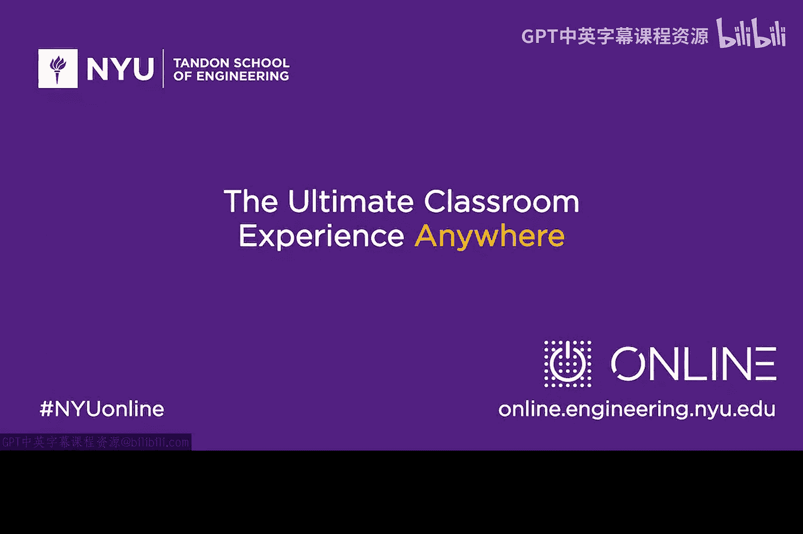

# 纽约大学《网络安全｜Introduction to Cyber Security》中英字幕（deepseek p01 1_作业与阅读.zh_en -BV1TFLZzYE26_p1-

So our goal for the module is to intro some basic cyber threats and attack methods and a basic introduction to cybersecurity from a hacking perspective。

 And there's some things I'd like you to read and watch。 as you go through the module。

 There's a couple of papers， One's a classic one written by it's a hackcker Moner， a guy named Al1。

 I assume it's a guy I think the name has come out you can go look on the Internet and see if you can find Al one's actual name。

 but wrote a paper called Smashing the Sta for Fun and profit， Awe paper。

 really ought to sit down and go through it， I think you'll enjoy it。

 And then there's a classic Turing award lecture written by Ken Thompson。

 who at the time is at Bell Lebs， and it's called Reflections on Trusting Trust。

 That's also a paper I think you should look at。 Now there's a couple of optional books that I'd like you to consider reading one is an ebook written by myself and my son Matt。

 It's called from CIA to AP and Introduction to Cysecurity。

 I like you to read the first two chapters to go along with this。Again it's optional。

 you can find that on Amazon。com might be good for your library and again。

 certainly not a requirement and another optional is that I do think you should get yourself a good TCPIP book。

sK up to you。 Some of them are a little pricey。 Some of them you can maybe get online。

 What I recommend is by Richard Stevens and I'd like you if you think reading along and learning something about TCPIP would be helpful to your background then chapters1 and2 in Richard Stevens find TCPIP Illusd volume thatd be great book for you to have on your professional library' a video I think will be fun for you to look at there's one made by Charlie Miller and one of his partners talk at Google and it's about remote exploitation of a passenger vehicle I think you can find the DefFcon 23 is a YouTube Lincoln and we share these things you can take a look at and go off and take a look at them。

 So listen， I hope you'll follow along with the readings and video and books and I hope you enjoy the module。

