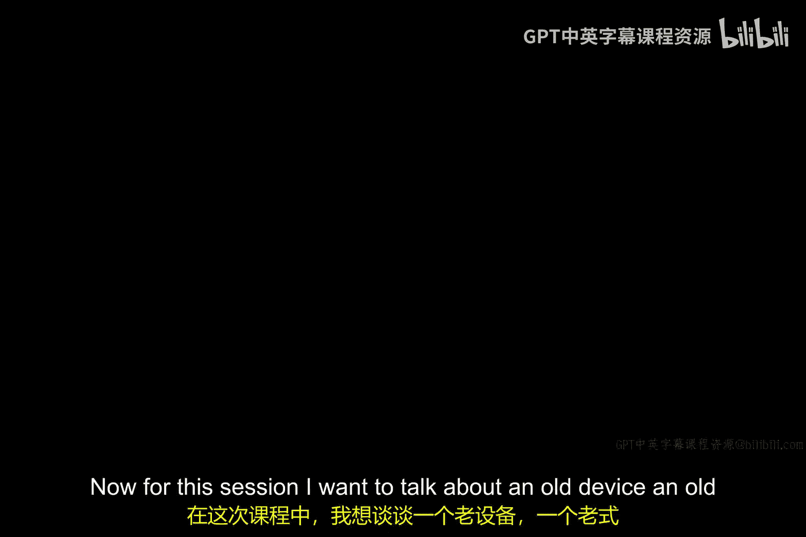

# 纽约大学《网络安全｜Introduction to Cyber Security》中英字幕（deepseek p02 2_黑客攻击老式苏打机.zh_en -BV1TFLZzYE26_p2-

Now， for this session， I want to talk about an old device， an old soda machine。

 a vending machine that I used to see when I was a little kid growing up。 No。

 some of you maybe about my age would remember this， Some of you were younger， might not。

 But here's how the thing worked。 It was a soda machine that usually outside with a long vertical glass door。

 and you would open the glass door， and you could actually get your hand on the tips of the bottles of this soda machine。

 It's a weird kind of concept where there was a metal enclosure。 And when you put money in。

 the metal enclosure would open， and you could pull the bottle of coke or Pepsi out。

 It an old design kind of circa 1970s into the 1980s。 Well。

 here's what I learned as a young kid not realizing that eventually I'd get into sort of a life of hacking and cybersecurity。

 but we figured out that because you could reach the tip of the bottle。

 that if you took a bottle opener and a straw and put it inside the bottle。

 you could drink all the soda out。 and。Little kids。

 we would walk around and hit these machines constantly and it's kind of an easy thing to explain to do like I've told you now if you ever saw a machine like that。

 you'd know immediately how to hit it。 Now here's the problem The problem is if I asked you to solve that problem what would you do think about it in a minute what would you do to stop a problem like that Now some people say well。

 I' redesign the machine and that's correct we did redesign a machine。

 you probably can't find machines like that today anywhere but what if I told you you want to fix the thing now。

 suppose it's in front of one of your stores and kids are hitting this。

 what would you do Well there's a lot of different options but none of them are great like you might for example put a little note that you tape on the machine and you'd say。

 hey all you kids。Stop taking a bottle opener and a straw and drinking out all the soda。

 If you did that， you tell the kids what's going on there' would be a terrible note to put on the machine。

 But if you try and dumb it down。 if you said， hey。

 all you kids that thing you're doing and you know what I mean that thing stop doing that thing that you're doing because I mean that's ridiculous and it's like a silly thing in cybersecurity we call that an advisory and in our industry it's hard to write advisory。

 but any rate， note is one thing， a lot of people think maybe putting a camera and watching the kids with that。

 and yeah， maybe that works， you better make sure it's a real camera because if it's up in the corner and it's kind of fake。

 a kid's going know that And if it's real。 Well then what do you actually have to hook it up to something and review the tape and keep in mind a bottle of Coke is maybe 25 cents in the 70s said do you really want to spend？

1 thousand dollars on a surveillance camera all it's crazy there's a lot of other possibilities move the machine in your store。

 but then your revenue goes down， the point is that the more you think about this。

 the more you realize that it's a simple hack，But the solution is not simple。

 and thats something you're going to see over and over and over again is a theme as we go through our lectures。

 you're going to see that there may be problems that seem straightforward， For example。

 Alice and Bob， they want to communicate。 Alice would like to provide an identity to Bob and then prove that it's really her identity。

 sounds like pretty simple thing， right？ Well， where do you see the kinds of fuss that we need to go to with protocols to actually make that work。

In some circles， that's called robustness。 It's called a system that has a little problem with only a little solution necessary is robust。

 If as the problem grows， the solution grows。 So that's a robust system。

 when those two dependencies are proportional。 But when they're not。

 when you have a situation where a little problem needs a big solution or the reverse。

 then we say that the system is not necessarily very robust。

 So I why't you keep that in mind as we go through our sessions and ponder in your own mind。

 You know， what are situations you might know from your own life where a little problem begs a big solution。

 Those are tough when that comes up。 So we'll use that as a way of sort of getting us in the mood to learn some about different types of hacks and different types of solutions that reduce the risk of those hacks。

 So give that some thought。

