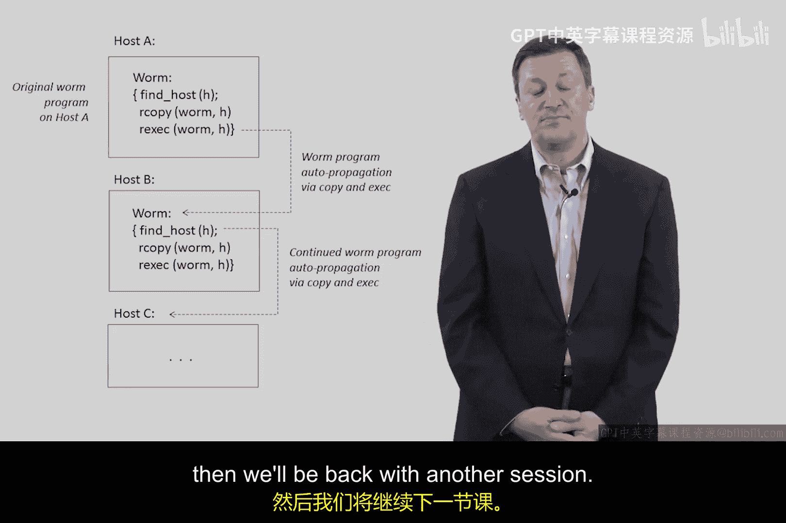

# 纽约大学《网络安全｜Introduction to Cyber Security》中英字幕（deepseek p03 3_简单蠕虫程序.zh_en -BV1TFLZzYE26_p3-

Hello everyone， so for this session we're going to talk about something called a wormM program and you know what a worm is now here's the idea。

You may or may not be somewhat familiar with the idea of a virus。

 That's a piece of malware that gets on a system that looks to be doing one thing。

 but it actually does something different。 Well， we've learned over time that that concept can be lethal。

 if， in fact， it can propagate on its own。 What that means is。

 but put a little piece of malware on a computer。 And then I push a button， make it run。

 and it finds its way across a network。 That's frightening concept because it's cascading。

 its's propagating without human beings having to do something。

 And we call that kind of program a worm。 Now， turns out that there's three steps in a worm program。

 And if you're a programmer， then you might even say three lines of code。

 But think of it as three steps。 The first step in a worm program is that the program itself running on a computer needs to find another computer it can connect to in the old days。

 you'd look it up in a Unix file。 Nowadays， you might create a TC P I P address。Number dot number。

 dot number， do number。And use that as some way of sort of pointing off to find another computer。

 So that's step1， Find a place you can copy to。 Step2 in the worm is to actually take the worm program and copy it to that other machine。

 a lot of ways you can do that。 You can do that with browsers。

 You can do it with different types of runtime environments。 And frankly。

 you can do it by exploiting bugs and software that allow you to copy executables onto another machine。

 So that's the second step And the third step is to actually run the program。

 then on that machine and think about it。 What's going to happen。 When I run it on that new machine。

 What's it going to do。 It's then going to find a computer that it can connect to again。

 IP address or whatever。 It's going to then copy itself。And then it's going to run that， which case。

 what's it going to do， it's going to find a machine， copy itself， run， find a machine， get the idea。

 it's going to cascade。Now， the first time we saw something like this was back in 1988。

 that's before a lot of you were born， it's a young man in New Jersey。

 where I live in the United States。Who wrote a program that did essentially this。

 His name was Robert Morris， Jr。 Robert Morris Seor。

 his father was actually my boss at the time at 1 A T Bell Laboratories。 but he wrote this program。

 and he pushed it on the Internet somewhat inadvertently。

 And it created a gigantic debate an early debate about whether he was to be held responsible for this。

 I think it's sort of an important lesson。 This was a young man as a graduate student。

 He had no intention of causing problems， and yet he brought the Internet down with that simple worm program。

 We call it appropriate and up the worm program of 1988。 or the Morris worm。 So if you look that up。

 if you look on the Internet， look up Morris Wm， you'll see a little bit of information。

 bottom line is that a worm program is those three lines。 Now。

 for your further consideration as you think about this session and think about the discussion we're having here。

 Like you think a little bit about where you might actually。Inject。Some lines of codes。

 some functionality， some additional steps to do a little bit of damage in each machine that you visit。

 for example， when the wormm program visits a machine， copies itself， maybe before it executes。

 perhaps it could do something。 Check for passwords， look around。

 see if there's something interesting， I'd like you to ponder that。

 think through what types of activities you might add to a wormm program。

 to actually make it somewhat more lethal or at least more interesting to the attacker。

 So so what you should take from this is wormm program is very simple。 three steps。

 But as we've said in other discussions。 For example， you remember our old Soda machine example。

 wormm programs easy to describe， not so easy to stop once something like this is coded。

 This is not necessarily the easiest thing in the world to stop。 So with that。

 like you to ponder a little bit about worms。 and we'll be back with another session。😊。

