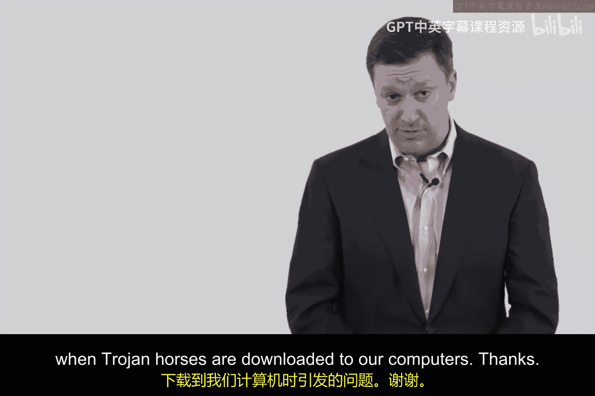
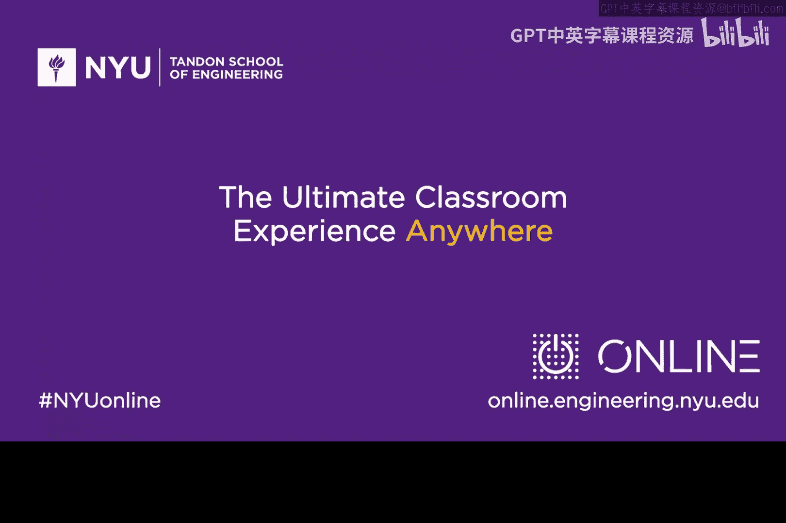

# 纽约大学《网络安全｜Introduction to Cyber Security》中英字幕（deepseek p04 4_木马登录程序.zh_en -BV1TFLZzYE26_p4-

Hi， for this session， I want to talk to you about a piece of software called a Trojan Hse。

 and I' alluded to this before。 Trojan Horse is something that looks like one thing。

 but is actually something different。 So imagine you download something to your mobile app and you think it's a game that maybe you're playing。

 not realizing。That that game that you're playing is also maybe sending your contacts out to somebody so you get the idea it's something that looks like one thing but is actually another now a classic type of program like that。

Has a function called a trap door。 So here's the idea。

 I'm pretty sure everybody watching has logged into something logged into an online system。

 logged into a computer logged into a network。 You'll get some request for who you are。

 What's your user I， your name， your account， something like that。 and you type it in。

 And then the second step is usually， well， what is your password or pin。 There might be other ways。

 But for now， let's assume it's a password。 So you type your user I。

 type password and then some piece of software is looking at what you typed in as your name。

 and then looking at what you typed in as your password and checking them。

 It knows ahead of time in some table， some database， some data structure that you've prearranged。

 you've gone through some infrastructure steps， some administrative steps with the owner of that program to connect your name and your password。

 you've all done that。 Now， think about the code that implements something like that。

 There's going to be a piece of software that'll have a line in it。

It'll be something like get user ID， get get your name， ingest it and understand。

 recognize your name again， this is not a big deal for anybody who's ever looked at even a piece of software The second thing is there'll be a little piece of code that's going to say get your password。

 you type it in， it's going to get it and then it'll compare the two。

So we would say that the policy for such a system is if your user I D and password combination is valid。

 you're in。 That's it。 That's a policy。 That's what you would write in user' guide。 Now， suppose。

A programmer decides I'm going to put a Trojan horse trap door into this code。

 So what they would then do is they introduce something called a conditional。 If your programmer。

 you know what I'm talking about， it's an or essentially in the test logic of something。

 So what I would have is something essentially that would say if your password and user I are valid。

 then you're in or in the code。If you just know the secret password is1 through3 ABC， then you're in。

Now think about that。 That's in the code。 It's compiled， It's built and there's the code。

 and you log into the system and the policy， the user manual says you have to have a valid user ID and password combination。

 not telling you that oh and also， if you know the secret password you can get in。

 That's a trap door， and it's a Trojan horse because you don't know that functionality there。

 just like when you download it to your mobile app。

 that piece of software that you thought was a game。

 but it's actually doing something else mail on your address book out or something in both cases。

 you're being tricked。 You don't realize it。 You don't realize what's in there。Now。

 how do you stop something like this。 What do you do， possiblysibly stop that？ I mean。

 if you're downloading a piece of software， Do you have any idea what's in there， you buy it。

 You get the code with it， No， of course you don't。 I mean。

 I understand that there's certainly some open source utilities that do。

 But the vast majority of software，99% of the kind of software that our learning community would be using day in and day out。

 You have no idea what's in there。 You bought it， You download it're own it's it。

 and what's the keyword you trust the developer to not put those types of things in there。

 That's a tough sort of issue， How much can you trust the developer。

 How reasonable is it for you to trust the developer。 look。

 If it's Microsoft or Apple or of kind of a developer that has some some reputation and has some consequence if they did。

Do something like that。 Then you can generally trust them。 certainly， in my opinion。

 it's your decision， whether you trust them， but I would certainly recommend that that's a good decision。

 But if it's a developer， you don't know。 you see something on a mobile app store that looks kind of cool。

 You download， you know the developer is， should you be trusting that。

 I guess that's an open question。 That's something that for someone like me doing cybersecurity。

 I would tend to say， don't you'll have to make that decision on your own now。😊。

To help in your learning process here， let's take a little quiz here。

 Let's think through some of the possible ways that we might actually stop or reduce the risk of a Trojan horse trap door。

You know， with along the lines of what we talked about where you put a little secret password in there and what are some ways that we might be able to stop that。

 so we have three options I want you to think through。

 option A would be to do some testing on the software where you're testing the code。

 typing it lot of different options， checks， from whatever you run through some guesses， a B。

B would be doing some code review where you're looking at the actual code。

 you have to have access to the code to do that， but would that be maybe more effective and then C would be getting some understanding of the software process that went into building it。

 I'll think about there for a minute。 Which of those three in your mind is more likely to pick up a Trojan horse trap door。

I think when you think about it for a moment， you'll realize we'll go through each one now。

 program testing， good luck， like unless you have spectacular good luck。

And you happen to type in the secret password， you're never going to pick that up with testing。

 so program testing a terrible way， pick up something like that， let's skip to C。Process compliance。

 were you kind of looking at how the development process worked。

 That might help Like I'd like to know whether it's chaotic or structured。

 So I think there's something there。 that may not be too bad。

 but obviously the right answer here is to look at the code。 like if I can actually review the code。

 I can look to see whether you've coded in certain types of trap doors。

 Now there are ways this can be subverted itself。 We're going to talk about that in a subsequent discussion。

 but I hope you'll continue to give some consideration to the issue of trust and software。

And the problems that arise when Trojan horses are downloaded to our computers， thanks。

