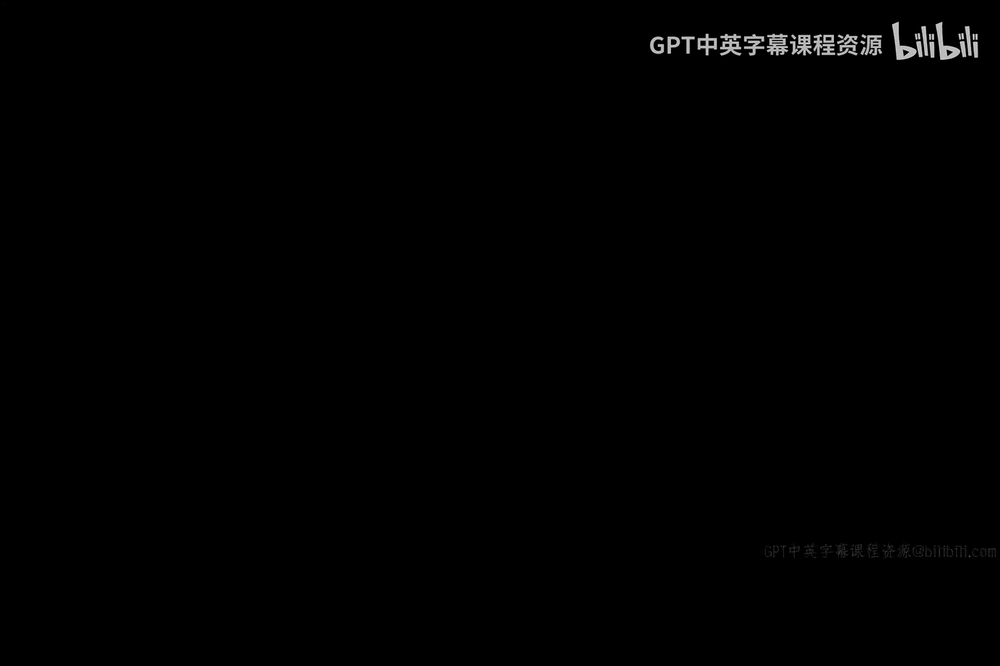
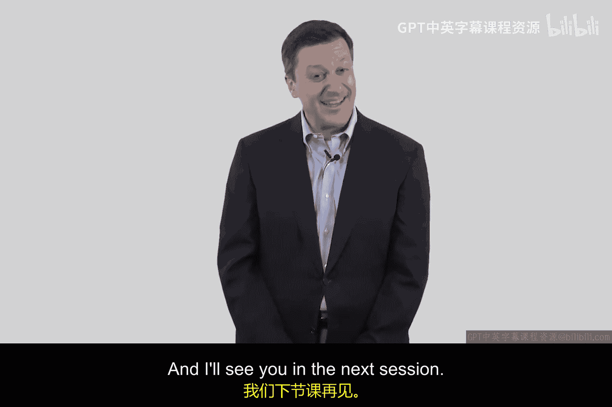

# 纽约大学《网络安全｜Introduction to Cyber Security》中英字幕（deepseek p05 5_恶意编译器程序.zh_en -BV1TFLZzYE26_p5-

You know， before we get into this session， I want to tell you a little bit about myself。

 So kind of grew up in Bell Laboratories。 It was this wonderful technology environment that I think was about the most incredible place to learn computing networking software was kind of in the 60。

70s，80s that that group that Bell Laboratories group was writing some software And one of the products that came out of it was something we know as Unix。

 which was the base technology for most of the things that run on your phone。

 Certainly ios and Android are Unix derivatives。 as is Linux。

 And I think even if you lift the hood up on Windows， you'll find that in the kernel。

 there's something called a Poex compliant piece of software， which is also Unix。

 So you could argue just about everything you run on all your computers emanated from Bell La's reason I bring this up is because around that time there were a couple of geniuses there。

 two guys who built Unix， one of whom Ken Thompson， won an award a touring award。😊。

You should know is the computer science equivalent of say the Nobel Prize。

 He won the Turing Award for Eunix and when he gave his speech。

 he talked about Trojan horses and how in some sense。

 you can make them invisible to code review Now you might remember in a previous session we talked about how we were looking for a Trojan horse that was inserted and say a login program where you' checking login password he' look in the code and there it is。

 but here's what Ken Thompson reminded us。 let me give you a little bit of background。

 I think you guys know and when you write a piece of software。

 you put it in a translator it might be compiler might be an assembr some of you I'm sure a programmers so you know that you write code it gets translated into something that can then be executed。

 and I understand there's linking and loading but to make things simple program translator object code makes sense。

 So what Ken Thompson said was take this source code that has。You know， maybe it's clean。

 There's no Trojan horse embedded in it。 I run it through a good compiler。

 I'm going to get clean object code， clean source， clean compiler， clean object。 Everything's good。

 But if， as we learned previously， let's say put Trojan horse stuff in the source code。

 I put a little check with a secret trap or password。 Di source through clean compiler。

 produced dirty object。 Got it， I write the Trojan horse， translate it。 It's in the code。 Well。

 we said earlier， you find something like that， Well go， look at the code。 See what's in there。😊。

I'm going to have a little piece of software that says if password user ID valid。

Or password equals ABC 1，2，3。 then let you know， I have that in there。 I'd see it in a code review。

 Here's the genius that Ken Thompson came up with。 He said， you know what。

 instead of putting it there， why don't you have the compiler just insert that。

 Do you follow the compilers translating So it sees clean source code， And when it's translating it。

 it translates the clean， but also inserts。The dirty part， isn't that， I't that something， I mean。

 here's the implication of something like this。If previously you thought， well。

 I can always look at source code and see if it has Trojan horses and we all acknowledge that， yeah。

 I mean， 99% of the code we run， the programs we run， the things you download your phone。

 you're not looking at the source code， but if you could。

 you could probably sense that there was something weird if you see these funny password checkers that are in there。

But if I do it in the compiler， the chances of you ever having the opportunity to go in and review the code in a translator。

Very， very， very low。 Now， let's think about this。 It implies something that as computer scientists。

 as engineers， as business people， as students that we must understand。And it's profound。

 Here's what Ken Thompson said。 I want you think。He said。

 you can't trust any piece of software that you didn't completely write yourself。

 including all the translation tools around it。 the corollary there is， you can't trust software。

 This is a depressing fact in computer science now， If you've never heard that。

 that I hope you're sitting down。 And， I mean， that's a pretty jarring concept that we can't trust software。

 And in some sets， it helps to explain this crazy cybersecurity industry that we're going to be learning about in our sessions。

 You think， why am I watching software to see what it does。

 Why do I have to build scaffolding around systems， why can't I just fix it in the first place。

The reason is because we can't trust software， that's the reason。

It it's probably the one root cause for almost every hack we've ever seen that software turns out。

 is remarkably difficult to get correct。You know you build a building and the building should be a structure that stands。

 You don't build systems around a building to catch it when it falls over。 It would be ridiculous。

 You would say be kidding me。 And yet for software， we build software we put it in place。

 And then we build cybersecurity around it to stop it or catch it when it goes awry。

 This is a fundamental notion， this question of trust and systems。

 I want you to keep that in mind as we go through the sessions。 Now。

 just to kind of check on our learning here around this problem of translators。 Let's do what we do。

 Let's think about how you might stop something like this。 You remember previous session。

 we talked about soda machines。 I asked you think about how you'd fix it， we tape the note。

 we put a camera。 we tried all this stuff。 none of it worked too well。

 We also when we were talking about our simple login program。 I said。

 how would you find the problem here， we came to the conclusion to code review might be the best way to do it。

 Well now I would ask you as a little quiz。How might we reduce the risk of a Trojan horse in a compiler。

 let's go through the three options， so first option might be to test the compiler so that would test it。

 run through a bunch of tests。Second possibility would be to impose stiff contracts or legal contractual requirements on the compiler vendor that we're buying the thing from。

 And the third might be to interview lots of different compiler vendors when we're buying our translator。

 So we've got testing， We've got contracts。 We've got multiple vendors。 Now， think about that。

 Which of those in your mind， you think would potentially reduce the risk。

Of there being an insertion in your translator。Think what you find me think about it。

 Testing will have the same problem we had before。 Too many possibilities。

 very unlikely that you'll ever pick something up in testing。 So that doesn't work。

 Let's skip to our third one。 This issue multiple compiler vendors。 Well。

 maybe it would be a good idea to talk to a few different vendors， maybe reduces the probability。

 maybe， but I think the correct answer here is interestingly enough B， that means contractually。

 you should ask your software provider to sign something。

 saying that's nothing like that in the code。 make it if they're going to put that in。

 at least force them。To lie on a contract， they're be a little bit tough for them to want to do that。

 So it's a weird sort of thing where a computer scientist， a software engineer， a manager。

 would have to resort to essentially making the software vendor raise their hand and swear they didn't put the thing in there。

 And you do that with a contract。 I think it's kind of funny because usually we like to fix security problems with functionality and hear I'm fixing it with a contract。

 So well， I hope you learned something with this。 And I'll see in the next session。

