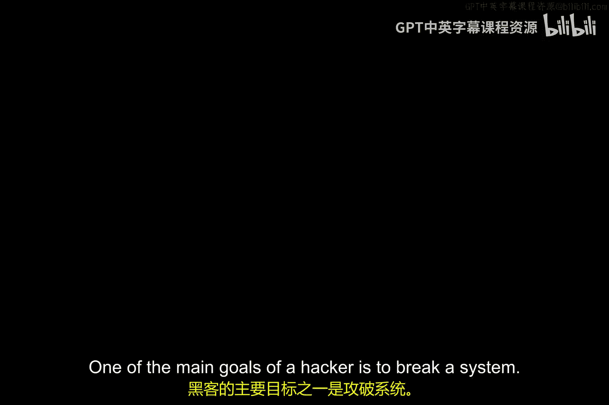
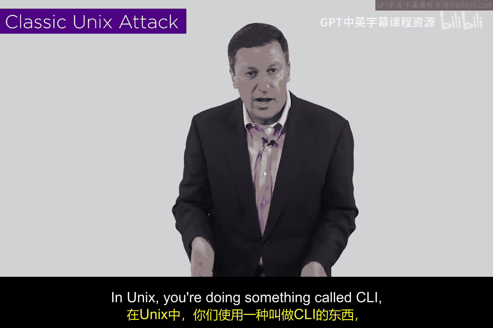
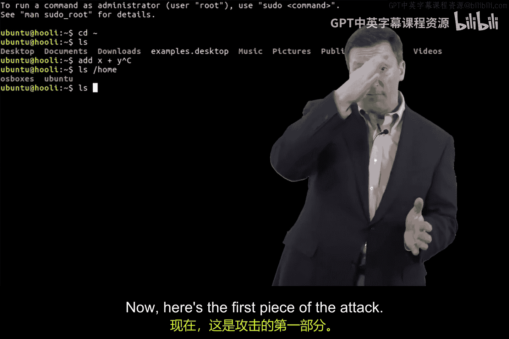
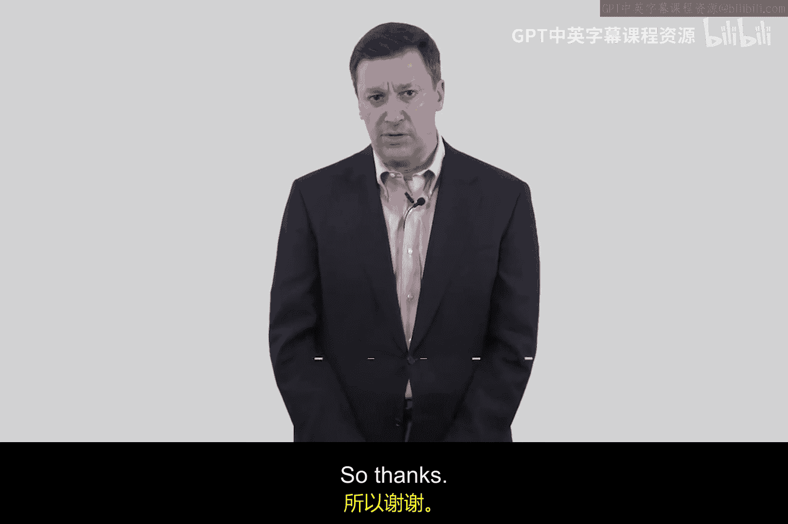
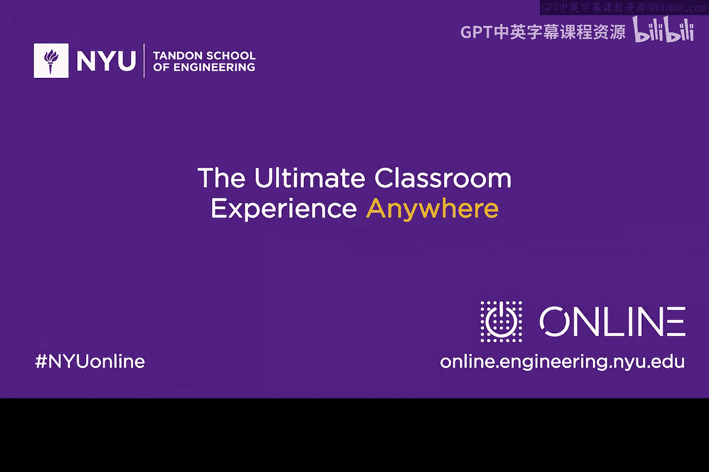

# 纽约大学《网络安全｜Introduction to Cyber Security》中英字幕（deepseek p06 6_典型的Unix内核攻击.zh_en -BV1TFLZzYE26_p6-

One of the main goals of a hacker is to break a system。 Now， the most popular system we know is Unix。

 the base of Linux， i， Android and so on。 So when I say Uniix。

 I'm saying it in a generic sense in and around those that family of systems。

 I want to tell you about an attack that sort of worked in the 90s a way of kind of getting access to the kernel to the underlying system of Uniix。

 This is going to be a little tricky for you to follow。

 I'm going to take it through in stages and we've got some material。

 you can look at the charts and they might help you a little bit。

 but I want you to try and follow as I take you through this attack。 Now， here's the key。

This attack involves features that seem fine on their own。 But when you combine them。

 it causes a problem。 let's take the first one In Unix。

 you're doing something called Ci or command line interface where you're typing commands。

 Instead of pointing and clicking yourre typing which means you're typing letters， spaces， arguments。

 spaces and so on。 Those spaces are called white space。

 and they separate a command from its argument， Like if you were typing add space。

 X space plus space Y。 the spaces separate the different fields in the command line interface。

 That makes sense。 So in Uniix， weirdly enough。 In addition to just a space and say a tab。

 that's what you would guess。 you can put anything you want in there。 Now， in Unix。

 there's a thing called a path name。 where you have a slash character。

A slash character， a word and so on。 And the first slash we call on Eunuchx root。 Now。

 here's the first piece of the attack。

Take the slash and define that also as a white space。 It's a simple command in Unix。

 It's called the internal field separator。 It's a variable。

 You just say that internal field separator is both space T and slash got it。 That's stage1。

 Ey to understand。 You could say， why would you want to do that。Unix designers were weird。

 They just liked to give you the option of having weird command line interface。 Now。

 the second feature that we're going to use in the attack is something called set Uid to root。

 And this is a feature in Uniix that allows a program running with low privilege to suddenly jump up to get high privilege to do something and then drop back down the low。

 So for example， if we're on a shared system。 And I said。

 can you touch the password file and you're a normal user， you'd say no。

 I can't change the password file But if I said can you change your password You go Yes。

 I can change mine and I have a command， I can change my own password。 I'd say great。

 then what that means is you're going to invoke a password program as a normal user It's going to run when it has to go change a password file set UI to root。

 change the password file with high privilege and then execute Go that So set UI allows a program to increase its privilege Now the third feature of Uniix is that it's。

So that means you can read the code， go and read what's going on。

 So go find some program that runs set UI to root and find some piece of code that runs at high privilege。

 So for example， if there's a piece of code that runs with high privilege and a set UI program that does exactec space slash file。

 slash something like a path name。Then notice that that's there。That's the third stage。

 just write it down， see what that piece of code is。Now。

 a fourth piece of this is that in the Unix shell， you can put commands in and run it as a program so I can create a program called Steel shellll and put commands in。

 So what I'm going to do is I'm going to put a little program in。

 put it in my home directory that's going to copy the Uniix shell to some other name。 Now。

 you should know that in Unix， the shell is my view of the operating system。 It's S H。

 It's the name of the command name of the program。 So I'm going to copy my view of S H to some other name called it Ha shell。

 Now， let's go through this。 First thing I do。Make IF S include slash。 Got it。

 Next thing I have in my home directory that program that copies the shell to some other name。 Now。

 third， I run the set Uid program。 And what's going to happen。 It runs increases privilege。

 Does the exact space slash。 And then there's a name。 Let's say that's called bin。 You know。

 that program that's in my home directory Call that bin。

 And now what'll happen is it's going to execute bin。

 with high privilege and it'll copy the shell to you。 I that crazy。

 Let me go through that one more time with you because it's amazing how they all come together。

 I put a program in my home directory called bin。 That program copies the shell to a hack shell。

 I change the field separator to basically dissolve the slash character。 It looks like a space now。😊。

I run a set UI program。 It increases the high privilege。 It exactecs， but ignores the slash。

 runs something that says bin thinking that's part of a path。

 I've dissolved all the all the path separators and it's gonna copy a shell to me。 Now。

 that's tricky。 Listen， it's not important for quizzes or anything。 for you to memorize those steps。

 If you didn't understand that I don't want you to freak out。

 Most people have a little trouble with that。 but I wanted you to see that this can get a little complicated。

 that hacking is not simple。 But when I explain it to you， it's totally simple。 You got it。

 you need somebody who can really dig into the internals and create a hack。

 but once it's created once it's automated， I could write the program I just told you and mail it to you when you run it。

And now you're a hacker。 you didn't have to do the design。

 But I wanted you to see something that was a little bit more involved。 If you're interested。

 it's very easy on the Internet to go off and find different types of resources。

 different types of information around hacking。 be very careful with that， though。

 I don't want any of you downloading hacking tools and actually doing this sort of thing to real networks。

 But it's certainly worth taking some time to go review。 And as part of the work here。

 we'll make sure that you see some good， solid resources on all of these different things that will help you in your personal learning plan。

 So thanks。

