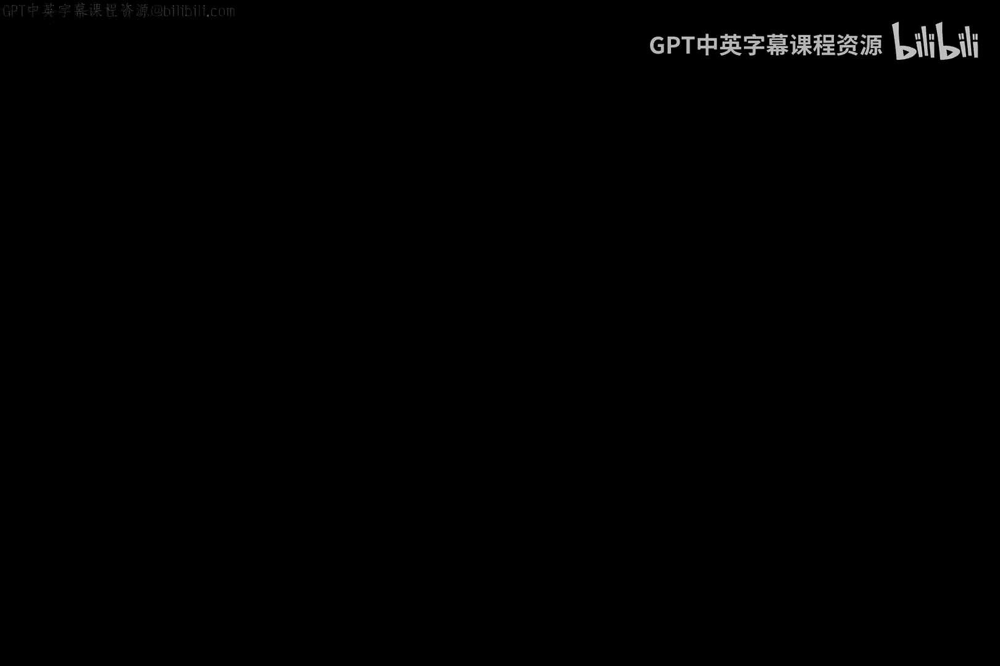
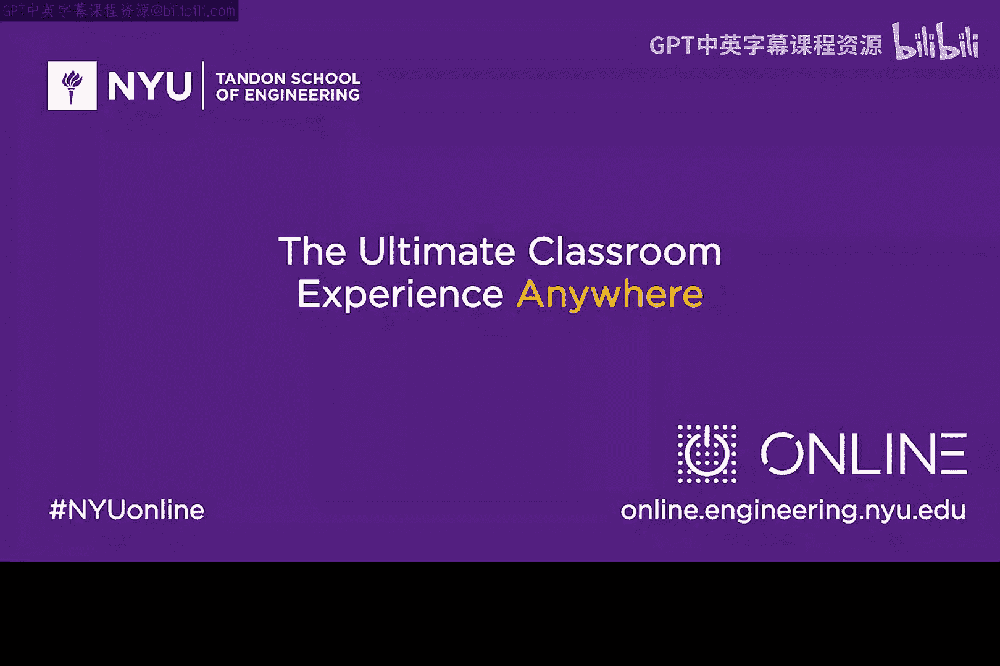

# 纽约大学《网络安全｜Introduction to Cyber Security》中英字幕（deepseek p07 7_解释访谈系列.zh_en -BV1TFLZzYE26_p7-

You know， as a learning community， we're going to be spending so much time on technology and on architecture and on security concepts that we wanted to balance that with some practical discussions with people I think you're going to enjoy hearing from We'll mix in some CEO founder types of security companies so you can hear from them and also some practitioners。

 what you're going to find is sometimes they'll use jargon or terminology that may or may not match what we talk about during our lectures。

 but itll be a good balance for you。 and I think you're really going to enjoy it。

 So as we go through the series。 listen to our guests， see what you can absorb about them。

 and in some cases， you can do some research on them on the Internet。

 learn a little bit more about them。 So I hope you enjoy our interview series we're doing it to try to provide some nice balance。

😊。

