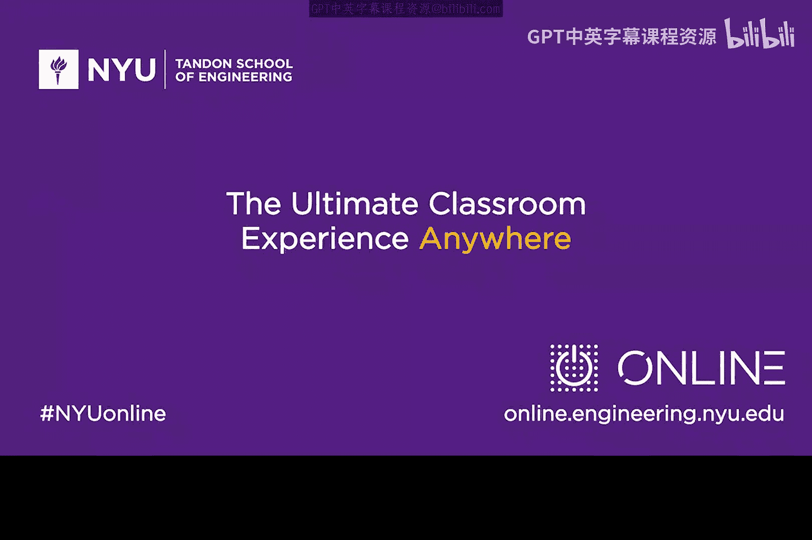

# 纽约大学《网络安全｜Introduction to Cyber Security》中英字幕（deepseek p08 8_欢迎Lou Manousos第1部分.zh_en -BV1TFLZzYE26_p8-

Well， welcome Luminusos， the founder and CEO of Risk IQ。 Wecom， Thanks for having me。 That's great。

 Thanks for coming。 Hey， tell us a little bit about yourself。😊，Well I'm as you said。

 the founder and CEO Rik IQ， I have a background in technology， grew up in the Midwest。

 I've been using computers and thinking about security from the young age of seven years old。

 always fascinated with the internet and how that could sort of change things one of the things that sort of drew me into cybersecurity was I originally went to university for a degree in physics and while I worked in the university。

 a professor came by one of my professors on rollerbls and he said， hey。

 you're this odd physics student that knows a little bit about Linux and in security。

 we have this program over at Arrgon National Las and we need somebody like you who knows physics who can work in the lab but also can help us because that's where we're going in physics is to embrace the internet and in computing that's actually how I got into security was trying to secure servers and make。

The world of physics more secure， did you find that some of the thinking that you did studying physics？

Kind of leads well into computer science。 So so the thing that I find really interesting about physics is the same reason I like cybersecurity and that's that cybersecurity is a game theory。

 it's a larger discipline with adversaries and it's also a problem that's very difficult to solve if not impossible because it's a game between the bad guys in the good guys and you know physics every time you get one step further to the answer the answer just keeps getting further away so there was a lot of similarities that I saw working in physics and what I still see today every day。

 there's a new threat， there's a new thing to learn whether it's on the business side of things that are on the actual technology。

 That's great。 Now tell us about founding a cybersecurity company。

 what prompted you to do that and tell us a little bit about what it takes to do something like that So I think there's really three things that embody。

The culture of。Of a company。 And this is something that I talk to our employees about。

 One is that you have to have passionate curiosity in solving a real problem for a customer and customers in this case。

 it's really everybody we use the Internet and there's threats。

 there's bad guys that want to break the system。 having that tendency to chase the rabbit down the hole and really have an interest in solving a problem for a customer and then continuing to innovate that's very。

 very important。 I think many companies don't take the perspective of the customer。

 they think about trying to solve some problem without knowing how it maps to a business use case。

 And what you'll find as a startup founder that's successful is that your customers will guide you towards the truth。

 So that's something that I look for all the time And when I hire people and。

Think about my partners in the business， do they have that type of orientation？

But it goes back to the curiosity if you don't wake up in the morning and worry about， the problem。

 you're not gonna do a good job at it。 So you got to really love the business that you're in。

 so you said customer over and over and over， is that really the key like focus on customer do you think well。

 you know you got to get your hands dirty is what I say and that means living in as the target。

 So if you're in cybersecurity， you think that's a career for you the only way to know what it's like to be a victim is to work with the people who are actually targeted and so that's what I mean when I say customer So and I like to solve problems by witnessing the actual event myself。

 and so the curiosity gets you there but then once you're there you have to live in their shoes So that's really why I think that's so important a ton of people get it wrong and what you'll need is money to start your company and the only way you're gonna get funded。

I if you've got use cases from real buyers。 So why not bring those buyers in earlier the way that I always look at it。

 I think people get that backwards often they go think about raising money first without really understanding the use case。

 So you think if someone has passion and persistence and willingness to innovate。

 combine that kind of with customer focus ability to raise little money are those the ingredients to being a successful entrepreneur。

 I think yeah， the people and those finding other people who also believe in those qualities tend to build the right team and if you miss that team and you get the wrong partners。

 if you can do it all yourself great， but that's rarely the case。

 So it's not only having those qualities in yourself but being able to select others who can can go on that journey with you it's not a it's not just an end state。

 starting a business， you've got to like the journey So that's the other part of it is if if you're really passionate about solving this。

blem every day is another day of that journey and you want to make sure those people who are sitting next to you in the chair are people you want to sit next to That's great well Lou thanks so much for sharing with our learning community。

 It was wonderful talking to you。 thank you Thank you very much。

