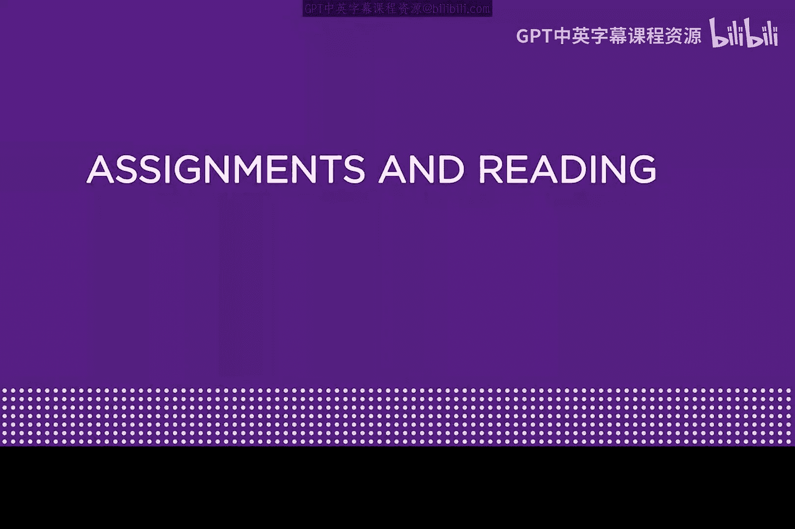
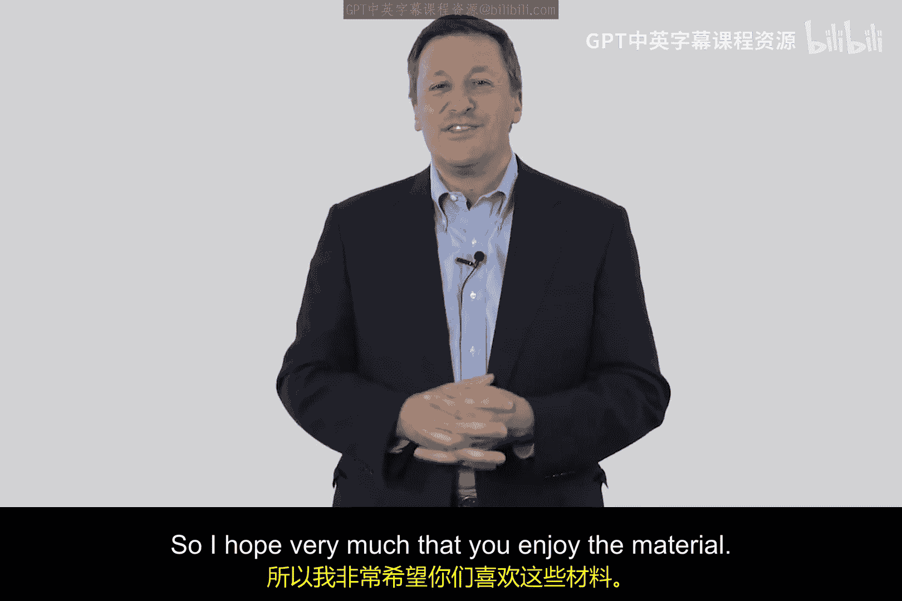
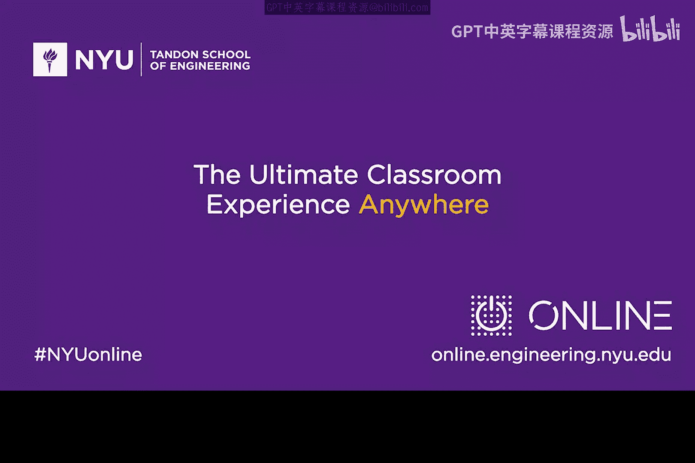

# 纽约大学《网络安全｜Introduction to Cyber Security》中英字幕（deepseek p10 10_作业与阅读.zh_en -BV1TFLZzYE26_p10-

Everyone， I'm at Ammaros， and I want to welcome you to this module。

 Our goal here is kind of introduce some basic threat modeling with some examples。

 I think you'll enjoy it。 kind of takes a real simple basic threat issues。

 and it gives you a little bit of flesh on them so you can learn a little bit about。

 Now there's some papers and books and videos I'd like you to kind of follow along with as you go through the module。

 One paper is written by an academic。 His name is Ross Anderson。 I think it's a really good paper。

 It's an older paper called why cryptoysems fail。 it kind of takes you through some of the problems that have existed with cryptoys。

 I think it'll be a good background for what you're doing。

 A second paper is by an old colleague of mine。 his name Steve Belivvin。 again， in older paper。

 It's called there be dragons and it talks to some of the early problems that we saw on the Internet with security。

 I'd like you to read some of the older papers because it provides perspective。

 maybe the daily social media stuff that you read about。😊。

On on an hourly basis nowadays about cybersecurity。's a couple of optional books， one is an ebook。

 It's written by myself and my son Matt。 It's called from CIA to AP。

 an introduction to cybersecurity。 I'd like you to read chapters 3 and4 from that ebook。

 which you can get at Amazon again， it's optional but it's sort of a companion book to the course。

 and for those of you like to have something that it gives you an optional means for reading along with the module。

 and also I think it's important that you have a good TCPI book。

 Richard Stevens is written one of the best。 again， it's optional particularly of your background。

 it's a little weak in TCP。 then read chapters 3 and4 from Stevens textbook， which again。

 I think should be on your professional technical bookshelf。

 there's a couple cool videos that I think you're going to enjoy。

 One is from my friend Pat Peterson who works at a company calledgarri。

 There's a whiteboard session on a standard called Dmar。 I want you to watch it。

 It's a little bit about。Some of the threats we have on the internet now but also will telegraph some security solutions that you may find useful you know in protecting emails take a look at it's kind of a good video he standss in front of a whiteboard and I think it's excellent and then there's a Defcon video Defcon 18 paw by owner take a look we've got the description of the course and there for you to take a look at it's about what happens when you steal hacker's computer I think you'll enjoy the video and it'll complement some of the things we do in this module so I hope very much that you enjoy the material。

 we take you through in this module thanks。

