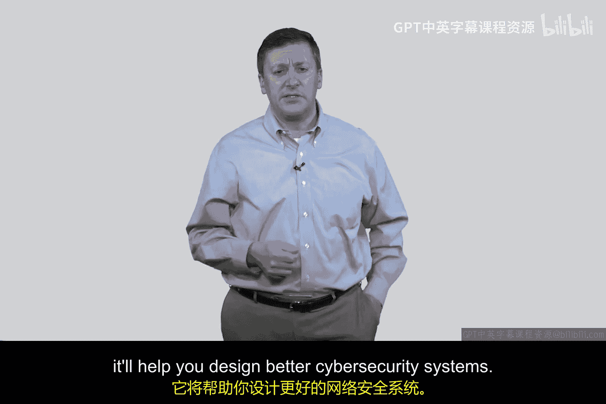

# 纽约大学《网络安全｜Introduction to Cyber Security》中英字幕（deepseek p100 11_有状态与无状态防火墙.zh_en -BV1TFLZzYE26_p100-

Hi， everyone Ed Emmarroso here。 And I want to talk to you about two different types of computing devices and ultimately two different kinds of firewalls。

 But think it's true。 just bet any device。 So we'll keep it general and then we'll hone in on how this works with firewall and the two types are ones that either have some ability to remember or not。

 and the thing we're going to remember is something that a computer scientist would refer to as a state。

 So a state is something you can think of as like a snapshot。

 If I want to freeze frame memory in a computer or freeze frame something， some aspect of memory。

 just remember it， freeze it and use it in some subsequent state。Then that's called being stateful。

 like having the ability to capture and use state， to have memory。

 to be able to count something or say， oh， I saw this before to have that ability。In contrast。

 some devices don't do that。 Some devices just have programmability that in some sense is referred to as being context free。

 So imagine me as like a guard in a building and I'm told I say， listen。

 here's what you're going to do。 when somebody comes in， you say。Are you wearing a blue jacket。

 if they're not wearing a blue jacket， you send them off。If they are wearing a blue jacket。

 you let them in。Not wearing blue jacket， get lost， wearing blue jacket come in。

 so you're programd to just look blue jacket。Oh， you got on， go ahead in。Come in blue jacket， Okay。

 come in， not wearing blue jacket Go off now let's say。Some guy Bill。

Comes in and he's wearing the blue jacket。And you go，Hi Bill， blue Jack。Let's you in。 And then Bill。

 for whatever reason， realized that he left something is coffee out on the street。

 So Bill tiptoes out， grabs his coffee， comes back and says， oh， hi。 And you go wait。And you go。

 what， you go what， now Bill， when he went inside， happened to take his blue jacket off， he says。

Well， I want to go back in you go， well， sorry， you nott wear a blue jacket。

 You said you just let me in two seconds ago。 Don't you remember。 I came in。 I said， hi。

 I'm wearing a blue jacket。 I walked over there and went I forgot my coffee now。

 I happen to take my jacket off if you're not letting me in and you go no， I don't remember anything。

 All I do is you have a blue jacket in。 you go in No blue jacket get lost。

 You see how crazy that is but a lot of pocket processing works that way。 It's packet comes in。

 read what's in the packet， do something。 packet comes in， read what's in the packet， do something。

 no statefulness。 No， like if I'm guessing passwords。

 you might have a game where you say if you guess the password you're in。

 If you don't get the password you're out。 So you go password， Oh， no good， sorry， password。 Oh。

 no good。 sorry， password， Oh， no good sir you might do that a billion times。

 and that device never becomes suspicious。That something might be going on because it's not programmed to remember you follow this is foundational to cybersecurity。

 you are either making decisions that are stateful or stateless and yes。

 we tend to talk about that in the context of firewalls it's almost always talked about in the context of firewalls。

 but what I want you to do is generalize the notion， statefulness。

 statelessness are properties of any device that's making any decision about certain types of things and I like the idea of sort of contextfr and context sensitive context free。

 meaning。Make the decision， don't worry about what happened previously， context sensitive， oh。

This is the fifth time you're getting a bad password to me。 maybe something funny is going on。

 I'm taking into account the context in which I'm detecting something。

 These are foundational concepts or things that I want to make sure you understands why I highlight these context in one video。

 like I'm sure going to pack this with 10 other things。 but I really want to highlight that。

 because it's something that you ought to have in mind as you're designing systems。

 and particularly as you're designing firewalls。 Now。

 you'll see that when we do think about firewalls， packet filtering。

 which we'll be doing a little bit where we're investigating a packet and making decisions about it。

 will tend to be stateless。But a concept called a proxy。As we'll define in a subsequent discussion。

Will tend to be stateful so as you move up the application stack， say in the OSI stack。

 things tend to be more stateful and as you move down， they tend to be more stateless。

 but not perfect and something you may be cringing oh and no you could be stateful layer too and I agree I'm just saying with the tendency is that as things get more intelligent。

 more application aware tend to have more memory so keep that in mind stateful， stateless。

 and it'll help you design better cybersecurity systems we'll see in the next video。

