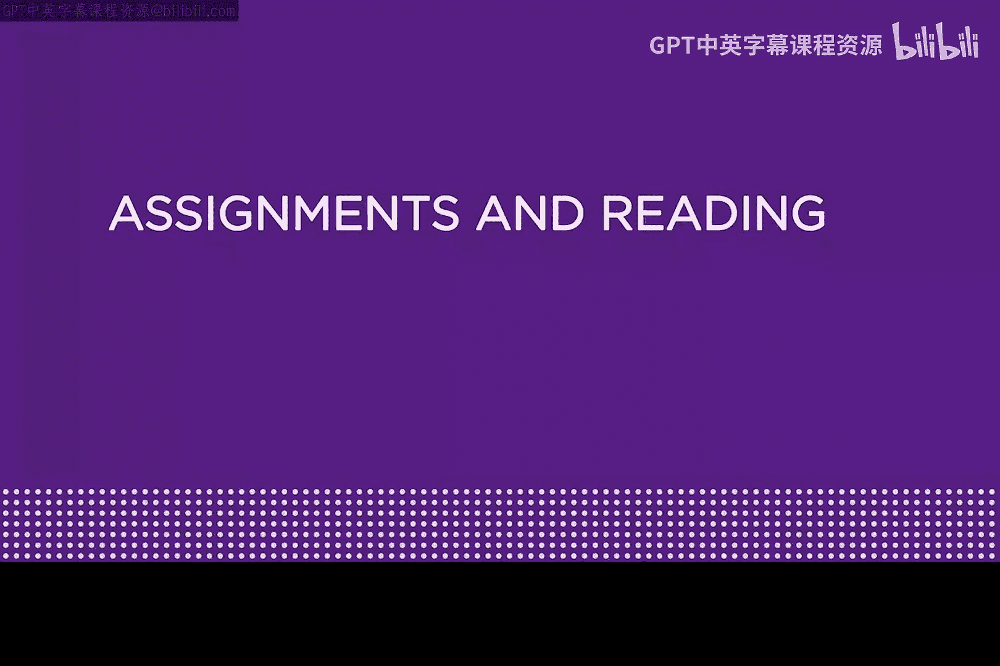
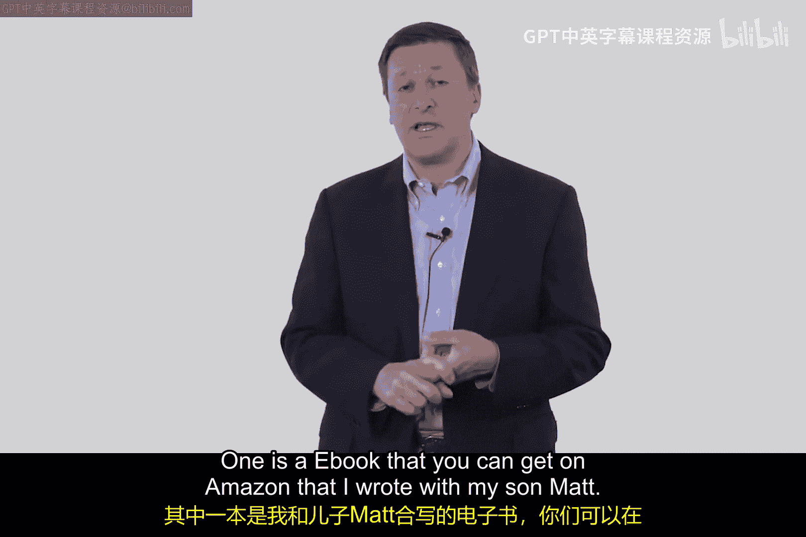
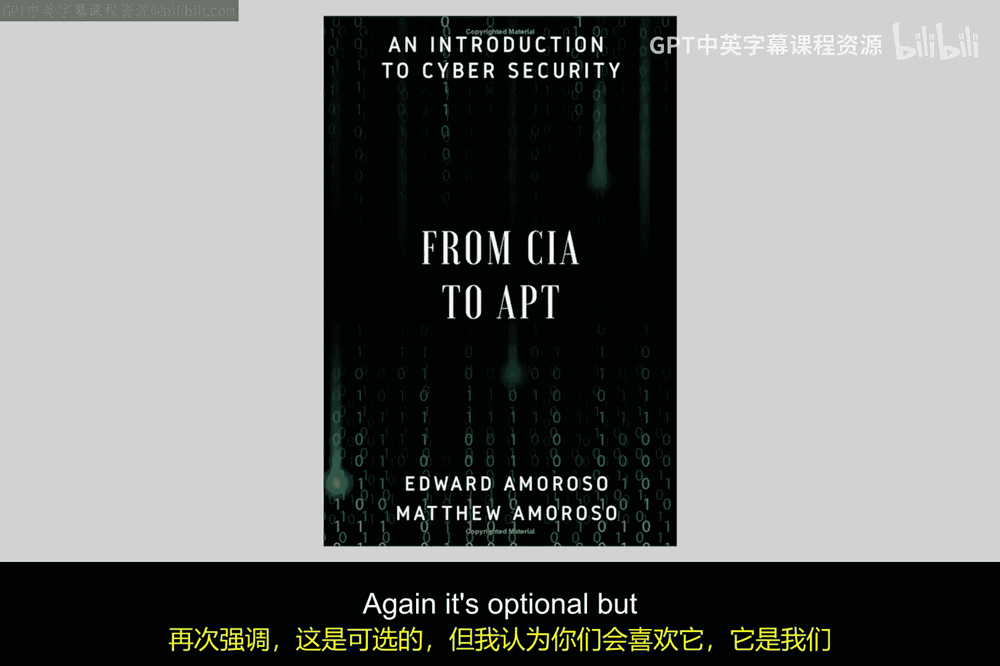
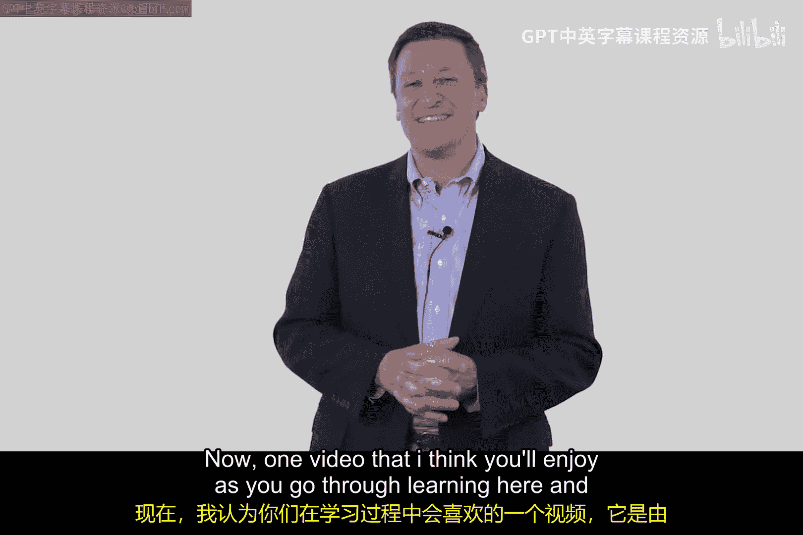
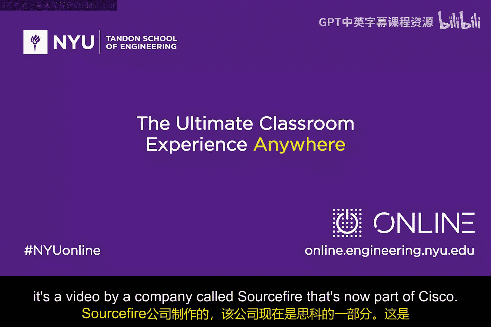

# 纽约大学《网络安全｜Introduction to Cyber Security》中英字幕（deepseek p102 13_作业与阅读.zh_en -BV1TFLZzYE26_p102-

Hi， everyone Ed Amorosso here。 and I want to welcome you to this module。

 now the goal in this module is about packet filtering firewalls and kind of leading into some intrusion detection things。

 I'll have you looking at some resources that have a lot to do with intrusion detection。 Now。

 there's some papers， some optional books and a video that I think will help you enhance your learning as we go through this module。

 So first in terms of papers is's a couple of papers on Is that I think would be good Is being intrusion detection。

 and keep in mind， sometimes the papers don't always match exactly the material that's in the module。

 sometimes I like to do some complementary things that offer a different set of technology issues that like I said。

 will compliment because as you're learning about packet filtering and firewall naturally。

 you're going to be thinking about how we can detect the attacks。

 So I think these papers will be helpful。 The first is long names written by a group of authors called theomaminlybased network intrusion detection Tech。

 systems and challenges。Survey and I think very good and a second paper that I think is important called intrusion detection via static analysis by Wagner and Dean。

 Take a look at these two papers they'll help you not just in this module。

 but in your overall learninging of Cysecurity and as you Pro in this area that's a couple of books Opional that I think you should look at one is an ebook you can get on Amazon that I wrote with my son Matt it's called from CIA to AP an introduction to cybersecurity。

 hope you'll look at that again you can read chapters 1920 would be the right ones to read to go along with this with this module against optional but I think you'll enjoy this good companion to what we do here Now one video that I think you'll enjoy as you go through Learning here and it's a video by a company called Soce Fire that's now part of Cisco 2013 video but it's very cool and it's called How does Intrusion Prevention Systems work。

I think it's cool and I think it's a good compliment to the material that will go through this module about pack of filtering firewalls and sort of the beginnings of real-time security techniques to stop cyber attacks that are aimed at you know infrastructure and enterprise and everything else。

 so I hope you enjoy the module。

