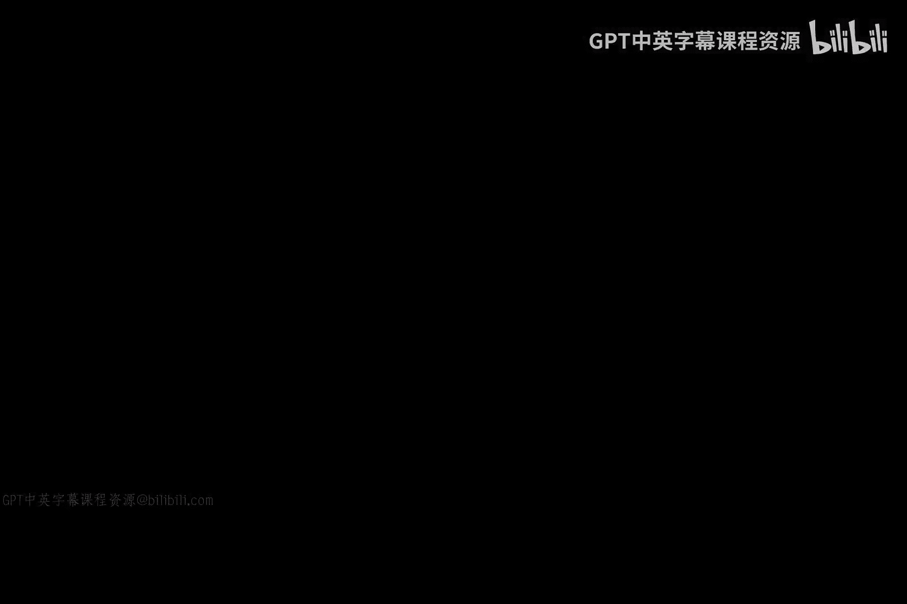
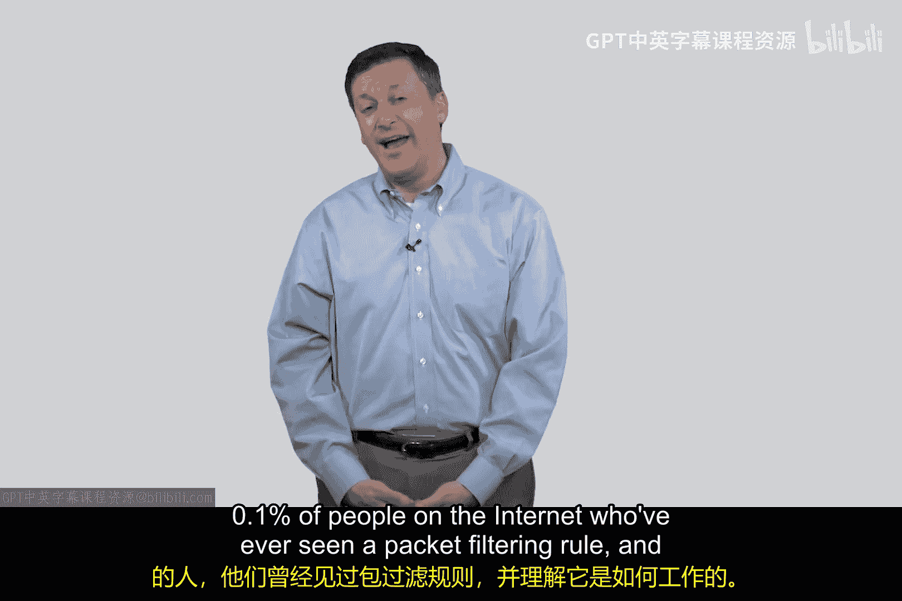

# 纽约大学《网络安全｜Introduction to Cyber Security》中英字幕（deepseek p104 15_示例数据包过滤与参考架构.zh_en -BV1TFLZzYE26_p104-

Hi， folks at Emmarosso here。 Now to understand packet filtering。

 there's some basic concepts we have to look at the way a typical packet filter on a router or on a firewall would work is that you。

 the user， the administrator would be presented with the graphical user interface and all the different components we call them sometimes columns of information that you'd have to use to describe or build rules that would dictate whether you're allowing or blocking packets would be in these respective columns I'm going to show you up on screen here rule。

 So the typical thing would have a rule name in first column source IP address second column destination IP source port。

 destination port， the protocol that's being used， which we're assuming is TCP the actbit setting which you know is so important。

 an interesting one called the direction of the packet is it inbound or outbound which we'll get to in a minute and then the action。

 these are the conditions。On which we build rules now。The address is source IP destinationin IP。

 I'd said in some previous discussions that we've had on if you've been watching other videos。

That these IP addresses are provided by ISPs or by network administrators。

And they can either be temporary， we use the word ephemeral。

 and these are numbers that typically are going to be greater than 1023。

 but it want to be a little bit more fine grain。From say，50000 to 65000， we call those ephemeral。

 Those are ones that are going to be very temporary。 from 1024 to 50 k。 call those registered。

 So we put certain types of not exactly reserved and certainly not ephemeral。

 but there'll be some services that would would belong in there。 And then， yes， from 0 to 1023。

 that's where our registered， I'm sorry， reserved wellknown servers exist。

 you can go off and study this a little bit。 It's not that important。

 your understanding of cybersecurity。 But I think it is important to your understanding of how routing and things like that work。

 If you want to be a network admin and you got to dig into that and really understand that logic。

 But for now， we're going to assume greater than 1023 means you're not a。Resserved address。

1023 and down reserve， fair enough。 the reference architecture that we will use will have。

 and I've got on the screen there， an in network that we say is trusted。

 an out network that we say is not trusted。 and any packet that's leaving the in network is called outbound。

 Any packet that's leaving the out network coming to the in network is in band。

 You follow that's the direction。 Now， let's do a couple of very simple rules here。

 that kind of give us some idea of how you might set up some sort of a packet filtering router。

 Let's say we set up a rule。That does something very simple All it does is it checks to see if a packet has a source IP address that's in。

 you follow source IP address that's in and the direction of the packet is inbound Now think about that。

If you're saying I'm in， but the direction of the packet is inbound。

 meaning it's hitting that interface on the router， does that make any sense， it doesn't。

 that means somebody's lying， It's a spoof do you follow So what would I do drop the packet okay now。

Similarly， if I had a rule that had an out IP address， outsource IP address。

So it's coming from the internet。And technically， it should be inbound。

 but it's labeled as outbound direction。That makes no sense， right。

 both of those cases make no sense they would be called spoof detection and spoof blocking rules。

All the other whatever you put is the match in those rules。

 like whatever you put is the condition won't matter。

 So a lot of times we'll use a star or a wild card to say I don't care what the source port a destination port is。

 If I've got a packet that's saying I'm already inside originating inside。

 and it's coming directly in who cares what the source port is。

 who cares what the destination port is that doesn't make any sense as a packet。

 you follow This is how we develop these rules。 This is how we do it。

 These are our tools We use columns。 We use reference architecture。

 We do matches on the individual cells in each column and we can use a wild card when we don't care what matches。

 and we built some very powerful rules and you're going to see in a minute。In in a subsequent video。

 this idea that we would develop rules that would specifically block something。

 you'll see later that they don't make a lot of sense because our philosophy is going to be more toward thinking through what we allow blocking everything else versus the result。

 but we'll get to that later for now， congratulations on having seen your first packet filtering rules。

 If you understood that then you're welcome to the you probably 0。

1% of people on the internet who've ever seen a packet filtering rule and understand how it works。

 So I hope you've enjoyed that we'll see you in the next video。

