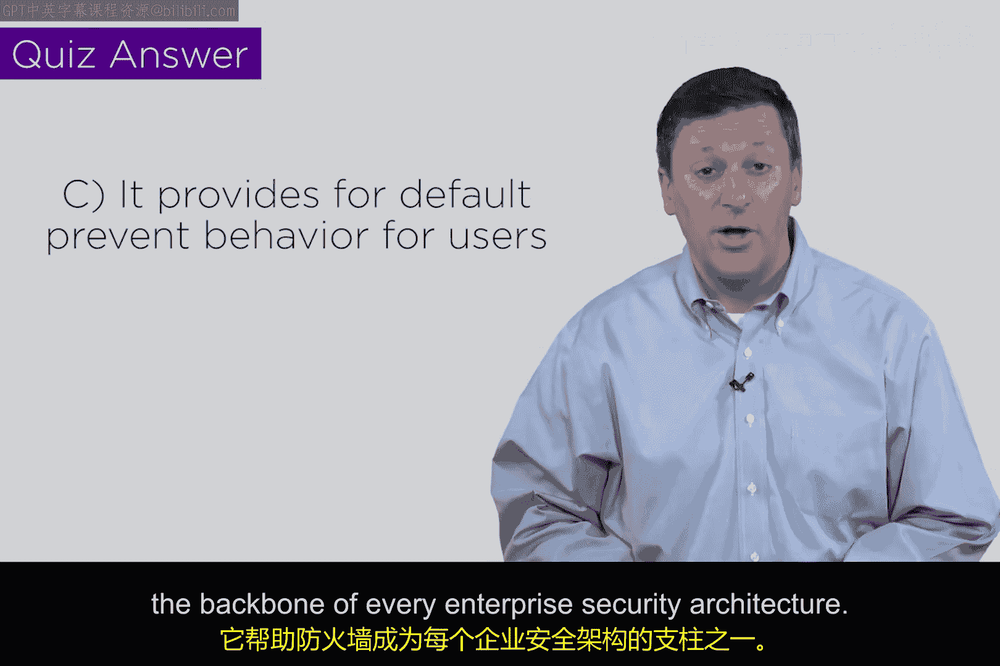

# 纽约大学《网络安全｜Introduction to Cyber Security》中英字幕（deepseek p105 16_默认防火墙阻止.zh_en -BV1TFLZzYE26_p105-

Hi everyone androso here now I want you to take a minute and think about how the antivirus software on your PC works。

 What does it do， It has a list of stuff。That it's looking for。 These are called signatures。

 any virus signatures or patterns。 And I'll say， oh， do I see this anywhere， No。

 do I see this anywhere， No， do I see this anywhere， goes all the way through its signatures。

 And when it's done， if didn't find anything that it was looking for。 It goes， okay。

 you can use your PC。 No problem， you're all set。 That's called a default， allow security tool。

 It means I'm going think up a bunch of bad stuff。And if I can match on any of the bad stuff。

 then I'm going to do something like not allow you to use the machine。

 but if I can think of the bad stuff， anything I can think of。

 Ill let you on default allow Now in contrast， a firewall will typically work in a very different way just the opposite in fact。

 So let's pop up our our typical towers here you know with the different rules and let's look at rules。

 source IP Dest IP and so on。 and what you'll see is that each of the successive rules in a packet filter。

A analyzed successively。 we go from the top of the page down。

 That's how its the semantics of how the computation is done。 I compare against the first rule。

 Does it match， do the action。 I look at the second rule。

 Does it match I do the action all the way down to the n minus1 rule。 And if it matches there grade。

 If it doesn't， then I get to the n or last rule and that's going to be a default rule on any pack of vote。

 because I have do something。 You have to have some decision you're going to make because the philosophy in a firewall is that I probably want to block things that I didn't think up faster or think up in the context of my rule development。

So the default rule in a packet filter is going to block。 So here's what that means。

 let's say you have no rules whatsoever that you develop and you put a packet filter in place。

 you enable it and you go go what's going to happen， There's no rules。

 it's going to match on every packet it's going to block everything you've now just put in place something akin to snipping the wire。

So that wouldn't be very useful unless that was your purpose unless you really wanted to snip the wire and then put a packet filter in with one default block roll。

Probably not all that useful， but now let's say you say hm。

I'd like to let people do whatever I want to allow domain name system packets into my enterprise and that's the only thing I want to do okay。

 so you put rules in there that allow that。And then the default rule blocks everything else。

 which means if I don't think to specifically allow。Then you're not getting in， it's way more secure。

 but way less convenient， meaning it's a lot of obligation then for the firewall team。

 whoever's doing the firewalled packet of filtering and you'll see a little bit in proxy。

To make sure you have rules in there for whatever your business really needs。

 So a lot of times when people are in the business of doing firewall development and set up an operations or so on for a company。

 they'll tell you funny stories about the initial so period where they put these things in place。

 and everybody's always mad at them。 This group can't get to the Internet。

 and they can't get this application。 And step by step。 you put in place。

 the things that need to be put in place。 And eventually all the complaining dies down。

 And you've got all the things you need followed by a default block rule。

 That's the nice smooth situation。 If only life were that simple。 and it's usually not that simple。

 But at any rate， you get the idea that any virus is default allow firewalls are default block。

The former is more convenient， less secure。 The latter is more secure， less convenient。

 Does that make sense。 Now Let's do a little quiz to test our understanding of this。

 And I guess that's a little odd because when you put in all of the above and none of the above。

 then there might be a logical and consistency doesn't even matter because the answer is C。

 So the answer is the default rule prevents access， if a given service is not specifically enabled。

 So that gives you some idea of the power of this default block rule really is something that's important。

 And it's helped firewalls become part of the backbone of every enterprise security architecture。

 We'll see on the next video。

