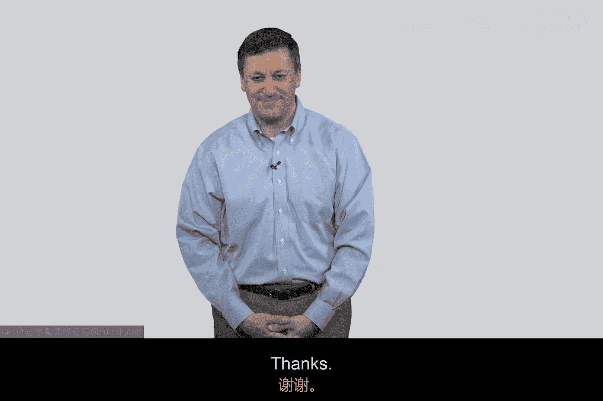
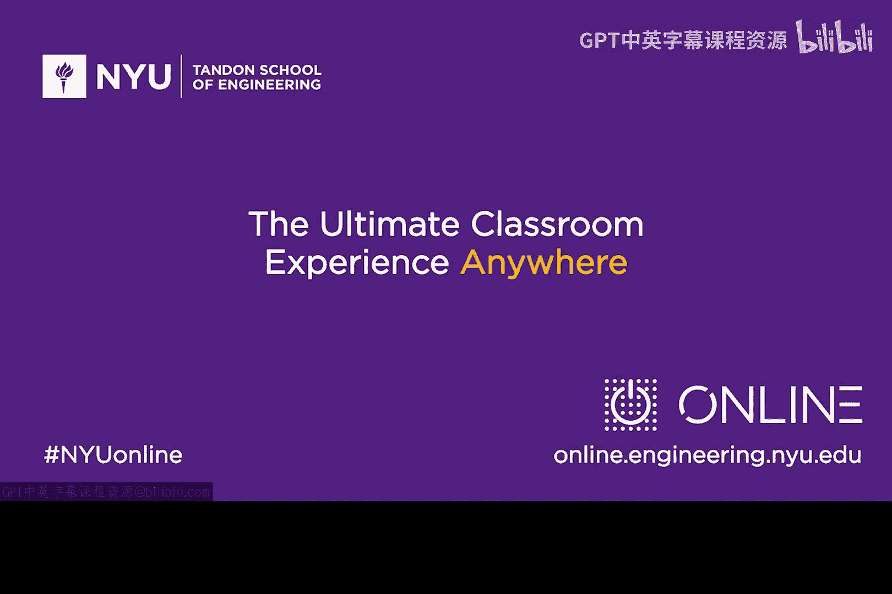

# 纽约大学《网络安全｜Introduction to Cyber Security》中英字幕（deepseek p106 17_允许出站网页浏览的防火墙规则.zh_en -BV1TFLZzYE26_p106-

Hi， folks at Emmarosso here now what we're going to do in this video is I'm going to show you how to set up a packet filtering set of rules。

That will allow web browsing， let's say outbound， let's say you your firewall。

 you got a bunch of users that work in your company or something。

 You're the admin and everybody goes hey， we want to be able to surf the internet。

 you got a default block rule。 so you're gonna to put rules in that allows somebody to go out to port 80 services So we're gonna have our towers rule S dipDP protocol act direction action right those are the rules so let's look at our first rule。

 first one is going be to allow the outbound HTP S packet。 Now this is how it works。

 you need a rule in the packet filter that sees the S packet is going out the port 80 right it's your browser in your user that wants to go out to this web server and you got to have a rule that allows the packet。

 So the first packet is going be looking for allow outbound HtP source IP is in destination and IP is out if you knew the IP address of the website that'd be great but you probably don't people want to be able to surf all kinds of things So you want to be able to just sort。

Characerize that it's an out IP address and your packet filter will come with software that will allow you to set up broad ranges of address and a good packet filter will have some shorthand like you see on the screen where it says out address source port greater than 1023 that means it's a client destination port 80 protocolcol TCP Actbit0 right it's the first one direction is。

Outbound。Right。And the action is going to be to allow。Okay， that makes sense。

So when I see all of this， I've got outbound going out to a web server。We're good。

The second step is the SAC packet， that's the response packet that's coming back to your user。

So it's an out address， destination IP is in， the source port is 80 that's coming from the web server。

 it's hitting your destination port that's greater than 1023 Procol TCP Acknowledment bit now is one and now it's an inbound packet coming to you and we're going to allow that。

 So you see how we let the first packet and second packet。 so we're good。

Third one is the act that has to go back out to the internet。

 so it's an in address going to a destination IP that's out。

 the source port again is your user greater than 1023。Going to port 80。Protocol TCP。

 acknowledgeledment bit1， direction is outbound， and we're going to allow that。

 Once you've done that， you've got a session set up。 and as long as that act bit is set to one。

 I have the ability now。To transfer data， these rules are going to be sufficient for the three step TCP handshake and for data to be passing back and forth。

It's good news now notice the first and the third rules here in our little setup。

How do they differer， They're exactly the same rule except in one， the Act bit is0。In the third rule。

 the Actbit is one。 So you know that regardless of what the Actbit is， if all the other fields match。

 it's going to be an allow。 So what you can do is put a new rule in that combines the first and third。

 puts the star into the Act field and you end up with the two two rules that you see on the screen there。

 you see allow outbound with essentially the Actbitt at star。

 And you see the second rule with the Actbit is set to one。 These two rules， in some sense。

 are the canonical framework for how you establish packet filtering rules for services on the Internets very powerful concept that you can put a rule in star on the Actbit list the source IP and destination IP sourceport destination port set them appropriately with those two rules。

And you're in pretty good shape， so from this we will jump off and do some other types。

Of serviceservic and subsequent videos， but I wanted to make sure you saw this and we focus on HTTP。

 which ultimately is going to be the most important service that we use on the internet。

 so we'll see you in a subsequent video， thanks。

