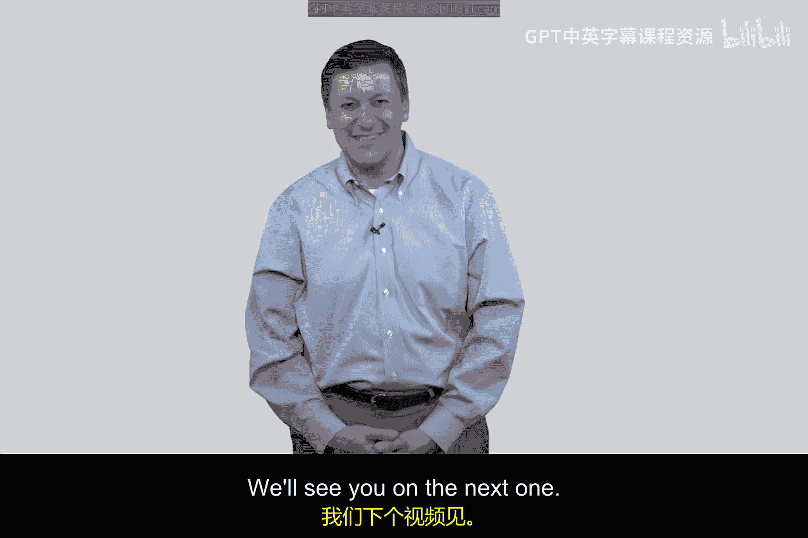

# 纽约大学《网络安全｜Introduction to Cyber Security》中英字幕（deepseek p107 18_允许Telnet及其他TCP服务的防火墙规则.zh_en -BV1TFLZzYE26_p107-

Hi， folks at Ammarosso here。 Now， listen， as you progress in your understanding of cybersecurity。

 you're going realize that as you do real time situationally aware or cyber protection。

 cyber defense。 one of the things a lot of security engineers know and do and almost have fun with is understanding and knowing and memorizing the well-known ports of different types of services like say fort 80 everybody goes TtP。

 everybody sort of knows that。 And there's older ones that they know。 and it's just sort of fun。

 you may want to go dig in and take a look。 but the reason that's important here is that we'll show you here on the screen。

 These are the rules that are in place for an HtTP outbound browsing session from an enterprise that has a firewall protecting its users in order to make changes to this rule for many types of services。

It turns out to be pretty easy， like if I think I told you about in some subsequent discussions。

 we talked about Tnet。That's4 23 if I want to take this canonical setup for HCTP and just have the rules in place for Tnet and what I do。

 Bing I just change 80 to 23 and the rest stays the same that kind of rocks。

 doesn't it like it makes it a little easier to think through how you might set these things up。

And then if I decide， hey， I want to do SMTP， well。

 that's 25 B I change it to port 25 and I have the same canonical setup。

 There are some shortcuts here right It's not always this tedious process of having to go through it。

 look here's my heartfelt advice to you if you enjoy this sort of thing。

 enjoy packet filtering and setting up rules and so on， you have to learn TCP。

 you have to learn the protocol， have to learn the suite。

 you have to learn the vigarities of each of these different types of services like SMTP simple mail transport protocol or tellnet or ATTP。

 even if they don't necessarily show up in your network。

 you have to know these things because hackers will try to use them。

 hackers don't care that people don't use tnet anymore。

 they're gonna to see if you've got it sort of sloppily set up on your network。

 you've got to keep track of these things。Sometimes my friends will say why do you use these old protocols in your examples。

 Why don't you use newer ones gaming stuff and might see well because hackers don't care if it's old。

 they'll use whatever they think they can get through with in fact in many cases。

 the older protocols are best because you may have an old legacy rule that's there that you forgot to pull out and it'll take full advantage of that。

 So if you like this， dig in with this sort of thing and spend some time and look at the reference materials that we've recommended in the videos that lay out our recommended books and articles in this area and you'll find that you have a lot of fun playing with and learning and being good at packet filtering and also help you find a job。

 So I hope you enjoyed the video we'll see on the next one。

