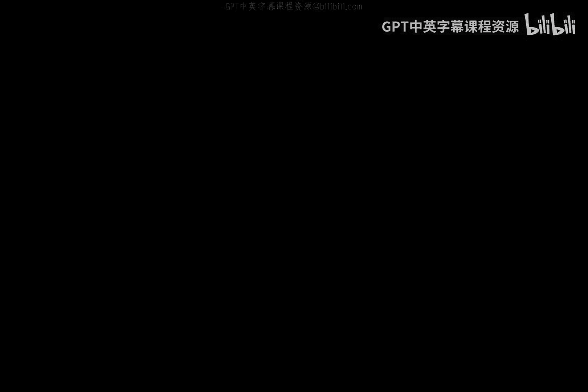
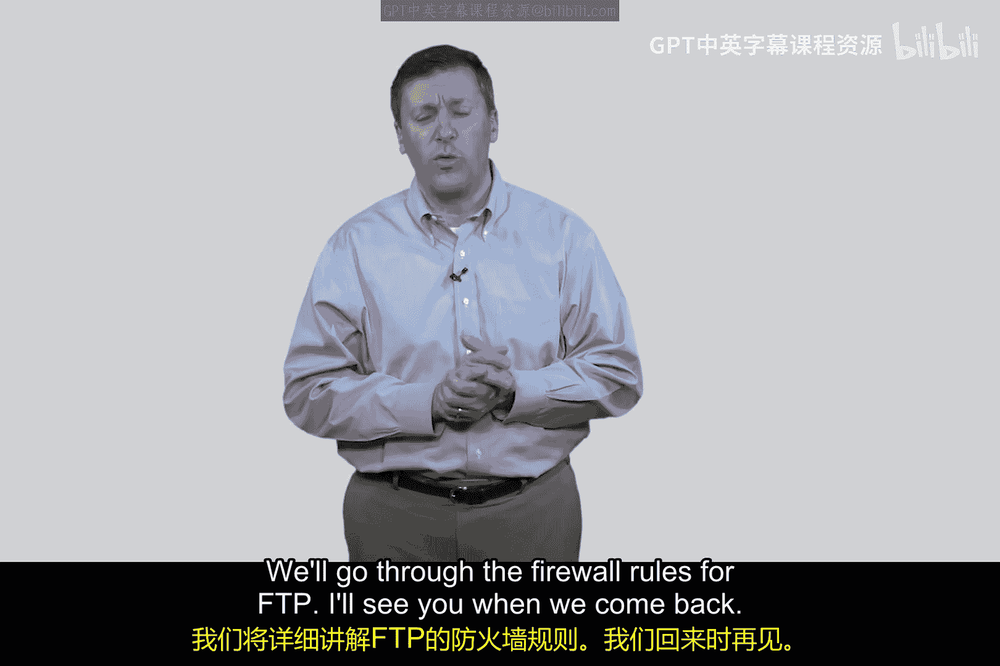

# 纽约大学《网络安全｜Introduction to Cyber Security》中英字幕（deepseek p109 20_FTP协议.zh_en -BV1TFLZzYE26_p109-

Hi， everyone Ed Amarosso here and in this video I want to tell you about a crazy protocol called file transfer protocol or FTP。

 reason I say crazy is it was designed a long time ago。

 I think some people have told me that they think this may be one of the first protocols that existed on the Internet。

And as you look at it， I'm going to show you it。You'll see that it's a little messy the way the thing is set up Now why do we care about that from a security perspective because when we go to design packet filtering rules for this one。

 this is a little tricky。 this is not the simple HTTP thing that we had before just sits lightly on top of a TCP connection it turns out that FTP uses two different TCP connections and they go in different directions which makes life more difficult So here's the way it works。

 we're going to set up an FTP client and an FTP server I'm going to represent the programs that are running these named programs that have ports by arrows。

 vertical arrows that are set up the FTP client is going to have two ports that are open one on some high number you 5006 I made that up5000 whatever five also made that up and then the server because it's a well-known capability is。

GoingTo have low number ports as you've learned。 So we're going to use 20 and 21。

 those are reserve ports for FTP， essentially set up control and for data transfer。

 So here's how this thing is going to work。 Let's say we have a client。

 and the way it would work is you download the client。 It looks like most clients。

 It's going to allow you to。Download files from an FTP server。 I know a lot of you would say。

 well why don't you use HTTP for that。 And the answer is you would But when there was no HTTP。

 this is what we used to download a research paper or an article or whatever used FTP。

 So the server is going to start by one of the ports it's going to send a port command and and that word port is different than the Ttp port but bear with me it's the name of the command that FTP used。

 sends this command port to port 20 on the FTP server and then FTP server then responds with an okay and in the content of that port command it's going to tell the FTP server oh。

 by the way， I've got another port that I opened here on 5006 so gives you that number now the server knows you're on 5005 because that's a source port So I have to tell you。

That I want you to do 5006 for data transfer and this thing is the server initiating outbound I'm sorry client initiating outbound to the server。

 you follow the client initiates a TCP session and then sends a port command and gets essentially an okay and that's the data transfer in some sense on top of the TCP command。

 but think of it as I'd need a rule that allows outbound we'll get to that。Once that's done。

The server now initiates a connection back。To the client。

And it basically comes from port 21 to the 5006 port that I told you about in the content field of the port command。

And then I say， okay， and then we transfer data。 So think of it this way。 I'm a client。

 you're the server。 I initiate something outbound to you saying， hey。

 this is the guy over here you're going to transfer data with and then the server goes， okay。

 and then we shut down that TCP connection。 Now a new TCP connection comes from the server back to this guy to say okay。

 you're ready to do data。 He says， okay， and they transfer data do you follow bi directionional。😊。

We're going to see that cause problems a little bit， but do you see how？

You have to look at how the protocol works if somebody taps you on the shoulder and says I need you to do security for FTP。

 you would go。Okay， well what do I need to do And the answer is。

 you have to dig into the protocol and look at this。 Look。

 I have so many students that I've taught for 30 years who ask me。

 how do I become an expert network security engineer and my answer for 30 years has been first become an expert network engineer Under the protocols。

 Under the plumbing， Under the services， because once you do。

 it becomes sort of obvious what you need to do， the security protections in some sense。

 are just overlaid on design。 Security is a engineering attributes， sort of like availability。

 reliability， dependability， security， these are properties of systems takes on too much of a life of its own。

 when things become hyper sort of highlighted， as we've seen with cyber。 one of the。

Things that I think， you know I'm happy to admit is that I would like to see nothing better than for cybersecurity to become embedded in other disciplines like would we'd be standing here having you know a deep discussion about dependability maybe we would but we certainly don't bat an eyelash when we do it about security and they're both properties of system so in a subsequent video we'll look at the firewall rules for FTP but for nowve give me a chance to sort of lift the hood up on seeing how FTP works and shown you that they're not all just sort of these obvious protocols that are easy to understand so we'll be back in a subsequent video we'll go through the firewalls firewall rules for FTP LC when we come back。

