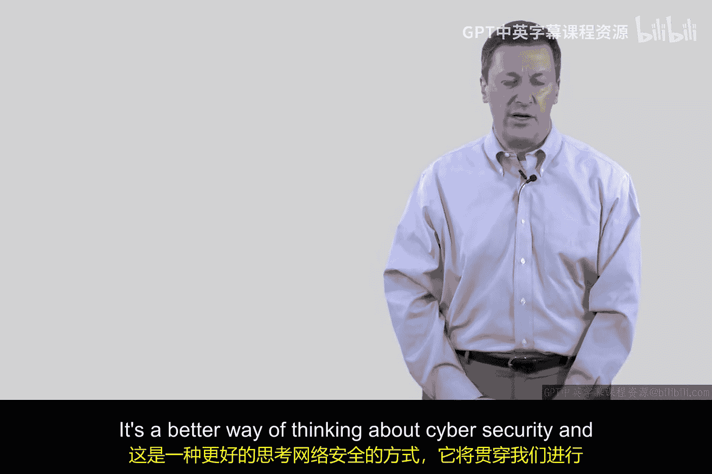

# 纽约大学《网络安全｜Introduction to Cyber Security》中英字幕（deepseek p11 11_网络安全的目的.zh_en -BV1TFLZzYE26_p11-

You know， I want to take some time here to get a little philosophical and talk about the purpose of cybersecurity。

 Like what's all about。 And it's an important thing for you as you're learning this topic to think through yourself because what'll happen is you spend weeks and weeks and weeks learning about cybersecurity。

 And then your friend， your mom， your cousin， your spouse， a co says， hey。

 what is cybersecurity all about。 And you say， you know。

 I'm not really sure I have all this information in my head。

 but I don't really have a good solid understand。 So what we're going to do is take a minute here and make sure that we're all in agreement around what this boils down to now。

 years ago， in the 1970s。 there was a man James Anderson was his name， a pioneer in cybersecurity。

 and he was pondering this question as computers beat were becoming more powerful。 The question was。

 what is we called it at the time， Comp security。 We called cybersecurity。 Now。

 Here's what he came up with， came up with something called a reference monitor concept。

And think of reference monitor as a box。And on one side of the box， you have active entities， users。

 hackers， processes， things doing stuff。 And on the other side of the box。

 you have resources or assets， files， databases， systems， things you want access to。

 So this is like a repository， this is an active process。

 And you drop this thing in the middle called a reference monitor。 And here's what Jim Anderson said。

 and I still think it's a wonderful way of thinking about cybersecurity。

 albeit a little operationally。 But what he said was the main purpose is that as active entities try to reach passive repositories。

😊，Cyber securityity sits in the middle。 and when those requests come in for access to a resource。

 cyberse says yes or no is not the most technical concept in the world， but he said based on policy。

 the idea is to either allow。Or disallow access to a resource。 And interesting， from that。

 a whole body of cybersecur modeling and technology kind of emerged where we formalized terms here。

 we started to call these things， these active entities subjects。

And we started calling these more passive entities objects。

 And we called that the subject object model of cybersecurity or of computer security and really stood for a long period of time。

 Now， a lot of you would say， well， wait a minute。 What if there's two entities。

 They're both subjects and they want to communicate， send each other email and stuff。

 You're absolutely correct。 Like the model in some sense doesn't fit all possibilities。

 but the bottom line is that you got an active entity wanting to do something and a piece of cybersecurity that is saying yes or no。

What this has caused in our industry I the observation amongst many people。

 a lot of you who are here listening， part of our learning community will say， you know what。

 it's always those cybersecur people saying no， Maybe you have a job somewhere。

 And you get this idea that when you work in the security department， you have to go ask。

 and they usually say no， and that comes from that original concept。

 that cybersecur is this thing where I make an access。 The reference monitor， the cybersecurity says。

 oh， who are you。 O， you're allowed。 and I let you through。 or I say， oh， who are you。 I'm sorry。

 you're not allowed， and I'd say no， that concept， I think increasingly has given way to。

 I think a much more collegial notion of cybersecurity and that security is an enabler。

 And what that means is that under normal circumstances。

 you might be very nervous about whether subjects can or should be accessing objects。 For example。

 subject with。Credit card wants to buy something from website。 and you go， wait a minute。

 We can't do that。 That's too dangerous。 And suddenly you say， wait， I have an enabling idea。

 Let's put this piece of security there。 Now， watch。 Now subject with credit card can come in。

 and I can invent protocols to make sure that everything is okay。

 check to make sure we're good and go ahead and use the credit card。

 It enables the ability of subjects and objects to communicate。

 is not a better way of thinking about it。 It's really the same picture。

 but it's a much more reasonable way of thinking about cybersecurity in the context of business。

 the Internet of all the things that we do。 security is an enabler。 instead of as a blocker。

 So keep that in mind as we go through our discussions。

 It's a better way of thinking about cybersecurity and it'll pervade a lot of the discussions that we do。

 thanks。😊。

