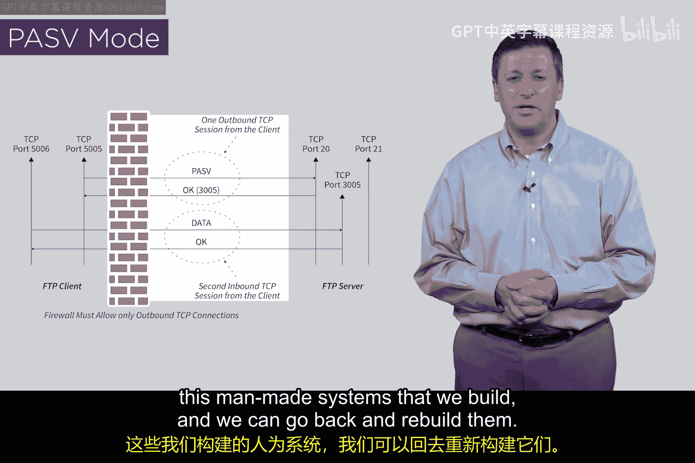

# 纽约大学《网络安全｜Introduction to Cyber Security》中英字幕（deepseek p110 21_FTP的防火墙规则.zh_en -BV1TFLZzYE26_p110-

Hi， folks。The issue of retrofitting security into an existing protocol or service is generally tough to do。

 It's usually a mess， like where you have something that's in place and you got to somehow get security into it。

 Retrofit is always tough。There are cases where it is so tough that you have to go back and redesign the thing in the first place。

 you may remember if you've been with us for other videos that I showed you how to break into an old soda machine。

Well how did that get fixed redesign the soda machine。

 It's like I'm sorry there's no other way to fix this than to just go back and we blew it。

 we got to redesign this thing better。 As you're learning cybersecurity， keep that in mind。

 That's always an option。 You can redesign things。 This is not astronomy where if you don't like the way stars are aligned。

 there's nothing you can do。 God put them there。 Well， you know， you know， cybersecurity。

 but they're dealing with manmade objects。 You don't like the way something is set up， change it。

 FTP can be changed。So it turns out。the designers of FTP。

 I'll remind you we had this idea where we had a port command that went from the client a server on outbound TCP connection if the firewall was phased in that direction and then a reverse inbound TCP connection to transfer data and we hated that because I would have to have a rule for that second thing like I've got a firewall protecting all my clients。

 I'd have to have a rule for that second TCP connection that just says if you ever see an inbound TCP connection from like port 21 anywhere coming inbound。

 you have to allow it。 Would you be comfortable with that rule， nobody wanted that rules。

 you know what they did they sort of the Internet community I've came up with a new design for FTP we call it Pass mode Some people call it firewall friendly mode FTP I still call it obsolete because you probably just use your web browser anyway。

 but at least for a fashion it was。Pretty important that we went back to the drawing board and set things up where the client would issue something called a pass V command to the server。

 The server would then say， okay great， let's do data and by the way。

 here I'm going to set up a port and in the diagram here I setting up you port 3005。

 And then the client goes great， and then it says to port 3005。 hey， you want to do data and it says。

 sure， let's do data and by the way， the reason you're establishing a dynamic new port is this sort of an improvement on FTP allows the server to be more dynamic in its port assignment for data transfer little optimization in the way the thing work。

 But now the firewall only has to have outbound allows no inbound allows and that makes for big smiles amongst firewall engineers do you follow So before we had bydirectional。

 didn't like the rule came to the conclusion we couldn't fix it。What would we do？Change the protocol。

I think it's a good story and I think it reminds us as computer scientists that sometimes we do have to go back and redesign systems。

 Comp is not natural science， it's mathematical science。

 these man-made systems that we build and we can go back and rebuild them。

 so I hope that's been useful for you and I'll see you in the next video。

