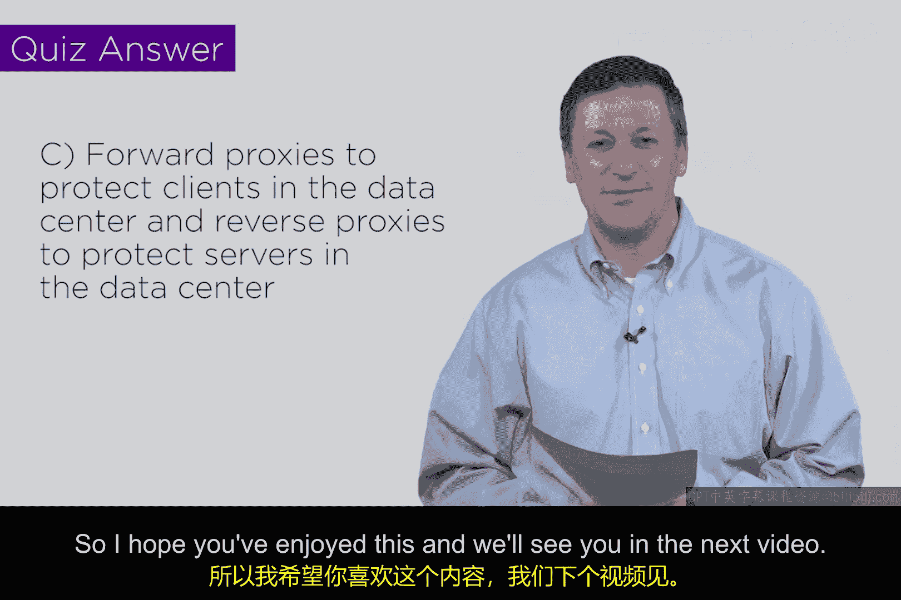
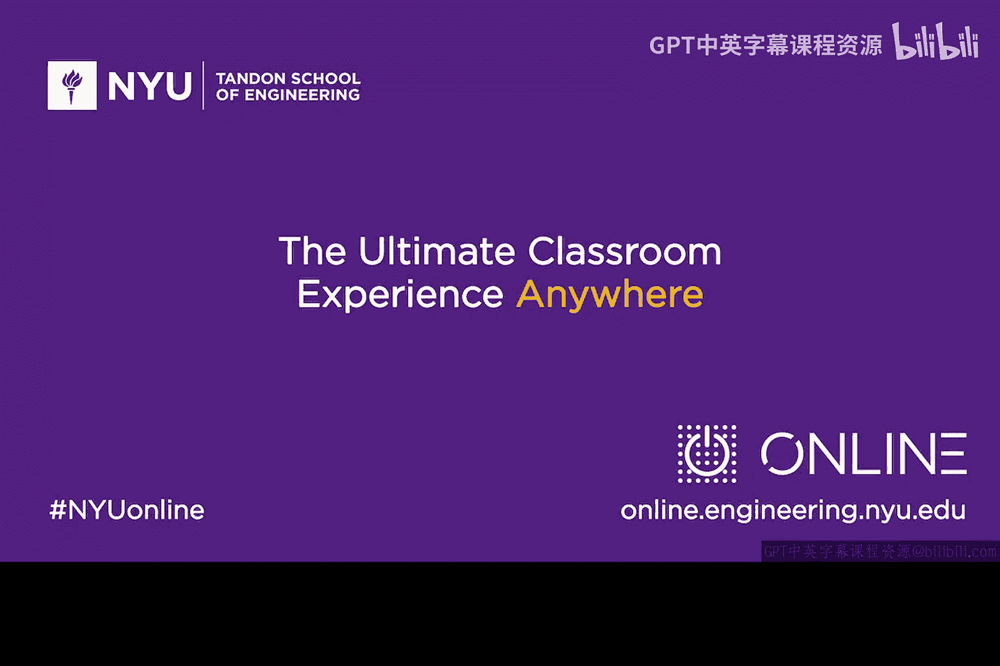

# 纽约大学《网络安全｜Introduction to Cyber Security》中英字幕（deepseek p112 23_正向与反向代理.zh_en -BV1TFLZzYE26_p112-

Hi， folks at Emmarosso here。 Hey， I want to start with a story。

 some number of years ago I was doing consulting for a government agency。

 They were having some trouble of US federal government agency。

 They're having trouble with security and。Thought that maybe they needed some security devices。

 firewalls， and they'd specifically mentioned that they wanted to do something called a forward proxy。

 which is basically a firewall that operates on behalf of a whole set of clients that say want to go out to the Internet or something and they were talking talking about how they might might have misconfigured that because they were seeing straight packets all over the place。

 I remember we sat down and we went through some network diagrams。 They didn't have very good ones。

 And we actually had to almost build them it took a month。

To try and rebuild the diagrams that made sense。 And by the time we rebuilt the diagrams and had interviewed everyone。

 we realized they had a whole segment of their network that was directly connected to the Internet through no firewall。

 no proxy know anything that explained why they had packets floating around the Internet。

 They hadn't misconfigured something they just directly connected to the Internet。

 So I can't underestimate， I can't underemphas the importance of architectural understanding of how things are set up Now。

 this concept of a proxy being a go between is really a conceptual capability that's embedded in modern firewalls and later discussions will get into firewall architectures。

 But for now， I want to kind of show you the two arrangements that a lot of times you see set up。

 The first， I mentioned a moment ago showed on screen here is when you got a proxy operating on behalf of a whole set of clients。

 We call that a forward proxy。 I means。You probably have some experience with that where the clients essentially think they're going out somewhere。

 but they're really hitting this proxy that's operating on their behalf。

 and you may have seen situations where optimizations can be done you think you're on you know we sell cool sneakers on the internet co。

 but actually the proxy has cached that page So what's the point of going out there if everybody's going they're I'll just keep it here and look for updates。

 you get the idea。 So that's a nonsecurity idea。 but you can see how naturally that extends to the idea of a firewall that might be embedded in a local enterprise。

 So keep that in mind that's very useful architectural concept as you're putting together security architectures。

 The second the second possibility is to use some protective proxy for servers that are operating you where clients are trying to gain access to one or multiple servers we call that a reverse proxy。

 they're the same thing。But for the most part， the reverse proxy would be something that you'd be using to protect the logical distinction is minimal and I think what you'll find as you do your own design in and around cybersecurity architectures is that it's the concept of proxy that really matters here。

 this idea that somewhere you're going to put something in the middle of what you're doing and where you want to go and the reason I think it's important to think of that is because as computing becomes more virtual for the most part you're going to find that in the virtual operating system。

 proxy type functionality is going to be part of the infrastructure you're going to see that computing is headed toward something called software definedfined networking。

 you might have heard that term SDN where you virtualized capability everything becomes cloudbased workloads。

 you've got workload to workload and a very convenient way of doing security is embedded。

In the infrastructure you can provide the arbitration and it could be your service provider doing it for you so rather than me having something to protect myself you having something to protect yourself。

 it's possible that your service provider might put something in between both of us and allow as essentially as an arbitration mechanism between us kind of a cool concept and it's something that we'll spend some time on later but for now I want to make sure that you just have down the basic concept of proxy。

 I've got a little quiz for you here and the answer is C you'd want to have basically because you have both clients and servers in the environment you'd want to make sure that you have protection for both and I think in number C we said was forward proxies we're protecting the clients and we said reverse proxies we protecting the servers so I hope that all that confusing nomenclature is not going to make your heads spin too much I hope you。

Enjoy this and we'll see you in the next video。

