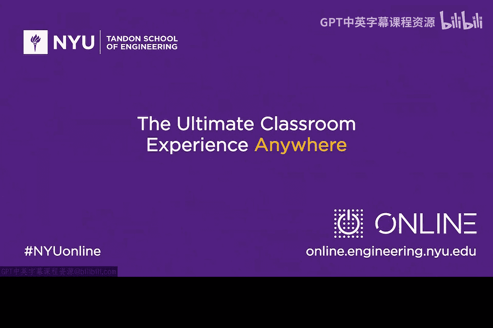

# 纽约大学《网络安全｜Introduction to Cyber Security》中英字幕（deepseek p113 24_采访Roger Piqueras Jover.zh_en -BV1TFLZzYE26_p113-

Hi everybody， Edroso here。 And for today's video interview。

 I have a longtime friend and colleague of mine。 his name is Roger Picars Jovert。

 Did I say that Yes very good Roger is a cybersecurity researcher and security architect。

 at Blolumberg。 that's a great job。 Yeah， it two different jobs， same jobs。 Yeah。

 I kind of like both things。 I do researcher， like kind of open endeded projects and also I do things that are more like close- ended like specific security architecture projects。

 Now let's go all the way back。 tell us a little bit about how if you got interested in technology and you know how did you get to get to the point you're at now。

 Well， my grandfather would say that when I was a kid。

 I was very interested in like machines and cars and trucks。

 the bigger it was and the more noise it made know the more I liked it and I also started playing with Lego is very。

 very young， My parents were afraid that I would actually swallow the little pieces because they recommend there's an agent。

😊，Box that says like three to seven year， and I was always playing with the once for like 12 year old。

But technology itself I would like say you have to fast forward a bit when I was an undergrad。

 I was never a teenager now there's a lot of teenagers that I heard and learned coding when they are 15 I was not like that when I was 15 I was playing soccer and video games。

And but when I went to undergrad， I didn't really know what to study。

 I knew I wanted to do engineering， but I didn't know what type。

 I ended up going for electrical engineering。And I remember one day that changed my life。

 that is the day。 So the first year of my undergrad was mostly like math physics。

 like very basic math and physics。 But on the second year。

 I started having more specific things like wireless communications like things like that。

 I remember the day that I learned the Four year transform and I understood how a radio in the car works。

 And what are those numbers on the radio of the car。

 and how you can separate things of plot things in frequency， as opposed in time。

 And that kind of like blew my mind。 And that day I knew I was in the right place。

 And ever since then， I've been very happy， know dont look like technology and fantastic Wi as an area。

 you've been particularly interested in Yeah career。

 did you ever predict that it would become as important this mobility sort of changed the world the way Yeah know when I was an undergrad。

 So when I started as an undergrad。 People say I look young。

 but I'm not that young when I started as an undergrad as a freshman。

 I did not have a cell phone which would be unthinkable today。

 I think I had my first cell phone when I was in my 30。😊。

Undergrad so people would make fun of me because I was learning how cell phones work but I didn't have a cell phone myself。

 But no back then I was not even aware how， you know。

 I wouldn't have even imagined that like a cell phone would be something that would be。

 so you know you cannot walk out of your apartment without your phone back then I actually when I got my first cell。

 I didn't really want to carry sometimes I would live it at home and my girlfriend at the time and like also my mom they were complaining because they couldn't reach me but like now I leave my phone at home。

 I literally freak out。 So no I would have never expected things to end up the way they did。

 but I'm happy because I ended up in the right place。

 I kind of did a security like the intersection of wireless and mobility security has been particularly fruitful Yeah and that was looking at those threats alone Yeah。

 that was pure chance。 like my academic background has always be in wireless communication。

 signal processing networking， things like that。 And then you know like for a few years。

 I got an offer to go to work for AT in a security research lab。And they just told me like。

 you know very well how cell phones work and cell network works。

 Can you come up with ways to make it not。 And I was like， I guess I could do that。

 And that's how I got into security。 But like it was pure change。

 I was not really ever thinking about working security And again， same story again。

 it's just the right place to live because now security。

 mobility and security are like two of the biggest things happening right now。

 you worry about threats and mobility。 Do you think that it's maybe a potentially consequential So I've done a lot of work on like mobile security。

 and I've seen a lot of things。 So people asked me should I be afraid of using online banking on my phone。

 things like that。 I。So I always think that I'm like a nobody。

 so I shouldn't be too too concerned about what's going to happen on my phone， but for example。

 I don't do mobile banking on my phone really now。Maybe I would。

 but I would definitely not do it when my phone is on GSM， for example。

 that's what I tell everybody like yeah the only moment you should really be concerned like in terms of somebody intercepting your traffic or like doing something。

Other than blocking the cell service， like if you're concerned about like somebodys steal something for you。

 I would say， just you know be careful when you're connected to GSM other than that。

 I don't have I'm not too concerned。 But again， it's because I'm nobody。

 if I was the pricinging of the US， I would definitely not use an Android like I've heard he's using but a different topic I've heard as well but it's the progression kind of from early generation mobility1 g2G through GSM and other say 2G3G kind of progressions to LT and 5G。

 it seems like the security literally ramps up with each generation。

 am I reading that right well so whenever I give talks on my research。

 I always have the same slide at the beginning that kind of gives you a timeline of security and getting better mobile network and I have a thing that highlights that in the first generation of mobile networks。

 there was not even support for encryption。 So I always argue that like we were not off for a good start。

In 2G， there was encryption， but 2G is very well known that like there's only authentication from the network to the phone。

 So you claim that you are like any provider and the phone believes it。

 and then you can do a lot of bad things And then it became very well known that you could do easycaching and other things on GSM3G solve that this mutual authentication。

 strong encryption thing with LT。 And then although it's much better and it's definitely been getting better。

 I always kind of like。😊，But one of the I have a slide that kind of quotes myself that's a funny story because once I gave a talk and I made a statement and somebody told me you should actually quote yourself on that。

 So now my talks I always quote myself on that， which is something I forgot the specific quote。

 but it's something like that although people assume that an LT all these problems don't happen that you won't have easy catching you can have roadway stations。

 you actually can you cannot really do a fullma in the middle connection。

 but essentially any LT device will exchange a substantial amount of messages with anything that seems to be an LTba station。

 And although eventually there will be an authentication handshake and there you would see or no that's not a realway station until that moment there's a lot of messages going back and forth and you can scoop them with them change them to do like lots of things you can service on a phone you can block the phone and you can catch the em you don't need to be in GSM to do em catchching So definitely security has gotten much。

 much better but I always say and I've been like。Talking with some folks at the FCC I always tell them that I still believe there's a lot of work you have confidence the encryption can't be defeated Do you think that's okay I'm not a cryptographer myself and I don't know that there's been any partial breaks of the LT crypto that's rarely the weakness Yeah it's usually the protocol so now I've been working in security for almost eight years and my experience tells me that like crypto is usually what does not break it's like really。

 really smart people working many， many hours on designing things that like I barely understand I always get to the slide with Alice and Bob and once they go past that it's like okay whatever。

I trust you like， but usually that's the part that like extend， you know， like， you know。

 that doesn't really break。 usually it's other things。 In this case， for example。

 LT going to the same example， encryption is very strong。

 But the problem is that before you do encryption， the phone will blindly trust anything that comes from the network。

 So you have to。Before we actually establish an in between you and I。

 we have to introduce each other and you say your  Ed and I say I'm Roger， well， you。

 if you were an LT phone， if I tell you that my name is like， I don't know Michael Jackson。

 you will be okay， and youll believe me。 And that's the problem。

 Like before you actually do the crypto， which hasn't been broken。 that's where the issues are。

 It's interesting。 You know， we have a lot of young people who are part of our learning community here。

 What。What advice would you have for them， they're probably watching saying wellow。

 I would love to be a security researcher Bloomberg if you were sitting with them right now。

 what advice would you have say for somebody maybe in high school or early college years what would you tell them Well from high school one thing that I would say is that when I was in high school I had a lot of good friends that were like classic story。

 somebody who comes up high school because they think it's not going to be useful and whatnot I have to say that as of now I feel grateful and lucky that I worked hard on high school and you can work hard on high school and still like play soccer in the evenings and like and play video games I played a lot of video games and that definitely helped me to do a good job in undergrad and definitely going to college if you want to work in technology going to college is very very important and'm saying that you cannot learn things on your own I actually today I'm learning a lot of things I never learn by just reading books but college is definitely something that is very important that prepares you for like a job in technology。

I would also encourage people to go to grad school because that exposes you a little bit to research。

 which is in like in college or like in high school， you just have a class。

 you learn a topic and you have an exam and everything。

 you know you have a lot of like everything is very well directed。

 you know what you have to do in grad school once you get involved in research it's more like well this this topic there's this area there might be issues that you know you find something to do So it gives you more。

You learn to be independent and to like think well and analyze world problems and I think although this might sound contradictory。

 I think that when you're in college and you don't have in grad school and you don't you're done with your classes where you're learning things That's when you learned to learn things the best like you're facing a problem on area you don't know about something you have to get a book with related papers and learn things So I would definitely encourage people to do that I'm happys that and everything for me was a bit like out of chances when I was finishing undergrad back home in Barcelon。

 I was not a common thing to go to grad school， but a friend of mine who I'm still friends with and he lives in New York he told me that he thought it would be a good idea for me to apply for scholarship or some grad school and so I apply I and actually I got the scholarship and that' what brought here to the US。

I't know I， I would say you should try to， you know。

 think what you want to do and find things that are fun to do。

 One thing that I'm very happy is that I really enjoy my job。 And it's not a common thing。

 but I feel that I've reached that point because I kind of， you know， explored the path。

 I went to college and grad school， I。😊，Try different things。 And I don't know。 actually。

 things work out。 It's a great story， great advice。 Hey， on behalf of our whole group。

 our whole learning community。 Thanks for stopping by NYU。 here welcome。 No。 welcome here。

 It was great to see you。 Great to see you very much。 No problem。 We'll see you next time。😊。

