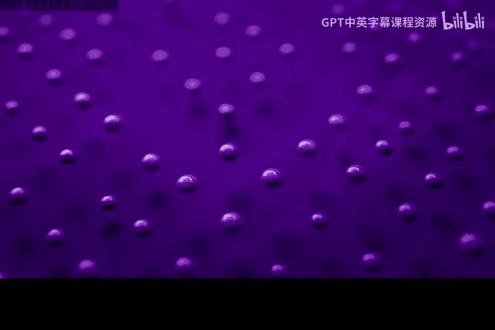
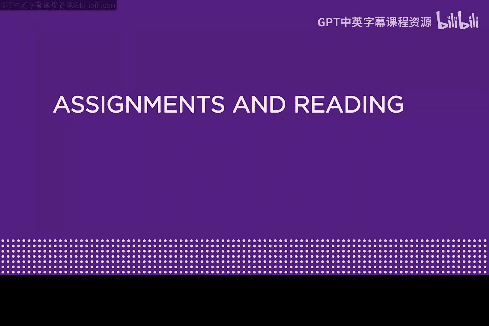
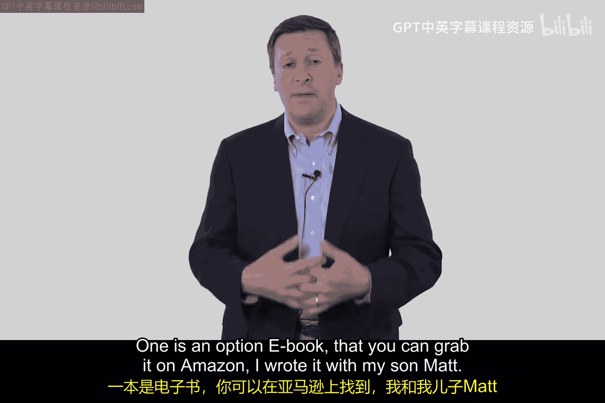
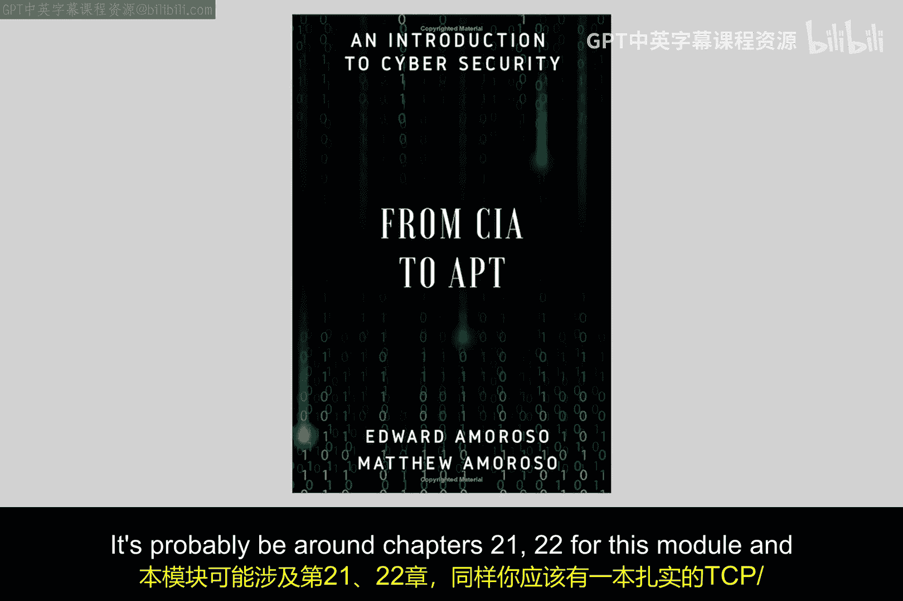
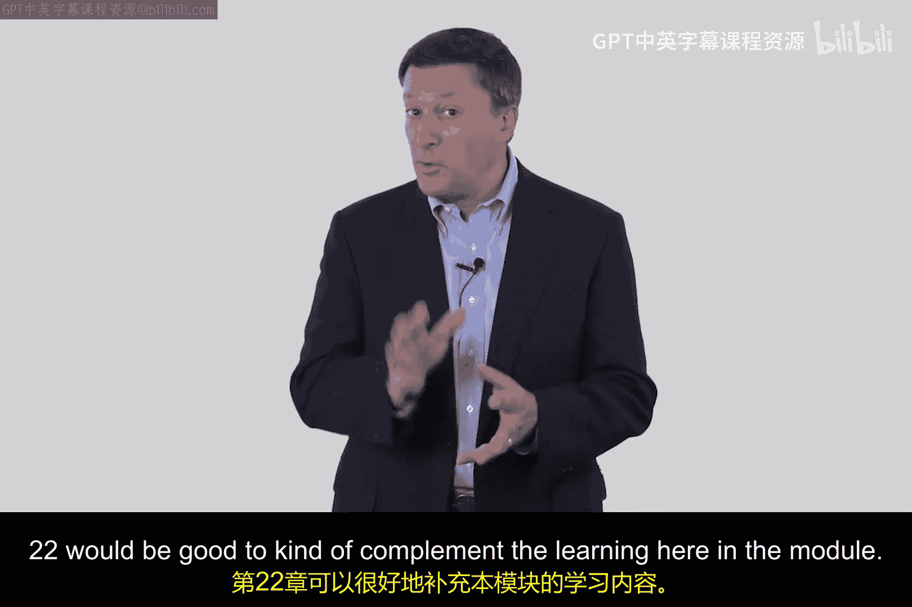
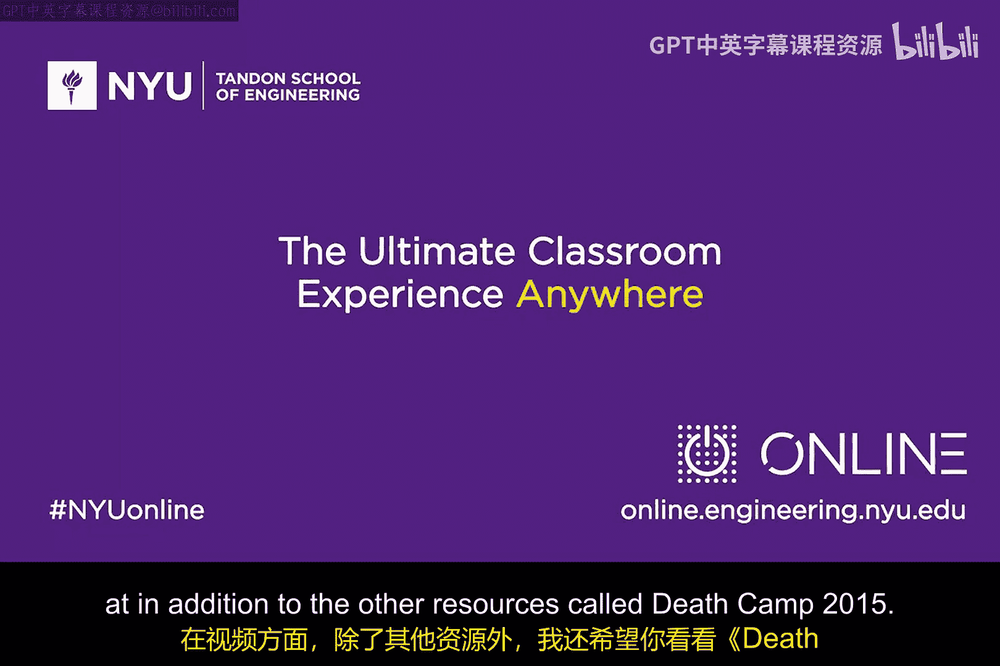

# 纽约大学《网络安全｜Introduction to Cyber Security》中英字幕（deepseek p114 25_作业与阅读.zh_en -BV1TFLZzYE26_p114-

Hi， everyone Ed Emmarosso here， and I want to welcome you to this module。

 Now the primary goal here will be to introduce some kind of advanced techniques in real-time security firewall architectures and setup and an enterprise。

 a little bit about intrusion detection intrusion prevention and security Op Center。

 It's a kind of interesting collage of very practical Meth that we used to stop cyberberts onces they've occurred or if we can do it right in advance of them occur。

 Ken would get that right。 as you'll learn。 Now there's some resources that we want you to take a look at as as you go through your learning in this module。

 a couple of papers， there are classic ones by two people are wonderful at this topic。

 one is Bill Cheswick。 Some people would say he may be the inventor of the firewall。

 I wrote a paper called an Even with Burford kind of a weird reference to an old TV show here in the United States called the Dickck Van Dyck Show in the 60s that was Dick Van Dyck had a brother。

Would sleepleepwalk and would go kind of nuts。 and he referred to everybody as Burford。

 I have no idea why some hacker decided to call himself Bford。

 but Cheswick found this guy back in the 90s and wrote a funny。

 hilarious but totally geeky paper about catching this person and literally putting this person into an Eron Ja。

 It's just a classic in our industry should totally be reading that。 and the second is a paper by。

 I think without a doubt， the most the most famous and the most influential cybersecurity female that we have in our business。

 Dorothy Denning， she's such a role model for everyone， including my daughters。

 So she wrote a paper called Is model IDS， and it's the foundation for how you do Intrusion detectionction。

 Really important paper。 It has a couple of optional books that you should look at。

 One is an optional ebook that you can grab it on Amazon。 I wrote it with my son Matt。

 It's called from CIA to AP and。

to cybersecurity should probably be around chapters 2122 for this module now in terms of video。

 there's one I'd like you to look at in addition to the other resources。 it's called Defc 2015。

 it's all about building a security operations center。 and it's a really good video。

 a lot of good practical advice in there。 And I think you should take a look at it。 Sossa。

 I hope you get started and start your learning this module immediately and I hope you enjoy it。😊。

