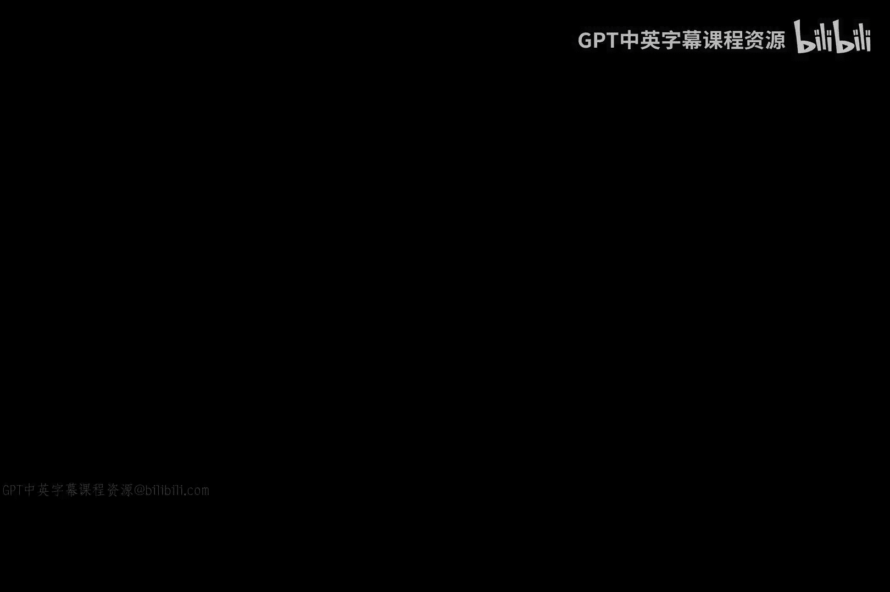
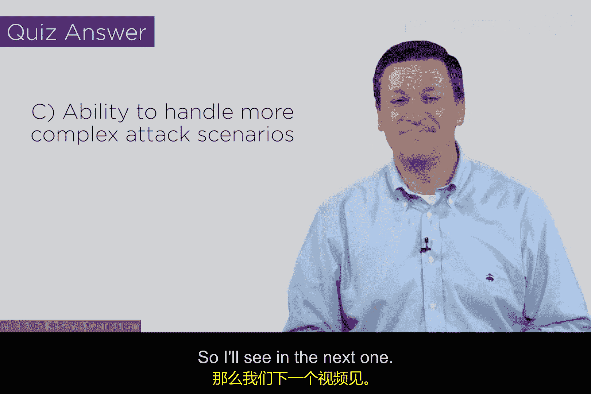
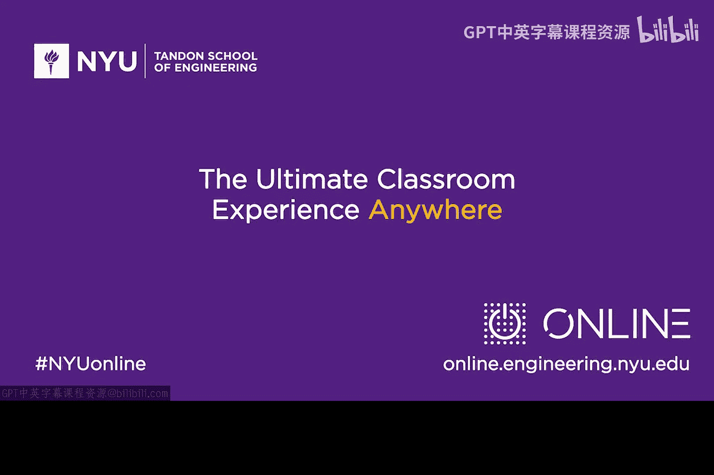

# 纽约大学《网络安全｜Introduction to Cyber Security》中英字幕（deepseek p115 26_防火墙架构第1部分.zh_en -BV1TFLZzYE26_p115-

Hi， everybody Ed I Miroso here。 So the building blocks of a demilitarized zone or perimeter network consist basically of a packet filter。

 an application proxy。 Those are the two main components that compred this thing we sort of call a perimeter network。

 and we're going to look at a few different ways that it can be arranged。

 There's some architectures that makes sense that you ought to be considering is a security engineer。

 when you're trying to protect one network from another， which。

 as we said earlier essentially definition of a firewall。 So the first option。

 the cheapest simplest option， is you get a router that implements packet filtering natively。

 And I think that's true just about every router。 it's funny when I first started looking at routers in the late 80s。

 early 90s Cisco was a company that was becoming very popular at the time。

 When they come call on you make a sales call， it was always about the speed of the router。

 the efficiency of the router， the capacity of the router。Never security。

 And then as we started to see some internet security problems pop up little but little the salespeople would start to mention security。

 they'd see it perk up。 and after about five or so years。

 we got into the 2000s when the router companies and vendors would come to visit you the first thing they'd talk about is security and then later on talking about capacity and other stuff。

 so it's kind of funny for me very vindicating but so the first architecture involves internet。

 your land and a router essentially providing packet filtering as the firewall as the network so you can have a device a routing device as your as your DMZ。

😊，Advantage， cheap， simple， easy， disadvantage， not much functionality there， right。

 You can what you can do just sort of drop or allow packets， but it has its advantage。

 So that's that sort of option one option two is you can put a packet filter in place and you can hang an application proxy off of it。

 So routers have multiple interfaces and the way routers work is they steer traffic right。

 So one possibilities you steer the traffic through the router to the land or from the land。

 depending on which direction packets headed。 Another is the router can make the decision to forward to a proxy to do something at the application level。

 So that's a second option。 What are the advantages。

 well it gives you more capabilities certainly than just a router。

 but it's a little more expensive then as you probably have seen the industry。

 this firewall industry has packaged that together into basically a product that's done pretty well for a whole bunch of years either as a。

piece of hardware that would sit in a rack at a data center or as a virtual appliance that would sit in a cloud operating system as a piece of software where the interfaces or application programming interfaces。

 As rather than network connections excepting packet。 So that's a second option。

 Third option is probably the way almost every big business， every government agency， every military。

 even more substantive organization would do it and that's to build something we would call a demilitarized zone or perimeter network and what we do that is we put one router in place facing say the untrusted side of the ecosystem say the internet you call that your exterior router and then put another router facing your land facing the stuff that you're trying to protect we call that an interior router an exterior interior and those two router share an interface and that interface that network is where you can expand and put。

Kinds of interesting components。 you put application proxies。 In fact。

 you can put application firewalls for all kinds of different protocols。

 You can decide I want to load balance all of the HtTP traffic to this device。

 I want to load balance email traffic to this device or whatever。

 it's kind of fun designing these things。 you look at the components snap things together into network but other things like an auditing mechanism you can have like a management of log files and audit trails and so on right there on the DMZ。

 but data leakage protection。 there's a lot of interesting things you can do。

 you very creative with that perimeter network。 So so the really fundamentally。

 you have these three options， a router。😊，A firewall， which potentially includes routing capability。

Or a network。 And I think most companies today realize。routers are pretty cheap。

 And if you're into virtualization。 they're not only cheap， they can be all software。

 also sitting in a cloud operating system kind of fun。

 So you put all that together and you come to the conclusion that certainly the pros of a perimeter network are that it is the most flexible。

 the most powerful gives you the most options。 The disadvantage。

 So although going to cost you the most money， and it'll be a little bit of time and effort to manage。

 So I doubt you would do that for your home。 But if you're running a little business or a mediumsd business or big one。

 then you probably want to think a little bit about a perimeter network。

 Now to test our understanding of this material， a little quiz here。

 it turns out that C is probably the best answer I know all of them。

 you can kind of make a little bit of a case for you know。

 certainly application level protocols may not be handleable at a router。

 so I'll give you some credit if you maybe be picked one of the other ones。 But for the most part。

 there's the ability to handle more complex。😊，Tax scenarios is the reason we build demilitarized zones。

 That's why we have perimeter networks in the first place。 So， so I hope you enjoy this。

 I hope you learned something about really the three stages of perimeter network design。

 We'll dig into this more in some subsequent videos that hopefully you'll stick with us on。

 So I'll see in the next one。😊。

