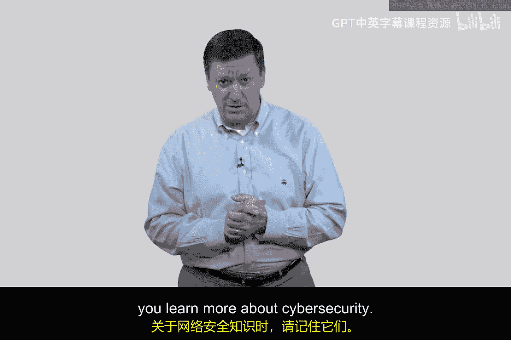

# 纽约大学《网络安全｜Introduction to Cyber Security》中英字幕（deepseek p116 27_防火墙架构第2部分.zh_en -BV1TFLZzYE26_p116-

Hi， Adam also here。 and I want to talk to you in this video about something kind of interesting。

 the idea that sometimes an architecture or a setup of the way you snap things together in a network is not advisable。

 it's not always the case。 that you can just be real creative and connect routers and networks and devices and servers and everything just sort of comes out okay Now usually when you do that wrong。

 you get chaos So a network manager will tell you， don't get it wrong because you won't have the functionality in need。

 people won't be able to connect to printers or to the internet or to each other or get certain basic services like email get all that。

 but people like myself who do cybersecur also have our set of beefs。 the things that we say， wow。

 don't do that like there's some real obvious ones。

 And I'm not even going bother with like for example。

 you don't connect to the internet with no security， no protection。

 no filtering no That's a terrible。Id I don't even think I need to explain that one。

 sometimes that's called being naked on the Internet。

 but there's some more subtle cases that I think are worth highlighting。

 just give you an idea that it's not always super obvious what types of configurations would be inaddvisable for connection to the internet。

 So one example pop up a little picture here to show you would be a case where you have two routers that a local area network are using is using to connect to the Internet。

 However， the local area network in some sense is two different segments with their own routers connected to the Internet and if you do it wrong。

 that what might happen is that that demilitarized zone that perimeter network is the shortest path from one client to one server。

On the network on the land， a terrible idea to be using a perimeter network for normal day to day traffic。

 It's the kind of thing when you're designing a DMZ， just like in the case of， for example。

 North and South Korea， DMZ that's not a place that you want to be walking to school through doesnt make a lot of sense。

 It's not for normal traffic。 So you can see on the diagram here。

 PCs servers shortest path through the perimeter network， absolutely not advisable and in general。

 what tends to happen when you're designing these types of things is something you can take to the bank。

 here's a thought that I want to make sure that you have in mind。

The level of complexity that you introduce into a network。

iss going to be inversely proportional to the protection。

 which means you get way complex and you're going to have problems from a security perspective as you simplify。

 as you bring the complexity down， you will bring the security up。 that is almost always true。

Granted， connecting to the Internet without security all is the simplest case。 That's an absurd case。

 set that aside。 But complexity tends to be the problem。

 We have a little diagram here that sort of shows you the idea that you can have in a network。

 It's possible to have a very simple perimeter。 If you had， for example。

 one connection to the Internet。 that's a case that makes good sense。

 You'd like to somehow have that。 The problem is that most businesses have these complex requirements for connecting all over the place。

 They're connecting to outsourcing providers and third parties and your customers and your employees are all working from home or from the local coffee shop。

 and you have all these gateways。 and you end up with not just a complex gateway of complex perimeter。

 But you have many of the multiple distributed gateways， Good luck keeping track of that， right。

 So the idea here is that same smaller organizations or smaller workloads。

Tend to be a little bit easier to protect than larger organizations with more complex requirements。

 What this hints at。Is a basic design property namely if I have a big complex organization and I don't have an easy way to protect it。

 is there a way for me to break big into small Now as a classic concept that I remember studying when I was in graduate school came from Edgar Dykstra probably the greatest computer scientists of all time and he would lay out these architectures for distributing things in the 60。

70s and 80s， computer scientists were realizing that dis communication amongst cooperating。

 coordinated processes was the most powerful weighted design computer systems and networks。

And he had this image of elephants and mosquitoes and I always that there was a really wonderful way of thinking about things that an elephant is a big blob of something from a security perspective。

 boom， I can take an elephant out with a gun sorry for the image。

 But if you break the elephant up into a bunch of mosquitoes， it's more resilient。

 it's harder to take out， you have to make sure you coordinate the communication。

 but the protection of each of those mosquitoes is going to turn out to be much easier to do。

 So keep that in mind as you think about distributed architectures and this concept that with perimeterters architectures that are illad that don't make sense。

 don't connect the internet with no security， don't you know have these paths that you draw through a DMZ and there may be other ones that you could come up with。

 and similarly， when you have too many of them then it becomes extremely difficult to coordinate to ensure that theres a common uniform policy and really just to manage in general。

😊，These are some useful guidelines that you'll keep in mind as we go through and as you learn more about cybersecurity。

 so I hope this has been helpful to you。

