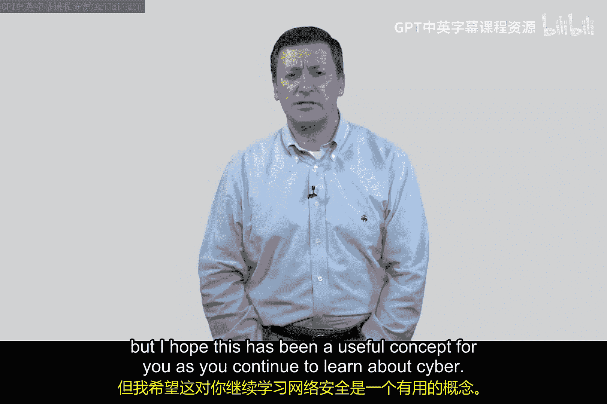

# 纽约大学《网络安全｜Introduction to Cyber Security》中英字幕（deepseek p119 30_入侵检测基础.zh_en -BV1TFLZzYE26_p119-

Hi， everybody at Amarosso here。 And I want to spend some time with you giving the basics of a discipline known as intrusion detection。

 Now， I got very excited about this in the mid-90s。

 I'd sort of first seen these devices that were popping up from some commercial companies。

 There was one called the W group。 They had a product called Ne rangeangr。

 There was a company called IsS later bought by IBM。

 They had these devices called real secures and a bunch of others in the 90s。

 And what they would do basically is they would take data that was fed to them。

 I called it essentially packet collection or sniffing。

 take the data and try to make some determination based on a set of signatures。

 So predetermined descriptions of attack patterns that we would code right into the intrusion detection。

 or we called them IS。😊，We code right into the Is。 And then with ding alarm。

 mean there's basically if we four steps that we saw you can kind of diagram here that kind of lays them out。

 So in an example， you can see that the first step is there's some attack activity that goes on and we can say。

 for example， it might be a user like guessing a bunch of passwords kind of in the second step concurrent with that。

 there's the Is is pulling the traffic from this。 You know it's detecting what's happening as the server sends back you know。

 a bunch of incorrect notices hey， Alice says， hey， my password， Bob says no， Alice's password。

 Bob says no so the Is is watching this。 And then based on a signature that we might have written that says you know how many you would guess 3。

5， we'd say， hey if you ever see three， let's say3。

You guess your password wrong within a very short period of time dinging a bell。

 Does that makes sense it seems very straightforward。 And I certainly got excited。

 I thought this is a really good idea because why not， You know， what can it hurt Just， you know。

 you can passively sit on a network。 You can do it in kind of a stealth mode。 Now。

 let's remember what stealth means。 stealth means you're not being obvious or upfront about the fact that you're there。

 You're just very quietly latching on the packets and you're observing activity and dinging a bell if something looks like it's not really following whatever policy you've set up。

Kind of an interesting concept。We'll get to in some subsequent discussions the real weaknesses associated with signatures。

 But for now， let's concentrate on some of the value。

 one is that there's two ways that this can be implemented on a typical system。 The first is。

 as we've shown， we call that a network intrusion detection system， Nds and Is。

 second possibility is you can embed this capability right into a host。

 and we call that HiIs host intrusion detection system。 So NIs sits on a network。

 HiIDs sits on a host。 Both of them collect data。 Both of them have signatures。

 both observe traffic or compute activity， and both if a signature is matched will notify some security server or the security team or sound bell。

 So you follow a pretty simple sort of case for how that would work right again。

 I wrote a big textbook about this in the late 90s。I was again， so so excited。

 I thought that this was going to change cybersecurity in some sense it did。

 and it's still the vestige of this is still there。 Let's look at our next chart。

 This one gives you an idea of you know passwords and let's look at how the progression。

 the time progression against the signature would work on a network or a heads。

 I mean we just call it ideas。 So the first thing if you represent time is sort of this vertical arrow going down in time。

 you can see that at some initial time password is guess at some time T plus you know whatever deelta t later time。

 a second password is guess third would be that password is guessed a third time we see that within a minute and we know that if we're detecting what's going on here within the minute then you know we're in pretty good shape however。

If the passwords are guessed。Over a period of time， that maybe extends out a little bit。

 so think about that。I guess one bad。Then I guess another bad。

 And then I wait6 hours and guess the third one。 The question is。

 would the I D S after an hour just go give up and say， All right， whatever it is was gone。

 Fort to clear the cash。 clear the buffers were good。 And then you guess the third time。

 But it's sort of outside the the pattern or the signature you've decided。

That gives you a hint as to one of the challenges we have。 And again。

 subsequent discussions will dig more deeply into this。

 But the idea is that you want to develop signatures that are going to match the attack。

 So you could make the case that heck， if I'm telling an attacker。

 they have to wait six hours or some long period of time in order to be outside the signature。

 Then maybe that's fine。 In fact， maybe that's what cybersecur is all about。 just making an attacker。

 change their behavior in order to to， to， not be caught in some signature that I've designed。

 when we change that behavior。 what we call that the word we use is variant。 do you follow。

 So an attack。Either matches or doesn't match a signature。

 One of the ways it might not match a signature is that the attack was specifically changed or extended in time。

To not match a signature that might be time bound。The bad guys would say， ha ha ha。

 I developed a variant to get around your signature。 The good guys would say， ha ha ha。

 I made you change your tactic。 Does that make sense。

 So therere both could make a case that they're sort of doing the right thing。

 It's that whole cat and mouse that we see in cybercurity。

 very interesting way of thinking about you know， this。

 how Is effective or potentially easy to get around。

 So just sort of as an additional consideration here as you think through and reflect on your learning。

 I want you to think about the relative effectiveness of that kind of thing dealing with variance or not on a host on a network。

 Like which do you think would be a more effective place or does it really not matter。

 Like if I wanted to let's， let's say we're thinking of ourselves as the defender。😊。

And I want my IDS to be super effective。Do you think it's easier to detect variants on a network or is it easier to detect variants and a host。

 How't you think about that， I think you may come to the conclusion that it's sort of doesn't matter。

 And in fact， a lot of times in cybersecurity， The underlying technology is less important than the foundational items。

 That's why on these videos as we go through them。 I always try and pull out something that I think is fundamental。

 And the fundamental issue here is that concept of variant。 attacker changes behavior。

 Defenders please that they made the attacker change behavior。

 but the attacker might be pleased that they can get around your signature pretty easily。

 Well come back to that in subsequent discussions。 But I hope this has been a useful concept for you as you continue to learn about cyber。

