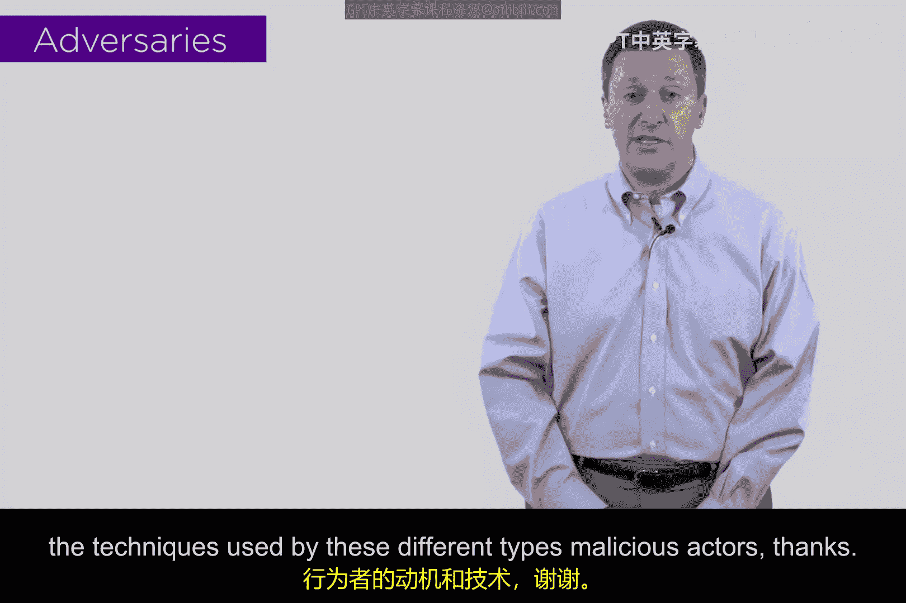

# 纽约大学《网络安全｜Introduction to Cyber Security》中英字幕（deepseek p12 12_对手类型.zh_en -BV1TFLZzYE26_p12-

We're going to take some time now and think about adversaries。 Now。

 what that word means is someone that in a sense is your。Like opposing party。

 someone that may have malicious intent with respect to you when， when two groups don't get along。

 they're called adversaries， when they fight when they're opposed in some whatever reason。

 Call them adversaries and cybersecurity is all about that， right。

 cybersecurity is not about you know， earthquake or an inadvertent piece of code causing a problem。

 that's not cybersecurity， cybersecurities about malicious activity。

 something that's intentionally done。 So we want to talk through really the four types of quote。

 unquote， actors that are involved in causing problems。 Now。

 the first one is what we would call a hacker。 Now， I believe that most hackers。

 young people are mostly of benign intent。 I think when people have this joy of breaking into things and learning how they work and piecing them apart getting in。

 they do that for love of technology。 And I think certainly the least。😊，cerning to me。

 but I think you have to be careful because hackers can get themselves in a lot of trouble when they break into things and maybe inadvertently cause a problem。

 but certainly along the spectrum， a hacker should be someone that's helping all of us understand the problems that exist in our system。

 so that's sort of the first type。The second type is criminal。So it's a little different， right。

 criminals somebody who wants money， there's good stealing things I mean。

 there's no other way to put it somebody somebody be stealing your credit cards and putting them up on the dark web or something for sale。

I think we all know what the motivation is there， right， it's money。And there's no two ways about it。

 That is malicious。 And there's no question。 That's an adversary， right？

 I hope none of you are doing anything like that。 If you are don't。

 lawaw enforcement's getting real good at detecting that sort of thing。 and crime does not pay。

 So I think that second type， a criminal is certainly more malicious。

 And keep mind that this is something that as long as we've had money， We've had crime。

 The thing that's changed is that money is now online， right。

 Your credit card is something used all the time online。 And increasingly。

 you see bitco and things being used， fact in some later lectures later in our session。

 I'm going to take you through how blockchain works really kind of cool。 But anyway。😊。

Criminals are the second type。Third would be politically or philosophically or even religiously motivated hackivists。

 So those are groups that have some message that they're really passionate about。

 And I'll be honest with you， in many cases， it's a perfectly legitimate message。

 They' are people who are outraged at injustices， and they use hacking as a way of expressing their outrage。

 Now， and be careful this viggiilantism is not acceptable in most societies。

 but it's certainly a third clear type of malicious actor that we need to be aware of。

 So this one's tough because， you know， sometimes like with the group anonymous。

 that's probably the most famous group of， say， philosophically motivated hackers。

 sometimes they'll do things that you might be agreeing with and cheering on。

 Other times they might be doing things that you would absolutely not agree with under any circumstances。

 But a more unpredictable group， and they certainly have。Mo that are a little different。

 That's the third。 The fourth and most intense is the nation state actor。This is a tough one。

 This is when military groups。Use cyber hacking， use vulnerabilities and systems as a means。

For warfare。For achieving military objectives， this is a disturbing kind of situation because these are usually well funded groups。

With all the resources that are available， lots of time and generally a lot of patience。

 this is something that we need to be concerned with as a group。

 If we were all together as a learning community right here in the room。

 I'd make you raise your hand and promise that you're not going to be any of the four there that you're going to be a defender。

 I mean， I think that's a much more noble pursuit。 and that's what we'll be emphasizing through these entire sessions。

 it's more about defense。 And I want to stay on this point for a minute。

 Most of you think of cyber security as hacking。 And I will tell you that it is 10 times more difficult to think through defenses than offensive hacking。

 If you tell me that you can sit around and fiddle around with something and break into it。

 you've not impressed me at all。But if you tell me that you've come up with a way to protect that system。

 then you have my attention。 And I want that to be something that sinks in。

Hacking is not cybersecurity。 It's component。 There's no question that there's a place。

For penetration， testing， a system looking for soft spots。 But as we've said a couple of times now。

 testing is a terrible way to demonstrate the absence of a problem。Terrible way。 Now。

 a dimension of these four malicious adversaries that we talked about。

Is called attribution that means。Do they care about getting caught if I can attribute attacks to you。

 then I have this attribution property in your tax。

 so let's let's take a little quiz as a group here just to test our learning with respect to the four types again。

 hacker， criminal hackivist nation state Now for those four groups。

Who do you think would be the most concerned about attribution， meaning I don't want to get caught。

 And who do you think might be the least concerned。 Now， let's take him in turn， hackers。

Probably don't want to get caught， right， Probably pretty motivated and I can go up。

 But there's also the balancing argument that they're probably not trying to bring down planet Earth either。

So a might be high on the scale of not wanting to be caught。 How about criminals。

 No question about it。 They don't want to get caught。 That's the whole idea。 when you're a criminal。

 You don't want to get caught。 In fact， I'd put them as number one and not wanting to get caught。

How about the hackivs， do they care about getting caught？Maybe not， right。

 If you're trying to get your point across， you may be raising your hand saying I did it。

 I that's the whole basis for terrorism， right， Ter for the most part。

 is not something that you hide from， But rather， you accept full attribution for what's going on。

 So I'd put the hackivs in the category of generally being less concerned about getting caught。

 And then nation state kind of in the middle there， right， no need to get caught。

 but if you do get caught， Rayy， what are you going to come arrest me I'm a government and I'm a military and I go after another country。

 I may be doing it in full attribution， or I may want to do it quietly。

 So think about that as we go through the cybersecurity attribution is a much more complex topic。

 And it's a nice way of helping us to understand the motivation and the techniques used by these different types of malicious actors。

 Thanks。

