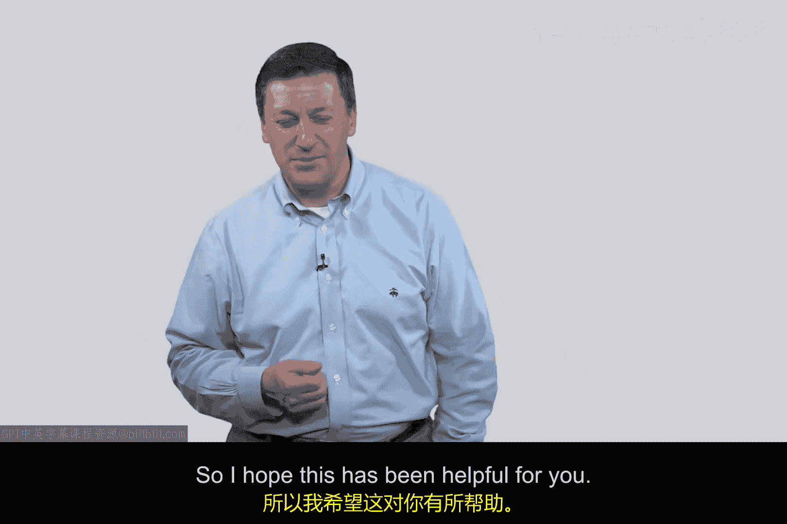

# 纽约大学《网络安全｜Introduction to Cyber Security》中英字幕（deepseek p121 32_IDS与IPS.zh_en -BV1TFLZzYE26_p121-

Hi folks at Emmarosso here， I want to talk to you in this video about two basic techniques for doing detection and making some sort of security determination。

 we call these techniques first， intrusion detection or intrusion detection system。

 IDS and a corresponding capability called intrusion prevention or IPS intrusion prevention system。

 so IDS， IPS， I want to explain the difference。An I S is something that we think of as a passive device in the sense that it collects data。

 but it will never climb in the middle of Alice and Bob or any interaction as or pure arbitrator。

 meaning it's going to observe。 Think of it as a camera。 It's collecting data。

 It's collecting a videotape in some sense of what's going on。

 And there might be a whole bunch of processing going on。

 Think of it offline processing going on offline。 and I might notify somebody。

 I might call the manager， I might call the system administrators。

 I might call all the users based on what I see。 and let them do what they're going to do。

 But the I D S itself。Doesn't do that natively now。The late 90s， early 2000s。

 a lot of people noticed that a very common thing that would happen is that Alice would be attacking Bob The intrusion detection system。

 IDS would see Alice attacking Bob， the client attacking the server let's say it's a probe and and I know the I address for the client is 192。

1。2。3 and I see the probe and the IDs sees it and goes I I know something going on this is not good。

 you know I need the do something about this and what we all noticed is that these IDss were resulting in a human being being notified the human being would then go to the firewall and manually key in a rule that would block IP address 192。

1。2。3 and that might take minutes hours days， whatever human being。So everybody went，huh。

If that's one of our big use cases。Why don't we just automate it， so it was like this？The client。

 Alice， 1921。2。3 is doing some scanning， it's a successful scan， a probe， whatever。

The ID detects it and thinks。Well， why do I need to call a human and call the firewall and do all this stuff。

 Why don't I jest？Block that IP address。And thus was born the concept of an I S。

 We call that blocking a shun。 It's an I P address shn。

 So what happens is the I S becomes more actively involved in the engagement between the client and server。

 actively engaged and almost like a firewall， In fact， as a firewall。

 based on the detection component of the device。 So you can think of it as kind of two states。

 The client and the server are connected through these IPS。 The client is misbehaving。

And the IPS has a component that's essentially an IS。 It sits in line now。

 I'm not talking about glumping on with alligator clips and sitting passively offline。

 I'm talking about sitting actively in line now， maybe right in front of your firewall。

It's matching signatures， profile， whatever's doing， probably signatures。

Sees that the probe is happening in state S sub I。 It comes to the conclusion that there's too much probing going on。

 puts a rule into its own sort of pass through semantics。

 So it's taking packets in and passing packets out， it'll have a rule very similar to a firewall。

 that'll shun， meaning， all right， if I see anything more coming from that source I， I'm dropping it。

 I'm not allowing it to proceed。 So puts an auto shun。 Now， think about that。

 What are the pros and cons of that。 The primary pro。 Well。

 I don't have to go call a guy ring a bell。 somebody changes the firewall。 You know。

 that whole loop is kind of lost。What's the con that that loop is lost？

What do we know about the Internet， We know that you can spook your source I。

 So it's possible if you're doing something like a S flood where I don't need the return Sinac packet。

 So I can make believe if I'm Alice that I'm somebody else。 And let's say I'm saying I'm George。

 And maybe I want to really make sure George can't connect to this server。 I know George's I address。

 So I change it to George's I address。 I start sending S you know。

 flood packet and traffic through the I。 It gets annoyed with what it's seeing boom。

 It puts a rule in that will block George's source I from hitting the server。 Do you follow。

 It's a way of， in some sense， tricking the I shun mechanism into locking out a victim from gaining legitimate access to a server。

 It's a weakness in Is。 In fact， it's such a significant weakness。

That if you talk to a lot of security teams， they'll tell you they run their IPS。In。Passive mode。

 So it's basically an I and I'm laughing because you pay a lot more money for an IPS than I。

 You're paying， you get all this extra functionality。

 you but a more expensive license and you put it in place and you're just running it in a mode that's essentially the cheap thing and be like buying a car。

 never turning the radio on so maybe that's okay because I do think in some sense。

 is' valid criticism about Is。 might be a little too dangerous to have these things just sort of willy knowy。

 making decisions about traffic that should be dropped， but again， if you buy it and you like it。

 you probably should be using the thing if you pay the money for it or just buy yourself an I。

 So I hope you get the difference passive and active the IPS is clearly vulnerable to this shun spoof problem。

 but it also when it's working right does save a lot of steps， a manual steps that saves a lot of。😊。

Time IDS versus IPS， something you should be very aware of if you want to be a cybersecurity expert。

 so I hope this has been helpful for you。

