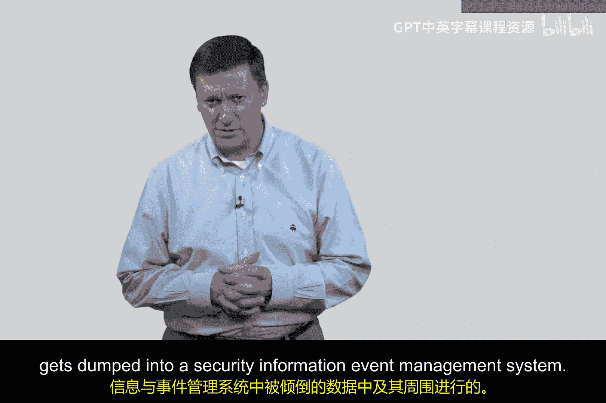

# 纽约大学《网络安全｜Introduction to Cyber Security》中英字幕（deepseek p122 33_SIEM设计.zh_en -BV1TFLZzYE26_p122-

Hi everybody at Ammarosso here and in this video I want to talk to you about something called a SIM SIEM security Information Even management System。

 SIM。Here's what this is， it sort of is the result of cybersecurity teams working in enterprise or government。

 defenders。Noticing that lots of things generate audit logs。

 right if you've been with us since previous videos。

 you'll know that we talked about how operating systems can generate log files， right。

 We talked about how applications like your browser can generate information about activity。

 We talked about how networks can generate information。

 and it might be internally generated externally。 So you get all this stuff flying around。

 all these logs。In the worst case， you'd have some tool that would help you make sense of each audit log that would be different for each log。

 So， you know， wonder your application that does this and that， another for another application。

 another for your operating system， a bunch for network yet of all these tools all over the place trying to make sense of audit logging and and an activity。

 And we talked also in some previous videos， about the concept of security hunting， threat hunting。

 So the thread hunter might have， you know，50 screens around the table trying to make sense out of all these logs。

 that's kind of crazy。 It doesn't make sense。 So we started to see in our industry was the design of something called Sim。

 And here's what a s is。 It has the ability to translate to a common data model。 All of these logs。

 So here's the idea。😊，Sa an application system is generating log information。

 If I fed it into a Sim where I have a connector that takes the log information and creates some standard template。

 What happened， What time， What system is it from。 What's the relative threat estimate for this Im not and on for all these things I can put it into a standard template。

 and let's say I also on some operating system， some Linux system that's spitting audit log information in a totally different format If I can build a translator sometimes called a connector as well。

 a connector that will take that data， put it in the same format， What happened， who did it。

 time you whatever fields I'd said previously， you can do that all the same you have a common data model with multiple feeds that are heterogeneous or different or diverse。

 they come from different places。 But if I can dump it and spill it into one common model then the threat hunter can compare。

Things like my application see some weird hacking going on and it happens to be coming from some place on the Internet。

192。1。2。3 notices that and it's in the application log and I dump it into the Sim。

 The operating system which had nothing to do with the application might even be the app runs on some other system。

 this O might see hacking also at its kernel coming from 192。1。3 right。

 how interesting is that the Sim then could you hunter could say， hey。

 tell me any IP address that looks like it's hitting two or more things and boom immediately you'd see that I address is hitting this and hitting that and I get it because I have a common data model。

 That's the power of a Sim。 It's really good idea。 Now。

 what do you think would be hard about running a SIim。Developing connectors， right？

All this stuff all over the place。 I have these apps and mainframes and systems and mobiles and tools。

 and it seems like when you're running an environment that has a SIim。

 all you're ever doing is connectors now vendors who sell these tools market their capability based on their preintegration with other types of things that you might have Now you can imagine that with cloud。

 it's not just systems you're connecting to。 but it could be these as a service。

 virtual capabilities like Office 365 and Amazon Web services and other things that I also have to somehow ingest into the Sim。

 it turns out it's kind of complex。 and we show a diagram here that just shows all sorts of different things。

 servers and apps and firewall and Is and other Sims and all of this。

 And then what comes out of the Sim is the ability to do analysis。

 incident response and and certainly to generate。😊，ReportSo is a powerful tool。

 it's something that by all means if you work in an enterprise environment， you will have a SIM。

 you may have many of them and the typical threathuer does most of his or her work in and around the data that gets dumped into a security information event management system hope this has been useful See in the next video。

