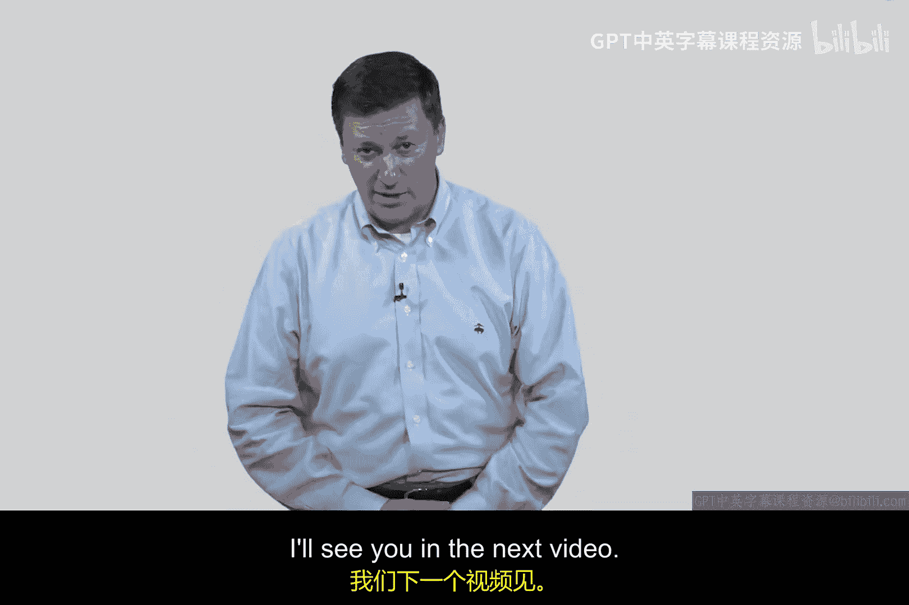

# 纽约大学《网络安全｜Introduction to Cyber Security》中英字幕（deepseek p123 34_SOC设计.zh_en -BV1TFLZzYE26_p123-

Hi， everybody at Ammarosso here。 And in this video。

 I want to talk to you about a facility concept that exists in most companies now。

 certainly bigger ones。 It's called the security operations center。

 And I got to tell you that if you work， say in the military or in a big place， a big bank。

 there is nothing more exciting。 Then walking into a physical facility。

 where perhaps data is rendered up on screens on wallboards and there's people working。

 doing analysis threat hunters working together， scarcurring around on the floor， you know。

 comparing notes on their analysis activity really gets the adrenaline up。

 I first started seeing this sort of thing and telecommunications kind of in the 80s。 And I loved it。

 I thought that just the imagery and the excitement and the adrenaline of being able to collect all this data and make realtime decisions was perfect for cyber。

 So I personally was very involved in kind of the。😊。

Evolution of the design of security operations centers I've been doing for many， many。

 many years and know a lot about how it works and how you actually do something like this。 Now。

 I want to give you a couple elements of more or less how a sock works and what you would experience if you were in such a thing now as we've talked about the concept of collecting data having lots and lots of data from which we try to derive intelligence is absolutely essential to the cybersecurity puzzle right we've said。

 yeah， we want arbitrating components like firewalls， and yeah。

 we want to be preventive like with cryptography。 but if that stuff breaks。

 I want to watch what's happening and take action if my preventive activity has not worked So you were monitoring you're watching so the data comes in and you're doing some sort of analysis based on this Now most security operation centers。

 think of what they're doing kind of to。There's internal information。 So if you're a sock for a bank。

 then there's data that's coming that's coming directly from the infrastructure that you control as a bank。

 It's your firewalls， your systems， your logs， your applications， all your stuff。

 And you can think of that as private， right， That's not something that you're out spilling out on the Internet。

 although a lot of people talk about the idea of sharing threat information。

 that's for another discussion。But you have internal logs and records and data。 But correspondingly。

 you also have external data that you're pulling from the Internet that you're pulling from your vendors that you might be learning from customers。

 In fact， you may be pulling it from your third parties。 you could have suppliers， vendors。 you know。

 all these other companies that help you support， help you in the support of your mission。

 So Assac has to pull things internally。And make sense out of it externally and makes sense。

 And what we refer to that as the term we use to refer to that is all source data collection and correlation。

 Let me say that again。 when I'm pulling internal and pulling external we refer to that as all source。

 okay you see that term a lot in the context of security operation design。

 another term you see sometimes is fusion where I'm fusing things that are coming from different sources。

 a big fusion center is one where data with deferring characteristics。

 differerring attributes is put together into a common data model along the lines of what we saw when we studied the way a security information event management system。

 a Sim works。 So all these things are so symbiotic data collection。

 internal external you probably have a lot of signatures that are embedded into the operations of a so。

And you're going to also clearly be doing management by exception in the little diagram that we show for you。

 the icon shows some wallboards with some little scribbles there。

 and typically the scribbles are things thatll show predicted behavior and when we see deviations from the norm。

 we take action from the floor of a security operation center I want to encourage any of you。

 if you're getting into cybersecurity as a discipline， working in a security operation center。

 something that everyone should have the experience of if you want to be well balancedance in your understanding of cyber。

 just the idea of learning to collect data and to make real-time decisions about what you see。

 sharpens your understanding of how cybersecurity systems work and also sharpenens your understanding of the way computing and technology works。

 I can think of no better， say internship for a young person and if you can get your hands on that kind of internship by all means go do it。

 and you know the bigger the place the better。Because fusion centers tend to be better when there is more data。

 again， that's such a fundamental statement。 Let me say it again。

 Fusion centers generate better and derive better threat intelligence when there is more data then less right。

 if I know that it's raining in this town in that town， but I know nothing else。

 and I want to make some broad statement about weather。 Well。

 then I just know about this town in that town。 But if I have data from every town in every state in every country。

 the weather， I can make amazingly accurate statement about weather I can see patterns I can see shifts。

 So the more data the better internal external fuse it all together driving in a Sim make realtime decisions。

 very exciting work。 and I hope that you have the experience at some point in your career to work in an active and vibrant security operations center。

 I'll see in the next video。😊。

